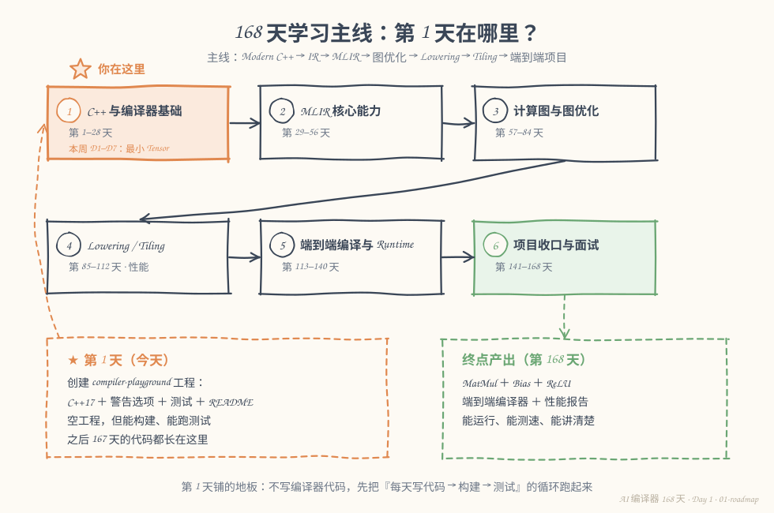
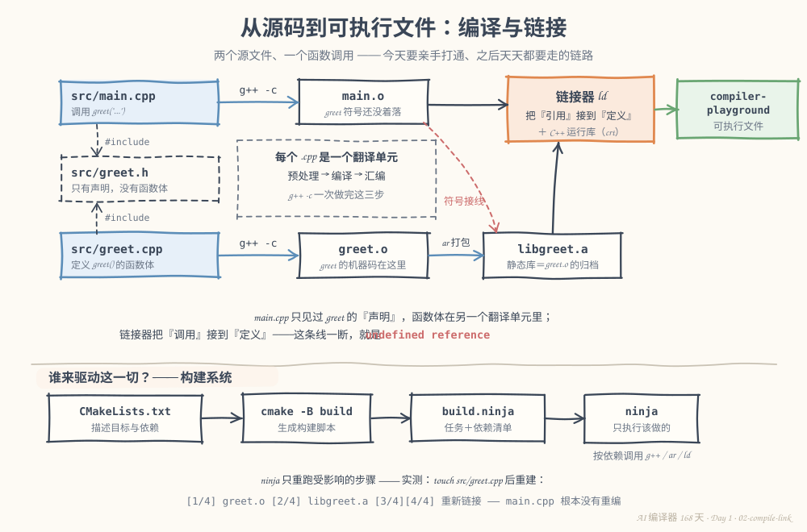
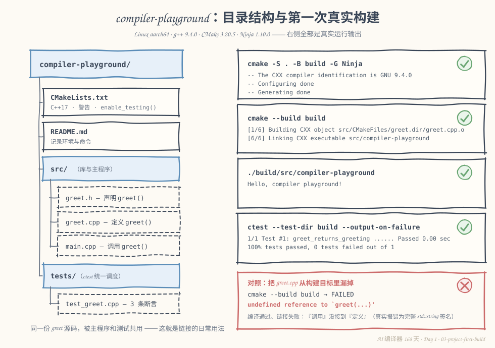

# 第 1 天：搭好 compiler-playground——让代码每天都能“构建 + 测试”

> **今日目标**：能亲手把多个 `.cpp` 文件变成一个可执行文件，并讲清楚中间发生了什么；创建 `compiler-playground` 工程，从零跑通 `cmake → ninja → ctest` 的完整循环。
> **预计时间**：学习 30 分钟 + 实践 45 分钟
> **前置准备**：一台 Linux 机器（或 WSL）；会打开终端、能用编辑器保存文件；不需要任何编译器基础。
> **今日产出**：一个可构建、可运行测试的空工程 `compiler-playground`，以及记录环境命令的 `README`。

## 1. 今天解决什么问题？

明天你就要开始写编译器了。第一个拦住你的问题不是“编译原理”，而是三个非常朴素的问题：

1. 我写了 3 个 `.cpp` 文件，怎么把它们变成一个能运行的程序？
2. 改了其中 1 个文件，为什么不想把全部重新编一遍？
3. 以后每天写的代码，怎么知道没被我改坏？

这三个问题分别对应今天的三个主角：**编译与链接**、**构建系统**、**自动化测试**。它们是之后 167 天每天都离不开的地板——地板不平，后面每天都会崴脚。

全文用同一个贯穿例子（今天是它，明天还是它）：

- `src/main.cpp`：调用 `greet("compiler playground")` 并打印结果；
- `src/greet.cpp`：真正定义 `greet()` 函数的函数体；
- `src/greet.h`：声明 `greet()` 的签名，被上面两个文件 `#include`。

**输入**是这三个文件，**操作**是“编译 + 链接”，**预期结果**是终端打印 `Hello, compiler playground!`，并且一条测试命令告诉你 3 条断言全部通过。

## 2. 先看全貌：第 1 天在哪里？



**图 1**：六个阶段构成 168 天主线。注意左下角的橙色框——今天不写任何“编译器代码”，产出是一块能构建、能测试的空地板，之后所有代码都长在这块地板上。

用 5 步描述今天的全局流程（第 4 节会逐步展开）：

1. 写源码：`main.cpp`、`greet.cpp`、`greet.h` 放进 `src/`；
2. 描述构建：用 `CMakeLists.txt` 告诉构建系统“要生成哪些目标、依赖谁”；
3. 生成构建脚本：`cmake` 读取描述，生成 `build.ninja`；
4. 执行构建：`ninja` 按依赖关系调用 `g++`、`ar`、`ld`，产出可执行文件和测试程序；
5. 跑测试：`ctest` 统一调度测试，报告通过/失败。

## 3. 核心概念：先用直觉，再给准确定义

### 3.1 翻译单元：编译器一次只看一个 .cpp

一句通俗解释：编译器读代码的单位不是“整个项目”，而是一个个 `.cpp` 文件，每个 `.cpp` 连同它展开后的 `#include` 内容，叫一个**翻译单元**（Translation Unit）。

生活类比：一本书由多位作者分章独立写作，谁也不看别人的手稿，只遵守一份共同的“术语表”；最后由编辑部装订成册。

**对应到技术上是**：每个 `.cpp` 独立编译成**目标文件**（`.o`），里面是机器码但还不能运行——里面对外部函数的调用只是“记了账”。`.h` 头文件就是那份“术语表”：它只声明“有这个东西”（比如 `std::string greet(const std::string&)`），不提供实现。

类比边界：头文件不是“复制给别人看的章节正文”，而是**契约**。编译 `main.cpp` 时，编译器完全看不到 `greet.cpp` 的内容——它只检查“你调用的函数和声明签名是否匹配”，仅此而已。

最小例子（在任意目录手工验证，我实际执行过）：

```bash
g++ -std=c++17 -Wall -Wextra -c greet.cpp -o greet.o   # 只编译，不链接
g++ -std=c++17 -Wall -Wextra -c main.cpp -o main.o     # 同上，两个 .o 互不知晓
g++ main.o greet.o -o playground                        # 链接：把账对上
./playground
```

真实输出：

```text
Hello, compiler playground!
```

### 3.2 链接：把“调用”接到“定义”

`main.o` 里有一条记录：“我在某处调用了 `greet`”。`greet.o` 里有另一条记录：“我定义了 `greet`”。**链接器**（Linker，Linux 上常用 `ld`，`g++` 会代为调用）负责把两边接上，再补上 C++ 运行库，最终产出可执行文件。

这条“接线”一旦没接上，就是你未来最常见的报错：`undefined reference`——编译明明通过了（签名和声明匹配），链接却失败（找不到定义）。第 6 节会真实复现一次。

### 3.3 CMake 与 Ninja：一个写菜谱，一个炒菜

直接手敲 `g++` 在文件变多后立刻失控：改一个文件要重敲全部命令、依赖关系记在人脑里、换个平台命令还不一样。

生活类比：**CMake 是菜谱，Ninja 是照着菜谱炒菜的厨师**。菜谱写“做一盘 compiler-playground 需要哪些原料（源文件）、按什么火候（C++ 标准、警告选项）”；厨师拿到菜谱后只做该做的菜。

**对应到技术上是**：`CMakeLists.txt` 是声明式的构建描述；`cmake -B build` 读取它，**生成** `build.ninja`（一份精确到命令的任务 + 依赖清单）；`ninja` 读这份清单，比较文件时间戳，只重跑受影响的步骤——这正是“改一个文件不全量重编”的实现方式。注意 CMake 自己不编译任何代码，它生成别的构建系统的脚本，所以叫“构建系统生成器”。

### 3.4 项目边界：这个工程要长成什么

终点很明确：第 168 天交付一个 `MatMul + Bias + ReLU` 的端到端编译器，带正确性验证和性能报告。今天**不**设计 IR、**不**装 MLIR、**不**写任何算子——只立目录约定：

```text
src/    库和主程序：今天的 greet，以后的 IR、Pass、Lowering
tests/  单元测试，由 ctest 统一调度
build/  构建产物，随时可整个删掉重建，不入库
```

克制也是今天的产出之一：一个空但干净的骨架，比一半能用一半猜测的“半成品架构”值钱得多。

## 4. 图解核心机制



**图 2**：上半部分是编译与链接的数据流，下半部分是构建系统如何驱动它。看图时关注那条红色虚线——它就是第 3.2 节说的“符号接线”。

按图中的关键位置逐步讲解：

1. **两个蓝色框（`main.cpp` / `greet.cpp`）各自向虚线框 `greet.h` 发出 `#include`**：头文件被“复制”进每个翻译单元，让两边对 `greet` 的签名达成一致。发生了什么：编译 `main.cpp` 时编译器看见了声明；为什么需要：没有契约，两边对同一函数的理解可能不一致。
2. **两条 `g++ -c` 箭头**：每个 `.cpp` 独立经过“预处理 → 编译 → 汇编”成为 `.o`。`main.o` 里的 `greet` 调用此刻只是“记了账”（重定位记录），并没有函数体。
3. **`ar 打包`箭头**：`greet.o` 被归档成静态库 `libgreet.a`——本质是 `.o` 的集合，方便复用。今天的主程序和测试程序都会链接它（图 3 左侧目录里能看到这种共用）。
4. **橙色框（链接器 `ld`）**：把 `main.o` 和 `libgreet.a` 接线，补上 C++ 运行库，产出绿色的可执行文件 `compiler-playground`。红色虚线标出的“符号接线”如果断了，就是 `undefined reference`。
5. **下半部分（构建系统带）**：`CMakeLists.txt → cmake → build.ninja → ninja`，ninja 按依赖调用 `g++ / ar / ld`。图底部那句 `touch src/greet.cpp` 后的 `[1/4]` 是第 5.4 节的真实实验结果：只重编 `greet.cpp`、重新打包和链接，`main.cpp` 根本没有重新编译。

## 5. 动手实践：完成一个最小可运行例子

> 本节所有命令与输出都在下面这台机器上真实执行过：
> Linux aarch64（Ubuntu 20.04）· g++ 9.4.0 · CMake 3.20.5 · Ninja 1.10.0。
> 完整工程存放在本仓库 `tutorials/day-001/examples/compiler-playground/`，你也可以按下面的步骤自己敲一遍。

### 5.1 准备目录和依赖

安装依赖（Ubuntu/Debian；我在本机实际执行了第二条）：

```bash
sudo apt-get install -y cmake ninja-build g++
```

创建目录结构：

```bash
mkdir -p compiler-playground/src compiler-playground/tests
cd compiler-playground
```

### 5.2 编写代码

顶层 `CMakeLists.txt`——注意三处关键配置：C++17、警告选项、测试开关：

```cmake
cmake_minimum_required(VERSION 3.16)
project(compiler-playground LANGUAGES CXX)

set(CMAKE_CXX_STANDARD 17)
set(CMAKE_CXX_STANDARD_REQUIRED ON)
set(CMAKE_CXX_EXTENSIONS OFF)

if(MSVC)
  add_compile_options(/W4)
else()
  add_compile_options(-Wall -Wextra -Wpedantic)
endif()

add_subdirectory(src)

enable_testing()
add_subdirectory(tests)
```

`src/CMakeLists.txt`——把 `greet.cpp` 做成库，主程序链接它：

```cmake
add_library(greet STATIC greet.cpp)
target_include_directories(greet PUBLIC ${CMAKE_CURRENT_SOURCE_DIR})

add_executable(compiler-playground main.cpp)
target_link_libraries(compiler-playground PRIVATE greet)
```

`src/greet.h`、`src/greet.cpp`、`src/main.cpp`：

```cpp
// src/greet.h
#pragma once
#include <string>

std::string greet(const std::string& name);
```

```cpp
// src/greet.cpp
#include "greet.h"

std::string greet(const std::string& name) {
    if (name.empty()) {
        return "Hello, playground!";
    }
    return "Hello, " + name + "!";
}
```

```cpp
// src/main.cpp
#include "greet.h"
#include <iostream>

int main() {
    std::cout << greet("compiler playground") << '\n';
    return 0;
}
```

`tests/CMakeLists.txt` 和 `tests/test_greet.cpp`——不引入外部测试框架，用 `assert` 保持零依赖：

```cmake
add_executable(test_greet test_greet.cpp)
target_link_libraries(test_greet PRIVATE greet)

add_test(NAME greet_returns_greeting COMMAND test_greet)
```

```cpp
// tests/test_greet.cpp
#include "greet.h"
#include <cassert>
#include <iostream>
#include <string>

int main() {
    assert(greet("CANNBot") == "Hello, CANNBot!");
    assert(greet("") == "Hello, playground!");
    assert(greet(std::string(64, 'x')).size() == 64 + 8);
    std::cout << "all 3 greet tests passed\n";
    return 0;
}
```

最后补一个 `README.md`，记录环境版本和四条命令（内容见 5.3 节，此处不重复）。

### 5.3 运行与观察

```bash
cmake -S . -B build -G Ninja
```

真实输出（省略了编译器探测的中间行）：

```text
-- The CXX compiler identification is GNU 9.4.0
-- Configuring done
-- Generating done
-- Build files have been written to: .../compiler-playground/build
```

```bash
cmake --build build
```

真实输出——6 个步骤正好对应图 2：2 个编译、1 个打包、3 个链接（测试和主程序都链接 `libgreet.a`）：

```text
[1/6] Building CXX object src/CMakeFiles/greet.dir/greet.cpp.o
[2/6] Linking CXX static library src/libgreet.a
[3/6] Building CXX object tests/CMakeFiles/test_greet.dir/test_greet.cpp.o
[4/6] Building CXX object src/CMakeFiles/compiler-playground.dir/main.cpp.o
[5/6] Linking CXX executable tests/test_greet
[6/6] Linking CXX executable src/compiler-playground
```

```bash
./build/src/compiler-playground && ctest --test-dir build --output-on-failure
```

真实输出：

```text
Hello, compiler playground!
Test project .../compiler-playground/build
    Start 1: greet_returns_greeting
1/1 Test #1: greet_returns_greeting ...........   Passed    0.00 sec

100% tests passed, 0 tests failed out of 1

Total Test time (real) =   0.00 sec
```



**图 3**：左边是工程目录树（注意 `src/` 的库被主程序和测试共用——这正是链接的日常用法），右边是四条命令的真实输出卡片；最底部的红色卡片是“漏掉 `greet.cpp`”的对照，说明编译和链接是两道独立的关卡。

### 5.4 修改一个参数再观察

**实验一：增量构建。** 只改 `greet.cpp`（`touch` 即可），重新构建：

```bash
touch src/greet.cpp && cmake --build build
```

真实输出——只有 4 步，且**没有** `main.cpp` 的编译步骤：

```text
[1/4] Building CXX object src/CMakeFiles/greet.dir/greet.cpp.o
[2/4] Linking CXX static library src/libgreet.a
[3/4] Linking CXX executable src/compiler-playground
[4/4] Linking CXX executable tests/test_greet
```

对比 5.3 节的 `[1/6]`：ninja 根据 `build.ninja` 里的依赖图，跳过了一切不受影响的步骤。

**实验二：验证测试真的在把关。** 把 `greet.cpp` 里的 `"Hello, playground!"` 改成 `"Goodbye, playground!"`，重建后跑测试：

```text
1/1 Test #1: greet_returns_greeting ...........Subprocess aborted***Exception:   0.11 sec
test_greet: ../tests/test_greet.cpp:8: int main(): Assertion `greet("") == "Hello, playground!"' failed.

0% tests passed, 1 tests failed out of 1
```

测试立刻变红，并精确指出是 `test_greet.cpp` 第 8 行的断言失败。改回原样重建，恢复 `100% tests passed`（这一还原我也实际执行并确认过）。这就是“每天写代码不怕改坏”的底气来源。

## 6. 常见错误与排查

以下三个错误我都真实复现过，报错原文照抄。

**错误一：`undefined reference`（链接失败）**

- 现象：构建在链接步骤失败——

  ```text
  [2/2] Linking CXX executable app
  FAILED: app
  /usr/bin/ld: CMakeFiles/app.dir/src/main.cpp.o: in function `main':
  main.cpp:(.text+0x50): undefined reference to `greet(std::__cxx11::basic_string<char, std::char_traits<char>, std::allocator<char> > const&)'
  collect2: error: ld returned 1 exit status
  ninja: build stopped: subcommand failed.
  ```

- 原因：`add_executable(app src/main.cpp)` 里漏了 `greet.cpp`（或忘了 `target_link_libraries`），`greet` 的“账”没人对。
- 定位：先看是哪个阶段报错——这里是 `/usr/bin/ld`，链接器。报错主体是 `ld` 而不是 `cc1plus`，说明签名检查已通过，问题一定在“接线”，而不是代码写错。
- 修复：把 `greet.cpp` 加进目标，或链接 `greet` 库，重新构建。

**错误二：`No such file or directory`（头文件名拼错）**

- 现象：编译第一个文件就失败——

  ```text
  FAILED: CMakeFiles/app.dir/typo.cpp.o
  ../typo.cpp:1:10: fatal error: great.h: No such file or directory
  ```

- 原因：代码里写的是 `#include "great.h"`，把 `greet` 拼成了 `great`。
- 定位：报错来自编译器（`fatal error`），且带着行号 `typo.cpp:1:10`——直接跳到那一行核对文件名。
- 修复：改成 `greet.h`。注意与错误一区分：**编译期错误带行号，链接期错误谈符号**，这个区分以后每天都会用到。

**错误三：`No tests were found!!!`（ctest 找不到测试）**

- 现象：构建成功，`ctest --test-dir build` 却输出——

  ```text
  No tests were found!!!
  ```

- 原因：顶层 `CMakeLists.txt` 忘了 `enable_testing()`（或在它之前就 `add_subdirectory(tests)`），`add_test` 没被注册进 ctest。
- 定位：进 `build` 目录看有没有生成 `CTestTestfile.cmake`；没有就是注册环节断了。
- 修复：在**顶层** CMakeLists 加 `enable_testing()`（注意必须加在顶层而不是 `tests/` 里，`add_test` 只会注册到最近的祖先），重新 configure。

## 7. 今日练习

### 必做练习

在 `src/` 新增 `farewell.cpp`（定义 `std::string farewell(const std::string& name)`，返回 `"Bye, <name>!"`）和对应头文件，让它进 `greet` 库；在 `tests/test_greet.cpp` 加 1 条断言，再在 `main.cpp` 里调用打印。验收标准：`cmake --build build` 与 `ctest --test-dir build` 全绿，且能说出你改了哪几个文件、为什么不用动 `CMakeLists.txt`（或需要动哪里）。

### 选做挑战

不改工程，在临时目录里用两条裸命令复现图 2 的机制：`g++ -std=c++17 -c` 分别编译两个 `.cpp`，再链接成可执行文件并运行成功；然后故意只链接 `main.o` 不链接 `greet.o`，观察 `undefined reference`。这一步能帮你把“构建系统在替我做什么”彻底落到实处。

## 8. 今日验收

- [ ] 我能用自己的话解释“翻译单元”和“链接器各自负责什么”，以及 `undefined reference` 断在哪一步；
- [ ] 我能独立完成 `cmake -S . -B build -G Ninja` → 构建 → 运行 → `ctest` 四步，并指出产物分别在哪；
- [ ] 我能修改一个源文件并预测增量构建会跳过哪些步骤（对照 `[1/6]` 与 `[1/4]` 的差异验证过）；
- [ ] 我能把“编译期错误（带行号）”和“链接期错误（谈符号）”区分开并各自定位一次；
- [ ] 我保存了 `compiler-playground` 工程、它的 `README`，以及至少一次测试由绿变红再变绿的记录。

## 9. 一句话总结与明天预告

今天解决的是“代码怎么变成程序、怎么天天安全地改”的问题：每个 `.cpp` 是独立编译的翻译单元，链接器把“调用”接到“定义”，CMake/Ninja 让这套流程可以增量、可重复，ctest 让每次修改都有把关。我们搭好了空但完整的 `compiler-playground`，并用两个对照实验（增量构建、测试变红）验证了机制确实在工作。

明天进入第 2 天“对象生命周期与 RAII”：今天 `greet()` 返回的 `std::string` 已经悄悄牵出一个问题——这块内存归谁管、什么时候释放？我们会写一个记录构造/析构日志的 `Buffer` 类，亲眼看着对象出生和销毁。
