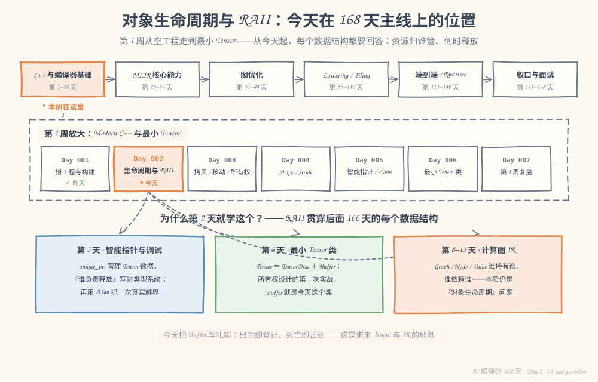
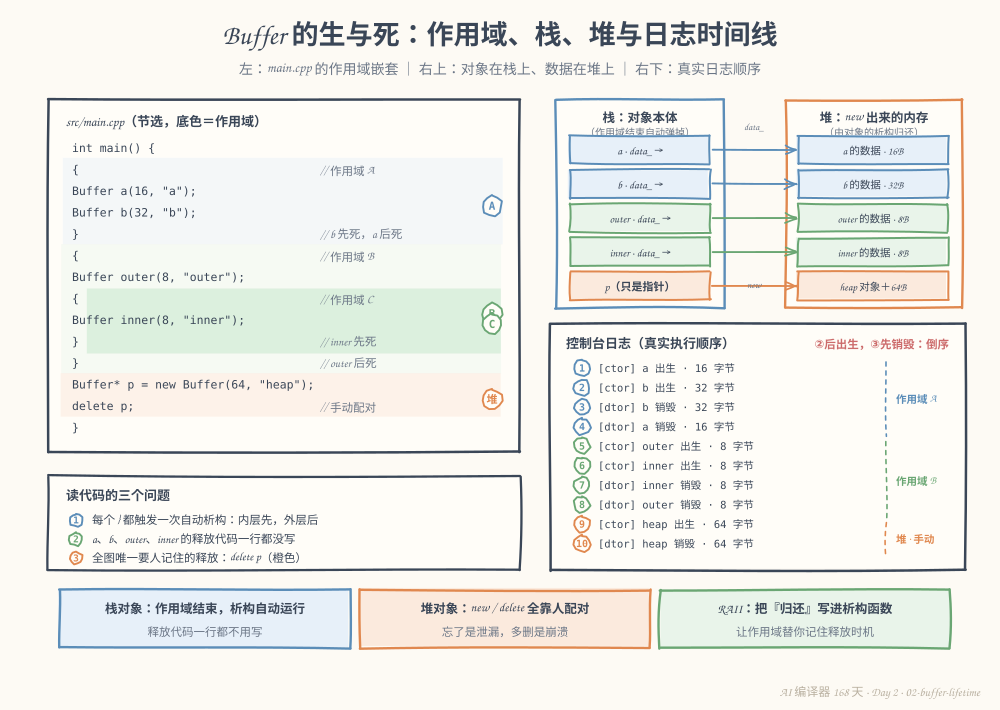
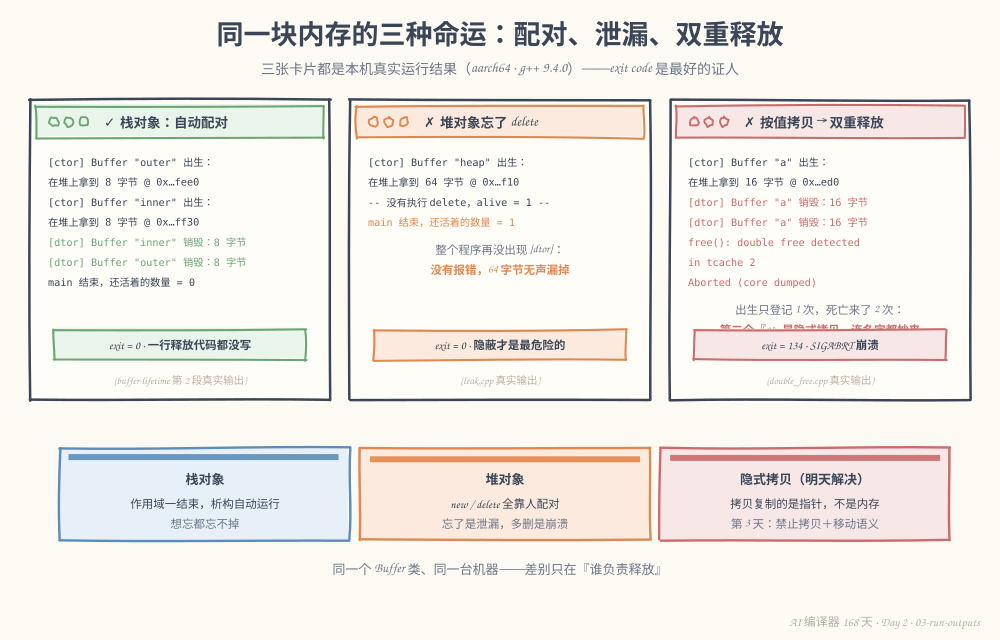

# 第 2 天：对象生命周期与 RAII——让资源"出生即登记，死亡即归还"

> **今日目标**：能构建并运行记录构造/析构日志的 `Buffer` 类，逐行解释每条日志由哪行代码触发；能在改动作用域**之前**预测析构顺序并用运行结果验证；能凭真实报错和日志特征识别泄漏、双重释放、悬垂指针三类错误。
> **预计时间**：学习 35 分钟 + 实践 45 分钟
> **前置准备**：第 1 天的构建环境（CMake ≥ 3.16、Ninja、支持 C++17 的 g++）；不需要第 1 天的工程文件，今天的示例独立成目录。
> **今日产出**：`Buffer` 类与观察程序 `buffer-lifetime`、12 条断言的生命周期测试，以及一段能脱稿讲出的 RAII 总结。

## 1. 今天解决什么问题？

昨天结尾留了一个问题：`greet()` 返回的 `std::string` 里装着字符，字符占内存——这块内存归谁管？什么时候释放？谁负责释放？

对小函数这无所谓。但我们的终点是写编译器：Tensor 数据、IR 节点、Pass 里的临时结构，全是"申请—使用—释放"的循环。三个朴素问题决定这个项目能不能活过 28 天：

1. 一块内存用完了，怎么保证它**一定**被归还？
2. 归还动作散落在代码各处，怎么保证不漏、不重？
3. 中途 `return` 或抛异常时，谁来收拾半路上的资源？

今天的答案是一个机制加一条纪律：**对象生命周期**（谁出生、谁死亡、按什么顺序）和 **RAII**（把资源归还绑进对象的死亡流程）。全文贯穿同一个例子——一个会记日志的 `Buffer` 类：

- `Buffer a(16, "a")`：出生时在堆上申请 16 字节，登记一条 `[ctor]` 日志；
- `}`：作用域结束，`a` 自动死亡，归还 16 字节，登记 `[dtor]` 日志；
- `new Buffer(64, "heap")`：堆上的对象，必须手动 `delete`——今天所有的麻烦都从它开始。

**预期结果**：程序打印出成对的出生/死亡日志，`main` 结束时"还活着的 Buffer 数量 = 0"。

## 2. 先看全貌：今天的内容位于哪里？



**图 1**：主线放大镜对准第 1 周：昨天搭好地板，今天给所有未来的数据结构立"资源规矩"。注意下方三张卡片——第 5 天的智能指针、第 6 天的 `Tensor = TensorDesc + Buffer`、第 8 天起的图 IR 所有权，全都建立在今天这个 `Buffer` 之上。

用 4 步描述今天的路线（后面各节展开）：

1. 弄清对象的一生：构造（出生）与析构（死亡）分别由哪行代码触发；
2. 区分栈对象（作用域管生死）与堆对象（`new`/`delete` 手动管生死）；
3. 用日志验证析构顺序：嵌套作用域里"后出生的先死亡"；
4. 把规律固化成 RAII，并亲眼看看违反它的三种下场。

## 3. 核心概念：先用直觉，再给准确定义

### 3.1 构造与析构：对象的一生有登记在案的起点和终点

一句通俗解释：**构造函数**（constructor）在对象出生那一刻自动运行；**析构函数**（destructor，名字前带 `~` 的成员函数）在对象死亡那一刻自动运行。

生活类比：图书馆借书。办手续那一刻（构造）登记"这本书在你名下"，还书那一刻（析构）注销登记。C++ 特殊之处在于：系统保证"你离开馆（作用域）之前必须办完退书手续"，想赖账都不行。

**对应到技术上是**：构造函数负责"拿到资源＋初始化状态"（比如 `new unsigned char[16]`），析构函数负责"归还资源"（`delete[]`）。编译器在对象生命周期结束处自动插入析构调用，不需要也不应该手写。

最小例子：

```cpp
{                      // 作用域开始
    Buffer a(16, "a"); // 出生：自动运行 Buffer::Buffer()
    // ... 使用 a ...
}                      // 死亡：自动运行 Buffer::~Buffer()
```

常见误解：以为析构函数"大概会"运行。准确说法是：**栈对象**的析构由作用域结束精确触发（第 3.3 节）；**堆对象**的析构只在 `delete` 时触发——没人 `delete`，析构永远不运行（第 6 节错误一真实复现）。

### 3.2 栈对象与堆对象：谁来决定生死

一句通俗解释：**栈**（stack，自动存储期）上的对象，编译器管生死；**堆**（heap，动态存储期）上的对象，你自己管生死。

生活类比：食堂餐盘 vs 储物柜。餐盘用完放回传送带，餐馆统一回收（栈：作用域结束自动回收）；储物柜要自己扫码开、自己记得还，忘了还就一直占着（堆：`new` 申请、`delete` 归还，忘了就泄漏）。

**对应到技术上是**：`Buffer a(16, "a")` 的对象本体（`data_` 指针、`size_`、`name_` 三个成员）在栈帧里，作用域结束时随栈帧消失，析构自动运行；`new Buffer(64, "heap")` 的对象本体在堆上，栈上只有指针 `p`——`p` 自己消失不会带走堆上的对象，必须 `delete p` 才触发析构。

类比边界：这个类比只讲"谁负责生死"，不涉及快慢（那是分配成本的对比）。还有一个容易忽略的细节：栈上的 `Buffer` 对象，它**管理的 16 字节数据**仍在堆上——"对象本体在哪"和"资源在哪"是两个问题，图 2 右上角画的就是这个对应关系。

### 3.3 作用域与析构顺序：后出生的先死亡

一句通俗解释：**作用域**（scope）就是 `{ }` 圈出来的一段代码生命区。离开作用域时，在里面出生的栈对象按**构造的倒序**逐个析构——后进先出（LIFO）。

类比：摞盘子。后放上去的先被拿走，绝不从底下抽。

**对应到技术上是**：同一作用域里 `a` 先构造、`b` 后构造，则离开时先析构 `b`、再析构 `a`；嵌套作用域同理，内层先结束、内层对象先死。这不是实现巧合，是语言保证的确定顺序——第 4 节的日志会逐行验证。

为什么这么设计？想象 `b` 的构造用到了 `a`（比如 `b` 保存了指向 `a` 的指针）：倒序析构保证 `a` 比 `b` 活得久，`b` 死的时候它依赖的东西还在。依赖关系因此天然安全。

### 3.4 RAII：把资源归还绑进对象的死亡流程

一句通俗解释：**RAII**（Resource Acquisition Is Initialization，资源获取即初始化）——资源的生命周期和对象的生命周期绑定：构造时拿资源，析构时还资源，让作用域替你记住归还时机。

生活类比：酒店房卡。办入住（构造）拿卡，房卡和你的住宿期绑定；退房（析构）交还房卡——人离开酒店，卡自然失效，不存在"忘了还卡还占着房间"。

**对应到技术上是**：释放代码**只**写在析构函数里，然后只通过对象使用资源。这样三条路径共用同一套释放逻辑：

- 正常走完作用域：析构自动运行；
- 中途 `return`：作用域照常结束，析构照常运行；
- 抛异常：栈回退（stack unwinding，异常向外的传播过程）时，已构造完成的对象析构同样运行。

第三条不是空话，我在本机补了一个小实验（`try` 里创建 `Buffer guard` 后抛出异常）：

```text
[ctor] Buffer "guard" 出生：在堆上拿到 8 字节 @ 0xaaab0596fed0
[dtor] Buffer "guard" 销毁：归还堆上 8 字节
捕获异常：中途出错
main 结束，还活着的 Buffer 数量 = 0
```

注意顺序：`[dtor]` 在"捕获异常"**之前**打印——栈回退先析构、再进入 `catch`。反例就是图 3 卡片 B：`new` 完忘了 `delete`，没人触发析构，64 字节无声泄漏。而 `std::string`、`std::vector`、`std::unique_ptr` 全是 RAII 的成品——昨天 `greet()` 返回 `std::string` 不泄漏，就因为它的字符串内存在析构时释放。

类比边界：RAII 管"何时释放"，不管"几个对象共享同一份资源"——共享问题要靠拷贝/移动语义（明天）或引用计数（第 5 天 `shared_ptr`）解决。

## 4. 图解核心机制



**图 2**：左边是 `main.cpp` 节选（底色＝作用域），右上是"栈上的对象本体 → `data_` 指针 → 堆上的数据块"，右下是带序号 ①–⑩ 的真实日志。看图时盯住序号：构造从 ① 顺时针排下去，析构完全倒着来。

按图中关键位置讲：

1. **左侧蓝色底（作用域 A）**：`a`、`b` 在同一个作用域，碰到 `}` 各析构一次；日志 ③④ 显示 `b` 先死、`a` 后死——倒序。
2. **左侧绿色底（作用域 B、嵌套的 C）**：内层 C 先结束，所以日志 ⑦⑧ 里 `inner` 先于 `outer` 死亡。
3. **左下橙色两行（`new` / `delete`）**：全图唯一需要人记住的释放。删掉 `delete p`，右下日志的 ⑨⑩ 就只剩 ⑨——第 6 节错误一真实复现了这个情况。
4. **右上"栈：对象本体"列**：`a`、`b`、`outer`、`inner` 的本体都在栈上；橙色 `p` 只是指针，它指向的 `heap` 对象本体在堆上（对应第 3.2 节"两个问题"）。
5. **右上彩色箭头（`data_` →）**：每个对象通过 `data_` 指向堆上自己的数据块。析构做两件事：`delete[] data_` 归还堆块，然后对象本体随栈帧消失。
6. **右下日志 ⑨⑩**：堆对象的出生和死亡之间隔着一个手写的 `delete`——这段间隔的可靠性，就是今天与后两天所有内容的主题。

## 5. 动手实践：完成一个最小可运行例子

> 本节所有命令与输出都在这台机器上真实执行过：
> Linux aarch64（Ubuntu 20.04）· g++ 9.4.0 · CMake 3.20.5 · Ninja 1.10.0。
> 完整工程在本仓库 `tutorials/day-002/examples/buffer-lifetime/`，也可以按下面步骤自己敲一遍。

### 5.1 准备文件

```bash
mkdir -p buffer-lifetime/src buffer-lifetime/tests
cd buffer-lifetime
```

目录结构：

```text
buffer-lifetime/
├── CMakeLists.txt
├── src/
│   ├── Buffer.h         # 类声明
│   ├── Buffer.cpp       # 构造/析构日志的实现
│   ├── main.cpp         # 观察程序：三段作用域实验
│   └── CMakeLists.txt
└── tests/
    ├── test_buffer.cpp  # 12 条断言
    └── CMakeLists.txt
```

### 5.2 编写代码

`src/Buffer.h`——全部成员一眼看完：

```cpp
#pragma once
#include <cstddef>
#include <string>

class Buffer {
public:
    explicit Buffer(std::size_t bytes, std::string name);
    ~Buffer();

    std::size_t size() const { return size_; }
    const std::string& name() const { return name_; }
    unsigned char* data() { return data_; }
    const unsigned char* data() const { return data_; }

    unsigned char& at(std::size_t i);  // 带边界检查的访问

    static int alive();                // 当前还活着的 Buffer 数量

private:
    unsigned char* data_;              // 指向堆上内存
    std::size_t size_;
    std::string name_;
    static int alive_;
};
```

`src/Buffer.cpp`——今天的心脏：

```cpp
#include "Buffer.h"

#include <cstdio>
#include <stdexcept>
#include <utility>

int Buffer::alive_ = 0;

Buffer::Buffer(std::size_t bytes, std::string name)
    : data_(new unsigned char[bytes]), size_(bytes), name_(std::move(name)) {
    ++alive_;
    std::printf("[ctor] Buffer \"%s\" 出生：在堆上拿到 %zu 字节 @ %p\n",
                name_.c_str(), size_, static_cast<void*>(data_));
}

Buffer::~Buffer() {
    --alive_;
    std::printf("[dtor] Buffer \"%s\" 销毁：归还堆上 %zu 字节\n",
                name_.c_str(), size_);
    delete[] data_;
}

unsigned char& Buffer::at(std::size_t i) {
    if (i >= size_) {
        throw std::out_of_range("Buffer \"" + name_ + "\": index " +
                                std::to_string(i) + " out of range for size " +
                                std::to_string(size_));
    }
    return data_[i];
}

int Buffer::alive() { return alive_; }
```

四个关键点：

1. **初始化列表 `data_(new unsigned char[bytes])`**：进入构造函数体之前，资源已经拿到手——"获取即初始化"的字面示范；
2. **`++alive_` / `--alive_`**：静态计数器随构造/析构增减，最后用它一眼判断"有没有对象没死"；
3. **两条 `printf`**：出生、死亡各记一条日志，本节所有结论都靠它观察；
4. **`delete[] data_`**：析构只做这一件资源归还，且 `new[]` 必须配 `delete[]`。

`src/main.cpp`——三段实验：

```cpp
#include "Buffer.h"
#include <cstdio>

int main() {
    std::printf("== 1. 栈对象：作用域结束自动销毁 ==\n");
    {
        Buffer a(16, "a");
        Buffer b(32, "b");
        a.at(0) = 1;
        b.at(0) = 2;
        std::printf("-- a、b 都活着，alive = %d --\n", Buffer::alive());
    }
    std::printf("-- 离开作用域，alive = %d --\n\n", Buffer::alive());

    std::printf("== 2. 嵌套作用域：内层先结束 ==\n");
    {
        Buffer outer(8, "outer");
        {
            Buffer inner(8, "inner");
            std::printf("-- 最内层，alive = %d --\n", Buffer::alive());
        }
        std::printf("-- inner 已销毁、outer 还在，alive = %d --\n", Buffer::alive());
    }
    std::printf("-- 外层也结束，alive = %d --\n\n", Buffer::alive());

    std::printf("== 3. 堆对象：new 出来的必须手动 delete ==\n");
    {
        Buffer* p = new Buffer(64, "heap");
        std::printf("-- 刚 new 完，alive = %d --\n", Buffer::alive());
        delete p;  // 试着注释掉这一行再运行（见第 6 节错误一）
        std::printf("-- delete 之后，alive = %d --\n", Buffer::alive());
    }

    std::printf("\nmain 结束，还活着的 Buffer 数量 = %d\n", Buffer::alive());
    return 0;
}
```

构建脚本和第 1 天同款（C++17、`-Wall -Wextra -Wpedantic`、`enable_testing`），只有目标名不同：

```cmake
# 顶层 CMakeLists.txt
cmake_minimum_required(VERSION 3.16)
project(buffer-lifetime LANGUAGES CXX)

set(CMAKE_CXX_STANDARD 17)
set(CMAKE_CXX_STANDARD_REQUIRED ON)
set(CMAKE_CXX_EXTENSIONS OFF)

if(MSVC)
  add_compile_options(/W4)
else()
  add_compile_options(-Wall -Wextra -Wpedantic)
endif()

add_subdirectory(src)

enable_testing()
add_subdirectory(tests)
```

```cmake
# src/CMakeLists.txt
add_library(buffer STATIC Buffer.cpp)
target_include_directories(buffer PUBLIC ${CMAKE_CURRENT_SOURCE_DIR})

add_executable(buffer-lifetime main.cpp)
target_link_libraries(buffer-lifetime PRIVATE buffer)
```

```cmake
# tests/CMakeLists.txt
add_executable(test_buffer test_buffer.cpp)
target_link_libraries(test_buffer PRIVATE buffer)

add_test(NAME buffer_lifetime COMMAND test_buffer)
```

`tests/test_buffer.cpp`——12 条断言，覆盖基本读写、嵌套作用域的 alive 增减（验证 LIFO）、越界拦截和 0 字节边界：

```cpp
#include "Buffer.h"
#include <cassert>
#include <cstdio>
#include <stdexcept>

int main() {
    {
        Buffer b(8, "t0");
        assert(b.size() == 8);
        assert(b.data() != nullptr);
        b.at(0) = 0x11;
        b.at(7) = 0x22;
        assert(b.at(0) == 0x11);
        assert(b.at(7) == 0x22);
    }
    assert(Buffer::alive() == 0);

    {
        Buffer x(4, "x");
        assert(Buffer::alive() == 1);
        {
            Buffer y(4, "y");
            assert(Buffer::alive() == 2);
        }
        assert(Buffer::alive() == 1);
    }
    assert(Buffer::alive() == 0);

    bool threw = false;
    {
        Buffer b(4, "t1");
        try {
            b.at(4);
        } catch (const std::out_of_range&) {
            threw = true;
        }
    }
    assert(threw);

    {
        Buffer z(0, "z");
        assert(z.size() == 0);
    }
    assert(Buffer::alive() == 0);

    std::printf("all 12 assertions passed\n");
    return 0;
}
```

### 5.3 运行与观察

```bash
cmake -S . -B build -G Ninja
cmake --build build
```

真实输出（configure 的中间行省略；6 个步骤正是第 1 天图 2 的机制在干活）：

```text
[1/6] Building CXX object src/CMakeFiles/buffer-lifetime.dir/main.cpp.o
[2/6] Building CXX object tests/CMakeFiles/test_buffer.dir/test_buffer.cpp.o
[3/6] Building CXX object src/CMakeFiles/buffer.dir/Buffer.cpp.o
[4/6] Linking CXX static library src/libbuffer.a
[5/6] Linking CXX executable src/buffer-lifetime
[6/6] Linking CXX executable tests/test_buffer
```

```bash
./build/src/buffer-lifetime
```

真实输出（`@` 后面的地址每次运行可能不同）：

```text
== 1. 栈对象：作用域结束自动销毁 ==
[ctor] Buffer "a" 出生：在堆上拿到 16 字节 @ 0xaaaaee46fee0
[ctor] Buffer "b" 出生：在堆上拿到 32 字节 @ 0xaaaaee46ff00
-- a、b 都活着，alive = 2 --
[dtor] Buffer "b" 销毁：归还堆上 32 字节
[dtor] Buffer "a" 销毁：归还堆上 16 字节
-- 离开作用域，alive = 0 --

== 2. 嵌套作用域：内层先结束 ==
[ctor] Buffer "outer" 出生：在堆上拿到 8 字节 @ 0xaaaaee46fee0
[ctor] Buffer "inner" 出生：在堆上拿到 8 字节 @ 0xaaaaee46ff30
-- 最内层，alive = 2 --
[dtor] Buffer "inner" 销毁：归还堆上 8 字节
-- inner 已销毁、outer 还在，alive = 1 --
[dtor] Buffer "outer" 销毁：归还堆上 8 字节
-- 外层也结束，alive = 0 --

== 3. 堆对象：new 出来的必须手动 delete ==
[ctor] Buffer "heap" 出生：在堆上拿到 64 字节 @ 0xaaaaee46ff90
-- 刚 new 完，alive = 1 --
[dtor] Buffer "heap" 销毁：归还堆上 64 字节
-- delete 之后，alive = 0 --

main 结束，还活着的 Buffer 数量 = 0
```

逐段读这份日志：

- 第 1 段：`[ctor] a`、`[ctor] b` 后 alive=2；随后 `[dtor] b` 出现在 `[dtor] a` **之前**——倒序析构，对应图 2 序号 ①–④；
- 第 2 段：`inner` 的 `[dtor]` 在内层 `}` 处触发，`outer` 的在外层 `}` 处——内层先死，对应序号 ⑦⑧；
- 第 3 段：`[ctor] heap` 和 `[dtor] heap` 之间隔着一个手写的 `delete`——对应序号 ⑨⑩；
- 一个值得注意的细节：`outer` 的地址和 `a` 一样（都是 `0x…fee0`）——堆把 `a`、`b` 归还的块又分给了后来者，说明归还确实发生了。

```bash
ctest --test-dir build --output-on-failure
```

真实输出：

```text
1/1 Test #1: buffer_lifetime ..................   Passed    0.00 sec

100% tests passed, 0 tests failed out of 1
```

测试程序运行时会先打印一串 ctor/dtor 日志，最后一句是：

```text
all 12 assertions passed
```



**图 3**：三张卡片是同一台机器上的真实运行结果。看两处：每张卡片的 `[ctor]`/`[dtor]` 是否成对，以及最下面的 exit code——0（正常）、0（泄漏也不崩溃）、134（崩溃）。卡片 C 出生只登记 1 次、死亡却来了 2 次，这个"账对不上"正是 double free 的日志特征。

### 5.4 修改一个参数再观察

**实验：把第 3 段的堆对象搬回栈上。** 把

```cpp
Buffer* p = new Buffer(64, "heap");
delete p;
```

换成

```cpp
Buffer h(64, "heap-to-stack");  // 不再需要 new / delete
```

先预测：日志会少掉什么？`alive` 何时归零？然后运行（我实际执行过）：

```text
== 实验：new/delete 换成栈对象 ==
[ctor] Buffer "heap-to-stack" 出生：在堆上拿到 64 字节 @ 0xaaab1eb0bed0
-- h 在栈上，alive = 1 --
[dtor] Buffer "heap-to-stack" 销毁：归还堆上 64 字节
-- 作用域结束，alive = 0 --
```

和图 3 卡片 A、B 对照：`[dtor]` 从"可能忘"变成"想忘都忘不掉"。这就是 RAII 的全部差别——释放时机从"人的记性"挪到了"作用域的规则"。

## 6. 常见错误与排查

以下三个错误都在本机真实复现过，报错原文照抄。复现用的是独立的单文件程序（和 `Buffer.cpp` 一起直接用 `g++` 编译），命令附在每条里。

**错误一：忘了 `delete`——内存泄漏**

复现核心：`new` 之后从不 `delete`。编译命令：`g++ -std=c++17 -Wall -Wextra -I src src/Buffer.cpp leak.cpp -o leak`。

- 现象：程序正常结束，exit code = 0，但计数器说有对象没死：

  ```text
  [ctor] Buffer "heap" 出生：在堆上拿到 64 字节 @ 0xaaaaf325cf10
  -- 没有执行 delete，alive = 1 --
  main 结束，还活着的 Buffer 数量 = 1
  ```

  编译时 g++ 还会提示 `warning: unused variable 'p'`——连编译器都觉得这个指针不对劲。
- 原因：离开作用域时，栈上消失的只有指针 `p`；堆上的对象不属于任何作用域，没人 `delete` 它，析构永远不运行。
- 定位：今天靠 `alive` 计数器；更专业的工具是 AddressSanitizer 的泄漏检测，第 5 天引入。
- 修复：补 `delete p` 是治标；治本是不再手写裸 `new`/`delete`，让对象自己拥有资源（第 5 天的 `unique_ptr`）。

**错误二：按值拷贝 `Buffer`——double free**

复现核心只有一行 `Buffer copy = a;`：

```cpp
#include "Buffer.h"
int main() {
    Buffer a(16, "a");
    Buffer copy = a;  // 按值拷贝：隐式拷贝构造被调用
    return 0;
}
```

- 现象（用 `stdbuf -o0` 关闭输出缓冲后的完整日志；直接运行时缓冲区里的日志会随 abort 丢失，只剩最后一行报错）：

  ```text
  [ctor] Buffer "a" 出生：在堆上拿到 16 字节 @ 0xaaaadfa8ded0
  [dtor] Buffer "a" 销毁：归还堆上 16 字节
  [dtor] Buffer "a" 销毁：归还堆上 16 字节
  free(): double free detected in tcache 2
  Aborted (core dumped)
  ```

  exit code = 134（128 ＋ SIGABRT）。
- 原因：编译器隐式生成的拷贝构造只复制了指针值（浅拷贝），`copy.data_` 和 `a.data_` 指向同一块堆内存；两个对象各自析构，同一块内存被归还两次。
- 定位：日志账对不上——出生 1 次、死亡 2 次，而且两条 `[dtor]` 的名字都是 "a"（`name_` 也被抄了过去，连日志都分不出谁是谁）。
- 修复：今天是"知道有雷"；明天的主题就是拆雷——用 `= delete` 禁止这种拷贝，再实现移动语义。

**错误三：返回栈对象的地址——悬垂指针**

复现核心：

```cpp
Buffer* make_buffer() {
    Buffer b(16, "local");
    return &b;  // 返回栈对象的地址
}
```

- 现象：编译期 g++ `-Wall` 已经拉响警报：

  ```text
  dangling.cpp:6:12: warning: address of local variable 'b' returned [-Wreturn-local-addr]
  ```

  运行期直接崩溃，exit code = 139（128 ＋ SIGSEGV）：

  ```text
  [ctor] Buffer "local" 出生：在堆上拿到 16 字节 @ 0xaaaaf2bb5ed0
  [dtor] Buffer "local" 销毁：归还堆上 16 字节
  p = (nil)
  Segmentation fault (core dumped)
  ```

- 原因：函数返回时 `b` 已随栈帧析构（日志里 `[dtor]` 打印在使用之前），返回它的地址毫无意义。本机 g++ 9.4 检测到这种代码后直接把返回值替换成了空指针，所以 `p = (nil)`、一访问就段错误——编译器用"必然崩溃"代替了"读到随机垃圾"。
- 定位：两个证据都在上面——编译警告，以及日志显示对象死于使用之前。
- 修复：按值返回（配合明天的移动语义）、使用输出参数，或返回拥有所有权的对象（第 5 天智能指针）。规则只有一条：不保存、不返回栈对象的地址。

## 7. 今日练习

### 必做练习

在 `main.cpp` 第 2 段里再嵌套一层作用域（比如在 `inner` 之内加 `Buffer deep(4, "deep")`）。先**在纸上**写出你预测的完整日志顺序（从 `[ctor] outer` 到 `[dtor] outer` 的每一行），再运行 `./build/src/buffer-lifetime` 逐行对照，全对才算完成。然后在 `tests/test_buffer.cpp` 里加一条断言，验证 `deep` 存活期间 `Buffer::alive()` 的值。预期产出：预测稿、真实输出、更新后的测试各一份。

### 选做挑战

给 `Buffer` 增加两个静态计数器：累计出生数和累计销毁数。在 `main` 末尾打印两者之差，把错误一的泄漏变成程序自己能报告的诊断（例如 `main 结束，泄漏 1 个 Buffer`）。只允许改 `Buffer.h`、`Buffer.cpp` 和 `main.cpp`，现有 12 条断言必须仍然全绿。

## 8. 今日验收

- [ ] 我能用自己的话解释构造/析构、栈对象/堆对象、RAII 各自是什么，并说出"对象本体在哪"和"资源在哪"是两个问题；
- [ ] 我能独立构建并运行 `buffer-lifetime`，指着任意一行日志说出它由哪行代码触发；
- [ ] 我能在改作用域之前预测析构顺序（必做练习验证过一次），并解释为什么是倒序；
- [ ] 我能凭真实报错或日志特征区分三种错误：泄漏（exit 0 但 alive≠0）、double free（出生死亡账不平＋`tcache` 报错）、悬垂指针（编译警告＋段错误）；
- [ ] 我保存了 `buffer-lifetime` 工程、12 条断言的测试，以及三种错误的复现记录。

## 9. 一句话总结与明天预告

今天解决"资源归谁管、何时释放"：构造拿资源、析构还资源；栈对象的生死由作用域精确控制且倒序析构，堆对象的生死全靠人配对。我们用带日志的 `Buffer` 验证了每一句话——日志序号严格倒序（图 2），`new/delete` 换成栈对象后 `[dtor]` 一次不漏（5.4 节），三种违反方式各有清晰可辨的现场（图 3）。

RAII 总结（今天的产出之一，建议脱稿复述）：

> 把资源的获取放在构造函数、归还放在析构函数，然后只通过对象使用资源。这样正常结束、提前 `return`、抛异常三条路径共用同一套释放逻辑，释放时机从"人的记性"变成"作用域的规则"。RAII 不解决"多个对象共享同一份资源"——那是拷贝、移动和智能指针的领地。

明天进入第 3 天"拷贝、移动与所有权"：今天错误二里的 `Buffer copy = a;` 已经证明隐式拷贝复制的是指针而不是内存。明天我们禁止这种语义不明确的廉价拷贝，实现真正的移动，并对比移动前后资源的地址——看看"所有权交接"到底长什么样。
