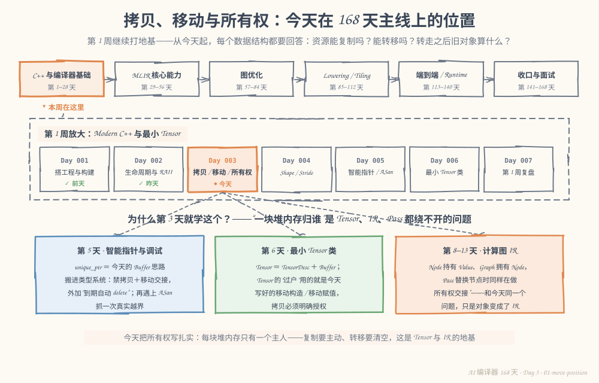
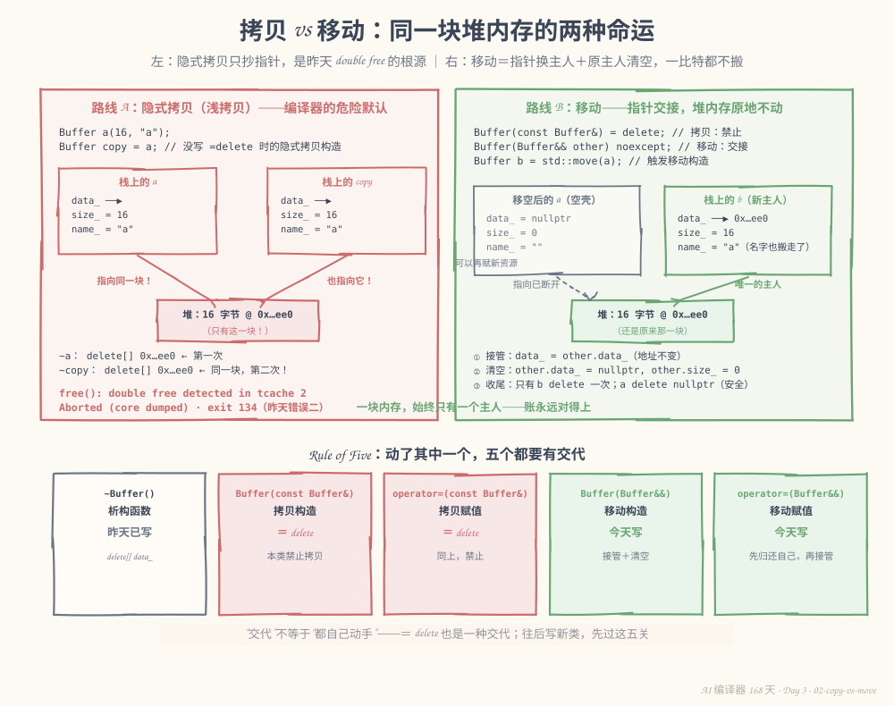
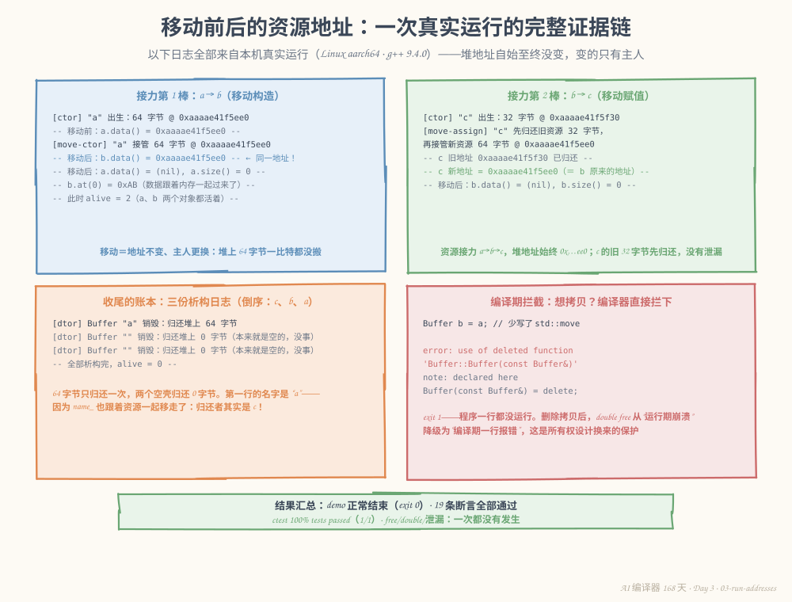

# 第 3 天：拷贝、移动与所有权——让资源"过户"而不是"复印"

> **今日目标**：能为 `Buffer` 用 `= delete` 禁止语义不明确的拷贝，并正确实现移动构造和移动赋值；能用真实地址日志证明"移动 = 指针换主人、堆内存一比特不动"；能凭日志特征区分 double free、泄漏、使用被移空对象三类错误，并说明它们各自在哪个阶段被拦下。
> **预计时间**：学习 35 分钟 + 实践 45 分钟
> **前置准备**：昨天第 2 天的 `Buffer` 类思路（构造/析构日志、`alive` 计数器）；构建环境同前两天（CMake ≥ 3.16、Ninja、支持 C++17 的 g++）。今天的示例独立成目录，不需要第 2 天的工程文件。
> **今日产出**：带移动语义的 `Buffer`（拷贝被删除）、地址观察程序 `move-semantics`、19 条断言的所有权测试，以及一段能脱稿讲出的"何时允许拷贝"的短说明。

## 1. 今天解决什么问题？

昨天第 6 节错误二留下一颗雷，一行代码就让程序崩溃：

```cpp
Buffer a(16, "a");
Buffer copy = a;   // 按值拷贝：隐式拷贝构造被调用
// 程序结束 → free(): double free detected in tcache 2 → exit 134
```

原因昨天已经定位：编译器隐式生成的拷贝只抄了指针值，两个对象的 `data_` 指向同一块堆内存，各自析构时把同一块内存归还两次。今天要拆这颗雷，绕不开三个问题：

1. 一段堆内存，到底允许有几个"主人"？
2. 想把一个 `Buffer` **交给**另一个变量——不是复制一份，而是整体易主——该怎么写？
3. 资源交出去之后，旧对象算什么？还能用吗？

全文贯穿同一场"资源接力"：`Buffer a(64, "a")` 出生，然后 `Buffer b = std::move(a)`、`c = std::move(b)`，一段 64 字节的堆内存三次易主。**预期结果**：三次易主前后堆地址一次都不变，程序正常结束，`alive = 0`，中途没有任何字节的复制。

## 2. 先看全貌：今天的内容位于哪里？



**图 1**：主线放大镜仍对准第 1 周：昨天给资源立了"生死规矩"（RAII），今天立"归属规矩"（所有权）。注意下方三张卡片——第 5 天的 `unique_ptr` 就是"今天的手写移动"搬进类型系统，第 6 天的 `Tensor` 里装着今天的 `Buffer`，第 8 天起的图 IR 则要回答"Node 和 Value 谁拥有谁"——全是同一个问题。

今天的路线分 4 步：

1. 弄清编译器的默认拷贝为什么危险（它抄的是指针，不是内存）；
2. 用 `= delete` 把危险的默认拷贝显式关掉；
3. 实现移动构造 / 移动赋值：接管资源 + 清空原主人；
4. 用真实地址日志和 19 条断言验证每一次交接，再看看三种典型翻车现场。

## 3. 核心概念：先用直觉，再给准确定义

### 3.1 拷贝构造与拷贝赋值：编译器的默认行为是"逐成员抄"

一句通俗解释：**拷贝构造**（copy constructor）在 `Buffer b = a;` 时运行；**拷贝赋值**（copy assignment，`operator=`）在 `b = a;`（`b` 已存在）时运行。不自己写，编译器就各生成一份默认的——行为是逐成员复制。

生活类比：复印房产证。证复印了两张，看起来名正言顺，但**房子还是一套**。

**对应到技术上是**：默认拷贝对指针成员只抄指针的值（这叫**浅拷贝**，shallow copy）。于是 `copy.data_` 和 `a.data_` 是同一个地址——两个对象都以为自己在管理这块内存，析构时各 `delete[]` 一次。这就是昨天 exit 134 的全部机制，图 2 左半边画的就是它。

最小例子（把昨天的崩溃浓缩成三行）：

```cpp
Buffer a(16, "a");
Buffer copy = a;      // 浅拷贝：两个 data_ 指向同一块堆内存
// 作用域结束：~copy 先 delete 一次，~a 再 delete 一次 → double free
```

类比边界：复印房产证的类比只对"持有资源的指针成员"成立。如果类里全是 `int`、`double` 这类值成员（比如第 4 天的 `TensorDesc`：几个尺寸整数），逐成员抄**就是**正确的拷贝，一点也不危险。危险的不是拷贝本身，而是"抄了一个不归你管的资源句柄"。

### 3.2 出路有两条：深拷贝，或禁止拷贝

**深拷贝**（deep copy）：不止抄指针，而是新分配一块同样大的内存，把内容逐字节复制过去。类比：真买第二套房。它**正确**，但有两个代价：

- **贵**：对 `Buffer` 是 64 字节，对一个真实 Tensor 可能是几百 MB——编译器替你默默复制几百 MB，是灾难不是便利；
- **语义不清**：`Buffer b = a;` 这行代码到底是"我要两个独立副本"还是"我想转移所有权"？读代码的人分不出来。

**禁止拷贝**：既然默认拷贝危险、深拷贝昂贵且语义含混，我们的 `Buffer` 定位是"独占资源"的类——直接用 `= delete` 告诉编译器：这两个函数不许生成，谁写谁编译不过：

```cpp
Buffer(const Buffer&) = delete;            // 拷贝构造：禁止
Buffer& operator=(const Buffer&) = delete; // 拷贝赋值：禁止
```

以后真需要一份独立副本？显式写 `clone()`——函数名自己会说话（今天的选做练习就是它）。什么时候允许拷贝、什么时候禁止，第 9 节有一段可以脱稿讲的短说明。

### 3.3 移动构造与移动赋值：过户，而不是复印

一句通俗解释：**移动**（move）把资源当作可以过户的房契——**移动构造**（move constructor）`Buffer b = std::move(a);` 让新对象接管旧对象的资源；**移动赋值**（move assignment）`c = std::move(b);` 让已存在的对象先退掉自己的资源、再接管别人的。

生活类比：过户。房子（堆内存）一砖一瓦都没动，房产证上的名字（`data_` 归属）换了，旧主人手里的证作废（`a.data_ = nullptr`）。

**对应到技术上是**：移动构造函数拿一个**右值引用**（rvalue reference，写作 `Buffer&&`，只绑定"可以被安全掏空"的对象），函数体里做两件事——把 `other` 的指针、大小接过来，再把 `other` 清空：

```cpp
Buffer::Buffer(Buffer&& other) noexcept
    : data_(other.data_), size_(other.size_), name_(std::move(other.name_)) {
    other.data_ = nullptr;  // 关键一步：不置空，两个析构会 delete 同一块内存
    other.size_ = 0;
}
```

全程没有 `new`、没有 `memcpy`——移动的"便宜"就便宜在这里：不管这块内存是 64 字节还是 64 MB，过户的成本都是复制三个成员。

三个必须弄清的细节：

1. **`std::move` 本身不移动任何东西**。它只是一个类型转换（把左值转成右值引用，相当于 `static_cast<Buffer&&>`），意思是"我同意把这个对象掏空"；真正干活的是移动构造/移动赋值函数。5.4 节有真实日志为证。
2. **被移空的对象（moved-from）处于"有效但未指定"状态**。对我们自己写的 `Buffer`，我们保证移空后 `data_ == nullptr`、`size_ == 0`——是个明确的空壳，还能接收新资源（测试断言 ⑰）。而成员 `name_` 是 `std::string`，标准只保证它"有效但未指定"，本机的 libstdc++ 恰好留成空串——但不能依赖这一点。
3. **`noexcept` 不是装饰**。`std::vector` 扩容时只有在移动构造保证不抛异常时才敢用移动（否则拷贝更安全）；不写 `noexcept`，容器会默默退回拷贝——而我们的拷贝是 `= delete` 的，直接编译不过。

### 3.4 Rule of Five：动了其中一个，五个都要有交代

昨天写了析构函数的那一刻起，编译器就不再替你生成可靠的拷贝和移动了。**Rule of Five**（五法则）：如果你定义了下面五个中的**任何一个**，就应该对全部五个做出明确交代——要么自己实现，要么 `= delete`：

| 成员函数 | 我们的交代 |
|---|---|
| 析构 `~Buffer()` | 昨天写：`delete[] data_` |
| 拷贝构造 `Buffer(const Buffer&)` | 今天删除：`= delete` |
| 拷贝赋值 `operator=(const Buffer&)` | 今天删除：`= delete` |
| 移动构造 `Buffer(Buffer&&)` | 今天写：接管 + 清空 |
| 移动赋值 `operator=(Buffer&&)` | 今天写：先归还自己，再接管 |

"交代"不等于"都自己动手"——`= delete` 也是一种交代。忘掉任何一行，缺的那个就退回编译器的危险默认（第 6 节错误二就是"忘了清空"的具体下场）。

### 3.5 所有权：一句话立规矩

**所有权**（ownership）：任意时刻，每块堆内存恰好有一个负责释放它的对象。复制 = 主动再买一套（显式 `clone`）；移动 = 过户（旧的作废）；析构 = 归还。昨天 RAII 管"何时释放"，今天所有权管"由谁释放"——两条规定合起来，`Tensor` 和图 IR 的资源管理就有了完整的法理基础。

## 4. 图解核心机制



**图 2**：左右两幅对照同一块 `16 字节 @ 0x…ee0` 的命运。左（红）：隐式拷贝抄指针——两个对象的 `data_` 同时指向堆上这一块，两个析构函数各 `delete` 一次，运行期 `free(): double free` 崩溃。右（绿）：移动——`b` 接管指针、`a` 被清空成空壳，堆块自始至终只有一个主人，收尾只有一次 `delete`。底部是今天的 Rule of Five 清单：五个函数各有交代。

按图中关键位置讲：

1. **左侧两个栈对象框**：`a` 和 `copy` 的 `data_` 一栏值完全相同——浅拷贝抄的是"地址"这个值，不是地址里的内容；
2. **左侧两条红箭头汇入同一个堆块**：一块内存、两个主人，账注定对不上；下方的两条 `delete` 是崩溃的直接原因；
3. **右侧 `Buffer b = std::move(a)`**：① 接管（`data_ = other.data_`，地址不变）→ ② 清空（`other.data_ = nullptr; other.size_ = 0`）→ ③ 收尾只有 `b` `delete` 一次，`a` 的析构 `delete nullptr` 是安全的空操作；
4. **右侧 `a` 的框变灰**：空壳不是废对象——它还能再接收新资源（移动赋值的目标可以是它）；
5. **右侧 `name_ = "a"` 出现在 `b` 的框里**：我们连名字（`std::string`）也一起移走了——这个细节会在今天的真实日志里再次出现，见 5.3 节。

## 5. 动手实践：完成一个最小可运行例子

> 本节所有命令与输出都在这台机器上真实执行过：
> Linux aarch64（Ubuntu 20.04）· g++ 9.4.0 · CMake 3.20.5 · Ninja 1.10.0。
> 完整工程在本仓库 `tutorials/day-003/examples/move-semantics/`，也可以按下面步骤自己敲一遍。

### 5.1 准备文件

```bash
mkdir -p move-semantics/src move-semantics/tests
cd move-semantics
```

目录结构：

```text
move-semantics/
├── CMakeLists.txt
├── src/
│   ├── Buffer.h         # 类声明：拷贝 = delete，移动 = 交接
│   ├── Buffer.cpp       # 构造/析构/移动的日志实现
│   ├── main.cpp         # 观察程序：一场三棒资源接力
│   └── CMakeLists.txt
└── tests/
    ├── test_move.cpp    # 19 条断言
    └── CMakeLists.txt
```

### 5.2 编写代码

`src/Buffer.h`——和昨天相比，中间多了两行删除、两行移动：

```cpp
#pragma once
#include <cstddef>
#include <string>

class Buffer {
public:
    explicit Buffer(std::size_t bytes, std::string name);
    ~Buffer();

    // 拷贝构造 / 拷贝赋值：禁止。
    // 隐式生成的版本只复制指针（浅拷贝），两个对象析构时会对同一块
    // 堆内存各 delete 一次（double free）。深拷贝虽然正确，但语义上
    // Buffer 是"独占资源"的类，我们不想让它悄悄复制一大段内存。
    Buffer(const Buffer&) = delete;
    Buffer& operator=(const Buffer&) = delete;

    // 移动构造 / 移动赋值：资源的所有权从 other 交接给 this。
    // noexcept 是移动操作的"标准姿势"，标准容器只对 noexcept 的移动
    // 放心（否则扩容时会退回拷贝以保证安全）。
    Buffer(Buffer&& other) noexcept;
    Buffer& operator=(Buffer&& other) noexcept;

    std::size_t size() const { return size_; }
    const std::string& name() const { return name_; }
    unsigned char* data() { return data_; }
    const unsigned char* data() const { return data_; }

    unsigned char& at(std::size_t i);  // 带边界检查的访问

    static int alive();  // 当前还活着的 Buffer 数量

private:
    unsigned char* data_;  // 指向堆上内存；nullptr 表示"手里没有资源"
    std::size_t size_;
    std::string name_;
    static int alive_;
};
```

`src/Buffer.cpp`——今天的心脏是中间两个函数：

```cpp
#include "Buffer.h"

#include <cstdio>
#include <stdexcept>
#include <utility>

int Buffer::alive_ = 0;

Buffer::Buffer(std::size_t bytes, std::string name)
    : data_(new unsigned char[bytes]), size_(bytes), name_(std::move(name)) {
    ++alive_;
    std::printf("[ctor]       Buffer \"%s\" 出生：在堆上拿到 %zu 字节 @ %p\n",
                name_.c_str(), size_, static_cast<void*>(data_));
}

Buffer::~Buffer() {
    --alive_;
    std::printf("[dtor]       Buffer \"%s\" 销毁：归还堆上 %zu 字节%s\n",
                name_.c_str(), size_, data_ ? "" : "（本来就是空的，没事）");
    delete[] data_;
}

// 移动构造：新对象直接接管 other 的指针，然后把 other 清空。
// 全程没有 new、没有 memcpy——移动的"便宜"就便宜在这里。
Buffer::Buffer(Buffer&& other) noexcept
    : data_(other.data_), size_(other.size_), name_(std::move(other.name_)) {
    other.data_ = nullptr;  // 关键一步：不置空，两个析构函数会 delete 同一块内存
    other.size_ = 0;
    ++alive_;
    std::printf("[move-ctor]  Buffer \"%s\" 接管 %zu 字节 @ %p，原主人已清空\n",
                name_.c_str(), size_, static_cast<void*>(data_));
}

// 移动赋值：目标是"已存在"的对象，先归还自己手里的资源，再接管 other 的。
Buffer& Buffer::operator=(Buffer&& other) noexcept {
    if (this != &other) {  // 防 c = std::move(c)：自己交接给自己等于原地自毁
        std::printf("[move-assign] Buffer \"%s\" 先归还旧资源 %zu 字节，",
                    name_.c_str(), size_);
        delete[] data_;  // 不做这一步，自己原来的内存就泄漏了
        data_ = other.data_;
        size_ = other.size_;
        name_ = std::move(other.name_);
        other.data_ = nullptr;
        other.size_ = 0;
        std::printf("再接管 Buffer 的新资源 %zu 字节 @ %p\n",
                    size_, static_cast<void*>(data_));
    }
    return *this;
}

unsigned char& Buffer::at(std::size_t i) {
    if (i >= size_) {
        throw std::out_of_range("Buffer \"" + name_ + "\": index " +
                                std::to_string(i) + " out of range for size " +
                                std::to_string(size_));
    }
    return data_[i];
}

int Buffer::alive() { return alive_; }
```

四个关键点：

1. **移动构造只有"抄三行成员 + 清两行状态"**：`data_`、`size_`、`name_` 从 `other` 接过来，然后 `other.data_ = nullptr; other.size_ = 0;`——后两行是移动和浅拷贝的全部区别，漏掉就是第 6 节错误二；
2. **移动赋值多了 `delete[] data_`**：赋值的目标已经持有资源，直接覆盖指针会把自己原来的内存泄漏掉（第 6 节错误三）；顺序必须是**先归还自己、再接管别人**；
3. **`if (this != &other)` 防"自己赋给自己"**：`c = std::move(c)` 若不加保护，会先 `delete` 自己的资源、再从已被掏空的自己手里接管悬垂指针；
4. **`std::move(other.name_)`**：`std::string` 自己也实现了移动——名字这个字符串同样被"过户"而非复制，5.3 节的日志会看到后果。

`src/main.cpp`——一场三棒接力，重点打印每一步的堆地址：

```cpp
#include "Buffer.h"
#include <cstdio>

int main() {
    std::printf("== 1. 移动构造：Buffer b = std::move(a) ==\n");
    unsigned char* addr_before = nullptr;
    {
        Buffer a(64, "a");
        a.at(0) = 0xAB;  // 在 a 的内存里写一个标记字节
        addr_before = a.data();
        std::printf("-- 移动前：a.data() = %p --\n", static_cast<void*>(addr_before));

        Buffer b = std::move(a);  // 移动构造：b 接管 a 的堆内存

        std::printf("-- 移动后：b.data() = %p --\n", static_cast<void*>(b.data()));
        std::printf("-- 移动后：a.data() = %p, a.size() = %zu --\n",
                    static_cast<void*>(a.data()), a.size());
        std::printf("-- b.at(0) = 0x%02X（数据跟着内存一起过来了）--\n", b.at(0));
        std::printf("-- 此时 alive = %d（a、b 两个对象都活着）--\n", Buffer::alive());

        std::printf("\n== 2. 移动赋值：c = std::move(b)，c 先退掉旧房子 ==\n");
        Buffer c(32, "c");
        unsigned char* c_old = c.data();
        c = std::move(b);  // 移动赋值：c 归还自己的 32 字节，再接管 b 的 64 字节
        std::printf("-- c 旧地址 %p 已归还，c 新地址 = %p（= b 原来的地址）--\n",
                    static_cast<void*>(c_old), static_cast<void*>(c.data()));
        std::printf("-- 移动后：b.data() = %p, b.size() = %zu --\n",
                    static_cast<void*>(b.data()), b.size());

        std::printf("\n== 3. 作用域结束：倒序析构，看谁归还多少字节 ==\n");
    }
    std::printf("-- 全部析构完，alive = %d --\n", Buffer::alive());
    (void)addr_before;
    return 0;
}
```

构建脚本和昨天同款（C++17、`-Wall -Wextra -Wpedantic`、`enable_testing`），只有目标名不同（完整文件在 `tutorials/day-003/examples/move-semantics/`）。

`tests/test_move.cpp`——19 条断言，把今天的所有权规矩逐条钉死：

```cpp
#include "Buffer.h"
#include <cassert>
#include <cstdio>
#include <stdexcept>
#include <utility>

int main() {
    // --- 1. 移动构造：地址原封不动地换主人 ---
    {
        Buffer a(16, "a");
        unsigned char* addr = a.data();
        a.at(3) = 0x5A;  // 写一个标记字节，验证数据跟着内存走

        Buffer b = std::move(a);  // 移动构造
        assert(b.data() == addr);      // ① b 接管的正是 a 原来的堆地址
        assert(b.size() == 16);        // ② 大小一起交接
        assert(b.at(3) == 0x5A);       // ③ 内存没动过，内容原样
        assert(a.data() == nullptr);   // ④ 原主人被清空
        assert(a.size() == 0);         // ⑤ 尺寸归零

        // ⑥ 移动不减少对象总数：a（空壳）和 b 都还活着
        assert(Buffer::alive() == 2);
    }
    assert(Buffer::alive() == 0);      // ⑦ 离开作用域全部析构，账对得上

    // --- 2. 移动赋值：先归还旧资源，再接管新资源 ---
    {
        Buffer b(32, "b");
        unsigned char* b_addr = b.data();
        Buffer c(8, "c");
        unsigned char* c_old = c.data();

        c = std::move(b);  // 移动赋值
        assert(c.data() == b_addr);  // ⑧ c 的新地址 = b 原来的地址
        assert(c_old != c.data());   // ⑨ c 旧地址已不是它的
        assert(b.data() == nullptr); // ⑩ b 被清空
        assert(b.size() == 0);
    }
    assert(Buffer::alive() == 0);      // ⑪ 两段作用域都干净

    // --- 3. 使用被移空的对象：不会读到野数据，而是明确拦截 ---
    {
        Buffer a(4, "a");
        Buffer b = std::move(a);
        bool threw = false;
        try {
            a.at(0);  // a.size() == 0，任何下标都越界
        } catch (const std::out_of_range&) {
            threw = true;
        }
        assert(threw);                // ⑫ at() 用边界检查拦住了"用已移交的资源"
    }
    assert(Buffer::alive() == 0);      // ⑬

    // --- 4. 自我移动赋值：c = std::move(c) 不应自毁 ---
    {
        Buffer c(8, "c");
        unsigned char* addr = c.data();
        c.at(1) = 0x77;
        c = std::move(c);              // 借助 if (this != &other) 保护
        assert(c.data() == addr);       // ⑭ 资源还在自己手里
        assert(c.at(1) == 0x77);        // ⑮ 内容没丢
    }
    assert(Buffer::alive() == 0);      // ⑯

    // --- 5. 被移空的对象可以再接收新资源（可重新赋值状态） ---
    {
        Buffer a(4, "a");
        Buffer b = std::move(a);
        a = Buffer(12, "fresh");  // 移动赋值接收一个临时对象
        assert(a.size() == 12);         // ⑰ a 重新持有了新资源
        assert(a.data() != nullptr);
        assert(b.size() == 4);          // ⑱ b 的资源不受影响
    }
    assert(Buffer::alive() == 0);      // ⑲

    std::printf("all 19 assertions passed\n");
    return 0;
}
```

### 5.3 运行与观察

```bash
cmake -S . -B build -G Ninja
cmake --build build
./build/src/move-semantics
```

构建输出 6 个步骤，和昨天一致。运行的真实输出（`@` 后面的地址每次运行可能不同；`(nil)` 是 glibc 的 `printf` 对空指针的打印形式）：

```text
== 1. 移动构造：Buffer b = std::move(a) ==
[ctor]       Buffer "a" 出生：在堆上拿到 64 字节 @ 0xaaaae41f5ee0
-- 移动前：a.data() = 0xaaaae41f5ee0 --
[move-ctor]  Buffer "a" 接管 64 字节 @ 0xaaaae41f5ee0，原主人已清空
-- 移动后：b.data() = 0xaaaae41f5ee0 --
-- 移动后：a.data() = (nil), a.size() = 0 --
-- b.at(0) = 0xAB（数据跟着内存一起过来了）--
-- 此时 alive = 2（a、b 两个对象都活着）--

== 2. 移动赋值：c = std::move(b)，c 先退掉旧房子 ==
[ctor]       Buffer "c" 出生：在堆上拿到 32 字节 @ 0xaaaae41f5f30
[move-assign] Buffer "c" 先归还旧资源 32 字节，再接管 Buffer 的新资源 64 字节 @ 0xaaaae41f5ee0
-- c 旧地址 0xaaaae41f5f30 已归还，c 新地址 = 0xaaaae41f5ee0（= b 原来的地址）--
-- 移动后：b.data() = (nil), b.size() = 0 --

== 3. 作用域结束：倒序析构，看谁归还多少字节 ==
[dtor]       Buffer "a" 销毁：归还堆上 64 字节
[dtor]       Buffer "" 销毁：归还堆上 0 字节（本来就是空的，没事）
[dtor]       Buffer "" 销毁：归还堆上 0 字节（本来就是空的，没事）
-- 全部析构完，alive = 0 --
```

逐段读这份日志：

- **第 1 段**：`a` 出生在 `0x…ee0`；`std::move` 之后 `b.data()` 还是 `0x…ee0`——**地址一比特没变**，变的是主人；`a.data()` 变成 `(nil)`、`a.size()` 归零——空壳；`b.at(0) = 0xAB`——内容原样（内存根本没被碰过）；`alive = 2`——移动不消灭对象，`a`（空壳）和 `b` 都活着；
- **第 2 段**：`c` 出生在 `0x…f30`；移动赋值时**先归还自己的 32 字节**（`delete[] data_`），再接管 `b` 的 64 字节——`c` 的新地址就是那块 `0x…ee0`，`c` 原来的 `0x…f30` 已经交还堆，没有泄漏；`b` 被清空；
- **第 3 段（重点）**：三条析构按倒序（`c`、`b`、`a`）执行。第一行归还 64 字节——注意名字是 `"a"`！这不是最外面的 `a`，而是 `c`：移动赋值把 `name_` 也一起搬了过来（`b` 从 `a` 那里接过名字 `"a"`，`c` 又从 `b` 那里接过来）。真正最外面的 `a` 是第三行的空壳，名字是空串。64 字节只被归还**一次**，两个空壳各归还 0 字节——账完全对得上；
- 整场接力下来，堆地址 `0x…ee0` 经历 `a → b → c` 三任主人，**从未变化、从未复制**。

```bash
ctest --test-dir build --output-on-failure
```

真实输出：

```text
1/1 Test #1: move_semantics ...................   Passed    0.00 sec

100% tests passed, 0 tests failed out of 1
```

测试程序自身最后打印：

```text
all 19 assertions passed
```



**图 3**：四张卡片是同一台机器上的真实证据。A/B 两张盯住地址：`0x…ee0` 穿过两次交接没变，`a`、`b` 接连变 `(nil)`。C 是收尾账本：64 字节只归还一次，归还者名字叫 `"a"`（其实它是 `c`——名字跟着资源一起过户了）。D 是编译期保护：手滑写成 `Buffer b = a;`，报错停在编译期，程序一行都没运行——昨天要用一次崩溃才能发现的错误，今天连二进制都不用生成。

### 5.4 修改一个参数再观察

**实验：证明 `std::move` 本身不移动任何东西。** 写一个独立小程序（和 `Buffer.cpp` 一起直接用 `g++` 编译）：

```cpp
#include "Buffer.h"
#include <cstdio>
#include <utility>
int main() {
    std::printf("-- 1) Buffer x = Buffer(8, \"temp\"); --\n");
    Buffer x = Buffer(8, "temp");   // C++17：直接在 x 的位置构造
    std::printf("-- 2) Buffer y = std::move(x); --\n");
    Buffer y = std::move(x);        // 这一句才真正调用移动构造
    std::printf("-- end --\n");
    return 0;
}
```

先预测：第 1 句会打印几条日志？会不会有 `[move-ctor]`？我实际执行过（`g++ -std=c++17 -Wall -Wextra -I src src/Buffer.cpp exp54.cpp -o exp54 && ./exp54`）：

```text
-- 1) Buffer x = Buffer(8, "temp"); --
[ctor]       Buffer "temp" 出生：在堆上拿到 8 字节 @ 0xaaaaf0143ee0
-- 2) Buffer y = std::move(x); --
[move-ctor]  Buffer "temp" 接管 8 字节 @ 0xaaaaf0143ee0，原主人已清空
-- end --
[dtor]       Buffer "temp" 销毁：归还堆上 8 字节
[dtor]       Buffer "" 销毁：归还堆上 0 字节（本来就是空的，没事）
```

第 1 句只有一条 `[ctor]`——C++17 保证的**拷贝消除**（copy elision）让临时对象直接在 `x` 的位置构造，连移动构造都没调用。所以 `std::move` 的准确定位是：**一个允许移动的类型转换**，真正的搬运发生在移动构造/移动赋值函数体里。把它读成"请把我掏空"而不是"请移动我"，就不会写出"为什么这里没有发生移动"的疑惑代码。

**对照实验：把 `std::move(a)` 写成 `a`。** 把 `Buffer b = std::move(a);` 改回 `Buffer b = a;` 再编译——这次连二进制都得不到：

```text
err1.cpp:4:16: error: use of deleted function 'Buffer::Buffer(const Buffer&)'
    4 |     Buffer b = a;  // 想交接资源，写成了拷贝
      |                ^
In file included from err1.cpp:1:
src/Buffer.h:14:5: note: declared here
   14 |     Buffer(const Buffer&) = delete;
      |     ^~~~~~
```

昨天的 double free 是"运行到程序结尾才崩"；今天它是"编译期一行错误"。**把危险操作显式禁止，错误的发现时机从运行期提前到了编译期**——这是今天所有改动的直接收益。

## 6. 常见错误与排查

以下三个错误都在本机真实复现过。复现使用独立的单文件程序：错误一直接和本工程的 `Buffer.cpp` 一起编译；错误二、三在 `Buffer.cpp` 的副本上各删一行（分别是移动构造的清空、移动赋值的 `delete`）再编译，命令附在各条里。

**错误一：漏写 `std::move`，把"想交接"写成了"拷贝"**

复现核心只有一行 `Buffer b = a;`。编译命令：`g++ -std=c++17 -Wall -Wextra -I src src/Buffer.cpp err1.cpp -o err1`。

- 现象：编译失败，exit 1，报错原文见 5.4 节末尾（`error: use of deleted function 'Buffer::Buffer(const Buffer&)'`），g++ 还贴心地标出了 `Buffer.h` 里的 `= delete` 那一行。
- 原因：`b = a` 请求的是拷贝构造，而拷贝被我们显式删除——这是保护生效，不是故障。
- 定位：看 note 行指向的声明，确认"我在请求一个被禁止的操作"。
- 修复：想要交接就写 `std::move(a)`；想要独立副本就显式调用 `clone()`（选做练习）；两者都不是的话，也许你要的只是引用或指针（第 5 天）。

**错误二：移动构造忘了清空原对象——double free**

复现方法：复制一份 `Buffer.cpp`，删掉移动构造里的 `other.data_ = nullptr; other.size_ = 0;` 两行，然后编译运行：

```text
[ctor]       Buffer "a" 出生：在堆上拿到 16 字节 @ 0xaaaaf6af1ed0
[move-ctor]  Buffer "a" 接管 16 字节 @ 0xaaaaf6af1ed0，原主人已清空
[dtor]       Buffer "a" 销毁：归还堆上 16 字节
[dtor]       Buffer "" 销毁：归还堆上 16 字节
free(): double free detected in tcache 2
Aborted (core dumped)
```

exit code = 134（128 ＋ SIGABRT）。

- 现象：日志说"原主人已清空"，但账对不上——出生登记 16 字节一次，死亡归还 16 字节**两次**，然后 `tcache` 报 double free。（那行"已清空"是 `printf` 在撒谎——日志描述的是意图，代码没做到。）
- 原因：`other` 的指针被抄走后没有置空，`a` 和 `b` 依然指向同一块内存，两个析构函数各 `delete` 一次。**移动构造没有 `delete[]`，但必须有置空**——它和浅拷贝的区别全在那两行。
- 定位：数日志——同一段字节的 `[dtor]` 出现两次，且发生在作用域收尾处；两行 dtor 的名字一个是 `"a"` 一个是空串，说明确实走到了两个不同对象。
- 修复：补上 `other.data_ = nullptr; other.size_ = 0;`。规则：**接管多少成员，就要清空多少成员**。

**错误三：移动赋值忘了归还自己的旧资源——无声泄漏**

复现方法：复制一份 `Buffer.cpp`，删掉移动赋值里的 `delete[] data_;` 一行，运行：

```text
[ctor]       Buffer "b" 出生：在堆上拿到 64 字节 @ 0xaaab00d94ed0
[ctor]       Buffer "c" 出生：在堆上拿到 32 字节 @ 0xaaab00d94f20
[move-assign] Buffer "c" 先归还旧资源 32 字节，再接管 Buffer 的新资源 64 字节 @ 0xaaab00d94ed0
[dtor]       Buffer "b" 销毁：归还堆上 64 字节
[dtor]       Buffer "" 销毁：归还堆上 0 字节（本来就是空的，没事）
```

- 现象：**完全没有现象**——程序正常结束，exit 0，alive 归零，日志一句怨言都没有。这也是三行里最危险的一行。（注意第三行日志同样在撒谎：说"先归还旧资源"，实际 `delete` 被跳过了。）
- 原因：移动赋值直接用 `other.data_` 覆盖了 `c` 自己的 `data_`，原来那 32 字节的指针从此丢失——没有任何对象记得要释放它。
- 定位：肉眼几乎不可见，需要工具。用 AddressSanitizer 重新编译（`g++ -std=c++17 -fsanitize=address ...`，本机运行时需 `LD_PRELOAD=$(g++ -print-file-name=libasan.so)`），LeakSanitizer 立刻给出真实报告：

  ```text
  ==689992==ERROR: LeakSanitizer: detected memory leaks

  Direct leak of 32 byte(s) in 1 object(s) allocated from:
      #0 0xffffaeccf2b8 in operator new[](unsigned long) ../../../../src/libsanitizer/asan/asan_new_delete.cc:107
      #1 0xaaaac7451cd8 in Buffer::Buffer(unsigned long, std::__cxx11::basic_string<char, std::char_traits<char>, std::allocator<char> >) (/tmp/opencode/day003/buggy/err3+0x1cd8)
  ```

- 修复：接管前先 `delete[] data_;`。规则：**移动赋值 = 先处理自己的旧资源，再接管**。第 5 天会把"自动归还"交给 `unique_ptr`，人忘得掉，类型系统忘不掉。

三个错误排成一条递进线：错误一被编译器拦下（编译期）；错误二当场崩溃（运行期、有症状）；错误三沉默地漏内存（运行期、无症状、要靠工具）。**同样的所有权失误，发现成本天差地别**——这就是我们用 `= delete` 把能拦的都拦在编译期的理由。

## 7. 今日练习

### 必做练习

在 `main.cpp` 第 2 段之后加第四棒：`Buffer d(16, "d"); d = std::move(c);`。先**在纸上**写出你预测的完整日志——从 `d` 的 `[ctor]` 到四条 `[dtor]`，每条的名字、字节数、地址都要对（提示：名字会跟着资源走；析构倒序）。然后运行 `./build/src/move-semantics` 逐行对照，全对才算完成。最后在 `tests/test_move.cpp` 里补一条断言：第四棒交接后 `d.data()` 等于 `c` 原来的地址。预期产出：预测稿、真实输出、更新后的测试各一份。

### 选做挑战

给 `Buffer` 增加显式深拷贝接口 `Buffer clone() const;`：新分配同样大小的内存并逐字节复制内容（`name_` 后缀加 `"-copy"`）。用测试验证三点：内容一致（逐字节比较）、地址不同（确实是两套房）、原对象不受影响。然后回答一个问题：第 4 天的 `TensorDesc`（只装 shape、stride 几个整数的类）应该像 `Buffer` 一样 `= delete` 拷贝吗？写下你的理由，明天开篇对照。

## 8. 今日验收

- [ ] 我能用自己的话解释浅拷贝为什么导致 double free、移动为什么不会，并指出"移动构造里防崩溃的是哪两行"；
- [ ] 我能独立构建并运行 `move-semantics`，指着日志里任意一行说出它由哪个函数触发、地址为什么是这个值；
- [ ] 我能在写 `std::move` 之前预测：哪个地址不变、哪个对象变空壳、最后一条 dtor 归还多少字节（必做练习验证过一次）；
- [ ] 我能凭现象区分三类错误：漏写 `std::move`（编译期一行错误）、忘清空原对象（出生死亡账不平＋崩溃）、忘归还旧资源（无症状，只有 ASan 能抓到）；
- [ ] 我保存了 `move-semantics` 工程、19 条断言的测试，以及三个错误的真实复现记录（含 ASan 报告）。

## 9. 一句话总结与明天预告

今天解决"资源能不能复制、怎么转移、转走之后旧对象算什么"：默认拷贝抄的是指针，一块内存两个主人注定 double free，所以 `Buffer` 用 `= delete` 禁止拷贝；想要交接就走移动——接管指针、清空原主人，移动赋值再多一步"先归还自己"。我们用三棒接力验证了每个字：堆地址 `0x…ee0` 三任主人从未变过（图 3 卡片 A/B），收尾账本 64 字节只归还一次（卡片 C），连名字都跟着资源一起过户了。三种典型失误各有清晰的现场——编译期错误、当场崩溃、无声泄漏——后两种的修复方案正是第 5 天的主角 `unique_ptr`。

"何时允许拷贝"短说明（今天的产出之一，建议脱稿复述）：

> 先问一句：**复制这个对象，是想多一份独立数据，还是想让两个名字管同一块内存？** 前者才叫拷贝，且应该显式（`clone()` 或明确命名的深拷贝）；后者用引用、指针或引用计数（第 5 天），别用值拷贝糊弄。默认规则：装资源、语义上"独占"的类（`Buffer`、`Tensor`、IR 节点）——`= delete` 拷贝、实现移动；纯值数据的小类（第 4 天的 `TensorDesc`：几个尺寸整数）——随便拷，拷贝就是正确的语义。拷贝必须便宜得看得见，昂贵的一律显式。

明天进入第 4 天"Shape、Stride 与 Dtype"：`Buffer` 解决了"字节放在哪、归谁管"，但 64 个字节凭什么被当成 8×8 而不是 4×16？答案装在明天的新类 `TensorDesc` 里——顺便验证今天选做挑战里你对"它该不该允许拷贝"的判断。
