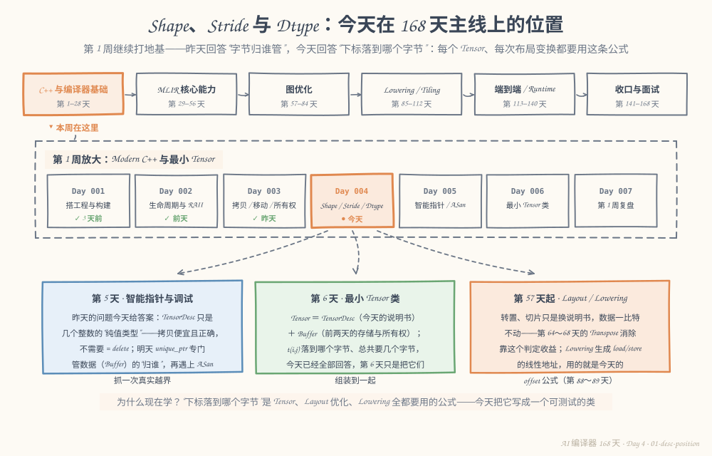
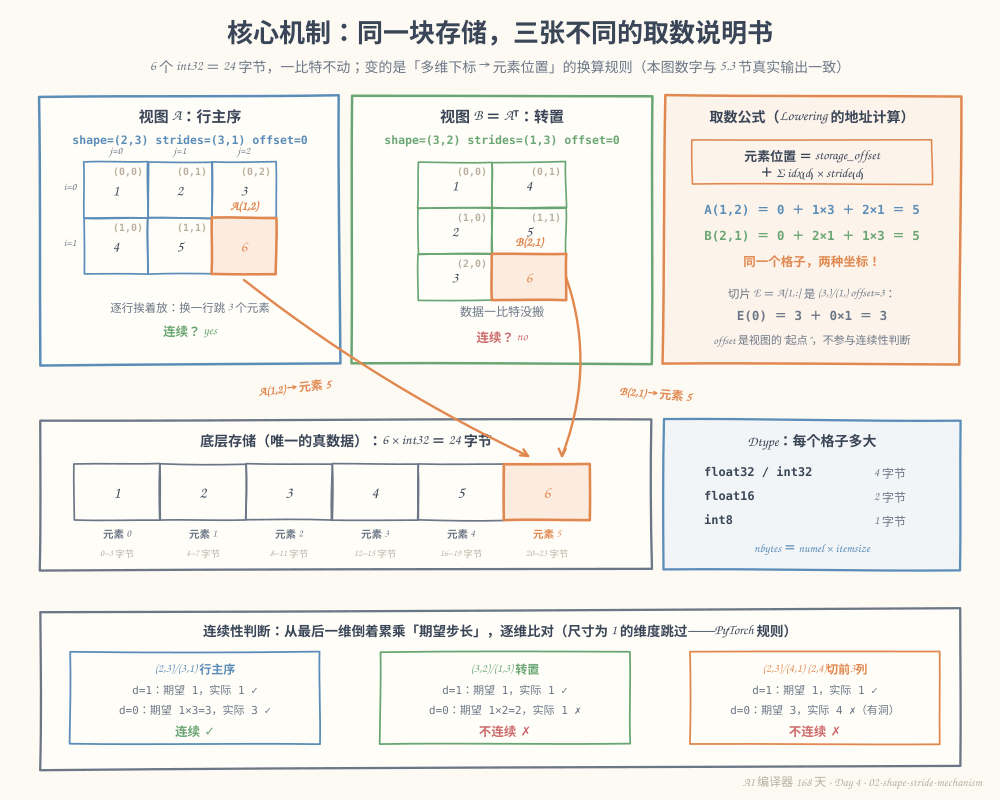
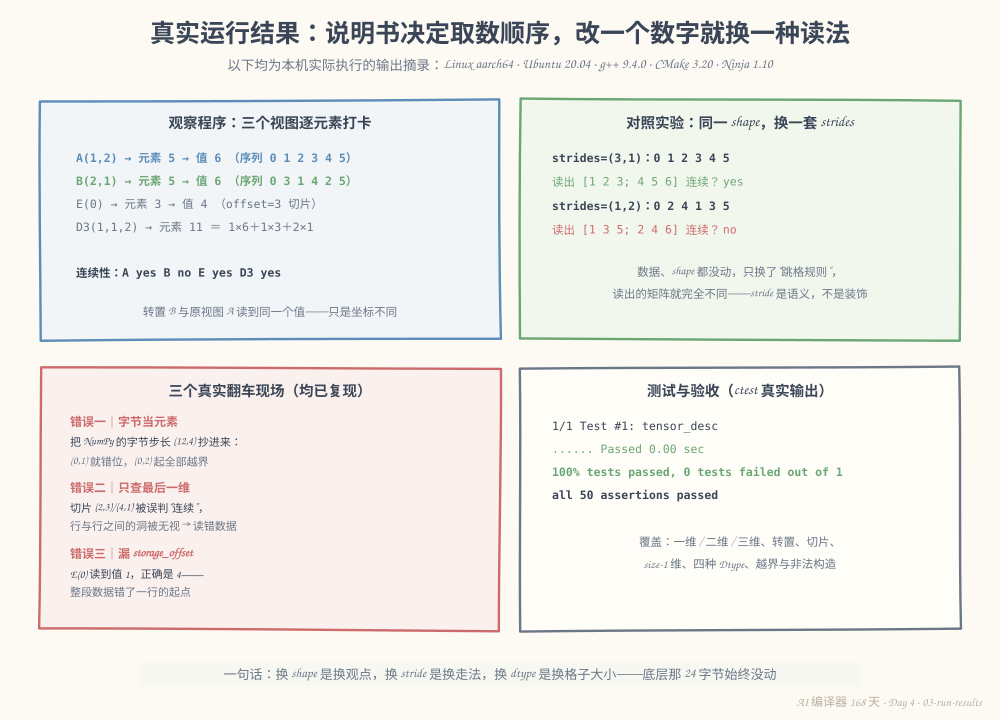

# 第 4 天：Shape、Stride 与 Dtype——给字节配一张"取数说明书"

> **今日目标**：能设计 `TensorDesc` 并解释 shape、strides、storage_offset、dtype 各自回答什么问题；能手工算出任意多维下标对应的元素位置和字节位置；能判断一个布局是否行主序连续（含"切片带洞"和"尺寸为 1 的维度"两种边界）；能用同一个底层存储构造转置、拉平、切片三种视图，并证明它们不搬一个字节的数据。
> **预计时间**：学习 35 分钟 + 实践 45 分钟
> **前置准备**：第 2～3 天的 `Buffer` 思路（存储与所有权）；构建环境同前三天（CMake ≥ 3.16、Ninja、支持 C++17 的 g++）。今天的示例独立成目录，不需要前几天的工程文件。
> **今日产出**：`TensorDesc` 类（元素数、字节数、连续性、偏移计算）、覆盖一维/二维/三维/非连续布局的 50 条断言测试，以及三张视图共享同一块存储的运行证据。

## 1. 今天解决什么问题？

昨天收尾时留了一个问题：`Buffer` 解决了"字节放在哪、归谁管"，但它只认识"第 N 个字节"。今天要给 Tensor 写 `at(i, j)` 时，马上撞墙：

```cpp
// 一块 24 字节的存储，想当成 2×3 的 int32 矩阵用
int& at(std::size_t i, std::size_t j) {
    return data_[?];   // ? 该填什么？
}
```

候选答案至少有三个：`i * 3 + j`（按行放）、`j * 2 + i`（按列放）、`i * 4 + j`（从别人切出来的、每行 4 列里取 3 列）。**数据自己不会说话**——同一块字节，配哪套规则，读出来就是不同的矩阵。这套规则必须显式地写下来，这就是今天的 `TensorDesc`。

对编译器来说这不是练习题：第 88～89 天把 `matmul` Lowering 成循环时，`load A[i][k]` 的地址就是这个公式；第 64～68 天判断一个 `Transpose` 能不能白拿掉，要看它是不是"只换说明书、没搬数据"；第 99 天做内存规划，要的是 `nbytes()`。今天把这个类写扎实，后面全是复用。

全文贯穿同一场戏：一块 6 个 int32 的存储 `[1, 2, 3, 4, 5, 6]`（24 字节），配三张说明书——

| 视图 | shape | strides | storage_offset | 含义 |
|---|---|---|---|---|
| A | (2,3) | (3,1) | 0 | 行主序矩阵 |
| B ＝ Aᵀ | (3,2) | (1,3) | 0 | 转置视图 |
| E ＝ A[1,:] | (3,) | (1,) | 3 | 第 2 行切片 |

**预期结果**：A(1,2) 和 B(2,1) 落到同一个元素（第 5 格）；A 连续、B 不连续；E 从第 3 格起步却仍然连续；全程存储一比特不动。

## 2. 先看全貌：今天的内容位于哪里？



**图 1**：主线放大镜仍对准第 1 周——昨天立的是"资源归谁"的规矩，今天回答"下标落到哪个字节"。看下方三张卡片：第 6 天 `Tensor = TensorDesc + Buffer` 把今天的说明书装进前两天的存储；第 57 天起的 Layout 优化和 Lowering，反复用的都是今天这条 offset 公式。

今天的路线分 4 步：

1. 用 shape 和 dtype 确定"逻辑上有几个格子、每个格子多大"；
2. 用 strides 和 storage_offset 确定"多维下标落到哪一格"；
3. 定义并判断"行主序连续"，理解它为什么是编译器的关键开关；
4. 写出 `TensorDesc`，用 50 条断言和三个视图的运行证据验收。

## 3. 核心概念：先用直觉，再给准确定义

### 3.1 Shape 与 Dtype：几个格子，每个多大

一句通俗解释：**Shape**（形状）说每个维度上有多少个元素；**Dtype**（数据类型）说每个元素占几个字节。

生活类比：一张 Excel 表——shape 是"几行几列"，dtype 是"每格存的是 4 字节的整数还是 2 字节的半精度数"。

**对应到技术上是**：shape 的单位是**元素**，元素总数 `numel = 各维大小之积`；dtype 决定元素大小 `itemsize`（float32/int32 是 4 字节，float16 是 2 字节，int8 是 1 字节），总字节数 `nbytes = numel × itemsize`。这两个函数是第 6 天 `Buffer` 分配内存、第 99～101 天内存规划的直接输入。

最小例子（今天的存储）：

```text
shape=(2,3), dtype=int32  →  numel = 2×3 = 6，nbytes = 6×4 = 24
shape=(2,3), dtype=float16 →  numel = 6，        nbytes = 6×2 = 12
```

常见误解：把 shape 当成"字节数"。`(2,3)` 说的是 6 个**元素**；换成 float16 后 shape 不变、字节数减半。另一个误解是"shape 相同 ⇒ 内存表现相同"——还要看 stride，3.3 节的反例会推翻它。

### 3.2 Stride 与 storage_offset：下标怎么落到格子上

一句通俗解释：**Stride**（步长）是"沿某个维度走一格，底层存储要跳过几个元素"；**storage_offset**（存储偏移）是"这个视图从底层存储的第几个元素开始"。

生活类比：教学楼里找房间——"3 楼 2 号"翻译成门牌序号，靠的是"每层有几间房"这条规则；顶楼带裙楼的楼，还要加一个"从第几间起算"。

**对应到技术上是**一个通用的线性化公式（维度记作 d，下标记作 idx）：

```text
元素位置 ＝ storage_offset ＋ Σ idx[d] × strides[d]
```

今天的三个代入（也是图 2 的核心）：

```text
A(1,2) ＝ 0 ＋ 1×3 ＋ 2×1 ＝ 5      B(2,1) ＝ 0 ＋ 2×1 ＋ 1×3 ＝ 5
E(0)   ＝ 3 ＋ 0×1     ＝ 3
```

由此立刻得到两个"免费"的结论：**转置 = 交换两条 stride**（数据一比特不动）；**行切片 = 改 shape 加 offset**（strides 原样保留）。第 57 天"Transpose 只是一个视图"、第 59 天"Reshape 为什么只改元信息"，地基都在这里。

一个必须钉死的单位约定：**本类的 stride 以"元素"为单位**（PyTorch 的 `tensor.stride()`、MLIR MemRef 的 strides 都是这么约定的）；而 **NumPy 的 `ndarray.strides` 属性以"字节"为单位**。我在本机用 NumPy 验证过这条边界（真实输出）：

```python
>>> import numpy as np
>>> a = np.arange(1, 7, dtype=np.int32).reshape(2, 3)
>>> a.strides
(12, 4)          # 字节：int32 的 (3,1) 元素步长 × 4 字节
>>> a.T.strides
(4, 12)
```

同一个 `(12,4)`，在 NumPy 语境和本类语境里含义差 4 倍——第 6 节错误一就是把这俩弄混的现场。

类比边界：教学楼类比里"每层几间房"是命名规则，而 stride 是真实的存储距离——它可以是 0（广播视图，同一格读多遍），也可以指向更大的底层存储（切片视图）。本类暂不支持负 stride（构造函数会拒绝），PyTorch 里它是合法的。

### 3.3 连续布局：编译器最关心的那个开关

一句通俗解释：**行主序连续**（row-major contiguous）指所有元素按"最后一维先走"的顺序背靠背挨着放，中间没有洞。

**对应到技术上是**一个判定规则：从最后一维往前倒序累乘"期望步长"，逐维与实际 stride 比对；**尺寸为 1 的维度跳过**（走一步也走不出它，步长是多少都无所谓——PyTorch 的规则）；**storage_offset 不参与判断**（起点在哪不影响"挨不挨着"）。

```text
(2,3) strides=(3,1)：d=1 期望 1 ✓ 实际 1；d=0 期望 1×3=3 ✓ 实际 3 → 连续
(3,2) strides=(1,3)：d=1 期望 1 ✓ 实际 1；d=0 期望 1×2=2 ✗ 实际 1 → 不连续
(2,3) strides=(4,1)：d=1 期望 1 ✓ 实际 1；d=0 期望 3 ✗ 实际 4 → 不连续（行间有洞）
```

第三行就是"从 (2,4) 矩阵切出前 3 列"的切片：每行末尾跳过 1 个不属于视图的元素。

为什么编译器关心：**连续 ⇒ 可以整块 `memcpy`、按顺序向量化 load、一次 DMA 搬完**；**不连续 ⇒ Lowering 要么生成带通用寻址的循环（慢），要么先 materialize（把数据真地拷成连续，花时间和空间）**。"这个 Tensor 连不连续"是第 57～58 天 Layout 决策、第 94 天 Tiling 的输入之一。

## 4. 图解核心机制



**图 2**：上方两张卡片是"逻辑视图"——同一批数字，A 按 (2,3) 排、B 按 (3,2) 排，橙色格子分别是 A(1,2) 和 B(2,1)。中间是唯一的真数据：6 个 int32 格子，每格 4 字节。右侧是 Lowering 要生成的地址公式和三个代入。底部是 3.3 节三条连续性判定的逐维展开。

按图中关键位置讲：

1. **两张逻辑网格的数字相同**：B 不是"另一份数据"，只是另一种坐标——转置发生在说明书上，不发生在存储里；
2. **两条橙色箭头汇入第 5 格**：A(1,2) 和 B(2,1) 的元素位置都是 5，公式卡上两个代入互相印证——这就是"同一格子、两种坐标"的机制全貌；
3. **存储条下方的字节标尺**（0–3、4–7……20–23）：元素位置乘 itemsize 才是字节位置，`byte_offset = element_offset × itemsize` 是 Dtype 进入地址计算的唯一入口；
4. **底部三连判定**：判定顺序永远是从最后一维倒着来；"切片有洞"（第三栏）说明**只查最后一维 stride==1 是错的**——第 6 节错误二的完整现场。

## 5. 动手实践：完成一个最小可运行例子

> 本节所有命令与输出都在这台机器上真实执行过：
> Linux aarch64（Ubuntu 20.04）· g++ 9.4.0 · CMake 3.20.5 · Ninja 1.10.0。
> 完整工程在本仓库 `tutorials/day-004/examples/tensor-desc/`，也可以按下面步骤自己敲一遍。

### 5.1 准备文件

```bash
mkdir -p tensor-desc/src tensor-desc/tests
cd tensor-desc
```

目录结构：

```text
tensor-desc/
├── CMakeLists.txt
├── src/
│   ├── TensorDesc.h      # 类声明：shape / strides / offset / dtype 四件套
│   ├── TensorDesc.cpp    # numel、nbytes、连续性、偏移计算
│   ├── main.cpp          # 观察程序：一块存储 × 三张说明书
│   └── CMakeLists.txt
└── tests/
    ├── test_tensor_desc.cpp   # 50 条断言
    └── CMakeLists.txt
```

构建脚本和前三天同款（C++17、`-Wall -Wextra -Wpedantic`、`enable_testing`），只有目标名不同（完整文件在 `tutorials/day-004/examples/tensor-desc/`）。

### 5.2 编写代码

`src/TensorDesc.h`——今天的全部概念落成四个成员：

```cpp
#pragma once
#include <cstddef>
#include <cstdint>
#include <initializer_list>
#include <string>
#include <vector>

// Dtype：元素类型。今天只关心两件事——名字和每个元素占几个字节。
// 数值语义（范围、精度）第 78 天再管。
enum class Dtype { Float32, Float16, Int32, Int8 };

const char* to_string(Dtype dt);
std::size_t itemsize(Dtype dt);  // 每个元素的字节数

// TensorDesc：Tensor 的“取数说明书”——只记录元信息，不拥有任何数据。
// 约定：stride 以“元素”为单位（同 PyTorch、MLIR MemRef）；
//       NumPy 的 ndarray.strides 以“字节”为单位，换算：字节步长 = 元素步长 × itemsize。
// 昨天的选做挑战问“TensorDesc 该不该禁止拷贝”——不该。它只有几个整数，
// 是纯值类型：拷贝便宜且语义正确。
class TensorDesc {
public:
    TensorDesc(std::vector<std::int64_t> shape, Dtype dtype,
               std::vector<std::int64_t> strides,
               std::int64_t storage_offset = 0);

    // 工厂：按行主序推导 strides。(2,3) → (3,1)
    static TensorDesc make_contiguous(std::vector<std::int64_t> shape, Dtype dtype);

    const std::vector<std::int64_t>& shape() const { return shape_; }
    const std::vector<std::int64_t>& strides() const { return strides_; }
    std::int64_t storage_offset() const { return storage_offset_; }
    Dtype dtype() const { return dtype_; }
    int rank() const { return static_cast<int>(shape_.size()); }

    std::int64_t numel() const;   // 元素数 = 各维大小之积（不是字节！）
    std::size_t nbytes() const;   // 字节数 = numel × itemsize
    bool is_contiguous() const;   // 行主序连续判断（PyTorch 规则）

    // 多维下标 → 底层存储的元素位置：offset_ + Σ idx[d]·strides_[d]
    std::int64_t element_offset(std::initializer_list<std::int64_t> idx) const;
    // 多维下标 → 字节位置：element_offset × itemsize
    std::int64_t byte_offset(std::initializer_list<std::int64_t> idx) const;

    std::string to_string() const;

private:
    std::vector<std::int64_t> shape_;
    std::vector<std::int64_t> strides_;
    std::int64_t storage_offset_;
    Dtype dtype_;
};
```

`src/TensorDesc.cpp` 的三个核心函数（`numel`/`nbytes`/`byte_offset`/`to_string` 以及构造期检查都是直白实现，完整版本在仓库）：

```cpp
// 工厂：最后一维步长 1，往前每维步长 = 后面所有维度大小之积。
TensorDesc TensorDesc::make_contiguous(std::vector<std::int64_t> shape, Dtype dtype) {
    const std::size_t rank = shape.size();
    std::vector<std::int64_t> strides(rank, 1);
    for (std::size_t i = rank; i-- > 1;) {  // 从倒数第二维往前累乘
        strides[i - 1] = strides[i] * shape[i];
    }
    return TensorDesc(std::move(shape), dtype, std::move(strides), 0);
}

// 行主序连续判断：倒序累乘期望步长，逐维比对。
// 尺寸为 1 的维度走不出格，步长是多少都算满足（PyTorch 规则）。
bool TensorDesc::is_contiguous() const {
    std::int64_t expected = 1;
    for (std::size_t i = shape_.size(); i-- > 0;) {
        if (shape_[i] == 1) {
            continue;
        }
        if (strides_[i] != expected) {
            return false;
        }
        expected *= shape_[i];
    }
    return true;
}

// 今天的公式：storage_offset ＋ Σ idx[d] × strides[d]，带边界检查。
std::int64_t TensorDesc::element_offset(std::initializer_list<std::int64_t> idx) const {
    if (idx.size() != shape_.size()) {
        throw std::invalid_argument("element_offset: 下标个数与秩不一致");
    }
    std::int64_t offset = storage_offset_;   // 别忘了起点（第 6 节错误三）
    std::size_t d = 0;
    for (std::int64_t i : idx) {
        if (i < 0 || i >= shape_[d]) {
            throw std::out_of_range("element_offset: 第 " + std::to_string(d) +
                                    " 维下标 " + std::to_string(i) + " 越界");
        }
        offset += i * strides_[d];
        ++d;
    }
    return offset;
}
```

三个设计决定值得停下来说一句：

1. **构造函数只查"说明书自身写得通不通"**（维数一致、无非负数），查不了"和真实数据配不配"——比如 stride 会不会跳出 buffer，要看存储多大才知道，那是第 6 天 `Tensor` 的职责。今天测试里的 `read_at` 替它做这个检查；
2. **`element_offset` 抛异常而不是返回 -1**：越界下标是调用方 bug，沿用第 2 天 `Buffer::at` 的约定；
3. **拷贝不做任何限制**：昨天选做挑战的答案是"不该 `= delete`"——`TensorDesc` 是几个整数的纯值类型，逐成员抄就是正确语义。测试第 ⑨ 组专门验证了这一点。

`src/main.cpp` 是观察程序：用 `std::vector<int>` 顶替未来的 `Buffer` 装下 `[1..6]`，对 A/B/C/D3/E/F 六个视图逐一打印"逻辑下标 → 元素位置 → 值"。核心是这么一个函数（完整文件在仓库）：

```cpp
// 安全读取：TensorDesc 自己不知道底层存储多大（这是它的设计边界），
// 观察程序替它做越界检查，顺便模拟“编译器按说明书取数”。
static int read_at(const std::vector<int>& storage, const TensorDesc& d,
                   std::initializer_list<std::int64_t> idx) {
    std::int64_t off = d.element_offset(idx);
    if (off < 0 || off >= static_cast<std::int64_t>(storage.size())) {
        std::printf("  【越界】元素 %lld 超出存储的 0..%zu\n",
                    static_cast<long long>(off), storage.size() - 1);
        return -1;
    }
    return storage[static_cast<std::size_t>(off)];
}
```

`tests/test_tensor_desc.cpp` 按概念分组写了 50 条断言，覆盖计划要求的一维/二维/三维/非连续，外加切片、size-1 维、四种 Dtype、越界与非法构造、以及"纯值类型可拷贝"。节选三段（完整文件在仓库）：

```cpp
// --- 二维行主序：make_contiguous 推导 strides ---
TensorDesc a = TensorDesc::make_contiguous({2, 3}, Dtype::Int32);
assert(a.strides()[0] == 3 && a.strides()[1] == 1);   // ⑧
assert(a.element_offset({1, 0}) == 3);                 // ⑬ 换行跳 3 个元素
assert(a.element_offset({1, 2}) == 5);                 // ⑭ 右下角
assert(a.byte_offset({1, 1}) == 16);                   // ⑮ 字节位置 = 4 × 4

// --- 二维非连续：转置视图 ---
TensorDesc b({3, 2}, Dtype::Int32, {1, 3}, 0);         // A 的转置：交换 strides
assert(!b.is_contiguous());                            // ⑯
assert(b.element_offset({2, 1}) == 5);                 // ⑳ 与 A(1,2) 同一格子

// --- storage_offset：切片视图从中间开始 ---
TensorDesc e({3}, Dtype::Int32, {1}, 3);               // A[1,:]
assert(e.element_offset({0}) == 3);                    // ㉝ 下标 0 也要加上 offset
assert(e.is_contiguous());                             // ㉟ offset 不影响连续性
```

### 5.3 运行与观察

```bash
cmake -S . -B build -G Ninja
cmake --build build
./build/src/tensor-desc
```

构建输出 6 个步骤，和前三天一致。运行的真实输出（数值固定，不含地址，逐次运行一致）：

```text
== 0. 数据准备：一块 6 个 int32 的底层存储 ==
storage = [1, 2, 3, 4, 5, 6]  （24 字节，每个 int32 占 4 字节）

== 1. 视图 A：行主序 (2,3)，说明书由 make_contiguous 推导 ==
A：shape=(2,3) strides=(3,1) offset=0 dtype=int32
  A(0,0) → 元素 0 → 值 1
  A(0,1) → 元素 1 → 值 2
  A(0,2) → 元素 2 → 值 3
  A(1,0) → 元素 3 → 值 4
  A(1,1) → 元素 4 → 值 5
  A(1,2) → 元素 5 → 值 6
  元素数 numel = 6，字节数 nbytes = 24，连续？ yes

== 2. 视图 B = A 的转置 (3,2)：只改元信息，数据一比特不动 ==
B：shape=(3,2) strides=(1,3) offset=0 dtype=int32
  B(0,0) → 元素 0 → 值 1
  B(0,1) → 元素 3 → 值 4
  B(1,0) → 元素 1 → 值 2
  B(1,1) → 元素 4 → 值 5
  B(2,0) → 元素 2 → 值 3
  B(2,1) → 元素 5 → 值 6
  元素数 numel = 6，字节数 nbytes = 24，连续？ no

  对照：A(1,2) 与 B(2,1) 的元素位置都是 5 —— 同一个格子，两种坐标。

== 3. 视图 C = 拉平 (6,)：仍是同一块存储 ==
C：shape=(6,) strides=(1,) offset=0 dtype=int32
  C(4) → 元素 4 → 值 5；连续？ yes

== 4. 三维 (2,2,3)：行主序 strides 由外向内 6,3,1 ==
D3：shape=(2,2,3) strides=(6,3,1) offset=0 dtype=int32
  D3(1,1,2) → 元素 11（= 1×6 + 1×3 + 2×1）；连续？ yes

== 5. 切片视图 E = A[1,:]（第 2 行）：shape 变小，offset 前移 ==
E：shape=(3,) strides=(1,) offset=3 dtype=int32
  E(0) → 元素 3 → 值 4
  E(2) → 元素 5 → 值 6
  连续？ yes（storage_offset 不参与连续性判断）

== 6. 换个 Dtype：同样的 (2,3)，float16 只要 12 字节 ==
F：shape=(2,3) strides=(3,1) offset=0 dtype=float16
  numel = 6，nbytes = 12；A(1,2) 的字节位置 = 20，F(1,2) 的字节位置 = 10
```

逐段读这份输出：

- **第 1 段**：A 的访问序列是 0,1,2,3,4,5——行主序连续，换行跳 3 个元素（`A(1,0)` 直接从 2 跳到 3，中间没有洞）；
- **第 2 段（重点）**：B 的访问序列是 0,3,1,4,2,5——按 B 的坐标走，物理上是在存储里"跳着"读；`B(2,1)` 和 `A(1,2)` 同落在元素 5，值都是 6。**转置前后的 `numel`、`nbytes` 完全相同**，说明没有发生任何数据搬运；
- **第 5 段**：E 的下标 0 对应元素 3——`storage_offset` 生效；但连续性是 yes，印证"起点不影响挨着与否"；
- **第 6 段**：同样的 `(2,3)`，float16 的字节数只有 12；`(1,2)` 的字节位置从 20 缩到 10——`itemsize` 只在 `nbytes`/`byte_offset` 两处进入计算。

```bash
ctest --test-dir build --output-on-failure
```

真实输出：

```text
1/1 Test #1: tensor_desc ......................   Passed    0.00 sec

100% tests passed, 0 tests failed out of 1
```

测试程序自身最后打印：

```text
all 50 assertions passed
```



**图 3**：四张卡片是同一台机器上的真实证据。左上是三个视图的"逐元素打卡"——A 与 B 在元素 5 会合；右上证明"只换 strides 就换一种读法"（5.4 节）；左下是三个真实复现的翻车现场（第 6 节）；右下是 ctest 与 50 条断言的收尾账单。

### 5.4 修改一个参数再观察

**实验：同一块存储、同一个 shape，只换一套 strides。** 写一个独立小程序（和 `TensorDesc.cpp` 一起直接用 `g++` 编译）：

```cpp
#include "TensorDesc.h"
#include <cstdio>
#include <vector>

int main() {
    std::vector<int> storage = {1, 2, 3, 4, 5, 6};
    TensorDesc row({2, 3}, Dtype::Int32, {3, 1}, 0);  // 按行读
    TensorDesc col({2, 3}, Dtype::Int32, {1, 2}, 0);  // 隔一个取一个

    for (auto* d : {&row, &col}) {
        std::printf("%s：访问序列", d == &row ? "strides=(3,1)" : "strides=(1,2)");
        for (std::int64_t i = 0; i < 2; ++i)
            for (std::int64_t j = 0; j < 3; ++j)
                std::printf(" %lld", static_cast<long long>(d->element_offset({i, j})));
        std::printf(" → 读到的矩阵 [");
        for (std::int64_t i = 0; i < 2; ++i)
            for (std::int64_t j = 0; j < 3; ++j)
                std::printf("%d%s", storage[static_cast<std::size_t>(d->element_offset({i, j}))],
                            (i == 1 && j == 2) ? "" : " ");
        std::printf("]，连续？ %s\n", d->is_contiguous() ? "yes" : "no");
    }
    return 0;
}
```

先预测：`strides=(1,2)` 会按什么顺序访问？读出的矩阵长什么样？我实际执行过（`g++ -std=c++17 -Wall -Wextra -Wpedantic -I src src/TensorDesc.cpp exp54.cpp -o exp54 && ./exp54`）：

```text
strides=(3,1)：访问序列 0 1 2 3 4 5 → 读到的矩阵 [1 2 3 4 5 6]，连续？ yes
strides=(1,2)：访问序列 0 2 4 1 3 5 → 读到的矩阵 [1 3 5 2 4 6]，连续？ no
```

读出的矩阵从 `[[1,2,3],[4,5,6]]` 变成 `[[1,3,5],[2,4,6]]`——**数据、shape、offset 全都没动，只换了"跳格规则"，读出的内容就完全不同**。这就是 stride 是语义而不是装饰的直接证据；也是为什么第 60 天的 Broadcast（stride=0）、第 64 天的 Transpose 消除都必须把 stride 当成一等公民来推理。

顺手做一次外部对照（NumPy 真实输出，验证 3.2 节的"字节步长"约定）：

```python
>>> a = np.arange(1, 7, dtype=np.int32).reshape(2, 3)
>>> a.strides, a.T.strides
((12, 4), (4, 12))      # 字节；除以 itemsize=4 才得到本类的 (3,1) / (1,3)
>>> a[1,:].ctypes.data - a.ctypes.data
12                      # 字节；= 元素 offset 3 × 4
```

NumPy 的切片视图同样只改元信息——和我们第 5 段输出的 E 视图一模一样，只是单位不同。

## 6. 常见错误与排查

以下三个错误都在本机真实复现过。复现使用独立的单文件程序，与工程里的 `TensorDesc.cpp` 一起编译，命令附在各条里。

**错误一：把"字节步长"当成"元素步长"传进来**

```cpp
// 想描述 (2,3) int32 行主序，却照着 NumPy 的字节步长 (12,4) 抄：
TensorDesc wrong({2, 3}, Dtype::Int32, {12, 4}, 0);
```

编译命令：`g++ -std=c++17 -Wall -Wextra -I src src/TensorDesc.cpp err1.cpp -o err1`。真实输出：

```text
错误说明书：shape=(2,3) strides=(12,4) offset=0 dtype=int32，存储却只有 6 个元素

wrong(0,0) → 元素 0 → 值 1（已经错位）
wrong(0,1) → 元素 4 → 值 5（已经错位）
wrong(0,2) → 元素 8 → 【越界】
wrong(1,0) → 元素 12 → 【越界】
wrong(1,1) → 元素 16 → 【越界】
wrong(1,2) → 元素 20 → 【越界】
nbytes() 只按 shape 算出 24，对 stride 的错误毫无感知。
```

- 现象：`(0,1)` 就开始读到错位的值（把第 4 个元素当成了第 1 行第 2 列），从 `(0,2)` 起全部越界；`nbytes()` 依旧报 24，毫无预警。
- 原因：NumPy 的 strides 以字节为单位，本类以元素为单位，两套约定差一个 `itemsize` 倍数；`TensorDesc` 构造期查不了这种错（它不知道 buffer 多大）。
- 定位：打印 desc 和存储大小，第一个越界点的位置除以 itemsize 约等于你想要的步长，就是单位错了。
- 修复：统一单位——类内部只用"元素"，`itemsize` 只在 `nbytes()`/`byte_offset()` 出现；如果接口必须收字节步长，进门先除以 `itemsize`。

**错误二：连续性判断只查"最后一维 stride 是否为 1"**

场景：从 `(2,4)` 大矩阵切出前 3 列，得到 `(2,3)/(4,1)`——最后一维步长确实是 1，但行与行之间有洞。复现程序里放一个有 bug 的第一版判断：

```cpp
// 有 bug 的版本：只检查最后一维（常见的第一版写法）。
static bool is_contiguous_v1(const TensorDesc& d) {
    return d.strides().back() == 1;
}
```

真实输出：

```text
切片说明书：shape=(2,3) strides=(4,1) offset=0 dtype=int32
访问序列： 0 1 2 4 5 6

is_contiguous_v1（只查最后一维）： yes ← 误判
正确的 is_contiguous（逐维累乘比对）： no
```

- 现象：切片被误判为"连续"。如果编译器信了，会按 0,1,2,3,4,5 的顺序整块搬运或向量化读取——而真实数据在 0,1,2,4,5,6，第 4 个位置读进来的是别人被跳过的第 4 列，结果悄悄错位。
- 原因：连续性是**所有维度**的联合约束，不是最后一维的局部属性；第 0 维的期望步长是 `1×3=3`，实际是 4。
- 定位：打印完整访问序列，和 `0..numel-1` 逐个比对——出现跳格立即暴露。
- 修复：倒序累乘逐维比对（5.2 节的正确实现），并补上 `(2,3)/(4,1)` 这样的回归测试（测试第 ⑤ 组）。

**错误三：取数时忘记加 storage_offset**

场景：`E = A[1,:]` 是 `(3,)/(1,) offset=3` 的切片视图，手写地址计算时直接用 `Σ idx × stride`：

```cpp
std::int64_t buggy = i * e.strides()[0];    // 忘了加 offset
std::int64_t right = e.element_offset({i}); // offset_ + i·stride
```

真实输出：

```text
切片说明书：shape=(3,) strides=(1,) offset=3 dtype=int32（注意 offset=3）

E(0)：漏掉 offset 读到 元素 0 → 值 1；正确是 元素 3 → 值 4
E(1)：漏掉 offset 读到 元素 1 → 值 2；正确是 元素 4 → 值 5
E(2)：漏掉 offset 读到 元素 2 → 值 3；正确是 元素 5 → 值 6
```

- 现象：读到的值整体错了"一段"——这里整整错了一行；程序不崩溃、不越界（0..2 恰好合法），纯数据错位。
- 原因：`element_offset` 的第一项就是 `storage_offset_`，手写公式时最容易漏；非零 offset 只出现在切片/子视图里，正常路径测不出来。
- 定位：对任何切片视图，检查"下标全 0 时位置是否等于 `storage_offset()`"——一条断言就能守住。
- 修复：永远调用 `element_offset`，别在手写地址公式时绕过它；测试第 ⑥ 组专门钉住这一点。

三个错误排成一条递进线：错误一错在**单位**（约定没对齐）、错误二错在**完整性**（约束少查一维）、错误三错在**起点**（公式漏一项）。共同点是 `TensorDesc` 自身都不崩溃——错误全部流向"读错数据"，这正是布局 bug 比内存 bug 更隐蔽的地方。

## 7. 今日练习

### 必做练习

给 `TensorDesc` 加两个视图工厂（转置和切片），全程不碰数据：

1. `TensorDesc permute(std::vector<int> perm) const`：新 shape 的第 d 维取 `shape[perm[d]]`，新 strides 同样取 `strides[perm[d]]`；
2. `TensorDesc slice(int dim, std::int64_t start, std::int64_t end) const`：`shape[dim]` 改为 `end-start`，`storage_offset` 加上 `start × strides[dim]`，strides 不变。

先**在纸上**写出预测：A 是 `(2,3)/(3,1) offset=0`，则 `A.permute({1,0})` 和 `A.slice(0,1,2)` 各是什么？`A.slice(1,1,3)`（取后两列）的 shape、strides、offset、连续性各是什么？`(1,1)` 落在哪个元素？然后写断言验证，并和 5.3 节输出里的 B、E 对照——`permute({1,0})` 应当与 B 完全一致，`slice(0,1,2)` 应当与 E 完全一致。预期产出：两个工厂方法、至少 6 条新断言、一张预测稿。

### 选做挑战

写一个 `make_col_major(shape, dtype)` 工厂：按**列主序**推导 strides（第一维步长 1，往后每维步长 = 前面维度大小之积）。验证 `(2,3)` 得到 `(1,2)`——恰好是 5.4 节实验里的第二套说明书，读出 `[[1,3,5],[2,4,6]]`。然后回答一个问题：这个 desc 在我们的 `is_contiguous()` 下是 no，但它"换个方向明明是挨着放的"——这说明"连续"这个结论依赖什么前提？把你的答案写成一两句话，第 58 天 NCHW/NHWC 对照时会用上。

## 8. 今日验收

- [ ] 我能用自己的话说出 shape、strides、storage_offset、dtype 各回答哪个问题，并解释"shape 相同 ≠ 内存表现相同"（5.4 节是反例）；
- [ ] 我能独立构建运行 `tensor-desc`，指着输出里任意一行（比如 `B(1,0) → 元素 1`）说出那个位置是怎么按公式算出来的；
- [ ] 给一个新 desc（如 `shape=(2,4) strides=(8,2) offset=2`），我能先笔算 `(1,3)` 的元素位置和连续性，再用程序验证我的预测；
- [ ] 我能凭现象区分三类错误：字节当元素（错位＋越界）、只查最后一维（把有洞的切片判成连续）、漏 storage_offset（值整体错一段）；
- [ ] 我保存了 `tensor-desc` 工程、50 条断言的测试，以及三个错误的真实复现记录（含命令和输出）。

## 9. 一句话总结与明天预告

今天解决"下标落到哪个字节"：`TensorDesc` 用四个整数成员（shape、strides、storage_offset、dtype）把逻辑坐标翻译成物理位置——元素位置 ＝ offset ＋ Σ 下标 × 步长，字节数 ＝ 元素数 × 元素大小。转置、拉平、切片全是"只换说明书"的元信息操作，我们用同一块 24 字节的存储跑出三个视图并看到 A(1,2) 与 B(2,1) 在元素 5 会合；换一套 strides 就读出完全不同的矩阵；连续性判定从最后一维倒序累乘，是编译器决定"能否整块搬、向量化"的开关。50 条断言和三个真实翻车现场把单位、完整性、起点三类错误都钉在了测试里。

明天进入第 5 天"智能指针与调试工具"：说明书（`TensorDesc`）已经就位，存储（`Buffer`）也定了生死和归属的规矩——但今天 `read_at` 里的越界检查是手写的，第 6 节错误一那种"悄悄读错"更是检查不出来。明天把 `Buffer` 的管理权交给 `unique_ptr`（昨天手写的移动语义搬进类型系统），再请 AddressSanitizer 出场，故意制造一次越界并看它怎么被抓出来。
