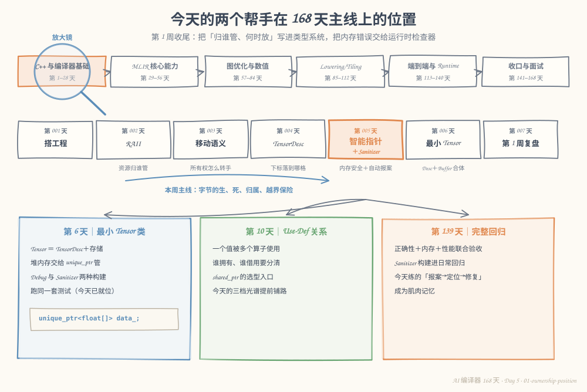
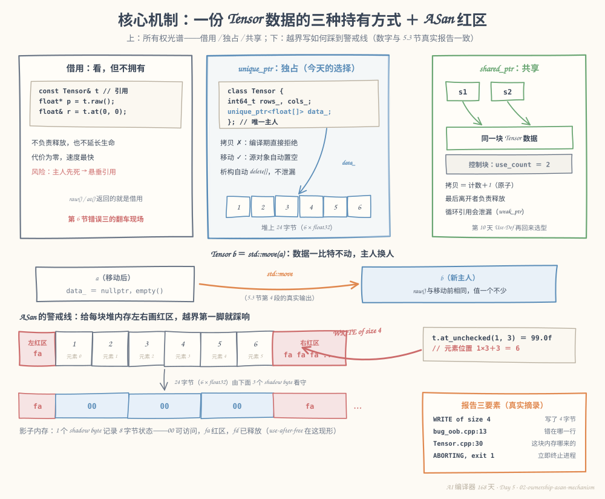
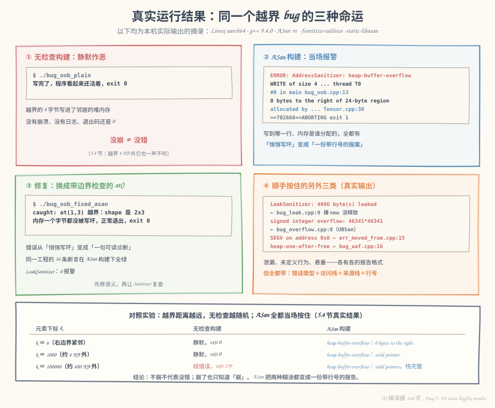

# 第 5 天：智能指针与调试工具——把"归谁管"写进类型系统，让越界自己报案

> **今日目标**：能说清 `unique_ptr`、`shared_ptr`、裸指针/引用三种"持有方式"的所有权差异，并按规则给 Tensor 选型；能用 `unique_ptr` 写出"拷贝在编译期被拒绝、移动自动正确、析构自动释放"的 `Tensor` 初版；能故意制造一次堆越界，逐行读懂 ASan 报告（写到哪里、错在哪行、这块内存谁分配的），随后修复并复查通过；能区分 ASan 与 UBSan 各管哪类问题，并用 LeakSanitizer 抓住一次真实泄漏。
> **预计时间**：学习 35 分钟 + 实践 50 分钟
> **前置准备**：第 2 天的 RAII 与 `Buffer`、第 3 天的移动语义与所有权（今天要把那两天的手艺"装进类型系统"）；第 4 天的 `TensorDesc` 只需要 shape 的概念，今天不并入它；构建环境同前四天（CMake ≥ 3.16、Ninja、g++ 或任何支持 `-fsanitize=address` 的编译器）。
> **今日产出**：`smart-tensor` 工程（`unique_ptr` 版 `Tensor` 初版 + 16 条断言测试 + ASan/UBSan 构建开关）、一次完整的"故意越界 → ASan 报告 → 修复 → 复查"记录、LeakSanitizer 抓泄漏与 UBSan 抓有符号溢出的真实输出。

## 1. 今天解决什么问题？

昨天收尾时留下两笔账：`TensorDesc` 解决了"下标落到哪个字节"，但 5.3 节里 `read_at` 的越界检查是**手写的**——忘写就没人管；第 6 节错误一那种"悄悄读错数据"的布局 bug，手写检查更抓不到。再往前翻一天：第 2～3 天的 `Buffer` 用裸 `new[]/delete[]`，析构、禁拷贝、移动构造、移动赋值全是**手写**的——手写意味着容易漏，漏一处就是泄漏或 double free。

把这三笔账摆到一起，就是今天要解决的两类问题：

```text
① 所有权靠自觉：谁该 delete？什么时候 delete？拷贝为什么必须禁止？——靠人记规则，必错。
② 内存错误靠运气：越界写 4 字节、用了已释放的内存、忘了释放——程序不崩就当没发生。
```

今天的两个帮手正好一对一：

- **智能指针**把"归谁管、何时放"从注释里的自觉变成**类型系统的硬约束**——拷贝在编译期直接报错，析构自动发生；
- **Sanitizer**（运行时检查器）把内存错误从"不崩就不发现"变成**当场报案**——带错误类型、调用栈和行号。

全文继续用那块老存储：`[1, 2, 3, 4, 5, 6]`（2×3、float32、24 字节）。今天它正式升级为 `Tensor` 初版。预期结果分三条路：`at(1,2)` 正常读写；`at(1,3)` 被边界检查拒绝；`at_unchecked(1,3)` 在无检查构建下静默 `exit 0`、在 ASan 构建下当场被抓——同一个 bug 的两种命运，就是今天的主角戏。

## 2. 先看全貌：今天的内容位于哪里？



**图 1**：放大镜仍然对准第 1 周——昨天管"下标落到哪格"，今天管"这块内存归谁、错了谁报警"。看下方三张卡片：第 6 天把今天的存储和第 4 天的说明书合体成正式 `Tensor`；第 10 天的 Use-Def 会重新遇到"一份值多个使用者"的所有权选型；第 139 天的完整回归里，Sanitizer 构建是日常工具而非一次性体检。

今天的路线分 4 步：

1. 摆出所有权三档光谱：借用 / 独占 / 共享，给 Tensor 选型；
2. 用 `unique_ptr` 写 `Tensor` 初版——拷贝被删、移动自动、析构自动；
3. 故意制造一次堆越界：先看无检查构建怎么"装没事"，再看 ASan 怎么报案，读懂报告后修复；
4. 泄漏、未定义行为各来一发，交给 LeakSanitizer 和 UBSan 收尾。

## 3. 核心概念：先用直觉，再给准确定义

### 3.1 所有权：谁负责"释放"

一句通俗解释：**所有权**（ownership）就是关于一份资源的契约——"它在没用的时候，**谁**负责释放"。C++ 里没有语言强制的答案，但类型系统可以帮你把约定写成硬规则。

生活类比：教室钥匙。只有一把钥匙时，谁拿钥匙谁负责锁门（独占）；钥匙配了几把大家共用，最后走的人锁门（共享）；你只是进去坐了一节课，不碰门锁（借用）。

**对应到技术上是**：`unique_ptr` 把"锁门"（`delete[]`）挂在**析构函数**里，跟着对象走；`shared_ptr` 把它挂在**引用计数归零**上，跟着最后一台持有者走；裸指针和引用什么都不挂——释放义务完全在主人那边，你只是"看了一眼"。

最小例子（同一份 Tensor 的三个档位）：

```cpp
Tensor t = Tensor::from_data(2, 3, {1, 2, 3, 4, 5, 6});

const float* p = t.raw();                  // 借用：只看，不管生死
Tensor u = std::move(t);                    // 独占：u 是这块内存的唯一主人
auto s = std::make_shared<Tensor>(std::move(u));  // 共享：计数归零才释放
```

常见误解：以为"所有权"是编译器或操作系统强制的。不是——它是**库类型和代码风格共同维护的约定**：你随时可以 `t.raw()` 拿裸指针绕过一切，约定破了没人拦你（这正是 Sanitizer 存在的理由）。类比也不覆盖性能：借用零开销，独占零开销，共享有实打实的计数开销（3.3 节）。

### 3.2 unique_ptr：把第 2～3 天的手艺装进类型系统

一句通俗解释：`std::unique_ptr<T[]>` 是"**只许有一个主人的堆数组**"。主人换了人（移动），旧主人自动两手空空；主人没了（析构），数组自动释放。

生活类比：房产过户——证随房走，过户一次手续，旧证自动作废，不存在两本有效房产证。

**对应到技术上是**：把成员写成 `std::unique_ptr<float[]> data_;` 之后，编译器为 `Tensor` 自动生成/删除这组函数——

| 事情 | 第 2～3 天的 `Buffer` | 今天的 `Tensor` |
|---|---|---|
| 析构时释放 | 手写 `~Buffer()` | 自动（`unique_ptr` 析构调 `delete[]`） |
| 禁止拷贝 | `= delete` 手写两处 | 自动（拷贝被成员连带删除） |
| 移动构造/赋值 | 手写（搬指针、置空源） | 自动（源 `data_` 变 `nullptr`） |
| 数组版下标 | 自己写 `buf[i]` | `data_[i]` 直接可用 |

也就是说：**第 3 天手写的全部移动语义，今天一个字都不用写**。这是"把纪律装进类型"的直接收益——人记规则会漏，类型系统不会。

最小例子（今天的真实输出，5.3 节第 4 段）：

```text
移动后 t.empty()? yes；b.raw() 和移动前相同? yes
```

移动把 `data_` 的指针搬给了 `b`，`t` 变空——**数据一比特没动，主人换了人**。这行输出同时验证两件事：没有发生数据拷贝（`raw()` 指针不变），也没有发生 double free（`t` 已经空了）。

常用接口备查：`std::make_unique<float[]>(n)` 分配并**数值初始化为 0**；`.get()` 借用裸指针（不转让所有权）；`.reset(p)` 换一块或置空；数组版自带 `operator[]`。

类比边界：`unique_ptr` 删除的是"**拷贝这个动作**"，不是"复制数据的能力"——真想复制，显式写一个 `clone()` 返回新 Tensor（第 7 节选做挑战）。过户类比也不覆盖"`new` 的那一刻"：`unique_ptr` 不负责让你少写 `new`，它负责让 `delete` 永远发生且只发生一次。

### 3.3 shared_ptr 与它的代价

一句通俗解释：`std::shared_ptr<T>` 是"**共享所有权**"——每次拷贝计数加一，每次销毁计数减一，减到零的那次负责释放。

生活类比：合租房的电闸——最后出门的人拉闸锁门，谁都不会提前断电。

**对应到技术上是**：每个 `shared_ptr` 指向同一块**控制块**（control block），里面存着强引用计数（`use_count()`）和弱引用计数；计数增减是**原子操作**——这就是它的代价：比 `unique_ptr` 多一次分配（控制块）、多一份原子开销。我在本机真实运行过一遍计数变化（`bugs/exp_shared.cpp`，完整输出见 5.3 节末）：

```text
s1.use_count() = 1
拷贝出 s2 后 use_count() = 2
s1.reset() 后 s2.use_count() = 1
s2 还能用：s2->at(0,0) = 1
```

今天为什么不用它：Tensor 的数据**天然只有一个主人**——Tensor 自己；共享的原子开销没有任何收益。什么时候会回来：第 10 天的 Use-Def 关系，一个 Value 被多个 Node 使用时，"共享还是独占"会变成真问题。还有一句必须先钉住：两个 `shared_ptr` 互相持有会形成**循环引用**，计数永远不归零——"最后走的人锁门"就失效了，解法是 `weak_ptr`（弱引用，不参与计数），第 10 天展开。

类比边界：合租类比听不出任何毛病，但代码里没有"门禁日志"——循环引用时房间永远显示"有人"，这正是 LeakSanitizer 能抓到的那类泄漏。

### 3.4 ASan 与 UBSan：两个运行时检查器

一句通俗解释：**ASan**（AddressSanitizer，地址消毒器）在每次内存访问前后插一句"查影子"；**UBSan**（UndefinedBehaviorSanitizer，未定义行为消毒器）在每次计算处问一句"这步数学上有定义吗"。

生活类比：ASan 像装修时沿每面墙贴了感应条，碰到不该碰的地方当场响；UBSan 像施工前审查图纸，发现"这堵墙根本没画支撑"。

**对应到技术上是**两套机制，管的错误类型互补：

- ASan：编译器把每次 `load/store` 改写成"先查**影子内存**（shadow memory）再访问"。影子内存用 **1 个字节记录真实内存 8 个字节的状态**：`00` 可访问、`fa` 是**红区**（redzone，分配器在每块堆内存左右垫的警戒带）、`fd` 已释放。越界、use-after-free、double-free、泄漏（配合 LeakSanitizer，下称 LSan）都是"踩到非法状态"被当场抓获；
- UBSan：抓**计算本身没有定义**的行为——有符号整数溢出、空指针解引用、移位越界这类。它和 ASan 的分工：ASan 管"访问了不该访问的内存"，UBSan 管"这个计算的结果 C++ 标准没规定"。

使用方式（本机验证过的命令形态）：

```bash
g++ -std=c++17 -g -fsanitize=address -static-libasan ...      # ASan（含 LSan）
g++ -std=c++17 -g -fsanitize=undefined -fno-sanitize-recover=all ...  # UBSan
```

两个使用边界必须先记住：Sanitizer 只能抓**执行到的路径**——没跑到的分支照样漏网，所以它是日常回归工具而不是一次性体检（第 139 天验收的标准配置）；另外 ASan 构建有额外运行开销，性能测量永远用普通构建（本机的真实对照：同一套 ctest，普通构建 0.00 秒、ASan 构建 3.27 秒，见 5.3 节）。

## 4. 图解核心机制



**图 2**：上半部分是所有权光谱的三张卡：灰色"借用"（`raw()`/引用，零开销、不负责释放）、蓝色"独占"（`unique_ptr<float[]> data_`，今天的选择）、绿色"共享"（控制块 `use_count`）。中间一条 `std::move` 把"数据不动、主人换人"画成过户。下半部分是 ASan 的警戒线：24 字节的堆块左右各画红区（`fa`），下面一行影子内存用 3 个 `00` 看守它——每 1 个 shadow byte 管 8 字节。

按图中编号顺序讲四点：

1. **三张卡的箭头都指向同一块堆数据**：Tensor 的数据只有一个，差别只在"谁负责释放"——这是 3.1 节契约的图形化。`unique_ptr` 卡里那行 `data_;` 就是今天 `Tensor` 的全部秘密；
2. **中间的过户箭头**：`std::move(a)` 之后 `a` 的 `data_` 是 `nullptr`、`b` 的 `raw()` 与移动前相同——对应 5.3 节真实输出的第 4 段。注意 `a` 的 `rows_/cols_` 还是旧值（整型成员的"移动"就是拷贝），所以对它调 `at(0,0)` 能**通过**边界检查然后解引用空指针——第 6 节错误二的现场；
3. **红区**：ASan 的分配器在 24 字节区域的左右垫上标记为 `fa` 的禁区。`at_unchecked(1,3)` 算出元素位置 6，写下去正踩在**右红区第一格**——真实报告里的 "0 bytes to the right of 24-byte region" 说的就是这一脚；
4. **影子行**：3 个 `00`（每管 8 字节）＋右侧一串 `fa`。任何访问先翻译到 shadow byte：`00` 放行，`fa/fd` 立即 abort 并打印报告。右下角"报告三要素"卡对应真实报告的四个关键行——写了什么（`WRITE of size 4`）、错在哪行（`bug_oob.cpp:13`）、内存哪来的（`Tensor.cpp:30`）、后果（`ABORTING, exit 1`）。

## 5. 动手实践：完成一个最小可运行例子

> 本节所有命令与输出都在这台机器上真实执行过：
> Linux aarch64（Ubuntu 20.04）· g++ 9.4.0 · CMake 3.20.5 · Ninja 1.10.0。
> 本机动态链接 libasan 时会报 `ASan runtime does not come first in initial library list`，解决办法是把运行时静态链接进可执行文件：**加 `-static-libasan`**（下面的命令都带上了）。
> 完整工程在本仓库 `tutorials/day-005/examples/smart-tensor/`，也可以按步骤自己敲一遍。

### 5.1 准备文件

```bash
mkdir -p smart-tensor/src smart-tensor/tests smart-tensor/bugs
cd smart-tensor
```

目录结构：

```text
smart-tensor/
├── CMakeLists.txt           # 根构建脚本：ENABLE_ASAN / ENABLE_UBSAN 两个开关
├── src/
│   ├── Tensor.h             # Tensor 初版：unique_ptr<float[]> 独占数据
│   ├── Tensor.cpp           # zeros / from_data / at / at_unchecked
│   ├── main.cpp             # 观察程序：读写、边界、借用、移动、转移
│   └── CMakeLists.txt
├── tests/
│   ├── test_tensor.cpp      # 16 条断言
│   └── CMakeLists.txt
└── bugs/                    # 单文件演示：故意越界、修复版、泄漏、溢出、
                             # use-after-free、误用移动源、拷贝编译错误、两个实验
```

### 5.2 编写代码

`src/Tensor.h`——今天的概念全部落在一个成员上：

```cpp
#pragma once
#include <cstddef>
#include <cstdint>
#include <initializer_list>
#include <memory>
#include <string>

// Tensor 初版：只把一件事做对——「这块堆内存归谁管」。
// 数据用 std::unique_ptr<float[]> 独占持有，由此自动获得三件事：
//   1) 拷贝构造 / 拷贝赋值被删除——想复制必须显式写 clone（防 double free）；
//   2) 移动构造 / 移动赋值自动生成且正确——源对象置空（第 3 天的语义搬进类型系统）；
//   3) 析构自动 delete[]——只要没人绕过封装裸 new，就不泄漏。
// 第 4 天的 TensorDesc（多维坐标）今天不并入，那是第 6 天的整合任务；
// 今天用 rows/cols 的连续公式 位置 = i*cols + j（第 4 天 strides=(3,1) 的特例）。
class Tensor {
public:
    Tensor() = default;

    static Tensor zeros(std::int64_t rows, std::int64_t cols);          // 全零
    static Tensor from_data(std::int64_t rows, std::int64_t cols,        // 从 initializer_list 构造
                            std::initializer_list<float> data);

    std::int64_t rows() const { return rows_; }
    std::int64_t cols() const { return cols_; }
    std::int64_t numel() const { return rows_ * cols_; }
    bool empty() const { return data_ == nullptr; }

    float& at(std::int64_t i, std::int64_t j);       // 带边界检查，越界抛 out_of_range
    float at(std::int64_t i, std::int64_t j) const;  // 只读版：返回值拷贝，不会悬垂

    float& at_unchecked(std::int64_t i, std::int64_t j);  // 无检查版：只给演示 Sanitizer 用

    const float* raw() const { return data_.get(); }      // 借用指针，不转让所有权

    std::string to_string() const;

private:
    std::int64_t rows_ = 0;
    std::int64_t cols_ = 0;
    std::unique_ptr<float[]> data_;  // 独占所有权：Tensor 是这 24 字节的唯一主人
};
```

`src/Tensor.cpp` 的两个关键函数（`to_string` 只是格式化打印，完整实现都在仓库）：

```cpp
Tensor Tensor::zeros(std::int64_t rows, std::int64_t cols) {
    if (rows <= 0 || cols <= 0) {
        throw std::invalid_argument("zeros: rows/cols 必须为正数");
    }
    Tensor t;
    t.rows_ = rows;
    t.cols_ = cols;
    // make_unique<float[]>(n) 会把 n 个 float 数值初始化为 0.0f。
    t.data_ = std::make_unique<float[]>(rows * cols);
    return t;
}

float& Tensor::at(std::int64_t i, std::int64_t j) {
    if (i < 0 || i >= rows_ || j < 0 || j >= cols_) {
        throw std::out_of_range("at(" + std::to_string(i) + "," + std::to_string(j) +
                                ") 越界：shape 是 " + std::to_string(rows_) + "x" +
                                std::to_string(cols_));
    }
    return data_[static_cast<std::size_t>(i * cols_ + j)];
}
```

三个设计决定值得停一下：

1. **`at()` 抛异常而不是返回错误码**：越界是调用方的 bug，沿用第 2 天 `Buffer::at`、第 4 天 `element_offset` 的约定——异常带上维度和 shape，一句话能读；
2. **只读版 `at` 返回值拷贝（`float`）、可写版返回引用（`float&`）**：值拷贝永远不悬垂，引用则要求调用方保证 Tensor 活着——这个差别是第 6 节错误三的主角；
3. **`at_unchecked` 保留在公开接口里**：它就是"故意越界给 Sanitizer 抓"的演示入口，注释里写明正常代码永远用 `at()`。

根 `CMakeLists.txt` 把两个 Sanitizer 做成开关，同一份源码出三种构建：

```cmake
option(ENABLE_ASAN "用 AddressSanitizer（含 LeakSanitizer）构建" OFF)
option(ENABLE_UBSAN "用 UndefinedBehaviorSanitizer 构建" OFF)

if(ENABLE_ASAN)
    # 本机动态链接 libasan 会报 "ASan runtime does not come first..."，改静态链接：
    add_compile_options(-fsanitize=address -static-libasan -fno-omit-frame-pointer -g)
    add_link_options(-fsanitize=address -static-libasan)
endif()
if(ENABLE_UBSAN)
    add_compile_options(-fsanitize=undefined -fno-sanitize-recover=all -g)
    add_link_options(-fsanitize=undefined)
endif()
```

`src/main.cpp` 的两个辅助函数是 3.1 节"借用与转移"的落地（`main` 本体是六段观察，完整文件在仓库）：

```cpp
// 借用演示：函数只是「看一眼」——既不拷贝（拷贝已被 unique_ptr 删除），
// 也不抢所有权（参数是 const 引用，离开函数什么都带不走）。
static float sum(const Tensor& t) { /* 逐元素累加，调 t.at(i, j) */ }

// 转移演示：按值接收 + 调用方 std::move = 把所有权整个交进函数；
// 函数返回时 t 在栈上析构，堆内存自动释放。
static float consume(Tensor t) { return sum(t); }
```

`tests/test_tensor.cpp` 按概念分组写了 16 条断言，节选三段（完整文件在仓库）：

```cpp
// --- ③ 边界检查：四个方向全部抛 out_of_range ---
bool threw = false;
try { t.at(2, 0); } catch (const std::out_of_range&) { threw = true; }
assert(threw);
threw = false;
try { t.at(1, 3); } catch (const std::out_of_range&) { threw = true; }
assert(threw);

// --- ⑤ 移动：源置空、目标完好、指针不换 ---
Tensor a = Tensor::from_data(2, 3, {1, 2, 3, 4, 5, 6});
const float* old_ptr = a.raw();
Tensor b = std::move(a);
assert(a.empty());
assert(b.raw() == old_ptr);   // 数据没搬，主人换了

// --- ⑦ 默认构造为空 ---
Tensor e;
assert(e.empty() && e.numel() == 0);
```

### 5.3 运行与观察

**第一步：普通构建，看正常路径。**

```bash
cmake -S . -B build -G Ninja
cmake --build build
./build/src/smart-tensor
```

构建输出 6 个步骤，和前四天一致。运行的真实输出（数值固定，不含地址，逐次一致）：

```text
== 0. 构造：2x3 float，数据就是第 4 天那块 [1..6] ==
2x3 float:
  [1 2 3]
  [4 5 6]
numel = 6，empty? no
== 1. 正常读写：at(1,2) 乘 10 ==
  at(1,2) = 60
== 2. 边界检查：at(1,3) 越界 → 抛 std::out_of_range ==
  caught: at(1,3) 越界：shape 是 2x3
== 3. 借用：sum(const Tensor&) 不拷贝、不抢所有权 ==
  sum(t) = 75
== 4. 移动：Tensor b = std::move(t) ==
  移动后 t.empty()? yes；b.raw() 和移动前相同? yes
2x3 float:
  [1 2 3]
  [4 5 60]
  t 复用为 1x1：1x1 float:
  [0]
== 5. 所有权交进函数：consume(std::move(b)) ==
  consume 拿走 b，sum = 75
  b.empty()? yes
  程序结束：所有堆内存均已自动释放（ASan 构建下由 LeakSanitizer 作证）
```

逐段读：第 2 段——同样的 `(1,3)`，`at()` 一句话把 bug 拒在门外；第 4 段——移动后源 `t` 立即可复用为 1×1（`empty? yes` 的下一行就是证据）；第 5 段——`consume` 按值接住所有权，返回时连内存一起带走，全程没有任何手动 `delete`。

**第二步：跑测试。**

```bash
ctest --test-dir build --output-on-failure
./build/tests/test_tensor
```

真实输出：

```text
1/1 Test #1: tensor ...........................   Passed    0.00 sec

100% tests passed, 0 tests failed out of 1

all 16 assertions passed
```

**第三步：同一份源码换 ASan、UBSan 构建再跑一遍。**

```bash
cmake -S . -B build-asan  -G Ninja -DENABLE_ASAN=ON  && cmake --build build-asan
cmake -S . -B build-ubsan -G Ninja -DENABLE_UBSAN=ON && cmake --build build-ubsan
ctest --test-dir build-asan --output-on-failure | tail -3
```

真实输出（ASan 构建）：

```text
100% tests passed, 0 tests failed out of 1

Total Test time (real) =   3.27 sec
```

同样的 16 条断言在 ASan 构建下全绿，`./build-asan/src/smart-tensor` 输出与普通构建逐行相同，且退出时 **LeakSanitizer 没有任何报告**——"所有堆内存均已自动释放"这句打印是真的。顺带一个真实的开销对照：普通构建 ctest 用时 0.00 秒，ASan 构建 3.27 秒——这就是 3.4 节说"性能测量别用 ASan 构建"的证据。UBSan 构建同样全绿（`all 16 assertions passed`）。

**第四步：故意越界——同一个 bug 的两种命运。**

`bugs/bug_oob.cpp`（完整文件在仓库）：

```cpp
#include "Tensor.h"
#include <cstdio>

int main() {
    Tensor t = Tensor::from_data(2, 3, {1, 2, 3, 4, 5, 6});
    std::printf("t = %s\n", t.to_string().c_str());
    std::printf("现在故意写到 (1,3)——shape 只有 2x3，这一格不存在\n");

    t.at_unchecked(1, 3) = 99.0f;  // 元素位置 1*3+3 = 6：24 字节区域的第 25~28 字节

    std::printf("写完了，程序看起来还活着，exit 0\n");
    return 0;
}
```

先无检查运行（`g++ -std=c++17 -g -I ../src ../src/Tensor.cpp bug_oob.cpp -o bug_oob_plain && ./bug_oob_plain`）：

```text
t = 2x3 float:
  [1 2 3]
  [4 5 6]
现在故意写到 (1,3)——shape 只有 2x3，这一格不存在
写完了，程序看起来还活着，exit 0
```

退出码 0。那 4 字节 `99.0f` 写进了**邻居的堆内存**——没人知道，程序"看起来还活着"。这就是第 1 节说的"靠运气"。

再上 ASan（`g++ -std=c++17 -g -I ../src ../src/Tensor.cpp bug_oob.cpp -o bug_oob_asan -fsanitize=address -static-libasan && ./bug_oob_asan`），真实报告（地址每次运行不同——那是 ASLR；区域大小、偏移、行号每次都一样；中间省略了影子字节表，编码规则就是图 2 画的 `00/fa/fd`）：

```text
=================================================================
==702668==ERROR: AddressSanitizer: heap-buffer-overflow on address 0xffffa3a00b98 at pc 0xaaaac3fdb5f4 bp 0xffffdef321a0 sp 0xffffdef321c0
WRITE of size 4 at 0xffffa3a00b98 thread T0
    #0 0xaaaac3fdb5f0 in main /mnt/workspace/aiinfra/ai-chip-compiler-learning-plan/tutorials/day-005/examples/smart-tensor/bugs/bug_oob.cpp:13
    #1 0xffffa824ce0c in __libc_start_main ../csu/libc-start.c:308
    #2 0xaaaac3ed1d20 (/mnt/workspace/aiinfra/ai-chip-compiler-learning-plan/tutorials/day-005/examples/smart-tensor/bugs/bug_oob_asan+0x11d20)

0xffffa3a00b98 is located 0 bytes to the right of 24-byte region [0xffffa3a00b80,0xffffa3a00b98)
allocated by thread T0 here:
    #0 0xaaaac3f9a4d0 in operator new[](unsigned long) (/mnt/workspace/aiinfra/ai-chip-compiler-learning-plan/tutorials/day-005/examples/smart-tensor/bugs/bug_oob_asan+0xda4d0)
    #1 0xaaaac3fda270 in std::_MakeUniq<float []>::__array std::make_unique<float []>(unsigned long) (/mnt/workspace/aiinfra/ai-chip-compiler-learning-plan/tutorials/day-005/examples/smart-tensor/bugs/bug_oob_asan+0x11a270)
    #2 0xaaaac3fd7448 in Tensor::from_data(long, long, std::initializer_list<float>) ../src/Tensor.cpp:30
    #3 0xaaaac3fdb470 in main /mnt/workspace/aiinfra/ai-chip-compiler-learning-plan/tutorials/day-005/examples/smart-tensor/bugs/bug_oob.cpp:9
    #4 0xffffa824ce0c in __libc_start_main ../csu/libc-start.c:308
    #5 0xaaaac3ed1d20 (/mnt/workspace/aiinfra/ai-chip-compiler-learning-plan/tutorials/day-005/examples/smart-tensor/bugs/bug_oob_asan+0x11d20)

SUMMARY: AddressSanitizer: heap-buffer-overflow .../bugs/bug_oob.cpp:13 in main
……（此处省略影子字节表若干行）……
==702668==ABORTING
```

逐行读这份报告（对照图 2 的"报告三要素"卡）：

- **`WRITE of size 4`**：一次 4 字节的写——正好一个 float；
- **`#0 in main bug_oob.cpp:13`**：就是 `t.at_unchecked(1, 3) = 99.0f` 那行——出错位置；
- **`0 bytes to the right of 24-byte region`**：写的位置紧贴 24 字节区域的**右边界之外**——元素位置 6 恰好是"第 25～28 字节"，一个字节都没冤枉；
- **`allocated by ... Tensor.cpp:30`**：这块内存是 `from_data` 里 `make_unique<float[]>` 分配的——来源栈；
- **`ABORTING`**：ASan 不是打完日志继续跑，而是当场终止进程（退出码 1）——错误内存可能已经污染状态，继续跑没有意义。

**修复：把 `at_unchecked` 换成 `at`**（`bugs/bug_oob_fixed.cpp`，完整文件在仓库），再跑 ASan 构建：

```text
t = 2x3 float:
  [1 2 3]
  [4 5 6]
还是想写 (1,3)——但这次用 at()
caught: at(1,3) 越界：shape 是 2x3
内存一个字节都没被写坏，正常退出，exit 0
```

退出码 0、无任何 Sanitizer 报告。同一份代码，两种构建，同一个 bug——三种命运全部真实发生过。

**第五步：附赠两发——泄漏与未定义行为。**

`bugs/bug_leak.cpp` 场景：绕过封装裸 `new float[1024]` 然后忘了 delete。无检查构建照常 `exit 0`；ASan 构建（LSan 在进程退出时清点）真实输出：

```text
=================================================================
==702752==ERROR: LeakSanitizer: detected memory leaks

Direct leak of 4096 byte(s) in 1 object(s) allocated from:
    #0 0xaaaadb0db3c0 in operator new[](unsigned long) (/mnt/workspace/aiinfra/ai-chip-compiler-learning-plan/tutorials/day-005/examples/smart-tensor/bugs/bug_leak_asan+0xdb3c0)
    #1 0xaaaadb11d284 in main /mnt/workspace/aiinfra/ai-chip-compiler-learning-plan/tutorials/day-005/examples/smart-tensor/bugs/bug_leak.cpp:9
    #2 0xffff94948e0c in __libc_start_main ../csu/libc-start.c:308
    #3 0xaaaadb011c10 (/mnt/workspace/aiinfra/ai-chip-compiler-learning-plan/tutorials/day-005/examples/smart-tensor/bugs/bug_leak_asan+0x11c10)

SUMMARY: AddressSanitizer: 4096 byte(s) leaked in 1 allocation(s).
```

4096 字节 = 1024 × 4，泄漏点和大小一句话说清。注意对照：`Tensor` 自己的存储**没有**被报——`unique_ptr` 的析构真的把活干完了。

`bugs/bug_overflow.cpp` 场景：给大 Tensor 算元素数时随手用了 `int`——`46341 × 46341` 超出 `int` 最大值。无检查构建静默打印错误结果并 `exit 0`：

```text
numel = -2147479015
```

UBSan 构建（`-fsanitize=undefined -fno-sanitize-recover=all`）真实输出：

```text
bug_overflow.cpp:8:9: runtime error: signed integer overflow: 46341 * 46341 cannot be represented in type 'int'
```

带 `-fno-sanitize-recover=all` 时进程立即以非零码终止（本机 `exit 1`）——负数元素数如果继续往下算字节偏移，就是第 4 天"单位错、越界读"的近亲。这也是为什么第 4 天 `TensorDesc` 的 numel 从一开始就用 `std::int64_t`。

最后补上 3.3 节欠的 `shared_ptr` 计数演示（`bugs/exp_shared.cpp` 的完整真实输出）：

```text
== 1. unique_ptr：Tensor 数据只有一个主人 ==
move 进 shared_ptr：a.empty()? yes，data 指针不变? yes
s1.use_count() = 1
拷贝出 s2 后 use_count() = 2
s1->at(1,2) = 6，s2->at(1,2) = 6（同一块数据）
s1.reset() 后 s2.use_count() = 1
s2 还能用：s2->at(0,0) = 1
（s2 也 reset() 后，最后离开的那位负责释放——这正是 shared_ptr 的语义）
```



**图 3**：四张卡片是同一台机器上的真实证据。左上：无检查构建——越界写 4 字节后 `exit 0`，"没崩 ≠ 没错"；右上：ASan 构建——报告四要素齐全（写入大小、出错行、`0 bytes to the right of 24-byte region`、分配来源行），进程 `ABORTING`；左下：修复版——`at()` 把 bug 变成一句可读诊断，ASan＋LSan 零报告；右下：同一天顺手按住的泄漏（4096 字节）、有符号溢出（UBSan）、空指针（SEGV）、use-after-free。底部是 5.4 节的距离实验账单。

### 5.4 修改一个参数再观察

**实验：把越界点从"紧贴边界"一路挪远，观察两种构建的差别。** `bugs/exp_oob_far.cpp` 把越界的元素下标做成命令行参数（其余不变，`at_unchecked(0, k)` 的元素位置就是 `k`）。构建两种版本后，对 `k = 6 / 1000 / 100000` 各跑一遍——共 6 次真实运行的结果：

| 越界元素下标 k | 无检查构建（真实结果） | ASan 构建（真实结果） |
|---|---|---|
| `k = 6`（右边界紧邻，24 字节外第 1 格） | 静默，`exit 0` | `heap-buffer-overflow`，`0 bytes to the right of 24-byte region` |
| `k = 1000`（约 4 KB 之外） | 静默，`exit 0` | `heap-buffer-overflow`，`Address ... is a wild pointer` |
| `k = 100000`（约 400 KB 之外） | **段错误**，`exit 139`（bash 打印 `Segmentation fault (core dumped)`） | `heap-buffer-overflow`，`wild pointer`，调用栈完整 |

两个结论从这张表里长出来：

1. **不崩 ≠ 没错**：`k=6` 和 `k=1000` 的两次写都真真切切写坏了不属于我们的内存，程序却正常退出——如果运气差，被写坏的是下一个分配块的头，下一行 `printf` 就开始玄学崩溃；
2. **崩了 ≠ 定位**：`k=100000` 在无检查构建下段错误，但你只知道"崩"，不知道"谁、在哪、为什么"。ASan 把三种情况都变成同一句话开头的报告：错误类型＋行号＋区域信息。远近只影响报告里 `located ... to the right` 还是 `wild pointer`（远到不属于任何已知分配块时，ASan 无法再关联到具体区域，但仍按住并给出栈）。

顺带一个反向对照：5.3 节第四步里同一个 `k=6` 的越界，无检查构建 `exit 0`——把它和表中 `k=100000` 的段错误放在一起看：**越界是否崩溃取决于踩到谁，而不是错有多深**。这就是"裸奔"程序最危险的地方：错误暴露是概率事件。

## 6. 常见错误与排查

以下三个错误都在本机真实复现过。编译/运行命令附在各条里，完整源文件在 `tutorials/day-005/examples/smart-tensor/bugs/`。

**错误一：拷贝一个 Tensor——编译期就被拦下**

```cpp
Tensor a = Tensor::from_data(2, 3, {1, 2, 3, 4, 5, 6});
Tensor b = a;   // ← 拷贝构造：unique_ptr 成员已把它删除
```

编译命令：`g++ -std=c++17 -I ../src -c err_copy.cpp -o /dev/null`。真实编译输出（节选关键行）：

```text
err_copy.cpp:8:16: error: use of deleted function 'Tensor::Tensor(const Tensor&)'
    8 |     Tensor b = a;   // ← 拷贝构造：unique_ptr 成员已把它删除
      |                ^
../src/Tensor.h:15:7: note: 'Tensor::Tensor(const Tensor&)' is implicitly deleted
    because the default definition would be ill-formed
/usr/include/c++/9/bits/unique_ptr.h:689:7: note: declared here
  689 |       unique_ptr(const unique_ptr&) = delete;
```

- 现象：**编译失败**，没有任何运行期 bug——这是好事：如果这行编译通过，两个 Tensor 析构时会对同一块内存 `delete[]` 两次（double free）。
- 原因：`unique_ptr` 的拷贝构造被删除，`Tensor` 的拷贝构造因此"默认定义不成立"，被连带删除。
- 定位：直接读 g++ 的三段式输出——用了哪个被删除的函数（`Tensor::Tensor(const Tensor&)`）、在 `err_copy.cpp:8`、根因在 `unique_ptr.h:689`。
- 修复：想转移所有权用 `std::move(a)`（并遵守"源变空"）；确实需要第二份数据，写显式的 `clone()`（第 7 节选做挑战）。

**错误二：移动之后继续用源对象**

```cpp
Tensor a = Tensor::from_data(2, 3, {1, 2, 3, 4, 5, 6});
Tensor b = std::move(a);               // a.data_ 已是 nullptr
std::printf("a(0,0) = %g\n", a.at(0, 0));   // ← 边界检查通过，空指针解引用
```

编译命令：`g++ -std=c++17 -g -I ../src ../src/Tensor.cpp err_moved_from.cpp -o err_moved_from_asan -fsanitize=address -static-libasan`。真实输出：

```text
b(1,2) = 6，一切正常
现在错误地继续用 a ...
AddressSanitizer:DEADLYSIGNAL
=================================================================
==702931==ERROR: AddressSanitizer: SEGV on unknown address 0x000000000000 (pc 0xaaaab66ad530 bp 0xfffff27f8290 sp 0xfffff27f8290 T0)
==702931==The signal is caused by a READ memory access.
==702931==Hint: address points to the zero page.
    #0 0xaaaab66ad52c in main .../bugs/err_moved_from.cpp:15
……
==702931==ABORTING
```

- 现象：`b` 一切正常；对 `a` 的访问直接段错误。无 ASan 时它就是一个裸段错误。
- 原因：移动构造把 `data_`（`unique_ptr`）搬空了，但 `rows_/cols_` 是整型——"移动"它们就是普通拷贝，**旧值还在**。于是 `a.at(0,0)` 的边界检查（只看 `rows_/cols_`）通过，随后解引用 `data_[0]`，而 `data_` 是 `nullptr`。
- 定位：ASan 的 `SEGV on unknown address 0x0` ＋ `Hint: address points to the zero page`——解引用了空指针，且栈顶直指 `err_moved_from.cpp:15`。也可以在读之前打印 `a.empty()?` 提防。
- 修复：把 moved-from 对象当"**空壳**"——只允许三件事：判空（`empty()`）、析构、赋新值（5.3 节第 4 段 `t` 复用为 1×1 就是合法用法）。要继续用旧数据，就别 move，或者先 `clone()`。

**错误三：把引用存下来，主人却先走了（use-after-free）**

```cpp
std::vector<Tensor> ts;
ts.push_back(Tensor::from_data(2, 3, {1, 2, 3, 4, 5, 6}));

float& r = ts[0].at(0, 0);   // 借用：引用指向堆上那 24 字节的第 1 格
ts.clear();                  // 容器析构 Tensor → unique_ptr 自动 delete[]
std::printf("r = %g\n", r);  // ← 读取已释放内存
```

编译命令：`g++ -std=c++17 -g -I ../src ../src/Tensor.cpp bug_uaf.cpp -o bug_uaf_asan -fsanitize=address -static-libasan`。真实输出（节选）：

```text
r = 1
容器清空后再读 r ...
=================================================================
==702860==ERROR: AddressSanitizer: heap-use-after-free on address 0xffffae500b80 at pc 0xaaaad3cec5f0 bp 0xffffcae7aba0 sp 0xffffcae7abc0
READ of size 4 at 0xffffae500b80 thread T0
    #0 0xaaaad3cec5ec in main .../bugs/bug_uaf.cpp:16

0xffffae500b80 is located 0 bytes inside of 24-byte region [0xffffae500b80,0xffffae500b98)
freed by thread T0 here:
    #0 0xaaaad3cac378 in operator delete[](void*) (...)
    #1 ... std::default_delete<float []>::operator()<float>(float*) const /usr/include/c++/9/bits/unique_ptr.h:115
    #2 ... std::unique_ptr<float []...>::~unique_ptr() /usr/include/c++/9/bits/unique_ptr.h:559
    #3 ... Tensor::~Tensor() ../src/Tensor.h:15
    #4 ... std::vector<Tensor...>::clear() /usr/include/c++/9/bits/stl_vector.h:1496
    #10 ... in main .../bugs/bug_uaf.cpp:14
……
previously allocated by thread T0 here:
    #2 0xaaaad3ce8478 in Tensor::from_data(long, long, std::initializer_list<float>) ../src/Tensor.cpp:30
```

- 现象：`r` 第一次读完全正常（`r = 1`）——**主人还活着**；`ts.clear()` 之后再读，读的是已释放内存。无 ASan 时运气好会读到旧值 `1`，运气差读到任何垃圾——错误结果还能"看起来对"，这是它比越界更阴险的地方。
- 原因：`at()` 返回 `float&`（借用）。借用合法的前提是**主人活得比引用久**；`clear()` 一执行，`unique_ptr` 按契约释放了内存，引用瞬间悬垂（dangling reference）。
- 定位：ASan 的 `heap-use-after-free`，且**三条栈**齐全：谁在读（`bug_uaf.cpp:16`）、谁释放的（`vector::clear → ~Tensor → ~unique_ptr → delete[]`）、这块内存当年哪来的（`Tensor.cpp:30`）。释放栈一路指到 `clear()`——不用猜是谁动的手。
- 修复（两条都要会）：要么**先取值**——`float v = ts[0].at(0, 0)`，值拷贝出来后再清容器；要么**重排生命周期**——引用的使用范围不越过容器可能发生的任何改动。

三个错误排成一条线：**拷贝被拒**（编译期）、**转移后源失效**（运行期空指针）、**借用越过主人的生死**（use-after-free）——正好是所有权三课时的三种翻车。对应到编译器工程上，错误三是大伏笔：图优化 Pass 会不断删除、替换节点，任何"存下来的旧引用"都可能瞬间悬垂——第 10 天实现 Use-Def 时，"替换节点要同步迁移所有使用者"就是这条教训的正式版。

## 7. 今日练习

### 必做练习

把错误三修成正果——完成一次"预测 → 定位 → 修复 → 复查"闭环：

1. **先写预测**：不运行，在纸上写出你预期的 ASan 报告样子（提示：`READ of size 4`、`0 bytes inside of 24-byte region`，以及 freed-by 栈里会出现哪一层——`vector`、`Tensor` 还是 `unique_ptr`？）；
2. **定位**：跑 5.3 节的 `bug_uaf_asan`，对照你的预测——哪几条猜中了，哪条没猜中（比如 region 是 "0 bytes **inside**" 而不是 "to the right"，为什么？）；
3. **修复**：写 `bugs/bug_uaf_fixed.cpp`，把两种修法都实现一遍：a) 先取值 `float v = ...` 再 `clear()`；b) 调整作用域，让引用的使用不越过 `clear()`；
4. **复查**：两个版本都用 ASan 构建运行，确认零报告、`exit 0`。

预期产出：`bug_uaf_fixed.cpp`（两种修法）＋一页预测与真实报告的对照笔记。加分题（写进笔记即可）：`at()` 的只读版为什么返回 `float` 值而不是 `const float&`——这恰好让"先取值"这条修法天然安全？

### 选做挑战

给 `Tensor` 写 `clone()`：返回一块**新分配**、数据相同的 Tensor。要求：

1. 内部分配走 `make_unique`，逐元素（或 `memcpy`）拷贝；
2. 断言：`clone` 后两块的 `raw()` 不同、改副本不影响原件、两块各自析构互不干扰（ASan 构建下零报告）；
3. 回答：为什么 clone 里不能写 `Tensor c(*this);`（想想错误一），而必须"新建一块再填"？——用一句话说清"删除拷贝"和"复制数据"的差别。

## 8. 今日验收

- [ ] 我能用自己的话讲出借用 / 独占 / 共享三档的所有权差异，并说明 Tensor 为什么选 `unique_ptr`（3.1～3.3 节，`exp_shared` 的输出是共享档的证据）；
- [ ] 我能独立构建并运行 `smart-tensor` 的普通、ASan、UBSan 三种构建，指着 5.3 节输出任意一行说出它证明了什么（如 `b.raw() 和移动前相同? yes` 证明了什么）；
- [ ] 我能逐行读懂 5.3 节那份 ASan 报告：`WRITE of size 4`、`0 bytes to the right of 24-byte region`、`bug_oob.cpp:13`、`Tensor.cpp:30` 各自回答哪个问题；
- [ ] 我能凭现象区分错误一/二/三：编译期 `use of deleted function`、`SEGV on address 0x0`、`heap-use-after-free`，并说出各自的一句修复方案；
- [ ] 我保存了 `smart-tensor` 工程（含 16 条断言测试）、5.3/5.4 节全部真实运行记录，以及三个错误的复现程序（`bugs/` 目录）。

## 9. 一句话总结与明天预告

今天解决"内存归谁管、错了谁报案"：`unique_ptr` 把第 2～3 天手写的 RAII 和移动语义装进类型系统——`Tensor` 初版一个成员 `std::unique_ptr<float[]> data_` 就同时得到了"拷贝即编译错误、移动自动正确、析构自动释放"；ASan 用红区加影子内存（1 个 shadow byte 看 8 字节）让同一个越界写从"静默 exit 0"变成"`WRITE of size 4`＋出错行＋分配来源＋ABORTING"的完整报告，UBSan 补上有符号溢出这类"计算无定义"，LSan 在退出时清点泄漏。距离实验证明不崩不等于没错、崩了也不等于能定位——6 次真实运行里，无检查构建一次静默、一次静默、一次玄学派崩溃，ASan 三次全部当场按住。三个翻车现场（拷贝被拒、误用 moved-from、悬垂引用）把所有权的三种时机全部钉进了测试和记录。

明天进入第 6 天"完成最小 Tensor 类"：把第 4 天的 `TensorDesc`（取数说明书）、今天的存储管理（`unique_ptr`）和数据访问整合成正式的最小 `Tensor`——支持创建、读取、写入、移动和基本信息打印，并且 Debug 与 Sanitizer 双构建跑同一套测试。地基今天已经全部就位。
