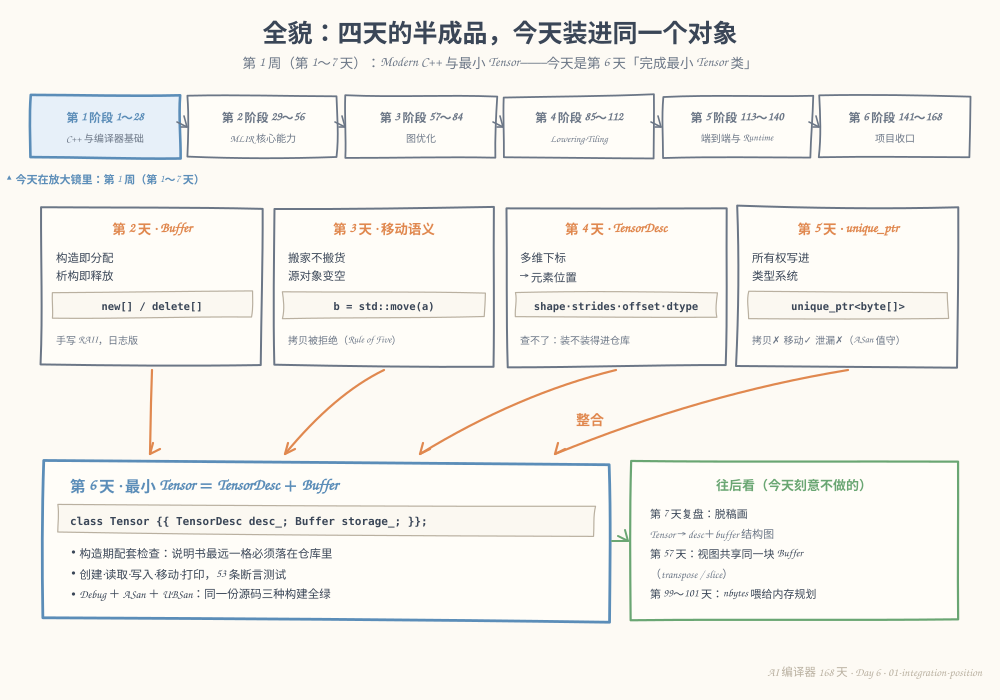
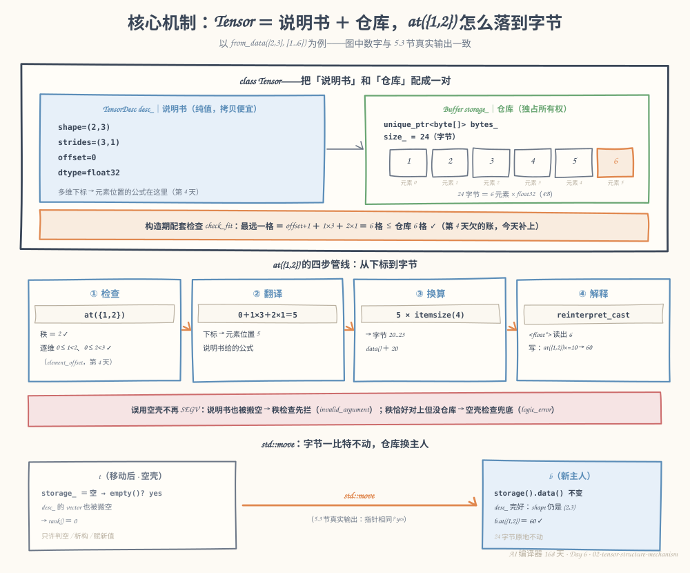
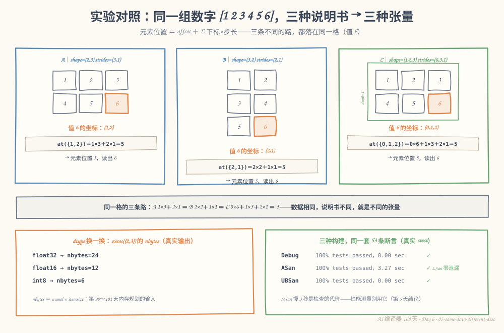

# 第 6 天：完成最小 Tensor 类——把说明书和仓库装进同一个对象

> **今日目标**：能脱稿画出 `Tensor → TensorDesc ＋ Buffer` 的结构图并说清各自职责；能写出构造期配套检查的公式，解释它为什么必须在构造期做；能说清"先检查后转移"与"先转移再检查"在异常抛出后的差别（强／弱异常保证）；能独立构建 `mini-tensor`，让 Debug、ASan、UBSan 三种构建跑同一套 53 条断言全部通过；能解释误用 moved-from Tensor 为什么从第 5 天的 SEGV 变成两道可读防线。
> **预计时间**：学习 35 分钟 + 实践 55 分钟
> **前置准备**：第 2～3 天的 RAII 与移动语义、第 4 天的 `TensorDesc`、第 5 天的 `unique_ptr` 与 Sanitizer（正文只回顾结论，细节回翻教程）；构建环境同前五天（CMake ≥ 3.16、Ninja、g++ 或 clang++）。
> **今日产出**：`mini-tensor` 工程（`Buffer` + `TensorDesc` + `Tensor` + 53 条断言测试 + 3 个错误复现程序），以及 Debug／ASan／UBSan 三种构建全绿的真实运行记录。

## 1. 今天解决什么问题？

把前五天的家底摊在桌上，正好是两块半成品加一笔欠账：

- **第 4 天的 `TensorDesc`**：会算"多维下标落在第几个元素"，但它只是说明书——构造函数注释里白纸黑字写着：*"查不了'和真实数据配不配'（比如 stride 越界要看 buffer 大小才知道，那是第 6 天 Tensor 的职责）"*。这笔账今天到期。
- **第 5 天的 `Tensor` 初版**：把所有权管对了（`unique_ptr<float[]>`），但 shape 是硬编码的 `rows_/cols_`、类型是写死的 `float`——连一维和三维都表达不了，说明书的能力全丢在了门外。

```text
① 说明书和仓库各管一摊，没人保证它们配套：desc 说 (2,3)/(5,1)，仓库只有 24 字节，谁拦？
② 元信息表达力倒退：desc 明明会 N 维，Tensor 只会 rows/cols。
③ 构造到一半抛异常，内存会不会漏？（异常安全，今天的复习重点）
```

今天的任务一句话：**把 `TensorDesc`（说明书）、`Buffer`（仓库）和数据访问整合成正式的最小 `Tensor`**，支持创建、读取、写入、移动和基本信息打印，并用 Debug 与 Sanitizer 双构建验收。

贯穿全文的还是那块老存储：`[1, 2, 3, 4, 5, 6]`（shape (2,3)、float32、24 字节）。今天结束时，它的身份是：一个 `Tensor` 对象，内含一份 `TensorDesc` 和一个 `Buffer`，`at({1,2})` 能读出 6，`at({2,0})` 被拦下，移动后源对象变空壳但绝不崩溃。

## 2. 先看全貌：今天的内容位于哪里？



**图 1**：放大镜仍在第 1 周。中间四张卡片是本周攒下的零件：第 2 天 `Buffer`（手写 RAII）、第 3 天移动语义、第 4 天 `TensorDesc`、第 5 天 `unique_ptr` + Sanitizer——四条橙色箭头今天汇进同一个对象。看右侧绿卡：视图共享存储是第 57 天、`nbytes` 喂给内存规划是第 99～101 天，今天刻意不做，边界先画清楚。

今天的路线分 4 步：

1. 定结构：`Tensor` **拥有**一个 `TensorDesc` 和一个 `Buffer`（组合，不是继承）；
2. 补配套检查：说明书最远一格必须落在仓库里（还第 4 天的账）；
3. 理顺异常安全：检查放在转移之前，构造失败不漏内存也不搬空调用方实参；
4. 用 53 条断言 + Debug／ASan／UBSan 三种构建验收。

## 3. 核心概念：先用直觉，再给准确定义

### 3.1 组合：Tensor ＝ 说明书 ＋ 仓库

一句通俗解释：**组合**（composition）就是"整个东西由几个零件拼成，零件的生死跟着整体走"——`Tensor` 里放一个 `TensorDesc` 成员和一个 `Buffer` 成员，而不是从它们任何一个继承。

生活类比：快递 = 面单 + 箱子。面单写"这批货怎么读"（第几排第几列、每格多大），箱子只管装货；撕掉面单箱子还是箱子，换个面单还是同一批货的读法。

**对应到技术上是**：`TensorDesc` 是**纯值类型**——只有几个整数和两个 `vector`，拷贝便宜且语义正确（第 4 天已论证它不该禁止拷贝）；`Buffer` 是 **RAII 资源持有者**——`unique_ptr<std::byte[]>` 独占堆内存，拷贝被删、移动换主人。`Tensor` 把它们配成一对：

```cpp
class Tensor {
private:
    TensorDesc desc_;   // 说明书：纯值类型，"移动"就是拷贝
    Buffer storage_;    // 仓库：独占所有权，移动 = 换主人
};
```

为什么不用继承？`Tensor` 不是"一种说明书"（is-a 不成立），是"有一份说明书"（has-a）；而且继承会把两套语义搅在一起——`desc` 需要廉价值拷贝，`buffer` 需要独占移动，一个类同时继承两者，拷贝和移动的规则立刻打架。组合让每个零件保住自己的语义，`Tensor` 的规则由 `Tensor` 自己定。

类比边界：面单和箱子可以分家（撕掉面单），但今天的最小 `Tensor` 里 `desc_` 和 `storage_` **同生共死**——想"同一块仓库配多份说明书"（转置、切片视图），得把所有权改成共享，那是第 57 天的课题。

### 3.2 配套检查：第 4 天欠下的账

一句通俗解释：**配套检查**（fit check）就是收货时核对"面单上最远的一个格子，仓库里真的有吗"。

生活类比：面单说"最大号货架第 7 排"，仓库只有 6 排——货单本身写得通，但照着它取货必然扑空。

**对应到技术上是**一个构造期不等式（元素单位，0 起）：

```text
need = storage_offset + 1 + Σ (shape[d] − 1) × strides[d]   ≤   have = 仓库字节数 ÷ itemsize
```

`need` 是说明书能摸到的最远一格再 +1（变成"格数"）；`numel > 0` 时每维都 ≥ 1，`(shape[d]−1)` 不会为负。拿真实例子代入：shape (2,3)、strides (5,1) → `need = 1 + 1×5 + 2×1 = 8` 格；仓库 24 字节 ÷ 4 = `have = 6` 格 → 8 > 6，构造期直接拒绝（5.3 节有真实报错输出）。

为什么放在构造期而不是 `at()` 里每次都查？构造期查一次是 O(rank)，之后**每一次**合法下标的访问都免检——`at()` 只需要管"下标是否越出 shape"（第 4 天的 `element_offset` 已经在做），"位置是否越出仓库"由构造期一次性担保。这正是"把不变量建立在构造期"的含义：**不变量**（invariant）就是对象活着期间永远为真的性质。

类比边界：货单类比听不出"元素单位"和"字节单位"的换算——技术上 `have` 必须除以 `itemsize` 再比较，单位错了就是第 4 天 6.1 节"字节当元素"的旧坑。

### 3.3 异常安全：检查放在转移之前

一句通俗解释：**异常安全**分三档——**基本保证**（出事不泄漏、不破坏，但对象状态随意）、**强保证**（要么成功，要么像从没发生过）、**不抛**（`noexcept`，如移动指针）。

生活类比：后厨备菜。先把食材验一遍再下锅（强保证：发现坏菜时锅还是干净的）；先倒进锅再尝（基本保证：坏了也能倒掉不炸厨房，但这锅料没了）。

**对应到技术上**是两件事，一件白送，一件要自己排顺序：

1. **白送的**：构造函数抛异常时，对象自身的析构函数不会执行，但**已构造完成的成员会自动析构**。所以 `Tensor` 的成员是 `unique_ptr` 系（`Buffer`、`vector`），构造中途抛异常也不会泄漏——这是第 5 天"把纪律装进类型"的延续红利。
2. **要自己排的**：今天的低级构造函数是 `Tensor(TensorDesc desc, Buffer storage)`，参数按值传入。如果**先 move 进成员再检查**：检查抛异常时内存照样不漏（成员已析构），但调用方传进来的实参**已经被搬空**——只算基本保证。正式版改成**先检查、后转移**：`check_fit(desc, storage)` 在参数还是完好的副本时执行，抛异常时实参原封不动、成员仍是空状态——**强保证**。

```cpp
Tensor::Tensor(TensorDesc desc, Buffer storage) {
    check_fit(desc, storage);        // ① 先检查：抛异常时实参完好（强保证）
    desc_ = std::move(desc);         // ② 后转移：到这步已不可能抛
    storage_ = std::move(storage);
}
```

工厂函数的异常安全顺序同理：`zeros` 先做会抛的元信息工作（此时零资源），再做唯一可能失败的分配（`bad_alloc`），最后是不会抛的组装。所以 `from_data` 给 3 个数想造 (2,3) 时，异常抛在**分配之前**——连一个字节都没漏。

类比边界：后厨类比里"锅还是干净的"对应成员未动，但注意它不覆盖"参数被搬空"这种坑——那是 C++ 按值 + 移动特有的时序问题，只能靠"先检查后转移"这种编码纪律解决。

### 3.4 边界检查与 moved-from：三道防线的回顾与升级

**边界检查**今天全部继承自第 4 天，`at()` 从外到里三道：① 今天只支持 float32 读写（`require_float32`）；② `element_offset` 查"下标个数 = 秩"和逐维边界；③ 空壳检查兜底。前两道是老朋友，第三道是今天的升级，源头是第 5 天错误二。

**moved-from 的新语义**值得单独说：第 5 天的 `Tensor` 被 move 后，`rows_/cols_`（整型）还在、`data_` 变空——`at(0,0)` 能**通过**边界检查然后解引用空指针，SEGV。今天的 `Tensor` 用默认移动，`desc_` 里的 `vector` 也被真搬空（`vector` 的移动 = 源变空，这是"移动不是拷贝"的又一次现身），于是：

- `t.at({1,2})`：秩已经是 0，**第一道防线（秩检查）**就抛 `invalid_argument`；
- `t.at({})`：秩恰好都是 0、过了第一道，**第三道防线（空壳检查）**抛 `logic_error`。

无论哪条路，都是可捕获、带人话的错误——不再是裸段错误。同时沿用第 5 天的约定：空壳只允许判空（`empty()`）、析构、赋新值。

## 4. 图解核心机制



**图 2**：上半部分是 `class Tensor` 的内部——左边蓝卡是说明书（`shape=(2,3)`、`strides=(3,1)`、`offset=0`、`dtype=float32`），右边绿卡是仓库（`unique_ptr<byte[]>`，6 格、每格 4 字节，格子里就是 1～6）；中间橙色横幅是构造期配套检查的代入结果。下半部分左边是 `at({1,2})` 的四步管线，右边是 `std::move` 的前后对照。

按图走一遍 `at({1,2}) = ?`：

1. **检查**：下标个数 2 = 秩 2 ✓；逐维 `0≤1<2`、`0≤2<3` ✓——第 4 天 `element_offset` 的老检查；
2. **翻译**：套说明书公式 `offset + i×strides[0] + j×strides[1] = 0 + 1×3 + 2×1 = 5`——元素位置 5；
3. **换算**：`5 × itemsize(4) = 20`——字节 20..23，即 `data() + 20`；
4. **解释**：把字节按 float32 解释，读出 `6`。写入同理：`at({1,2}) *= 10` 后那 4 个字节变成 60。

橙色横幅说的是第 2 节那笔账：构造期 `check_fit` 算出最远一格 `= 1 + 1×3 + 2×1 = 6` 格 ≤ 仓库 6 格 ✓，从此**每次访问免检**。红色窄条是 3.4 节的两道防线；底部移动图对应 5.3 节第 4 段的真实输出：`b.storage().data()` 与移动前相同、`t.empty()? yes`——字节一比特不动，主人换了人。

## 5. 动手实践：完成一个最小可运行例子

> 本节所有命令与输出都在这台机器上真实执行过：
> Linux aarch64（Ubuntu 20.04）· g++ 9.4.0 · CMake 3.20.5 · Ninja 1.10.0。
> 完整工程在本仓库 `tutorials/day-006/examples/mini-tensor/`，也可以按步骤自己敲一遍。

### 5.1 准备文件

```bash
mkdir -p mini-tensor/src mini-tensor/tests mini-tensor/bugs
cd mini-tensor
```

目录结构：

```text
mini-tensor/
├── CMakeLists.txt           # 根构建脚本：默认 Debug ＋ ENABLE_ASAN / ENABLE_UBSAN 开关
├── src/
│   ├── Buffer.h/.cpp        # 字节仓库：unique_ptr<byte[]>，独占所有权
│   ├── TensorDesc.h/.cpp    # 第 4 天的说明书（今天动了两处，见 5.2 末尾）
│   ├── Tensor.h/.cpp        # 今天的主体：desc + storage ＋ check_fit ＋ at
│   ├── main.cpp             # 观察程序：八段输出
│   └── CMakeLists.txt
├── tests/
│   ├── test_tensor.cpp      # 53 条断言
│   └── CMakeLists.txt
└── bugs/                    # 单文件演示：个数不匹配、说明书装不进仓库、误用 moved-from
```

### 5.2 编写代码

`src/Buffer.h`——今天的仓库，把第 2～5 天的手艺收进 20 行：

```cpp
class Buffer {
public:
    Buffer() = default;

    // 分配 nbytes 字节并清零。nbytes 允许为 0：拿到合法但空的仓库，
    // empty() 仍为 false——「零元素张量」和「moved-from 空壳」由此区分开。
    explicit Buffer(std::size_t nbytes);

    std::byte* data() { return bytes_.get(); }
    const std::byte* data() const { return bytes_.get(); }
    std::size_t size() const { return size_; }  // 单位：字节
    bool empty() const { return bytes_ == nullptr; }

private:
    std::unique_ptr<std::byte[]> bytes_;  // 独占所有权：拷贝✗ 移动✓ 析构自动释放
    std::size_t size_ = 0;
};
```

按字节（`std::byte`）而不是按 `float` 持有，是配套检查的前提：同一套仓库才能装 float32／int8／float16——`have = size() ÷ itemsize` 的换算只在"仓库只认字节"时才成立。

`src/Tensor.h`——类骨架（工厂和打印的完整声明在仓库里）：

```cpp
class Tensor {
public:
    Tensor() = default;

    // 低级入口：先检查、后转移——检查抛异常时实参完好（强异常保证，3.3 节）。
    Tensor(TensorDesc desc, Buffer storage);

    static Tensor zeros(std::vector<std::int64_t> shape, Dtype dtype);   // 全部 Dtype
    static Tensor from_data(std::vector<std::int64_t> shape,            // float32 专用
                            std::initializer_list<float> data);

    const TensorDesc& desc() const { return desc_; }
    std::int64_t numel() const { return desc_.numel(); }
    std::size_t nbytes() const { return desc_.nbytes(); }
    bool is_contiguous() const { return desc_.is_contiguous(); }
    bool empty() const { return storage_.empty(); }   // 空壳 = 不持有存储
    const Buffer& storage() const { return storage_; }

    float at(std::initializer_list<std::int64_t> idx) const;   // 读：值拷贝，永不悬垂
    float& at(std::initializer_list<std::int64_t> idx);        // 写：借用，主人要活得比引用久

private:
    static void check_fit(const TensorDesc& desc, const Buffer& storage);
    // …… checked_element / element_ptr / append_slice 等私有辅助，见仓库

    TensorDesc desc_;   // 说明书：纯值类型
    Buffer storage_;    // 仓库：独占所有权
};
```

`src/Tensor.cpp` 的三个关键函数——3.2、3.3 节的概念全部落在这里：

```cpp
Tensor::Tensor(TensorDesc desc, Buffer storage) {
    check_fit(desc, storage);      // 先检查：实参完好；成员仍是默认空状态
    desc_ = std::move(desc);       // 后转移：不会再抛
    storage_ = std::move(storage);
}

void Tensor::check_fit(const TensorDesc& desc, const Buffer& storage) {
    if (desc.numel() == 0) return;                       // 没有元素要放，天然装得下
    std::int64_t need = desc.storage_offset() + 1;       // 最远一格 +1 变「格数」
    for (int d = 0; d < desc.rank(); ++d) {
        const std::size_t du = static_cast<std::size_t>(d);
        need += (desc.shape()[du] - 1) * desc.strides()[du];
    }
    const std::int64_t have =                            // 字节仓库换算成元素容量
        static_cast<std::int64_t>(storage.size() / itemsize(desc.dtype()));
    if (need > have) {
        throw std::invalid_argument(
            "Tensor: 说明书装不进仓库——最远需要 " + std::to_string(need) +
            " 个元素，仓库只有 " + std::to_string(have) + " 个（" + desc.to_string() + "）");
    }
}

std::int64_t Tensor::checked_element(const std::int64_t* idx, std::size_t n) const {
    require_float32("at");                               // 防线①：今天的读写只做 float32
    const std::int64_t elem = desc_.element_offset(idx, n);  // 防线②：秩 + 逐维边界
    if (storage_.empty()) {                              // 防线③：空壳兜底
        throw std::logic_error("at: 这个 Tensor 不持有存储（默认构造或已被移动）");
    }
    return elem;   // 元素位置 → element_ptr 里 ×itemsize 得字节地址
}
```

根 `CMakeLists.txt` 沿用第 5 天的开关，加一条"默认 Debug"（今天按计划跑 Debug 构建）和全程警告：

```cmake
if(NOT CMAKE_BUILD_TYPE)
    set(CMAKE_BUILD_TYPE Debug)
endif()
add_compile_options(-Wall -Wextra -Wpedantic)

option(ENABLE_ASAN "用 AddressSanitizer（含 LeakSanitizer）构建" OFF)
option(ENABLE_UBSAN "用 UndefinedBehaviorSanitizer 构建" OFF)
# ASan 分支同第 5 天：-fsanitize=address -static-libasan ……（完整内容在仓库）
```

最后交代对第 4 天 `TensorDesc` 的两处改动，都是整合逼出来的：**① 补默认构造**——`Tensor` 需要空壳状态（默认构造／moved-from），成员必须可以默认构造（`shape_/strides_` 为空、offset 0、float32）；**② `element_offset` 拆出指针区间版核心**——`to_string` 递归打印时秩是运行期才知道的，拿不出 `initializer_list`，老接口转调新核心。除此之外一行未动——好零件整合时最好不用改。

`tests/test_tensor.cpp` 按概念分了 19 组、53 条断言：zeros 元信息与其他 Dtype、from_data 逐位核对、读写、边界四方向、秩不匹配、一维／三维、同数据不同 shape、移动、误用空壳两道防线、配套检查正反例、异常后续、非 float32 拒绝、零元素张量、打印冒烟（节选见仓库，全部断言 5.3 节验收）。

### 5.3 运行与观察

**第一步：Debug 构建，看八段观察。**

```bash
cmake -S . -B build -G Ninja
cmake --build build
./build/src/mini-tensor
```

构建 8 个步骤零警告。运行的真实输出：

```text
== 0. 创建：from_data({2,3}, [1..6])——还是那块老存储 ==
shape=(2,3) strides=(3,1) offset=0 dtype=float32 | numel=6 nbytes=24 contiguous=yes empty=no
  [[1 2 3] [4 5 6]]
== 1. 读取：at({0,0})、at({1,2}) ==
  at({0,0}) = 1
  at({1,2}) = 6
== 2. 写入：at({1,2}) *= 10 ==
  at({1,2}) = 60
== 3. 边界检查：秩、逐维、负下标 ==
  at({2,0})  caught: element_offset: 第 0 维下标 2 越界（0..1）
  at({0,3})  caught: element_offset: 第 1 维下标 3 越界（0..2）
  at({-1,0}) caught: element_offset: 第 0 维下标 -1 越界（0..1）
  at({1})    caught: element_offset: 下标个数 1 与秩 2 不一致
== 4. 移动：Tensor b = std::move(t) ==
  移动后 t.empty()? yes；b.storage().data() 与移动前相同? yes
  b 还能读：b.at({1,2}) = 60
  t 的说明书也被搬空（vector 移动 = 源变空）：t.rank() = 0
  误用空壳 t.at({1,2}) caught: element_offset: 下标个数 2 与秩 0 不一致
  误用空壳 t.at({})   caught: at: 这个 Tensor 不持有存储（默认构造或已被移动）
== 5. 同一组数字，换一份说明书 ==
shape=(3,2) strides=(2,1) offset=0 dtype=float32 | numel=6 nbytes=24 contiguous=yes empty=no
  [[1 2] [3 4] [5 6]]
  at({2,1}) = 6
shape=(1,2,3) strides=(6,3,1) offset=0 dtype=float32 | numel=6 nbytes=24 contiguous=yes empty=no
  [[[1 2 3] [4 5 6]]]
  at({0,1,2}) = 6
== 6. dtype 换一换：同一 shape，nbytes 跟着 itemsize 走 ==
  shape=(2,3) strides=(3,1) offset=0 dtype=float32 | numel=6 nbytes=24 contiguous=yes empty=no
  shape=(2,3) strides=(3,1) offset=0 dtype=float16 | numel=6 nbytes=12 contiguous=yes empty=no
  shape=(2,3) strides=(3,1) offset=0 dtype=int8 | numel=6 nbytes=6 contiguous=yes empty=no
== 7. 异常安全：from_data 元素个数不匹配 ==
  caught: from_data: 元素个数 3 != numel 6
  异常之后照常创建：after.at({1,1}) = 4
  程序结束：所有堆内存自动释放（ASan 构建下由 LeakSanitizer 作证）
```

逐段读三个重点：第 3 段——秩、逐维、负下标三类错误各得一句带维度和范围的诊断；第 4 段——移动后仓库字节没搬（指针相同）、`b` 照常读写，而误用空壳 `t` 被两道防线分别拦下（3.4 节的实景）；第 7 段——异常抛出后程序继续创建新 Tensor，状态毫无残留（强保证的最直接证据）。

**第二步：跑测试。**

```bash
ctest --test-dir build --output-on-failure
```

真实输出：

```text
1/1 Test #1: tensor ...........................   Passed    0.00 sec

100% tests passed, 0 tests failed out of 1

Total Test time (real) =   0.00 sec
```

`./build/tests/test_tensor` 单独跑会打印 `all 53 assertions passed`。

**第三步：同一份源码换 ASan、UBSan 构建再跑一遍（计划要求的 Sanitizer 构建）。**

```bash
cmake -S . -B build-asan  -G Ninja -DENABLE_ASAN=ON  && cmake --build build-asan
cmake -S . -B build-ubsan -G Ninja -DENABLE_UBSAN=ON && cmake --build build-ubsan
ctest --test-dir build-asan --output-on-failure
ctest --test-dir build-ubsan --output-on-failure
```

真实输出（ASan 构建）：

```text
1/1 Test #1: tensor ...........................   Passed    3.27 sec

100% tests passed, 0 tests failed out of 1

Total Test time (real) =   3.27 sec
```

同样的 53 条断言在 ASan 下全绿，`./build-asan/src/mini-tensor` 输出与 Debug 构建逐行相同（我用 `diff` 核对过），退出码 0 且 **LeakSanitizer 零报告**——包括第 7 段那次构造失败在内，所有路径没漏一个字节。UBSan 构建同样 `100% tests passed`（0.00 sec）、`all 53 assertions passed`。顺带的老结论依然成立：ASan 慢（3.27 秒 vs 0.00 秒）是检查的代价，性能测量别用它。



**图 3**：上半部分是 5.3 节第 5 段的真实结果——同一组 `[1 2 3 4 5 6]` 配三种说明书，值 6 的坐标分别是 A(1,2)、B(2,1)、C(0,1,2)，三条路代入 `Σ 下标×步长` 都落在元素 5。左下是第 6 段 dtype 实验的 nbytes 表；右下是三种构建的真实 ctest 汇总——Debug 0.00 秒、ASan 3.27 秒（LSan 零泄漏）、UBSan 0.00 秒，53 条断言一个不少。

### 5.4 修改一个参数再观察

**实验：同一组数字，换 shape 再换 dtype，先预测再运行。**

1. **改 shape**：把 `main.cpp` 第 0 段的 `from_data({2, 3}, ...)` 改成 `{3, 2}`（数据不动）。先在纸上预测三件事：`info()` 里的 strides 变成多少？`at({1,2})` 还能过边界检查吗？值 6 的新坐标是什么？然后运行，对照 5.3 节第 5 段的真实输出（答案：strides 变 (2,1)；`at({1,2})` 抛 `第 1 维下标 2 越界（0..1）`——**换说明书后，原来合法的坐标可能失效**；值 6 在 (2,1)）。这个实验我在 5.3 节第 5 段已经替你跑过一遍真实版本，你的预测应该能逐条对上；
2. **改 dtype**：把 `zeros({2, 3}, Dtype::Float32)` 的 dtype 依次换成 `Float16`、`Int8`，预测 `nbytes` 再运行。真实结果：24 → 12 → 6 字节，`nbytes = numel × itemsize`（第 4 天的公式）在真 Tensor 上第一次兑现——这三个数字后面会被第 99～101 天的内存规划直接拿去用。

两个实验共同的教训：**数据没变，解释数据的元信息变了，就是不同的张量**——这正是编译器里"同一个 Buffer 搭配不同 Layout"的雏形（第 57～58 天展开）。

## 6. 常见错误与排查

以下三个错误都在本机真实复现过，完整源文件在 `tutorials/day-006/examples/mini-tensor/bugs/`。

**错误一：from_data 元素个数与 numel 不匹配**

```cpp
Tensor t = Tensor::from_data({2, 3}, {1, 2, 3});   // 3 个数 ≠ numel 6
```

编译运行命令：`cd bugs && g++ -std=c++17 -g -I ../src ../src/Buffer.cpp ../src/TensorDesc.cpp ../src/Tensor.cpp err_count.cpp -o err_count && ./err_count`。真实输出：

```text
想造 shape=(2,3) 的 Tensor，却只给了 3 个数 ...
caught: from_data: 元素个数 3 != numel 6
异常之后照常创建：ok.at({1,2}) = 6
```

- 现象：构造被拒，抛 `std::invalid_argument`，程序继续运行。
- 原因：`from_data` 在分配**之前**先核对个数——3.3 节的异常安全顺序：会抛的检查都排在拿资源之前，此时一个字节都没分配。
- 定位：异常消息自带"给了几个、要几个"，不需要调试器。
- 修复：补齐数据，或改 shape。不要用 `try/catch` 把它吞掉——这是调用方的 bug，异常的目的就是让它当场停下。

**错误二：说明书装不进仓库（第 4 天欠账的兑现）**

```cpp
TensorDesc bad_desc({2, 3}, Dtype::Float32, {5, 1});   // 说明书自身合法
Tensor bad(std::move(bad_desc), Buffer(24));           // 但仓库只有 6 格
```

编译运行命令同上（换成 `err_bad_desc.cpp`）。真实输出：

```text
说明书本身写得通：shape=(2,3) strides=(5,1) offset=0 dtype=float32
但仓库只有 24 字节（6 格）...
caught: Tensor: 说明书装不进仓库——最远需要 8 个元素，仓库只有 6 个（shape=(2,3) strides=(5,1) offset=0 dtype=float32）
换成 32 字节仓库：at({1,2}) 落在元素 7，读出 0
```

- 现象：`TensorDesc` 构造成功（维数、非负、offset 合法——它只查自己），`Tensor` 构造被拒。
- 原因：strides (5,1) 能摸到的最远一格是 `1×5 + 2×1 = 7`，需要 8 格；24 字节 ÷ 4 = 6 格。3.2 节的公式在报错消息里完整现身。
- 定位：消息里有 need/have 两个数和整份说明书，一眼看出是 stride 太大还是仓库太小。
- 修复：要么放大仓库（演示里 32 字节版本就通过了，`at({1,2})` 落在元素 7），要么改小 stride。这个检查今天发生在构造期；如果推迟到运行期，同一个错误会变成"合法下标、越界地址"的静默内存破坏——第 5 天 5.4 节已经看过它不崩的样子。

**错误三：移动之后继续用源对象（第 5 天错误二的复演）**

```cpp
Tensor a = Tensor::from_data({2, 3}, {1, 2, 3, 4, 5, 6});
Tensor b = std::move(a);
std::printf("%g\n", a.at({1, 2}));   // ← 第 5 天这里 SEGV
```

编译运行命令同上（换成 `err_moved_from.cpp`）。真实输出：

```text
b.at({1,2}) = 6，一切正常
a.empty()? yes；a.rank() = 0（说明书也被搬空了）
现在错误地继续用 a ...
caught: element_offset: 下标个数 2 与秩 0 不一致
caught: at: 这个 Tensor 不持有存储（默认构造或已被移动）
程序正常退出，exit 0
```

- 现象：`b` 一切正常；对 `a` 的两种误用都变成可捕获的异常，程序 `exit 0`。
- 原因：第 5 天的 `Tensor` 里 `rows_/cols_` 是整型，移动后旧值还在，边界检查通过、`data_` 是空指针 → SEGV。今天的默认移动把 `desc_` 里的 `vector` 也搬空（rank 0），`at({1,2})` 在秩检查处被拦；`at({})` 秩恰好对上，由空壳检查兜底。
- 定位：两条异常消息都能直接指到"这是空壳"。
- 修复：遵守空壳三件事——判空、析构、赋新值（5.3 节第 4 段之后 `t` 重新赋值再用的写法就是合法用法）。要旧数据就别 move，或者先复制。

最后一句提醒，不展开但必须记得：`at()` 的可写版返回 `float&` 是**借用**——取了引用再让 Tensor 先走（比如清空装它的 `vector`），就是第 5 天错误三的 use-after-free，ASan 照抓不误。今天的三道防线管"下标错"，不管"主人先走"。

## 7. 今日练习

### 必做练习

给 `mini-tensor` 实现逐元素加法（第 9 天 `Add` 算子的前身）：

```cpp
// 返回 a + b：要求两者都是 float32 且 shape 相同，否则抛 std::invalid_argument。
Tensor add(const Tensor& a, const Tensor& b);
```

要求按今天的全部纪律来做：

1. **先检查后分配**：shape／dtype 检查放在任何分配之前（想想错误一为什么这么排）；
2. 结果用 `Tensor::zeros(a.desc().shape(), Dtype::Float32)` 分配，再逐元素 `result.at({i, j}) = a.at({i, j}) + b.at({i, j})` 写入——rank 可以先只支持 1～2 维；
3. 写至少 5 条断言：`(1,2)` 位置的和正确、两处 shape 不匹配抛异常、int8 输入抛异常、**加完之后 `a`、`b` 的数据不变**（借用不拿走所有权）；
4. Debug 和 ASan 两种构建各跑一遍，ASan 零报告。

预期产出：`add` 函数 + 测试断言 + 两种构建的通过记录。做的时候留意一个细节：`add` 的参数是 `const Tensor&`（借用），返回值是按值返回的 `Tensor`——为什么返回值不会触发"拷贝被删除"的编译错误？（提示：返回的是即将销毁的局部对象，移动接管。）

### 选做挑战

亲手体验一次"弱保证"：把 `Tensor::Tensor(TensorDesc, Buffer)` 临时改成**先 move 进成员、再 check_fit** 的版本，然后在 `err_bad_desc.cpp` 的场景里观察——异常抛出后，调用方传进来的 `Buffer` 实参 `empty()` 是什么？改回正式版再跑一遍对照。用 3～5 句话写下：为什么正式版选择"先检查后转移"，以及在什么代价下这个选择是值得的（提示：参数多一次移动）。

## 8. 今日验收

- [ ] 我能脱稿画出 `Tensor → TensorDesc ＋ Buffer` 结构图，说清各自职责和"为什么是组合不是继承"（图 2 上半部分，明天复盘的第一项就是它）；
- [ ] 我能写出 `check_fit` 的不等式并代入 strides=(5,1) 算出 need=8、have=6，解释它为什么必须在构造期做而不是 `at()` 里做；
- [ ] 我能说清"先检查后转移"和"先转移再检查"抛异常后的差别：实参是否完好、成员是否已动、分别对应强保证还是基本保证；
- [ ] 我能独立跑通 Debug、ASan、UBSan 三种构建，让 53 条断言全绿，并指出 ASan 构建慢 3.27 秒的原因；
- [ ] 我能解释误用 moved-from Tensor 的两种下场（秩检查 `invalid_argument`／空壳检查 `logic_error`），以及它为什么比第 5 天的 SEGV 更好；
- [ ] 我保存了 `mini-tensor` 工程（含 53 条断言测试和 3 个错误复现程序）与 5.3 节全部真实运行记录。

## 9. 一句话总结与明天预告

今天把一周的零件装成整机：`Tensor` 用组合关系持有一份 `TensorDesc`（纯值说明书）和一个 `Buffer`（`unique_ptr<byte[]>` 仓库），在构造期用 `need ≤ have` 的配套检查还清第 4 天欠的账，从此每次 `at()` 只管下标、不管容量；"先检查后转移"让构造失败既不漏内存（成员自动析构兜底）也不搬空调用方实参（强保证）；`at({1,2})` 沿"检查 → 翻译 → 换算 → 解释"四步从下标落到字节，同一组数字配上三种说明书就是三种张量。53 条断言在 Debug、ASan（3.27 秒、零泄漏）、UBSan 三种构建下全部通过，三个构造期／使用期错误全部以可读异常收场——第 5 天那个 SEGV 在新防线面前绝迹。

明天是第 1 周复盘：脱稿画出 `Tensor → TensorDesc＋Buffer` 结构图（图 2 的底稿今天已经打好），整理对象生命周期、所有权和元信息的关系，并回答那道压轴题——"为什么 Tensor 不能简单持有裸指针并随意拷贝"。本周收官。
