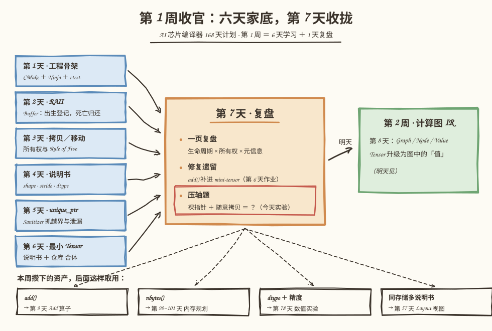
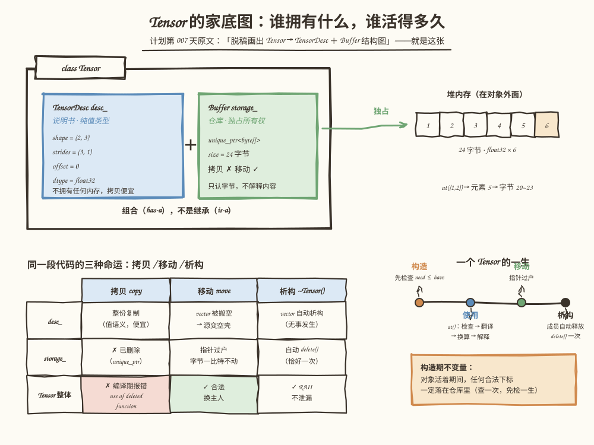
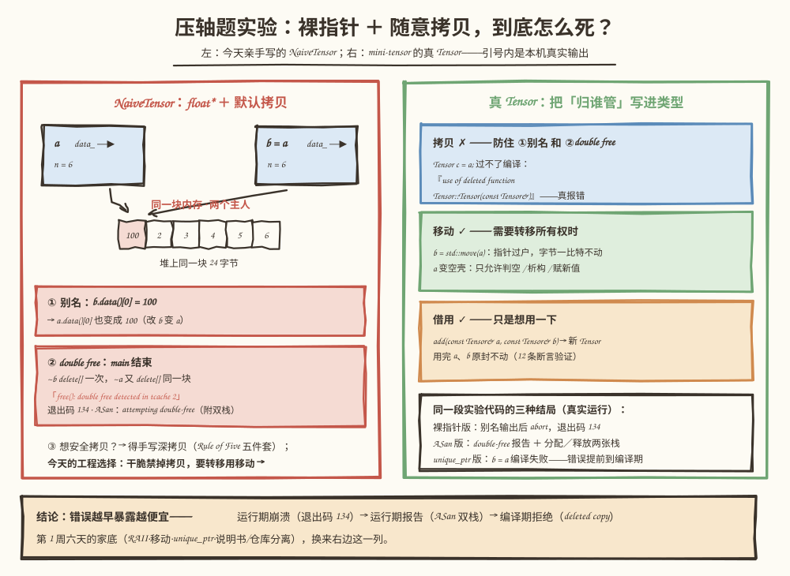

# 第 7 天：第 1 周复盘——把六天家底画成一张图，让裸指针死给你看

> **今日目标**：能脱稿画出 `Tensor → TensorDesc ＋ Buffer` 结构图并说清每个成员的所有权语义；能亲手让一个"裸指针＋随意拷贝"的 NaiveTensor 以别名和 double free 两种方式死掉（真实运行），再逐条对应到本周搭起的防线上；能修复本周遗留（把第 6 天作业 `add()` 补进 mini-tensor，Debug 与 ASan 构建下 53＋12 条断言全绿）；最后合上教程，用五句话回答压轴题——"为什么 Tensor 不能简单持有裸指针并随意拷贝"。
> **预计时间**：学习 30 分钟 ＋ 实践 45 分钟
> **前置准备**：第 1～6 天教程（尤其第 5 天的 `unique_ptr`／Sanitizer 和第 6 天的最小 Tensor）；构建环境同前六天（CMake ≥ 3.16、Ninja、g++ 或 clang++）。今天不引入任何新概念——复盘日的规矩是只收拢、不扩张。
> **今日产出**：一页复盘（正文第 8 节就是我的版本，你可以对照着写自己的）；修复遗留后的 `mini-tensor`（新增 `ops.h/.cpp` ＋ 12 条断言）；反面教材 `naive-tensor.cpp` 及它的三种真实结局（退出码 134／ASan 双栈报告／编译期拒绝）。

## 1. 今天解决什么问题？

复盘不是把六天的目录再念一遍。计划给第 7 天定的三件事是：**整理** C++ 对象生命周期、所有权和 Tensor 元信息之间的关系；**脱稿画出** `Tensor → TensorDesc＋Buffer` 结构图、修复本周遗留问题；**产出**一页复盘，并能回答那道压轴题——"为什么 Tensor 不能简单持有裸指针并随意拷贝"。

最好的复盘方式是让答案接受审判。所以今天的主线是一场实验：先按"最简单的做法"写一个 Tensor——

```cpp
class NaiveTensor {
public:
    explicit NaiveTensor(std::size_t n) : data_(new float[n]), n_(n) {}
    ~NaiveTensor() { delete[] data_; }      // 有 RAII，看起来挺规矩？
    float* data() { return data_; }
private:
    float* data_;                            // 裸指针
    std::size_t n_;
};

NaiveTensor a(6);      // [1 2 3 4 5 6]，心里想着 shape (2,3)
NaiveTensor b = a;     // “随意拷贝”——一行看似人畜无害的代码
```

然后亲眼看它怎么死。贯穿全文的还是那块老存储 `[1, 2, 3, 4, 5, 6]`：在 NaiveTensor 里它是 `a.data()` 指向的 6 个 float；在 mini-tensor 的真 Tensor 里它是 `shape=(2,3)`、`strides=(3,1)` 的说明书加 24 字节仓库。同一块数据，两种命运。

今天还要还一笔账：第 6 天的**必做练习**（实现 `add`）到现在还躺在教程里、没进仓库——这就是"本周遗留问题"。计划内推迟的边界（只支持 float32 读写、不做视图、不做 broadcast）不算欠账，它们分别指向第 78、57、60 天；欠的是"说好要写、还没写"的部分。今天补上。

## 2. 先看全貌：今天的内容位于哪里？



**图 1**：左边六张蓝卡是本周攒下的零件——第 1 天工程骨架、第 2 天 RAII、第 3 天移动语义、第 4 天说明书、第 5 天 `unique_ptr`＋Sanitizer、第 6 天最小 Tensor——六条箭头今天汇进中间的复盘卡。注意复盘卡上只有三件事：一页复盘、修复遗留、压轴题实验。底部四个标签是本周资产在后续课程里的取用点，绿色卡片是明天开始的第 2 周。

今天的路线分 4 步：

1. **先审后立**：让 NaiveTensor 死给我们看（第 3.3、5 节），把压轴题的答案变成亲眼见过的事实；
2. **脱稿画图**：合上教程画出 `Tensor → TensorDesc ＋ Buffer`（第 4 节的图 2 就是标准答案）；
3. **还账**：把 `add()` 补进 mini-tensor，用测试验收（第 5 节）；
4. **收拢**：写出自己的一页复盘（第 8 节给了我的版本当对照）。

## 3. 核心概念：先用直觉，再给准确定义

复盘收拢成三条主线：**值与资源是两种东西**（3.1）、**拥有／转移／借用是三种关系**（3.2）、**压轴题的三连问**（3.3）。它们分别对应本周的第 4 天、第 2～3 天、第 5～6 天。

### 3.1 值与资源：说明书可以复印，仓库不能有两个房产证

一句通俗解释：**值**（value）的内容长在对象身上，复印一份就是完整的一份；**资源**（resource）的对象身后还拖着一条"外部命脉"（这里是堆内存），复印对象复印不了命脉的所有权。

生活类比：说明书是复印件——复印一份随便用，两份各自作主；仓库是房产——两本房产证写同一套房，卖的时候就是纠纷。

**对应到技术上是**：`TensorDesc` 是纯值类型——只有几个整数和两个 `vector`，拷贝构造把内容原样复制一份，两个 `desc` 互不干扰，析构时 `vector` 自己清理、无事发生；`Buffer` 是资源句柄——`unique_ptr<std::byte[]>` 身后是 24 字节堆内存，**必须有且只有一个主人**，拷贝被直接删除，移动是把指针过户。第 6 天选择"组合"而不是"继承"，正是为了让这两种语义各管各的成员、互不打架。

类比边界：房产类比听不出"移动后源对象还活着"这件事——C++ 的 moved-from 对象不是消失了，而是变成一个合法的空壳（允许判空、析构、赋新值）。房产证过户后没有"作废但还能查询"的状态，这个状态是 C++ 特有的，也是第 5 天错误二的案发现场。

### 3.2 拥有、转移、借用：一个函数签名把三种关系用全

Tensor 世界里只有三种和所有权打交道的方式，今天修复的 `add` 恰好一次用全：

```cpp
Tensor add(const Tensor& a, const Tensor& b);   // ← 第 6 天作业的原签名
```

- **拥有**（owns）：`Tensor` 通过成员 `desc_`、`storage_` 拥有说明书和仓库——成员的生死跟着对象走（组合关系）。`add` 里的局部变量 `result` 拥有一个新 Tensor；
- **转移**（move）：`b = std::move(a)`——所有权过户。`desc_` 里的 `vector` 被搬空（`rank()` 变 0），`storage_` 的指针过户（字节一比特不动），源变空壳。`add` 返回 `result` 时走的正是这条路：返回值接管局部对象，不触发拷贝，也不产生"deleted copy"编译错误——因为返回的是即将销毁的对象，移动接管；
- **借用**（borrow）：`const Tensor& a` 不拿所有权，用完原封不动；`at()` 返回的 `float&` 也是借用——规则只有一条：**主人要活得比引用久**（第 5 天错误三的 use-after-free 就是违反了这条）。

一句话记住三种关系的判据：**看谁负责析构**。拥有者负责、移动是换负责的人、借用者永远不负责。

### 3.3 压轴题：为什么不能裸指针＋随意拷贝？

把大问题拆成三连问，每一问今天的实验都会给出真实答案：

**第一问：随意拷贝会发生什么？** 编译器生成的默认拷贝只抄成员值——对裸指针来说就是抄一个地址。于是两个对象各持一份相同指针，都以为自己是唯一主人：改 `b.data()[0]`，`a.data()[0]` 跟着变（**别名**，5.3 节实验①的真实输出）。放到编译器场景里，这就是"改了图上一个张量，另一个张量悄悄变了"——最难排查的幽灵 bug。

**第二问：析构会发生什么？** 两个主人在离开作用域时**各自** `delete[]` 一次——同一块内存释放两次，未定义行为。运气好是 glibc 当场 abort（今天实验②：`free(): double free detected in tcache 2`，退出码 134）；运气不好是静默破坏堆，错误在千里之外爆炸。

**第三问：那深拷贝不就行了？** 技术上行——手写 Rule of Five 五件套（拷贝构造、拷贝赋值、移动构造、移动赋值、析构），让每次拷贝都复制整块内存。但两个工程理由让我们不这么做：

1. **拷贝是昂贵的隐式操作**：几百 MB 的权重张量，一次按值传参就是一次 O(n) 内存复制，藏在语法糖里、性能悬崖不可见。C++ 的历史教训恰恰是"隐式拷贝太容易发生"；
2. **拷贝的语义还没定清楚**：第 57 天要做视图——同一块存储配多份说明书。"拷贝一个 Tensor"到时候是拷视图还是拷数据？语义没定清楚之前，正确的工程决策是**删掉拷贝**，把转移（`std::move`）和借用（`const&`）写成显式语法，让每一次数据流向都看得见。

注意一个容易被忽略的细节：浅拷贝错在指针，**不错在元信息**——`n_` 跟着复制了一份，这本身是对的（每个对象该有自己的说明书）。"元信息跟着数据走"这件事，真 Tensor 用组合关系自动做对了：拷贝 `desc_`（值，没问题）＋ 禁掉 `storage_` 的拷贝（资源，不许抄指针）。

## 4. 图解核心机制



**图 2**：这就是计划要求"脱稿画出"的那张图。看四个层次：`class Tensor` 盒子里只有两个成员；堆内存格子在**对象外面**（指针在对象里、内存在堆上，橙色格是 `at({1,2})` 落到的元素 5）；左下表格回答"拷贝／移动／析构时每个成员各发生什么"；右下时间线串起一个 Tensor 的一生。

按图逐格核对（脱稿自测就按这个顺序）：

1. **结构**：`Tensor` 组合（has-a，不是继承 is-a）一个 `TensorDesc desc_`（蓝卡：`shape=(2,3)`、`strides=(3,1)`、`offset=0`、`dtype=float32`，纯值、不拥有任何内存）和一个 `Buffer storage_`（绿卡：`unique_ptr<byte[]>`、24 字节、拷贝 ✗ 移动 ✓，只认字节不解释内容）；
2. **堆内存**：`storage_` 独占指向对象外面那块 24 字节——`at({1,2})` 沿说明书翻译到元素 5、换算到字节 20~23，读出 6；
3. **三种操作**（左下表，逐格背）：**拷贝**——`desc_` 本可以整份复制，但 `storage_` 的拷贝已删除，所以 `Tensor` 整体的拷贝被编译器连带删除（编译期报错）；**移动**——`desc_` 的 `vector` 被搬空（源变空壳）、`storage_` 指针过户（字节不动）；**析构**——`vector` 自动析构、`unique_ptr` 自动 `delete[]` 恰好一次（RAII，第 2 天的红利）；
4. **一生**（右下时间线）：构造（先检查 `need ≤ have`、后转移，强异常保证）→ 使用（`at()` 四步：检查→翻译→换算→解释）→ 移动（换主人）→ 析构（自动释放）。橙色便签是构造期不变量：对象活着期间，任何合法下标一定落在仓库里——查一次，免检一生。

画不出第 3 步的表格，通常说明把"拷贝被连带删除"和"移动搬空 vector"这两件事混了；画不出第 4 步的不变量，通常说明第 6 天的 `check_fit` 还没真正内化。

## 5. 动手实践：让裸指针死给你看，再把它救回来

> 本节所有命令与输出都在这台机器上真实执行过：
> Linux aarch64（Ubuntu 20.04）· g++ 9.4.0 · CMake 3.20.5 · Ninja 1.10.0。
> 完整文件在本仓库 `tutorials/day-007/examples/`，也可以按步骤自己敲一遍。

### 5.1 准备文件

```text
tutorials/day-007/examples/
├── naive-tensor.cpp              # ★ 反面教材：裸指针＋默认拷贝（单文件，g++ 直接编译）
└── mini-tensor/                  # 第 6 天工程的延续（整体复制过来）＋ 今天补的 add
    ├── CMakeLists.txt            # 同第 6 天：默认 Debug ＋ ENABLE_ASAN / ENABLE_UBSAN 开关
    ├── src/
    │   ├── Buffer.h/.cpp         # 原样
    │   ├── TensorDesc.h/.cpp     # 原样
    │   ├── Tensor.h/.cpp         # 原样
    │   ├── ops.h/.cpp            # ★ 今天新增：add（修复遗留）
    │   ├── main.cpp              # 原样（第 6 天的八段观察程序）
    │   └── CMakeLists.txt        # 加了一行 ops.cpp
    ├── tests/
    │   ├── test_tensor.cpp       # 原样：53 条断言
    │   ├── test_ops.cpp          # ★ 今天新增：12 条断言
    │   └── CMakeLists.txt        # 加了 test_ops 目标
    └── bugs/
        └── err_by_value.cpp      # ★ 错误三：按值传 Tensor（编译期反面教材）
```

### 5.2 编写代码

`naive-tensor.cpp` 的对照组（反面教材本体）——注意它**不是**稻草人：析构写了、RAII 有了，唯一的问题是"裸指针＋没写拷贝"：

```cpp
class NaiveTensor {
public:
    explicit NaiveTensor(std::size_t n) : data_(new float[n]), n_(n) {}
    ~NaiveTensor() { delete[] data_; }
    // 注意：拷贝构造 / 拷贝赋值一个字都没写——
    // 编译器生成的版本只抄指针值（浅拷贝），不复制指向的内存。
    float* data() { return data_; }
    std::size_t size() const { return n_; }
private:
    float* data_;
    std::size_t n_;
};
```

`main` 的关键三行（完整文件在仓库，实验组用 `-DUSE_UNIQUE_PTR` 切换，见 5.4 节）：

```cpp
NaiveTensor a(6);                          // [1 2 3 4 5 6]
NaiveTensor b = a;                         // “随意拷贝”
b.data()[0] = 100.0f;                      // 改 b，看 a
```

`mini-tensor/src/ops.cpp`——第 6 天作业的正式答案，3.2 节的三种关系全部落在这一段里：

```cpp
Tensor add(const Tensor& a, const Tensor& b) {
    // 异常安全顺序（第 6 天 3.3 节的纪律）：会抛的检查全部排在分配之前——
    // 检查失败时，一个字节都还没拿。三种拒绝都在这一段：
    if (a.desc().dtype() != Dtype::Float32 || b.desc().dtype() != Dtype::Float32) {
        throw std::invalid_argument("add: 只支持 float32，实际 a=" +
            std::string(::to_string(a.desc().dtype())) + " b=" +
            std::string(::to_string(b.desc().dtype())));
    }
    if (a.desc().shape() != b.desc().shape()) {
        throw std::invalid_argument("add: shape 不一致——" +
            a.desc().to_string() + " vs " + b.desc().to_string());
    }
    const int rank = a.rank();
    if (rank < 1 || rank > 2) {
        throw std::invalid_argument("add: 今天只支持 1～2 维，实际秩 " + std::to_string(rank));
    }

    // 检查全过了才分配结果（零值仓库），再逐元素写入。
    // at() 沿各自的说明书翻译下标——a、b 的 strides 可以不同，照样算对。
    Tensor result = Tensor::zeros(a.desc().shape(), Dtype::Float32);
    if (rank == 1) {
        const std::int64_t n = a.desc().shape()[0];
        for (std::int64_t i = 0; i < n; ++i) {
            result.at({i}) = a.at({i}) + b.at({i});
        }
    } else {  // rank == 2
        const std::int64_t rows = a.desc().shape()[0];
        const std::int64_t cols = a.desc().shape()[1];
        for (std::int64_t i = 0; i < rows; ++i) {
            for (std::int64_t j = 0; j < cols; ++j) {
                result.at({i, j}) = a.at({i, j}) + b.at({i, j});
            }
        }
    }
    return result;  // 局部对象按值返回：移动接管，仓库指针直接过户
}
```

`tests/test_ops.cpp` 的 12 条断言按第 6 天作业的验收要求分组：2D/1D 正确性（①②）、**借用**——`add` 之后 `a`、`b` 一个字节没动（③）、**结果独立**——改 `c` 不影响 `a`、`b`（④）、同一组数字配不同 `strides` 的说明书也能相加（⑤，给第 57 天视图留的接口预演）、shape 不匹配／非 float32／秩超范围三种拒绝（⑥⑦⑧）、异常之后照常工作（⑨）、返回值可继续被移动（⑩）。完整文件在仓库。

### 5.3 运行与观察

**第一步：对照组上场——裸指针＋随意拷贝的两种死法。**

```bash
cd tutorials/day-007/examples
g++ -std=c++17 -g -Wall -Wextra naive-tensor.cpp -o naive && ./naive; echo "exit code: $?"
```

真实输出：

```text
创建 a（6 个元素）：1 2 3 4 5 6
a.data() = 0xaaaac73abed0
拷贝出 b：b.data() = 0xaaaac73abed0
a、b 的指针是同一块内存吗？是（同一块！）
执行 b.data()[0] = 100 之后：a.data()[0] = 100（改 b，a 跟着变了？）
main 结束：b 先析构、a 后析构，各自 delete[] 一次……
free(): double free detected in tcache 2
Aborted (core dumped)
exit code: 134
```

两个死法先后兑现：前四行是**别名**——两个指针同一地址，改 `b` 变 `a`；最后一行是 **double free**——glibc 的 tcache 检测到重复释放，`SIGABRT`，退出码 134。注意这段代码"看起来挺规矩"：析构写了、也没忘释放——**它不是死于忘写代码，而是死于所有权从未被定义**。

**第二步：ASan 接管——给死亡开一张解剖报告。**

```bash
g++ -std=c++17 -g -fsanitize=address -static-libasan naive-tensor.cpp -o naive-asan && ./naive-asan; echo "exit code: $?"
```

（`-static-libasan` 是本机的用法：Ubuntu 20.04／g++ 9.4 动态链接 libasan 会报 "ASan runtime does not come first"；其他环境通常直接 `-fsanitize=address` 即可，第 5 天有说明。）

真实输出（帧的十六进制地址列略；`←` 为笔者标注）：

```text
……（前五行与上面相同，指针为 0xffff9b000b80）……
==710701==ERROR: AddressSanitizer: attempting double-free on 0xffff9b000b80 in thread T0:
    #1 in NaiveTensor::~NaiveTensor() naive-tensor.cpp:38
    #2 in main naive-tensor.cpp:60        ← a 的析构（第二次 delete[]）
freed by thread T0 here:
    #1 in NaiveTensor::~NaiveTensor() naive-tensor.cpp:38
    #2 in main naive-tensor.cpp:69        ← b 的析构（第一次 delete[]）
previously allocated by thread T0 here:
    #1 in NaiveTensor::NaiveTensor(unsigned long) naive-tensor.cpp:37
    #2 in main naive-tensor.cpp:60        ← NaiveTensor a(6)
SUMMARY: AddressSanitizer: double-free
exit code: 1
```

读这张报告的方式是第 5 天练过的"三段式"：**谁**（`naive-tensor.cpp:38` 的析构）在**释放哪块**（`0xffff9b000b80`，24 字节，第 37 行分配）**第几次**（第二次——第一次来自 `b` 的析构）。两行行号 60/69 正好是 `a` 和 `b = a` 的声明处——析构顺序 `b` 先 `a` 后，与栈帧吻合。

**第三步：真 Tensor 的验收——Debug 与 ASan 各跑一遍 53＋12 条断言。**

```bash
cd mini-tensor
cmake -S . -B build -G Ninja && cmake --build build
ctest --test-dir build --output-on-failure
cmake -S . -B build-asan -G Ninja -DENABLE_ASAN=ON && cmake --build build-asan
ctest --test-dir build-asan --output-on-failure
```

Debug 构建的真实输出：

```text
1/2 Test #1: tensor ...........................   Passed    0.00 sec
2/2 Test #2: ops ..............................   Passed    0.00 sec

100% tests passed, 0 tests failed out of 2

Total Test time (real) =   0.00 sec
```

`./build/tests/test_ops` 单独跑打印 `all 12 assertions passed`，`./build/tests/test_tensor` 打印 `all 53 assertions passed`。ASan 构建同样 `100% tests passed`（两个测试各 3.27 秒、合计 6.53 秒），12＋53 条断言一个不少，LeakSanitizer 零报告——包括 ⑥⑦⑧⑨ 那些构造失败路径在内，没漏一个字节。`add` 这笔账还清了。



**图 3**：左面板是 NaiveTensor 的完整死法档案——两个对象指向同一块 24 字节（第 0 格已变 100）、①别名、②double free 及两行真实输出；右面板是真 Tensor 的三种关系，每行都标了它防住左边的哪种死法。底部结论条是今天最重要的一句话，5.4 节的实验会让它落地。

### 5.4 修改一个参数再观察

**实验一：把"随意拷贝"那一行拿掉。** 注释掉 `NaiveTensor b = a;` 起的整段（我临时改了一份做实验），只剩"创建 a → 析构 a"。先预测：裸指针版能不能正常退出？

真实结果：

```text
创建 a（6 个元素）：1 2 3 4 5 6
a.data() = 0xaaaaf76eded0
main 结束：只有 a 一个主人，析构 delete[] 一次……
exit code: 0
```

正常退出。这说明一件容易被说反的事：**杀死程序的不是裸指针本身，而是"随意拷贝"**。单个主人下的裸指针＋手写 RAII 析构是能跑的（第 2 天的 Buffer 就是这么过来的）——它只是没有防线：一旦谁来一次拷贝、一次移动、一次返回，就裸奔。`unique_ptr` 的价值不是"代替 delete"，而是**把"只能有一个主人"变成类型系统强制的事实**。

**实验二：只把裸指针换成 `unique_ptr`，其余一行不改。**

```bash
g++ -std=c++17 -g -Wall -Wextra -DUSE_UNIQUE_PTR naive-tensor.cpp -o naive-up
```

真实结果——编译失败，而这正是实验目的：

```text
naive-tensor.cpp: In function 'int main()':
naive-tensor.cpp:69:21: error: use of deleted function 'NaiveTensor::NaiveTensor(const NaiveTensor&)'
   69 |     NaiveTensor b = a;
      |                     ^
naive-tensor.cpp:21:7: note: 'NaiveTensor::NaiveTensor(const NaiveTensor&)' is implicitly deleted
      because the default definition would be ill-formed:
```

同一个 `b = a`，三种结局排成一个阶梯：**运行期崩溃**（glibc，退出码 134）→ **运行期报告**（ASan 双栈）→ **编译期拒绝**（deleted copy）。越往右，错误暴露得越早、修复成本越低。本周六天的家底，本质上就是把错误沿这个阶梯往右推：第 2 天 RAII 管析构、第 3 天移动语义管过户、第 5 天 `unique_ptr` 把拷贝从"静默错误"变成"编译错误"、Sanitizer 把剩下的运行期错误变成"当场报告"。

## 6. 常见错误与排查

以下三个错误都在本机真实复现过（前两个来自 5.3 节的运行，第三个在 `tutorials/day-007/examples/mini-tensor/bugs/err_by_value.cpp`）。

**错误一：改了 b，a 的数据跟着变（别名）**

```cpp
NaiveTensor b = a;
b.data()[0] = 100.0f;          // a.data()[0] 也变成 100
```

- 现象：只写 `b`，读 `a` 却看到新值；程序不崩溃、不报错、一切"正常"。
- 原因：默认拷贝是浅拷贝——只抄指针值，不复制指向的内存。两个对象的 `data_` 是同一地址。
- 定位：打印两个 `data()`（5.3 节第一段输出里两行地址逐字相同）；或问一句"谁负责析构？"——有两个候选答案时必有别名。
- 修复：要么禁掉拷贝（`unique_ptr` 成员自动实现，见 5.4 实验二），要么写真正的深拷贝（选做练习）。**不要**靠"大家小心别拷贝"的口头约定——约定会被忘。

**错误二：程序 abort，`free(): double free detected in tcache 2`，退出码 134**

- 现象：输出打印到一半，glibc 报 double free，`SIGABRT`（退出码 134），可能 core dumped。
- 原因：别名不可避免的续集——`b`、`a` 先后析构，同一块堆内存被 `delete[]` 两次。这是未定义行为：glibc 的 tcache 检测拦住了它，但换个运行库或运气差点，就是静默堆破坏。
- 定位：普通构建只给你一行 glibc 消息；ASan 构建给出完整三段式（分配于 `:37`、第一次释放于 `b` 的析构、第二次释放于 `a` 的析构），5.3 节第二段输出就是模板。
- 修复：和错误一同根同源——保证单主人。删除拷贝（编译期杜绝）或深拷贝（每次拷贝复制内存）。

**错误三：`Tensor` 按值传参——编译失败**

```cpp
// bugs/err_by_value.cpp：故意按值传参（正确版本是 const Tensor&）
Tensor by_value_add(Tensor a, Tensor b) {   // ← 编译器在这一行拒绝
    return add(a, b);
}
```

编译命令：`cd bugs && g++ -std=c++17 -g -I ../src ../src/Buffer.cpp ../src/TensorDesc.cpp ../src/Tensor.cpp ../src/ops.cpp err_by_value.cpp -o err_by_value`。真实输出的关键行：

```text
err_by_value.cpp:20:33: error: use of deleted function 'Tensor::Tensor(const Tensor&)'
../src/Tensor.h:23:7: note: 'Tensor::Tensor(const Tensor&)' is implicitly deleted because
      the default definition would be ill-formed:
../src/Buffer.h:13:7: error: use of deleted function 'Buffer::Buffer(const Buffer&)'
/usr/include/c++/9/bits/unique_ptr.h:689:7: note: declared here:
  689 |       unique_ptr(const unique_ptr&) = delete;
```

- 现象：编译失败，错误信息像一条链：`Tensor` 的拷贝被删 → 因为 `Buffer` 的拷贝被删 → 因为 `unique_ptr` 的拷贝本来就是 `= delete`。
- 原因：按值传参要求把实参拷贝进形参——对拷贝被删除的类型，这一步在编译期就不存在。
- 定位：从错误链最顶端往下读，第一次犯错的调用点在 `err_by_value.cpp:20`（调用 `by_value_add(a, b)` 处），但病根在函数签名那一行。
- 修复：改成 `const Tensor&`（借用，`ops.h` 的正式签名）；确要转移所有权就按值传右值或 `Tensor&&`。这个错误其实是**好消息**：它证明第 5 天"把纪律装进类型"的设计在真实调用点生效了——同样的笔误写在 NaiveTensor 上，要到运行期才炸。

## 7. 今日练习

### 必做练习

**合上教程，完成计划要求的两件事**：

1. **脱稿画图**：白纸画出 `Tensor → TensorDesc ＋ Buffer`，要求标出——每个成员的所有权语义（纯值／独占资源）、拷贝／移动／析构时各成员发生什么、堆内存画在对象外面、构造期不变量 `need ≤ have`。画完对照图 2，缺哪块就回哪天的教程；
2. **口头回答压轴题**：对着手机录音（或写在纸上），用不超过五句话回答"为什么 Tensor 不能简单持有裸指针并随意拷贝"，必须提到：浅拷贝→别名、析构→double free、深拷贝的两个工程问题、以及"禁拷贝／显式移动／显式借用"的三分法。

预期产出：一张纸＋一段五句话的录音或文字。第 8 节有我的版本，先自己写再看——复盘的价值在检索记忆，不在核对答案。

### 选做挑战

给 NaiveTensor 手写**深拷贝版**（Rule of Five 五件套：拷贝构造、拷贝赋值、移动构造、移动赋值、析构），让 `b = a` 之后 `b.data() != a.data()` 且改 `b` 不影响 `a`、析构各自释放。写完回答两个问题（3～5 句话）：什么场景值得手写五件套（确实需要值语义的小对象），什么场景直接禁掉拷贝更对（编译器内部的大数据结构，如 Tensor）？提示：深拷贝版里 `n_` 也要跟着复制——元信息跟数据走，这件事组合已经自动做对了。

## 8. 一页复盘：第 1 周浓缩版

### 8.1 六天家底表

| 天 | 一句话产出 | 防住什么错 |
|---|---|---|
| 1 | 工程骨架：CMake＋Ninja＋ctest | "代码跑不起来、结果没法重复" |
| 2 | `Buffer`：手写 RAII，资源绑定生命周期 | 忘记释放 → 泄漏 |
| 3 | 移动语义＋Rule of Five：过户而非复印 | 浅拷贝、过户后旧对象被误用 |
| 4 | `TensorDesc`：shape／stride／dtype 说明书 | 有字节但不知道怎么解释 |
| 5 | `unique_ptr`＋ASan／UBSan：纪律进类型 | 归属不清、越界不可见 |
| 6 | `Tensor`＝desc＋Buffer：构造期配套检查＋三道防线 | 说明书装不进仓库；空壳误用变 SEGV |
| 7（今天） | 一页复盘＋`add()` 进仓库＋压轴题答案 | 裸指针＋随意拷贝的三种死法 |

### 8.2 压轴题标准答案（五句话版）

**问：为什么 Tensor 不能简单持有裸指针并随意拷贝？**

1. 裸指针让"谁负责释放"变成口头约定而不是类型事实——约定会被忘（第 2 天 RAII 的出发点）；
2. 默认拷贝是浅拷贝：两个对象各持同一指针——改 `b` 变 `a`（别名，今天的实验①），析构两次（double free，今天的实验②，退出码 134）；
3. 深拷贝技术上可行（Rule of Five 五件套），但大 Tensor 的隐式拷贝是把 O(n) 复制藏进语法糖的性能悬崖；而且第 57 天要做共享存储的视图，"拷贝一个 Tensor"的语义在定清楚之前，隐式拷贝是埋雷；
4. 所以工程决策是：**拷贝删除**（错误提前到编译期）、**移动显式**（`std::move` 过户，源变空壳、只许三件事）、**借用显式**（`const&`／`at()` 返回引用，主人活得比引用久）——判据始终是"看谁负责析构"；
5. 一句话：**让所有权成为类型系统的事实，而不是代码评审时的希望**。

### 8.3 今日验收

- [ ] 我能脱稿画出 `Tensor → TensorDesc ＋ Buffer` 结构图，标出每个成员的所有权语义、三种操作各自发生什么、堆内存在对象外面、构造期不变量；
- [ ] 我能不看笔记用五句话回答压轴题（8.2 节是我的版本，你的可以是另一个说法，但三个死法和三分法不能少）；
- [ ] 我跑通了 naive-tensor 的三种结局并能解释为什么错误暴露时机依次提前（运行期崩溃 134 → ASan 报告 → 编译期拒绝）；
- [ ] 我知道"杀死程序的是随意拷贝而不是裸指针本身"（5.4 实验一），也能说出 `unique_ptr` 的真正价值；
- [ ] `add()` 已补进 mini-tensor，Debug 和 ASan 两种构建下 53＋12 条断言全绿，ASan 零泄漏；
- [ ] 我写完了自己的一页复盘（或至少对着 8.1 表逐行回忆出了六天的产出和防的错误）。

## 9. 一句话总结与明天预告

复盘日用一场审判代替复述：一个"裸指针＋随意拷贝"的 NaiveTensor 在真实运行中先别名后 double free（glibc 拦截、退出码 134），ASan 给出分配／两次释放的完整解剖，而把指针换成 `unique_ptr` 后同一个 `b = a` 直接过不了编译——错误沿"运行期崩溃 → 运行期报告 → 编译期拒绝"的阶梯一路提前，这正是本周六天家底的本质：第 2 天 RAII 管生死、第 3 天移动管过户、第 4 天说明书管解释、第 5 天纪律进类型、第 6 天组合成 Tensor。`Tensor ＝ 纯值的 TensorDesc ＋ 独占的 Buffer`，拷贝删除、移动显式、借用显式，判据是"看谁负责析构"；欠账 `add()` 已还清（53＋12 条断言、Debug／ASan 双绿），一页复盘落在 8.2 节那五句话上。

明天进入第 2 周：第 8 天开始设计极简计算图 IR——`Graph`、`Node`、`Value` 的最小接口。今天的 Tensor 将升级为图中的"值"，而"谁拥有谁"的问题会原样出现在节点与边之间（提示：数据依赖和节点所有权是两回事）。本周的所有权直觉，下周直接复用。
