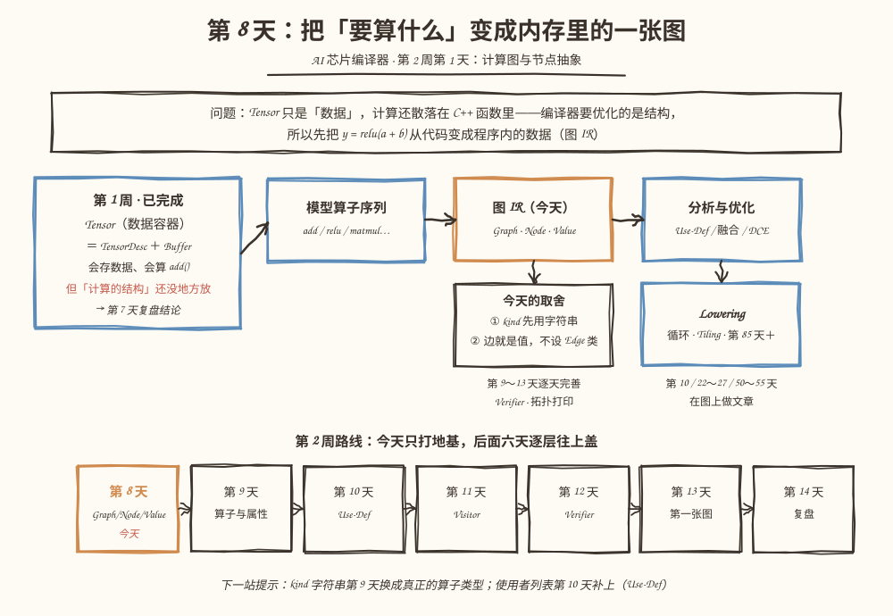
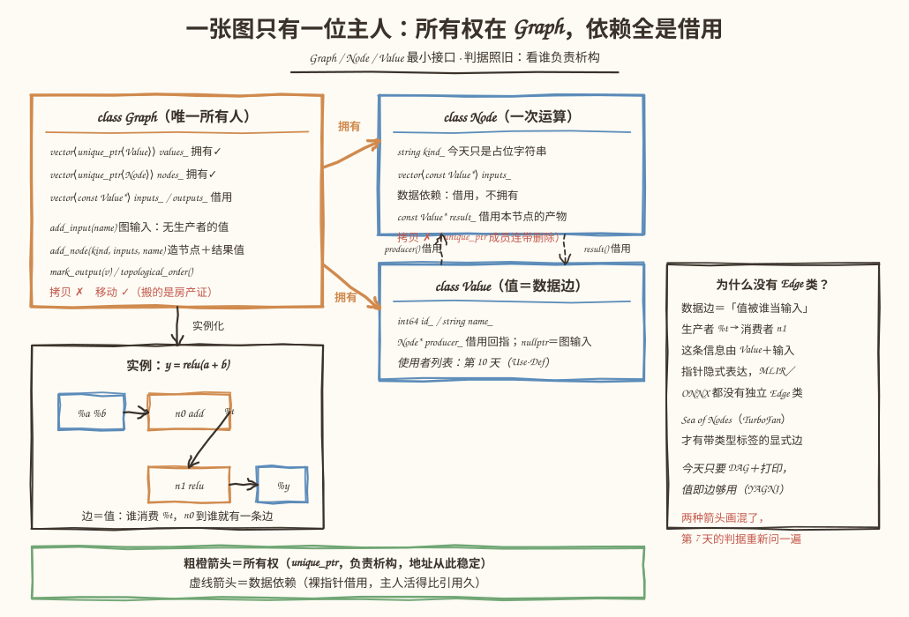
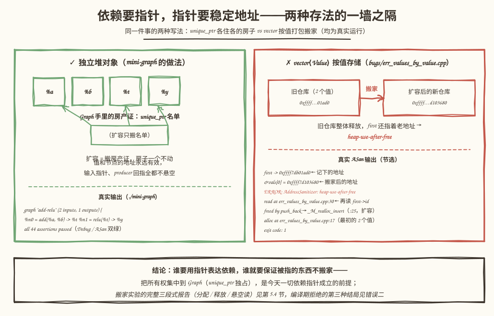

# 第 8 天：计算图与节点抽象——把"要算什么"变成内存里的一张图

> **今日目标**：能说出 Graph、Node、Value 各自存什么、谁拥有谁、数据依赖怎么表达；亲手搭出可编译可测试的 `mini-graph` 接口骨架（44 条断言，Debug／ASan 双绿）；能解释"数据依赖"和"节点所有权"为什么是两种箭头；最后让一个按值存储的反面教材在 ASan 下现出原形（heap-use-after-free，退出码 1）。
> **预计时间**：学习 40 分钟 ＋ 实践 45 分钟
> **前置准备**：第 1 周教程（尤其第 5 天的 `unique_ptr`、第 7 天复盘的"看谁负责析构"判据）；构建环境同前七天（CMake ≥ 3.16、Ninja、g++ 或 clang++）。今天不需要 mini-tensor 的代码——图 IR 是独立的新工程。
> **今日产出**：`mini-graph` 工程（`Graph`／`Node`／`Value` 最小接口 ＋ 44 条断言测试）；一张 IR 类图（正文图 2）；三个反面教材的真实结局（搬家悬空、编译期拒绝、借用超寿）。

## 1. 今天解决什么问题？

第 7 天复盘结束时留了一句话："本周的所有权直觉，下周直接复用。"今天兑现。第 1 周的成果是 **Tensor**——一个数据容器；但"计算"本身还散落在 C++ 函数里：第 7 天补的 `add()` 就是直接写两重循环算出来的。函数一旦执行完，"谁加了谁、结果喂给了谁"这些**结构信息**就消失了。

而编译器恰恰要吃结构：第 26 天的公共子表达式消除要问"这两个节点输入相同吗"，第 50～55 天的融合要问"Relu 是不是紧跟在 Add 后面"，第 85 天之后的 Lowering 要问"我该按什么顺序生成循环"。**这些问题的前提，是把"要算什么"变成内存里可以遍历、可以改写的数据结构**——这就是计算图 IR（Intermediate Representation，中间表示）。

今天的贯穿例子是第 13 天 `MatMul → Add → Relu` 目标的迷你版：

```text
输入 a ─┐
        ├─→ add ──→ t ──→ relu ──→ y（输出）
输入 b ─┘
```

用 C++ 把 `y = relu(a + b)` 完整地"存"进一个 `Graph`，能打印成文本，能给出拓扑序（topological order，保证每个节点排在它依赖的节点之后），并且不引入任何今天用不到的能力。计划说的"只支持当前项目需要的能力"是硬要求：多写一个"以后可能有用"的接口，第 14 天复盘时就会为它付维护成本。

## 2. 先看全貌：今天的内容位于哪里？



**图 1**：注意中间的流水线——模型算子序列 → **图 IR（今天）** → 分析与优化 → Lowering。图 IR 是后面所有 Pass 的操作对象，所以它是最先要立起来的东西。左边的蓝卡是第 1 周的 Tensor：会存数据，但"计算的结构"没地方放。底部的第 2 周日历标出今天的位置：今天只打 `Graph`／`Node`／`Value` 的地基，算子语义、Use-Def、Verifier 分属第 9～12 天。

今天的路线分 4 步：

1. **想清楚再动手**：回答三个设计问题——谁拥有谁、依赖怎么表达、要不要 Edge 类（第 3 节）；
2. **搭骨架**：写出三个类的最小接口，编译通过（第 5.1～5.2 节）；
3. **验收**：构造贯穿例子，Debug 和 ASan 双构建跑 44 条断言（第 5.3 节）；
4. **看清边界**：用两个对照实验确认"为什么必须这样存"（第 5.4 节），再收走三个常见错误（第 6 节）。

## 3. 核心概念：先用直觉，再给准确定义

今天只有三个新名词，但有两个容易混的关系。先给直觉，再对照第 7 天的判据。

### 3.1 Graph：一张图只有一位主人

一句通俗解释：**Graph** 是整张计算图的"总仓库"，图里所有节点和所有值都住在它名下。

生活类比：仓库管理员。每个货架（节点）、每件货（值）的产权证都登记在他一个人名下；别人手里最多有"第 3 排第 5 号"的门牌号（指针），没有产权。

**对应到技术上是**：`Graph` 持有 `vector<unique_ptr<Value>>` 和 `vector<unique_ptr<Node>>`——所有权集中、每个对象恰好一份、地址一旦登记永不搬家。图的输入输出（`inputs_`／`outputs_`）反而只是指针列表，登记门牌号就够。第 7 天的判据原样适用：**看谁负责析构**——Graph 析构时，`unique_ptr` 自动释放所有节点和值，恰好各一次。

类比边界：仓库管理员类比听不出"为什么不能有两个管理员"。技术上，两个 `Graph` 若同时拥有一张 `unique_ptr` 名单，拷贝就变成抄指针（第 7 天 NaiveTensor 的死法）——所以 Graph 的拷贝被直接删除（第 6 节错误二会让编译器亲口告诉你）。

### 3.2 Node：一次运算，只借用不拥有

**Node**（节点）表示一次运算。它身上有三样东西：

```cpp
class Node {
    std::int64_t id_;                       // 编号
    std::string kind_;                      // 今天只是字符串："add"、"relu"
    std::vector<const Value*> inputs_;      // 数据依赖：借用，不拥有
    const Value* result_ = nullptr;         // 本节点生产的值：同样是借用
};
```

重点在最后两行：`inputs_` 和 `result_` 都是裸指针，但**不构成所有权**——节点析构时对它们什么都不做。节点像一个只会记门牌号的施工队：它知道从哪几个地址取料、把成品放到哪个地址，但那些地址的房子都归 Graph。

`kind_` 是有意的偷懒：今天它只是字符串。为什么不做 `AddNode`、`ReluNode` 的继承体系？因为第 9 天的题目就是"算子类型、属性怎么表达"，第 11 天还会比较继承和 Visitor 两种分发方式的修改范围——现在提前设计继承树，就是在替明天做决定。

### 3.3 Value：值即边

**Value**（值）是某次计算产出的数据，比如例子里的 `t` 和 `y`。它的最小成员：

```cpp
class Value {
    std::int64_t id_;
    std::string name_;           // 打印用：%t、%y
    Node* producer_ = nullptr;   // 借用回指；nullptr 表示图输入
};
```

`producer_` 是一条回指的借用指针：值知道自己是谁生产的。图输入（`a`、`b`）没有生产者，`producer_` 为空——这正是"输入"和"计算结果"在数据上的区别。

那**学习目标里的 Edge（边）呢**？我们的答案是：**边不是独立对象，值本身就是边**。`n1` 的输入里出现 `%t`，就等于画了一条从 `n0` 出发到 `n1` 的边——"谁消费这个值，生产者到谁就有一条边"。这不是偷懒的发明：MLIR 里 Operation 的 operand 就是对 SSA Value 的引用，没有独立 Edge 实体；ONNX 的 `NodeProto.input` 也只是字符串名字。反例是 Sea of Nodes 风格的 IR（如 V8 的 TurboFan），边是一等对象、还带"控制／数据／效果"类型标签——那是为调度器服务的复杂度。今天只要 DAG（有向无环图）＋打印，值即边够用。

### 3.4 数据依赖 vs 节点所有权：两种箭头不能画混

把 3.1～3.3 的关系画出来，箭头分两种：

| 关系 | 例子 | 实现 | 析构时 |
|---|---|---|---|
| **所有权**（粗橙） | Graph → Node／Value | `unique_ptr` | Graph 负责 delete |
| **数据依赖**（虚线） | Node → 输入 Value；Value → producer Node；Graph → 输入输出表 | 裸指针借用 | 谁都不负责 |

两种箭头混掉的典型症状：让 Node 拥有输入（`vector<Value>` 成员）——同一个值被两个节点消费时（例子中 `t` 若再喂给一个 `neg` 节点）就会被析构两次，第 7 天的 double free 换了个地方重演。判据不变：**看谁负责析构**。

还有一个今天免费的礼物：因为 `add_node` 只能引用**已经存在**的值，你无法构造出"节点依赖还没创建的后代"的环——这个 API 天生只产出 DAG，**创建顺序本身就是拓扑序**。第 16 天做一般图的拓扑排序和环检测时，这个"天生无环"的性质会被打破（图可变、可回填之后），今天先享受它。

## 4. 图解核心机制



**图 2**：这就是计划要求的"IR 类图"。看四个区域：左上橙色 `Graph` 盒子——两个 `unique_ptr` 容器（拥有✓）加两张借用表；右上两个蓝盒子——`Node` 与 `Value`，成员里清一色裸指针借用，拷贝全部 ✗；左下实例区——`y = relu(a + b)` 真正长出来的样子，`%t` 就是从 `n0` 到 `n1` 的那条边；右侧便签——为什么没有 Edge 类。

按图核对三个要点：

1. **双向借用不等于所有权环**：Node 借用 `result_`，Value 回指 `producer_`——两个指针互指，但谁都不负责 delete，所以没有循环所有权的问题。判据依旧是"看谁负责析构"：答案永远是 Graph；
2. **图输入的特殊性**：`%a`、`%b` 的 `producer_` 为空。打印和拓扑遍历都要跳过这种空生产者——它们是图的边界；
3. **拷贝全灭、移动可用**：`Graph` 可以整体 `std::move`——搬走的是 `unique_ptr`（房产证），节点和值（房子）一个都不动，所有借用指针继续有效。第 5.3 节的测试 11 会验证这件事。

画不出第 1 点的双向借用、或把 `result_` 画成拥有关系，说明第 3.4 节的两种箭头还没分清。

## 5. 动手实践：搭出 mini-graph 骨架并让它通过 44 条断言

> 本节所有命令与输出都在这台机器上真实执行过：
> Linux aarch64（Ubuntu 20.04）· g++ 9.4.0 · CMake 3.20.5 · Ninja 1.10.0。
> 完整文件在本仓库 `tutorials/day-008/examples/mini-graph/`，也可以按步骤自己敲一遍。

### 5.1 准备文件

```text
tutorials/day-008/examples/mini-graph/
├── CMakeLists.txt            # 同第 6/7 天套路：默认 Debug ＋ ENABLE_ASAN / ENABLE_UBSAN 开关
├── src/
│   ├── CMakeLists.txt        # mini_graph 静态库 ＋ mini-graph 可执行文件
│   ├── Value.h               # ★ 值：id、名字、producer 回指
│   ├── Node.h                # ★ 节点：kind、输入借用、结果借用
│   ├── Graph.h               # ★ 图：唯一所有人 ＋ 构造入口 ＋ 遍历
│   ├── Graph.cpp             # ★ add_input / add_node / topological_order / to_string
│   └── main.cpp              # 构造 y = relu(a + b)，打印与盘点
├── tests/
│   ├── CMakeLists.txt
│   └── test_graph.cpp        # 44 条断言，11 组主题
└── bugs/
    ├── err_values_by_value.cpp  # 5.4 实验一：按值存储，扩容搬家
    ├── err_copy_graph.cpp       # 错误二：按值拷贝 Graph（编译期拒绝）
    └── err_outlive.cpp          # 错误三：节点指针活得比图久
```

### 5.2 编写代码

`Value.h` 和 `Node.h` 的完整内容就是 3.2／3.3 节那两个类，外加一条：构造函数放进 private，只让 `friend class Graph` 调用——**除了图，谁也不许造节点和值**，这是"唯一所有人"的类型化表达。

`Graph.h` 的公开接口一共五个方法，每个都对应今天的学习目标：

```cpp
class Graph {
public:
    explicit Graph(std::string name);
    Graph(const Graph&) = delete;                 // 两张一样的图？今天没有理由
    Graph& operator=(const Graph&) = delete;
    Graph(Graph&&) noexcept = default;            // 移动可用：搬房产证不搬房子

    Value* add_input(std::string name);           // 图输入：无生产者的值
    Node* add_node(std::string kind, std::vector<const Value*> inputs,
                   std::string result_name);      // 造节点 ＋ 它的结果值
    void mark_output(const Value* v);             // 标记图输出
    const std::string& name() const noexcept;
    std::int64_t num_values() const noexcept;
    std::int64_t num_nodes() const noexcept;
    const std::vector<const Value*>& inputs() const noexcept;
    const std::vector<const Value*>& outputs() const noexcept;
    std::vector<const Node*> topological_order() const;   // 拓扑依赖
    std::string to_string() const;                        // 文本形式 IR

private:
    std::string name_;
    std::vector<std::unique_ptr<Value>> values_;  // 拥有：值
    std::vector<std::unique_ptr<Node>> nodes_;    // 拥有：节点
    std::vector<const Value*> inputs_;            // 借用：图输入表
    std::vector<const Value*> outputs_;           // 借用：图输出表
    std::int64_t next_value_id_ = 0;
    std::int64_t next_node_id_ = 0;
};
```

`Graph.cpp` 里最核心的是 `add_node` 的三步——顺序就是设计：

```cpp
Node* Graph::add_node(std::string kind, std::vector<const Value*> inputs,
                      std::string result_name) {
    // 今天的廉价检查：只拒绝空指针。值是否真属于本图，第 12 天 Verifier 再管。
    for (std::size_t i = 0; i < inputs.size(); ++i) {
        if (inputs[i] == nullptr) {
            throw std::invalid_argument("add_node: 第 " + std::to_string(i) +
                                        " 个输入是空指针");
        }
    }
    // 1) 先造结果值，再造节点——两样都归图所有，地址从此稳定；
    // 2) 节点借用结果、结果回指生产者（双向借用，不构成所有权环）。
    std::unique_ptr<Value> result(new Value(next_value_id_++, std::move(result_name)));
    std::unique_ptr<Node> node(new Node(next_node_id_++, std::move(kind),
                                        std::move(inputs)));
    node->result_ = result.get();
    result->producer_ = node.get();

    Node* raw = node.get();
    values_.push_back(std::move(result));   // unique_ptr 入库，仓库只搬房产证
    nodes_.push_back(std::move(node));
    return raw;
}
```

这里有个我真实踩过的坑，值得单独记：最初写的是 `std::make_unique<Value>(...)`，编译报错 **`Value::Value(int64_t, string) is private within this context`**——`friend class Graph` 的友情不会传递给标准库函数，`make_unique` 内部的 `new` 表达式不在友元范围内。改成由 Graph **亲自** `new`，友元恰好覆盖这一行。教训：private 构造＋friend 的模式与 `make_unique` 不兼容，两个选择：Graph 直接 `new`（今天的做法），或者把构造函数公开。

`topological_order` 用 DFS 后序（先把依赖走完、再记录自己），因为图天生无环，不需要今天做环检测；`to_string` 逐行打印输入、节点、输出——就是第 13 天"文本形式 IR"的雏形。两个函数的完整实现都在仓库 `Graph.cpp` 里，加起来不到 40 行。

### 5.3 运行与观察

```bash
cd tutorials/day-008/examples/mini-graph
cmake -S . -B build -G Ninja && cmake --build build
./build/src/mini-graph
./build/tests/test_graph
```

`./build/src/mini-graph` 的真实输出：

```text
== 一张 a,b -> add -> relu 的小图 ==
graph "add-relu" (2 inputs, 1 outputs) {
  %a = input
  %b = input
  %n0 = add(%a, %b) -> %t
  %n1 = relu(%t) -> %y
  output %y
}

== 拓扑序（DFS 后序） ==
  n0(add) n1(relu) 

== 数据依赖的三个事实 ==
  add 的输入：a, b
  %t 的生产者：n0(add)
  relu 的输入 %t：来自节点 n0，不是 relu 自己

== 所有权盘点（判据：看谁负责析构） ==
  Graph 拥有 4 个 Value、2 个 Node（unique_ptr，各一份）
  Node、Value 的拷贝被删除：所有依赖指针都只是借用
```

读三件事：第一，`%t` 出现在 `relu` 的输入里、又出现在 `add` 的结果里——同一条边被生产者和消费者各引用一半，这就是"值即边"；第二，拓扑序 `n0(add) n1(relu)` 与创建顺序相同（3.4 节解释过为什么这是必然）；第三，`%a`、`%b` 是 `input` 而不是某节点的结果——`producer_` 为空的边界值。

测试与双构建：

```bash
ctest --test-dir build --output-on-failure
cmake -S . -B build-asan -G Ninja -DENABLE_ASAN=ON && cmake --build build-asan
ctest --test-dir build-asan --output-on-failure
```

真实输出（Debug 与 ASan 各跑一遍）：

```text
1/1 Test #1: graph ............................   Passed    0.00 sec      # Debug
100% tests passed, 0 tests failed out of 1

1/1 Test #1: graph ............................   Passed    3.28 sec      # ASan
100% tests passed, 0 tests failed out of 1
```

`./build/tests/test_graph` 两种构建下都打印 `all 44 assertions passed`。44 条断言分 11 组：基本结构（数量、输入输出表）、图输入无生产者、节点的 kind／输入／结果、值回指生产者、拓扑序等于创建序、**菱形结构**（同一输入分给两个消费者再汇合，逐对验证"依赖排在前面"）、空图、文本 IR 关键行、空指针拒绝、`static_assert(!is_copy_constructible)` 三连，以及最重要的一条——**移动整个 Graph 之后，移动前拿到的节点／值指针依然有效**（`unique_ptr` 搬的是房产证）。LeakSanitizer 全程零报告：44 条断言跑完，一个字节没漏。

### 5.4 修改一个参数再观察

**实验一：把"稳定地址"抽掉——值按值存进 vector。** 对照组是 `bugs/err_values_by_value.cpp`：不建堆对象，直接 `vector<NaiveValue> vals` 按值存储，记下 `&vals[0]` 当作边，然后继续 `push_back` 逼 vector 扩容。编译运行（ASan 版）：

```bash
cd bugs
g++ -std=c++17 -g -fsanitize=address -static-libasan err_values_by_value.cpp -o err_values_by_value
./err_values_by_value; echo "exit code: $?"
```

真实输出（帧的十六进制地址列略；`←` 为笔者标注）：

```text
第 2 次入库后：first -> 0xffff83301ad0, id = 0
扩容之后：&vals[0] = 0xffff82903680（仓库已经搬家）
=================================================================
==717659==ERROR: AddressSanitizer: heap-use-after-free on address 0xffff83301ad0
READ of size 8 at 0xffff83301ad0 thread T0
    #0 in main err_values_by_value.cpp:30      ← 再读 first->id
0xffff83301ad0 is located 0 bytes inside of 80-byte region
freed by thread T0 here:
    #3 in std::_Vector_base::_M_deallocate     ← 旧缓冲区整体释放
    #4 in std::vector::_M_realloc_insert (vector.tcc:500)
    #7 in main err_values_by_value.cpp:25      ← 某次 push_back 触发扩容
previously allocated by thread T0 here:
    #7 in main err_values_by_value.cpp:17      ← 最初的 2 个值
SUMMARY: AddressSanitizer: heap-use-after-free err_values_by_value.cpp:30 in main
exit code: 1
```

三段式报告读法（第 5 天的功课）：**谁**（`:30` 的 `first->id`）**读了哪块**（`0xffff83301ad0`，80 字节区域，`:17` 分配）**为什么已释放**（`:25` 的扩容把旧仓库整个还给了系统）。头两行还额外送了证据：`vals[0]` 的地址从 `0xffff83301ad0` 变成了 `0xffff82903680`——仓库真的搬了。结论是今天最重要的工程理由：**谁要用指针表达依赖，谁就要保证被指的东西不搬家**；`vector<Value>` 按值存做不到，`vector<unique_ptr<Value>>` 做到了。

**实验二：给 `%t` 增加第二个消费者。** 在 `main.cpp` 里加一行（我临时改了一份做实验）：

```cpp
Node* neg = g.add_node("neg", {add->result()}, "w");   // %t 的第二个消费者
g.mark_output(neg->result());
```

真实输出：

```text
graph "add-relu" (2 inputs, 2 outputs) {
  %a = input
  %b = input
  %n0 = add(%a, %b) -> %t
  %n1 = relu(%t) -> %y
  %n2 = neg(%t) -> %w
  output %y
  output %w
}

== 拓扑序（DFS 后序） ==
  n0(add) n1(relu) n2(neg) 

== 所有权盘点（判据：看谁负责析构） ==
  Graph 拥有 5 个 Value、3 个 Node（unique_ptr，各一份）
```

两件事值得看：`%t` 同时是 `n1` 和 `n2` 的输入——**一个值多个消费者，图自动支持**，因为边（值）和节点是分开的；而所有权盘点里 `%t` 依然只有一份、归 Graph——消费者增加不增加所有权，这正是 3.4 节"两种箭头"的活演示。"谁在用 `%t`"目前只能靠扫描节点回答，把它维护成一张表，就是第 10 天的 Use-Def。



**图 3**：左边是 mini-graph 的做法——每个值／节点住自己的房子（独立堆对象），Graph 手里的 `unique_ptr` 名单扩容时只搬名单；右边是实验一的反面教材——vector 按值打包搬家，旧仓库整体释放，`first` 还指着老地址。两边引用的都是真实运行输出。

## 6. 常见错误与排查

三个错误都在本机真实复现过（第一个来自 5.4 实验一，后两个在 `tutorials/day-008/examples/mini-graph/bugs/`）。

**错误一：图构建到一半，之前记下的指针读出垃圾数据或直接崩溃**

```cpp
std::vector<NaiveValue> vals;          // 按值存储
vals.push_back(...);
const NaiveValue* first = &vals[0];    // 记下地址当"边"
vals.push_back(...);                   // 扩容：vector 整体搬家
first->id;                             // 悬空
```

- 现象：小图一切正常（没触发扩容），图变大后打印混乱或 ASan 报 `heap-use-after-free`（5.4 实验一，退出码 1）。
- 原因：`vector` 按值存储的对象地址不稳定——扩容时申请更大内存、逐个搬走、释放旧缓冲区，所有旧地址同时悬空。
- 定位：ASan 三段式（分配 `:17`／释放于 `_M_realloc_insert`／悬空读 `:30`）；或打印扩容前后 `&vals[0]` 是否变化。
- 修复：被指针引用的对象一律堆上独立分配、交给 `unique_ptr` 管（`values_`／`nodes_` 的做法）。`vector<unique_ptr<T>>` 扩容时搬的是指针数组，`T` 本体不动。

**错误二：想要"两张一样的图"，写 `Graph g2 = g1;`——编译失败**

```bash
cd bugs && g++ -std=c++17 -I ../src ../src/Graph.cpp err_copy_graph.cpp -o err_copy_graph
```

真实输出的关键行（退出码 1）：

```text
err_copy_graph.cpp:22:16: error: use of deleted function 'Graph::Graph(const Graph&)'
   22 |     Graph g2 = g1;  // ← 编译错误：Graph 的拷贝构造被删除
      |                ^~
../src/Graph.h:19:5: note: declared here
   19 |     Graph(const Graph&) = delete;
      |     ^~~~~
```

- 现象：编译期直接拒绝，一行不剩。
- 原因：Graph 显式删除了拷贝（成员里的 `unique_ptr` 本来也会连带删除）——拷贝图等于抄指针名单，是第 7 天 NaiveTensor 死法的翻版。
- 定位：错误链顶端就是犯错的调用点 `:22`，病根在 `Graph.h:19`。
- 修复：今天没有"复制图"的正当需求，正确动作是**不复制**——要么重新构造（写个 builder 函数），要么 `std::move` 过户（测试 11 验证过：移动后借用指针全部有效）。真要图复制是"深拷贝／克隆"问题，留给以后有真实需求时设计。

**错误三：把节点指针带出 Graph 的作用域再使用——ASan 报 use-after-free**

```cpp
const Node* leaked = nullptr;
{
    Graph g("tmp");
    ...
    leaked = relu;          // 把"借用"带出了主人的作用域
}                            // g 析构：所有节点被释放
leaked->kind();              // 悬空
```

编译运行：`g++ -std=c++17 -g -fsanitize=address -static-libasan -I ../src ../src/Graph.cpp err_outlive.cpp -o err_outlive && ./err_outlive`，真实输出的关键行：

```text
==717722==ERROR: AddressSanitizer: heap-use-after-free on address 0xffff8b501ae8
READ of size 5 at 0xffff8b501ae8 thread T0
    #3 in main err_outlive.cpp:21                 ← leaked->kind()
freed by thread T0 here:
    #1 in std::default_delete<Node>::operator()   ← unique_ptr 释放节点
    #2 in std::unique_ptr<Node>::~unique_ptr()    ← 发生在 Graph 析构里
exit code: 1
```

- 现象：图还在作用域里时一切正常；离开作用域后用旧指针，ASan 立刻报悬空读。
- 原因：第 7 天的借用规则"**主人要活得比引用久**"在图上原样成立——Graph 是唯一主人，主人析构，全部借用同时失效。`add_node` 返回裸指针是故意的：它是一张门牌号，不是房产证。
- 定位：ASan 的 freed-by 栈会一路指到 `unique_ptr<Node>` 析构——释放者就是图，说明指针比图活得久。
- 修复：让使用依赖的代码活在 Graph 的作用域内；需要长期持有就持有 `Graph` 本身（或未来的引用计数方案），而不是抓着节点不放。

## 7. 今日练习

### 必做练习

合上教程，在 `main.cpp` 里**不参考原文**构造一张自己的图：`z = relu(x) + exp(x)`——同一个输入 `x` 喂给 `relu` 和 `exp` 两个节点，结果再 `add` 汇合，`z` 标记为输出。动手前先在纸上预测三件事：打印出的节点行有几行、拓扑序里 `add` 排第几、`num_values()` 等于几。然后运行并对照。预期产出：一个能跑的 `main`、一张预测纸、三个对得上的答案。加一步观察：把 `mark_output` 也加到中间值上（比如 `relu` 的结果），看输出表怎么变——想清楚"图输出"和"值被谁生产"为什么是两个独立的概念。

### 选做挑战

给 `Graph` 写一个 `std::string edge_list() const`：扫描所有节点，按"生产者 → 消费者"打印每条数据边，形如 `n0(add) -> n1(relu) [via %t]`。写之前想清楚：`%a` 这类图输入没有生产者，它们要不要出现在列表里、以什么身份？写完用它重跑 5.4 实验二的多消费者图，确认 `%t` 有两行。这个练习实际上是第 10 天 Use-Def 的"一次性只读版"——你已经提前碰到那天的核心工作了。

## 8. 今日验收

- [ ] 我能不看笔记说出 Graph、Node、Value 各存什么、谁拥有谁，并用"看谁负责析构"判据区分所有权和数据依赖两种箭头；
- [ ] 我能独立从空目录构建 mini-graph 并跑通 44 条断言（Debug 与 ASan 双绿），知道每一步命令在做什么；
- [ ] 我能在纸上画出图 2 的类图并解释：为什么没有 Edge 类、为什么 `kind` 只是字符串、为什么这个 API 天生造不出环；
- [ ] 我能解释实验一的三段式 ASan 报告（谁、哪块、为什么已释放），并说出"依赖要指针 → 指针要稳定地址 → 稳定地址要 `unique_ptr`"这条推理链；
- [ ] 我能定位并说出三种错误的修复方式：搬家悬空、Graph 拷贝被编译器拒绝、节点指针活得比图久；
- [ ] 我保存了 mini-graph 工程、44 条断言测试和三个 bugs 反面教材，练习的图（或预测纸）也在仓库里。

## 9. 一句话总结与明天预告

今天的核心动作是把结构装进内存：`Graph` 用 `unique_ptr` 集中拥有所有节点和值（房产证唯一、地址永不搬家），`Node` 用裸指针借用输入和结果表达数据依赖，`Value` 用 `producer_` 回指生产者、用"被谁当输入"隐式充当边——所有权与依赖两种箭头泾渭分明，判据还是第 7 天那句"看谁负责析构"。44 条断言在 Debug 和 ASan 下双绿（包括移动整张图后旧指针依然有效），而三个反面教材用真实结局守住了边界：按值存储在扩容时搬家悬空（ASan 三段式报告）、拷贝 Graph 在编译期被拒、借用指针超出图的寿命当场被抓。`kind` 字符串和"使用者要靠扫描"是今天埋下的两处刻意留白。

明天第 9 天填第一处留白：算子表示与属性——`MatMul`、`Add`、`Relu`、`Constant` 四种节点正式登场，`kind` 字符串换成真正的类型与属性（Shape、Dtype 的记录也在那天）。今天"只支持当前需要的能力"的克制，正是为了让明天的扩展成本清清楚楚。
