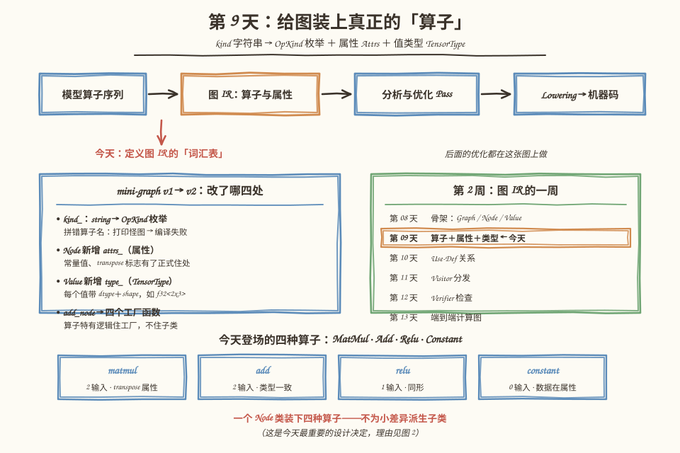
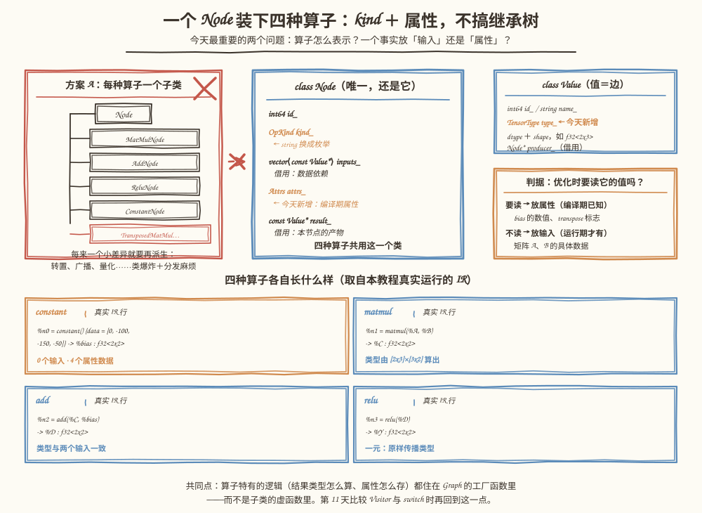
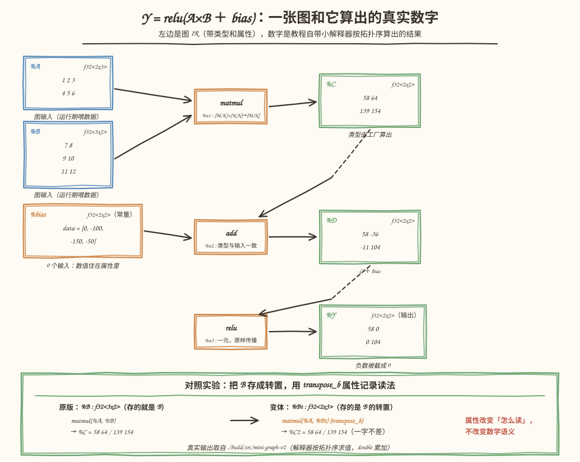

# 第 9 天：算子表示与属性——四种算子住进同一个 Node

> **今日目标**：能说出算子类型、输入、输出、属性各自表达什么、分别住在哪个成员里；能用一条判据（"优化时要读它的值吗"）判断一个事实该做成输入还是属性；亲手把第 8 天的 mini-graph 升级到 v2——`MatMul`、`Add`、`Relu`、`Constant` 四种节点带类型和属性落地，58 条断言 Debug／ASan 双绿，并用一个百余行的小解释器把 `Y = relu(A×B + bias)` 真正算出数字。
> **预计时间**：学习 40 分钟 ＋ 实践 50 分钟
> **前置准备**：第 8 天教程（Graph／Node／Value 的所有权结构、"值即边"）；第 4 天的 Shape／Dtype 概念（忘了就回看一眼，今天会重新遇到它们）。构建环境同前（CMake ≥ 3.16、Ninja、g++ 或 clang++）。
> **今日产出**：`mini-graph-v2` 工程（四种算子工厂 ＋ `OpKind`／`Attrs`／`TensorType` ＋ 58 条断言构造测试 ＋ 小解释器）；一张 Node 解剖图（正文图 2）；一张带真实数字的端到端例子图（正文图 3）。

## 1. 今天解决什么问题？

第 8 天结束时刻意留了两处白：`kind_` 只是字符串，"谁在用某个值"只能靠扫描。今天填第一处。先用三个具体失败感受一下字符串时代的窘境：

1. **拼错算子名没人管**。`g.add_node("mutl", {a, b}, "c")`——少了一个字母，编译器不吭声，测试照样过，最后打印出一张带 `mutl` 节点的怪图。错误从写下的那一刻要拖延到人眼看到输出才暴露。
2. **常量数据没有住处**。我们最终要做 `MatMul + Bias + ReLU`，bias 是编译期就知道的四个数。但第 8 天的节点只有 kind 和输入列表——bias 的数值放不进图里，只能放在图外某个变量里，图一打印，这个信息就丢了。
3. **值没有类型**。`%C` 到底是 `f32<2x2>` 还是 `f16<2x3>`，图里没有任何记录。第 12 天的 Verifier（合法性检查器）要检查 Shape 兼容性、第 43 天要做 Shape 推导，输入都没有，无从下手。

今天的贯穿例子是最终项目的迷你版，也是第 13 天目标的预演：

```text
A : f32<2x3> ─┐
              ├─→ matmul ─→ %C ─┐
B : f32<3x2> ─┘                 ├─→ add ─→ %D ─→ relu ─→ %Y（输出）
bias : 常量 [0, -100, -150, -50]┘
```

用 C++ 把 `Y = relu(A×B + bias)` 完整存进 `Graph`：每个值带类型（dtype ＋ shape），常量数据住进属性，打印出的文本 IR 人能读、机器能查，最后真的算出数字来验证。计划里"避免为每个小差异增加复杂继承"是今天的硬要求——这个结论是怎么推出来的，是本文最重要的一段推理。

## 2. 先看全貌：今天的内容位于哪里？



**图 1**：看三块。顶部流水线——图 IR 处在"模型算子序列"和"分析与优化"之间，今天给它定义**词汇表**：图里允许出现哪些算子、每个算子带什么属性、每个值是什么类型。左下蓝卡是 v1 到 v2 的四处升级，即今天的全部工作量。右下绿色日历标出今天在第 2 周的位置：骨架（第 8 天）→ **算子与属性（今天）** → Use-Def（第 10 天）→ Visitor（第 11 天）→ Verifier（第 12 天）→ 端到端图（第 13 天）。

今天的路线分 4 步：

1. **想清楚**：算子怎么表示（枚举 vs 字符串 vs 继承树）、属性和输入怎么区分、类型记在谁身上（第 3 节）；
2. **升级骨架**：写 `OpKind`／`Attrs`／`TensorType`，改造 `Node`／`Value`，给 `Graph` 加四个工厂函数（第 5.1～5.2 节）；
3. **验收**：构造贯穿例子，58 条断言 Debug 与 ASan 双构建通过，再用小解释器算出真实数字（第 5.3 节）；
4. **对照观察**：换一个 transpose 属性，看输出 Shape 和数字如何变化（第 5.4 节），再收走四个常见错误（第 6 节）。

## 3. 核心概念：先用直觉，再给准确定义

### 3.1 算子类型：枚举，不是继承树

**算子**（Operator）就是"一次运算的种类"：矩阵乘、逐元素加、取正、造常量。第 8 天用字符串占位，今天正式化。候选方案有三个：

| 方案 | 长相 | 代价 |
|---|---|---|
| 字符串 | `kind_ = "matmul"` | 拼错不报错；改名要全局搜文本 |
| **枚举（今天）** | `OpKind::MatMul` | 拼错 → 编译失败；新增算子要改枚举（这是优点：改动点集中） |
| 继承树 | `class MatMulNode : public Node` | 每个小差异都要派生：转置一个 `MatMul` 就得有 `TransposedMatMulNode`，类数量爆炸 |

生活类比：给文件柜贴抽屉标签（枚举），而不是给每种文件盖一栋楼（继承树）。楼盖多了，找一个"带转置的矩阵乘"要在楼群之间跑。**对应到技术上是**：所有算子共用一个 `Node` 类，`kind_` 成员是 `OpKind` 枚举；算子之间**真正不同**的部分（有几个输入、结果类型怎么算、属性长什么样）不放在成员函数里，而放在 `Graph` 的**工厂函数**（factory function，专门负责构造某类对象的函数）里——`add_matmul`、`add_elementwise`、`add_relu`、`add_constant`。

类比边界：抽屉标签类比听不出"分发"问题——拿到一个节点后怎么知道该走哪段处理逻辑？字符串和枚举都要 `switch (kind)`，继承树用虚函数。两种分发的修改范围对比是第 11 天的正题，今天不展开，只在图 2 里留个问题。

真实世界的参照：MLIR 的 Operation 用字符串名（如 `mini.matmul`）加 Dialect 命名空间，而不是枚举——因为 MLIR 要支持任意第三方注册新算子，封闭枚举装不下。我们的项目只有自己定义的十来种算子，枚举的"改动点集中、拼错即编译错"更值钱。**规模不同，选择不同**，这不是谁对谁错。

### 3.2 属性 vs 输入：今天最重要的判据

**属性**（Attribute）是构造图时就已经确定的编译期数据；**输入**（Operand）是数据流里的值，运行期才有内容。今天新增的 `Attrs` 结构体就装两样东西：`Constant` 的常量值 `data`，`MatMul` 的 `transpose_a`／`transpose_b` 标志。

生活类比：菜谱。客人当场点的菜是**输入**——写菜谱时不知道是什么；烘烤温度是**属性**——印在菜谱上，写下去就定了。**对应到技术上是**：`%A`、`%B` 是输入，节点只借用指向它们的指针，数值要等运行期喂数据；bias 的四个数是属性，构造 `add_constant` 时就写进 `Attrs::data`，从此成为图的一部分，打印 IR 都能看到。

判据只有一句：**优化时要读它的值吗？** 要读 → 属性；不要 → 输入。第 24 天和第 47 天的常量折叠要读 bias 的数值做编译期计算，所以它必须是属性；矩阵 `A` 的数据运行期才存在，编译期想读也读不到，所以它是输入。

类比边界：菜谱里的温度似乎也能"调"，但 IR 的属性改了就等于改图——正确的做法是构造新节点替换旧节点（第 45 天 RewritePattern 的活），而不是原地赋值。另外"属性是编译期常量"不等于"数值小"：一个 4096×4096 的权重也是属性，只是今天不展开大常量的存储问题。

### 3.3 TensorType：类型记在值上

第 4 天给数据容器练过 Shape／Dtype；今天同样的概念搬到 IR 里，但更小：`TensorType = Dtype + shape`，没有 stride、没有 storage offset——**布局**（Layout）是第 57 天以后的事，IR 阶段只记录逻辑形状。

```cpp
struct TensorType {
    Dtype dtype = Dtype::F32;          // f32 / f16 / i32 / i64
    std::vector<std::int64_t> shape;   // 如 {2, 3}
    // num_elements() / bytes() / to_string()：打印成 MLIR 风格 "f32<2x3>"
};
```

类型挂在 `Value` 上而不是 `Node` 上，理由要想清楚：类型是"值"的性质——将来一个节点有多个输出时（比如拆分算子），每个输出各带各的类型；而"输入必须是什么类型"是算子的性质，由工厂函数在构造时检查。`f32<2x3>` 这个写法学 MLIR：dtype 在前、维度用 `x` 连接，一眼可读。

## 4. 图解核心机制



**图 2**：这是今天的核心机制图，看四个区域。左侧红框是被否决的方案 A（继承树）：每种算子一个子类，转置这种小差异还要再派生 `TransposedMatMul…`，右上角一个大叉。中间蓝卡是采用方案 B 后的 `Node`——还是第 8 天那个类，成员从四个变五个：`kind_` 换成 `OpKind`，新增 `attrs_`，输入和结果依旧是借用指针。右上 `Value` 新增 `type_`。右下橙色判据卡回答"一个事实放输入还是属性"。

按图核对三个要点：

1. **一个类吃下四种算子**：`MatMul`（2 输入＋transpose 属性）、`Add`（2 输入）、`Relu`（1 输入）、`Constant`（0 输入＋data 属性）——差异全部装进"kind ＋ 输入个数 ＋ 属性"三个维度，不需要四个子类。图底部四张卡片是它们在真实 IR 里的样子，注意 `constant()` 的括号是**空的**——它没有输入；
2. **属性和输入的箭头不同**：输入指向数据流里的 `Value`（借用指针），属性是节点自己肚子里的一块数据（`Attrs` 按值持有）。谁负责析构的判据照旧：`Attrs` 归节点所在 Graph 间接拥有，随节点一起生死；
3. **算子特有逻辑住在工厂里**：`add_matmul` 负责"检查内维、算出 `[M,N]`、记下 transpose"，`add_constant` 负责"核对数据个数"——如果明天新增 `Mul`，加一个枚举值加一个工厂即可（第 14 天复盘会真实做一遍并数一数改了几个文件）。

## 5. 动手实践：升级到 mini-graph-v2 并算出真实数字

> 本节所有命令与输出都在这台机器上真实执行过：
> Linux aarch64（Ubuntu 20.04）· g++ 9.4.0 · CMake 3.20.5 · Ninja 1.10.0。
> 完整工程在本仓库 `tutorials/day-009/examples/mini-graph-v2/`，所有权结构与第 8 天完全相同（`unique_ptr` 集中拥有、其余全是借用），本文只讲变化的部分。

### 5.1 准备文件

```text
tutorials/day-009/examples/mini-graph-v2/
├── CMakeLists.txt            # 同第 8 天：Debug 默认 ＋ ENABLE_ASAN / ENABLE_UBSAN
├── src/
│   ├── CMakeLists.txt        # mini_graph_v2 库 ＋ mini-graph-v2 可执行文件
│   ├── Dtype.h               # ★ 元素类型枚举与 element_bytes
│   ├── TensorType.h          # ★ dtype ＋ shape，打印成 f32<2x3>
│   ├── OpKind.h              # ★ 算子枚举（今天的主角之一）
│   ├── Attrs.h               # ★ 属性：transpose 标志 ＋ 常量数据
│   ├── Value.h               # v1 ＋ type_（TensorType）
│   ├── Node.h                # v1 ＋ OpKind ＋ attrs_
│   ├── Graph.h / Graph.cpp   # 四个工厂函数 ＋ 带类型的打印
│   ├── Interpreter.h/.cpp    # ★ 教程自带的验收小解释器
│   └── main.cpp              # 构造 Y = relu(A×B + bias) 并求值
├── tests/
│   ├── CMakeLists.txt
│   └── test_ops.cpp          # 58 条断言，12 组主题
└── bugs/
    ├── err_kind_string.cpp   # 反面教材一：v1 字符串写法 → 编译失败
    ├── err_checks.cpp        # 反面教材二：四个构造期检查的真实异常
    └── err_bias_as_input.cpp # 反面教材三：常量做成图输入（能跑，但是设计错误）
```

### 5.2 编写代码

**四个新头文件**（`Dtype.h`／`TensorType.h`／`OpKind.h`／`Attrs.h`）加起来约 140 行。`OpKind.h`：

```cpp
enum class OpKind : std::uint8_t {
    Constant,  // 常量：值放在属性里，没有输入
    MatMul,    // 矩阵乘：两个二维输入
    Add,       // 逐元素加：两个同形输入
    Relu,      // 逐元素取正：一个输入
};

inline std::string op_name(OpKind k) {   // 叫 op_name 不叫 to_string：
    switch (k) {                          // Graph::to_string() 成员会遮蔽同名自由函数
        case OpKind::Constant: return "constant";
        case OpKind::MatMul:   return "matmul";
        case OpKind::Add:      return "add";
        case OpKind::Relu:     return "relu";
    }
    return "?";
}
```

`Attrs` 是一个普通结构体：具名字段 `transpose_a`／`transpose_b`／`data`。四种算子用具名字段够用且类型安全；等算子多起来再换成"名字 → 值"的通用字典（MLIR 的做法），今天不预支那个复杂度。

**`Node` 与 `Value` 的升级**：成员对比一目了然——

```cpp
class Node {
    std::int64_t id_;
    OpKind kind_;                          // v1: std::string kind_
    std::vector<const Value*> inputs_;     // 不变：借用
    Attrs attrs_;                          // 新增：编译期属性
    const Value* result_;                  // 不变：借用
};

class Value {
    std::int64_t id_;
    std::string name_;
    TensorType type_;                      // 新增：dtype ＋ shape
    Node* producer_;                       // 不变：借用回指
};
```

**工厂函数**是"算子特有逻辑"的新家。以最复杂的 `add_matmul` 为例：

```cpp
Node* Graph::add_matmul(const Value* a, const Value* b, std::string result_name,
                        bool transpose_a, bool transpose_b) {
    require(a != nullptr && b != nullptr, "matmul: 输入是空指针");
    const TensorType& ta = a->type();
    const TensorType& tb = b->type();
    require(ta.rank() == 2 && tb.rank() == 2, "matmul: 今天只支持二维...");
    require(ta.dtype == tb.dtype, "matmul: dtype 不一致 ...");

    // 有效形状：transpose 只影响「怎么读」，不改动存储。
    const std::int64_t m  = transpose_a ? ta.shape[1] : ta.shape[0];
    const std::int64_t k  = transpose_a ? ta.shape[0] : ta.shape[1];
    const std::int64_t k2 = transpose_b ? tb.shape[1] : tb.shape[0];
    const std::int64_t n  = transpose_b ? tb.shape[0] : tb.shape[1];
    require(k == k2, "matmul: 内维不匹配 " + std::to_string(k) + " vs " +
                         std::to_string(k2) + where(a) + where(b));

    TensorType out{ta.dtype, {m, n}};      // 结果类型：算出来，不是抄进来
    Attrs attrs;
    attrs.transpose_a = transpose_a;       // 小差异 → 属性，不是子类
    attrs.transpose_b = transpose_b;
    return make_node(OpKind::MatMul, {a, b}, std::move(attrs), std::move(out),
                     std::move(result_name));
}
```

读三件事：**想记录输出 Shape，就必须先算它**——`[M,K]×[K,N]→[M,N]`，算它就必须看内维，所以内维检查是"记录"的必要部分，不是提前实现第 12 天的 Verifier（"这个值属不属于本图"之类的全套检查今天仍然不做）；**transpose 变成属性**，同一个 `matmul` 工厂通吃；**错误消息带上两个维度和输入类型**（`where(a)` 拼出 `（输入 %A : f32<2x3>）`），定位不用调试器。

`to_string` 的打印升级成带类型的 IR：值行追加 `: f32<2x3>`，属性跟在算子名后——`Constant` 打 `{data = [...]}`，带转置的 `matmul` 打 `{transpose_b}`，都是 MLIR 的排版习惯。

**小解释器**（`Interpreter.h/.cpp`，合计约 110 行）按拓扑序把图算一遍：图输入由 `bind()` 喂数据，`Constant` 直接抄属性里的 `data`，`MatMul` 按属性处理转置后做三重循环，`Add`／`Relu` 逐元素。要强调：它是**教程的验收工具**，用来证明"记录的类型和属性足够还原语义"，不是编译器的一部分——真正的执行在第 116 天之后。测试和 main 共用它。

### 5.3 运行与观察

```bash
cd tutorials/day-009/examples/mini-graph-v2
cmake -S . -B build -G Ninja && cmake --build build
./build/src/mini-graph-v2
./build/tests/test_ops
```

`./build/src/mini-graph-v2` 的真实输出：

```text
== Y = relu(A x B + bias) 的图 ==
graph "matmul-bias-relu" (2 inputs, 1 outputs) {
  %A = input : f32<2x3>
  %B = input : f32<3x2>
  %n0 = constant() {data = [0, -100, -150, -50]} -> %bias : f32<2x2>
  %n1 = matmul(%A, %B) -> %C : f32<2x2>
  %n2 = add(%C, %bias) -> %D : f32<2x2>
  %n3 = relu(%D) -> %Y : f32<2x2>
  output %Y
}

== 四种节点的关键信息 ==
  constant: 输入 0 个，数据 4 个，结果类型 f32<2x2>
  matmul:   输入 2 个，结果类型 f32<2x2>（由 [2x3]x[3x2] 算出）
  add:      输入 2 个，结果类型 f32<2x2>（与两个输入完全一致）
  relu:     输入 1 个，结果类型 f32<2x2>

== 小解释器：按拓扑序算出每个值 ==
  %C (f32<2x2>) =
    58 64
    139 154
  %D (f32<2x2>) =
    58 -36
    -11 104
  %Y (f32<2x2>) =
    58 0
    0 104
```

读四件事：`constant()` 括号是空的，数据在 `{data = [...]}` 属性里；`%C` 的类型 `f32<2x2>` 是 `add_matmul` 从 `[2x3]×[3x2]` **算出来**的，不是调用者背书抄进来的；手算一遍验证解释器：`C[1][0] = 4×7+5×9+6×11 = 139`，`D[0][1] = 64-100 = -36`，relu 把两个负数截成 0——`Y = [[58,0],[0,104]]`；bias 的四个数从构造到打印到求值**全程住在属性里**，图外没有任何变量持有它。



**图 3**：把上面的输出画成一张图。左列是图输入和常量（注意 bias 卡片标注"数值住在属性里"），中间橙色是三个算子节点，右列绿色是计算结果，每个值都带类型。底部绿框是 5.4 节对照实验的预告。所有数字与程序输出一字不差。

测试与双构建：

```bash
ctest --test-dir build --output-on-failure
cmake -S . -B build-asan -G Ninja -DENABLE_ASAN=ON && cmake --build build-asan
ctest --test-dir build-asan --output-on-failure
```

真实输出（两种构建各跑一遍；行尾标注为笔者所加）：

```text
all 58 assertions passed
100% tests passed, 0 tests failed out of 1          # Debug，0.00 sec

all 58 assertions passed
100% tests passed, 0 tests failed out of 1          # ASan，3.27 sec
```

58 条断言分 12 组：基本结构（6 值 4 节点）、类型记录（含 `f32<2x3>` 打印、6 元素 24 字节）、constant 的零输入与数据往返、matmul 的输入与默认属性、add／relu 的类型传播、f16 的 dtype 传播、transpose 属性、文本 IR 关键行、**五个构造期错误**（消息内容逐个核对）、解释器三步数值、transpose 版解释器数值，以及第 8 天遗风的第 12 组——移动整个 Graph 后借用指针依然有效。

### 5.4 修改一个参数再观察

**对照实验：给 `matmul` 换一个 `transpose_b` 属性。** 把 `B` 换个存法——不存 `[[7,8],[9,10],[11,12]]`（3×2），改存它的转置 `[[7,9,11],[8,10,12]]`（2×3），然后带 `transpose_b=true` 构造：

```cpp
Value* bt = g2.add_input("Bt", {Dtype::F32, {2, 3}});   // 存的是 B 的转置
Node* mm2 = g2.add_matmul(a2, bt, "C2", /*transpose_a=*/false, /*transpose_b=*/true);
```

真实输出（`main.cpp` 后半段）：

```text
== 对照实验：B 存成转置，transpose_b 属性记录读法 ==
graph "transpose-variant" (2 inputs, 1 outputs) {
  %A = input : f32<2x3>
  %Bt = input : f32<2x3>
  %n0 = matmul(%A, %Bt) {transpose_b} -> %C2 : f32<2x2>
  output %C2
}

  %C2 (f32<2x2>) =
    58 64
    139 154
  （与上面的 %C 完全相同：属性改变读法，不改变数学）
```

两个观察：**同一个工厂、同一个 `OpKind`**，只多了一个布尔属性，就表达了"换一种读法"——这正是"小差异用属性、不用子类"的活演示；`%C2` 与 `%C` 数字一字不差，因为转置只改变**怎么读**，不改变数学。如果不带 `transpose_b` 直接构造，`add_matmul` 会当场抛出"内维不匹配 3 vs 2"（见第 6 节错误一）。这个实验还悄悄埋了一颗种子：同一份数据、不同的物理存法，会一直长到第 57～58 天的 Layout 话题才发芽。

## 6. 常见错误与排查

前三个错误（外加逐元素 Shape 不一致）都能在 `bugs/err_checks.cpp` 里真实复现，编译运行命令：

```bash
cd bugs
g++ -std=c++17 -g -fsanitize=address -static-libasan -I ../src \
    ../src/Graph.cpp ../src/Interpreter.cpp err_checks.cpp -o err_checks && ./err_checks
```

程序把四个异常逐个接住并打印（退出码 0）；第四个是能跑但错的设计，在 `err_bias_as_input.cpp`。

**错误一：matmul 内维不匹配——构造时抛异常**

```cpp
Value* a = g.add_input("A", {Dtype::F32, {2, 3}});
Value* b = g.add_input("B", {Dtype::F32, {2, 3}});   // 忘了 transpose_b
g.add_matmul(a, b, "C");
```

- 现象：`std::invalid_argument: matmul: 内维不匹配 3 vs 2（输入 %A : f32<2x3>）（输入 %B : f32<2x3>）`，构造当场失败。
- 原因：A 的内维是 3，B（未转置）的外维是 2，`[2,3]×[2,3]` 在数学上不成立——想记录输出 Shape 就绕不开这个检查。
- 定位：异常消息自带两个维度和两侧类型，直接看出谁对谁错。
- 修复：改 B 的声明为 `{3, 2}`，或确实存的是转置就传 `transpose_b=true`。

**错误二：dtype 不一致——f32 乘 f16 被拒绝**

- 现象：`std::invalid_argument: matmul: dtype 不一致 f32 vs f16`。
- 原因：`TensorType` 的相等比较连 dtype 一起比。混合精度需要显式的 Cast 节点，那是第 67 天的话题，今天明确拒绝而不是静默提升。
- 定位：消息里点名 `f32 vs f16`。
- 修复：统一输入 dtype，或显式插入类型转换（现在还没有这个算子，就先统一）。

**错误三：常量数据个数与 Shape 不符**

- 现象：`std::invalid_argument: constant: 数据个数 3 与元素数 4 不符（f32<2x2>）`。
- 原因：`add_constant` 要把 `data` 塞进属性，属性的数据量由结果类型钉死——2×2 就是 4 个数，少一个属性就不完整。
- 定位：消息带个数、元素数和期望类型。
- 修复：补齐数据或改正 Shape。

**错误四：把常量值做成图输入——能跑，但是设计错误（`bugs/err_bias_as_input.cpp`）**

```cpp
Value* bias = g.add_input("bias", {Dtype::F32, {2, 2}});   // ← 错在这一行
```

- 现象：编译通过、IR 打印正常、解释器照样算对——**错误不体现在数值，体现在可优化性**。真实输出的关键差异（节选，`←` 为笔者标注）：

```text
graph "bias-as-input" (3 inputs, 1 outputs) {        ← 正确版本 2 inputs
  %A = input : f32<2x3>
  %B = input : f32<3x2>
  %bias = input : f32<2x2>                           ← 变成了图输入
  %n0 = matmul(%A, %B) -> %C : f32<2x2>              ← 没有 constant 节点
  ...
```

- 原因：违反了 3.2 节的判据。常量折叠（第 24／47 天）要**读** bias 的数值，输入的值编译期不可见——优化机会直接丢失；且图的调用方被迫多喂一份本该固化在图里的数据。
- 定位：数一数图输入个数（2 还是 3）、搜一搜 IR 里有没有 `constant` 节点。
- 修复：`g.add_constant("bias", {Dtype::F32, {2, 2}}, {0, -100, -150, -50})`，数值住进属性。

顺带一个第 8 天对照：v1 里 `g.add_node("mutl", ...)` 拼错只是打出怪图；v2 里字符串 API 已被枚举工厂取代，同样的写法**编译失败**（`bugs/err_kind_string.cpp`，真实编译输出：`error: 'class Graph' has no member named 'add_node'`）——一类运行期问题被挪到了编译期。

## 7. 今日练习

### 必做练习

合上教程改 `main.cpp`：把 `A` 换成 3×4、`B` 换成 4×2、bias 换成 3×2 的常量（数值自定，建议放一两个让 relu 有活干的负数）。**先在纸上**写出三件事：`%C`／`%D`／`%Y` 的类型各是什么；打印出的节点行有几行、`constant` 的 data 有几个数；手算 `%C` 第一行第一列等于多少。然后运行，逐项对照，再让解释器把整张表算出来检查手算。预期产出：一份预测纸 ＋ 一段和预测一致的运行输出。如果构造时被异常拦下，先读消息里的维度再回头检查纸面预测——这本身就在练第 6 节错误一的排查。

### 选做挑战

给 `MatMul` 增加一个 `alpha` 属性（语义 `C = alpha × A×B`，属性类型 `double`，默认 1.0）：(1) 在 `Attrs` 里加字段；(2) 让 `to_string` 只在非默认时打印它；(3) 在解释器里乘上它；(4) 用 `alpha=2` 跑一遍，确认 `%C` 变成 `116 128 / 278 308`。做完数一数改了几个文件、每处几行——再想象这件事在继承树方案里要动几个类。这个练习完成后，"属性扩展 vs 子类扩展"的成本差异就不再是纸面推理。

## 8. 今日验收

- [ ] 我能不看笔记说出 `kind_`／`inputs_`／`attrs_`／`type_` 各自表达什么，并用"优化时要读它的值吗"判据判断一个事实该做成输入还是属性；
- [ ] 我能独立从空目录构建 mini-graph-v2，跑通 58 条断言（Debug 与 ASan 双绿），并指出解释器是验收工具而不是编译器的一部分；
- [ ] 我能解释为什么不搞继承树（小差异→属性；算子逻辑住工厂），以及 MLIR 为什么反而用字符串名（开放注册 vs 封闭集）；
- [ ] 我能不看输出预测"3×4 乘 4×2 的 matmul 结果类型"，以及"bias 做成图输入"会丢掉什么优化机会；
- [ ] 我能定位今天的四类错误：内维不匹配、dtype／类型不一致、常量数据个数不符、常量误做成输入；
- [ ] 我保存了 mini-graph-v2 工程、58 条断言测试、三个 bugs 反面教材和必做练习的预测纸。

## 9. 一句话总结与明天预告

今天的核心动作是给图装上词汇表：算子类型从字符串升级为 `OpKind` 枚举（拼错即编译错），属性 `Attrs` 给编译期数据（常量值、transpose 标志）一个正式的住处，`TensorType` 让每个值带上了 dtype 和 shape，而四种算子共用一个 `Node`——差异全部装进"kind ＋ 输入个数 ＋ 属性"，算子特有逻辑住进 `Graph` 的工厂函数，继承树被明确否决。`Y = relu(A×B + bias)` 完整落进 IR 并被小解释器算出真数字，58 条断言双构建全绿；四个常见错误里最值得记住的是"常量做成输入"——它能跑、能算对，却把常量折叠的优化机会连同数据一起藏到了编译期之外。

明天第 10 天填第 8 天的第二处留白：Use-Def 关系。今天回答"谁生产 `%C`"靠 `producer_` 回指，但"谁在用 `%C`"仍然要扫全图——第 45 天替换节点、第 25 天死代码消除都重度依赖这个反向查询。明天把它维护成一张使用者表，并保证替换、删除节点时两边同步更新。
