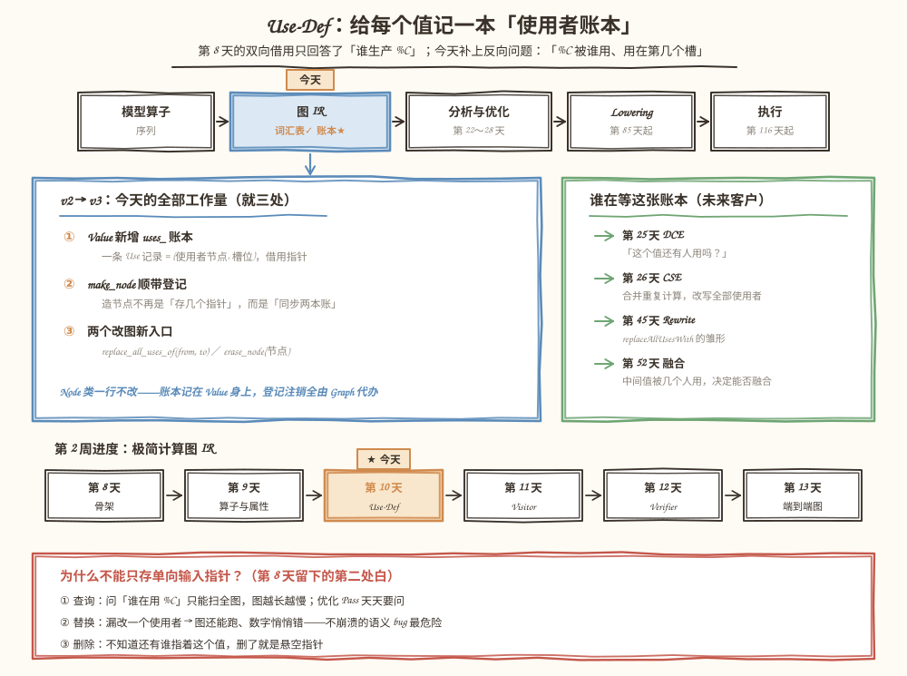
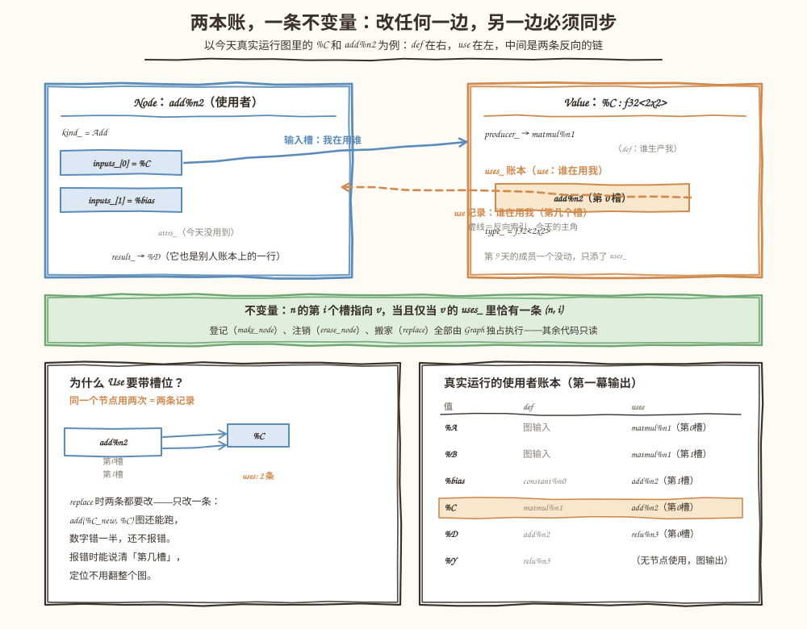
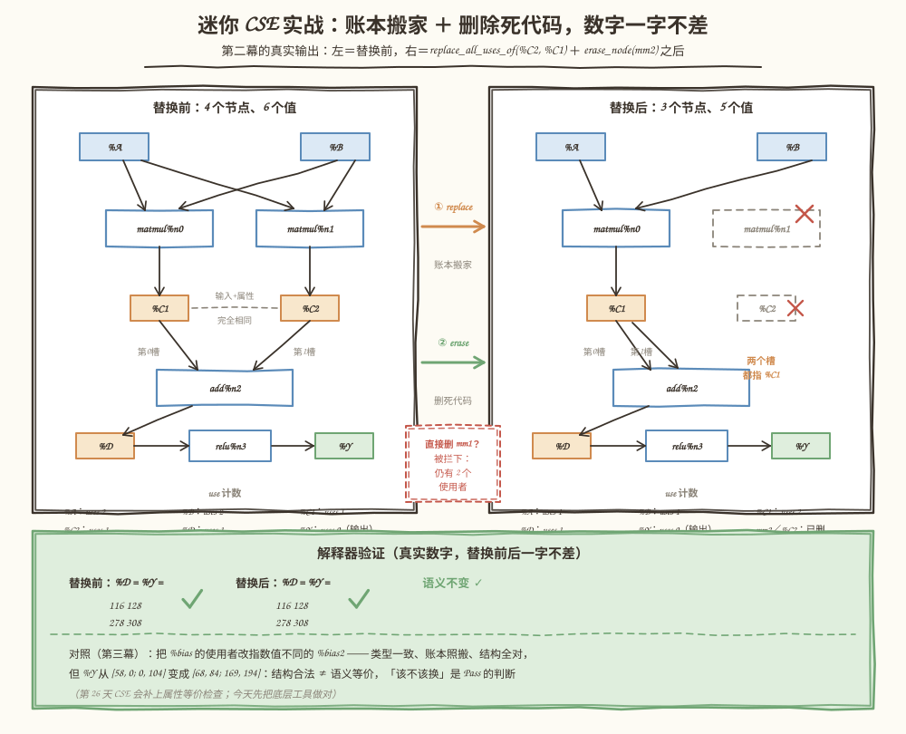

# 第 10 天：Use-Def 关系——给每个值记一本"使用者账本"

> **今日目标**：能画出 def 与 use 的三条链（谁生产我、我在用谁、谁在用我），说清一条 Use 记录为什么必须带槽位；亲手把 mini-graph 升级到 v3——`Value` 长出 `uses_` 账本，`Graph` 学会 `replace_all_uses_of` 与 `erase_node`，并用它们预演第 26 天的 CSE：两个一模一样的 matmul 合并成一个，解释器数字一字不差，71 条断言 Debug／ASan／UBSan 三构建全绿。
> **预计时间**：学习 40 分钟 ＋ 实践 50 分钟
> **前置准备**：第 8 天教程（Graph／Node／Value 的所有权与双向借用）、第 9 天教程（四种算子工厂、`TensorType`、文本 IR）。构建环境同前（CMake ≥ 3.16、Ninja、g++ 或 clang++）。
> **今日产出**：`mini-graph-v3` 工程（use-def 账本 ＋ 两个改图原语 ＋ 71 条断言测试 ＋ 三个 bugs 反面教材）；一张双向账本机制图（正文图 2）；一张迷你 CSE 前后对照图（正文图 3）。

## 1. 今天解决什么问题？

第 8 天留了两处白：`kind_` 只是字符串（第 9 天已填），"谁在用某个值"只能靠扫描（今天填）。先用三个具体失败感受一下单向指针时代的窘境——都以贯穿例子里的 `%C`（`matmul` 的结果）为主角：

1. **查询贵**。问一句"谁在用 `%C`"，唯一的办法是把全图每个节点的每个输入槽扫一遍。第一幕程序里真实数了一遍：4 个节点、5 个输入槽才找到 1 个使用者。第 25 天的死代码消除（DCE）要对每个值问这句话，图越大越痛。
2. **替换危险**。假设想把重复的计算合并——比如两个一模一样的 `matmul`，第二个的结果 `%C2` 该让所有使用者改指 `%C1`。手工扫描改写一旦漏掉一个槽（尤其 `add(%C2, %C2)` 这种同一节点用两次的情况），图照样打印、解释器照样跑，**数字悄悄错**。不崩溃的语义错误是最难查的一类 bug。
3. **删除危险**。想删掉多余的 `matmul` 节点，但不知道它的结果还有没有人指着。指望着"调用的人自己小心"，删错了就是悬空指针，要等 ASan 在运行期抓。

今天的贯穿例子是第 26 天 CSE（公共子表达式消除）的迷你预演，也是最终项目里真实会发生的变换：

```text
%A ─┐             ┌─→ %C1 ─┐
    ├→ matmul%n0 ─┘        ├→ add ─→ %D ─→ relu ─→ %Y
%B ─┤                      │
    └→ matmul%n1 ─→ %C2 ───┘      ← 和 %C1 完全相同的计算
```

目标只有一句话：**用账本代替扫描，用机制代替纪律**——替换不漏人、删除不悬空、查询不扫图，每一步都有测试机器盯着。

## 2. 先看全貌：今天的内容位于哪里？



**图 1**：看三块。顶部流水线——图 IR 的"词汇表"（算子、类型、属性）昨天定稿，今天给它装**反向索引**：每个值记下谁在用它。左下蓝卡是 v2 到 v3 的全部工作量，就三处；右下绿卡是这张账本的四个未来客户——第 25 天 DCE 问"还有人用吗"、第 26 天 CSE 合并重复计算、第 45 天 `replaceAllUsesWith`、第 52 天融合前的多使用者检查，全都重度依赖今天的数据结构。

今天的路线分 4 步：

1. **想清楚**：def 与 use 的三条链、Use 记录为什么带槽位、一致性不变量（第 3 节）；
2. **升级骨架**：`Value` 添 `uses_`，`Graph` 的 `make_node` 顺带登记，新增两个改图入口（第 5.1～5.2 节）；
3. **验收**：71 条断言三种构建通过，迷你 CSE 数字一字不差（第 5.3 节）；
4. **对照观察**：类型一致但数值不同的替换，看数字如何变化（第 5.4 节），再收走五个常见错误（第 6 节）。

## 3. 核心概念：先用直觉，再给准确定义

### 3.1 Def 与 Use：一次计算的两个方向

**Def**（definition，定义）就是"这个值从哪来"：生产它的节点，或者图输入（没有 def）。**Use**（使用）就是"某节点把它放进了自己的第几个输入槽"。值与使用之间的关系统称 use-def 关系，它包含**两条方向相反的链**：

| 链 | 方向 | 我们的成员 | 状态 |
|---|---|---|---|
| use → def | 从使用找定义 | `Value::producer_` | 第 8 天就有 |
| def → use | 从定义找全部使用 | `Value::uses_` | **今天新增** |

顺带理清一个容易绕晕的点：`Node::inputs_`（我在用谁）虽然存在节点身上，但它本质也是 def→use 方向的信息——只是组织在使用者这边。今天要补的不是"节点知道自己用了谁"（早就知道），而是"**值知道自己被谁用**"。真实世界的参照：MLIR 里每个操作数就是一个 `OpOperand` 对象，双向挂在 Value 的 use list 上，改写接口叫 `replaceAllUsesWith`；LLVM 里叫 `Value::uses()`。名字不同，账本同款。

生活类比：图书馆的借书卡。书是**值**；书的版权页写着出版方是 **def**；书后夹的借阅卡记着"谁、什么时候借走了"是 **uses**。**对应到技术上是**：`%C` 的 `producer_` 指回 `matmul%n1`，`uses_` 里记着 `add%n2（第0槽）`。类比的边界：借书要人主动登记，忘登记书就丢了；技术上登记由 `make_node` 自动完成，构造节点和记账是同一个函数的相邻两行——**想忘都忘不了**。这就是"把纪律变成机制"。

### 3.2 为什么单向输入指针不够

三个高频操作，全都要反查：

- **查**：DCE 问"这个值还有人用吗"——`has_uses()` 一次搞定，或者扫全图；
- **换**：CSE／RewritePattern 要改写全部使用者——账本直接给出名单，或者扫全图祈祷别漏；
- **删**：删除节点前必须确认结果无人引用——账本为空才能删，或者赌一把悬空指针。

扫描不仅慢，更危险的是**漏改不报错**。四个未来客户（第 25／26／45／52 天）会在之后两周里陆续上门，今天先把地基打好。

### 3.3 Use 记录为什么是 (节点, 槽位) 二元组

```cpp
struct Use {
    Node* user;           // 谁在用
    std::size_t operand;  // 用在第几个输入槽
};
```

只存 `Node*` 不够，两个理由：其一，**替换时要知道改写哪个槽**——`add(%C, %bias)` 的账本必须分清 `%C` 在第 0 槽、`%bias` 在第 1 槽；其二，**同一个节点可以重复使用同一个值**，`add(%C, %C)` 是两条记录不是一条，替换时两条都要改，只改一条就是"数字错一半"的静默 bug。附赠的好处：报错时能说清"第几槽"，定位不用翻图。

### 3.4 一致性不变量与唯一写者

今天全部正确性浓缩成一句话——**不变量**：

> 节点 n 的第 i 个输入槽指向值 v，当且仅当 v 的 `uses_` 里恰有一条 (n, i)。

维护它靠**唯一写者**：登记（`make_node`）、注销（`erase_node`）、搬家（`replace_all_uses_of`）全部由 `Graph` 独占执行，其余代码只读。加上一条工程约束：**失败的操作不留半套修改**——检查全部通过之前一个字都不改，异常抛出时账本原样。测试里的 `use_def_consistent()` 把不变量变成机器检查，每次变形后重跑（第 5.3 节）。

## 4. 图解核心机制



**图 2**：上半部分看两张卡。左卡是使用者 `add%n2`：`inputs_` 的两个槽分别放着 `%C` 和 `%bias`。右卡是值 `%C`：`producer_` 回指生产者（def），`uses_` 账本列出使用者（use）。蓝实线是正向——"我在用谁"；橙虚线是今天的主角——"谁在用我、在第几个槽"。中间绿横幅是不变量，底左解释槽位为什么进记录，底右是第一幕程序真实打印的账本。

按图核对四个要点：

1. **两本账，双向可查**：从 `add%n2` 顺 `inputs_[0]` 找到 `%C`，从 `%C` 顺 `uses_` 找回 `add%n2（第0槽）`——两条路必须给出同一对节点和槽位；
2. **Node 一行不改**：账本记在 `Value` 身上，`add%n2` 对自己被记账这件事毫不知情，第 9 天的成员原样保留；
3. **带槽位的理由**（底左）：`add(%C, %C)` 产生两条记录，替换时都改才安全；
4. **真实账本**（底右）：第一幕的输出里，`%Y` 一栏是"无节点使用，图输出"——图输出也是一种使用者，只是不住在 `uses_` 里，住在 `outputs_` 里（第 6 节错误二会用到这条规则）。

## 5. 动手实践：升级到 mini-graph-v3，预演一次 CSE

> 本节所有命令与输出都在这台机器上真实执行过：
> Linux aarch64（Ubuntu 20.04）· g++ 9.4.0 · CMake 3.20.5 · Ninja 1.10.0。
> 完整工程在本仓库 `tutorials/day-010/examples/mini-graph-v3/`，由第 9 天的 v2 复制而来（`Dtype`／`TensorType`／`OpKind`／`Attrs`／`Interpreter` 原样），机制上的改动是下文的三处，外加一处在调试中计划外的 bug 修复（5.2 节末尾）。

### 5.1 准备文件

```text
tutorials/day-010/examples/mini-graph-v3/
├── CMakeLists.txt            # 同第 9 天：Debug 默认 ＋ ENABLE_ASAN / ENABLE_UBSAN
├── src/
│   ├── CMakeLists.txt        # mini_graph_v3 库 ＋ mini-graph-v3 可执行文件
│   ├── Dtype.h / TensorType.h / OpKind.h / Attrs.h   # 第 9 天原样
│   ├── Value.h               # ★ Use 结构体 ＋ uses_ 账本
│   ├── Node.h                # 一行未改（账本不关 Node 的事）
│   ├── Graph.h / Graph.cpp   # ★ make_node 登记 ＋ replace / erase ＋ use 表打印
│   ├── Interpreter.h/.cpp    # 第 9 天原样（验收工具）
│   └── main.cpp              # 三幕：看账本 → 迷你 CSE → 语义对照
├── tests/
│   ├── CMakeLists.txt
│   └── test_use_def.cpp      # 71 条断言，13 组主题
└── bugs/
    ├── err_erase_with_users.cpp      # 反面教材一：删仍有使用者的节点
    ├── err_erase_output.cpp          # 反面教材二：删图输出的节点
    └── err_replace_type_mismatch.cpp # 反面教材三：类型不一致／自己换自己
```

### 5.2 编写代码

**改动一：`Value.h` 添账本**。`Use` 结构体（上文 3.3）加 `uses_` 向量，配三个只读接口：

```cpp
class Value {
public:
    // ... 第 9 天的 id / name / type / producer 原样 ...
    std::size_t num_uses() const noexcept { return uses_.size(); }
    bool has_uses() const noexcept { return !uses_.empty(); }
    const std::vector<Use>& users() const noexcept { return uses_; }

private:
    friend class Graph;                 // 唯一写者是 Graph
    Node* producer_ = nullptr;          // def：谁生产我
    std::vector<Use> uses_;             // use：谁在用我（今天新增）
};
```

**改动二：`make_node` 顺带登记**。造节点从"存几个指针"变成"同步两本账"，就多了一个循环：

```cpp
Node* raw = node.get();
for (std::size_t i = 0; i < raw->inputs_.size(); ++i) {
    mutable_value(raw->inputs_[i])->uses_.push_back(Use{raw, i});
}
```

`mutable_value` 是 `const_cast<Value*>` 的一行封装：输入槽的类型是 `const Value*`（节点只读值的数据），但登记要改账本；值本体住在 `values_` 里生来非 const，写权限收在 Graph 一人手里。`Node` 的成员和接口一个没动，只有注释更新。

**改动三：两个改图入口**。先看替换——注意第一行为什么要先拷贝账本再遍历：

```cpp
void Graph::replace_all_uses_of(const Value* from, const Value* to) {
    require(from != nullptr && to != nullptr, "replace: 空指针");
    require(from != to, "replace: from 和 to 是同一个值 %" + from->name());
    require(from->type() == to->type(),
            "replace: 类型不一致 %" + from->name() + " : " + from->type().to_string() +
                " vs %" + to->name() + " : " + to->type().to_string());

    // 先拷贝再遍历：改槽位会往 to 的账本添记录，若 to 恰好也是 from 的
    // 使用者，边遍历边改 from->uses_ 就是「迭代中修改容器」，会漏记录。
    const std::vector<Use> moved = from->uses_;
    for (const Use& u : moved) {
        u.user->inputs_[u.operand] = to;    // 槽位改指 to
        mutable_value(to)->uses_.push_back(u);
    }
    mutable_value(from)->uses_.clear();
}
```

再看删除——三条守门规则全部通过之前，一个字都不改：

```cpp
void Graph::erase_node(Node* n) {
    require(n != nullptr, "erase_node: 空指针");
    const auto node_it = std::find_if(/* 在 nodes_ 里找 n，找不到拒绝 */);
    require(node_it != nodes_.end(), "erase_node: 节点不属于本图");

    const Value* result = n->result_;
    if (result->has_uses()) {               // 规则一：结果仍有人用 → 点名拒绝
        std::string users;
        for (const Use& u : result->users()) { /* 拼出 " add%n2(第0槽) ..." */ }
        throw std::invalid_argument("erase_node: %" + result->name() + " 仍有 " + ...);
    }
    require(std::find(outputs_.begin(), outputs_.end(), result) == outputs_.end(),
            "erase_node: %" + result->name() + " 是图输出，不能删除");   // 规则二

    for (std::size_t i = 0; i < n->inputs_.size(); ++i) {   // 规则三：注销登记
        remove_use(mutable_value(n->inputs_[i]), n, i);
    }
    values_.erase(/* 摘掉结果值 */);
    nodes_.erase(node_it);   // 从这行起，n 和它的结果指针全部失效（同 MLIR eraseOp）
}
```

**一个今天真实踩到的坑**，值得原样记下：v2 的 `topological_order` 用 `vector<char> visited` 按**节点 id 当下标**做标记——只加不删的图里 id 恰好连续，这个假设一直成立。`erase_node` 一来，id 出现空洞，`visited[4]` 在长度 4 的数组上**越界读**。第一次跑第二幕，程序异常终止，最后一个输出是解释器的 `std::invalid_argument: 解释器: %Y 没有数据（输入未绑定？）`——因为 relu 节点被越界读"误判为已访问"，压根没进拓扑序。修复：`visited` 改成 `std::unordered_set<const Node*>`，用指针做键，与 id 是否连续无关。教训写进了源码注释：**新功能（删除）会打破旧代码里"恰好成立"的隐含假设，越早跑真实用例越早暴露**。

### 5.3 运行与观察

```bash
cd tutorials/day-010/examples/mini-graph-v3
cmake -S . -B build -G Ninja && cmake --build build
./build/src/mini-graph-v3
./build/tests/test_use_def
```

`./build/src/mini-graph-v3` 的真实输出（三幕，节选自完整运行）：

```text
== 第一幕：Y = relu(A x B + bias)，先看 use 表 ==
graph "matmul-bias-relu" (2 inputs, 1 outputs) {
  %A = input : f32<2x3>
  %B = input : f32<3x2>
  %n0 = constant() {data = [0, -100, -150, -50]} -> %bias : f32<2x2>
  %n1 = matmul(%A, %B) -> %C : f32<2x2>
  %n2 = add(%C, %bias) -> %D : f32<2x2>
  %n3 = relu(%D) -> %Y : f32<2x2>
  output %Y
}

use 表（def 在左，use 在右）
  %A   def: 图输入      uses: matmul%n1(第0槽)
  %B   def: 图输入      uses: matmul%n1(第1槽)
  %bias def: constant%n0 uses: add%n2(第1槽)
  %C   def: matmul%n1   uses: add%n2(第0槽)
  %D   def: add%n2      uses: relu%n3(第0槽)
  %Y   def: relu%n3     uses: （无节点使用，图输出）

问「谁在用 %C」：扫全图 = 访问 4 个节点、5 个输入槽，找到 1 个使用者；
use 表直读 = num_uses() 返回 1（图越长扫描越慢，账本永远是常数次）

== 解释器基准（第三幕回来对照）==
  %Y (f32<2x2>) =
    58 0
    0 104

== 第二幕：两个一模一样的 matmul（第 26 天 CSE 的靶子）==
graph "duplicate-matmul" (2 inputs, 1 outputs) {
  %A = input : f32<2x3>
  %B = input : f32<3x2>
  %n0 = matmul(%A, %B) -> %C1 : f32<2x2>
  %n1 = matmul(%A, %B) -> %C2 : f32<2x2>
  %n2 = add(%C1, %C2) -> %D : f32<2x2>
  %n3 = relu(%D) -> %Y : f32<2x2>
  output %Y
}

use 表（def 在左，use 在右）
  %A  def: 图输入     uses: matmul%n0(第0槽) matmul%n1(第0槽)
  %B  def: 图输入     uses: matmul%n0(第1槽) matmul%n1(第1槽)
  %C1 def: matmul%n0  uses: add%n2(第0槽)
  %C2 def: matmul%n1  uses: add%n2(第1槽)
  ...

== 替换前，解释器先算基准 ==
  %D (f32<2x2>) =
    116 128
    278 308
  %Y (f32<2x2>) =
    116 128
    278 308

== replace_all_uses_of(%C2, %C1) 之后：账本搬家 ==
  %C1 def: matmul%n0  uses: add%n2(第0槽) add%n2(第1槽)
  %C2 def: matmul%n1  uses: （无）

试图删除仍被使用的 mm1 → std::invalid_argument: erase_node: %C1 仍有 2 个使用者： add%n2(第0槽) add%n2(第1槽)

== erase_node(mm2) 之后：节点 4 -> 3，值 6 -> 5 ==
graph "duplicate-matmul" (2 inputs, 1 outputs) {
  %A = input : f32<2x3>
  %B = input : f32<3x2>
  %n0 = matmul(%A, %B) -> %C1 : f32<2x2>
  %n2 = add(%C1, %C1) -> %D : f32<2x2>
  %n3 = relu(%D) -> %Y : f32<2x2>
  output %Y
}

== 替换后，解释器再算一遍（语义不变的证明）==
  %D (f32<2x2>) =
    116 128
    278 308
  %Y (f32<2x2>) =
    116 128
    278 308
```

读四件事：账本搬家后 `%C1` 的使用者变成**同一节点的两个槽**（`add(%C1, %C1)`），`%C2` 清零；偷懒先删 `mm1` 被当场拦下，异常消息点名剩余使用者和槽位；`erase_node(mm2)` 之后节点 4→3、值 6→5；替换前后 `%D`、`%Y` 数字**一字不差**——手算可验：`C1 = C2 = [[58,64],[139,154]]`，`D = C1 + C2 = 2×C1 = [[116,128],[278,308]]`，全为正所以 `Y = D`。



**图 3**：左面板是替换前——注意 `%A`／`%B` 各有 2 个使用者（两个 matmul 都在用），`%C1`／`%C2` 各 1 个；中间两步是 CSE 的标准动作，红色小框提醒"直接删 `mm1` 会被拦"；右面板是替换后——`mm2`／`%C2` 变成虚线幽灵，`add` 的两个槽都指 `%C1`；底部绿框是解释器验证，数字与程序输出一字不差，最后一行预告 5.4 节的反例。

测试与三构建（`test_use_def.cpp` 全部真实执行）：

```bash
ctest --test-dir build --output-on-failure
cmake -S . -B build-asan -G Ninja -DENABLE_ASAN=ON && cmake --build build-asan
ctest --test-dir build-asan --output-on-failure
cmake -S . -B build-ubsan -G Ninja -DENABLE_UBSAN=ON && cmake --build build-ubsan
ctest --test-dir build-ubsan --output-on-failure
```

真实输出（`#` 后为笔者所加）：

```text
all 71 assertions passed
100% tests passed, 0 tests failed out of 1     # Debug，0.00 sec

all 71 assertions passed
100% tests passed, 0 tests failed out of 1     # ASan，3.27 sec

all 71 assertions passed
100% tests passed, 0 tests failed out of 1     # UBSan，0.00 sec；main 同样退出码 0
```

71 条断言分 13 组：经典图初始账本（16 条）、producer 不受影响、同一节点重复使用（`add(%C,%C)` 两条记录）、多节点共用一个值、`replace_all_uses_of` 搬家与槽位改写、替换后数值等于手算 `2×C1`、erase 三类拒绝（有使用者／图输出／空指针与外图节点）、erase 成功路径（数量、不变量、数值）、replace 三个廉价检查、无使用者的空操作替换、以及第 8／9 天遗风——移动整个 Graph 后账本依然有效。其中**不变量检查**是主角：`use_def_consistent()` 正向数一遍（每个槽在账本里恰有一条记录）、反向对一遍（每条记录的槽确实指回这个值），每次变形后重跑。

### 5.4 修改一个参数再观察

**对照实验：类型一致、数值不同的替换。** 第三幕把经典图的 `%bias`（`[0, -100, -150, -50]`）换成同类型 `f32<2x2>` 但数值不同的 `%bias2`（`[10, 20, 30, 40]`），再删掉无人使用的旧常量：

```cpp
Node* bias_new = g3.add_constant("bias2", {Dtype::F32, {2, 2}}, {10.0, 20.0, 30.0, 40.0});
g3.replace_all_uses_of(bias3->result(), bias_new->result());  // 类型检查通过
g3.erase_node(bias3);                                          // 旧常量已无人使用
```

真实输出（节选）：

```text
graph "semantic-replace" (2 inputs, 1 outputs) {
  %A = input : f32<2x3>
  %B = input : f32<3x2>
  %n1 = matmul(%A, %B) -> %C : f32<2x2>
  %n2 = add(%C, %bias2) -> %D : f32<2x2>
  %n3 = relu(%D) -> %Y : f32<2x2>
  %n4 = constant() {data = [10, 20, 30, 40]} -> %bias2 : f32<2x2>
  output %Y
}

== 解释器：结构变换全部成功，数字却变了 ==
  %Y (f32<2x2>) =
    68 84
    169 194
  （第一幕同款图的 Y = [58, 0; 0, 104]；bias 换了数值，Y 就跟着变——
   账本保证「每个使用者都被改到」，不保证「改了还等于原来」）
```

两个观察：**结构层面一切正常**——账本搬家、槽位改写、死常量删除、IR 打印、解释器执行全部成功，5.2 节的不变量检查也通过；**数字变了**——`D = C + bias2 = [[68,84],[169,194]]` 全为正，`Y = D`。和第二幕对照就得到今天最重要的边界结论：`replace_all_uses_of` 是底层工具，它保证"改全、不漏、类型不破"，**不判断"该不该换"**——那是第 26 天 CSE Pass 的职责（比较 kind、属性、输入全部相等才允许合并）。工具层和决策层分开，正是 5.2 节"机制代替纪律"的另一半。

## 6. 常见错误与排查

前三个错误在 `bugs/` 下可真实复现，编译运行命令：

```bash
cd bugs
g++ -std=c++17 -g -fsanitize=address -static-libasan -I ../src \
    ../src/Graph.cpp ../src/Interpreter.cpp err_erase_with_users.cpp -o err_erase_with_users && ./err_erase_with_users
```

（另外两个文件同理，换文件名即可。）

**错误一：删除仍有使用者的节点——异常拦截，点名到槽位（`bugs/err_erase_with_users.cpp`）**

- 现象：`std::invalid_argument: erase_node: %C 仍有 2 个使用者： add%n1(第0槽) add%n1(第1槽)`——第二个用例里 `add` 把 `%C` 用了两次，账本如实记了两条。
- 原因：结果还在别人的输入槽里，删了节点槽位就悬空。use 表存在的意义就是把"不知道谁还指着"变成"点名告诉你"。
- 定位：异常消息自带使用者节点和槽位，直接看出该先处理谁。
- 修复：先 `replace_all_uses_of` 把使用者改指别处，再删；或者保留节点。
- 附带保证：被拦下的删除不留下半套修改——检查全过之前一个字不改，异常抛出时账本原样（测试第 7 组验证过）。

**错误二：删除图输出的节点（`bugs/err_erase_output.cpp`）**

- 现象：`std::invalid_argument: erase_node: %Y 是图输出，不能删除`（以及直接 `mark_output` 了 `%C` 再删 `matmul` 的变体）。
- 原因：图输出也是一种"使用者"，只是不住在 `uses_` 里、住在 `outputs_` 里——删了它，图的调用方就拿不到结果。这正是第 25 天 DCE 的规则：无使用者的纯算子可删，图输出必须保留。
- 定位：消息点名"是图输出"。
- 修复：先换输出再删节点。今天还没有"取消输出"的接口——需要时再加，不预支。

**错误三：类型不一致的替换／自己替换自己（`bugs/err_replace_type_mismatch.cpp`）**

- 现象：`replace: 类型不一致 %C : f32<2x2> vs %X : f32<2x3>`；以及 `replace: from 和 to 是同一个值 %x`。
- 原因：槽位上的类型契约是算子工厂（第 9 天）立的，替换绕过工厂直接改槽位，必须自己把好这道门，否则 relu 的输入会悄悄变成 `2x3`。
- 定位：消息带两个值的名字和类型。
- 修复：换同类型的值；确要变形状就插入 `reshape` 类算子（第 59 天的事）。至于"类型一致但数值不同"能通过检查——那不是 bug，是职责边界，见 5.4 节。

**错误四：替换后忘删旧节点——僵尸节点（测试开发时真实踩到）**

- 现象：笔者把测试写成"替换后 `%A` 的使用者应为 1"，`CHECK` 当场失败。打印 use 表发现 `matmul%n1` 还在册——`%A` 仍有两个使用者。
- 原因：`replace_all_uses_of` 只改 `%C2` 的使用者，**不删 `%C2` 的生产者**——节点没死，只是变成了没人用结果的僵尸：不报错、照样打印、照样被拓扑排序执行、白算一次。
- 定位：use 表里看结果值一栏是否为"（无）"，或者数节点个数没变。
- 修复：替换后跟着 `erase_node`。MLIR 的 Rewriter 也是这两步（`replaceUses ＋ eraseOp`），分开是有意的：中间可能还要读旧节点。

**错误五：erase 之后节点 id 不再连续——越界读（5.2 节详述的真实 bug）**

- 现象：第二幕首次运行异常终止，最后的输出是 `解释器: %Y 没有数据（输入未绑定？）`，可 `%Y` 明明是 relu 的结果。
- 原因：`topological_order` 沿用 v2 的 `visited[id]` 数组下标假设；删除节点后 id 出现空洞，越界读把 relu 误判为"已访问"，它没进拓扑序，解释器自然算不出 `%Y`。
- 定位：ASan 也未必抓得住这种"读到了垃圾值"的越界；靠输出倒推——哪个值缺了，谁没进拓扑序。
- 修复：`visited` 改用 `unordered_set<const Node*>` 按指针做键，与 id 无关。泛化教训：**加"删除"这类新能力时，排查所有"只加不删时代恰好成立"的隐含假设**（id 连续、下标即位置）。

## 7. 今日练习

### 必做练习

合上教程改 `main.cpp` 第二幕：再加一个相同的 `mm3`（结果名 `%C3`），加一个 `E = relu(%C3)` 并 `mark_output`。**先在纸上**写出三件事：替换前三张账本（`%A`、`%C3`、`%E` 各有几个使用者）；`replace_all_uses_of(%C3, %C1)` 之后 `%C1`、`%C3`、`%E` 的使用者各是什么；`erase_node(mm3)` 后节点和值的个数。然后运行，逐项对照，最后让解释器算 `%E` 并手算验证。预期产出：一份预测纸 ＋ 一段与预测一致的运行输出。如果预测错了，先回看 3.3 节"同一节点用两次"和错误四"僵尸节点"，十有八九踩的是这两个点之一。

### 选做挑战

用今天的 API 写一个约 20 行的 mini-DCE：循环删除"无使用者且非图输出"的节点，直到一轮下来一个都删不动（不动点），在"替换后忘删 mm2"的图上跑，看僵尸被清走。两个思考题：为什么必须循环到不动点（提示：构造 `relu(relu(x))`，外层删掉之前内层一直有人用）；今天的算子全是**纯**的（没有副作用），如果有个 `print` 节点，即使没人用它的结果能删吗——第 25 天会正面回答。

## 8. 今日验收

- [ ] 我能不看笔记画出 def 与 use 的三条链（`producer_`、`inputs_`、`uses_`），并说出它们各回答什么问题；
- [ ] 我能独立从空目录构建 mini-graph-v3，跑通 71 条断言（Debug／ASan／UBSan 三绿），并解释 `use_def_consistent()` 检查的是什么不变量；
- [ ] 我能说清一条 Use 记录为什么必须带槽位（`add(%C, %C)` 反例），以及 `replace_all_uses_of` 为什么先拷贝账本再遍历；
- [ ] 我能预测"替换后忘了 erase"和"把 `%bias` 换成数值不同的同类型常量"分别会发生什么（僵尸节点／数字变化），并用 use 表和解释器验证；
- [ ] 我能定位今天的五类错误：删仍有使用者、删图输出、类型不一致替换、僵尸节点、erase 后 id 不连续；
- [ ] 我保存了 mini-graph-v3 工程、71 条断言测试、三个 bugs 反面教材和必做练习的预测纸。

## 9. 一句话总结与明天预告

今天的核心动作是把"谁在用这个值"从全图扫描变成账本直读：`Value` 新增 `uses_`，每条 Use 记录是（使用者节点， 槽位）二元组，登记、注销、搬家全部由 `Graph` 独占执行，一条不变量（每个槽位恰好对应账本里一条记录）贯穿始终并由测试机器盯着。`replace_all_uses_of` ＋ `erase_node` 两步走，预演了第 26 天 CSE 的核心动作——两个一模一样的 matmul 合并成一个，解释器数字一字不差；同时第三幕证明了账本只保证"改全"，不保证"等价"，该不该换是 Pass 的判断。五个常见错误里最值钱的是两个真实踩到的坑：僵尸节点（替换后忘删）和 erase 打破"id 当下标"的隐含假设。

明天第 11 天：Visitor 与扩展方式。今天 `uses_to_string()` 里又写了一遍 `switch (kind)`——每新增一种算子，所有 switch 都要跟着改，第 14 天复盘加 `Mul` 时这个账会算得更清楚。明天比较 `switch`、动态分发（虚函数 Visitor）和 CRTP 的修改范围与运行代价，回答"当前这个规模选哪种分发最划算"。
