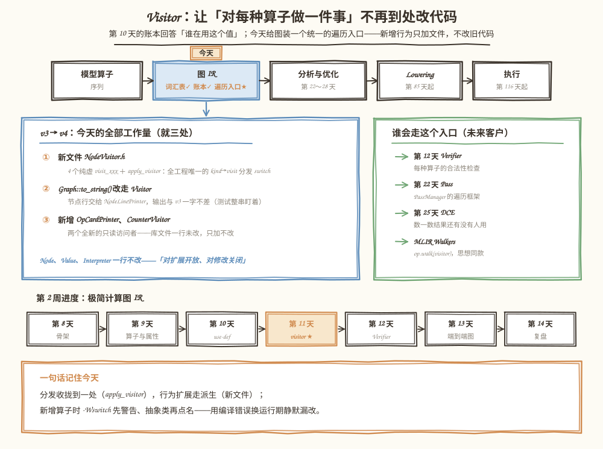
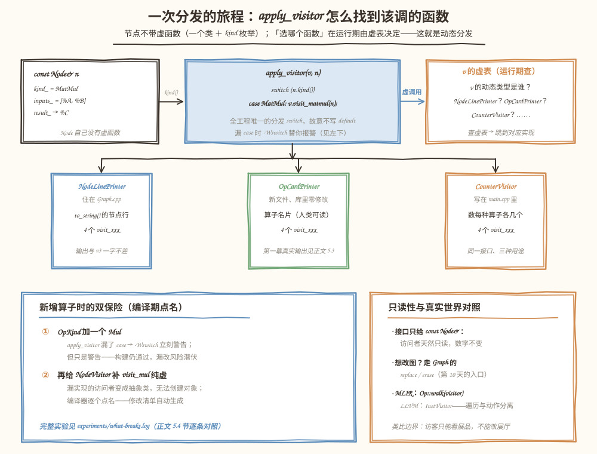

# 第 11 天：Visitor 与扩展方式——把"按算子选动作"收拢到一处

> **今日目标**：能说清 Visitor（访问者）、动态分发和 CRTP 各自解决什么问题、各付出什么代价；亲手把 mini-graph 升级到 v4——`NodeVisitor` 接口 ＋ 全工程唯一的 `apply_visitor` 分发入口，`to_string()` 重构后输出与 v3 一字不差，再用两个全新的只读访问者体验"只加不改"；最后用一个真实编译实验回答"新增一种算子，谁替你抓住漏改"，并用 1000 万次分发的计时数据回答"动态分发到底贵多少"。
> **预计时间**：学习 40 分钟 ＋ 实践 50 分钟
> **前置准备**：第 9 天教程（四种算子工厂、`OpKind` 枚举、文本 IR）、第 10 天教程（use-def 账本、`replace_all_uses_of`／`erase_node`）。构建环境同前（CMake ≥ 3.16、Ninja、g++ 或 clang++）。
> **今日产出**：`mini-graph-v4` 工程（`NodeVisitor` 分发框架 ＋ 两个新访问者 ＋ 71＋44 条断言三构建全绿）；一个可重复运行的"新增 Mul"对照实验（`experiments/`）；一张分发机制图（正文图 2）；一张 switch 与 Visitor 的对照实验图（正文图 3）；一段"当前为什么选虚函数分发"的说明（正文 3.4 节）。

## 1. 今天解决什么问题？

第 10 天结尾埋了一根刺：`uses_to_string()` 打印 use 表时，又把"kind 转成名字"的逻辑借了一遍 `op_name()`；而 `to_string()` 的节点行是一长串 `if (kind == ...) ... else if (...)`，`Interpreter::run()` 里还有一整个 `switch (n->kind())`。这些代码都在回答同一个问题——**"这个节点是什么算子？该对它做什么？"**——但答案散落在各个文件里，每个想遍历图的新功能都得再抄一份。

用贯穿全文的例子感受一下麻烦有多大。还是那张经典图（第 9 天起一路沿用）：

```text
%A ─┐
    ├→ matmul%n1 ─→ %C ─┐
%B ─┘                   ├→ add%n2 ─→ %D ─→ relu%n3 ─→ %Y（图输出）
%bias（constant%n0）────┘
```

今天想对它做三件彼此独立的事：打印文本 IR（每种算子的行格式不同）、打一张"算子名片"（每种算子一句话介绍）、数一数每种算子各几个。在 v3 的世界里，这意味着三段各自带 `if/else` 或 `switch` 的循环，分别写进 `Graph.cpp`、一个新文件和 `main.cpp`。更糟的在第 14 天：复盘时要新增 `Mul` 算子，届时**每一段这样的代码都要记得回来改**——漏掉任何一处，编译照样通过，错误潜伏到运行期（今天 5.4 节的实验会真实演示漏改的后果：节点从 IR 里悄悄消失，解释器静默输出全 0）。

所以今天的目标一句话：**把"按算子选动作"的分发收拢到一个入口，把"做什么"留给可以无限新增的访问者**——新增行为只加文件、不改旧代码；新增算子时，让编译器逐个点名该改的地方。

## 2. 先看全貌：今天的内容位于哪里？



**图 1**：看三块。顶部流水线——图 IR 的词汇表（第 9 天）和账本（第 10 天）都已就位，今天装的是**遍历入口**：从此"对图上每个节点做一件事"有了一条统一通道。左下蓝卡是 v3 到 v4 的全部工作量，就三处，其中两处是纯新增；右下绿卡是排着队的未来客户——明天第 12 天的 Verifier（合法性检查）立刻就会用上，第 22 天的 Pass、第 25 天的 DCE 也都走这条路，MLIR 的 `Operation::walk` 与 LLVM 的 `InstVisitor` 是同一思想的工业级版本。

今天的路线分 4 步：

1. **想清楚**：Visitor 是什么、动态分发怎么找到该调的函数、CRTP 为什么今天不用（第 3 节）；
2. **升级骨架**：新文件 `NodeVisitor.h`，`to_string()` 重构走访问者，输出必须与 v3 一字不差（第 5.1～5.2 节）；
3. **验收**：71＋44 条断言 Debug／ASan／UBSan 三构建通过，解释器数字仍是 58 0 ／ 0 104（第 5.3 节）；
4. **对照实验**：新增 `Mul` 算子，比较两种分发方式的修改范围和抓漏能力；再测 Debug 与 Release 下 1000 万次分发的真实代价（第 5.4 节）。

## 3. 核心概念：先用直觉，再给准确定义

### 3.1 Visitor：把"做什么"从图里搬出来

**Visitor（访问者）**是一种组织代码的方式：被访问的数据（节点）保持不动，"对每种数据做什么"写在一个独立对象里，每种数据一个入口函数。它要解的是**行为频繁新增、数据结构基本稳定**的场景——编译器正是典型：算子种类一个季度加不了几种，但"遍历图做一件事"的需求（打印、验证、统计、变换）每周都有。

生活类比：博物馆的讲解员。展品（`Node`）摆在展柜里一动不动，讲解员（Visitor）带着自己的讲稿进场，按展品种类讲不同内容；换个讲解员，展柜不用动。**对应到技术上是**：`NodeVisitor` 接口为每种算子留一个 `visit_xxx`，`NodeLinePrinter`、`OpCardPrinter`、`CounterVisitor` 各自实现这四个入口；节点对"谁来过"毫不知情。**类比的边界**：博物馆新增展品时，讲解员可以临场发挥不补讲稿；技术上恰恰相反——我们**故意**要求每个访问者必须补实现，漏了就编译失败。这个"反转"是今天最重要的设计决策：宁可编译失败，不要运行期静默漏改（5.4 节的实验会量化这半句话）。

还有一处与教科书不同要说明：经典 Visitor 模式靠**双分派**（数据对象有一个虚函数 `accept`，回手再调访问者）实现，前提是每种算子一个 C++ 子类。我们的 `Node` 是"一个类 ＋ kind 枚举"（第 9 天的决策），没有 `accept` 可用，于是用一个自由函数 `apply_visitor` 里的 `switch` 完成第一重分派、虚函数完成第二重。MLIR 也是这个形状：Operation 不为每种算子提供虚接口，遍历走 `walk` 回调。

### 3.2 动态分发：虚函数怎么找到该调的函数

**动态分发（dynamic dispatch）**指"调用哪个函数"要到运行期才能决定。C++ 的实现是**虚函数**：每个多态类有一张**虚表（vtable）**——函数指针数组；每个对象藏一个虚表指针（vptr）。调用 `v.visit_matmul(n)` 时，编译器生成的代码是"取 v 的 vptr → 取虚表里对应槽位的指针 → 间接调用"。代价有两项：一次额外的指针跳转（可能多一次 cache miss），以及**编译器看不清调用目标，无法内联**。反过来，直接调用（如普通函数、`switch` 里直插的代码）在 `-O2`／`-O3` 下常被内联甚至整段优化掉。

今天真实测了这笔账（细节见 5.4 节）：Debug 构建下 visitor 比 switch 慢约 1.26 倍（36.17 vs 28.65 ns／次），Release（-O3）下差距缩小到 1.16 倍（8.05 vs 6.95 ns／次）。按绝对值说，一次虚调用贵 1～2 ns；一次 Pass 遍历几百到几万个节点，总代价在微秒级——对编译器完全无感。**结论先放在这里：这个量级的代价，换"新增算子必被编译器点名"，是划算的。**

### 3.3 CRTP：零开销的另一个极端

**CRTP（Curiously Recurring Template Pattern，奇异递归模板）**是第三种选择：基类是模板，把派生类自己作为模板参数传回去，`static_cast` 回具体类型后调用——**编译期**就绑定了实现，没有虚表、可以内联：

```cpp
template <class Derived>
class CrtpOp {
public:
    const char* name() const { return self().name_impl(); }  // 静态绑定
private:
    const Derived& self() const { return static_cast<const Derived&>(*this); }
};

class CMatMul : public CrtpOp<CMatMul> {
public:
    const char* name_impl() const { return "matmul"; }
};
```

真实世界的参照：MLIR 里每种算子类正是这个形状——`struct TransposeOp : public Op<TransposeOp, ...>`，模板基类共享了大量算子通用设施，静态分发、零虚表。但它的代价对我们是致命的：`CrtpOp<CMatMul>` 和 `CrtpOp<CRelu>` 是两个毫无关系的类型，**没有公共基类**，`std::vector` 装不进异构的算子集合；而 `apply_visitor` 干的事恰恰是"运行期拿到 kind 再选动作"。仓库里的 `experiments/crtp_demo.cpp` 可以编译运行，程序自己打印了这三条结论。

### 3.4 为什么今天选虚函数分发（今日选型说明）

三种方式摆在一起，判断依据只有两条：**类型何时已知**、**谁负责抓漏**。

| 方式 | 分发时机 | 新增一个访问者 | 新增一种算子 | 适合 |
|---|---|---|---|---|
| `switch` 散落各处 | 编译期 | 抄一份循环 | 手工找齐所有 switch，漏了**静默潜伏** | 只有一两处分发的小工具 |
| 虚函数 Visitor | 运行期 | 新增一个派生类，**零改动** | `-Wswitch` 警告 ＋ 抽象类**编译错误点名** | 行为频繁新增的遍历 |
| CRTP | 编译期 | 新增一个派生类 | 每种组合实例化，编译变慢 | 类型编译期已知、追求零开销 |

当前项目每种算子一个类、运行期才拿到节点、访问者会越来越多——虚函数 Visitor 是唯一同时满足"运行期可选动作"和"编译期抓漏"的选项；多花的每秒几十纳秒，换来的是第 12 天 Verifier、第 22 天 Pass 可以放心地只加文件。等哪天真的出现"每节点都要分发且在热循环里"，再回到这张表重新选（那时的答案可能是 MLIR 式的 CRTP ＋ 类型 ID）。

## 4. 图解核心机制



**图 2**：从左往右看一次分发的旅程。左卡是只读的 `Node`——它自己没有任何虚函数；中卡是 `apply_visitor`，全工程唯一的分发 `switch`，**故意不写 `default`**；右卡是运行期的虚表查询——`v` 的静态类型是 `NodeVisitor&`，动态类型是谁，编译期不知道，虚表说了算。下半部分是三类真实访问者：同一个接口、三种用途，库文件一行不改。

按图核对四个要点：

1. **一个入口**：`kind → visit_xxx` 的对应关系只写在 `apply_visitor` 一处。新增访问者不需要知道这个 switch 存在；
2. **故意不写 `default`**：`-Wswitch`（包含在 `-Wall` 里）会在枚举新增值而 switch 漏 case 时报警——不写 `default` 就是不给编译器"闭嘴"的借口；
3. **纯虚接口的第二道保险**：将来给 `NodeVisitor` 补第五个纯虚 `visit_mul`，所有没实现的访问者立刻变成抽象类、无法创建对象，编译器逐个点名——修改清单自动生成；
4. **只读性由类型保证**：接口只给 `const Node&`，访问者拿不到任何写入口；想改图必须走 `Graph` 的 `replace`／`erase`（第 10 天的入口）。对照 MLIR 的 `Operation::walk` 和 LLVM 的 `InstVisitor`，"遍历只读、修改走 Rewriter"是同一个分工。

## 5. 动手实践：升级到 mini-graph-v4，实测两种分发

> 本节所有命令与输出都在这台机器上真实执行过：
> Linux aarch64（Ubuntu 20.04）· g++ 9.4.0 · CMake 3.20.5 · Ninja 1.10.0。
> 完整工程在本仓库 `tutorials/day-011/examples/mini-graph-v4/`，由第 10 天的 v3 复制而来（`Value`／`Node`／`Graph`／`Interpreter` 原样），机制上的改动是下文的三处。

### 5.1 准备文件

```text
tutorials/day-011/examples/mini-graph-v4/
├── CMakeLists.txt              # 同第 10 天：Debug 默认 ＋ ENABLE_ASAN / ENABLE_UBSAN
├── src/
│   ├── CMakeLists.txt          # mini_graph_v4 库 ＋ mini-graph-v4 可执行文件 ＋ bench
│   ├── Dtype.h / TensorType.h / OpKind.h / Attrs.h / Value.h   # 第 9/10 天原样
│   ├── Node.h                  # 一行未改（分发不关 Node 的事）
│   ├── NodeVisitor.h           # ★ 今天的主角：接口 ＋ apply_visitor 唯一 switch
│   ├── Graph.h / Graph.cpp     # ★ to_string() 节点行改走 NodeLinePrinter
│   ├── OpCardPrinter.h         # ★ 全新的只读访问者：算子名片
│   ├── Interpreter.h/.cpp      # 第 10 天原样（验收工具）
│   ├── bench.h / bench.cpp     # 分发计时：故意放独立翻译单元（见 5.2 末尾）
│   └── main.cpp                # 两幕：三个访问者 → switch vs visitor 计时
├── tests/
│   ├── test_use_def.cpp        # 第 10 天的 71 条断言原样（重构回归）
│   └── test_visitor.cpp        # ★ 今天的 44 条断言，9 组主题
├── bugs/
│   ├── err_fallthrough.cpp     # 反面教材一：手写 switch 漏 break
│   └── err_unhandled_kind.cpp  # 反面教材二：枚举外的 kind 静默漏网
└── experiments/
    ├── add-mul.patch / add-mul-visit.patch    # 实验用两个小补丁
    ├── what-breaks-when-adding-mul.sh          # 一键对照实验（日志全文在 .log）
    └── crtp_demo.cpp                           # CRTP 对照演示
```

### 5.2 编写代码

**改动一：`NodeVisitor.h`——接口 ＋ 唯一分发入口**（新文件，全文核心）：

```cpp
class NodeVisitor {
public:
    virtual ~NodeVisitor() = default;

    virtual void visit_constant(const Node& n) = 0;
    virtual void visit_matmul(const Node& n) = 0;
    virtual void visit_add(const Node& n) = 0;
    virtual void visit_relu(const Node& n) = 0;
};

// 唯一的 kind → visit 分发入口。故意不写 default：
//   1) -Wswitch 会在新增算子、忘记加 case 时报警；
//   2) 一旦给 NodeVisitor 补上新的纯虚 visit_xxx，所有漏实现的
//      访问者立刻变成抽象类，编译器逐个点名——这就是我们用
//      「编译错误」换「运行期静默漏改」的地方。
inline void apply_visitor(NodeVisitor& v, const Node& n) {
    switch (n.kind()) {
        case OpKind::Constant: v.visit_constant(n); break;
        case OpKind::MatMul:   v.visit_matmul(n);   break;
        case OpKind::Add:      v.visit_add(n);      break;
        case OpKind::Relu:     v.visit_relu(n);     break;
    }
}
```

四行纯虚函数是接口的全部：想对图做一件新事情，就派生一个类、实现四个 `visit`——不碰 `Node`、不碰 `Graph`、不碰解释器。注意接口只出现 `const Node&`：**只读是类型系统保证的，不是口头约定**。

**改动二：`Graph::to_string()` 重构走访问者**。节点行打印从 `if/else` 链搬进 `Graph.cpp` 匿名命名空间里的 `NodeLinePrinter`，`to_string()` 只剩图的框架（头部、输入表、输出表）：

```cpp
std::string Graph::to_string() const {
    std::string text = "graph \"" + name_ + "\" (" /* 头部与输入表，同 v3 */;
    // 节点行改走 Visitor：kind 的分发收拢到 apply_visitor 的唯一 switch，
    // 本函数只剩「图的框架」。新增一种算子时，这里一行不用改。
    NodeLinePrinter printer(text);
    for (const std::unique_ptr<Node>& n : nodes_) {
        apply_visitor(printer, *n);
    }
    for (const Value* v : outputs_) { text += "  output %" + v->name() + "\n"; }
    return text;
}
```

这是一次**行为保持不变的重构**：`NodeLinePrinter` 的四个 `visit` 拼出的字符串必须与 v3 的 `if/else` 版本一字不差，`tests/test_visitor.cpp` 第 3 组用整串字面量比较盯着这一点（第 10 天的 71 条断言也全部原样重跑，见 5.3 节）。

**改动三：两个全新的访问者**。`OpCardPrinter`（`src/OpCardPrinter.h`，新文件）给每种算子打一张"名片"，核心是四个 `visit` 共用一个 `card()` 格式函数；`CounterVisitor` 直接写在 `main.cpp` 里，数每种算子各几个：

```cpp
class CounterVisitor : public NodeVisitor {
public:
    void visit_constant(const Node&) override { ++constant_; }
    void visit_matmul(const Node&) override { ++matmul_; }
    void visit_add(const Node&) override { ++add_; }
    void visit_relu(const Node&) override { ++relu_; }
    std::int64_t constant_ = 0, matmul_ = 0, add_ = 0, relu_ = 0;
};

CounterVisitor counter;
for (const std::unique_ptr<Node>& n : g.nodes()) {
    apply_visitor(counter, *n);
}
```

写这两个类时，`Node`、`Value`、`Graph`、`Interpreter` 没有被改动任何一个字符——这就是 3.1 节"只加不改"的直接体验。

**一个今天真实踩到的坑，值得原样记下**：最初把 benchmark 循环直接写在 `main.cpp` 里，Release 构建测出的 visitor 和 switch 几乎一样快——**假象**。编译器看得见 `counter` 的具体类型，`-O3` 把虚调用**去虚化（devirtualization）**成了直接调用并内联，测的不再是动态分发。修复：两个循环挪进独立的 `bench.cpp`，函数签名只暴露 `NodeVisitor&`，编译器无从去虚化。教训写进了 `bench.h` 的注释：**测"动态分发代价"之前，先确认没被优化掉**。

### 5.3 运行与观察

```bash
cd tutorials/day-011/examples/mini-graph-v4
cmake -S . -B build -G Ninja && cmake --build build
./build/src/mini-graph-v4
./build/tests/test_use_def && ./build/tests/test_visitor
```

`./build/src/mini-graph-v4` 第一幕的真实输出（三个访问者先后上场，图是同一个）：

```text
== 第一幕：to_string() 已改走 Visitor，输出与 v3 一字不差 ==
graph "matmul-bias-relu" (2 inputs, 1 outputs) {
  %A = input : f32<2x3>
  %B = input : f32<3x2>
  %n0 = constant() {data = [0, -100, -150, -50]} -> %bias : f32<2x2>
  %n1 = matmul(%A, %B) -> %C : f32<2x2>
  %n2 = add(%C, %bias) -> %D : f32<2x2>
  %n3 = relu(%D) -> %Y : f32<2x2>
  output %Y
}

== 算子名片（OpCardPrinter，一个全新的只读 Visitor）==
  [constant%n0] 常量：0 个输入，值写在属性里；data[4 个元素] → 结果 %bias : f32<2x2>
  [matmul%n1] 矩阵乘：2 个输入（%A × %B） → 结果 %C : f32<2x2>
  [add%n2] 逐元素加：2 个同形输入（%C + %bias） → 结果 %D : f32<2x2>
  [relu%n3] 取正：1 个输入（%D），逐元素 max(0, x) → 结果 %Y : f32<2x2>

计数器：constant=1 matmul=1 add=1 relu=1（共 4 个节点）

== 访问者跑完，解释器再算（只读性：数字应仍是 58 0 / 0 104）==
  %Y (f32<2x2>) =
    58 0
    0 104
```

读四件事：`to_string()` 的输出与第 10 天**一字不差**（重构没改行为）；名片和计数器是两个互不知道对方存在的访问者，对同一个图各跑各的；三种访问者跑完之后，解释器算出的数字仍是 58 0 ／ 0 104——**只读性是可验证的**，不只是口号。

测试与三构建（全部真实执行）：

```bash
ctest --test-dir build --output-on-failure
cmake -S . -B build-asan -G Ninja -DENABLE_ASAN=ON && cmake --build build-asan
ctest --test-dir build-asan --output-on-failure
cmake -S . -B build-ubsan -G Ninja -DENABLE_UBSAN=ON && cmake --build build-ubsan
ctest --test-dir build-ubsan --output-on-failure
```

真实输出：

```text
all 71 assertions passed        # test_use_def：第 10 天的 71 条，原样重跑
all 44 assertions passed        # test_visitor：今天新增
100% tests passed, 0 tests failed out of 2     # Debug，0.01 sec

all 71 assertions passed
all 44 assertions passed
100% tests passed, 0 tests failed out of 2     # ASan，6.54 sec

all 71 assertions passed
all 44 assertions passed
100% tests passed, 0 tests failed out of 2     # UBSan
```

新的 44 条断言分 9 组：分发序列（`RecordingVisitor` 记下每次调用的 kind 和 id，4 个节点恰好 4 次调用、顺序正确）、空图与只有输入的图、**重构安全性**（`to_string` 与 v3 整串相等）、带 `transpose` 属性的打印、改图之后（`replace` ＋ `erase` 再打印仍正确，访问者看到的是删除后的图）、名片内容、**只读性**（三个访问者跑完后 IR 整串不变、use-def 不变量成立、节点数值数不变、解释器数字不变）、混合图上计数与手写 `switch` 对照、图移动之后访问者依然可用。

### 5.4 修改一个参数再观察：新增 Mul 与优化级别

**对照实验一：新增一种算子，谁替你抓住漏改。** `experiments/what-breaks-when-adding-mul.sh` 一键完成（真实日志全文在 `experiments/what-breaks.log`）：

```bash
bash experiments/what-breaks-when-adding-mul.sh
```

- **步骤 0**（基线）：v4 原样构建，安静地全绿；
- **步骤 1**（`add-mul.patch`）：只给 `OpKind` 加一个 `Mul`，别的都不改。构建**仍然通过**，但冒出 **13 条 `-Wswitch` 警告**——`op_name()` 在 6 个翻译单元各报一次、`apply_visitor` 4 处、`bench_switch`、`Interpreter::run`、测试里的手写 `switch` 各 1 处。注意：**全部只是警告**，漏改的风险就此潜伏；
- **步骤 2**（`add-mul-visit.patch`）：响应警告，给 `NodeVisitor` 补上 `visit_mul` 纯虚、给 `apply_visitor` 加 case。这次构建**失败**：**13 个编译错误**逐个点名 4 个漏改的类——`NodeLinePrinter`（Graph.cpp）、`OpCardPrinter`、`CounterVisitor`、`RecordingVisitor`（test_visitor.cpp），每个都是 `cannot declare variable ... to be of abstract type`。这份报错清单就是修改清单；
- **步骤 3**：还原两个补丁，重新全绿。

真实输出节选（步骤 2）：

```text
../src/main.cpp:77:19: error: cannot declare variable 'card_printer' to be of abstract type 'OpCardPrinter'
../src/NodeVisitor.h:16:18: note:   'virtual void NodeVisitor::visit_mul(const Node&)'
../src/Graph.cpp:297:21: error: cannot declare variable 'printer' to be of abstract type '{anonymous}::NodeLinePrinter'
ninja: build stopped: subcommand failed.
```

**对照实验二：优化级别如何改变分发代价。** 第二幕用一张 20000 轮、每轮 5 个节点的混合大图（共 100,000 个节点、100,001 个值，四种 kind 混合出现，让分支预测和虚表都无法一次猜中），每方案做 100 遍共 **1000 万次分发**，先验证正确性再计时（每方案跑 3 轮取最优）。正确性：两个方案的加权总数都是 22,000,000（= 每轮权重 11 × 20000 轮 × 100 遍）——先保证数的是同一个东西，再比较快慢。

真实计时结果：

| 构建 | switch | visitor | 比值 |
|---|---|---|---|
| Debug（`-g`） | 286.49 ms（28.65 ns/次） | 361.70 ms（36.17 ns/次） | ≈ 1.26 倍 |
| Release（`-O3`） | 69.53 ms（6.95 ns/次） | 80.46 ms（8.05 ns/次） | ≈ 1.16 倍 |

（Release 由 `cmake -DCMAKE_BUILD_TYPE=Release` 构建，用的是 CMake 默认的 `-O3`；程序末尾那行提示写"-O2"是因为它只检查 `__OPTIMIZE__` 宏，实际优化级别以构建配置为准。）


**图 3**：上半部分是对照实验一的账本：左（红）是 switch 散落的世界——13 条警告但构建绿灯，漏改的代价要到运行期才露馅（`bugs/` 下两个反面教材可以真实复现）；右（绿）是 Visitor 收拢的世界——13 个编译错误把 4 个漏改的类逐个点名，补完实现重新全绿。下半部分是对照实验二的真实计时和结论：一次虚调用差 1～2 ns，一次 Pass 的总代价在微秒级，换来的是"新增算子必被点名"。

两个观察合在一起，就是 3.4 节选型说明的实证版本：**动态分发的代价小到可以忽略，它买到的"编译期点名"在新增算子时价值巨大。**

## 6. 常见错误与排查

前两个错误在 `bugs/` 下可真实复现（在 `bugs/` 目录下编译运行，命令写在各文件头部注释里）。

**错误一：手写 switch 漏了 break——计数悄悄翻倍（`bugs/err_fallthrough.cpp`）**

- 现象：`图中 relu 实际 1 个；手写 switch 数出 2 个（add 掉进来背了锅）`。编译时其实给过提示：`warning: this statement may fall through [-Wimplicit-fallthrough=]`（`-Wextra` 里）。
- 原因：`case OpKind::Add:` 数完忘了 `break`，直接掉进 `case OpKind::Relu:`——add 节点被数成 relu。这正是"分发散落在用户代码里"的日常事故：图能跑、数字看着也像回事。
- 定位：与 `apply_visitor` 版本的计数对照（程序里自带对照组），立刻看出差在哪。
- 修复：补 `break`；更彻底的修复是不再手写分发——`apply_visitor` 的入口只有一份、每个节点恰好调一次，想写漏都没有下手的地方。

**错误二：枚举外的 kind 一路绿灯——静默出错（`bugs/err_unhandled_kind.cpp`）**

- 现象：三连——`to_string()` 里这个节点的行整个消失；use 表里它以 `?%n0` 的面目出现（`op_name` 落到 `return "?"`）；解释器对它什么都不算，结果静默输出全 0（正确应为逐元素乘 5 12 21 32）。
- 原因：`static_cast<OpKind>(99)` 是合法的 `uint8_t` 值，只是没有对应的名字——模拟"新增算子后有人漏改一处"的后果。switch 没有 default、也没有穷尽性检查时，落单的值谁都不接。
- 定位：全程没有编译错误、没有运行期异常——只能靠输出倒推：哪个节点从 IR 里消失了，谁就是漏网之鱼。
- 修复：今天靠 `-Wswitch` ＋ 纯虚接口在编译期抓漏（5.4 节）；`add_elementwise` 不检查 kind 合法性是第 9 天留下的口子，第 12 天 Verifier 来正面堵上。

**错误三：测虚函数代价时被去虚化骗了（5.2 节详述的真实教训）**

- 现象：benchmark 写在 `main.cpp` 里，Release 构建下 visitor 与 switch 几乎一样快，比值好看得可疑。
- 原因：编译器看得见访问者的具体类型，`-O3` 把虚调用去虚化成直接调用并内联——测的不是动态分发。
- 定位：检查计时循环所在函数的签名——只要形参是具体类型而非 `NodeVisitor&`，就有被去虚化的风险。
- 修复：循环挪进独立翻译单元（`bench.cpp`），签名只暴露 `NodeVisitor&`。泛化教训：**测量一个机制之前，先确认测的确实是它**。

**错误四：把 -Wswitch 警告当耳旁风（5.4 节步骤 1 的真实状态）**

- 现象：给 `OpKind` 加 `Mul` 后构建照样通过，13 条警告躺在输出里。
- 原因：警告不阻断构建；"反正能跑"的惯性让人跳过它。
- 定位：`cmake --build` 的输出里 grep 一下 `Wswitch`——或者干脆把它当错误：`-Werror=switch`。
- 修复：响应警告，把 case 补齐；再补纯虚 `visit_mul`，让编译器把漏实现的类逐个点名（两道保险的用法见 5.4 节）。本项目保留警告而非 `-Werror`，是为了教学时能演示"警告世界"与"错误世界"的差别。

## 7. 今日练习

### 必做练习

合上教程做两件事。**（a）** 写一个约 15 行的 `SlotCounter`：派生自 `NodeVisitor`，统计每种算子贡献的输入槽数（提示：`visit_xxx` 里读 `n.num_inputs()`），在经典图上运行——先在纸上算出预期（constant 0 ＋ matmul 2 ＋ add 2 ＋ relu 1 ＝ 5 个槽），再运行对照；然后构造第 10 天第二幕那种混合图（7 轮）再算一遍。**（b）** 预测题：按 5.4 节步骤 2 的做法，手动给 `OpKind` 加 `Mul`、给 `apply_visitor` 加 case、给 `NodeVisitor` 加纯虚 `visit_mul`——**先写下你预测会被编译器点名的类**（提示：不止 `src/` 里两个，`tests/` 里也有），构建后逐个对照，最后还原。预期产出：`SlotCounter` 代码 ＋ 两次手算对照输出 ＋ 一份"预测 vs 实际点名"清单。

### 选做挑战

把 5.2 节末尾的去虚化坑亲手复现一遍：在 `main.cpp` 里另写一个只对 `CounterVisitor`（具体类型）循环计时的函数，`-O3` 构建后与 `bench_visitor`（独立翻译单元）对比每毫秒的分发量，观察编译器"看得到类型"和"看不到类型"的差别；再试着给 `experiments/crtp_demo.cpp` 的 CRTP 版本加一行 `std::vector<CrtpOp<CMatMul>*> both = {&mm, &relu};`，读一遍编译错误——这就是 3.3 节"没有公共基类"的机器证明。

## 8. 今日验收

- [ ] 我能不看笔记画出一次分发的旅程：`Node.kind()` → `apply_visitor` 的唯一 switch → 虚表 → 派生类的 `visit_xxx`，并说出"故意不写 default"和"纯虚接口"各是哪一道保险；
- [ ] 我能独立从空目录构建 mini-graph-v4，跑通 71＋44 条断言（Debug／ASan／UBSan 三绿），并解释 `to_string()` 重构后为什么能与 v3 一字不差；
- [ ] 我能复述 3.4 节的选型表：switch／虚函数 Visitor／CRTP 各自的分发时机、新增访问者和新增算子的代价，以及"当前为什么选虚函数"；
- [ ] 我能预测"给 OpKind 加 Mul 但不改任何访问者"会发生什么（警告世界），以及"再补纯虚 visit_mul"会发生什么（点名世界），并用 5.4 节的实验验证；
- [ ] 我能定位今天的四类错误：手写 switch 漏 break、枚举外的 kind 静默漏网、benchmark 被去虚化、无视 `-Wswitch` 警告；
- [ ] 我保存了 mini-graph-v4 工程、115 条断言测试、两个 bugs 反面教材、`experiments/` 对照实验日志和必做练习的预测清单。

## 9. 一句话总结与明天预告

今天的核心动作是把"按算子选动作"的分发从各文件的 `if/else`／`switch` 里收拢到 `apply_visitor` 的唯一 switch，把"做什么"开放给可以无限新增的只读访问者：`NodeVisitor` 四个纯虚入口 ＋ 一处故意不写 `default` 的 switch，构成两道编译期保险——新增访问者零改动，新增算子先警告、后点名。重构 `to_string()` 一字不差、三个访问者互不知情、解释器数字纹丝不动，是行为不变的证明；1000 万次分发的真实计时（Debug 1.26 倍、Release 1.16 倍、每次贵 1～2 ns）说明动态分发的代价对编译器无感；CRTP 演示了"编译期已知类型"时零虚表的另一条路，也解释了为什么"一个类 ＋ kind"的我们用不上它。

明天第 12 天：图的合法性检查。今天 `bugs/err_unhandled_kind.cpp` 里那个一路绿灯的假 kind 还没人拦——Verifier（验证器）就是来堵这个口子的：检查输入数量、空指针、Shape 兼容性和简单类型约束，并把"构造失败、验证失败、运行失败"三种错误分清楚。它正是今天 Visitor 的第一个正式客户。
