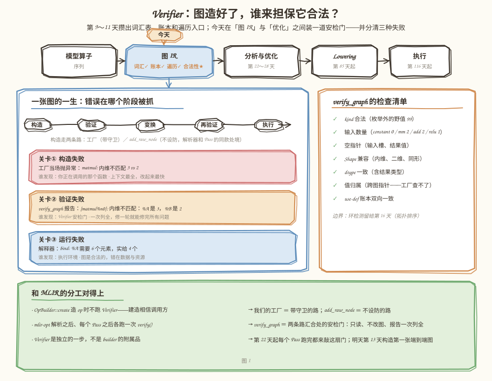
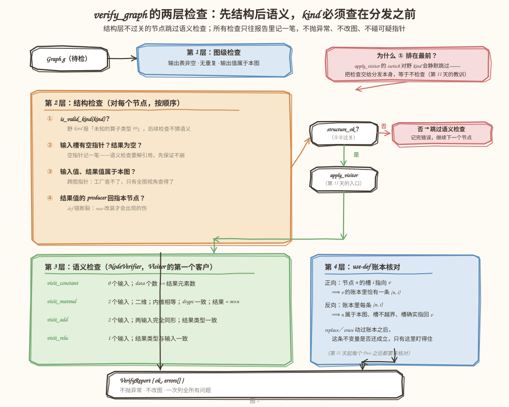
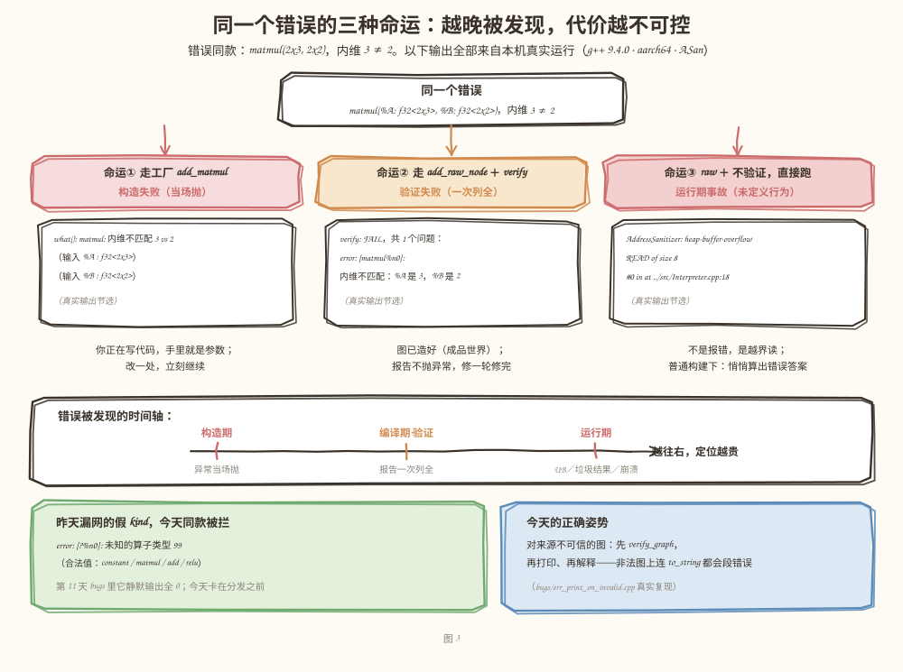

# 第 12 天：图的合法性检查——Verifier，和三种失败的边界

> **今日目标**：能说清 IR Verifier（验证器）的职责边界，把**构造失败、验证失败、运行失败**三种错误分清楚；亲手把 mini-graph 升级到 v5——一个只读、不改图、一次列全所有问题的 `verify_graph()`，检查 kind 合法性、输入数量、空指针、Shape 兼容性、dtype 约束、值归属和 use-def 账本；再用真实实验回答"跳过验证直接跑会发生什么"（答案是 ASan 眼皮底下的越界读）。
> **预计时间**：学习 40 分钟 ＋ 实践 50 分钟
> **前置准备**：第 9 天教程（四种算子工厂、`OpKind` 枚举）、第 10 天教程（use-def 账本、双向一致性不变量）、第 11 天教程（`NodeVisitor` 与 `apply_visitor`）。构建环境同前（CMake ≥ 3.16、Ninja、g++ 或 clang++）。
> **今日产出**：`mini-graph-v5` 工程（`Verifier` ＋ 62 条新断言，71＋44＋62 三构建全绿）；`bugs/` 下两个可复现的反面教材（越界读、非法图上打印崩溃）；`experiments/` 一键对照实验与真实日志；一段"三种失败怎么分"的判断准则（正文 3.2 节）。

## 1. 今天解决什么问题？

昨天（第 11 天）结尾留了一根刺：`bugs/err_silent_fake_kind.cpp` 里，`static_cast<OpKind>(99)` 这个枚举外的野值一路绿灯——`to_string()` 里它的节点行整个消失，use 表里它顶着 `?%n0` 的假面，解释器对它什么都不算，结果静默输出全 0。全程没有编译错误，没有运行期异常。

今天的贯穿例子是同一个错误的"放大版"：**`matmul(%A, %B)`，A 是 `f32<2x3>`，B 是 `f32<2x2>`，内维 3 ≠ 2**。这一个错误，在编译器里有三种可能的下场：

- 走工厂函数 `add_matmul(a, b, ...)`：`require()` 当场抛 `std::invalid_argument`——**构造失败**，你正在写代码，手里就是参数；
- 走一条"不检查的造图路径"，图造出来了，交给一个验证器——它输出报告 `[matmul%n0]: 内维不匹配：%A 是 3，%B 是 2`——**验证失败**，一次列全；
- 走"不检查的造图路径"而且**不验证**，直接交给解释器跑——解释器按错误的内维去读 B 的数据，读出缓冲区边界之外——这不是报错，是**未定义行为**（今天 5.4 节会在 ASan 下真实复现：`heap-buffer-overflow READ of size 8`）。

为什么第三种可能真实存在？因为**图的来源不只你的工厂函数**。真实编译器里，IR 从文本解析进来、被 Pass 改来改去、由别的工具组装——这些路径没有一个会经过你写在工厂里的 `require()`。MLIR 的做法是把"建造"和"验证"拆开：`OpBuilder` 造 op 时不跑 Verifier，`mlir-opt` 在解析之后、每个 Pass 之后各跑一次验证。今天我们就把这套分工搬进 mini-graph，并顺手回答两个问题：**Verifier 该查什么、不该查什么；三种失败各自的边界在哪里。**

## 2. 先看全貌：今天的内容位于哪里？



**图 1**：看两块。顶部流水线——第 9～11 天攒出了词汇表（四种算子）、账本（use-def）和遍历入口（Visitor），今天在"图 IR"这一格补上最后一块基础设施：**合法性检查**。左下大卡是"一张图的一生"时间轴：构造 → 验证 → 变换 → 再验证 → 执行，三道关卡分别对应三种失败；右下卡是 `verify_graph` 今天的检查清单；底部绿条是和 MLIR 的分工对照——今天的设计与 `mlir-opt` 的验证时机一一对应。

今天的路线分 4 步：

1. **想清楚**：Verifier 是什么、三种失败怎么分、为什么需要一个"不设防的后门"（第 3 节）；
2. **升级骨架**：`OpKind.h` 加 `is_valid_kind`，`Graph` 加 `add_raw_node`，新文件 `Verifier.h/.cpp`（第 5.1～5.2 节）；
3. **验收**：62 条新断言 ＋ 第 10/11 天的 71＋44 条原样重跑，Debug／ASan／UBSan 三构建全绿（第 5.3 节）；
4. **对照实验**：跳过 verify 的三种代价，全部真实执行（第 5.4 节）。

## 3. 核心概念：先用直觉，再给准确定义

### 3.1 Verifier：对成品做全套检查的安检门

**Verifier（验证器）**是编译器里一个独立的检查步骤：对已经构造完成的 IR 做一次只读的全套检查，输出一份"哪里不合法"的报告。它和工厂函数里的检查分工不同——工厂检查发生在"你正在搬东西进门"的瞬间，错误上下文最全；Verifier 检查发生在"东西已经装配成成品"之后，它面对的是一张来历不明的图。

生活类比：工厂门口的保安（构造检查）对每个进门的人当场查证件，查到问题立刻拦下；成品质检台（Verifier）在流水线末端，按一张固定清单逐项检查整机，一张单子列出所有毛病，交给质检主管决定怎么办。**对应到技术上是**：`add_matmul` 里的 `require()` 是保安，抛 `std::invalid_argument`；`verify_graph(g)` 是质检台，返回 `VerifyReport{ok, errors}`——不抛异常、不改图、把所有问题一次列全。**类比的边界**：质检员查的是"这台整机是否满足出厂标准"，不负责"这道工序该怎么改"；Verifier 只判断合法不合法，不修图、不给优化建议——修图是以后 Pass ＋ Rewriter 的事（第 45 天）。

为什么"一次列全"而不是抛第一个？因为图的来源是解析器或 Pass 时，调用方手上没有"正在构造的上下文"，抛异常只能让他修一个问题再跑一遍。一次列全，修一轮就能修完。

### 3.2 三种失败：谁发现、什么形态、怎么办

这是今天最需要记住的一张表。判断一个错误属于哪种，只问一句：**它在哪个阶段、被谁发现**。

| | 构造失败 | 验证失败 | 运行失败 |
|---|---|---|---|
| **阶段** | 调用工厂函数的瞬间 | 图造好之后，verify 时 | 图开始执行时 |
| **谁发现** | 工厂里的 `require()` | `verify_graph()` | 解释器／执行环境 |
| **形态** | 抛 `std::invalid_argument` | 报告里的一条 `error:` | 执行期异常（或更糟） |
| **今天的例子** | `matmul: 内维不匹配 3 vs 2` | `[matmul%n0]: 内维不匹配：%A 是 3，%B 是 2` | `bind: %A 需要 6 个元素，实给 4 个` |
| **图的合法性** | 还没造出来 | **不合法——这是它的本职** | 图是合法的，错在数据／资源 |
| **怎么办** | 改参数，重新构造 | 按报告修 IR，重新验证 | 换数据或换资源，图不用动 |

注意最后一行的分界线：**运行失败不是图的错**。`bind` 传错元素个数，图本身毫无问题；反过来，如果一张**不合法**的图跑到了执行阶段，那不叫运行失败——那是验证的失职，下场是未定义行为（5.4 节的真实实验）。一句话总结：**验证的意义，就是把本可以在编译期发现的问题，从运行期的未定义行为手里抢回来。**

还有一个容易混淆的点：同一种逻辑错误（内维不匹配）可以表现为构造失败（走工厂）或验证失败（走 raw ＋ verify），取决于它从哪条路进来——但**不该**表现为"没有失败"。让每条路都有人把关，就是今天的工程目标。

### 3.3 为什么需要一个"不设防的后门"

既然工厂都检查了，非法图从哪来？现实里有三个来源：**文本解析器**（第 41 天读 MLIR 文本时，什么样的输入都可能有）、**Pass 的 bug**（第 22 天起改图的代码一旦写错，会破坏任何不变量）、**别的工具组装**。它们的共同点：不经过你的工厂。

所以 MLIR 把 `OpBuilder::create` 设计成"造 op 时不跑 Verifier"——建造路径相信调用方，验证是汇合处的独立一步。今天我们照搬这个分工，给 `Graph` 加一个 `add_raw_node(kind, inputs, attrs, result_type, name)`：**不做任何检查**——不查 kind、不查空指针、不查输入数量、不查 Shape/dtype。有了它，测试才能像解析器一样"把错误造出来交给 Verifier"，而不是永远测不到验证逻辑。

一个必要的澄清：raw 入口不是"作弊后门"而是**真实存在的建造路径**——今天的测试用它模拟解析器，第 22 天以后 Pass 的重写逻辑也会用类似的方式组装节点。工厂与 raw，一个带守卫、一个不设防，两条路最终都汇到 `verify_graph()` 这道安检门。

### 3.4 kind 检查为什么必须在分发之前

第 11 天的 `apply_visitor` 故意不写 `default`：对枚举外的野 kind，switch 一个 case 都不匹配，**静默跳过，什么都不调用**。这带来一个 Verifier 设计上的死穴：如果把 kind 检查写成 `visit_xxx` 里的逻辑，野 kind 节点根本进不了任何 visit 函数——它会毫无阻力地通过一个"用 Visitor 写的 Verifier"。

所以检查顺序必须是：**先用 `is_valid_kind(kind)` 拦在分发之前，再 `apply_visitor` 做逐算子的语义检查**。这条顺序不是风格偏好，是昨天实验换来的硬约束——分发本身信任 kind，验证器不能把检查托付给一个"会静默跳过"的机制。

> **前置补给**：`is_valid_kind` 用一个覆盖全部枚举值的 switch 实现，野值落到 `return false`。写成 switch 而不是 `k <= OpKind::Relu` 的原因是：将来枚举表增删时，`-Wswitch` 会提醒这里同步改，比较运算符不会。另外，Verifier 内部用 `std::unordered_set` 存"本图的值／节点指针集合"来做归属检查——哈希集合，平均 O(1) 查询，第 10 天的 `topological_order()` 已经用过同款。

## 4. 图解核心机制



**图 2**：从左往右看一次验证的旅程。输入是待检的 `Graph g`；第 1 层是图级检查（输出表）；第 2 层是逐节点的结构检查——注意红色警告框：**kind 合法性排在①**，因为 `apply_visitor` 对野 kind 会静默跳过；结构不过关的节点跳过语义检查（记完错误继续下一个），既避免越界解引用，也不浪费检查。第 3 层是 `NodeVerifier`——昨天 Visitor 框架的第一个正式客户，每种算子各自的语义约定；第 4 层是账本核对，正向反向各数一遍。四层的结果汇进同一份 `VerifyReport`。

按图核对四个要点：

1. **结构先于语义**：语义检查（`visit_xxx`）要解引用输入指针、按下标取输入——数量不对或指针为空的节点，先把错误记下、跳过语义，检查器自己绝不能先崩；
2. **kind 在分发之前**：3.4 节的死穴，图中用红框钉在①的位置；
3. **账本双向核对**：正向"每个槽恰有一条记录"，反向"每条记录指回真实的槽"——`replace`／`erase`（第 10 天）动过账本之后，这条不变量是否还成立，只有这里盯得住；
4. **报告贯穿全程**：任何一层发现问题都只往 `errors` 里记一笔，不中断、不抛异常——一张单子列全，是 Verifier 和工厂检查在行为上最大的区别。

## 5. 动手实践：给 mini-graph 装上 Verifier

> 本节所有命令与输出都在这台机器上真实执行过：
> Linux aarch64（Ubuntu 20.04）· g++ 9.4.0 · CMake 3.20.5 · Ninja 1.10.0。
> 完整工程在本仓库 `tutorials/day-012/examples/mini-graph-v5/`，由第 11 天的 v4 复制而来（`Value`／`Node`／`Graph`／`NodeVisitor`／`Interpreter` 原样保留），新增和修改的只有下文四处。v4 的分发计时设施（`bench.*`）今天用不上，留在 v4 不再复制。

### 5.1 准备文件

```text
tutorials/day-012/examples/mini-graph-v5/
├── CMakeLists.txt              # 同第 11 天：Debug 默认 ＋ ENABLE_ASAN / ENABLE_UBSAN
├── src/
│   ├── CMakeLists.txt          # mini_graph_v5 库 ＋ mini-graph-v5 可执行文件
│   ├── Dtype.h / TensorType.h / Attrs.h / Value.h / Node.h   # 原样
│   ├── OpKind.h                # ★ +is_valid_kind：枚举值的合法性检查
│   ├── NodeVisitor.h / OpCardPrinter.h                        # 第 11 天原样
│   ├── Graph.h / Graph.cpp     # ★ +add_raw_node：不设防的建造路径
│   ├── Verifier.h / Verifier.cpp   # ★ 今天的主角：报告 ＋ 四层检查
│   ├── Interpreter.h/.cpp      # 原样（验收工具）
│   └── main.cpp                # 三幕：合法图旅程 → 三种失败现场 → 多错误列全
├── tests/
│   ├── test_use_def.cpp        # 第 10 天的 71 条断言原样（回归）
│   ├── test_visitor.cpp        # 第 11 天的 44 条断言原样（回归）
│   └── test_verifier.cpp       # ★ 今天的 62 条断言：7 组合法 ＋ 18 组非法
├── bugs/
│   ├── err_silent_fake_kind.cpp   # 第 11 天遗留现场：假 kind 一路绿灯
│   ├── err_oob_read.cpp           # ★ 跳过 verify 直接跑 → ASan 越界读
│   └── err_print_on_invalid.cpp   # ★ 非法图上打印 → 段错误
└── experiments/
    └── cost-of-skipping-verify.sh  # 一键对照实验（日志全文在 .log）
```

### 5.2 编写代码

**改动一：`OpKind.h`——枚举值的合法性检查**（3.4 节说过为什么是 switch）：

```cpp
inline bool is_valid_kind(OpKind k) {
    switch (k) {
        case OpKind::Constant:
        case OpKind::MatMul:
        case OpKind::Add:
        case OpKind::Relu:
            return true;
    }
    return false;  // 枚举外的野值落在这里
}
```

**改动二：`Graph`——不设防的建造路径**。原 `make_node` 改名为 `make_node_impl`，多一个 `check_nulls` 开关；工厂走 `true`（行为与 v4 一字不差），raw 走 `false`：

```cpp
Node* Graph::add_raw_node(OpKind kind, std::vector<const Value*> inputs, Attrs attrs,
                          TensorType result_type, std::string result_name) {
    return make_node_impl(kind, std::move(inputs), std::move(attrs), std::move(result_type),
                          std::move(result_name), /*check_nulls=*/false);
}
```

`make_node_impl` 里有一处必须小心：use 登记循环原来直接 `mutable_value(inputs[i])->uses_.push_back(...)`——raw 路径的空槽会在这里解引用空指针，**非法图还没造出来就先崩了**。所以登记前先判空，空槽不登记：

```cpp
    for (std::size_t i = 0; i < raw->inputs_.size(); ++i) {
        if (raw->inputs_[i] != nullptr) {
            mutable_value(raw->inputs_[i])->uses_.push_back(Use{raw, i});
        }
    }
```

这条"缺失的记录"本身就成了Verifier 账本检查的靶子之一——错误不会消失，只是换了个地方等着被点名。

**改动三：`Verifier.h`——报告先行**（新文件，全文核心）。先定输出再定检查，是今天最重要的设计顺序：

```cpp
struct VerifyReport {
    bool ok = true;
    std::vector<std::string> errors;

    void fail(const std::string& msg) {
        ok = false;
        errors.push_back(msg);
    }
    void fail_if(bool cond, const std::string& msg) {
        if (cond) {
            fail(msg);
        }
    }
};

VerifyReport verify_graph(const Graph& g);
```

**改动四：`Verifier.cpp`——四层检查**（新文件，关键部分）。语义层的 `NodeVerifier` 是昨天 Visitor 框架的第一个正式客户；`expect_inputs` 返回 `bool`，数量不符直接 `return`——**后续检查要按下标取输入，越界解引用比错误报告更糟**：

```cpp
class NodeVerifier : public NodeVisitor {
public:
    explicit NodeVerifier(VerifyReport& rep) : rep_(rep) {}

    void visit_matmul(const Node& n) override {
        if (!expect_inputs(n, 2)) {
            return;  // 数量不对就不碰 input(1)
        }
        const TensorType& ta = n.input(0)->type();
        const TensorType& tb = n.input(1)->type();
        const TensorType& tr = n.result()->type();
        rep_.fail_if(ta.rank() != 2 || tb.rank() != 2,
                     where(n) + ": 输入 %… 不是二维（…）");
        rep_.fail_if(ta.dtype != tb.dtype,
                     where(n) + ": 两个输入 dtype 不一致：…");
        if (ta.rank() == 2 && tb.rank() == 2 && ta.dtype == tb.dtype) {
            // 与工厂同一套内维公式（含 transpose_a / transpose_b），
            // 再补一条工厂永远给对、只有 raw 能造错的：结果类型。
            const std::int64_t m = /* … */, k = /* … */, k2 = /* … */, n_dim = /* … */;
            rep_.fail_if(k != k2, where(n) + ": 内维不匹配：…");
            rep_.fail_if(tr.dtype != ta.dtype || tr.rank() != 2 || tr.shape[0] != m ||
                             tr.shape[1] != n_dim,
                         where(n) + ": 结果类型应为 …，实际是 …");
        }
    }
    // visit_constant / visit_add / visit_relu 同款结构，全文见工程文件

private:
    bool expect_inputs(const Node& n, std::size_t expected) {
        if (n.num_inputs() != expected) {
            rep_.fail(where(n) + ": 需要 " + std::to_string(expected) + " 个输入，实际有 " +
                      std::to_string(n.num_inputs()) + " 个");
            return false;
        }
        return true;
    }

    VerifyReport& rep_;
};
```

图级入口 `verify_graph` 按图 2 的四层展开（此处给结构，完整实现见工程文件）：先用 `unordered_set` 收集本图的值／节点指针集合，然后图级检查（输出表非空、无重复、归属）→ 逐节点结构检查（**kind 最先**，其次空指针、归属、def 回指，结构不过关就跳过 `apply_visitor`）→ 账本正向反向各数一遍。所有检查共享同一份 `rep`，任何一层都只记不抛。

一个值得注意的细节：**跨图指针**（g2 的值喂给 g1 的工厂）连工厂都拦不住——`add_relu(foreign, "R")` 只查了空指针和类型，而"这个值住在哪张图里"是全局信息，局部检查天然看不见。两张图各自验证时**都会报错**：g1 报"输入不属于本图"，g2 报"账本里有使用者，但这个节点不属于本图"——账本的反向核对从另一侧把同一条病边抓了出来。

### 5.3 运行与观察

```bash
cd tutorials/day-012/examples/mini-graph-v5
cmake -S . -B build -G Ninja && cmake --build build
./build/src/mini-graph-v5
./build/tests/test_use_def && ./build/tests/test_visitor && ./build/tests/test_verifier
```

`./build/src/mini-graph-v5` 的真实输出（三幕完整输出）：

```text
== 第一幕：先构造，再验证，然后才敢碰 ==
graph "matmul-bias-relu" (2 inputs, 1 outputs) {
  %A = input : f32<2x3>
  %B = input : f32<3x2>
  %n0 = constant() {data = [0, -100, -150, -50]} -> %bias : f32<2x2>
  %n1 = matmul(%A, %B) -> %C : f32<2x2>
  %n2 = add(%C, %bias) -> %D : f32<2x2>
  %n3 = relu(%D) -> %Y : f32<2x2>
  output %Y
}
verify: PASS（4 个节点、6 个值、1 个输出，全部检查通过）

（replace ＋ erase 之后，账本必须仍然自洽）
verify: PASS（4 个节点、6 个值、1 个输出，全部检查通过）

（验证是只读的：解释器照常算）
  %Y (f32<2x2>) =
    59 65
    140 155

== 第二幕：同一个错误（2x3 × 2x2），三种命运 ==
命运一（构造失败，当场抛）：
  what(): matmul: 内维不匹配 3 vs 2（输入 %A : f32<2x3>）（输入 %B : f32<2x2>）
命运二（验证失败，一次列全）：
verify: FAIL，共 1 个问题：
  error: [matmul%n0]: 内维不匹配：%A 是 3，%B 是 2
命运三（运行失败，数据与类型不符）：
  what(): bind: %A 需要 6 个元素，实给 4 个

== 第三幕：一张图藏四个错，Verifier 一次列全 ==
verify: FAIL，共 4 个问题：
  error: 图没有输出：所有计算结果都无人消费
  error: [?%n0]: 未知的算子类型 99（合法值：constant / matmul / add / relu）
  error: [relu%n1]: 需要 1 个输入，实际有 2 个
  error: [constant%n2]: 常量数据 3 个，与结果 f32<2x2> 的元素数 4 不符
```

读四件事：第一幕后 `replace_all_uses_of` ＋ `erase_node` 动过账本，`verify` 仍然 PASS——第 10 天的不变量在变形后确实守住了（这正是账本核对存在的意义：哪天某个 Pass 写坏了它，这里会立刻红）；第一幕的解释器数字是 59 65／140 155，因为 demo 顺手把 bias 换成了全 1（C = A×B = 58 64／139 154，加 1 后过 relu），验证只读、解释器照常算；第二幕三种失败的形态与 3.2 节的表格逐行对应；第三幕 `[?%n0]` 就是昨天 use 表里那个 `?%n0` 的同款假面——今天它在分发之前被拦下，且整张报告四条错误一次给全。

测试与三构建（全部真实执行）：

```bash
ctest --test-dir build --output-on-failure
cmake -S . -B build-asan -G Ninja -DENABLE_ASAN=ON && cmake --build build-asan
ctest --test-dir build-asan --output-on-failure
cmake -S . -B build-ubsan -G Ninja -DENABLE_UBSAN=ON && cmake --build build-ubsan
ctest --test-dir build-ubsan --output-on-failure
```

真实输出：

```text
all 71 assertions passed        # test_use_def：第 10 天的 71 条，原样重跑
all 44 assertions passed        # test_visitor：第 11 天的 44 条，原样重跑
all 62 assertions passed        # test_verifier：今天新增
100% tests passed, 0 tests failed out of 3     # Debug

all 71 assertions passed
all 44 assertions passed
all 62 assertions passed
100% tests passed, 0 tests failed out of 3     # ASan，9.81 sec

all 71 assertions passed
all 44 assertions passed
all 62 assertions passed
100% tests passed, 0 tests failed out of 3     # UBSan
```

62 条新断言覆盖：7 组合法用例（经典图、双转置 matmul、`add(%C, %C)` 重复输入、图输入当输出、**raw 造的完全正确的图**——raw 不等于非法、replace＋erase 之后、验证只读跑两遍输出一致）和 18 组非法用例——远超计划要求的"至少 5 个"：野 kind、matmul 输入数量／内维／维度／结果类型／dtype、add 形状／结果 dtype、relu 数量／结果形状、constant 数据个数／带输入、空指针、无输出、重复输出、跨图指针（输入侧＋输出侧）、多错误一次列全（`errors.size() == 4` 且逐条断言内容）。

### 5.4 修改一个参数再观察：跳过 verify 的三种代价



**图 3**：三个竖列就是 5.3 节第二幕的三种命运，输出全部来自本机真实运行。右列是今天的重头戏：raw 造图＋不验证＋直接跑解释器——ASan 报出 `heap-buffer-overflow READ of size 8`，第一现场直指 `Interpreter.cpp:18` 的 `at()`：解释器信任了 IR 里错误的内维 k=3，去读只有 4 个元素的 B，`b[2*2+j]` 越界。**普通构建下它不崩——它悄悄算出错误答案**。底部绿框是昨天假 kind 的今日结局，蓝框是今天的操作纪律。

一键复现（真实日志全文在 `experiments/cost-of-skipping-verify.log`）：

```bash
bash experiments/cost-of-skipping-verify.sh
```

日志里三段真实结果，各对应一条"不验证的代价"：

```text
== 解释器：应为逐元素乘 5 12 21 32，实际是 ==
 0 0
 0 0
全程零报错。静默的错误，是最难抓的那一种。            # err_silent_fake_kind，退出码 0

==742505==ERROR: AddressSanitizer: heap-buffer-overflow on address 0xffff90800b40
READ of size 8 at 0xffff90800b40 thread T0
    #0 0xaaaac9919608 in at ../src/Interpreter.cpp:18
    #1 0xaaaac991a7d8 in Interpreter::run(Graph const&) ../src/Interpreter.cpp:54
    #2 0xaaaac9922b90 in main ../bugs/err_oob_read.cpp:35                # err_oob_read，退出码 1

verify 先行：FAIL（安全地报出问题）
  error: [relu%n0]: 第 0 个输入是空指针
==743078==ERROR: AddressSanitizer: SEGV on unknown address 0x000000000010
    #2 0xaaaadf400ee0 in head ../src/Graph.cpp:95                        # err_print_on_invalid，退出码 1
```

三段连起来读：**假 kind 静默出错（退出码 0，最难抓）；越界读是事故不是报错；同一张带空指针的图，`verify_graph` 安全地报出问题，`to_string` 却直接段错误**。最后这个对比还说明：Verifier 自己必须是全工程最健壮的代码——它面对的就是坏图，从头到尾不能解引用任何可疑指针（所以结构检查不过关就跳过语义检查、账本核对前先跳过空槽）。

## 6. 常见错误与排查

前三个错误在 `bugs/` 下可真实复现（编译运行命令写在各文件头部注释里，或直接跑 5.4 节的脚本）。

**错误一：对非法图调用 `to_string()`——段错误（`bugs/err_print_on_invalid.cpp`）**

- 现象：raw 造出带空指针输入的节点后直接打印，ASan 报 `SEGV on unknown address 0x10`，栈顶是 `Graph.cpp:95` 的 `head()`；普通构建下同样是段错误。
- 原因：`NodeLinePrinter::head()` 无条件 `n.input(i)->name()`——打印器假设图是合法的，它没有也不该有防坏图的能力（给每个遍历器都装上防御，等于把 Verifier 抄进每一个客户）。
- 定位：先看崩溃栈指向打印路径，再对同一张图跑 `verify_graph`——它会安全地告诉你第几个槽是空指针。
- 修复：操作纪律——对来源不可信的图，**先 verify 再碰**（打印、解释、遍历都算"碰"）。

**错误二：跳过 verify 直接跑解释器——越界读（`bugs/err_oob_read.cpp`）**

- 现象：ASan 构建：`heap-buffer-overflow READ of size 8`，第一现场 `Interpreter.cpp:18`；普通构建：不崩，悄悄输出错误答案。
- 原因：解释器信任 IR 的内维，按 k=3 去读只有 4 个元素的 B。"验证失败"被拖成了"运行事故"——未定义行为的报错方式轮不到你挑。
- 定位：ASan 栈直指读越界的那个下标计算；但要回答"为什么会算出 k=3"，得回到 IR——这正是 Verifier 一行 `[matmul%n0]: 内维不匹配` 就能说清的事。
- 修复：执行入口先 `verify_graph`，`!rep.ok` 就拒绝执行。

**错误三：Verifier 自己在坏图上崩——`visit_matmul` 越界解引用**

- 现象：一张"matmul 只有 1 个输入"的 raw 图，`verify_graph` 直接段错误，报告根本没机会返回。把 `Verifier.cpp` 里 `expect_inputs` 的 early-return 临时删掉即可复现，真实崩溃栈（gdb）：
  `#0 vector::size (this=0x5a) → #1 TensorType::rank (this=0x52) → #2 NodeVerifier::visit_matmul (Verifier.cpp:45) → #3 apply_visitor (NodeVisitor.h:29) → #4 verify_graph (Verifier.cpp:178)`。
- 原因：第一版 `expect_inputs` 只记错误不拦截，`visit_matmul` 继续 `n.input(1)`——对只有 1 个元素的 `inputs_` 向量按下标 `[1]` 取值，读到的不是空指针而是越界垃圾指针，解引用即崩。检查器比被检查对象先倒下，是验证代码最讽刺的死法。
- 定位：崩溃栈顶在 `visit_matmul` 读 `input(1)->type()` 的那一行；回头看这个节点的 `num_inputs()` 是 1——数量检查其实做了，只是没挡住后面的解引用。
- 修复：`expect_inputs` 返回 `bool`，数量不符直接 `return`（Verifier.cpp 当前实现）；修复后同一用例安静地只报一条"需要 2 个输入"。泛化教训：**检查器自己必须比被检查对象更健壮，宁少查一条，不可先崩**。

**错误四：把 verify 当构造检查用——每造一个节点验证一次**

- 现象：有人把 `verify_graph` 塞进每个工厂调用之后，小图没感觉，几千节点的图编译明显变慢（每次验证都是全图遍历，总体 O(n²) 次检查）。
- 原因：职责错位——工厂管局部廉价检查（一次比较），Verifier 管成品全套检查（全图遍历），两者是"关卡"不是"步哨"。
- 定位：性能剖析显示热点全在 `verify_graph`，且绝大多数报告为空。
- 修复：只在边界调用：解析之后、（将来）每个 Pass 之后、执行之前——mlir-opt 也是在每个 Pass 之后验证一次，而不是每条指令一次。

## 7. 今日练习

### 必做练习

合上教程做两件事。**（a）** 给 `verify_graph` 加一条新检查：**图输入的名字必须唯一**（`add_input("A")` 两次会造出两个都叫 `%A` 的值，打印和调试时会看串行）——先在 `Verifier.cpp` 的图级检查区加一个名字到 `unordered_set` 的循环，重名就 `rep.fail(...)`；再写一个测试：造重名输入图断言被抓、正常图断言通过。**（b）** 预测题：按第 11 天 5.4 节的做法，给 `OpKind` 加 `Mul`、给 `NodeVisitor` 加纯虚 `visit_mul`、给 `apply_visitor` 加 case——**先写下你预测会被编译器点名拒绝编译的类**（提示：`src/` 里不止两个——今天 Visitor 多了一个新客户；`tests/` 里也有），构建后逐个对照，最后还原补丁。预期产出：新检查＋两条测试；一份"预测 vs 实际点名"清单。

### 选做挑战

给 Verifier 写一个**鲁棒性模糊测试**：固定随机种子，循环 100 次，每次用 `add_raw_node` 随机拼一张图（kind 从 `{合法四种, 野值 99}` 里抽、输入数量 0～3、偶尔塞 `nullptr`、结果类型随机），断言两件事：`verify_graph` 从不崩溃（错误只进报告）、报告为空当且仅当图确实是按合法规则拼的。这个测试在后面的日子里会一直留着——每加一种新算子、每写一个新 Pass，它都在替你问一句"坏图进来，验证器还活着吗"。

## 8. 今日验收

- [ ] 我能不看笔记说出三种失败的判断标准（哪个阶段、被谁发现、图的合法性归谁负责），并对"内维不匹配""bind 元素数不符""野 kind"各归一类；
- [ ] 我能独立从空目录构建 mini-graph-v5，跑通 71＋44＋62 条断言（Debug／ASan／UBSan 三绿），并解释为什么 raw 造的**正确**图必须验证通过、raw 不等于非法；
- [ ] 我能解释 `verify_graph` 的四层检查顺序，特别是"kind 检查为什么必须在 `apply_visitor` 之前"和"结构不过关为什么要跳过语义检查"；
- [ ] 我能复述账本双向核对的两句话（正向、反向），并说出跨图指针为什么工厂拦不住、Verifier 能拦；
- [ ] 我能定位今天的四类错误：非法图上打印段错误、跳过验证的越界读、检查器自身越界解引用、把 verify 当构造检查用；
- [ ] 我保存了 mini-graph-v5 工程、177 条断言、三个 bugs 反面教材、`experiments/` 实验日志和必做练习的预测清单。

## 9. 一句话总结与明天预告

今天的核心动作是把"图合不合法"从工厂函数的廉价检查里拆出来，做成一道独立的安检门：`VerifyReport` 先行（不抛异常、不改图、一次列全），四层检查跟进（图级输出表 → 结构层的 kind／空指针／归属／回指 → 语义层的逐算子约定 → 账本双向核对），其中 kind 必须拦在 `apply_visitor` 之前——因为分发对野值会静默跳过。`add_raw_node` 补上了"不设防的建造路径"，让测试能像解析器一样把错误造出来；真实实验给出了三种失败的分界线：工厂当场抛、Verifier 列报告、运行期只剩未定义行为——越晚发现，代价越不可控。62 条新断言里 18 组非法用例证明这道门真的拦得住：从野 kind、空指针到跨图指针，昨天一路绿灯的漏网之鱼今天全部落网。

明天第 13 天：构造第一张端到端计算图。词汇表、账本、遍历、验证四块基础设施今天全部就位——正好把它们串成一条完整的流水线：`MatMul → Add → Relu` 图的构造、拓扑打印、合法性检查、use-def 检查，外加文本形式 IR。今天的主角 `verify_graph` 将在链路里第一次以"出厂质检"的身份上岗。
