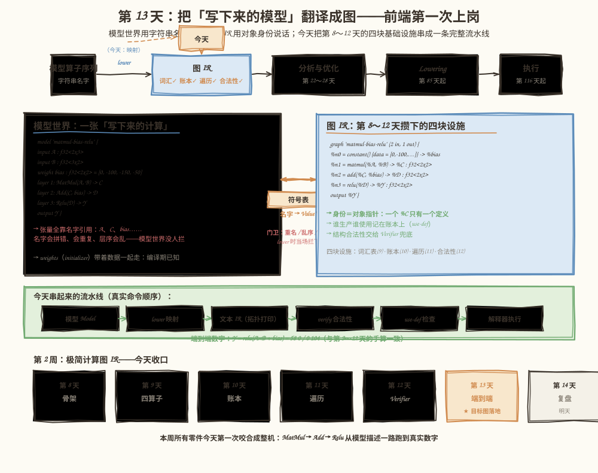
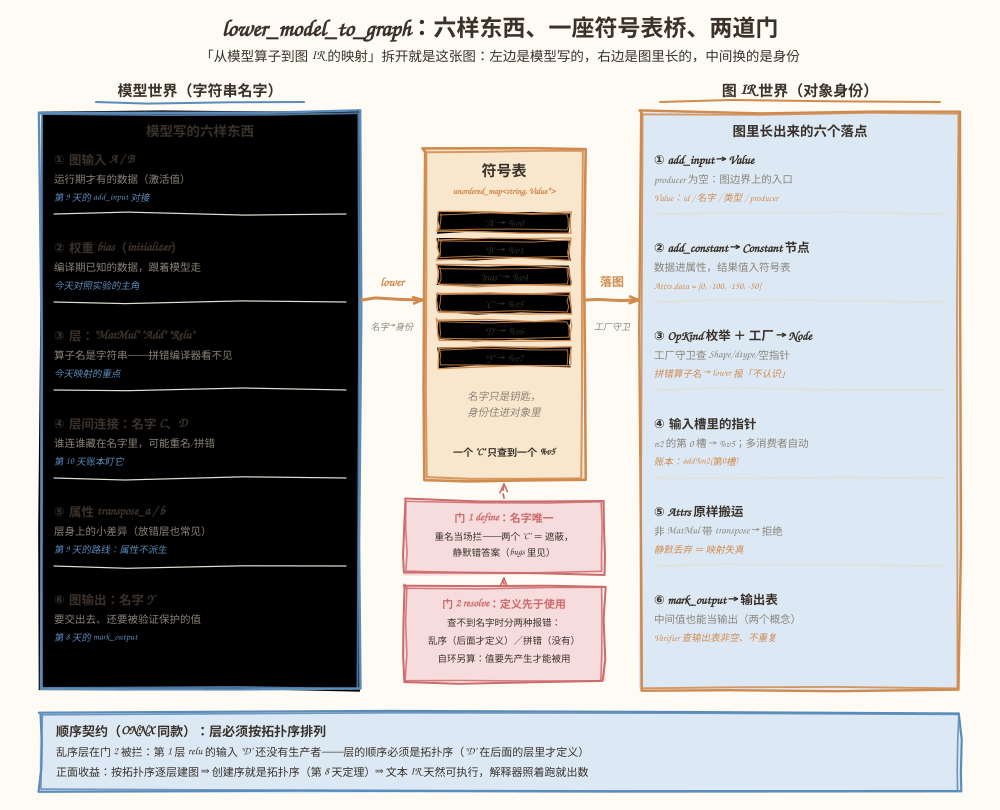
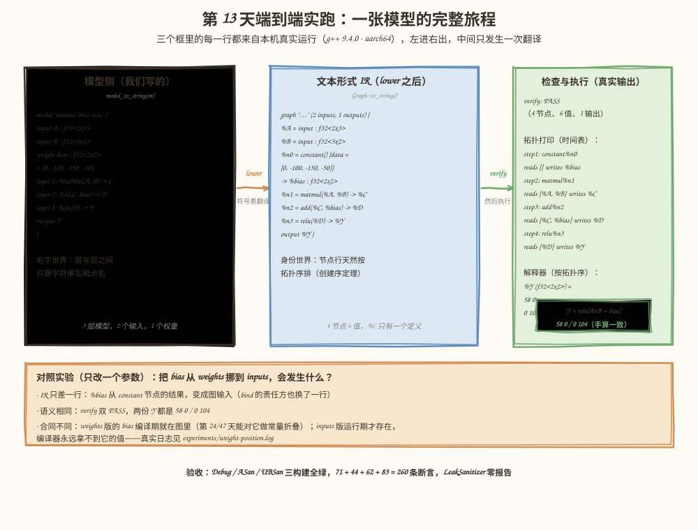

# 第 13 天：构造第一张端到端计算图——把模型翻译成图 IR

> **今日目标**：能说清「从模型算子到图 IR」的六条映射线（图输入、权重、层、层间连接、属性、图输出）各自换成了什么；亲手定义 ONNX 风格的 `Model` 与前端 `lower_model_to_graph`，把 `MatMul → Add → Relu` 从三行层描述变成一张通过验证的图；完整跑通拓扑打印、合法性检查、Use-Def 检查和解释器执行（端到端数字与手算一致）；最后用只改一个参数的对照实验，回答「权重放 weights 还是 inputs」这道真实前端的分界题。
> **预计时间**：学习 40 分钟 ＋ 实践 50 分钟
> **前置准备**：第 9 天（四种算子工厂与属性）、第 10 天（use-def 账本）、第 11 天（Visitor 分发）、第 12 天（Verifier 与三种失败）。构建环境同前五天（CMake ≥ 3.16、Ninja、g++ 或 clang++）。
> **今日产出**：`mini-graph-v6` 工程（`Model` ＋ `Frontend` ＋ 83 条新断言，71＋44＋62＋83 四组测试在 Debug／ASan／UBSan 三构建全绿）；三个可复现的反面教材（重名遮蔽的静默错答案、三种名字诊断的读法、重新 lower 之后的悬空指针）；「权重放哪」一键对照实验与真实日志。

## 1. 今天解决什么问题？

第 12 天收尾时说过：`verify_graph` 是所有建造路径汇合处的安检门。但当时留了一个没回答的问题——**图从哪来？** 前四天我们一直用 C++ 手写工厂调用：`g.add_matmul(a, b, "C")`。真实编译器不吃 C++ 调用，它吃**模型**：ONNX 一类的模型世界里，层是文件里的一行记录，算子名是**字符串**；张量靠**名字**互相引用；权重（initializer）连着数据一起打包。学习计划今天把这件事定为学习目标：**从模型算子到图 IR 的映射关系**。

这不是换个写法的习题。模型世界的三个特征，每一个都是新的出错面：

- 名字会**拼错**（`"biasx"`）、会**撞车**（两个层都写 `"C"`）；
- 层的**顺序**没人保证按依赖排列（手工编辑一下就乱了）；
- 权重放哪（图里还是图外）是**合同问题**，不是风格问题。

今天的贯穿例子就是整个学习计划的最终项目缩影：`Y = relu(A × B + bias)`，`A: f32<2x3>`、`B: f32<3x2>`、`bias: f32<2x2>`。第 13 天的实践要求是「构造 `MatMul → Add → Relu` 图，完成拓扑打印、合法性检查和 Use-Def 检查」——今天这四样连同解释器执行一起，第一次在**同一张图**上完整走通：

```text
模型描述（字符串名字） ──lower──→ 图 IR（对象身份）
                                    ├─ 文本形式 IR（拓扑打印）
                                    ├─ verify_graph（合法性检查）
                                    ├─ uses_to_string（Use-Def 检查）
                                    └─ 解释器执行 → Y = 58 0 / 0 104
```

## 2. 先看全貌：今天的内容位于哪里？



**图 1**：看三个区域。顶部流水线——今天在「模型算子序列」和「图 IR」之间补上一直缺的那一格：**前端（Frontend）**，真实编译器里对应把 ONNX／TFLite 导入成 MLIR 的那一层。中间两张卡片——左边是模型写的（真实输出，字符串名字），右边是图里长的（真实 IR，身份是对象），中间那座小桥就是今天的主角：符号表。底部日历——第 2 周在第 8 天立骨架、第 9 天定算子、第 10 天记账本、第 11 天做遍历、第 12 天装安检门，今天**四块设施第一次咬合成整机**：本周的目标图落地。

今天的路线分 4 步：

1. **想清楚**：两个世界差在哪、六条映射线各换什么、顺序契约为什么跟 ONNX 一致（第 3 节）；
2. **动手**：定义 `Model` 四个结构体，写出 `lower_model_to_graph` 的符号表与两道门（第 5.1～5.2 节）；
3. **验收**：端到端跑通五个环节，83 条新断言 ＋ 前三天的 71＋44＋62 条原样重跑，三构建全绿（第 5.3 节）；
4. **对照**：把 bias 从 weights 挪到 inputs，观察 IR、验证和数字各变了什么（第 5.4 节），再收走四个常见错误（第 6 节）。

## 3. 核心概念：先用直觉，再给准确定义

### 3.1 前端：两个世界之间的翻译官

一句通俗解释：**前端（Frontend）**是把模型世界翻译成 IR 世界的翻译官——左边递进来的是字符串写的计算，右边递出去的是编译器能遍历、能改写、能验证的对象。

生活类比：口岸的报关员。你递一张纸质单据（字符串），他核对每一项、登记台账（符号表）、按编码归类（算子分发），最后交出一份系统里可流转的电子记录（图 IR）。**对应到技术上是**：`lower_model_to_graph(const Model&)` 按拓扑序逐层翻译，把每个名字换成 `Value*`、每个字符串算子名换成 `OpKind` 枚举加一次工厂调用，返回一张完整的 `Graph`。**类比的边界**：报关员可以退回单据让你补材料，但不会替你重新设计货物；前端只做忠实映射和守门检查，不做优化、不判断这个模型算得对不对——那是第 22 天以后 Pass 的事。也不跑 Verifier：前端是「带守卫的建造路径」，验证在边界处由调用方显式执行（第 12 天的分工原样有效）。

### 3.2 名字与身份：模型用字符串，图用对象

这是今天最重要的一组对照。模型世界里，`Add(C, bias)` 里的 `"C"` 只是一串字符——它**可能指错人**；图 IR 里，`n2` 的第 0 个输入槽放的是一个 `Value*`——**指向谁就是谁**，第 10 天的账本和第 12 天的 Verifier 看的都是对象，不看名字。

把字符串换成对象，靠的是**符号表（symbol table）**：`std::unordered_map<std::string, const Value*>`。它只做两件事：

- **登记（define）**：每造出一个值，就把「名字 → 对象」写进去；
- **查找（resolve）**：后面每层引用名字，就从表里换出对象。

为什么这一步值得单独设计？因为**名字可以撞车，身份不能**。模型文件是文本，两个层都写 `"C"` 语法上毫无问题；可一旦放进同一张符号表，后写的会**遮蔽**先写的——第 3 层引用 `"C"` 时拿到的是第二个定义，图算的已经不是模型作者想要的那个。更糟的是文本形式 IR 也跟着遭殃：`to_string` 会打印出两个 `%C`，从文本读回来的人（第 41 天的解析器）无法知道该接哪个。所以名字唯一不是风格约定，是**前端的合同**——第 6 节错误一会用真实复现展示违反它的下场。

### 3.3 顺序契约：定义先于使用

模型侧的层列表必须按**拓扑序**排列——每一层引用的名字，都在它之前的层或声明里定义过。这不是我们发明的家规：ONNX 规范同样要求图里的节点按拓扑序排列。

这条契约带来两个直接后果。**正面**：按拓扑序逐层建图，每次工厂调用的输入都已经是造好的对象——第 8 天的定理「只能引用已存在的值 ⇒ 创建序必是拓扑序」继续生效，文本 IR 的节点行天然按可执行顺序排列，解释器照着跑一遍就出数。**反面**：查不到名字就是破坏契约，但报错要分清三种病，不能一句话打发：

- **乱序**：`"D"` 在后面的层里才定义（手工编辑把层挪乱）——修层顺序；
- **拼错**：`"biasx"` 整个模型里都没有——改拼写或补声明；
- **自环**：一层的输入是它自己的输出（`R = relu(R)`）——值要先产生才能被用，第 16 天的环检测会在可变图上正式遇到它的亲戚。

三种病、三种诊断，全部带「第几层／第几个槽／哪个名字」——模型世界的数据不受编译器保护，认得名字的报错只有前端能做，这是它的岗位价值。

### 3.4 权重放哪：编译期合同 vs 运行期合同

模型里的数据分两种身份：**激活值**（运行期才有的输入，用户喂数据）和**权重**（训练完就固定的参数）。映射时权重可以有两种放法：进 `weights`（initializer），lower 成 `Constant` 节点——数据从此**住在图里**；或者进 `inputs`，变成图输入——数据**运行期才到**，由执行方 `bind`。

两种放法算出的数字完全一样，但合同完全不同：前者的数据编译期可见，将来能参与常量折叠（第 24、47 天的核心原料）；后者的值编译器永远看不到。ONNX 的历史注脚正卡在这条分界线上：IR v4（2019）之前，initializer 被要求同时登记为图输入——很多旧模型至今如此，现代约定才把两者分开。今天的主线取「权重进 weights」的路线，第 5.4 节用只改一个参数的对照实验验证两种放法的差别。

## 4. 图解核心机制



**图 2**：`lower_model_to_graph` 的全景。左卡是模型写的六样东西，右卡是它们在图里的六个落点，中间一座符号表桥、两道门。按编号对照三条要点：

1. **中间的桥只换身份，不造计算**：六条映射线最后都汇成「名字 → 对象」的翻译。`"A"` 查到 `%v0`、`"C"` 查到 `%v5`——一个名字只能查到一个对象，这是 3.2 节名字唯一合同在机制上的样子；
2. **两道门都在登记和查找这两个动作上**：门 1 `define` 拦重名（遮蔽＝静默错答案），门 2 `resolve` 拦乱序／拼错／自环（三种诊断各自成句）。模型世界的字符串没有任何编译器保护，前端是它们的第一道关卡；
3. **右边每个落点都有前几天的设施接着**：类型和内维交给工厂守卫（第 9 天），多消费者交给 use-def 账本（第 10 天），属性走 `Attrs` 不派生子类（第 9 天），输出表交给 Verifier（第 12 天）。前端只做映射和守门，不重复任何一层已有的检查——除了带名字的那部分。

底部蓝条是顺序契约的完整闭环：按拓扑序建图 → 创建序即拓扑序（第 8 天定理）→ 文本 IR 天然可执行；乱序的层在门 2 被拦下，错误消息原样引用模型里的算子名和名字。

## 5. 动手实践：从模型描述到端到端数字

> 本节所有命令与输出都在这台机器上真实执行过：
> Linux aarch64（Ubuntu 20.04）· g++ 9.4.0 · CMake 3.20.5 · Ninja 1.10.0。
> 完整工程在本仓库 `tutorials/day-013/examples/mini-graph-v6/`，由第 12 天的 v5 复制而来——`Value`／`Node`／`Graph`／`NodeVisitor`／`Verifier`／`Interpreter` 十四个文件**一行未改**（今天正是检验前四天成果的日子），新增的只有 `Model.h`、`Frontend.h/.cpp` 和新的 `main.cpp`。

### 5.1 准备文件

```text
tutorials/day-013/examples/mini-graph-v6/
├── CMakeLists.txt              # 同第 12 天：Debug 默认 ＋ ENABLE_ASAN / ENABLE_UBSAN
├── src/
│   ├── ……（v5 全部 14 个文件原样：Dtype/TensorType/Attrs/OpKind/Value/Node/
│   │      NodeVisitor/OpCardPrinter/Graph/Verifier/Interpreter）
│   ├── Model.h                 # ★ 模型侧四结构体：Input/Weight/Layer/Model ＋ 打印视图
│   ├── Frontend.h / Frontend.cpp   # ★ 今天的主角：符号表 ＋ 两道门 ＋ 工厂分发
│   └── main.cpp                # 两幕：完整流水线 ＋ 写错模型的三个现场
├── tests/
│   ├── test_use_def.cpp        # 第 10 天的 71 条断言原样（回归）
│   ├── test_visitor.cpp        # 第 11 天的 44 条断言原样（回归）
│   ├── test_verifier.cpp       # 第 12 天的 62 条断言原样（回归）
│   └── test_frontend.cpp       # ★ 今天的 83 条断言：映射忠实性 ＋ 纪律 ＋ 移动
├── bugs/
│   ├── err_shadowed_name.cpp   # ★ 无重名检查的前端：两个 %C ＝ 静默错答案
│   ├── err_wrong_layer_order.cpp   # ★ 乱序/拼错/自环三种诊断怎么读
│   └── err_outlived_graph.cpp  # ★ 重新 lower 之后，旧指针全部悬空（ASan 现形）
└── experiments/
    ├── weight_position_ab.cpp  # ★ 对照实验程序：bias 放 weights vs 放 inputs
    └── weight-position.sh       # 一键运行 ＋ 逐行 diff（日志在 weight-position.log）
```

### 5.2 编写代码

**`Model.h`：模型侧长什么样。** 四个结构体对应 ONNX 的四样东西：`ModelInput`（图输入）、`ModelWeight`（initializer，连着数据）、`ModelLayer`（一层计算）、`Model`（装起来加图输出名）。有一个刻意的决定值得注意：`ModelLayer::op` 是**字符串**。模型世界的算子名是数据不是类型——拼错要等到映射时才发现，这正是今天要体会的边界；顶多在 C++ 侧写错结构体字段时，编译器才会管你。

**`Frontend.cpp`：先扫一遍「后面才定义的名字」，再逐层翻译。** 预扫描只为一件事——把 3.3 节的乱序和拼错区分开：

```cpp
std::unordered_set<std::string> defined_later;
for (const ModelLayer& l : m.layers) {
    defined_later.insert(l.output);
}
```

然后是符号表的两道门，全部错误消息带上下文：

```cpp
const auto define = [&](const std::string& name, const Value* v, const std::string& who) {
    if (!named.emplace(name, v).second) {
        fail("lower: " + who + "：名字 \"" + name +
             "\" 已存在——模型世界一个名字只许一个定义");
    }
};
const auto resolve = [&](const std::string& name, const std::string& who) -> const Value* {
    const auto it = named.find(name);
    if (it != named.end()) {
        return it->second;
    }
    if (defined_later.count(name) != 0) {
        fail("lower: " + who + " \"" + name + "\" 还没有生产者——层的顺序必须是拓扑序（\"" +
             name + "\" 在后面的层里才定义）");
    }
    fail("lower: " + who + " \"" + name + "\" 在整个模型里都不存在（拼错名字？忘了声明？）");
};
```

层循环里有三处纪律值得逐条说出理由。**自环检查**放在名字解析之前，但只对「别处没定义过的名字」生效——名字撞上图输入的情况留给 `define` 报「已存在」，遮蔽和成环是两种病。**属性搬运**要么完整、要么拒绝：`Add` 层带着 `transpose` 属性会被当场拦下（`matmul` 才有这个属性），静默丢弃等于模型说的事和图做的事从此不一致。**算子分发**是一个小 if/else：`"MatMul"` → `add_matmul`（类型、内维交给工厂守卫），`"Add"` → `add_elementwise`，`"Relu"` → `add_relu`，`"Constant"` 被明确拒绝——常量放 `weights`，不作为层。函数结尾 `return g;` 按值返回：`Graph` 是 move-only，搬走的是 `unique_ptr` 名单（第 8 天的房产证），节点和值一个都不动。

权重的数据个数检查是个**岗位价值**的注脚：`add_constant` 的工厂守卫本可以拦（消息只有指针没有名字），前端多写三行预检查，报错就能带上「权重 `"bias"`」——认得名字的报错只有前端能做。

**`main.cpp`：两幕。** 第一幕是完整流水线：模型打印 → lower → 文本 IR → `verify_graph` → 拓扑打印 → `uses_to_string` → 解释器。其中「拓扑打印」除了打印执行顺序，还做了一件 5.3 节会看到的事：逐个对照 `topological_order()` 与创建顺序——把第 8 天的定理用肉眼再钉一遍。第二幕把三种写错模型的现场（乱序、拼错、重名）各演示一遍。

一个今天**没有**做的改动，理由要说清楚：`to_string()` 没改成按 `topological_order()` 遍历。因为「创建序＝拓扑序」是当前 API 的定理，且有测试钉住——打印器今天改不改输出一个字都不差。哪天定理被打破（第 16 天图可回填、第 22 天 Pass 乱序建图），再让打印器自己走 `topological_order()`——那才是必要时机，今天改是多余的。

### 5.3 运行与观察

```bash
cd tutorials/day-013/examples/mini-graph-v6
cmake -S . -B build -G Ninja && cmake --build build
./build/src/mini-graph-v6
```

第一幕的真实输出（两幕完整输出见下方，关键处用行内注释标注）：

```text
== 第一幕：模型侧（写下来的计算） ==
model "matmul-bias-relu" {
  input A : f32<2x3>
  input B : f32<3x2>
  weight bias : f32<2x2> = [0, -100, -150, -50]
  layer 1: MatMul(A, B) -> C
  layer 2: Add(C, bias) -> D
  layer 3: Relu(D) -> Y
  output Y
}

== lower 之后：文本形式 IR（Graph::to_string） ==
graph "matmul-bias-relu" (2 inputs, 1 outputs) {
  %A = input : f32<2x3>
  %B = input : f32<3x2>
  %n0 = constant() {data = [0, -100, -150, -50]} -> %bias : f32<2x2>
  %n1 = matmul(%A, %B) -> %C : f32<2x2>
  %n2 = add(%C, %bias) -> %D : f32<2x2>
  %n3 = relu(%D) -> %Y : f32<2x2>
  output %Y
}

== 合法性检查（第 12 天的 Verifier 上岗） ==
verify: PASS（4 个节点、6 个值、1 个输出，全部检查通过）

== 拓扑打印（执行时间表） ==
  执行顺序： constant%n0 matmul%n1 add%n2 relu%n3
  step 1: constant%n0 reads [] writes %bias
  step 2: matmul%n1 reads [%A, %B] writes %C
  step 3: add%n2 reads [%C, %bias] writes %D
  step 4: relu%n3 reads [%D] writes %Y
  （与创建顺序一致——第 8 天的定理：只能引用已存在的值 ⇒ 创建序即拓扑序）

== Use-Def 检查（第 10 天的账本） ==
use 表（def 在左，use 在右）
  %A	def: 图输入    	uses: matmul%n1(第0槽) 
  %B	def: 图输入    	uses: matmul%n1(第1槽) 
  %bias	def: constant%n0	uses: add%n2(第1槽) 
  %C	def: matmul%n1	uses: add%n2(第0槽) 
  %D	def: add%n2	uses: relu%n3(第0槽) 
  %Y	def: relu%n3	uses: （无节点使用，图输出）

== 端到端执行（解释器按拓扑序求值） ==
  %Y (f32<2x2>) =
    58 0
    0 104
```

对照读五件事：第一，模型侧 `layer 1: MatMul(A, B) -> C` 里的字符串 `"A"`，到了 IR 侧变成 `%n1` 输入槽里对 `%A` 的引用——名字换成了身份；第二，`weight bias` 变成了 `%n0` 这个 Constant 节点，数据进了属性——权重从此住在图里；第三，执行时间表的 `step 1..4` 就是拓扑序，解释器（自第 9 天起就按 `topological_order()` 求值）走的就是这张表；第四，use 表里每个名字恰好一个定义、每个使用都有槽位——映射没有走样；第五，`A = 1..6`、`B = 7..12` 代入，`C = A×B = 58 64/139 154`，加 `bias = [0,-100,-150,-50]` 得 `58 -36/-11 104`，过 relu 得 **58 0/0 104**——与第 9～12 天的手算逐位一致。

第二幕的真实输出——三个写错模型的现场，三种诊断各自成句：

```text
== 第二幕：写错模型的三个现场（全部构造失败） ==
现场一（层序不是拓扑序，先用了还没生产的 D）：
  what(): lower: 第 1 层 Relu 的第 0 个输入 "D" 还没有生产者——层的顺序必须是拓扑序（"D" 在后面的层里才定义）
现场二（名字拼错，整个模型里没有 biasx）：
  what(): lower: 第 2 层 Add 的第 1 个输入 "biasx" 在整个模型里都不存在（拼错名字？忘了声明？）
现场三（relu 的输出也叫 C，名字撞车）：
  what(): lower: 第 3 层 Relu 的输出：名字 "C" 已存在——模型世界一个名字只许一个定义
```

测试与三构建（全部真实执行）：

```bash
ctest --test-dir build --output-on-failure
cmake -S . -B build-asan -G Ninja -DENABLE_ASAN=ON && cmake --build build-asan
ctest --test-dir build-asan --output-on-failure
cmake -S . -B build-ubsan -G Ninja -DENABLE_UBSAN=ON && cmake --build build-ubsan
ctest --test-dir build-ubsan --output-on-failure
```

真实输出（`#` 后为笔者标注）：

```text
100% tests passed, 0 tests failed out of 4      # Debug，0.01 sec
100% tests passed, 0 tests failed out of 4      # ASan，13.09 sec
100% tests passed, 0 tests failed out of 4      # UBSan，0.01 sec

all 71 assertions passed        # test_use_def：第 10 天原样
all 44 assertions passed        # test_visitor：第 11 天原样
all 62 assertions passed        # test_verifier：第 12 天原样
all 83 assertions passed       # test_frontend：今天新增（Debug/ASan/UBSan 三构建各跑一遍）
```

83 条新断言分四组：**映射的忠实性**（45 条——节点种类序列、每个名字译到的对象用指针级核对、类型与属性到位、verify PASS、拓扑序等于创建序、use 表使用者与槽位、解释器数字 58 0/0 104）；**共享与多输出**（9 条——菱形模型同一个输入两个消费者、中间值当图输出、零层直通模型）；**映射的纪律**（23 条——14 组构造失败逐个断言消息内容：重名×3、乱序、拼错、自环、算子名拼错、常量作为层、权重数据不符、属性放错层、输入个数、输出拼错、输出写两次）；**身份与所有权**（6 条——两次 lower 得到独立图、拷贝编译期拒绝的 `static_assert`、移动整图后旧指针继续有效）。LeakSanitizer 全程零报告。



**图 3**：三个框是同一张图在流水线三个站点上的真实输出：左边是我们写的模型，中间是 lower 之后的文本 IR，右边是检查与执行——`verify: PASS`、四步执行时间表、最后的 Y 矩阵。底部橙条是 5.4 节对照实验的结论预告：把 bias 挪个家，语义不变、合同改变。

### 5.4 修改一个参数再观察：bias 搬家

只改一个参数：把 `bias` 从 `weights` 挪到 `inputs`（模型其余部分一字不动）。一键复现：

```bash
bash experiments/weight-position.sh
```

真实日志（`experiments/weight-position.log`）里两份 IR 的逐行 diff——**全部差别**就这两处：

```text
< graph "A-bias-as-weight" (2 inputs, 1 outputs) {
> graph "B-bias-as-input" (3 inputs, 1 outputs) {
4,7c4,7
<   %n0 = constant() {data = [0, -100, -150, -50]} -> %bias : f32<2x2>
<   %n1 = matmul(%A, %B) -> %C : f32<2x2>
<   %n2 = add(%C, %bias) -> %D : f32<2x2>
<   %n3 = relu(%D) -> %Y : f32<2x2>
---
>   %bias = input : f32<2x2>
>   %n0 = matmul(%A, %B) -> %C : f32<2x2>
>   %n1 = add(%C, %bias) -> %D : f32<2x2>
>   %n2 = relu(%D) -> %Y : f32<2x2>
```

三个观察结论，全部来自真实运行：

1. **语义相同**：`verify` 双 PASS，两份 `Y` 都是 58 0/0 104——数值上两种放法没有差别；
2. **责任换手**：变体 A 的 bias 是图的一部分，解释器只要 bind 两个输入；变体 B 的 bias 变成第三个图输入，**执行方必须多 bind 一次**——权重从「编译进图」变成「运行期投喂」；
3. **合同不同**：变体 A 的 bias 数据编译期就在 `Attrs` 里，第 24、47 天的常量折叠能直接吃它（`Add(x, 常量)` 可以在编译期算掉一部分）；变体 B 的 bias 对编译器永远是一个未知数。

这个实验是 3.4 节的分界线第一次用数据说话：**权重放哪不是风格问题，是「谁在什么时候拿得到数据」的合同问题**——今天选了「进 weights」作为主线（真实前端把 initializer 变成常量也是同一路线），第 47 天做常量折叠时会回头感谢这个决定。

## 6. 常见错误与排查

四个错误都在本机真实复现过（前三个在 `bugs/` 下，编译运行命令写在各文件头部注释里）。

**错误一：两个层都写 `"C"`——图算的不是模型想要的，全程零报错（`bugs/err_shadowed_name.cpp`）**

- 现象：模型本意 `Y = relu(X + X)`，第二个层手滑也输出 `"C"`。用一个不查重名的迷你前端 lower：文本 IR 出现**两个 `%C`**，use 表里第一个 `%C` 「uses: （无）」静默死掉，解释器算出 `relu(relu(X)) = 1 0/0 4`（想要的 `relu(X+X) = 2 0/0 8`），`verify_graph` 竟然 **PASS**，退出码 0。
- 原因：符号表条目被第二次 `define` 覆盖，第三层引用 `"C"` 拿到的是第二个定义。图的**结构**完全合法——Verifier 管对象身份的一致性，不管名字唯一；名字唯一是前端的合同，合同没执行，就没有人拦。
- 定位：看 use 表找「无使用者」的值（本该被用的 `%C₁` 露馅）；或读文本 IR 找重名行。真正的陷阱是：如果你只看 verify 和退出码，这个 bug 根本不存在——**静默错答案是最难抓的一种**，和第 11 天的假 kind、第 12 天的悄悄越界同族。
- 修复：真实前端的 `define` 拒绝重名——同一模型再跑一次：`lower: 第 2 层 Relu 的输出：名字 "C" 已存在——模型世界一个名字只许一个定义`，在映射的一瞬间拦下。

**错误二：手工编辑模型后层序乱了（或名字拼错）——读诊断（`bugs/err_wrong_layer_order.cpp`）**

- 现象：把 relu 层挪到 add 前面，lower 抛出：`第 1 层 Relu 的第 0 个输入 "D" 还没有生产者——层的顺序必须是拓扑序（"D" 在后面的层里才定义）`。
- 原因：层序违反「定义先于使用」。前端的预扫描发现 `"D"` 在后面的层里有定义，于是把「乱序」和「拼错」分开报——拼错的 `biasx` 会得到另一种消息（`在整个模型里都不存在`），自环（`R = relu(R)`）是第三种（`是这一层自己的输出——值要先产生才能被用`）。
- 定位：三个数字定位三个信息：第 1 层（层号）、第 0 个输入（槽位）、`"D"`（名字）。
- 修复：按消息分层号调整层序（或改拼写、给自环层换输出名）。模型世界的错误在前端这一关全部是**构造失败**——当场抛、消息最全，这正是第 12 天三种失败里代价最低的那种。

**错误三：重新 lower 之后还用旧指针——ASan 报 use-after-free（`bugs/err_outlived_graph.cpp`）**

- 现象：`Graph g = lower_model_to_graph(m1);` 之后记下 `g.outputs()[0]`；为了「换个权重再跑」执行 `g = lower_model_to_graph(m2);`，再读旧指针——ASan 报 `heap-use-after-free READ of size 2`，退出码 1；普通构建下是未定义行为。
- 原因：移动赋值先析构旧图的全部 `unique_ptr`（释放栈一路指到 `Graph::operator=(Graph&&)` 在 `Graph.h:22`），再接管新名单。第 8 天的借用规则原样成立：**主人（g）被重新赋值的那一刻，旧引用全部失效**——lower 的返回值是新图本体，不是对旧图的更新。
- 定位：ASan 的 freed-by 栈顶是 `std::default_delete<Value>::operator()`，调用点在移动赋值里——释放者就是你自己那行 `g = lower(...)`。
- 修复：需要两张图就声明两个 `Graph` 变量；需要「改权重」就重新 lower 之后**重新取**输出指针，或直接走第 10 天的 `replace_all_uses_of`（在同一张图上换常量，指针世界不换房本）。

**错误四：想要「两张一样的图」，写 `Graph g2 = g;`——编译期拒绝**

真实编译输出（`Graph.h:26` 是 v5 起就有的老规矩）：

```text
try_copy.cpp:12:16: error: use of deleted function 'Graph::Graph(const Graph&)'
   12 |     Graph g2 = g;
      |                ^
Graph.h:26:5: note: declared here
   26 |     Graph(const Graph&) = delete;
```

- 现象：编译失败，一行不剩。
- 原因：图的所有权集中（第 8 天）——拷贝等于抄指针名单，前端的返回值不破例。今天「再要一张一样的图」的正确动作是**再 lower 一次**：`lower_model_to_graph` 是纯函数，同样的模型换回一张全新的图（测试里断言了两次 lower 的结果名字相同、对象不同）。
- 修复：重复构造而不是复制；真要克隆是「深拷贝」问题，留给将来有真实需求时再设计。

## 7. 今日练习

### 必做练习

合上教程，写一个变体模型：`Y = relu(A × W + X)`——把今天的 `B` 换成权重 `W`（放进 `weights`，数据就用今天 B 的 `{7, 8, 9, 10, 11, 12}`），把 `bias` 换成运行期输入 `X`（`f32<2x2>`，bind 全 1）。动手前先在纸上预测四件事：IR 里节点行有几行、`%bias` 那一行变成了什么、解释器需要 bind 几个输入、`Y` 等于多少（提示：这正好是第 12 天第一幕解释器跑出的同款数字）。运行 `mini-graph-v6`（在 `main.cpp` 里加一段即可）并逐条对照。预期产出：一份四条预测、一个能跑的变体模型，和四个对得上的答案——尤其体会「X 要 bind、W 不用」背后的 3.4 节合同。

### 选做挑战

构造一个菱形模型：`X → relu → R`，`X → add(X, R) → S`（同一个 `X` 喂两个层，`S` 输出）。先在纸上预测三件事：use 表里 `%X` 有几条记录、执行时间表有几步、`verify` 的节点数。然后运行对照。再加一步：把 `to_string` 的文本**手工**读回来——在纸上为每个 `%名字` 标出它对应图里的哪个对象；最后回到第 6 节错误一，回答一个问题：如果文本里有两个 `%C`，你（扮演第 41 天的解析器）按什么规则决定 `add` 该接哪一个？这个练习是文本 IR 往返（round-trip）的预告，也是「名字唯一合同」存在的最终理由。

## 8. 今日验收

- [ ] 我能不看笔记说出六条映射线（图输入、权重、层、层间连接、属性、图输出）各自换成了 IR 里的什么，以及符号表在中间做了哪两个动作（登记、查找）；
- [ ] 我能独立从空目录构建 mini-graph-v6，跑通 71＋44＋62＋83 条断言（Debug／ASan／UBSan 三绿），并解释为什么 v5 的十四个文件一行未改也能接住今天的前端；
- [ ] 我能解释两道门各拦什么、三种「名字查不到」的诊断分别对应什么病（乱序／拼错／自环），并说出乱序诊断靠什么和拼错区分（defined_later 预扫描）；
- [ ] 我能解释权重放 weights 和放 inputs 的合同差别（编译期可见 vs 运行期投喂），并说出 5.4 实验 diff 里全部差异行各说明什么；
- [ ] 我能定位今天的四类错误：重名遮蔽的静默错答案（为什么 verify 不管名字）、乱序诊断的读法、重新 lower 后的悬空指针、Graph 拷贝被编译器拒绝；
- [ ] 我保存了 mini-graph-v6 工程、260 条断言、三个 bugs 反面教材、`weight-position.log` 实验日志，练习的预测纸也在仓库里。

## 9. 一句话总结与明天预告

今天的核心动作是把「图从哪来」补上：模型世界用字符串名字互相点名，IR 世界用对象身份互相连接，`lower_model_to_graph` 用一张符号表把前者翻译成后者——六条映射线（输入→边界值、权重→Constant 节点、层→OpKind＋工厂、连接→输入槽指针、属性→Attrs、输出→输出表），两道门（define 拦重名、resolve 区分乱序／拼错／自环），错误消息一律带层号、槽位和名字——这是只有认得名字的一层才能给的诊断。顺序契约与第 8 天的定理首尾相接：按拓扑序建图，创建序就是拓扑序，文本 IR 天然可执行——`MatMul → Add → Relu` 第一次从三行层描述走到真实数字 58 0/0 104，验证、use-def、解释器四块设施在同一张图上咬合成整机。对照实验用只改一个参数的 bias 搬家证明：权重放哪是合同问题——数字不变，编译期能见度天差地别，第 24、47 天的常量折叠会回来兑现。

明天第 14 天是第 2 周复盘：新增一个 `Mul` 节点，记录需要修改的文件。今天的前端让这份成本清单多了一行必改点——`Frontend.cpp` 的算子分发；你可以先预测：除了它，还有哪几个文件躲不掉（提示：今天 `tests/` 里也有）。一周攒下的所有设计决定，明天用「改一个算子的代价」统一验收。
