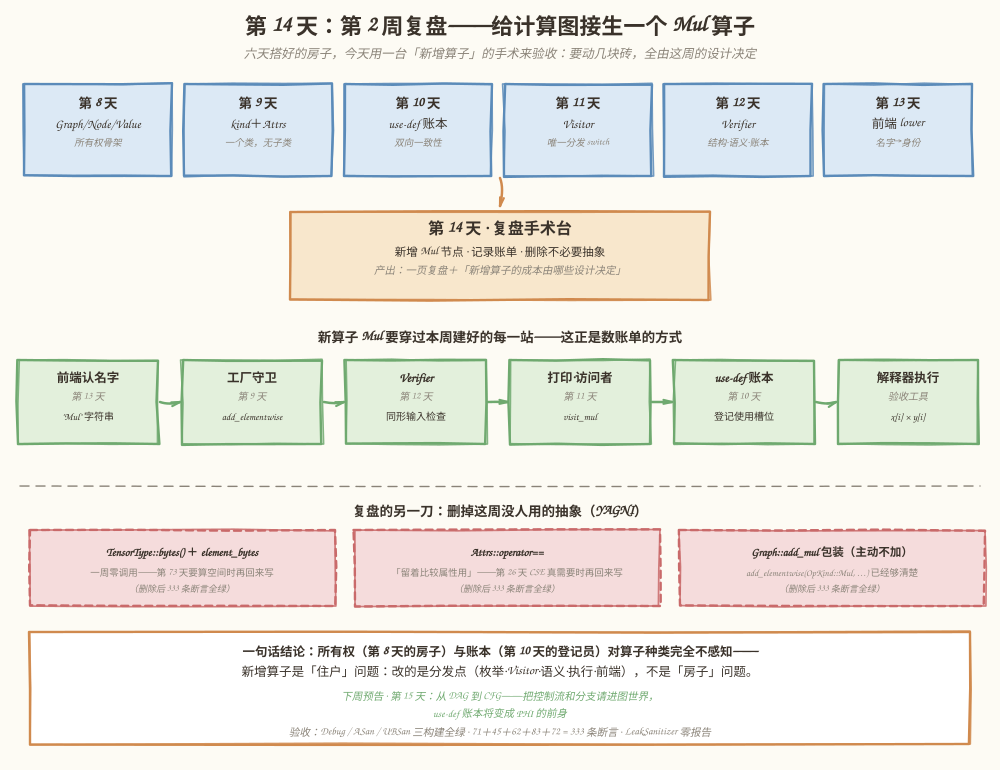
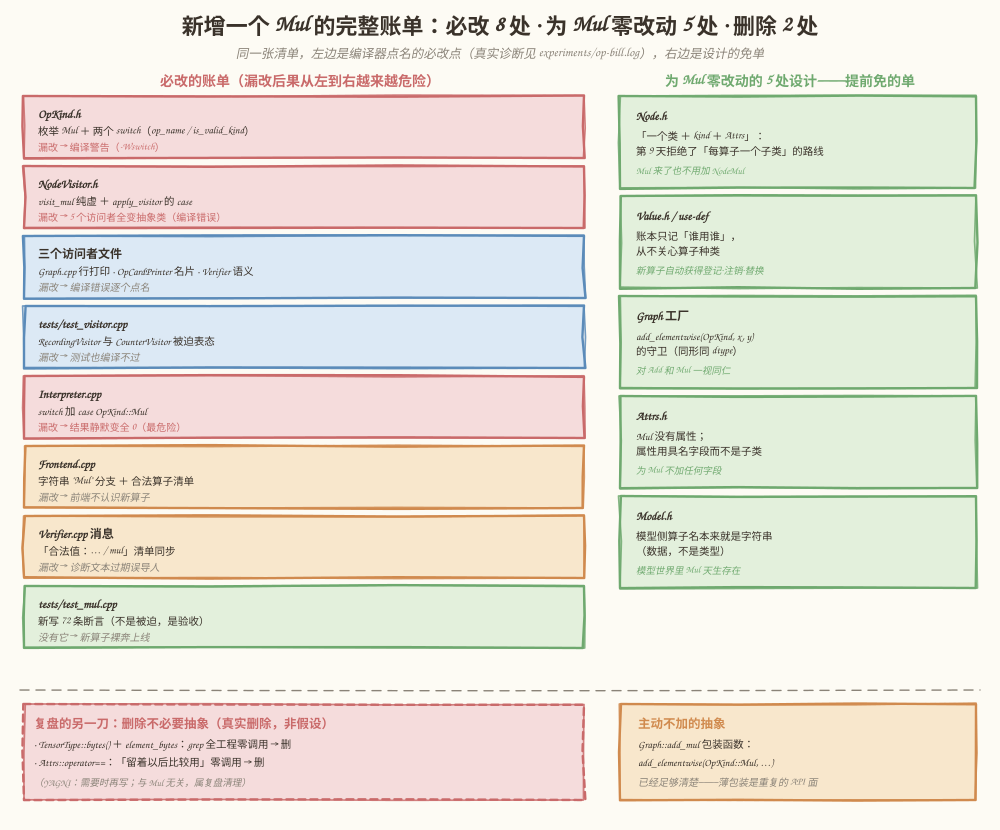
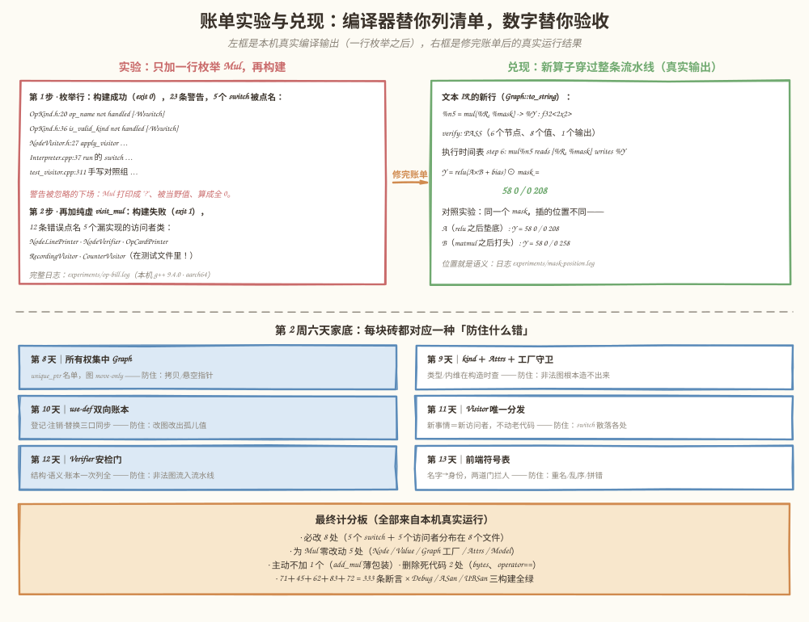

# 第 14 天：第 2 周复盘——数一数新增一个算子的账单，看它由谁决定

> **今日目标**：能不看笔记说出本周四条主线（所有权、依赖、扩展性、Verifier）各自的职责边界；亲自动手给 mini-graph 新增一个 `Mul` 节点，先用纸面预测「哪些文件必须改」，再用编译器的真实诊断核对预测；按 YAGNI 删掉本周攒下的死代码（真实删除，333 条断言全绿）；最后合上教程，用五句话回答压轴题——「新增一种算子的成本由哪些设计决定」。
> **预计时间**：学习 35 分钟 ＋ 实践 50 分钟
> **前置准备**：第 8～13 天教程（尤其第 9 天的「一个类＋kind＋属性」、第 11 天的 Visitor、第 12 天的 Verifier 分层）；构建环境同前六天（CMake ≥ 3.16、Ninja、g++ 或 clang++）。复盘日的规矩同第 7 天：只收拢、不扩张——今天不引入任何新概念。
> **今日产出**：`mini-graph-v7` 工程（新增 `Mul` 算子 ＋ 删除 2 处死代码（3 个函数）＋ 72 条新断言，71＋45＋62＋83＋72 共 333 条断言在 Debug／ASan／UBSan 三构建全绿）；一份编译器自动开出的「算子账单」（`experiments/op-bill.log`）；mask 位置对照实验（`experiments/mask-position.log`）；两个反面教材（漏接执行语义的静默全 0、签名写错的抽象类点名）；一页复盘（第 8 节）。

## 1. 今天解决什么问题？

复盘不是把六天的目录再念一遍。计划给第 14 天定的三件事是：**总结**所有权、依赖、扩展性和 Verifier 的职责边界；**新增**一个 `Mul` 节点、记录需要修改的文件，并**删除**不必要抽象；**产出**一页复盘，能回答「新增一种算子的成本由哪些设计决定」。

最好的复盘方式，是让一周的设计决定接受一次真实审判。所以今天的主线是一场手术：给 mini-graph 接生一个新的逐元素乘算子 `Mul`，然后**把账单数清楚**——哪些文件被迫要改、哪些文件纹丝不动、每处漏改会发生什么。这份账单不是感想，是编译器亲手开的：第 8 天立骨架、第 9 天选了「一个类＋kind＋属性」而不是每算子一个子类、第 10 天写了与算子无关的 use-def 账本、第 11 天把分发收进一个 switch、第 12 天给 Verifier 划了职责边界、第 13 天让前端认得字符串算子名——六天的每个决定，今天都会在账单上显形。

贯穿全文的例子在第 13 天的经典图上再加一层：`Y = relu(A × B + bias) ⊙ mask`，其中 `mask = [1, 0, 0, 2]`——左上角放行、右上角清零、右下角翻倍，这是真实模型里常见的「掩码」模式。手算链条：`C = A×B = 58 64/139 154` → `D = C + bias = 58 -36/-11 104` → `R = relu(D) = 58 0/0 104` → **`Y = R ⊙ mask = 58 0/0 208`**。今天做完手术，这张图要原样穿过本周建好的全部设施：工厂守卫、Verifier、文本 IR、拓扑打印、use-def 账本、解释器。

「删除不必要抽象」也不是走过场：一周下来，工程里攒了两三样「留着以后用」的东西——`TensorType::bytes()`、`Attrs::operator==`。今天用 grep 查它们的调用方，查完就动手删。

## 2. 先看全貌：今天的内容位于哪里？



**图 1**：看三个区域。顶部六张蓝卡是本周六天的家底，箭头汇进中间橙色的「复盘手术台」——今天的全部动作都在这张台上：新增 `Mul`、记录账单、删除不必要抽象。中部绿条是新算子要穿过的六个站台——前端认名字（第 13 天）、工厂守卫（第 9 天）、Verifier（第 12 天）、打印与访问者（第 11 天）、use-def 账本（第 10 天）、解释器执行——每个站台都是这一天建的，今天每个站台都要收一次账。底部红框是复盘的另一刀：三处「删／不加」的决定，和一句话结论。

今天的路线分 4 步：

1. **收拢**：把四条主线（所有权、依赖、扩展性、Verifier）的边界各用一段话说清（第 3 节）；
2. **手术**：先纸面预测账单，再让编译器用真实的警告和报错核对（第 5.1～5.2 节）；
3. **验收**：333 条断言三构建全绿，新算子端到端出数字 58 0/0 208（第 5.3 节）；
4. **对照**：同一个 mask 插在两个位置，看数字分岔（第 5.4 节），再收走四个常见错误（第 6 节）。

## 3. 核心概念：先用直觉，再给准确定义

### 3.1 所有权与依赖：房子和住户从来是两回事

一句通俗解释：**所有权**回答「谁负责析构」，**依赖**回答「谁等谁的结果」——本周最重要的洞察是这两件事完全正交。

生活类比：房子（`Graph` 的 `unique_ptr` 名单）登记在唯一房主名下；住户（`Node`、`Value` 之间的引用）只是彼此认识，谁也不拥有谁。**对应到技术上是**：节点和值的所有权全部集中在 `Graph` 手里（第 8 天的「房产证」）；节点对输入值、值对生产者，握着的全是**借用指针**——数据依赖是 `Node::inputs_` 里的 `const Value*`，节点所有权是 `Graph::nodes_` 里的 `unique_ptr`，两者从第 8 天起就没混过。**类比的边界**：房主搬家（`Graph` 移动）时借用关系全部照旧，但房子拆了（析构）借用指针全部失效——「主人要活得比引用久」这条第 5 天立的规矩本周一直在营业——昨天的 `err_outlived_graph.cpp`（重新 lower 后的悬空指针）就是违反它的最新现场。

### 3.2 扩展性：新增算子的成本，由「分发点」的数量和形态决定

为什么 `Mul` 来了有的文件必须改、有的可以一行不看？因为「按算子类型选动作」这件事在一周里被刻意收拢到了**少数几个分发点**上，每个分发点的形态决定了漏改的后果：

- **封闭枚举上的 switch**（`op_name`、`is_valid_kind`、`apply_visitor`、解释器的执行 switch）：枚举加了新值、switch 没加 case，`-Wswitch` **编译警告**——不拦构建，但点名了每个漏改处；
- **纯虚接口**（`NodeVisitor::visit_mul`）：接口加了纯虚、派生类没实现，派生类**变成抽象类，编译错误**逐个点名——最硬的安全网，连测试文件里的小访问者都不放过；
- **字符串分发**（前端 `l.op == "Mul"`）：模型世界的算子名是数据不是类型，编译器帮不上忙，漏写只能在运行期由前端的「不认识」诊断拦下；
- **零分发**（`Node`、`Value`、use-def 账本、`Graph` 工厂）：设计上根本不看算子种类——新算子**自动**获得登记、注销、替换、移动全部能力。

**分发点越少、越集中，账单越短**；反过来，第 11 天把 if/else 散写换成 Visitor，今天看正是把「每个文件都可能藏一个 switch」压缩成「一个 switch ＋ 一批必须表态的类」。这就是压轴题的直觉版：**新增算子的成本不由算子本身决定，由它必须穿过的分发点决定**。

### 3.3 Verifier 的职责边界：安检门只查「图内一致性」

复盘第 12 天的三层结论，今天用 `Mul` 再对一次表：

- **工厂守卫**（构造时）：空指针、类型不一致、内维不匹配——「带守卫的建造路径」，消息只有指针没有名字；
- **Verifier**（验证时）：结构（kind 合法、指针非空、结果回指、值归属）、语义（输入数量、Shape、dtype、结果类型）、账本（use-def 双向各数一遍）——**它只对图的内部一致性负责**，不查名字唯一（那是前端的合同），不查数据算得对不对（那是解释器的事）；
- **前端两道门**（映射时）：名字世界的重名、乱序、拼错、自环——认得名字的报错只有前端能做。

对号入座：今天 `Mul` 走进 Verifier 的路径是 `NodeVerifier::visit_mul`——它复用 `expect_elementwise`（两个输入类型完全一致、结果同型），和 `visit_add` 一字不差；而 `Mul` 图输出算得对不对，Verifier 天生不管——第 6 节错误一会展示一个 `verify: PASS` 却算出全 0 的现场。**边界划得清，才能各管各的账**。

## 4. 图解核心机制



**图 2**：今天的核心交付——完整账单。左列是必改的 8 处，每行标了「漏改会怎样」，颜色越红越危险：`OpKind.h` 的三个 switch 漏改是**警告**（构建仍绿）、`NodeVisitor.h` 加纯虚后五个访问者漏改是**编译错误**（最硬的网）、`Interpreter.cpp` 漏改是**静默全 0**（最危险——无任何提示）、`Frontend.cpp` 漏改是前端「不认识」、测试文件漏写则**无人提醒**。右列是为 `Mul` 零改动的五处设计——`Node` 的「一个类＋kind＋属性」、`Value` 的账本、`Graph` 工厂的同形守卫、`Attrs` 的具名字段、`Model` 的字符串算子名——它们是第 8～13 天六个决定今天的兑现（`Attrs.h` 的改动来自复盘清理「删 `operator==`」，不是 `Mul` 索要的）。

按编号读三个层次：

1. **必改的账单按设计决定分组**：封闭枚举（`OpKind.h` 的两个 switch：`op_name`、`is_valid_kind`）→ 纯虚接口（`NodeVisitor.h` 一个 case ＋ 五个派生类表态）→ 语义分发（`Verifier.cpp` 的 `visit_mul`）→ 执行分发（`Interpreter.cpp` 的 case）→ 字符串分发（`Frontend.cpp` 的 `"Mul"` 分支）——每一组都对应 3.2 节的一种分发形态；
2. **漏改后果呈阶梯**：编译错误（抽象类）→ 编译警告（`-Wswitch`）→ 运行期诊断（前端「不认识」）→ **静默错答案**（解释器全 0）——离「静默」越近越危险，第 6 节的错误一正是最后一格；
3. **删除与不加也是账单的一部分**：左下红框是今天真实删除的两处死代码（grep 零调用），右下橙框是主动不加的 `add_mul` 薄包装——「成本」不只是要改多少，还包括**忍住不加多少**。

## 5. 动手实践：一台手术，两份真实账单

> 本节所有命令与输出都在这台机器上真实执行过：
> Linux aarch64（Ubuntu 20.04）· g++ 9.4.0 · CMake 3.20.5 · Ninja 1.10.0。
> 完整工程在本仓库 `tutorials/day-014/examples/mini-graph-v7/`，由第 13 天的 v6 复制而来——`Value`／`Node`／`Graph`／`Model`／`Frontend` 的接口一行未改，改动清单就是今天的账单本体。

### 5.1 准备文件

```text
tutorials/day-014/examples/mini-graph-v7/
├── CMakeLists.txt               # 同第 13 天：Debug 默认 ＋ ENABLE_ASAN / ENABLE_UBSAN
├── src/
│   ├── OpKind.h                 # ★ 必改①：枚举 Mul ＋ op_name / is_valid_kind 两个 switch
│   ├── NodeVisitor.h            # ★ 必改②：visit_mul 纯虚 ＋ apply_visitor 的 case
│   ├── Graph.cpp                # ★ 必改③：NodeLinePrinter::visit_mul（文本 IR 行）
│   ├── OpCardPrinter.h          # ★ 必改④：visit_mul（算子名片）
│   ├── Verifier.cpp             # ★ 必改⑤：visit_mul 复用抽出的 expect_elementwise ＋ 合法值清单
│   ├── Interpreter.cpp          # ★ 必改⑥：case OpKind::Mul 的执行语义
│   ├── Frontend.cpp             # ★ 必改⑦："Mul" 分支 ＋ 合法算子名清单
│   ├── main.cpp                 # 三幕演示：Mul 全流水线 ＋ 名片 ＋ 写错算子名现场
│   ├── Node.h / Value.h         # 零改动：一个类＋kind＋属性；账本不看算子种类
│   ├── Graph.h                  # 零改动：add_elementwise(OpKind,…) 直接收编 Mul
│   ├── Attrs.h                  # ★ 删 operator==（零调用）；Mul 无属性，结构体本体零改动
│   ├── TensorType.h / Dtype.h   # ★ 删：bytes() ＋ element_bytes（零调用链）
│   └── Model.h / Frontend.h / Interpreter.h / Verifier.h   # 零改动
├── tests/
│   ├── test_use_def.cpp         # 第 10 天 71 条原样
│   ├── test_visitor.cpp         # ★ 必改⑧：两个访问者被迫表态 ＋ 手写对照组补 case（44→45 条）
│   ├── test_verifier.cpp        # 第 12 天 62 条原样
│   ├── test_frontend.cpp        # 第 13 天 83 条原样
│   └── test_mul.cpp             # ★ 新写：72 条断言（唯一「自愿」的一处——漏写没有任何提示）
├── bugs/
│   ├── err_missing_interp_case.cpp   # ★ 解释器漏接 Mul：verify PASS ＋ 静默全 0
│   ├── err_wrong_signature.cpp       # ★ visit_mul 签名写错：抽象类点名
│   └── （第 13 天的三个反面教材原样，全部仍可编译复现）
└── experiments/
    ├── op-bill.log              # ★ 编译器开出的账单（两步真实诊断全文）
    ├── mask-position.sh / .log / mask_position_ab.cpp   # ★ mask 位置对照实验
    └── weight-position.sh / .log / weight_position_ab.cpp   # 第 13 天的实验原样
```

### 5.2 编写代码：先预测，再让编译器核对

**第一步：纸上预测。** 动手前先合上教程写下你的预测清单：新增 `Mul` 要改哪几个文件？每个文件漏改会怎样？第 13 天结尾的提示还记得吗——「除了 `Frontend.cpp`，`tests/` 里也有躲不掉的」。写完再往下走，这份预测就是复盘的考卷。

**第二步：只改一行，让编译器开账单。** 在 `OpKind.h` 的枚举里加一行（今天唯一先做的一步）：

```cpp
enum class OpKind : std::uint8_t {
    Constant,  // 常量：值放在属性里，没有输入
    MatMul,    // 矩阵乘：两个二维输入
    Add,       // 逐元素加：两个同形输入
    Relu,      // 逐元素取正：一个输入
    Mul,       // 逐元素乘：两个同形输入（第 14 天新增）
};
```

然后构建（干净基线在第 13 天收尾状态：0 警告）：

```bash
cd tutorials/day-014/examples/mini-graph-v7
cmake -S . -B build -G Ninja && cmake --build build
```

真实输出——**构建成功（exit 0），但 23 条警告落在 5 个不同的 switch 上**（完整日志在 `experiments/op-bill.log`）：

```text
9  src/OpKind.h:20:12: warning: enumeration value 'Mul' not handled in switch [-Wswitch]
9  src/OpKind.h:36:12: warning: enumeration value 'Mul' not handled in switch [-Wswitch]
3  src/NodeVisitor.h:27:12: warning: enumeration value 'Mul' not handled in switch [-Wswitch]
1  src/Interpreter.cpp:37:16: warning: enumeration value 'Mul' not handled in switch [-Wswitch]
1  tests/test_visitor.cpp:311:20: warning: enumeration value 'Mul' not handled in switch [-Wswitch]
```

每行警告就是一个分发点：`op_name`（枚举变字符串）、`is_valid_kind`（合法性检查）、`apply_visitor`（Visitor 分发）、解释器的执行 switch、测试里的手写对照 switch。注意两件事：**构建是绿的**——警告是唯一防线，忽略它们，`Mul` 会打印成 `"?"`、被 Verifier 当野值、被解释器算成全 0；**测试文件也在名单上**——第 13 天的提示应验了。

**第三步：把最硬的安全网拉起来。** 给 `NodeVisitor` 加纯虚 `visit_mul`，并在 `apply_visitor` 补上 case（这些 switch 一律不写 default 的理由第 11 天讲过：`-Wswitch` 报警 ＋ 纯虚逼所有派生类表态）：

```cpp
class NodeVisitor {
public:
    virtual ~NodeVisitor() = default;

    virtual void visit_constant(const Node& n) = 0;
    virtual void visit_matmul(const Node& n) = 0;
    virtual void visit_add(const Node& n) = 0;
    virtual void visit_relu(const Node& n) = 0;
    virtual void visit_mul(const Node& n) = 0;   // ★ 今天新增
};

inline void apply_visitor(NodeVisitor& v, const Node& n) {
    switch (n.kind()) {
        case OpKind::Constant: v.visit_constant(n); break;
        case OpKind::MatMul:   v.visit_matmul(n);   break;
        case OpKind::Add:      v.visit_add(n);      break;
        case OpKind::Relu:     v.visit_relu(n);     break;
        case OpKind::Mul:      v.visit_mul(n);      break;
    }
}
```

再构建——这次**构建失败（exit 1），12 条错误点名 5 个漏实现的访问者类**：

```text
src/Graph.cpp:310:21:       error: cannot declare variable 'printer' to be of abstract type 'NodeLinePrinter'
src/Verifier.cpp:148:18:    error: cannot declare variable 'semantics' to be of abstract type 'NodeVerifier'
tests/test_visitor.cpp:236: error: cannot declare variable 'printer' to be of abstract type 'OpCardPrinter'
tests/test_visitor.cpp:264: error: cannot declare variable 'counter' to be of abstract type 'CounterVisitor'
tests/test_visitor.cpp:130: error: cannot declare variable 'rec' to be of abstract type 'RecordingVisitor'（×5 处）
```

完整错误链的读法是三层递进，直到病根：

```text
Graph.cpp:310:21: error: cannot declare variable 'printer' to be of abstract type 'NodeLinePrinter'
Graph.cpp:49:7: note:   because the following virtual functions are pure within 'NodeLinePrinter':
NodeVisitor.h:17:18: note: 	'virtual void NodeVisitor::visit_mul(const Node&)'
```

编译器把账单开到了「哪个文件第几行、哪个类、缺哪个函数」——你纸面预测里漏掉的那几个，此刻正在被逐个点名。这就是第 11 天用「编译错误」换「运行期静默漏改」的兑现时刻。

**第四步：逐个兑现。** `OpKind.h` 的两个 switch、五个访问者的 `visit_mul`、解释器与测试对照组的 case、前端的字符串分支，逐项清零：

- `Graph.cpp` 的 `NodeLinePrinter`——`Mul` 没有属性，行格式与 `add`／`relu` 完全一样：`void visit_mul(const Node& n) override { head(n); tail(n); }`
- `OpCardPrinter.h`——名片一张：`card(n, "逐元素乘", "2 个同形输入（… × …）", "")`（输入名动态拼进 `how` 字符串）；
- `Verifier.cpp`——`visit_add` 的检查（两个输入类型完全一致、结果同型）对 `Mul` 一字不差。第一个逐元素算子把它写在 `visit_add` 里，第二个到来时抽成公共函数——**同类算子的边际成本从「抄十行」降到「写一行」**：

```cpp
void visit_add(const Node& n) override { expect_elementwise(n); }
void visit_mul(const Node& n) override { expect_elementwise(n); }

private:
void expect_elementwise(const Node& n) {
    if (!expect_inputs(n, 2)) {
        return;  // 数量不对就不碰 input(1)：越界解引用比错误报告更糟
    }
    const TensorType& tx = n.input(0)->type();
    const TensorType& ty = n.input(1)->type();
    const TensorType& tr = n.result()->type();
    rep_.fail_if(tx.dtype != ty.dtype || !tx.same_shape(ty),
                 where(n) + ": 两个输入类型不一致：" + tx.to_string() + " vs " + ty.to_string());
    rep_.fail_if(!(tx == tr),
                 where(n) + ": 结果类型应与输入一致（" + tx.to_string() + "），实际是 " +
                     tr.to_string());
}
```

- `Interpreter.cpp`——执行语义，与 `Add` 的分支对称：

```cpp
case OpKind::Mul: {
    const std::vector<double>& x = of(n->input(0));
    const std::vector<double>& y = of(n->input(1));
    for (std::size_t i = 0; i < x.size(); ++i) {
        result[i] = x[i] * y[i];
    }
    break;
}
```

- `Frontend.cpp`——字符串分发加一个分支，合法算子名清单同步（诊断文本也是接口）：

```cpp
} else if (l.op == "Mul") {
    if (l.inputs.size() != 2) {
        fail("lower: " + where + " 需要 2 个输入，实际 " + count_of(l.inputs.size()));
    }
    // 与 Add 同走 add_elementwise：工厂守卫（类型完全一致）对两种
    // 逐元素算子同样成立——Graph 一行不用改。
    n = g.add_elementwise(OpKind::Mul, ins[0], ins[1], l.output);
}
```

注意 `Graph` 的工厂**零改动**：`add_elementwise(OpKind kind, …)` 第 9 天就是按「任一同形二元算子」设计的，守卫（空指针、类型完全一致）对 `Mul` 自动生效——`test_mul.cpp` 里断言了错误消息会带 `mul:` 前缀。**顺手决定不加 `Graph::add_mul` 薄包装**：它只是换名字转发，却是新增一层 API 面——「删除不必要抽象」先从「不加」开始。

- `tests/test_visitor.cpp`——两个访问者被迫表态（一行计数、一行记录），手写对照组补一个 case 并把 `CHECK(sw_u == counter.mul_)` 加进对照断言（44 → 45 条）；

**第五步：删除死代码（真实执行）。** 复盘的第二刀。先用 grep 查证，再删：

```bash
grep -rn "element_bytes\|\.bytes()\|->bytes()" src tests bugs
# src/TensorType.h:26:    std::int64_t bytes() const noexcept { … }   ← 定义本身
# src/Dtype.h:25:inline std::int64_t element_bytes(Dtype d) { … }   ← 定义本身
# （grep 只剩两行定义本身：element_bytes 的唯一调用方是 bytes()，而 bytes() 自己没有任何调用方——一整条死链）
```

`bytes()` 家族是第 4 天 `TensorDesc` 的惯性带过来的——在 v6 里**一周零调用**。删掉 `TensorType::bytes()` 和 `Dtype::element_bytes`，注释里写明去处：第 73 天估算片上空间真需要时再回来写（那时要按目标硬件的 dtype 宽度算，今天这版多半也不对）。`Attrs::operator==` 同样处理——「留着第 26 天 CSE 比较属性用」是猜测需求，而 CSE 关心哪些字段今天还不知道，现在写必然猜错。删完构建：0 警告，333 条断言全绿。**YAGNI 不是「永远不写」，是「需要时再写」——git 历史里永远找得回来。**

**第六步：新写 `test_mul.cpp`（72 条断言）。** 八个组：枚举与名字（2）、工厂收编与守卫（5）、Verifier 五个反例（raw 造非法 `Mul`：输入数量、Shape、dtype、结果类型、野 kind 合法清单）、解释器数字（含负数传播）、前端整图映射（6 节点 8 值、use-def 槽位、拓扑序）、三个访问者的分发、改图入口对 `Mul` 生效（replace ＋ erase 换掩码，数字退回 58 0/0 104）、前端纪律（拼错 `Mull`、输入数量、带 `transpose` 属性）。这是账单上唯一「自愿」的一处——5.3 节末尾会证明漏掉它没有任何提示。

### 5.3 运行与观察

```bash
cmake -S . -B build -G Ninja && cmake --build build
ctest --test-dir build --output-on-failure
./build/src/mini-graph-v7
```

第一幕的真实输出（模型 → lower → 文本 IR → verify → 拓扑打印 → use 表 → 解释器）：

```text
== lower 之后：文本形式 IR（Graph::to_string） ==
graph "matmul-bias-relu-mask" (2 inputs, 1 outputs) {
  %A = input : f32<2x3>
  %B = input : f32<3x2>
  %n0 = constant() {data = [0, -100, -150, -50]} -> %bias : f32<2x2>
  %n1 = constant() {data = [1, 0, 0, 2]} -> %mask : f32<2x2>
  %n2 = matmul(%A, %B) -> %C : f32<2x2>
  %n3 = add(%C, %bias) -> %D : f32<2x2>
  %n4 = relu(%D) -> %R : f32<2x2>
  %n5 = mul(%R, %mask) -> %Y : f32<2x2>
  output %Y
}

== 合法性检查（Verifier 的 visit_mul 上岗） ==
verify: PASS（6 个节点、8 个值、1 个输出，全部检查通过）

== 拓扑打印（执行时间表） ==
  执行顺序： constant%n0 constant%n1 matmul%n2 add%n3 relu%n4 mul%n5
  （与创建顺序一致——第 8 天的定理：只能引用已存在的值 ⇒ 创建序即拓扑序）

== Use-Def 检查（第 10 天的账本） ==
  %mask	def: constant%n1	uses: mul%n5(第1槽) 
  %R	def: relu%n4	uses: mul%n5(第0槽) 
  %Y	def: mul%n5	uses: （无节点使用，图输出）

== 端到端执行（解释器按拓扑序求值） ==
  %Y (f32<2x2>) =
    58 0
    0 208
```

对照读四件事：`%n5 = mul(%R, %mask)` 是今天新生的 IR 行——由 `NodeLinePrinter::visit_mul` 打出；use 表里 `%R` 和 `%mask` 各恰好一条 `mul` 使用记录（槽位 0／1）——第 10 天的账本对没见过的算子照常记账；执行时间表第 6 步 `mul%n5 reads [%R, %mask] writes %Y`——拓扑序对新算子照常成立；最后的 **58 0/0 208** 与手算一致。第二幕的六张名片里有 `[mul%n5] 逐元素乘：2 个同形输入（%R × %mask）`——第 11 天「对扩展开放、对修改关闭」的直观体验，代价是一行 `card(...)`。第三幕两个写错现场（`"Mull"` 拼错、只给 1 个输入）都被前端分发拦下，合法清单里已经能看到 `Mul`。

测试与三构建（全部真实执行）：

```bash
ctest --test-dir build --output-on-failure
cmake -S . -B build-asan -G Ninja -DENABLE_ASAN=ON && cmake --build build-asan
ctest --test-dir build-asan --output-on-failure
cmake -S . -B build-ubsan -G Ninja -DENABLE_UBSAN=ON && cmake --build build-ubsan
ctest --test-dir build-ubsan --output-on-failure
```

真实输出：

```text
100% tests passed, 0 tests failed out of 5      # Debug，0.01 sec
100% tests passed, 0 tests failed out of 5      # ASan（含 LeakSanitizer），16.37 sec
100% tests passed, 0 tests failed out of 5      # UBSan，0.02 sec

all 71 assertions passed        # test_use_def：第 10 天原样
all 45 assertions passed        # test_visitor：44 原样 ＋ 1 条新对照（被迫表态后的增量）
all 62 assertions passed        # test_verifier：第 12 天原样
all 83 assertions passed        # test_frontend：第 13 天原样
all 72 assertions passed        # test_mul：今天新写
```

**71＋45＋62＋83＋72 = 333 条断言**。三天前的 260 条原样重跑（只有 test_visitor 多了那 1 条被迫表态的对照），删除的两处死代码没有惊动任何一行测试——这就是「删得对」的证明。零警告、零泄漏。



**图 3**：左边是 5.2 节两步实验的真实编译输出——23 条警告点名 5 个 switch、12 条错误点名 5 个访问者类；右边是修完账单后的真实运行——`mul` 的 IR 行、`verify: PASS`、数字 58 0/0 208，和 5.4 节 mask 位置实验的两个答案。底部计分板把今天全部数字收在一行：**必改 8 处、为 Mul 零改动 5 处、主动不加 1、删除 2、333 断言三构建全绿**。

还有一个值得单独说的验证：**`test_mul.cpp` 不写会怎样？** 我真实试过——把 `test_mul` 从 `tests/CMakeLists.txt` 摘掉再构建：`exit 0`、**0 警告**、`100% tests passed, 0 tests failed out of 4`。账单上其他 8 处漏改，编译器至少会用警告或错误提醒你；唯独这一处**没有任何提示**——新算子裸奔上线。这就是为什么它叫「自愿必改」：安全网管得住分发点，管不住「没写测试」。

### 5.4 修改一个参数再观察：同一个 mask，插在两个位置

只改一个参数：`Mul` 层在层列表里的位置。变体 A 把掩码垫底（先算完 bias 和 relu），变体 B 把掩码打头（先给乘积套上再走完原链条）。一键复现：

```bash
bash experiments/mask-position.sh
```

真实日志（`experiments/mask-position.log`）里两份 IR 的全部差异——就是中间三层换了个位置：

```text
<   %n3 = add(%C, %bias) -> %D : f32<2x2>
<   %n4 = relu(%D) -> %R : f32<2x2>
<   %n5 = mul(%R, %mask) -> %Y : f32<2x2>
---
>   %n3 = mul(%C, %mask) -> %M : f32<2x2>
>   %n4 = add(%M, %bias) -> %D : f32<2x2>
>   %n5 = relu(%D) -> %Y : f32<2x2>
```

三个观察结论，全部来自真实运行：

1. **两个变体都 `verify: PASS`**（6 节点、8 值），结构合法性与算子位置无关；
2. **数字分岔**：变体 A 的 `Y = 58 0/0 208`，变体 B 的 `Y = 58 0/0 258`——同一个 mask，先套后套不一样。手算核对 B：`C⊙mask = 58 0/0 308`，`+bias = 58 -100/-150 258`，`relu = 58 0/0 258`；
3. **`Mul` 不是图上的装饰**：它是带真实语义的算子，**位置就是语义**。这回答了一个容易被轻视的问题——为什么账单里解释器的 case（`x[i] * y[i]`）绝不能靠「看起来差不多」省掉：上一行算式的含义整个取决于它。

这个实验和第 13 天的 bias 搬家互为镜像：那次证明「权重放哪是合同问题」，这次证明「算子放哪是语义问题」——图 IR 把两者都诚实地记在层列表里。

## 6. 常见错误与排查

四个错误都在本机真实复现过（前两个在 `bugs/` 下，编译命令写在各文件头部注释里；第三、四个的完整日志在 `experiments/op-bill.log` 和 5.3 节）。

**错误一：解释器漏接 `Mul`——`verify: PASS`、正常退出、结果是全 0（`bugs/err_missing_interp_case.cpp`）**

- 现象：图完全合法（`verify: PASS`），程序 `exit code: 0`，但 `Mul` 节点的结果是 `0 0/0 0`（正确答案 `58 0/0 308`）——静默错答案。
- 原因：switch 没写 `case OpKind::Mul`，落到 switch 之外，result 保持初始的全 0 向量。编译时 `-Wswitch` 警告过**恰好一次**（`err_missing_interp_case.cpp:41`），警告被忽略后，运行期没有任何防线——Verifier 只管图内一致性，不管算得对不对。
- 定位：对照第 12 天三种失败的分法，这是「运行失败」里最阴的一种（不崩溃、不报错）。破案线索：`to_string` 里 `mul` 行正常、use 表正常、只有解释器输出不对——问题必然在「消费 kind 做计算」的那一层，全工程只有一个 switch 在做这件事。
- 修复：补上 `case OpKind::Mul` 分支；同时把教训写进纪律——**构建输出里的每一条 `-Wswitch` 警告都是没兑现的账**。

**错误二：补 `visit_mul` 时签名写错——类还是抽象的（`bugs/err_wrong_signature.cpp`）**

- 现象：明明写了 `void visit_mul(Node& n)`，编译仍然报 `cannot declare variable 'counter' to be of abstract type 'BadCounter'`。
- 原因：参数少了 `const`——它不是对纯虚函数的重写，而是一个**新的虚函数**；纯虚的 `visit_mul(const Node&)` 仍未实现。错误链的三层读法：报错行（实例化处）→ note 1（哪个类纯虚未实现）→ note 2（缺的正是 `NodeVisitor::visit_mul(const Node&)`）——最后那行就是病根。
- 定位：从 note 2 直接读出两个候选病因：忘了写、或签名不匹配。本例是后者。
- 修复：签名与接口完全对齐并写上 `override` 关键字——签名不匹配时编译器直接在那一行报「`marked 'override', but does not override`」，不用猜。**`override` 应该是肌肉记忆**：它把「以为重写了」从静默错误变成编译错误。

**错误三：只加了枚举就以为完事——构建是绿的，五个 switch 全在警告（`experiments/op-bill.log` 第 1 步）**

- 现象：`OpKind.h` 加了 `Mul`，构建 `exit 0`，很容易得出「改完了」的错觉——尤其在没有 `-Wall` 的项目里连警告都没有。
- 原因：switch 对未匹配的枚举值只是跳过。`op_name` 返回 `"?"`、`is_valid_kind` 返回 `false`、`apply_visitor` 静默跳过、解释器算全 0——每处的后果都不同，但构建都能通过。
- 定位：5.2 节的 23 条警告就是完整清单：**5 个 switch、23 条来自不同编译单元的重复报告，去重后正好是账单**。
- 修复：让账单清零而不是让警告闭嘴——补齐 5 个 switch 后警告归零；再给纯虚接口加 `visit_mul`，让「漏改访问者」从警告升级成错误。**警告的价值在于点名，不在于拦截**。

**错误四：不写 `test_mul.cpp` 就提交——没有任何东西会提醒你（5.3 节的真实验证）**

- 现象：把 `test_mul` 目标从 `tests/CMakeLists.txt` 摘掉：构建 `exit 0`、**0 警告**、`100% tests passed, 0 tests failed out of 4`。一切看起来圆满。
- 原因：必改清单的前 8 处都在类型系统或分发路径上，漏改会被编译器警告／报错点名；唯独「为新算子写测试」不在任何依赖链上——安全网管得住分发点，管不住省略。
- 定位：无法在构建期定位——只能靠复盘时的自问：「新算子有自己的正例和反例吗？它算出的数字有人对过吗？」
- 修复：把「新增一个算子 ＝ 新增一份它的测试」写进工作纪律（对应 MLIR 的惯例：每个新 Op 至少配一个 `.mlir` IR 测试）。今天 72 条断言里最值钱的是五个 Verifier 反例和两个数字对照（208 与 104）——**测试是账单里唯一自愿、也最容易被砍掉的一行**。

## 7. 今日练习

### 必做练习

合上教程，新增一个 `Sub`（逐元素减）算子。**先写账单再动手**：在纸上列出你预测的必改文件（对照今天 8 处），每处标注「漏改会怎样——警告／错误／静默」，再预测：有没有哪处今天为 `Mul` 做的事，`Sub` 可以完全照抄？然后动手验证你的预测。特别留意三件事：解释器分支里**减法不满足交换律**——`x[i] - y[i]` 与 `y[i] - x[i]` 完全不同，`test_mul.cpp` 里负数传播的断言在 `Sub` 这里要反过来设计；前端的 `Sub` 层要不要在 `test_mul.cpp` 第 8 组同款纪律下加「属性拒绝」检查；最后为你自己的 `Sub` 写测试（正例数字 ＋ 至少 3 个 Verifier 反例）。预期产出：一份预测账单、一个能跑的 `Sub`、一套自己的测试，以及预测与实际的 diff。

### 选做挑战

做一个「安全网拆除」实验：把 `NodeVisitor::visit_mul` 从纯虚改成普通虚函数并给一个**空的默认实现**，然后删掉 `CounterVisitor::visit_mul`（工程里只留这一个改动），重新构建并运行 `test_visitor`。先预测三件事：构建还能过吗（提示：`-Wswitch` 只看 `apply_visitor` 的 case，不看虚函数实现）；`counter.mul_` 会是多少；第 8 组的对照断言还能抓到它吗？运行后回答：默认空实现让哪几层安全网失效、「漏表态」从编译错误退化成了什么？写 3～5 句结论：什么时候值得给访问者默认实现（比如新增算子对大多数访问者确实「无事可做」的成熟项目），什么时候纯虚更对（比如现在——每周都在加算子的开发期）。这个实验不引入新知识，却直接触碰第 11 天「Visitor vs switch」决策的代价面。

## 8. 一页复盘：第 2 周浓缩版

### 8.1 六天家底表（账单视角）

| 天 | 一句话产出 | 防住什么错 | 今天账单上的角色 |
|---|---|---|---|
| 8 | `Graph`／`Node`／`Value` 骨架：所有权集中、借用引用 | 拷贝图、悬空指针 | **零改动**：房子不用为新房客动砖 |
| 9 | kind 枚举＋`Attrs`＋工厂守卫 | 拼错算子名、非法图造出来就传播 | 必改①：枚举＋两个 switch；`add_elementwise` 免单 |
| 10 | use-def 双向账本 | 改图改出孤儿值、双向不一致 | **零改动**：账本不看算子种类，自动记账 |
| 11 | Visitor 唯一分发＋`apply_visitor` | switch 散落各处、静默漏改 | 必改②③④：一个 case＋五个类被迫表态——最硬的安全网 |
| 12 | Verifier：结构·语义·账本一次列全 | 非法图流入流水线才炸 | 必改⑤：`visit_mul` 复用 `expect_elementwise`，边际成本一行 |
| 13 | 前端符号表：名字→身份，两道门 | 重名遮蔽、乱序、拼错 | 必改⑦：字符串分发＋合法清单；模型侧零改动 |
| 14（今天） | `Mul` 全链路＋333 断言＋删 2 处死代码 | 新算子裸奔上线、死代码当资产 | 账单：必改 8、零改动 5（为 Mul）、不加 1、删 2 |

### 8.2 压轴题标准回答（五句话版）

**问：新增一种算子的成本由哪些设计决定？**

1. **由分发点决定，不由算子决定**——成本清单就是「按算子类型选动作」的所有位置：本周的设计把它们收拢成 5 个 switch（枚举变字符串、合法性检查、Visitor 分发、解释器执行、测试对照组）、1 个纯虚接口（连带 5 个具体访问者表态）、1 个字符串分派分支，落在 **8 个既有文件**里，另有 1 个自愿新写的测试文件；
2. **每个分发点的形态决定漏改的后果**：纯虚接口漏改是编译错误（最安全），枚举 switch 漏改是 `-Wswitch` 警告，字符串分发漏改是运行期「不认识」，执行语义漏改是**静默错答案**（最危险）——设计分发点时其实是在选择错误暴露的时机；
3. **成本大头能被好的设计提前免掉**：`Node`「一个类＋kind＋属性」免掉了子类膨胀，`Value` 账本与 `Graph` 工厂对算子种类不感知——`Mul` 自动获得登记、注销、替换、移动全部能力，5 处关键设计为它零改动；
4. **同类算子的边际成本在下降**：第二个逐元素算子出现时，`visit_add` 的检查抽成 `expect_elementwise`、工厂守卫直接复用——从「抄十行」降到「写一行」；这也是第 50～55 天算子融合要走的路；
5. 一句话：**新增算子的成本 ＝ 它必须穿过的分发点数量 × 每处漏改的暴露时机；而「不写测试」是唯一没有任何安全网兜底的必改点**。

### 8.3 今日验收

- [ ] 我能不看笔记说出四条主线（所有权、依赖、扩展性、Verifier）各自的职责边界，以及「房子／住户」类比中所有权与依赖为什么正交；
- [ ] 我独立完成了两步账单实验：只加一行枚举得到 23 条警告／5 个 switch，再加纯虚得到 12 条错误／5 个访问者类，并能解释每一层的漏改后果（错误→警告→诊断→静默）；
- [ ] 我能列出 8 处必改、5 处为 `Mul` 零改动的设计，并说出每个零改动背后的那个设计决定（第 9 天的「一个类＋kind＋属性」、第 10 天的账本、第 8 天的所有权）；
- [ ] 我真实删除了 2 处死代码（3 个函数：`bytes()`、`element_bytes`、`operator==`）并知道 YAGNI 的正确读法——「需要时再写」，而不是「永远不写」；
- [ ] 我能解释 mask 位置实验里 208 与 258 为什么不同（位置就是语义），并说出「不写 test_mul.cpp 时构建全绿」说明了什么；
- [ ] 我保存了 `mini-graph-v7`、333 条断言、`op-bill.log`、`mask-position.log`、两个 bugs 反面教材和我的预测账单纸。

## 9. 一句话总结与明天预告

复盘日用一台手术代替复述：给 `mini-graph` 新增 `Mul`，编译器先开警告账单（5 个 switch、23 条），再开错误账单（5 个访问者类、12 条）——每一条都对应本周的一个分发点设计；账单兑清之后，新算子自动穿过了第 9 天的工厂守卫、第 10 天的账本、第 12 天的 Verifier、第 13 天的前端和解释器，端到端算出 58 0/0 208。手术刀的另一刃向内：删掉 2 处零调用的死代码（3 个函数，YAGNI），忍住不加 `add_mul` 薄包装，再把「不写测试则一切照绿」记为唯一没有安全网的必改点——71＋45＋62＋83＋72 = 333 条断言在 Debug／ASan／UBSan 三构建全绿，两个 mask 位置（208 vs 258）证明算子的位置就是语义。压轴题的答案收在一句话里：**新增算子的成本＝分发点数量×漏改暴露时机，好设计把成本变成编译器替你记账**。

明天第 15 天进入第 3 周：从 DAG 到 CFG——把控制流和分支请进图世界。本周的计算图是无环、无分支的 DAG，节点排成一条执行时间表；下周要引入基本块、前驱后继和数据流，第 10 天的 use-def 账本将在汇合点升级成 PHI 的前身。今天 333 条断言的家底，下周原样复用。
