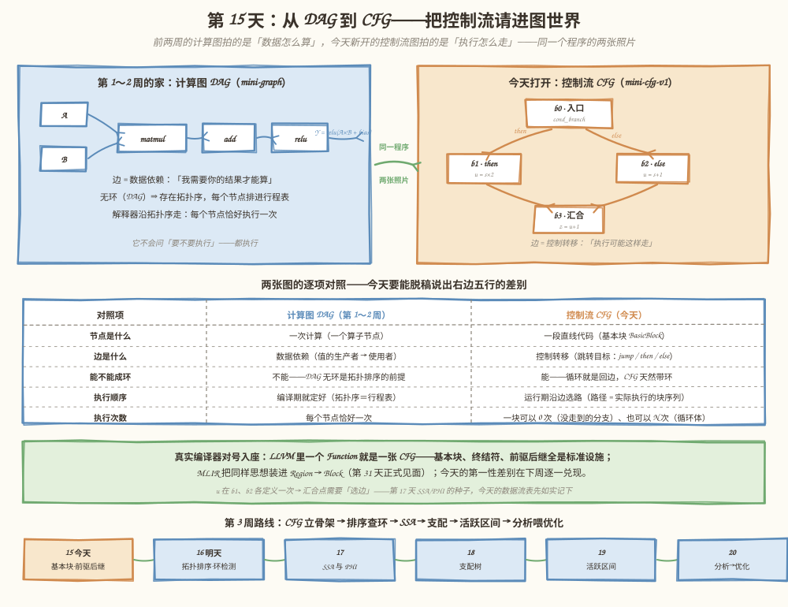
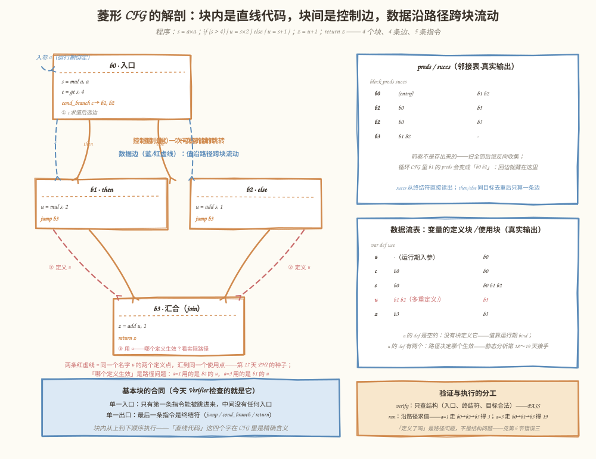
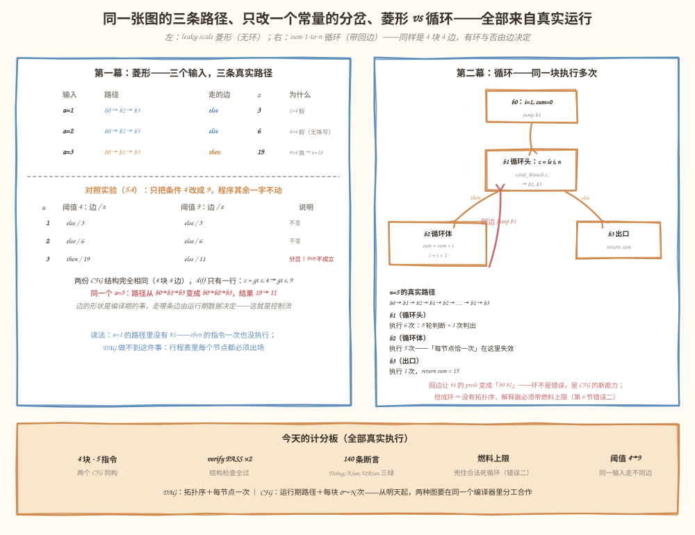

# 第 15 天：从 DAG 到 CFG——把控制流请进图世界

> **今日目标**：能脱稿说出计算图 DAG 与控制流图 CFG 在节点、边、成环、执行顺序、执行次数五件事上的差别；在独立工程 `mini-cfg-v1` 里亲手创建多个基本块和条件跳转，用「文本 CFG ＋ 边表 ＋ 前驱/后继表 ＋ 数据流表」四张打印把 CFG 完整画出来；沿控制流执行同一个菱形程序，观察三个输入各走哪条边、结果各是多少；最后用只改一个常量的阈值对照实验，验证「边的形状是编译期的事，走哪条边是运行期的事」。
> **预计时间**：学习 40 分钟 ＋ 实践 50 分钟
> **前置准备**：第 8 天（所有权集中、借用指针）、第 9 天（解释器按拓扑序执行）、第 12 天（验证只管结构一致性）、第 13 天（名字唯一合同）。构建环境同前（CMake ≥ 3.16、Ninja、g++ 或 clang++）。今天按计划要求是**独立示例**——`mini-graph` 原样封存（下周还要用），新开 `mini-cfg-v1`。
> **今日产出**：`mini-cfg-v1` 工程（`Cfg` 类＋四件套打印＋带燃料上限的解释器＋**140 条断言**，Debug／ASan／UBSan 三构建全绿）；两个可运行的 CFG（菱形 `leaky-scale`、循环 `sum-1-to-n`）；四个真实复现的反面教材（缺终结符、回边写错成死循环、变量只在没走到的分支定义、unreachable 孤块藏错误）；阈值 4→9 对照实验与日志。

## 1. 今天解决什么问题？

第 14 天复盘的结尾留了一句预告：「下周：从 DAG 到 CFG——把控制流和分支请进图世界，use-def 账本将变成 PHI 的前身」。今天兑现前半句。

先看一个 `mini-graph` 无能为力的现象。前两周的计算图是一张 **DAG**（Directed Acyclic Graph，有向无环图）：节点是算子，边是数据依赖，**每个节点都必须执行，而且恰好执行一次**——第 9 天的解释器按拓扑序走一遍就出结果。但真实计算经常不是一条直线：

- **Leaky ReLU** 这类算子的语义本身就带分支：`x > 0 ? x : α·x`——对同一个输入，两种算法只有一个会被执行；
- **RNN** 沿时间步循环：同一段计算要重复执行，次数由序列长度决定；
- **Mixture-of-Experts** 按输入做路由：走哪个专家网络，运行期才知道。

这些「要不要执行、执行几次」的问题，DAG 的边表达不了——数据依赖边说的是「我需要你的结果」，从不说「可能跳过去」。所以今天开第二种图：**CFG（Control Flow Graph，控制流图）**——节点是**基本块**，边是**控制转移**。

贯穿全文的例子是一个 leaky 风格的条件缩放程序（AI 味的分支，但小到能手算）：

```text
s = a * a
if (s > 4) { u = s * 2 } else { u = s + 1 }
z = u + 1
return z
```

手算三份输入：`a=1` → s=1，走 else，u=2，**z=3**；`a=2` → s=4，`4>4` 不成立，走 else，u=5，**z=6**；`a=3` → s=9，走 then，u=18，**z=19**。注意 `a=2` 这个点：`4 > 4` 是假的——严格大于不含等号，这是第 5.4 节对照实验里最容易翻车的细节。**同一个程序，不同输入走不同路径、得到不同结果**——这句话就是今天要建的全部设施。

计划给今天的定位是三件事：学习**基本块、前驱、后继、控制流和数据流**，比较计算图 DAG 与 CFG；实践是**在独立示例中创建多个基本块和条件跳转，打印 CFG**；产出一个 CFG 示例和结构图。

## 2. 先看全貌：今天的内容位于哪里？



**图 1**：看三个区域。顶部两张卡片——左边是前两周的家（计算图 DAG：`A×B → +bias → relu`，边是数据依赖，无环、有拓扑序、每节点执行一次），右边是今天打开的新世界（CFG：`b0` 条件分叉到 `b1/b2`，汇合到 `b3`，边是控制转移，允许成环，一块可以执行 0 到 N 次）。中间一张五行的对照表是今天的**必背内容**。底部绿条把两张图对号入座到真实编译器：LLVM 的一个 Function 就是一张 CFG；MLIR 的 Region → Block（第 31 天正式见面）。最下面是第 3 周六天的路线。

今天的路线分 4 步：

1. **想清楚**：基本块的合同（单一入口/单一出口）、前驱后继怎么算、控制流与数据流是两种边（第 3 节）；
2. **动手**：新开 `mini-cfg-v1`，定义 `Instr/BasicBlock/Cfg`，写出四件套打印和带燃料的解释器（第 5.1～5.2 节）；
3. **验收**：菱形三分支、循环回边两幕跑通，140 条断言三构建全绿（第 5.3 节）；
4. **对照**：只改阈值一个常量，看 a=3 的路径翻转（第 5.4 节），再收走四个常见错误（第 6 节）。

## 3. 核心概念：先用直觉，再给准确定义

### 3.1 基本块：直线代码的最大一段

一句通俗解释：**基本块（Basic Block）**是一段「从头进、从尾出、中间不拐弯」的直线代码——执行一旦进入，就必然按顺序跑到块尾。

生活类比：高速公路的封闭区间。匝道只能从区间起点驶入，出口只在区间终点——中途没有第二个入口或出口，你不可能开到一半插队进来，也不可能半路下高速。**对应到技术上是**：只有块的**第一条指令**能被跳转进入（这叫**单一入口**），块内指令不含任何分支，最后一条指令是**终结符（terminator）**——`jump`（无条件跳）、`cond_branch`（条件跳）或 `return`（返回），这是**单一出口**。今天的 `b0` 有两条普通指令加一个 `cond_branch`，`b1/b2` 各一条指令加一个 `jump`——四个块都遵守同一份合同。

**类比的边界**：高速公路区间由路网客观决定，基本块的划分则有一条形式化规则——**最大**直线段。如果 `b0` 的 `s = a*a` 和 `c = gt s, 4` 中间有人跳进来（比如另一个块 jump 到 `c` 那一行），那么从 `c` 开始必须另起一块，`b0` 就得在 `s` 之后断开。编译原理教材里把「每块的第一条指令」叫**首指令（leader）**：入口指令、跳转目标、以及分支指令的下一条，各自开启一个新块。今天我们手工建块，不写自动划分——但合同（单一入口/单一出口）和真实编译器一字不差。

### 3.2 前驱与后继：CFG 的邻接关系

有了块和跳转边，就能定义**前驱（predecessor）**和**后继（successor）**：块 A 有一条控制边指向块 B，A 就是 B 的前驱，B 就是 A 的后继。对照菱形图：`b1` 的前驱是 `{b0}`，`b3` 的前驱是 `{b1, b2}`——汇合点收两条边。

工程上有个值得注意的不对称：**后继是存出来的，前驱是算出来的**。`BasicBlock` 的终结符里就有跳转目标——`succs` 只需按终结符种类读一遍；而没有任何字段存「谁指向我」，`preds` 要把全图所有块的后继扫一遍、看见谁的后继里有我就把谁记下（反向收集）。这不是偷懒——第 20 天会讲**分析结果失效**：改一条边，相关块的前驱表全部要重算，与其维护两份可变数据，不如让一份从另一份**推导**。这个「派生视图」的思路，四周后就是分析 Pass 的设计骨架。

### 3.3 控制流 vs 数据流：两种边，两张图

这是今天最重要的一组对照。**数据流**沿着「谁生产值、谁消费值」走：菱形程序里 `s` 在 `b0` 生产，被 `b1`、`b2` 使用——数据边从 `b0` 出发指向两个使用点；**控制流**沿着「执行可能怎么走」走：`b0` 到 `b1`、`b0` 到 `b2` 是两条控制边。两种边都跨块，但含义完全不同：

| 对照项 | 计算图 DAG（第 1～2 周） | 控制流 CFG（今天） |
|---|---|---|
| 节点 | 一次计算（算子节点） | 一段直线代码（基本块） |
| 边 | 数据依赖：值的生产者 → 使用者 | 控制转移：jump / then / else |
| 成环 | 不允许——DAG 无环 | **允许**——循环就是回边 |
| 执行顺序 | 编译期定好（拓扑序＝行程表） | 运行期沿边选路（路径） |
| 执行次数 | 每节点恰好一次 | 一块 0 次（没走到的分支）～ N 次（循环体） |

后两行是明天的直接伏笔：**DAG 无环 ⇒ 拓扑排序存在**（第 16 天要给 `mini-graph` 实现它）；**CFG 有环 ⇒ 没有全局拓扑序**，执行顺序不是「排」出来的，是运行期「走」出来的。第 9 天的解释器把节点按拓扑序各算一遍必然终止；今天的解释器沿控制流走，同一块可以反复执行——也**可能永远停不下来**，所以它必须带**燃料上限**（5.2 节，以及第 6 节错误二的现场）。

### 3.4 汇合点：一个名字，多个定义

菱形程序里藏着一个本周持续发酵的问题：`u` 这个名字，`b1` 里定义一次（`u = s*2`），`b2` 里又定义一次（`u = s+1`），`b3` 要使用它（`z = u+1`）——**到底用哪个定义？** 答案取决于实际走了哪条边：`a=3` 用的是 `b1` 的，`a=1` 用的是 `b2` 的。这不是哲学问题，是编译器每天都要回答的问题，教科书里叫**到达定义（reaching definitions）**——「哪个定义能沿控制流到达这个使用点」。

今天先做最诚实的一步：数据流表把每个变量的**定义块**和**使用块**如实记下，`u` 的 def 列出现两个块名并标注「多重定义」。第 17 天 SSA 会把 `u` 拆成 `u1/u2` 两个名字、在汇合点引入 PHI 节点让路径来「选边」；第 18 天支配关系会回答「哪些路径保证经过某个块」；第 19 天活跃区间会回答「这个值要活到哪条边」。今天只需要记住一句话：**汇合点的多定义，是第 17 天的入场券**。

## 4. 图解核心机制



**图 2**：`leaky-scale` 的全景解剖，左边是 CFG 主体，右边是从真实输出抄来的两张表。按编号读三步：

1. **① b0 里条件求值并选边**：`c = gt s, 4` 把数据问题变成 0/1，`cond_branch c -> b1, b2` 读 c 决定下一条要执行的块。橙色实线是**控制边**——注意它连接的是块与块，不连接指令与指令；
2. **② 被选中的块执行，各自定义 u**：两条红色虚线是同一个名字 `u` 的两个定义点，沿各自的路径流向汇合点。数据边（蓝/红虚线）与控制边（橙实线）在图上是两套边——数据沿着控制流跨块流动，这正是 3.3 节的直观形态；
3. **③ b3 使用 u**：`z = add u, 1` 里的 `u` 到底取 `b1` 的值还是 `b2` 的值，**静态看不出来，运行期走哪条边才知道**——汇合点的多定义问题第一次显形。

右边两张表回答「怎么知道这些」：`preds/succs` 表里 `b3` 的前驱是 `b1 b2`——汇合；数据流表里 `a` 的定义列是「运行期入参」（没有块定义它，值靠 bind），`u` 的定义列是 `b1 b2（多重定义!）`。两张表都来自 5.3 节的真实运行，不是示意图。

底部蓝条是今天 Verifier 的合同：**单一入口、单一出口、块内顺序执行**——第 6 节错误一会看到违反出口合同的下场。

## 5. 动手实践：从直线程序到带分支的 CFG

> 本节所有命令与输出都在这台机器上真实执行过：
> Linux aarch64（Ubuntu 20.04）· g++ 9.4.0 · CMake 3.20.5 · Ninja 1.10.0。
> 完整工程在本仓库 `tutorials/day-015/examples/mini-cfg-v1/`，按计划要求**独立于 `mini-graph`**——今天不动第 8～14 天的任何一行代码，只引用它们的设计决定：所有权集中在 `Cfg`（`unique_ptr` 名单＋move-only，同第 8 天），名字唯一合同（同第 13 天），验证只管结构（同第 12 天）。

### 5.1 准备文件

```text
tutorials/day-015/examples/mini-cfg-v1/
├── CMakeLists.txt              # 同第 8～14 天：Debug 默认 ＋ ENABLE_ASAN / ENABLE_UBSAN
├── src/
│   ├── Instr.h                 # ★ Op/Operand/Instr：值指令，操作数显式区分变量与立即数
│   ├── Block.h                 # ★ BasicBlock：指令序列＋终结符；终结符守卫（每块最多一个）
│   ├── Cfg.h / Cfg.cpp         # ★ 今天的主角：块的所有权、前驱后继、数据流表、验证、打印
│   ├── Interpreter.h / Interpreter.cpp   # ★ 沿控制流执行：环境表＋路径日志＋燃料上限
│   └── main.cpp                # 两幕：菱形（三分支输入）＋循环（回边）
├── tests/
│   └── test_cfg.cpp            # ★ 140 条断言：结构/邻接/数据流/执行/纪律 五组
├── bugs/
│   ├── err_missing_term.cpp    # ★ 缺终结符：verify 点名 vs 直接跑掉出块底
│   ├── err_wrong_target.cpp    # ★ 回边写错成自环：结构合法的死循环，燃料兜底
│   ├── err_uninit_on_path.cpp  # ★ 变量只在没走到的分支定义：数据流表早有预警
│   └── err_unreachable.cpp     # ★ 孤块：不是错误；死代码还能藏住未定义变量
└── experiments/
    ├── threshold_ab.cpp        # ★ 对照实验：阈值 4 vs 9，同一输入走不同边
    ├── threshold.sh            # 一键编译运行（日志在 threshold.log）
    └── threshold.log           # 真实运行结果
```

### 5.2 编写代码

**`Instr.h`：操作数显式区分变量与立即数。** 一条值指令是 `dst = op(lhs, rhs)`；`Operand` 结构体用 `is_imm` 把「变量名」和「立即数」显式分开，不靠「字符串像不像数字」去猜——猜是第 13 天之前的老毛病，今天的新世界（可变变量）更要一开始就说清楚：

```cpp
struct Operand {
    bool is_imm = false;
    std::string var;       // is_imm == false 时有效
    std::int64_t imm = 0;  // is_imm == true 时有效
    static Operand var_of(std::string name) { return {false, std::move(name), 0}; }
    static Operand of(std::int64_t v) { return {true, "", v}; }
};
```

注意 `Instr::dst` 是**变量名**而不是第 10 天那种「一个值一个对象」——同一名字可以被写多次（`u` 写两次、循环里 `sum` 每圈重写）。这是刻意的：今天的机器是「CFG＋可变变量」，多重定义的问题才能被亲眼看见，第 17 天 SSA 才有活干。

**`Block.h`：基本块＝指令序列＋一个终结符。** 建造守卫延续第 9 天的「带守卫的建造路径」：空目标当场拒绝，终结符每块最多一个：

```cpp
void ensure_free() const {
    if (term_.kind != TermKind::None) {
        throw std::invalid_argument("块 " + name_ + " 已有终结符——一个块只能有一个出口");
    }
}
```

**`Cfg.cpp`：所有权、名字合同、前驱后继、数据流、验证。** 四个决定逐条说理由。第一，**所有权照抄第 8 天**：`Cfg` 持有 `vector<unique_ptr<BasicBlock>>`，块与块之间的跳转边全是借用裸指针，拷贝删除、移动保留——搬家不换房本。第二，**块名唯一照抄第 13 天**：`new_block` 查重名抛异常，因为路径日志、preds 表、将来的诊断全靠名字认块。这里有个编写时真实踩到的坑值得一提：登记表 `by_name_` 的键在 `std::move` 之后变成空串——**名字先拷给块、再 move 进登记表**，顺序反了重名检查就悄悄失效（被 140 条断言里的一条当场抓获）。第三，**后继读终结符、前驱反向扫全图**（3.2 节的理由：派生视图）。第四，**验证只管结构**，延续第 12 天的职责边界——查入口、查每块有终结符、查每个跳转目标非空且属于本图；它**不**查「变量有没有值」（那是路径问题，错误三的现场）、**不**查「块有没有人跳进来」（unreachable 不是错误，是死代码，删除是第 25 天 DCE 的事）。

**`Interpreter.cpp`：沿控制流走，带刹车。** 与第 9 天解释器的对照是今天最有味道的一处：那边按拓扑序必然终止，这边**可能不终止**。所以第一版燃料计数写在指令循环里，测试立刻用一张「只有终结符、没有指令」的死循环图把它挂死了——只数指令的话，空块转圈永远烧不到燃料。修复后的计数移到**进入每个块**时：

```cpp
while (true) {
    // 燃料按「进入一个块」计数：没有指令的空块同样消耗燃料——
    // 只数指令的话，b1->b2->b1->b2 这样没有指令的圈会永远转下去。
    if (++steps > max_steps) { ... }        // 报错，并附上最后 12 个块的路径片段
    out.path.push_back(cur->name());
    for (const auto& instr : cur->instrs()) {
        ...                                 // 块内顺序求值，写环境表
    }
    switch (cur->term().kind) {             // 终结符决定下一块
        case TermKind::Return:     ...      // 唯一的自然出口
        case TermKind::Jump:       cur = cur->term().target;          break;
        case TermKind::CondBranch: cur = cond ? ...tthen : ...telse; break;
        case TermKind::None:       ...      // 「掉出了块底」——报错返回
    }
}
```

失败消息里特意带上**最后 12 个块的路径片段**——第 6 节错误二会看到它如何一眼定位死循环卡在哪个圈。顺带一提，数据流表里还有一处编写时抓到的真 bug：终结符里用不到的字段（比如 `jump` 的 `ret`）默认构造出一个**空名操作数**，数据流扫描把它当变量记了一笔——修复是空名不算使用。两个坑都留在了代码注释里。

### 5.3 运行与观察

```bash
cd tutorials/day-015/examples/mini-cfg-v1
cmake -S . -B build -G Ninja && cmake --build build
./build/src/mini-cfg-v1
```

第一幕的真实输出（对照图 2 读四个关键处）：

```text
== 第一幕：菱形 CFG——条件缩放（leaky 风格） ==
程序：s = a*a;  if (s > 4) { u = s*2 } else { u = s+1 };  z = u+1;  return z

cfg "leaky-scale" (4 blocks, entry b0) {
b0:  # 入口
  s = mul a, a
  c = gt s, 4
  cond_branch c -> b1, b2
b1:  # preds: b0
  u = mul s, 2
  jump b3
b2:  # preds: b0
  u = add s, 1
  jump b3
b3:  # preds: b1 b2
  z = add u, 1
  return z
}

== 边表（控制流：一条 = 一次可能的跳转） ==
  b0 -> b1   (then)
  b0 -> b2   (else)
  b1 -> b3   (jump)
  b2 -> b3   (jump)

== 前驱 / 后继（控制流的邻接表） ==
  block  preds          succs
  b0     (entry)       b1 b2
  b1     b0            b3
  b2     b0            b3
  b3     b1 b2         -

== 变量的定义块 / 使用块（数据流，沿控制流跨块） ==
  var   def            use
  a     - (运行期入参)   b0
  c     b0                    b0
  s     b0                    b0 b1 b2
  u     b1 b2 (多重定义!) b3
  z     b3                    b3

verify: PASS（4 块、5 条指令、4 条边，全部检查通过）

  a = 1 :  路径 b0 -> b2 -> b3  =>  结果 = 3
  a = 2 :  路径 b0 -> b2 -> b3  =>  结果 = 6
  a = 3 :  路径 b0 -> b1 -> b3  =>  结果 = 19
```

对照读四件事：第一，文本 CFG 每块的头一行就是 preds 注释——`b3` 的 `preds: b1 b2` 正是汇合点的证据；第二，`a=2` 走了 else：`s=4`，而 `4 > 4` 不成立——严格大于不含等号，这个边界值是手算最容易翻车的地方；第三，数据流表里 `u` 的 def 列是 `b1 b2 (多重定义!)`、`a` 的 def 列是「运行期入参」——零定义与双定义，一枚硬币的两面；第四，三个结果与第 1 节的手算逐位一致：3、6、19。

第二幕的真实输出（循环——CFG 有环，DAG 没有的东西）：

```text
== 第二幕：带回边的 CFG——循环求和 1+2+...+n ==
程序：i=1; sum=0; while (i <= n) { sum += i; i += 1 }; return sum

cfg "sum-1-to-n" (4 blocks, entry b0) {
b0:  # 入口
  i = const 1
  sum = const 0
  jump b1
b1:  # preds: b0 b2
  c = le i, n
  cond_branch c -> b2, b3
b2:  # preds: b1
  sum = add sum, i
  i = add i, 1
  jump b1
b3:  # preds: b1
  return sum
}

== 前驱 / 后继（控制流的邻接表） ==
  block  preds          succs
  b0     (entry)       b1
  b1     b0 b2         b2 b3
  b2     b1            b1
  b3     b1            -

== 变量的定义块 / 使用块（数据流，沿控制流跨块） ==
  var   def            use
  c     b1                    b1
  i     b0 b2 (多重定义!) b1 b2
  n     - (运行期入参)   b1
  sum   b0 b2 (多重定义!) b2 b3

verify: PASS（4 块、5 条指令、4 条边，全部检查通过）

  n = 5 :  路径 b0 -> b1 -> b2 -> b1 -> b2 -> b1 -> b2 -> b1 -> b2 -> b1 -> b2 -> b1 -> b3  =>  结果 = 15

== 对照：DAG 节点恰执行一次，CFG 的块按路径执行 ==
  n=5 时：b1（循环头）执行 6 次，b2（循环体）执行 5 次，b0/b3 各 1 次——
  第 9 天的解释器按拓扑序把每个节点恰好算一遍；今天的解释器沿控制流走，
  同一块可以一次不执行（菱形里每次只走 then/else 之一）、也可以执行多次。
```

两个 CFG 同样是 **4 块、5 条指令、4 条边**——有没有环不是块数决定的，是边决定的：`b2 -> b1` 这条**回边（back edge）**让 `b1` 的 preds 从 `{b0}` 变成 `{b0, b2}`，一张无环图从此有了圈。这也解释了 3.3 节表格的最后一行：`b2` 执行了 5 次，「每节点恰一次」在 CFG 里失效。

测试与三构建（全部真实执行）：

```bash
ctest --test-dir build --output-on-failure
cmake -S . -B build-asan -G Ninja -DENABLE_ASAN=ON && cmake --build build-asan
ctest --test-dir build-asan --output-on-failure
cmake -S . -B build-ubsan -G Ninja -DENABLE_UBSAN=ON && cmake --build build-ubsan
ctest --test-dir build-ubsan --output-on-failure
```

真实输出（`#` 后为笔者标注）：

```text
100% tests passed, 0 tests failed out of 1      # Debug，0.00 sec
100% tests passed, 0 tests failed out of 1      # ASan，3.28 sec
100% tests passed, 0 tests failed out of 1      # UBSan，0.00 sec

all 140 assertions passed                       # 三构建各跑一遍
```

140 条断言分五组：**结构**（33 条——块数、指令数、边数、终结符种类、操作数字段、操作符与操作数打印）；**控制流邻接**（19 条——菱形与循环的全部 preds/succs 逐一核对，含 then/else 同目标去重）；**数据流**（18 条——五个变量的定义块/使用块逐项核对，含 return 值与终结符条件也算使用）；**执行**（34 条——三份输入的路径与结果、循环的执行次数（6/5）、死循环燃料刹车、未初始化变量的路径报告）；**纪律**（36 条——验证失败诊断、建造守卫（空目标/重名/双终结符/外来块）、unreachable 标注、文本格式抽查、move-only 与移动后借用指针有效）。LeakSanitizer 全程零报告。



**图 3**：三个框把今天的运行结果收在一页：左上是菱形的三条真实路径（`a=1/2` 走 else、`a=3` 走 then）与阈值 4→9 的分岔——**同一个 a=3，路径和结果换了**；右上是循环 CFG 的真实计数——`b1` 执行 6 次、`b2` 执行 5 次，回边（红）让 `b1` 的 preds 变成 `b0 b2`；底部计分板是今天的全部数字：4 块·4 边·5 指令、verify PASS ×2、140 断言三构建全绿、燃料上限兜住死循环。

### 5.4 修改一个参数再观察：阈值 4 → 9

只改一个常量：把 `b0` 里的条件 `c = gt s, 4` 改成 `c = gt s, 9`，程序其余部分一字不动。一键复现：

```bash
bash experiments/threshold.sh
```

真实日志（`experiments/threshold.log`）的完整输出：

```text
变体 A：if (s > 4)  变体 B：if (s > 9)   （程序其余部分一字不动）

  a      s=a*a    A: 走的边 / z        B: 走的边 / z
  1      1        else   / 3          else   / 3
  2      4        else   / 6          else   / 6
  3      9        then   / 19          else   / 11

两份 CFG 结构完全相同（4 块 4 边），diff 只有一行：
  <   c = gt s, 4
  >   c = gt s, 9
但 a=3 的执行路径从 b0->b1->b3 变成了 b0->b2->b3，结果从 19 变成 11。
边的「形状」是编译期的事，走哪条边是运行期的事——这就是控制流。
```

三个观察结论，全部来自真实运行：

1. **两份 CFG 的 IR 只差一行**：块数、边数、邻接表、数据流表全部相同——结构层面这是一模一样的图；
2. **同一个输入走不同的边**：`a=3` 时 `s=9`，在变体 A 里 `9>4` 成立走 then；在变体 B 里 `9>9` 不成立走 else——路径从 `b0→b1→b3` 翻成 `b0→b2→b3`，结果从 19 变成 11；
3. **CFG 记录的是可能性，路径才是现实**：四条控制边从建造那一刻起就在图里，但一次执行只踩其中三条。第 13 天的模型是「一张图、一条执行时间表」；今天是「一张图、一族路径」——这是本周所有后续概念（拓扑排序失效、SSA、支配、活跃）的公共前提。

## 6. 常见错误与排查

四个错误都在本机真实复现过（全部在 `bugs/` 下，编译运行命令写在各文件头部注释里；四个程序都在 ASan 下运行，无内存错误报告）。

**错误一：块尾忘了写终结符——「单一出口」被破坏（`bugs/err_missing_term.cpp`）**

- 现象：菱形写完，`b3` 有指令但没有 `return`。验证器当场点名：`verify: 块 b3 没有终结符——直线执行会掉出块底，基本块的单一出口被破坏`；跳过验证直接跑（错误示范），解释器执行完 `b3` 的指令后报告：`run: 块 b3 走到末尾没有终结符——直线执行掉出了块底`，`ok = 0`。
- 原因：基本块合同的出口半边被违反——块在 IR 里成了一个缺口：前驱边都指向它，它自己的「下一步」却未定义。DAG 世界没有这个问题：第 9 天的工厂造完节点就完事，节点之间的顺序交给拓扑序；CFG 的块必须**自带**出口。
- 定位：验证消息直接给出块名 `b3`。补上 `b3->term_return(Operand::var_of("z"))` 这一行后重跑：`verify: PASS`，`a=3 => 结果 = 19`。
- 教训：**先验后跑**这条第 12 天立的纪律，在 CFG 世界同样成立——而且今天的解释器在块底掉出去时给出的消息与验证器几乎一字不差，两条防线指向同一个缺口。

**错误二：回边写错一格——结构完全合法的死循环（`bugs/err_wrong_target.cpp`）**

- 现象：循环体写 `b2->term_jump(b2)`（手滑，本该是 `b1`）。验证器说 `verify: PASS（结构没有问题）`；解释器用 300 步的燃料跑 `n=5`：`ok = 0`，失败消息附上路径片段：`...b2 -> b2 -> b2 -> b2 -> b2 -> b2 -> b2 -> b2 -> b2 -> b2 -> b2 -> b2`。
- 原因：每个块都有终结符、每个目标都存在且属于本图——CFG 层面这是一张**完全合法**的图。第 14 天「结构合法 ≠ 语义正确」的教训换了马甲回来：CFG 允许成环，写错跳转目标就造出一个程序自己出不去的圈。更要命的是：DAG 解释器**天然会停**（拓扑序走完就结束），CFG 解释器**没有这个保证**——没有燃料上限，这个进程就永远出不来。
- 定位：失败消息里的路径片段一眼指出卡在哪个圈——`b2 -> b2` 说明回边进了自己，而不是循环头。
- 修复：目标改回 `b1`，`n=5 => 结果 = 15`。两个工程教训：**燃料上限不是可选项**（真实 JIT 里同样要有 step/time limit 保护）；**路径日志本身就是调试器**。

**错误三：变量只在「没走到的分支」里定义（`bugs/err_uninit_on_path.cpp`）**

- 现象：`w` 只在 then 分支（`b1`）里定义，`b3` 的汇合点使用它；这条输入偏偏走了 else（`c=0`）。验证器 `PASS`；解释器走到 `b3` 才报：`变量 "w" 在块 b3 执行到时还没有值——在这条实际执行的路径上，它没有被定义过`，路径 `b0 → b2 → b3`。
- 原因：**「变量有没有值」不是图的结构属性，是「路径 × 定义位置」的组合**——这就是 3.4 节的到达定义问题。验证器管不了它（要看路径）；数据流表却早就把风险亮出来了：`w 的 def 只有 b1，use 在 b3`——定义没有覆盖所有能到达使用点的路径。
- 定位：先看数据流表找「def 列很短、use 列在别的块」的名字；再看失败消息——它同时给出变量名（w）、所在块（b3）和定性（没有被定义过）。
- 修复：让定义覆盖每条路径——在 `b0` 先给 `w` 一个值（`w = 0`），重跑 `结果 = 1`（then 的 `w=1` 没走到，`b0` 的值生效）。今天靠人肉保证「每条路径都有定义」，第 17 天 SSA ＋ PHI 会把这件事变成 IR 的正式义务。

**错误四：改程序留下孤块——unreachable，还藏着一个没人发现的错误（`bugs/err_unreachable.cpp`）**

- 现象：菱形上一版有两个出口（`b4` 也是），这一版把 `b2` 改跳 `b3`，忘了删 `b4`。`verify: PASS`、块数 5；preds 表里 `b4` 一行标注 `unreachable`；解释器 `a=3` 跑出 `19`，路径里没有 `b4`——而 `b4` 里引用的**从未定义的变量 `q`** 没有引起任何报错。
- 原因：没有任何规则要求「每个块都必须被跳到」——**unreachable 不是错误，是死代码**。删除它是变换 Pass 的决定（第 25 天 DCE 的原料），验证器只负责如实报告，打印器在 preds 表里标注。死代码最阴的地方：它**不执行，所以它藏的错误也不执行**——`q` 没有值这件事，只要 `b4` 永远不被走到，就永远不会爆。
- 定位：preds 表里搜 `unreachable`；或对照「文本 CFG 里的块」和「执行路径里的块」。
- 修复与验证：对照实验让 `b4` 活过来（`b2` 跳回 `b4`），`q` 的错误**立刻**爆出来（`变量 "q" 在块 b4 执行到时还没有值`）。结论写成纪律：改完跳转结构要检查有没有块「断网」；今天靠 preds 表，第 25 天靠 DCE Pass。

## 7. 今日练习

### 必做练习

合上教程，把菱形扩成三分支：`if (s > 100) { u = s * 3 } else if (s > 4) { u = s * 2 } else { u = s + 1 }`。先在纸上预测五件事再动手：新 CFG 有几个块、几条边；三个给 `u` 赋值的块各自的前驱是谁；汇合块（`z = u + 1` 所在的块）的 preds 有**几**个；`a=1`（s=1）与 `a=20`（s=400）各走哪条路径、`z` 等于多少；`u` 的数据流表 def 列长什么样。然后在 `mini-cfg-v1` 的 `main.cpp` 里加一幕验证（提示：两个 `cond_branch`——第一个条件的 else 目标是「第二个条件所在的块」，那个块自己也是一个条件块）。预期产出：五条纸面预测、一幕能跑的三分支 CFG，和五个对得上的答案——尤其注意 `a=20`（s=400）在**第一个**条件处就成立，路径根本不经过第二个条件块；而 `u` 的 def 列将出现**三个**块名、汇合块将收到**三条**入边。

### 选做挑战

给第二幕的循环加一个内层循环，做双重求和（外层 `i` 从 1 到 3、内层 `j` 从 1 到 2、`sum` 累加 `i*10+j`，手算 `sum = 11+12+21+22+31+32 = 129`）。先纸面预测：最少需要几个块、内层循环头有几个 preds、内层体在整次执行中被执行几次（6 次）。跑完对照路径日志，回答一个问题：如果只看「文本 CFG 的块数和边数」，你能推断出任何一块的执行次数吗？——这题的答案是下周反复出现的一句话：**结构是静态的，次数是路径的**。

## 8. 今日验收

- [ ] 我能不看笔记说出 DAG 与 CFG 的五点差别（节点、边、成环、执行顺序、执行次数），并各举一个今天的真实例子（菱形路径、循环 6/5 次计数）；
- [ ] 我能独立从空目录构建 `mini-cfg-v1`，跑通 140 条断言（Debug／ASan／UBSan 三绿），并说出验证器为什么**不**查「变量有没有值」和「块有没有人跳进来」；
- [ ] 我能写出基本块的合同（单一入口／单一出口／终结符收尾），并解释「后继从终结符读、前驱反向扫全图」这个不对称背后的设计理由；
- [ ] 我能解释 `u` 为什么有两个定义块、`a` 为什么没有定义块，以及这分别通向第 17 天的什么机制（PHI）和第 13 天的什么合同（运行期绑定）；
- [ ] 我能定位今天的四类错误：缺终结符（verify 与解释器各怎么报）、回边写错的合法死循环（为什么必须带燃料、路径片段怎么读）、变量只在没走到的分支定义（数据流表怎么预警）、unreachable 孤块（为什么不是错误、死代码能藏住什么）；
- [ ] 我保存了 `mini-cfg-v1` 工程、140 条断言、四个 bugs 反面教材、`threshold.log` 对照实验日志，以及三分支练习的纸面预测。

## 9. 一句话总结与明天预告

今天的核心动作是把「执行怎么走」从图世界里独立出来：DAG 的边说「我需要你的结果」，CFG 的边说「执行可能这样走」——前者无环、有拓扑序、每节点恰执行一次；后者允许成环、路径由运行期数据选出、一块可以执行 0 到 N 次（`b1` 六次、`b2` 五次是今天的真实计数）。`mini-cfg-v1` 用最小的一套设施把 CFG 立起来：基本块（指令序列＋一个终结符，单一入口/出口的合同由验证器看守）、前驱后继（后继读终结符、前驱反向收集的派生视图）、数据流表（`u` 的双定义与 `a` 的零定义如实记录，分别通向第 17 天的 PHI 和运行期绑定合同）、带燃料上限的解释器（DAG 解释器天然终止，CFG 解释器必须自带刹车——错误二的合法死循环是燃料存在的全部理由）。阈值 4→9 的对照实验用一行 diff 证明：边的形状是编译期的事，走哪条边是运行期的事——同一张图，一族路径。

明天第 16 天回到 DAG 阵营做**拓扑排序与依赖检查**：给 `mini-graph` 实现拓扑排序、遇到环给出错误。今天埋好的两颗种子明天都要发芽——**DAG 无环所以拓扑序存在**（今天表格的第二行），**CFG 的回边正是环的样子**（`b2 -> b1` 那条红边，明天在计算图上抓到同类结构时要能认出来）。
