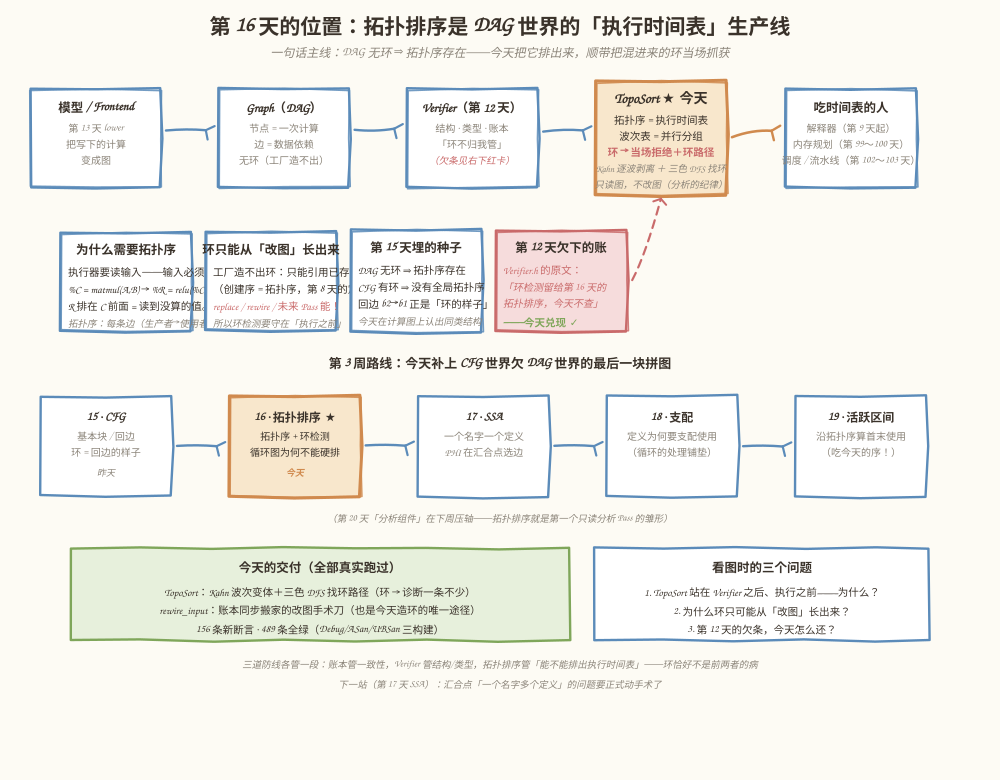
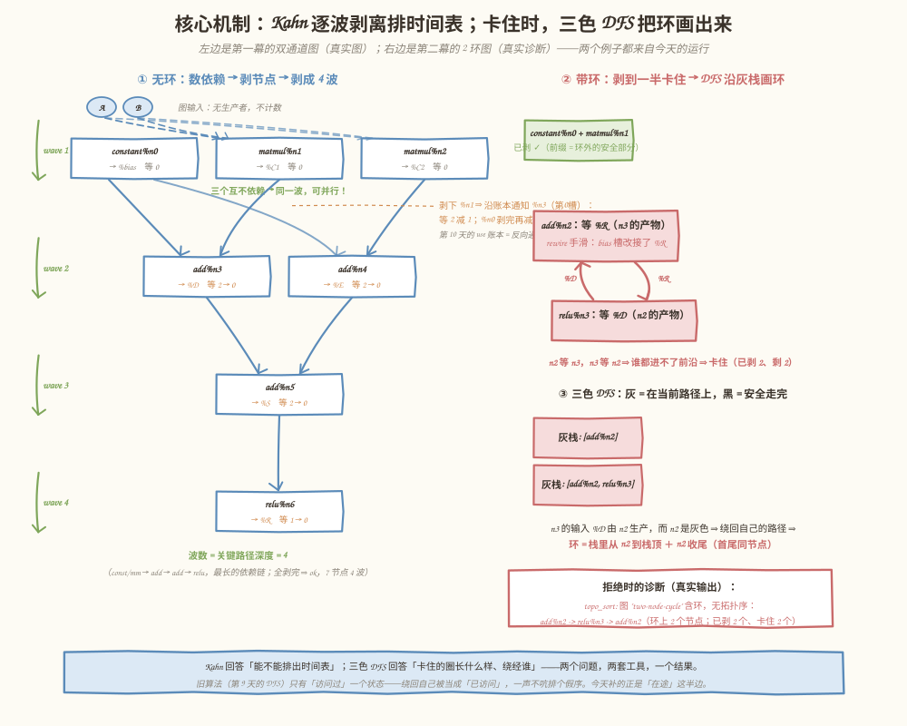
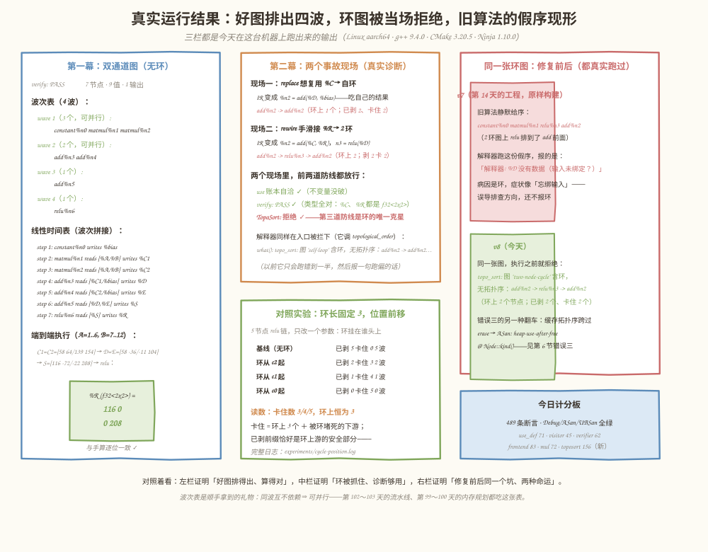

# 第 16 天：拓扑排序与依赖检查——给 DAG 一张可信的执行时间表

> **今日目标**：能脱稿讲清「拓扑排序在排什么、环为什么排不出来、环图的正确出路是什么」；在 `mini-graph-v8` 里实现 Kahn 波次变体的拓扑排序＋三色 DFS 环检测，环图当场拒绝并画出完整环路径；用 `rewire_input` 亲手造出 1 环、2 环、3 环、5 环，验证「已剥前缀 / 卡住 / 环上」三组读数各自的含义；最后用「环长固定、位置前移」的对照实验，把「卡住 ≠ 环上」这个最易读错的诊断字段弄明白。
> **预计时间**：学习 40 分钟 ＋ 实践 50 分钟
> **前置准备**：第 8 天（只能引用已存在的值 ⇒ 创建序即拓扑序）、第 9 天（解释器按拓扑序执行）、第 10 天（use 账本）、第 12 天（Verifier 的职责边界——它明确说「环检测留给第 16 天」）、第 15 天（CFG 的回边长什么样）。构建环境同前（CMake ≥ 3.16、Ninja、g++ 或 clang++）。工程从 v7 复制，`Value`／`Node`／`Graph` 的既有接口一行不改。
> **今日产出**：`mini-graph-v8` 工程（新增 `TopoSort` 组件＋`rewire_input` 改图入口＋**156 条新断言**，71＋45＋62＋83＋72＋156 共 489 条断言在 Debug／ASan／UBSan 三构建全绿）；一整套可运行的环检测现场（replace 自环、rewire 2 环、测试里的 3 环与 5 环）；三个反面教材（旧算法静默假序、合法 replace 造自环、拓扑序缓存跨 erase 的 ASan 现场）；环位置对照实验与日志；在第 14 天的 v7 工程上实测的「修复前」误导错误。

## 1. 今天解决什么问题？

两笔账今天一起还。第一笔记在第 12 天的 `Verifier.h` 里，原文白纸黑字：**「边界：环检测留给第 16 天的拓扑排序，今天不查。」**第二笔记在第 15 天的预告里：**「DAG 无环所以拓扑序存在，CFG 的回边正是环的样子。」**今天是第 3 周里唯一回到 `mini-graph` 主线的一天，干的正是这两件事：把「拓扑序存在」变成一台真机器（拓扑排序器），把「回边的样子」变成一道真防线（环检测）。

再看一个今天必须直面的旧坑。`topological_order()` 从第 9 天写下、一路沿用至今：一个记忆化 DFS，访问过的直接返回——**它没有环检测**。在环图上它不报错、不崩溃，而是**静默返回一份假序**。今天在本仓库第 14 天的 v7 工程上原样构建实测（`replace_all_uses_of` 造出自环后调用）：

```text
v7 旧算法给出的序： constant%n0 matmul%n1 add%n2 relu%n3
v7 解释器报错: 解释器: %D 没有数据（输入未绑定？）
```

病因是**图有环**，症状却像**忘了绑输入**——错误消息把排查方向整个带偏。而且这不是理论推演：工厂函数造不出环（第 8 天定理：只能引用已存在的值），所以这个洞在纯工厂流程里永远看不见；一旦明天开始写 Pass、或者解析器读入外部 IR，「环」就会从改图的那条缝里钻进来。

贯穿全文的例子有两张。**好图**是第一幕的双通道网络：`Y = relu((A×B + bias) + (A×B + bias))`——两个 matmul 吃同样输入（互不依赖，天生同波），汇合、再加 bias、过 relu，共 7 个节点；手算 `A=[1,2,3;4,5,6]`、`B=[7,8;9,10;11,12]` 时每路 `C=[58,64;139,154]`。**坏图**由同一条经典链 `bias + A×B → add → relu` 被两种真实事故改出来：一个想「复用中间结果」的 `replace` 造出自环；一次手滑的 `rewire` 造出 2 环。今天结束时，好图得到波次表与执行时间表，坏图在执行之前被拒绝、并附上完整环路径。

## 2. 先看全貌：今天的内容位于哪里？



**图 1**：看四块。顶部流水线里 `TopoSort` 站在 Verifier 之后、执行之前——这位置是刻意的：结构／类型问题先让 Verifier 拦，剩下的图结构上已经「合法」，拓扑排序要回答的是另一件事：**能不能排出执行时间表**。中间四张卡是今天的动机：为什么需要拓扑序、环为什么只能从改图长出来、第 15 天埋的两颗种子、第 12 天的欠条（红色虚线箭头直指今天的主角）。底部是第 3 周路线——第 19 天的活跃区间、第 20 天的分析 Pass 都要吃今天的序，第 102～103 天的流水线要吃今天的波次表。

今天的路线分 4 步：

1. **想清楚**：拓扑序排的是什么、环图为什么无解（3 节）；
2. **动手**：`TopoSort` 组件（Kahn 波次变体＋三色 DFS）、`rewire_input` 手术刀（5.1～5.2 节）；
3. **验收**：好图四波全绿、环图三种现场全被拒、489 断言三构建（5.3 节）；
4. **对照**：环长固定、位置前移——读数变化的只有「已剥／卡住」（5.4 节），再收走四个常见错误（第 6 节）。

## 3. 核心概念：先用直觉，再给准确定义

### 3.1 拓扑排序：把偏序拉成一条线

一句通俗解释：**拓扑排序（topological sort）**就是把「谁依赖谁」的网状关系拉直成一条队列——队里每个人都排在它所有依赖的后面。

生活类比：穿衣服。袜子必须在鞋之前、内衣在外衣之前，但袜子和衬衫谁先无所谓——任何一种满足全部先后约束的穿法都是合法的拓扑序。**对应到技术上是**：对 DAG 的节点排一个线性序，使**每条边 u→v（u 生产、v 使用）都满足 u 在 v 前面**。今天图上的一条边就是「值的生产者 → 使用者」，所以拓扑序正是第 9 天以来解释器一直在按它执行的那张**执行时间表**。

**类比的边界**：穿衣服的约束是成对的先后关系，拓扑排序处理的是同样的偏序，但有两个衣服没有的性质。其一，**拓扑序通常不唯一**——双通道图里 `matmul%n1` 和 `matmul%n2` 谁先谁后都合法，所以断言「排序结果必须等于某个具体序列」的测试是脆弱的，正确断言是「每条边都从左到右」（今天测试里的 `is_valid_topo_order` 干的就是这件事）。其二，**拓扑序存在当且仅当图无环**——衣服的先后关系天然无环，计算图却不一定，这就引出第二个概念。

### 3.2 环检测：循环图为什么「排不出来」

直觉上，环就是「鸡生蛋、蛋生鸡」：环上每个节点都在等别人的结果当输入，谁都不可能第一个执行。这句直觉可以一句话变成证明：假设环上存在一个拓扑序，取环上**排在最前**的节点 v，它的环内前驱 u 也必须在 v 之前——矛盾。所以**有环 ⟺ 无拓扑序**，不是「难排」，是数学上**不存在**。

那能不能「硬排」？v7 的旧算法就是反面教材：它把「绕回自己」当成「已经访问过」，一声不吭塞给你一个假序（第 1 节的实测），解释器跑到一半报一句跑偏的话。**正确的工程答案是拒绝执行＋报出环路径**——宁可停在门口，不要错在半路。

最后回答计划里那句「为什么循环图不能直接按普通拓扑序执行」的现实版：真实计算里确实有循环——RNN 沿时间步重复同一段计算。业界的做法不是给环硬排序，而是二选一：**沿时间展开**（unroll，T 步就是 T 份复制，每份之间是普通数据依赖——整体又成了 DAG）；**把循环显式化**（IR 里引入 while/loop 结构，循环体内部是一张小 DAG 单独排拓扑序，跨迭代的值交给控制流和 PHI 搬运）。第 15 天的 CFG（`b2 → b1` 回边）正是后者的地基；第 17 天的 SSA 会在汇合点补上「选边」的那块板。

### 3.3 Kahn 的波次变体：一次剥一波

**Kahn 算法**（1962）一句话：反复找出「所有依赖都已就绪」的节点，剥下来排进结果；每剥一个，就通知它的使用者把等待计数减一；全部剥完 = 拓扑序，剥到一半剥不动 = 有环。像剥洋葱——每次剥掉最外层必然露出来的那圈。

今天的实现有一个刻意的小变体：**不是一次剥一个，而是一波剥一组**。同一波里的节点互不依赖（谁的依赖都在更早的波里），于是波次表直接就是**最朴素的并行调度表**——第 1 波的三个节点扔进三个核同时算，不会有人读到没算好的值。由此还有一条好性质：**波数 = 关键路径深度**（最长依赖链的长度），双通道图 4 波，因为 `const/mm → add → add → relu` 这条最长的链要走 4 步；而就算核多到无限，4 波也是不可再少的墙——并行度的天花板由依赖结构决定，不由硬件决定。

实现上最舒服的一点：**Kahn 的「反向通知」直接复用第 10 天的 use 账本**。正向读依赖走 `Node::inputs()`；剥掉一个节点要通知谁，走它的结果值 `users()` 账本——每条 `(user, slot)` 记录恰好让 `user` 减一次，连重复槽位（`add(%C, %C)` 计 2，剥 `C` 时按两条记录减两次）都自动对消。账本在第 10 天是「改不出错」的保险，今天第一次当**算法的数据结构**用。

## 4. 图解核心机制



**图 2**：左右两栏分别是第一幕好图和第二幕坏图的机器内部。按编号读：

1. **左（无环）**：每个节点先数「等待计数」——有生产者的输入槽计 1，图输入不计。计数为 0 的节点（常量、吃图输入的两个 matmul）组成第 1 波；剥完第 1 波，`add%n3/%n4` 的计数 2 减成 0，进入第 2 波；如此剥完 4 波。橙色标注是账本工作的一瞬：剥下 `matmul%n1`，沿 `%C1` 的账本通知 `%n3` 的第 0 槽——等 2 减 1。
2. **右（带环）**：rewire 之后 `add%n2` 等 `relu%n3`、`relu%n3` 等 `add%n2`，谁的计数都到不了 0——**前沿空了、节点没剥完**，Kahn 就此判定有环（已剥 2、卡住 2，已剥的前缀恰好是环外的安全部分）。
3. **右下（找环路径）**：三色 DFS——**白**没碰过、**灰**在当前路径上、**黑**安全走完。走到「灰」节点 = 绕回了自己这条路径：灰栈 `[add%n2]` → `[add%n2, relu%n3]` → `%n3` 的输入 `%D` 由 `n2` 生产、而 `n2` 是灰 ⇒ 栈里从 `n2` 到栈顶加 `n2` 收尾，就是环路径。旧算法缺的正是「灰」这半边状态：它只有「访问过」，绕回自己被当成已访问，于是排假序。

## 5. 动手实践：TopoSort 组件与三幕现场

> 本节所有命令与输出都在这台机器上真实执行过：
> Linux aarch64（Ubuntu 20.04）· g++ 9.4.0 · CMake 3.20.5 · Ninja 1.10.0。
> 完整工程在本仓库 `tutorials/day-016/examples/mini-graph-v8/`，由第 14 天的 v7 复制而来——除 `Graph` 的两处改动（`topological_order` 委托 TopoSort、新增 `rewire_input`）和 `Verifier.h` 里把「欠条」注释改为「已兑现」的两行说明外，其余文件一行未改；v7 的五个测试文件原样保留继续跑。

### 5.1 准备文件

```text
tutorials/day-016/examples/mini-graph-v8/
├── CMakeLists.txt               # 同第 8～14 天：Debug 默认 ＋ ENABLE_ASAN / ENABLE_UBSAN
├── src/
│   ├── TopoSort.h / TopoSort.cpp  # ★ 今天的主角：Kahn 波次变体＋三色 DFS＋诊断消息
│   ├── Graph.h / Graph.cpp         # topological_order() 改为委托 TopoSort（环图抛异常）
│   │                               # ＋ 新增 rewire_input：账本同步搬家的改图手术刀
│   └── （其余九个文件从 v7 原样复制）
├── tests/
│   ├── test_toposort.cpp          # ★ 156 条断言：排序/波次/环/改图/防线联动 五组
│   └── （v7 的五个测试原样保留：71＋45＋62＋83＋72）
├── bugs/
│   ├── err_silent_bogus_order.cpp # ★ v7 旧算法原样拷贝：环图上静默给假序
│   ├── err_replace_self_loop.cpp  # ★ 合法的 replace 静默造出自环
│   └── err_stale_topo_cache.cpp   # ★ 拓扑序缓存跨 erase → ASan 抓 use-after-free
└── experiments/
    ├── cycle_position.cpp         # ★ 环长固定 3、位置前移的对照实验
    ├── cycle-position.sh           # 一键编译运行（日志写进 cycle-position.log）
    └── cycle-position.log          # 真实运行结果
```

### 5.2 编写代码

**`TopoSort.h`：结果是报告，不是异常。** 对外只有三样：`topo_sort(g)` 返回 `TopoSortResult`（`ok`／`order` 线性序／`waves` 波次表／`cycle` 环路径／`peeled`／`stuck`），`cycle_to_string` 打印环路径，`topo_error_message` 翻译成人话。刻意**不抛异常**——测试要逐字段检查诊断，调用方要自己决定怎么处理（`Graph::topological_order()` 那层才是「要序号、不要诊断」的便捷外壳，它抛）。这个「报告 vs 异常」的分层同第 12 天的 Verifier 一模一样。

**`TopoSort.cpp` 的主循环：逐波剥离。** 等待计数按「有生产者的输入槽」统计；前沿不为空就整波收编、沿账本减计数、减到 0 的进下一波：

```cpp
while (!frontier.empty()) {
    result.waves.push_back(frontier);
    std::vector<const Node*> next;
    for (const Node* n : frontier) {
        const Value* out = n->result();
        //（这里还有一行空指针防御，完整实现见 TopoSort.cpp）
        for (const Use& u : out->users()) {          // 第 10 天的账本：反向通知
            const auto it = pending.find(u.user);
            if (it == pending.end() || it->second <= 0) {
                continue;  // 使用者不在本图（Verifier 的活），防野账本
            }
            if (--it->second == 0) {
                next.push_back(u.user);
            }
        }
    }
    frontier = std::move(next);
}
// 拼出线性序；剥不满 ⇒ ok = false ⇒ 跑 find_cycle 补环路径
```

**`find_cycle`：三色 DFS。** 白→灰→入栈；邻接边走「输入槽的生产者」（且生产者属于本图——跨图指针是 Verifier 第 12 天的属地，这里不越权、也不把别人的节点画进我们的环）；**命中灰节点即收工**——栈里从它第一次出现的位置到栈顶，加上它自己收尾，环路径首尾同节点。找不到环（比如只是依赖了不属于本图的值）返回空，诊断走「无法调度」分支——**宁可拒绝，绝不悄悄给错序**。

**`Graph::rewire_input`：今天唯一的改图入口。** 三步搬账本（旧值注销记录、新值登记、槽位改指向），不变量任何时刻成立；刻意**不查类型、不查环**——同 `add_raw_node` 一份合同：Pass 负责 legality，Verifier 兜类型，TopoSort 兜环。它也是今天所有环测试的唯一造环途径：**工厂造不出环，环只会从改图里长出来**——这句话在 3.2 节是数学，在这里变成了 API 设计。

### 5.3 运行与观察

```bash
cd tutorials/day-016/examples/mini-graph-v8
cmake -S . -B build -G Ninja && cmake --build build
./build/src/mini-graph-v8
```

第一幕的真实输出（对照图 2 读四个关键处）：

```text
== 拓扑排序（TopoSort：逐波剥离） ==
  ok = 1，4 波 · 7 个节点（波数 = 关键路径深度）
  wave 1（3 个，可并行）: constant%n0 matmul%n1 matmul%n2
  wave 2（2 个，可并行）: add%n3 add%n4
  wave 3（1 个）: add%n5
  wave 4（1 个）: relu%n6

== 执行时间表（波次拼接成线性序） ==
  step 1: constant%n0 reads [] writes %bias
  step 2: matmul%n1 reads [%A, %B] writes %C1
  ...
  step 7: relu%n6 reads [%S] writes %R

== 端到端执行（解释器按拓扑序求值） ==
  %R (f32<2x2>) =
    116 0
    0 208
```

（时间表 step 3～6 与 IR 一一对应，中间三行省略；`verify: PASS（7 个节点、9 个值、1 个输出，全部检查通过）`。）四个读数各有含义：两波多节点（1 波 3 个、2 波 2 个）证明「同波可并行」不是口号；`116 0 / 0 208` 与手算逐位一致；执行时间表 7 步的 `reads/writes` 每一步的输入都已在前面的步骤里写过。

第二幕的真实输出（两个事故现场；省略 IR 正文与 use 表，完整输出可自行运行程序查看）：

```text
现场一：Pass 想复用结果，replace_all_uses_of(%C, %D)——自环诞生
  verify: PASS（4 个节点、6 个值、1 个输出，全部检查通过）
  （环不归 Verifier 管——账本一致、类型正确，它如实放行）
  topo_sort: 拒绝（ok = 0）
  环路径: add%n2 -> add%n2（环上 1 个节点）
  已剥 2 个（前缀： constant%n0 matmul%n1）、卡住 2 个
  解释器想按拓扑序执行——入口处就被拦下：
  what(): topo_sort: 图 "self-loop" 含环，无拓扑序：add%n2 -> add%n2（环上 1 个节点；已剥 2 个、卡住 2 个）

现场二：rewire_input 手滑——n2 的 bias 槽改接 %R，环长 2
  verify: PASS（4 个节点、6 个值、1 个输出，全部检查通过）
  （类型全对：%C 和 %R 都是 f32<2x2>，逐元素检查照样通过）
  topo_sort: 拒绝（ok = 0）
  环路径: add%n2 -> relu%n3 -> add%n2（环上 2 个节点）
  已剥 2 个（前缀： constant%n0 matmul%n1）、卡住 2 个
```

对照读三件事：第一，**两个现场的 verify 都是 PASS**——账本自洽（不变量没破）、类型全对（`%C`、`%R` 同为 `f32<2x2>`），环根本不在前两道防线的职责清单里；第二，**`Graph::topological_order()` 的异常带着完整环路径**，解释器从第 9 天起就调它，于是整条执行链今天自动获得了环防护；第三，`use` 表里 `%C` 的 uses 变成「（无）」、`%D` 的 uses 变成两条（原住民 relu＋新搬来的 add 自己）——replace 的账本搬家一丝不乱，**账本一致性与图无环是两件独立的事**，前者由第 10 天的不变量保证，后者今天才有人管。

测试与三构建（全部真实执行）：

```bash
ctest --test-dir build --output-on-failure
cmake -S . -B build-asan -G Ninja -DENABLE_ASAN=ON && cmake --build build-asan
ctest --test-dir build-asan --output-on-failure
cmake -S . -B build-ubsan -G Ninja -DENABLE_UBSAN=ON && cmake --build build-ubsan
ctest --test-dir build-ubsan --output-on-failure
```

真实结果（`#` 后为笔者标注）：

```text
100% tests passed, 0 tests failed out of 6      # Debug，6/6
100% tests passed, 0 tests failed out of 6      # ASan，19.65 sec
100% tests passed, 0 tests failed out of 6      # UBSan
```

再逐个运行六个测试可执行文件（`./build/tests/test_*`），各自打印自己的账本：`use_def 71 · visitor 45 · verifier 62 · frontend 83 · mul 72 · toposort 156`——489 条断言，三个构建各跑一遍全绿。

156 条新断言分五组：**排序正确性**（经典链／双通道／重复槽位 `add(%C,%C)`／恒等图／死节点照排／确定性——都用 `is_valid_topo_order` 的「每条边从左到右」来断言，不断言具体序）；**波次性质**（同波两两互不依赖、波数＝关键路径深度 4、汇合点晚于全部生产者）；**环检测**（自环／2 环／3 环／5 环／环＋下游：卡住 4 而环上 3／独立分支照剥：peeled 1）；**改图路径**（合法 rewire 的账本搬家、三重守卫、创建序在改图后失效、合法 replace、erase 后重排、跨图依赖「宁可拒绝不冒充环」）；**防线联动**（`topological_order` 抛异常带环路径、解释器拒绝执行、图名进诊断）。



**图 3**：三栏都是今天这台机器上的真实输出。左栏是第一幕的波次表、7 步时间表和 `[116 0 / 0 208]`；中栏是第二幕两份诊断和「三道防线」的分工——账本自洽 ✓、verify PASS ✓、TopoSort 拒绝 ✓；右栏是修复前后的命运对照（v7 假序＋误导错误 vs v8 拒绝＋环路径）和环位置实验读数，底部计分板是今天的全部数字。

### 5.4 修改一个参数再观察：环长固定 3，位置前移

只改一个参数：把 5 节点 relu 链上「被改的节点」从 `c2` 前移到 `c1` 再到 `c0`（环长恒为 3）。一键复现：

```bash
bash experiments/cycle-position.sh
```

真实日志（`experiments/cycle-position.log`）的核心三行：

```text
  环位置   环路径                                          已剥  卡住  波数
  基线     （无环基线）                                    5     0     5
  c2 起    relu%n2 -> relu%n4 -> relu%n3 -> relu%n2       2     3     2
  c1 起    relu%n1 -> relu%n3 -> relu%n2 -> relu%n1       1     4     1
  c0 起    relu%n0 -> relu%n2 -> relu%n1 -> relu%n0       0     5     0
```

三个观察结论，全部来自真实运行：

1. **环长都是 3，卡住数却是 3／4／5**——卡住 = 环上 ＋ 被环堵死的下游，诊断里「环上 N 个」才是环长；把卡住数当环长读，这张表会读出三个不同的「环」；
2. **已剥的 2／1／0 个恰好是环上游的安全前缀**——它们不依赖环，本可以安全执行；部分序本身就是诊断（「剥到第几步开始转圈」）；
3. **基线 5 波**：链上每个节点自成一波，关键路径深度 5——环一旦前移到链头，连第 1 波都凑不出来。

## 6. 常见错误与排查

三个反面教材都在 `bugs/` 下真实复现过（编译运行命令写在各文件头部注释里，均以 ASan 构建）。错误四来自实验读数。

**错误一：环图上旧算法静默给假序——症状被伪装成「忘绑输入」（`bugs/err_silent_bogus_order.cpp`）**

- 现象：v7 的 `topological_order`（原样拷贝）在 2 环图上不报错，给出 `constant%n0 matmul%n1 relu%n3 add%n2`——审计发现 1 条违例：`relu%n3` 的输入 `%D` 由 `add%n2` 生产，生产者排在了使用者后面。本仓库 v7 工程实测的下游后果：解释器报「`%D` 没有数据（输入未绑定？）」。
- 原因：记忆化 DFS 只有「访问过」一个状态，绕回自己（环）被当成已访问直接返回——没有「在途」（灰）这半边。
- 定位：今天 bug 程序里的 `audit_order` 逐边检查「生产者是否在使用者前面」，违例条数当场点破假序；再跑 v8 的 `topo_sort` 对出环路径 `add%n2 -> relu%n3 -> add%n2`。
- 修复与教训：三色状态（白／灰／黑）是环检测的最小完备工具。**执行器入口必须用带环检测的排序**；症状在执行器、病根在 IR 时，先 dump 图、查依赖，别急着怀疑绑定。

**错误二：一个「完全合法」的 replace，静默造出自环（`bugs/err_replace_self_loop.cpp`）**

- 现象：`replace_all_uses_of(%C, %D)` 之后 IR 变成 `%n2 = add(%D, %bias)`——add 吃起了自己的结果。账本自洽（`%D` 两条 use、`%C` 零条 use）、`verify: PASS`、类型全对。
- 原因：replace 的合同只管「账本搬家＋类型一致」，不管图是否成环——`%D` 的生产者恰好是 `%C` 的使用者时，一条合法的改图操作就造出了环。**环不是结构／类型／账本问题，前两道防线看它如无物**。
- 定位：`topo_sort` 拒绝，环路径 `add%n2 -> add%n2`（环上 1 个节点）；解释器入口同样被拦（它调 `topological_order`）。
- 修复与教训：写 Pass 时问自己一句「我的替换值会不会被它自己的生产者消费」；这道防线放在 IR 层（排序／验证），比放在每个 Pass 里各查一遍便宜得多——这正是 MLIR 把支配性检查放进 Verifier 的理由。

**错误三：拓扑序是派生视图——缓存它跨过一次改图（`bugs/err_stale_topo_cache.cpp`）**

- 现象：调度器先 `topological_order()` 缓存时间表，随后 Pass 删掉死节点；调度器继续用旧表执行，第 4 步就踩到悬垂指针。ASan 当场开火（真实运行）：

```text
排好的时间表（5 个节点）: constant%n0 matmul%n1 add%n2 relu%n4 relu%n3
Pass 删除死节点 dead%n4 后，图里剩 4 个节点——但缓存的时间表没重排
调度器按旧时间表执行:
  step 1: constant%n0 writes %bias
  step 2: matmul%n1 writes %C
  step 3: add%n2 writes %D
=================================================================
==772598==ERROR: AddressSanitizer: heap-use-after-free ...
    #0 ... in Node::kind() const ../src/Node.h:24        ← 读已释放的节点（bug 第 55 行）
    #7 ... in Graph::erase_node(Node*) ../src/Graph.cpp:265 ← 释放点（bug 第 46 行调用）
```

（帧号与地址随构建变化，`#` 后为笔者标注；关键事实是 `Node::kind()` 读到了 `erase_node` 释放的内存。）

- 原因：拓扑序是「图在当前状态下的推导结果」，`erase_node` 之后旧序里还躺着已析构节点的指针——第 10 天写在合同里的「删除后指针失效」在更高的抽象层又咬了一次。不开 ASan 时可能悄悄跑过（内存还没被复用），改天换个分配顺序才爆。
- 定位：ASan 报告直接点名 `Node::kind()` 读已释放内存、释放者是 `Graph::erase_node`。
- 修复与教训：**改图（replace／rewire／erase）之后必须重排**。第 15 天「前驱表是派生视图，改边要重算」是同一课；第 20 天「分析结果失效」会把这件事制度化为失效位。

**错误四：把「卡住数」当「环长」读（读数陷阱，来自 5.4 节实验）**

- 现象：5.4 节的表里三张图环长都是 3，卡住数却是 3／4／5。若按「卡住几个 = 环上几个」读，会把 `c1 起` 报告成 4 环、`c0 起` 报告成 5 环。
- 原因：卡住 = 环上节点 ＋ **被环堵死的下游**——下游节点自己不在环里，只是它的依赖永远等不来。
- 定位：环路径首尾同节点，数**去重后**的节点个数才是环长；诊断消息里「环上 N 个」已经是去重后的数，直接用它。
- 修复与教训：读诊断先分清三个字段——`环上`（环长）、`已剥`（环上游安全前缀）、`卡住`（环上＋下游）；写自动分析工具时同样别拿 `stuck` 去除以任何东西。

## 7. 今日练习

### 必做练习

合上教程，先在纸上造一张 5 节点图：`%x` 是 `f32<2x2>` 图输入；`n1 = relu(%x)` 得 `%v1`；`n2 = mul(%v1, %v1)` 得 `%v2`；`n3 = add(%v2, %v1)` 得 `%v3`；`n4 = relu(%v3)` 得 `%v4`（图输出）；`n5 = relu(%v2)` 得 `%v5`（死节点，不作输出）。预测四件事再动手：① 无环时的波次表（几个节点在哪几波——`n3` 和 `n5` 会在同一波吗？）；② 关键路径深度；然后 `rewire_input(n1, 0, %v4)`，③ 已剥／卡住各是多少；④ 环路径是哪一条（提示：环不止一条——`n1→n4→n3→n1` 和 `n1→n4→n3→n2→n1` 都成环，DFS 只报告它先碰到的那条；想想它先沿 `n3` 的哪个输入槽走）。最后在 `mini-graph-v8` 里跑 `topo_sort` 对答案。预期产出：四条纸面预测＋一段 20 行左右的验证代码＋一个「为什么报告的是 4 环而不是 3 环」的解释（答案跟输入槽的遍历顺序有关——`n3` 先看第 0 槽 `%v2`，于是先走进 `n2`）。

### 选做挑战

把 `find_cycle_dfs` 里「遍历输入槽」的循环改成**倒序**（从最后一个槽往前看）。先在纸上预测：必做练习那张图上，报告的环会变成哪一条（`n3` 这次先看第 1 槽 `%v1`，直接撞上灰色的 `n1`）。跑通后回答两个问题：两条环路径都正确吗（都首尾闭合、都真实成环）？「环检测报一条就停」和「环路径唯一」为什么是两回事？——顺手想一层：如果要**列出全部环**，最小改动是什么（找到一条后记录下来、不立即返回，继续换起点搜）？不用实现，写下思路即可。

## 8. 今日验收

- [ ] 我能不看笔记说清拓扑排序排的是什么（每条边从左到右的线性序）、环图为什么不是「难排」而是「不存在」（反证：取环上最前者，其环内前驱必须更前——矛盾），以及 RNN 这类真循环的两条出路（时间步展开／显式控制流）；
- [ ] 我能独立从空目录构建 `mini-graph-v8`，跑通 489 条断言（Debug／ASan／UBSan 三绿），并解释为什么测试断言「每条边从左到右」而不是「等于某个具体序」；
- [ ] 我能解释 Kahn 波次变体的三件事：等待计数怎么数（含 `add(%C,%C)` 的重复槽位）、「沿账本通知」怎么复用第 10 天的账本、波数为什么等于关键路径深度；
- [ ] 我能用 `rewire_input` 亲手造出 1 环、2 环、3 环并预测三组读数（环上／已剥／卡住），并说出「卡住 ≠ 环上」的原因（下游也被堵死）；
- [ ] 我能定位今天的四类错误：旧算法静默假序（症状伪装成忘绑输入，怎么审计）、合法 replace 造自环（为什么前两道防线看不见它）、拓扑序缓存跨改图（ASan 怎么点名、为什么必须重排）、把卡住数当环长（正确读法是哪三个字段）；
- [ ] 我保存了 `mini-graph-v8` 工程、156 条新断言、三个 bugs 反面教材、`cycle-position.log`、v7 实测输出，以及必做练习的四条纸面预测。

## 9. 一句话总结与明天预告

今天的核心动作是给 DAG 世界补上「执行时间表」这道总闸：Kahn 的波次变体把无环图剥成 4 波（波次表顺手成为并行调度表，波数＝关键路径深度＝并行度的结构上限），三色 DFS 把混进来的环连路径一起画出来（`add%n2 -> relu%n3 -> add%n2`）——环不是结构、类型或账本问题，账本自洽、verify PASS，它是「能不能排出执行时间表」的问题，所以守闸人只能是拓扑排序。`rewire_input` 第一次演示了环的真实来源：工厂造不出环，环只从改图里长出来（合法的 replace 也能造出自环）；而 `topological_order()` 的改造让解释器自第 9 天写下的那条调用链**自动**获得了环防护——v7 实测的「`%D` 没有数据（输入未绑定？）」那种把病因伪装成症状的错误，今天起在门口就被正确的话挡回去。环位置实验把三组读数（环上 3、卡住 3／4／5、已剥 2／1／0）各自的含义钉死：**卡住是环＋下游，已剥是安全前缀，环长看路径去重**。

明天第 17 天进入 SSA：第 15 天留下的那个问题——汇合点的 `u` 有两个定义、静态看不出走哪条——终于要动手术了：一个名字一个定义、PHI 在汇合点选边。今天的时间表和账本都会跟着升级：SSA 让「定义」有了唯一的名字，拓扑序上的每一步从此可以问「这个值是谁生产的」而不必再查两遍。
