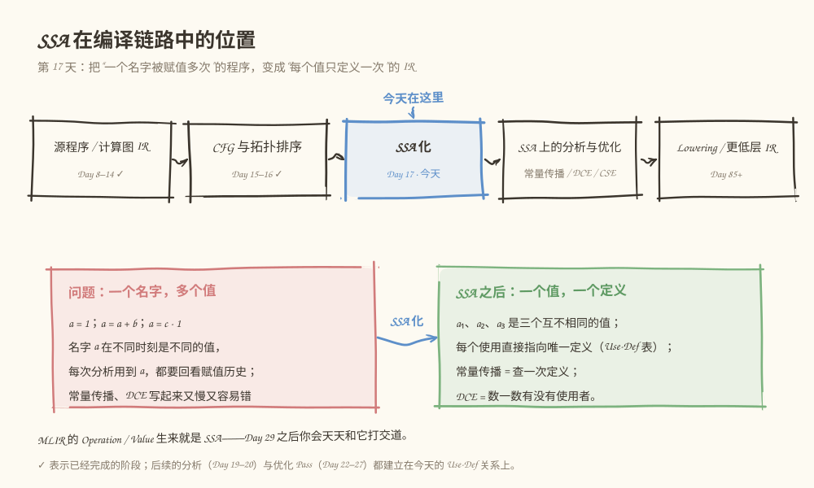
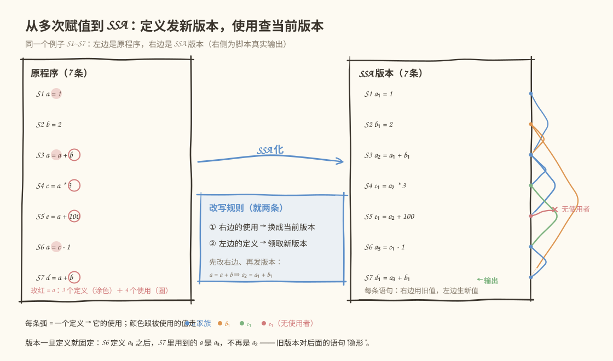
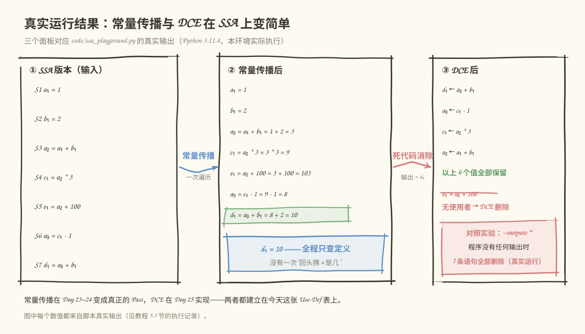

# 第 017 天：让每个值只出生一次——SSA 基础

> **今日目标**：读完本教程并完成实践后，你能把一段多次赋值的程序亲手改写成 SSA（Static Single Assignment，静态单赋值）形式，列出每个值的定义和使用位置（Use-Def 对照表），并用可运行脚本验证改写、跑通常量传播和死代码消除。
> **预计时间**：学习 35 分钟 + 实践 40 分钟
> **前置准备**：Python 3（本教程用 3.11.4 实测）；回顾 Day 10 的 Use-Def 关系（"谁定义了这个值、谁用了它"）和 Day 16 的拓扑排序（"先执行谁"）。
> **今日产出**：一段原程序、手工完成的 SSA 版本和 Use-Def 对照表，以及 `code/ssa_playground.py` 的真实运行记录。

## 1. 今天解决什么问题？

先看一段只有 7 条赋值语句的小程序，后面整天都会用它：

```text
S1  a = 1
S2  b = 2
S3  a = a + b
S4  c = a * 3
S5  e = a + 100
S6  a = c - 1
S7  d = a + b
```

问一个问题：**S4 里的 `a` 到底是哪个 `a`？** 名字只有一个，但值有多个——它用的是 S3 定义的那个 `a`，不是 S6 的。要回答"这里用的是什么值"，你必须往回扫描，找到"最近一次赋值"，而且每个使用点都得重复这个过程。

这对编译器是实打实的麻烦。第 4 周要写的常量传播 Pass 需要回答"这个使用对应的定义是不是常量"，死代码消除（DCE）需要回答"这个定义还有没有人用"。在"一个名字多次赋值"的程序上，这两个问题都要先做一次"到达定义分析"才敢回答，又慢又容易写错。

**前置补给**：Day 10 我们已经在图 IR 里实现过 Use-Def 关系——每个值记录定义者和使用者列表。但那时一个名字可以有多个定义点，"使用"和"定义"之间是多对多。今天的 SSA 把它收紧成一对一：每个使用点都精确指向唯一一个定义。昨天（Day 16）解决了"按什么顺序执行"，今天解决"每个值到底从哪来"。

## 2. 先看全貌：SSA 在编译链路中的位置



**图 1**：看这张图时注意两点——SSA 化处在"结构分析"和"优化 Pass"之间；玫红框是今天的问题（一个名字多个值），绿框是 SSA 化之后的效果（一个值一个定义）。

全局流程一共五步，今天只做第三步：

1. 前端把源程序/模型变成计算图 IR（Day 8–14，已完成）；
2. 给图配上 CFG 与拓扑排序，知道执行顺序（Day 15–16，已完成）；
3. **SSA 化：改写 IR，让每个值只定义一次（今天）**；
4. 分析与优化直接查 Use-Def 表：活跃区间（Day 19–20）、常量传播（Day 23–24）、DCE（Day 25）；
5. 往后 Lowering 到更低层 IR（Day 85+）；另外，Day 29 起要学的 MLIR，其 Operation/Value 体系天生就是 SSA。

## 3. 核心概念：SSA 到底是什么

SSA 全称 Static Single Assignment（静态单赋值），是一种 **IR 的性质**，不是一种语言、也不是一个工具。满足 SSA 的 IR 里，每个值只被定义（赋值）一次。

### 3.1 单赋值：一次定义，终身不变

- **通俗解释**：每个值出生时领一个终身的"身份证号"，号码和内容永不更换；想产生新值，只能去领一个新号，而不是涂改旧号。
- **一个类比**：像问卷回收——每人只交一份、统一编号，之后任何人引用"3 号问卷"，指的都是同一份原件，没人能改别人交上来的内容。**对应到技术上是**：SSA 名字就是值本身（比如 `a₁`），定义点就是它的出生地，之后任何语句想更新 `a`，都只能定义新版本（`a₂`、`a₃`），旧版本原样保留。类比的边界在于：问卷是"人"的一次性，而 SSA 针对的是"值"，且它限制的是编译器内部的 IR，不是你写的源代码。
- **最小例子**：

  ```text
  源程序        SSA 版本
  a = 1    →    a₁ = 1
  a = a + b    a₂ = a₁ + b₁
  ```

- **常见误解**："SSA 表示程序不能给变量赋第二次值。" 恰恰相反，第二次赋值被表达成了 `a₂ = a₁ + b₁` 这样一条新的定义——赋值次数没有减少，只是每次赋值都生成了一个全新的、独一无二的名字。

### 3.2 定义与使用：Use-Def 从"多对多"变"一对一"

沿用同一例子。SSA 化之后，程序里每个值都可以列出一张精确的表：

| SSA 值 | 定义于 | 使用于 |
|---|---|---|
| `a₁` | S1 | S3 |
| `b₁` | S2 | S3、S7 |
| `a₂` | S3 | S4、S5 |
| `c₁` | S4 | S6 |
| `e₁` | S5 | （无人使用） |
| `a₃` | S6 | S7 |
| `d₁` | S7 | （程序输出） |

- 在 Day 10 的非 SSA 图里，"使用 `a`"要问"`a` 的哪一个定义"；SSA 里 `a₂` 的使用永远指向 S3 这一条定义，**"使用 → 定义"是一条唯一的边**。
- 这张表就是后面所有分析（Day 19 活跃区间要的"首次/最后使用位置"）和优化（常量传播、DCE）的共同地基。
- **一个重要边界**：今天只处理直线代码（没有分支汇合）。如果两个分支各自定义了 `a₂` 和 `a₃`，汇合后该用哪个版本？这需要 **φ（phi）函数**，它和 Day 18 的支配关系绑定在一起，今天不展开，你也暂时不需要它。

### 3.3 SSA 对常量传播、DCE 的帮助（先看直觉）

为什么优化在 SSA 上更好写？看两个第 4 周就要实现的 Pass：

- **常量传播**：想知道某个使用点用的是什么值，查一次唯一定义即可；定义又是已知常量的话，直接替换。**不需要**再担心"后面还有别的赋值会把它改掉"——旧版本永远不变。
- **死代码消除**：一个 SSA 值如果没有任何使用者、定义它又没有副作用，直接删除；删除后，可能让它的操作数也失去使用者，可以级联继续删（比如删掉 `e₁` 之后看 `a₂` 是否还有别人用）。

类比的边界要提前说清：SSA 本身**不直接产生性能提升**，它是让分析和优化"好写、好验证"的表示形式；性能来自建在它上面的具体 Pass。

## 4. 图解核心机制



**图 2**：左边是原程序，玫红涂色标出 `a` 的 3 个定义、圈出 4 个使用；右边是 SSA 版本，每条弧从定义指向使用，颜色跟被使用的值走（蓝 = a、橙 = b、绿 = c、玫红 = e）。

按编号讲一遍改写机制：

1. **按语句顺序扫描**（S1 到 S7）。顺序很重要——"当前版本"这个概念建立在"之前的定义都已处理完"之上。
2. **遇到语句先看右边**：把右边出现的每个使用，替换成该变量当前的版本。比如处理 S4 时 `a` 的当前版本是 `a₂`，于是 `c = a * 3` 变成 `c₁ = a₂ * 3`。
3. **再给左边的定义发新版本**：`c` 第一次定义，领到 `c₁`。
4. **同一语句"先使用、后定义"**：S3 的 `a = a + b` 是关键测试——右边的 `a` 必须用旧版本 `a₁`，然后左边才生成 `a₂`，得到 `a₂ = a₁ + b₁`。如果这两步顺序反了，就会写出 `a₂ = a₂ + b₁` 这种自引用错误（第 6 节错误一你会看到它被检查器当场抓住）。

图右侧的弧线就是 Use-Def 边：`b₁` 有两条弧（S3 和 S7 用它），`e₁` 一条都没有——它就是 DCE 的目标。图中脚本风格的 `a1` 与本文的 `a₁` 是同一个东西（下标 1、2、3），脚本用 ASCII 是为了终端对齐。

## 5. 动手实践：把 S1~S7 变成 SSA 并验证

### 5.1 先手工改写（不要先看脚本输出）

拿出纸或打开编辑器，对上面 S1~S7 的原程序：

1. 按第 4 节的两条规则，逐句写出 SSA 版本（注意 S3 和 S6 都是给 `a` 发新版本）；
2. 写出 Use-Def 对照表：每个 SSA 值的定义语句号、所有使用语句号；
3. 特别预测一下：哪个值没有任何使用者？

写完再往下走——下面用脚本来对答案。

### 5.2 准备文件

本教程目录结构如下，脚本已随教程提供：

```text
tutorials/day-017/
├── README.md
├── code/
│   └── ssa_playground.py      # 演练脚本：SSA 化 + 检查 + 常量传播 + DCE
└── images/
    ├── 01-overview.svg
    ├── 02-mechanism.svg
    └── 03-example.svg
```

下面是 `code/ssa_playground.py` 的完整实现（与仓库文件一致），重点看 `to_ssa` 的两行顺序和 `dce` 的反查逻辑：

```python
#!/usr/bin/env python3
"""第 17 天演练场：直线程序的 SSA 化 + Use-Def 表 + 常量传播 + 死代码消除。

用法：
    python3 ssa_playground.py                  # 默认只把 d1 当作输出
    python3 ssa_playground.py --outputs d1,e1  # 让 e1 也变成被观察的输出
    python3 ssa_playground.py --outputs ""     # 没有任何输出 -> 全部是死代码

语句用元组表示：(被赋值变量, 右边表达式)
右边表达式递归定义为三种节点：
    ("const", 整数)                     常量
    ("var", 变量名)                      变量使用
    (运算符, 左表达式, 右表达式)          二元运算，支持 + - *
"""

import argparse

# 原程序：S1~S7，变量 a 被赋值 3 次，e 从未被使用
ORIGINAL = [
    ("a", ("const", 1)),                          # S1  a = 1
    ("b", ("const", 2)),                          # S2  b = 2
    ("a", ("+", ("var", "a"), ("var", "b"))),     # S3  a = a + b
    ("c", ("*", ("var", "a"), ("const", 3))),     # S4  c = a * 3
    ("e", ("+", ("var", "a"), ("const", 100))),   # S5  e = a + 100
    ("a", ("-", ("var", "c"), ("const", 1))),     # S6  a = c - 1
    ("d", ("+", ("var", "a"), ("var", "b"))),     # S7  d = a + b
]


def fmt(expr, env=None):
    """把表达式打印成文本；给定 env 时把已知值代入，便于展示传播过程。"""
    if expr[0] == "const":
        return str(expr[1])
    if expr[0] == "var":
        name = expr[1]
        return str(env[name]) if env is not None and name in env else name
    return f"{fmt(expr[1], env)} {expr[0]} {fmt(expr[2], env)}"


def collect_vars(expr):
    """收集一条表达式里使用的全部变量名。"""
    if expr[0] == "const":
        return []
    if expr[0] == "var":
        return [expr[1]]
    return collect_vars(expr[1]) + collect_vars(expr[2])


def to_ssa(program):
    """直线程序的 SSA 改写。

    规则只有两条，且顺序固定：
      1. 右边的『使用』换成该变量当前版本；
      2. 左边的『定义』领取下一个新版本。
    所以 a = a + b 会改写成 a2 = a1 + b1，右边用的是旧版本。
    """
    current = {}
    ssa = []
    for idx, (lhs, rhs) in enumerate(program, start=1):
        rewritten = rewrite_uses(rhs, current)
        current[lhs] = current.get(lhs, 0) + 1
        ssa.append((f"{lhs}{current[lhs]}", rewritten, idx))
    return ssa


def rewrite_uses(expr, current):
    if expr[0] == "const":
        return expr
    if expr[0] == "var":
        if expr[1] not in current:
            raise SystemExit(f"错误：语句使用了未定义变量 {expr[1]}")
        return ("var", f"{expr[1]}{current[expr[1]]}")
    return (expr[0], rewrite_uses(expr[1], current), rewrite_uses(expr[2], current))


def use_def(ssa):
    """返回两张表：每个 SSA 值定义在哪条语句、被哪些语句使用。"""
    defs, uses = {}, {}
    for name, rhs, idx in ssa:
        defs[name] = idx
        for v in collect_vars(rhs):
            uses.setdefault(v, []).append(idx)
    return defs, uses


def check_ssa(ssa):
    """检查两条 SSA 性质：单赋值；定义先于使用（直线代码的最低要求）。"""
    defs, uses = use_def(ssa)
    problems = []
    names = [name for name, _, _ in ssa]
    if len(names) != len(set(names)):
        problems.append("存在同一个名字被定义多次")
    for user, stmts in uses.items():
        if user not in defs:
            problems.append(f"{user} 被使用但从未定义")
            continue
        for s in stmts:
            if s <= defs[user]:
                problems.append(f"S{s} 使用 {user}，但定义不早于使用（S{defs[user]}）")
    return problems


def const_prop(ssa):
    """SSA 常量传播：直线 SSA 按序遍历一次，每个值查唯一定义即可确定。"""
    env, rows = {}, []
    for name, rhs, idx in ssa:
        value = eval_expr(rhs, env)
        if rhs[0] == "const":
            rows.append(f"S{idx}  {name} = {value}")
        else:
            rows.append(f"S{idx}  {name} = {fmt(rhs)} = {fmt(rhs, env)} = {value}")
        env[name] = value
    return env, rows


def eval_expr(expr, env):
    if expr[0] == "const":
        return expr[1]
    if expr[0] == "var":
        return env[expr[1]]
    left, right = eval_expr(expr[1], env), eval_expr(expr[2], env)
    return {"+": left + right, "-": left - right, "*": left * right}[expr[0]]


def dce(ssa, outputs):
    """SSA 死代码消除：从输出出发反查，够不着的值就是死代码。"""
    defs, uses = use_def(ssa)
    rhs_of = {name: rhs for name, rhs, _ in ssa}
    missing = [o for o in outputs if o not in defs]
    live, stack = set(), [o for o in outputs if o in defs]
    while stack:
        name = stack.pop()
        if name in live:
            continue
        live.add(name)
        for v in collect_vars(rhs_of[name]):
            if v not in live:
                stack.append(v)
    kept = [(n, r, i) for n, r, i in ssa if n in live]
    removed = [n for n, _, _ in ssa if n not in live]
    return kept, removed, missing, uses


def main():
    ap = argparse.ArgumentParser(description="SSA 演练场")
    ap.add_argument("--outputs", default="d1",
                    help="逗号分隔的输出 SSA 值；空字符串表示程序没有任何输出")
    args = ap.parse_args()
    outputs = [o.strip() for o in args.outputs.split(",") if o.strip()]

    print("== [1] 原程序 ==")
    for idx, (lhs, rhs) in enumerate(ORIGINAL, start=1):
        print(f"S{idx}  {lhs} = {fmt(rhs)}")

    ssa = to_ssa(ORIGINAL)
    print("\n== [2] SSA 版本 ==")
    for name, rhs, idx in ssa:
        print(f"S{idx}  {name} = {fmt(rhs)}")

    defs, uses = use_def(ssa)
    print("\n== [3] Use-Def 对照表 ==")
    print(f"{'SSA值':<6}{'定义于':<8}使用于")
    for name, _, idx in ssa:
        markers = [f"S{s}" for s in uses.get(name, [])]
        if name in outputs:
            markers.append("(输出)")
        if not markers:
            markers.append("(无)")
        print(f"{name:<6}S{idx:<7}{'、'.join(markers)}")

    print("\n== [4] SSA 合法性检查 ==")
    problems = check_ssa(ssa)
    if problems:
        for p in problems:
            print(f"未通过：{p}")
        print("SSA 检查未通过，已停止后续优化步骤。")
        return 1
    print("通过：每个 SSA 值只有 1 个定义，且定义先于使用。")

    env, rows = const_prop(ssa)
    print("\n== [5] 常量传播（在 SSA 上一次正向遍历） ==")
    for row in rows:
        print(row)

    kept, removed, missing, uses = dce(ssa, outputs)
    print(f"\n== [6] 死代码消除（输出集合 = {{{', '.join(outputs) or '空'}}}） ==")
    for p in missing:
        print(f"注意：{p} 不是程序里的值，已忽略")
    if removed:
        print("删除：" + "、".join(removed))
    else:
        print("删除：无")
    print(f"保留 {len(kept)} 条语句：" + ("、".join(n for n, _, _ in kept) or "（空）"))


if __name__ == "__main__":
    main()
```

代码里最关键的三处：

- `to_ssa` 中 `rewrite_uses` 在前、版本号自增在后——这就是第 4 节的规则①②，顺序不能反；
- `check_ssa` 检查"单赋值"和"定义先于使用"，它是你手工改写的对答案工具，也是后面优化能放心运行的前提；
- `dce` 从输出集合出发反查使用者，够不着的全部删除——SSA 让"有没有人用"变成一次查表。

### 5.3 运行与观察

在 `tutorials/day-017/` 目录下运行：

```bash
python3 code/ssa_playground.py
```

以下是本环境的**真实运行结果**（Python 3.11.4，Linux），不是预期输出：

```text
== [1] 原程序 ==
S1  a = 1
S2  b = 2
S3  a = a + b
S4  c = a * 3
S5  e = a + 100
S6  a = c - 1
S7  d = a + b

== [2] SSA 版本 ==
S1  a1 = 1
S2  b1 = 2
S3  a2 = a1 + b1
S4  c1 = a2 * 3
S5  e1 = a2 + 100
S6  a3 = c1 - 1
S7  d1 = a3 + b1

== [3] Use-Def 对照表 ==
SSA值  定义于     使用于
a1    S1      S3
b1    S2      S3、S7
a2    S3      S4、S5
c1    S4      S6
e1    S5      (无)
a3    S6      S7
d1    S7      (输出)

== [4] SSA 合法性检查 ==
通过：每个 SSA 值只有 1 个定义，且定义先于使用。

== [5] 常量传播（在 SSA 上一次正向遍历） ==
S1  a1 = 1
S2  b1 = 2
S3  a2 = a1 + b1 = 1 + 2 = 3
S4  c1 = a2 * 3 = 3 * 3 = 9
S5  e1 = a2 + 100 = 3 + 100 = 103
S6  a3 = c1 - 1 = 9 - 1 = 8
S7  d1 = a3 + b1 = 8 + 2 = 10

== [6] 死代码消除（输出集合 = {d1}） ==
删除：e1
保留 6 条语句：a1、b1、a2、c1、a3、d1
```

对照检查：`[2]` 的 SSA 版本和 `[3]` 的表应该与你 5.1 节的手工答案一致。如果 `a2` 的使用行不是 `S4、S5`，回去看 S5——那里 `e` 用的是当时最新的 `a2`。



**图 3**：三个面板全部来自上面的真实输出——常量传播一次遍历就确定了所有 7 个值（`d₁ = 10`），DCE 只删掉无使用者的 `e₁`。这说明了一个前面只在直觉层面说过的事实：**在 SSA 上，常量传播就是查表，DCE 就是数使用者**。

### 5.4 修改一个参数再观察

DCE 的结果由"输出集合"决定。做两个对照实验（输出均为真实运行结果）：

```bash
python3 code/ssa_playground.py --outputs d1,e1 | sed -n '/== \[6\]/,$p'
```

```text
== [6] 死代码消除（输出集合 = {d1, e1}） ==
删除：无
保留 7 条语句：a1、b1、a2、c1、e1、a3、d1
```

```bash
python3 code/ssa_playground.py --outputs "" | sed -n '/== \[6\]/,$p'
```

```text
== [6] 死代码消除（输出集合 = {空}） ==
删除：a1、b1、a2、c1、e1、a3、d1
保留 0 条语句：（空）
```

解读：

- `e₁` 只要被列为输出就不再死——"死不死"取决于**有没有人需要它**，而不是它算出来的值大不大；
- 输出集合为空时，从输出反查一步都走不出去，于是 7 条语句**级联全部删除**。这暴露了 DCE 的真正定义：从"程序外部可见的结果"出发，反查必须保留的计算。

## 6. 常见错误与排查

**错误一：把"先使用后定义"的顺序写反。**
- **现象**：SSA 版本出现 `S3 a2 = a2 + b1`，右边用上了本语句刚定义的新版本。
- **原因**：`to_ssa` 里先给左边发了新版本、再替换右边使用。
- **定位**：`check_ssa` 的"定义先于使用"检查当场报错。以下是我在副本里对调那两行后的**真实运行结果**（节选，`...` 为省略的行）：

  ```text
  == [2] SSA 版本 ==
  S1  a1 = 1
  S2  b1 = 2
  S3  a2 = a2 + b1
  ...
  == [3] Use-Def 对照表 ==
  a2    S3      S3、S4、S5
  ...
  == [4] SSA 合法性检查 ==
  未通过：S3 使用 a2，但定义不早于使用（S3）
  SSA 检查未通过，已停止后续优化步骤。
  ```

  注意 `[3]` 表里 `a2` 的使用者含 S3 自己——自引用使值变成了"先有鸡还是先有蛋"，常量传播遇到它会直接失败，这就是检查器必须存在的理由。
- **修复**：恢复顺序——先 `rewrite_uses`（右边用旧版本），再给左边发新版本。

**错误二：使用了未定义的变量。**
- **现象**：脚本中途终止，打印 `错误：语句使用了未定义变量 z`，退出码 1。
- **原因**：我把副本里 S4 的 `("var", "a")` 改成了 `("var", "z")`，而 `z` 从未定义。SSA 化要求"每个使用都能找到当前版本"，找不到就是程序本身的问题。
- **定位**：报错信息直接给出变量名；对照 `[1]` 原程序找它该在哪定义。
- **修复**：补上定义或改正变量名。编译器术语里这叫"未定义引用检查"，你的图 IR Verifier（Day 12）做过类似的事。

**错误三：手工 Use-Def 表漏标或多标使用者。**
- **现象**：DCE 结果和脚本不一致——比如 `e1` 没被删（多标了使用者），或 `c1` 被删了（漏标 S6 用它）。
- **原因**：抄写时漏看某条语句；或忘了"S5 用的是 `a2` 而不是 `a3`"。
- **定位**：拿脚本 `[3]` 的表逐行核对，重点检查多次赋值过的变量（`a` 的三个版本最容易混）。
- **修复**：回到 SSA 版本逐句重推，尤其是新定义产生之后、旧版本还剩几个使用者。

**错误四：拿今天的规则去改带分支的程序。**
- **现象**：`if` 两个分支各自定义了 `a₂`、`a₃`，汇合点直接选了"当前版本"，结果两台机器跑出不同答案或分析出错。
- **原因**："当前版本"规则只对直线代码成立；汇合点同时"看得见"两个版本，需要一个显式的合并操作——φ 函数。
- **定位**：汇合点处两个前驱对同名变量持有不同版本号。
- **修复**：今天先不处理分支；Day 18 学完支配关系后，"定义必须支配使用"会给出严格说法，φ 的引入也会顺理成章。

## 7. 今日练习

### 必做练习

把下面这段程序（同样只有加减乘，直线代码）手工改写成 SSA，写出 Use-Def 对照表，并算出 `z` 的最终值；然后修改脚本顶部的 `ORIGINAL`，运行验证你的答案：

```text
w = 3
x = w + 4
y = x - 1
x = y + x
z = x * 2
```

- 预期产出：5 条 SSA 语句、5 行 Use-Def 表、`z` 的值（脚本 `[5]` 常量传播会告诉你对不对）；
- 注意 `x` 被赋值两次，最后一行 `x = y + x` 两边用的是**同一个旧版本**；
- 运行时记得带上 `--outputs z1`——这段程序没有 `d1`，沿用默认输出集合的话，DCE 会把 5 条语句全部当成死代码删光（想想为什么，这正是 5.4 节的结论）。

### 选做挑战

在 `ORIGINAL` 的 S5 之后加一条 `("t", ("+", ("var", "a"), ("var", "b")))`（即 `t = a + b`，`t` 从未被使用）。先在纸上预测：`t` 的版本号是多少？DCE 会删掉谁？会级联删除 `a` 的任何版本吗？然后运行脚本验证。如果想更狠一点：再给 `t` 加一个使用者（比如把 S7 改成 `d = t + 1`），观察 Use-Def 表和 DCE 结果的变化。

## 8. 今日验收

- [ ] 我能用自己的话说清 SSA 的"单赋值"含义，以及它为什么把 Use-Def 从多对多变成一对一；
- [ ] 我独立完成了 S1~S7 的手工 SSA 改写和 Use-Def 对照表，并与脚本 `[2]`、`[3]` 的输出逐行核对一致；
- [ ] 我运行了三组实验（默认输出、`d1,e1`、空输出），并能解释为什么空输出会级联删光全部 7 条语句；
- [ ] 我知道"先改右边、再发版本"的顺序反了会发生什么，并能根据 `check_ssa` 的报错定位到具体语句；
- [ ] 我保存了 `code/ssa_playground.py`、三张图和本次真实运行记录，`python3 code/ssa_playground.py` 可以随时复现。

## 9. 一句话总结与明天预告

今天的问题是一个名字被赋值多次，使用点无法精确指向定义；机制是两条规则——使用换当前版本、定义领新版本——外加一张 Use-Def 表；实践是手工改写 S1~S7 并用脚本验证，还顺手跑通了常量传播（一次遍历全知）和 DCE（无使用者即删、可级联）；验证靠 `[4]` 的单赋值与"定义先于使用"检查，以及三组输出集合对照实验。明天（Day 18）把"定义先于使用"升级成分支世界的严格版本——支配关系：定义为什么必须支配它的所有使用，支配树怎么算，这是理解 φ 函数和后续所有控制流分析的地基。
