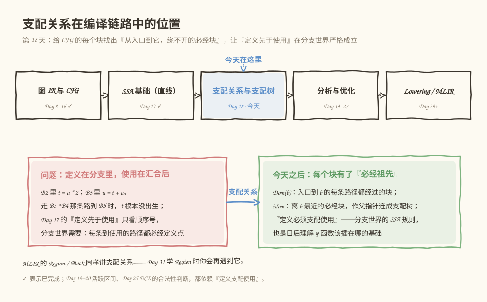
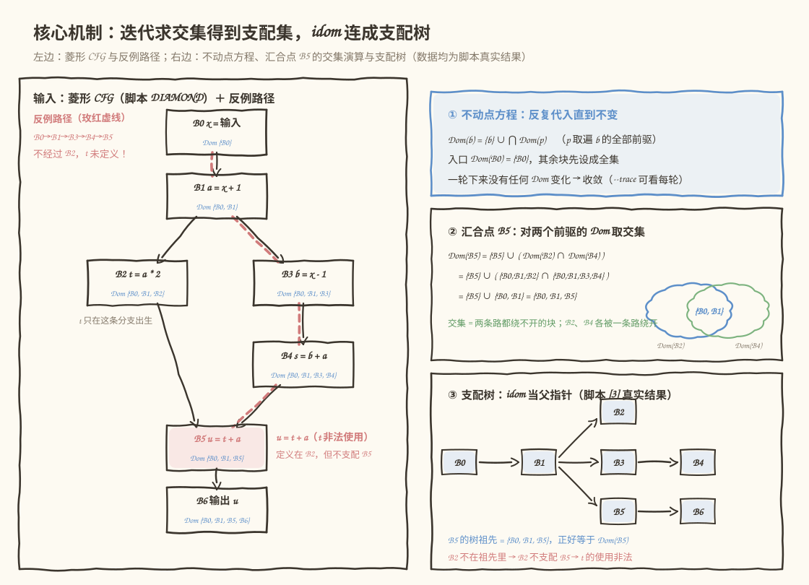
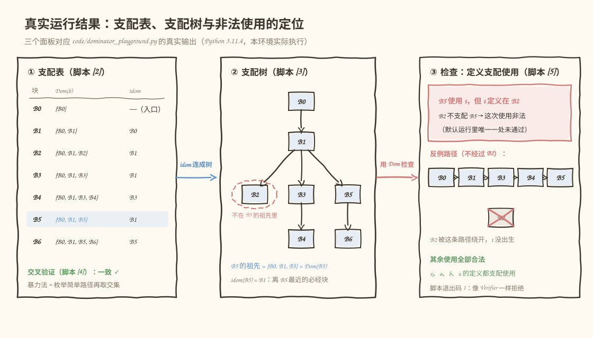

# 第 018 天：分支世界里，谁能保证"先有定义"——支配关系与支配树

> **今日目标**：读完本教程并完成实践后，你能为一个含分支和汇合的 CFG 手工算出每个块的支配集（Dominators），实现"迭代求交集"算法并用路径枚举交叉验证，从支配集推出直接支配者（idom）和支配树，并用"定义必须支配使用"这条规则查出程序里读取未定义值的错误。
> **预计时间**：学习 35 分钟 + 实践 45 分钟
> **前置准备**：Python 3（本教程用 3.11.4 实测）；回顾 Day 15 的 CFG（基本块、前驱、后继）、Day 16 的拓扑排序和 Day 17 的 SSA（定义、使用、Use-Def 对照表）。
> **今日产出**：一张手工支配表、`code/dominator_playground.py` 的真实运行记录，以及支配树与"定义支配使用"检查的完整输出。

## 1. 今天解决什么问题？

先看一段带分支的小程序，后面整天都用它。它的 CFG 是一个菱形：`B1` 处分支成两条路，在 `B5` 汇合：

```text
B0:  x = 输入
B1:  a = x + 1      ┐
B2:  t = a * 2      │ if 那条路
B3:  b = x - 1      │
B4:  s = b + a      ┘ else 那条路（B3→B4）
B5:  u = t + a      ← 汇合点
B6:  输出 u
```

问一个昨天留下的问题：**B5 里的 `u = t + a`，用的 `t` 一定有值吗？** 不一定——只有走 `B2` 那条路时 `t` 才出生；走 `B3→B4` 那条路到 B5，`t` 根本没被定义过。这是一个真实的程序 bug（读未初始化的值），但昨天的检查器抓不住它：Day 17 的规则是"定义先于使用"，按语句顺序号看，S2 定义 `t`、S5 使用 `t`，2 < 5，看起来"先于"，完全合法。

顺序号在分支世界里不够用。正确的问法必须换成：**到达这个使用的每一条路径，是否都经过定义点？** 换句话说：定义点是不是使用点的"必经之地"。这就是今天的主题——支配关系（Dominance）。它同时回答三件事：

1. `t` 的定义在 B2，B2 不支配 B5 → 这次使用非法（程序有 bug）；
2. `a` 的定义在 B1，B1 支配 B5 → 合法；
3. 如果两条路**都**定义了 `t`，汇合点需要一个 φ 函数（phi，发音"斐"）把两个版本合起来——φ 该插在哪个块，也由支配关系决定。

**前置补给**：Day 17 只处理了直线代码（没有分支汇合），当时说过"汇合点同时看得见两个版本怎么办，Day 18 再说"。今天补上这块拼图：先给"必经"一个准确定义，再把它算出来。

## 2. 先看全貌：支配关系在编译链路中的位置



**图 1**：看这张图时注意两点——"支配关系与支配树"处在结构分析和优化 Pass 之间，正好接在昨天的 SSA 后面；玫红框是今天的问题（定义在分支里、使用在汇合后，顺序号规则失效），绿框是今天之后你拥有的新工具（支配集、支配树、"定义支配使用"规则）。

全局流程五步，今天做第四步：

1. 前端把源程序/模型变成图 IR（Day 8–14，已完成）；
2. 配上 CFG 与拓扑排序，知道执行的块和顺序（Day 15–16，已完成）；
3. 直线程序的 SSA：每个值一次定义，Use-Def 一对一（Day 17，已完成）；
4. **支配关系：算出每个块的必经块、直接支配者，连成支配树（今天）**；
5. 在这之上做分析与优化：活跃区间（Day 19–20）、常量传播与 DCE（Day 23–27）；往后 Lowering（Day 85+）。另外 Day 29 起要学的 MLIR，其 Region/Block 体系同样内置支配关系——Day 31 讲 Region 时你会再遇到它。

## 3. 核心概念：从"必经"到支配树

### 3.1 支配：绕不开的块

- **通俗解释**：块 d 支配块 b，意思是"从入口走到 b，不管怎么走都得路过 d"——d 是 b 的必经之地。
- **一个类比**：像小区的门禁——从大门（入口 B0）走到你家（B5），无论绕哪条路，都得先过门禁（B1）；但"楼下便利店（B2）"只是某条路上的店，绕另一条路就不用经过它。**对应到技术上是**：d dom b ⟺ 从入口到 b 的**每一条路径**都包含 d。类比的边界在于：支配说的是"所有路径都经过"，跟执行的先后次数、图上画的位置高低都没有直接关系；而且每个块支配它自己（路径的终点当然包含终点）——这是定义的一部分，不是特例。
- **最小例子**（就用今天的 CFG）：
  - 到 B4 只有两条路吗？不，只有一条：`B0→B1→B3→B4`。所以 B0、B1、B3、B4 全都支配 B4；
  - 到 B5 有两条路：`B0→B1→B2→B5` 和 `B0→B1→B3→B4→B5`。公共的只有 B0、B1、B5——**B2 不支配 B5**（第二条路绕开了它），B4 同样不支配 B5。
- **常见误解**："B2 在图上挂着 B5 上方，又是它的前驱那边的块，所以支配 B5。" 错。前驱的"祖先"不自动成为汇合点的支配者——`B2` 只是 B5 的**某一个**前驱，另一条路完全不经过它。判定只认一条铁律：数路径，别看位置。

### 3.2 严格支配与直接支配：一层层收紧

沿用同一个 CFG，把概念排成递进的三级：

- **支配（dom）**：如上，记 `Dom(b)` 为 b 的全部支配者组成的集合；
- **严格支配（strictly dominate）**：d 支配 b 且 d ≠ b。比如严格支配 B6 的是 {B0, B1, B5}——把自己去掉；
- **直接支配者（immediate dominator，idom）**：严格支配者中**离 b 最近**的那一个。B6 的严格支配者里，B5 离它最近（B5 又被 B1 支配，B1 又被 B0 支配），所以 idom(B6) = B5。

为什么"最近"的那个唯一存在？因为 b 的所有严格支配者在支配关系下是一条**链**：B0 支配 B1，B1 支配 B5——它们两两可比，不会出现两个"并列最近"的支配者。这条链是后面支配树能长成"树"而不是"网"的原因。

### 3.3 支配树：把 idom 当父指针

每个块（除入口）都连一条边指向自己的 idom，就得到**支配树（dominator tree）**。今天的 CFG 长这样（就是脚本 `[3]` 的真实输出）：

```text
B0
└─ B1
   ├─ B2
   ├─ B3
   │  └─ B4
   └─ B5
      └─ B6
```

支配树有一个极好的性质：**b 在树上的祖先，恰好等于 Dom(b)**。B5 的树祖先是 B0、B1、B5——正是它的支配集。以后想知道"谁支配它"，沿树往上爬一遍就行，不用再数路径。

### 3.4 定义为何需要支配使用：SSA 在分支世界的规则

现在可以给昨天的问题一个严格答案了。SSA 的合法性规则在 CFG 上是：

> **每个使用，都必须被它的唯一定义支配。**

拿运行例子对照：

| 使用 | 定义在 | 定义支配使用吗 | 结论 |
|---|---|---|---|
| B2 用 `a` | B1 | B1 支配 B2 ✓ | 合法 |
| B4 用 `a` | B1 | B1 支配 B4 ✓ | 合法 |
| B6 用 `u` | B5 | B5 支配 B6 ✓ | 合法 |
| **B5 用 `t`** | B2 | **B2 不支配 B5 ✗** | **非法** |

`t` 的使用违反规则意味着：存在一条入口到 B5 的路径（`B0→B1→B3→B4→B5`）不经过定义点，走这条路时 `t` 还没出生。编译器看到这种结构应该拒绝——这就是"读未初始化变量"在 IR 层面的样子。

那怎么修？两条路，都通向同一个未来概念：

1. **如果程序本意就是"只有一条路定义 t"**：那是源程序的 bug，让用户回去改（编译器报错即可）；
2. **如果两条路都想定义 t**（比如 B2 里 `t = a * 2`，B4 里也来一个 `t = b + 1`）：SSA 构造会在汇合点 B5 插入一个 φ 函数——`t' = φ(B2 的 t, B4 的 t)`，按"从哪条路来"选择版本。φ 的结果是在 B5 定义的一个**新**值，它支配 B5 之后的所有使用，规则恢复成立。φ 该插在哪些块，由支配关系推导出的"支配边界（dominance frontier）"决定——今天先记结论，不展开。

类比收尾：门禁（B1）刷卡记录在物业系统里人人可见；便利店（B2）的小票只有进店的人才有——你要在汇合处引用"便利店小票"，就得先确认对方进过店，否则只能让两条路各带一份凭证（φ）来汇合。

## 4. 图解核心机制



**图 2**：左边是菱形 CFG，每个块里写着它的语句和支配集（都是脚本的真实结果），玫红虚线是那条绕开 B2 的反例路径；右边从上到下是三步机制——不动点方程、汇合点 B5 的交集演算（含两个支配集求交的小图）、最终连成的支配树。

按图里的编号讲一遍算法，它是教科书和工业编译器（LLVM、MLIR）的标准做法（Cooper–Harvey–Kennedy 2001 年把它整理成工程上最常用的迭代形式）：

1. **初始化**：`Dom(B0) = {B0}`（入口到入口只有一条零长路径）；其余每个**可达**块先粗放地设成**全集**——"谁都可能支配它"，后面靠交集往小收。为什么必须从全集开始、不能从空集开始，第 6 节错误二会用真实运行展示。
2. **代入方程**：对每个非入口块 b，用 `Dom(b) = {b} ∪ ⋂ Dom(p)`（p 取遍 b 的前驱）重算一遍。汇合点是关键：B5 有两个前驱 B2、B4，就把两个支配集**取交集**——交集才是"两条路都绕不开"的块。图中 B5 的演算一行行算下来：`{B0,B1,B2} ∩ {B0,B1,B3,B4} = {B0,B1}`，加上 B5 自己，得到 `Dom(B5) = {B0, B1, B5}`。
3. **迭代到不动点**：一轮里只要有任何 Dom 变了，就再来一轮；一轮下来全都没变，就收敛。本教程脚本按 B0→B6 的顺序处理块，恰好前驱大多排在前面，所以第 1 轮就基本算完、第 2 轮确认无变化（`--trace` 的真实输出见 5.3 节）。工程实现按"反向后序（reverse postorder）"排块序，同样是为了少跑几轮。
4. **提取 idom，连成支配树**：对每个非入口块，在它的严格支配者里取支配集**最大**的那个（离它最近的必经块），作父指针。B5 的严格支配者是 {B0, B1}，其中 Dom(B1) = {B0, B1} 比 Dom(B0) = {B0} 大，所以 idom(B5) = B1。
5. **执行检查**：对每个使用，看它的唯一定义在不在使用块的 Dom 里。不在，就用路径枚举找出一条**反例路径**当证据——图中玫红虚线那条 `B0→B1→B3→B4→B5` 就是不经过 B2 的活证据，检查器会把它原样打印出来。

## 5. 动手实践：算出支配树，抓住非法使用

### 5.1 先手工算（不要先看脚本输出）

拿出纸或打开编辑器，对第 1 节的 CFG 完成下面这张表（路径列帮你起头了）：

| 块 | 入口到它的全部路径 | Dom(b)（所有路径的公共块） |
|---|---|---|
| B0 | （起点，零长路径） | {B0} |
| B1 | B0→B1 | {B0, B1} |
| B2 | B0→B1→B2 | ？ |
| B3 | B0→B1→B3 | ？ |
| B4 | B0→B1→B3→B4 | ？ |
| B5 | 两条：B0→B1→B2→B5；B0→B1→B3→B4→B5 | ？ |
| B6 | ？ | ？ |

算完再回答三个预测题：

1. idom(B5) 是谁？idom(B4) 呢？
2. B2 支配 B5 吗——从"有边连过去"和"所有路径必经"各说一遍；
3. 检查器会对 `B5` 里的 `t` 报什么？反例路径是哪条？

写完再往下走——下面用脚本来对答案。

### 5.2 准备文件

本教程目录结构如下，脚本已随教程提供：

```text
tutorials/day-018/
├── README.md
├── code/
│   └── dominator_playground.py      # 演练场：迭代法 + 路径枚举交叉验证 + 支配树 + 定义支配使用检查
└── images/
    ├── 01-overview.svg
    ├── 02-mechanism.svg
    └── 03-example.svg
```

下面是 `code/dominator_playground.py` 的完整实现（与仓库文件一致），重点看 `iterative_dominators` 的初始化两行、`idom_of` 的取最大、和 `check_def_dominates_use` 里找反例路径的部分：

```python
#!/usr/bin/env python3
"""第 18 天演练场：支配关系、支配树与“定义支配使用”检查。

用法：
    python3 dominator_playground.py                # 菱形 CFG + 一处非法使用
    python3 dominator_playground.py --trace        # 额外打印每轮迭代后的 Dom 集
    python3 dominator_playground.py --shortcut     # 加一条 B2→B6 近路
    python3 dominator_playground.py --loop         # 加一条 B6→B1 回边（构成环）
    python3 dominator_playground.py --add-ghost    # 加一个无人跳转到它的不可达块 G

CFG 用“后继表”表示：键是块名，值是该块的所有后继。
程序用 DEF_USE 表示：每块记录 (定义的变量列表, 使用的变量列表)；
入口参数视作定义在入口块 B0。
"""

import argparse

ENTRY = "B0"

# 菱形 CFG：B1 处分支，B2 这条路与 B3→B4 这条路在 B5 汇合
DIAMOND = {
    "B0": ["B1"],
    "B1": ["B2", "B3"],
    "B2": ["B5"],
    "B3": ["B4"],
    "B4": ["B5"],
    "B5": ["B6"],
    "B6": [],
}

# 每块的语句，简化成 定义/使用 两个集合：
#   B0: x = 输入参数          B3: b = x - 1
#   B1: a = x + 1             B4: s = b + a
#   B2: t = a * 2             B5: u = t + a   ← t 的使用有问题！
#   B6: 输出 u
DEF_USE = {
    "B0": (["x"], []),
    "B1": (["a"], ["x"]),
    "B2": (["t"], ["a"]),
    "B3": (["b"], ["x"]),
    "B4": (["s"], ["b", "a"]),
    "B5": (["u"], ["t", "a"]),
    "B6": ([], ["u"]),
}


def predecessors(cfg):
    preds = {b: [] for b in cfg}
    for b, succs in cfg.items():
        for s in succs:
            preds[s].append(b)
    return preds


def reachable_from(cfg, entry):
    """从 entry 出发能走到的块集合（DFS）。"""
    seen, stack = {entry}, [entry]
    while stack:
        b = stack.pop()
        for s in cfg[b]:
            if s not in seen:
                seen.add(s)
                stack.append(s)
    return seen


def iterative_dominators(cfg, entry, trace=False):
    """迭代法求支配集：Dom(b) = {b} ∪ ⋂_{p∈前驱(b)} Dom(p)。

    只处理从 entry 可达的块：不可达块没有“从入口来的路径”，
    支配关系对它无定义（详见教程第 6 节错误三）。
    其余块初始化为全集——必须从“谁都支配它”开始往小收缩，
    从空集开始会收敛到过小的错误不动点（错误二）。
    """
    live = reachable_from(cfg, entry)
    order = [b for b in cfg if b in live]
    preds = predecessors(cfg)
    dom = {b: ({entry} if b == entry else set(order)) for b in order}
    rounds = 0
    changed = True
    while changed:
        changed = False
        rounds += 1
        for b in order:
            if b == entry:
                continue
            new = set(order)
            for p in preds[b]:
                if p in dom:
                    new &= dom[p]
            new.add(b)
            if new != dom[b]:
                dom[b] = new
                changed = True
        if trace:
            print(f"  -- 第 {rounds} 轮后 --")
            for b in order:
                print(f"     {b}: {{{', '.join(sorted(dom[b]))}}}")
    return dom, rounds


def simple_paths(cfg, entry, target):
    """枚举 entry→target 的全部简单路径（不重复经过任何块）。"""
    paths = []

    def dfs(node, path):
        if node == target:
            paths.append(list(path))
            return
        for s in cfg[node]:
            if s not in path:
                path.append(s)
                dfs(s, path)
                path.pop()

    dfs(entry, [entry])
    return paths


def brute_dominators(cfg, entry):
    """暴力法交叉验证：d 支配 b ⟺ d 出现在每条 entry→b 的简单路径里。

    “所有路径”可以只看“所有简单路径”：任何路径都能剪掉中途的环变成
    简单路径，剪枝只会删块不会加块，所以绕开 d 的路径若存在，
    必存在一条同样绕开 d 的简单路径。
    """
    live = reachable_from(cfg, entry)
    dom = {}
    for b in live:
        common = None
        for p in simple_paths(cfg, entry, b):
            s = set(p)
            common = s if common is None else common & s
        dom[b] = common
    return dom


def idom_of(b, dom, entry):
    """直接支配者：b 的严格支配者中离 b 最近的那个。

    b 的所有严格支配者在“支配”关系下构成一条链，
    离 b 越近的支配者自己被支配得越多、支配集越大，
    所以取 |Dom| 最大的那个就是 idom。先按名字排序再取 max，
    保证在病态图（支配集并列，比如不可达块）下结果也可复现。
    """
    if b == entry:
        return None
    strict = dom[b] - {b}
    return max(sorted(strict), key=lambda d: len(dom[d]))


def dominator_tree(dom, entry):
    """支配树：父节点 = idom；返回 children 映射。"""
    children = {b: [] for b in dom}
    for b in dom:
        if b != entry:
            children[idom_of(b, dom, entry)].append(b)
    for kids in children.values():
        kids.sort()
    return children


def tree_lines(children, node, prefix="", is_last=True, is_root=False):
    """把支配树渲染成带 ├─ └─ 的文本行。"""
    if is_root:
        lines = [node]
        kids = children.get(node, [])
        for i, k in enumerate(kids):
            lines += tree_lines(children, k, "", i == len(kids) - 1)
        return lines
    connector = "└─ " if is_last else "├─ "
    lines = [prefix + connector + node]
    new_prefix = prefix + ("   " if is_last else "│  ")
    kids = children.get(node, [])
    for i, k in enumerate(kids):
        lines += tree_lines(children, k, new_prefix, i == len(kids) - 1)
    return lines


def find_witness_path(cfg, entry, use_block, def_block):
    """找一条 entry→use_block 且不经过 def_block 的简单路径（反例路径）。"""
    for p in simple_paths(cfg, entry, use_block):
        if def_block not in p:
            return p
    return None


def check_def_dominates_use(cfg, entry, dom):
    """检查“每个使用都被它的定义支配”。

    名字只有唯一定义点 d 时：任何使用块 u 必须满足 d ∈ Dom(u)，
    否则存在入口→u 的路径不经过 d，执行到 u 时值还没出生。
    多个定义点需要 φ 函数在汇合处合并版本（今天只报告，不展开）。
    """
    def_sites = {}
    for b, (defs, _) in DEF_USE.items():
        for name in defs:
            def_sites.setdefault(name, []).append(b)

    all_names = set()
    for defs, uses in DEF_USE.values():
        all_names.update(defs)
        all_names.update(uses)

    problems, notes = [], []
    for name in sorted(all_names):
        sites = def_sites.get(name, [])
        users = [b for b, (_, uses) in DEF_USE.items() if name in uses]
        if not users:
            continue
        if not sites:
            problems.append(f"{name} 被使用但没有任何定义")
            continue
        if len(sites) > 1:
            notes.append(f"{name} 定义于 {' 和 '.join(sites)}——多处定义，"
                         f"汇合处需要 φ 函数选择版本，本教程不展开")
            continue
        d = sites[0]
        for u in users:
            if d not in dom.get(u, set()):
                witness = find_witness_path(cfg, entry, u, d)
                w = "→".join(witness) if witness else "（未找到，实现有 bug）"
                problems.append(
                    f"{u} 使用 {name}，但 {name} 定义在 {d}，{d} 不支配 {u}；"
                    f"反例路径 {w} 不经过 {d}，走这条路时 {name} 还没定义")
    return problems, notes


def fmt_set(s):
    return "{" + ", ".join(sorted(s)) + "}"


def main():
    ap = argparse.ArgumentParser(description="支配关系演练场")
    ap.add_argument("--shortcut", action="store_true", help="加一条 B2→B6 的近路")
    ap.add_argument("--loop", action="store_true", help="加一条 B6→B1 的回边（构成环）")
    ap.add_argument("--add-ghost", action="store_true", help="加一个无人跳转到它的不可达块 G")
    ap.add_argument("--trace", action="store_true", help="打印每轮迭代后的 Dom 集")
    args = ap.parse_args()

    cfg = {b: list(succ) for b, succ in DIAMOND.items()}
    extra = []
    if args.shortcut:
        cfg["B2"].append("B6")
        extra.append("近路 B2→B6")
    if args.loop:
        cfg["B6"].append("B1")
        extra.append("回边 B6→B1")
    if args.add_ghost:
        cfg["G"] = ["B5"]
        extra.append("孤块 G→B5")

    print("== [1] CFG（后继表） ==")
    for b, succs in cfg.items():
        print(f"{b} → {', '.join(succs) if succs else '（出口）'}")
    if extra:
        print("在菱形基础上增加：" + "；".join(extra))
    dead = [b for b in cfg if b not in reachable_from(cfg, ENTRY)]
    if dead:
        print("不可达块（没有从入口来的路径，不参与支配计算）：" + "、".join(dead))

    print("\n== [2] 迭代法求支配集：Dom(b) = {b} ∪ ⋂ Dom(前驱) ==")
    if args.trace:
        print("（--trace 打开：每轮结束后打印全部 Dom 集）")
    dom, rounds = iterative_dominators(cfg, ENTRY, trace=args.trace)
    print(f"收敛：{rounds} 轮")
    print(f"{'块':<5}{'支配集 Dom(b)':<20}{'严格支配（去掉自己）':<22}直接支配者 idom")
    for b in sorted(dom):
        strict = fmt_set(dom[b] - {b})
        idom = idom_of(b, dom, ENTRY) or "—（入口）"
        print(f"{b:<5}{fmt_set(dom[b]):<20}{strict:<22}{idom}")

    print("\n== [3] 支配树（父节点 = idom） ==")
    children = dominator_tree(dom, ENTRY)
    for line in tree_lines(children, ENTRY, is_root=True):
        print(line)

    print("\n== [4] 与暴力路径枚举交叉验证 ==")
    bdom = brute_dominators(cfg, ENTRY)
    if bdom == dom:
        print(f"一致：{len(dom)} 个可达块的支配集两种算法完全相同。")
    else:
        print("不一致！两种算法结果不同：")
        for b in sorted(set(dom) | set(bdom)):
            if dom.get(b) != bdom.get(b):
                dv = fmt_set(dom[b]) if b in dom else "无"
                bv = fmt_set(bdom[b]) if b in bdom else "无"
                print(f"  {b}: 迭代法={dv}  路径枚举={bv}")

    print("\n== [5] 检查：定义是否支配使用 ==")
    problems, notes = check_def_dominates_use(cfg, ENTRY, dom)
    for n in notes:
        print("提示：" + n)
    if not problems:
        print("通过：每个使用都被唯一定义支配。")
    else:
        for p in problems:
            print("未通过：" + p)
        print("（存在不被定义支配的使用，编译器应拒绝或要求插入 φ —— 退出码 1）")
    return 0 if not problems else 1


if __name__ == "__main__":
    raise SystemExit(main())
```

代码里最关键的四处：

- `iterative_dominators` 的两步初始化：先 `reachable_from` 把不可达块挡在门外，再给其余块设**全集**——这两行分别防住第 6 节的错误三和错误二；
- `new = set(order)` 之后连着 `&=` 每个前驱：交集就发生在这几行，汇合点少一个前驱都会算错；
- `idom_of` 用"支配集最大"挑最近的严格支配者——依据是 3.2 节说的"严格支配者构成链"；
- `find_witness_path`：报错不只说"不支配"，还把反例路径找出来当证据——这和 Day 12 Verifier 的诊断思路一致：错误要能定位。

### 5.3 运行与观察

在 `tutorials/day-018/` 目录下运行：

```bash
python3 code/dominator_playground.py
```

以下是本环境的**真实运行结果**（Python 3.11.4，Linux），不是预期输出：

```text
== [1] CFG（后继表） ==
B0 → B1
B1 → B2, B3
B2 → B5
B3 → B4
B4 → B5
B5 → B6
B6 → （出口）

== [2] 迭代法求支配集：Dom(b) = {b} ∪ ⋂ Dom(前驱) ==
收敛：2 轮
块    支配集 Dom(b)          严格支配（去掉自己）            直接支配者 idom
B0   {B0}                {}                    —（入口）
B1   {B0, B1}            {B0}                  B0
B2   {B0, B1, B2}        {B0, B1}              B1
B3   {B0, B1, B3}        {B0, B1}              B1
B4   {B0, B1, B3, B4}    {B0, B1, B3}          B3
B5   {B0, B1, B5}        {B0, B1}              B1
B6   {B0, B1, B5, B6}    {B0, B1, B5}          B5

== [3] 支配树（父节点 = idom） ==
B0
└─ B1
   ├─ B2
   ├─ B3
   │  └─ B4
   └─ B5
      └─ B6

== [4] 与暴力路径枚举交叉验证 ==
一致：7 个可达块的支配集两种算法完全相同。

== [5] 检查：定义是否支配使用 ==
未通过：B5 使用 t，但 t 定义在 B2，B2 不支配 B5；反例路径 B0→B1→B3→B4→B5 不经过 B2，走这条路时 t 还没定义
（存在不被定义支配的使用，编译器应拒绝或要求插入 φ —— 退出码 1）
```

对照检查：`[2]` 的支配集和 `[3]` 的树应与你 5.1 节的手工答案一致——尤其 Dom(B5) 里**没有** B2、B4。注意两件事：`[4]` 用第二种独立算法（枚举所有简单路径再取交集）算出完全相同的结果，这是你手算之外的第二重保险；默认运行的退出码是 1（用 `echo $?` 验证），因为程序里故意留了一处非法使用——这是特性，和 Day 12 的 Verifier 拒绝非法图一个道理。



**图 3**：三个面板全部来自上面的真实输出——① 支配表（B5 行高亮：它的支配集小得出人意料）；② 支配树（B5 的树祖先 = 它的支配集，B2 圈在外面）；③ 非法使用的完整报告，含反例路径 B0→B1→B3→B4→B5 和被绕开的 B2。这说明第 3.4 节只在直觉层面说过的事实可以被程序自动证明：**在 CFG 上，"定义支配使用"是一条可以逐块检查的硬规则**。

想看第 4 节的迭代过程本身，加 `--trace`：

```bash
python3 code/dominator_playground.py --trace | sed -n '/--trace 打开/,/收敛/p'
```

```text
（--trace 打开：每轮结束后打印全部 Dom 集）
  -- 第 1 轮后 --
     B0: {B0}
     B1: {B0, B1}
     B2: {B0, B1, B2}
     B3: {B0, B1, B3}
     B4: {B0, B1, B3, B4}
     B5: {B0, B1, B5}
     B6: {B0, B1, B5, B6}
  -- 第 2 轮后 --
     B0: {B0}
     B1: {B0, B1}
     B2: {B0, B1, B2}
     B3: {B0, B1, B3}
     B4: {B0, B1, B3, B4}
     B5: {B0, B1, B5}
     B6: {B0, B1, B5, B6}
收敛：2 轮
```

两轮的内容一模一样：第 1 轮就到位，第 2 轮只是确认"没有变化"——因为块的处理顺序（B0→B6）恰好让每个块的前驱都排在自己前面。处理顺序一乱，同样的图也可能要多跑几轮才能收敛；图里有环时算法照样工作（下一节的 `--loop` 就是一例）——不管跑几轮，结果都一样。

### 5.4 修改 CFG 再观察

支配关系由"路径集合"决定，所以改一条边就能看到明显变化。两个对照实验（输出均为真实运行结果）：

**实验一：加一条近路 `B2→B6`（`--shortcut`）**

```bash
python3 code/dominator_playground.py --shortcut | sed -n '/== \[2\]/,$p'
```

```text
== [2] 迭代法求支配集：Dom(b) = {b} ∪ ⋂ Dom(前驱) ==
收敛：2 轮
块    支配集 Dom(b)          严格支配（去掉自己）            直接支配者 idom
B0   {B0}                {}                    —（入口）
B1   {B0, B1}            {B0}                  B0
B2   {B0, B1, B2}        {B0, B1}              B1
B3   {B0, B1, B3}        {B0, B1}              B1
B4   {B0, B1, B3, B4}    {B0, B1, B3}          B3
B5   {B0, B1, B5}        {B0, B1}              B1
B6   {B0, B1, B6}        {B0, B1}              B1

== [3] 支配树（父节点 = idom） ==
B0
└─ B1
   ├─ B2
   ├─ B3
   │  └─ B4
   ├─ B5
   └─ B6

== [4] 与暴力路径枚举交叉验证 ==
一致：7 个可达块的支配集两种算法完全相同。

== [5] 检查：定义是否支配使用 ==
未通过：B5 使用 t，但 t 定义在 B2，B2 不支配 B5；反例路径 B0→B1→B3→B4→B5 不经过 B2，走这条路时 t 还没定义
未通过：B6 使用 u，但 u 定义在 B5，B5 不支配 B6；反例路径 B0→B1→B2→B6 不经过 B5，走这条路时 u 还没定义
（存在不被定义支配的使用，编译器应拒绝或要求插入 φ —— 退出码 1）
```

解读：

- 到 B6 的路径从两条变三条，多出的 `B0→B1→B2→B6` 绕开了 B5，于是 **Dom(B6) 从 {B0,B1,B5,B6} 缩到 {B0,B1,B6}**，idom(B6) 从 B5 变成 B1，支配树里 B6 从 B5 名下挪到 B1 名下。加一条边只会让支配集**变小或不变**——路径更多，"公共必经"只会更少；
- 更有意思的是 `[5]` 多了一条未通过：**默认运行里完全合法的 `u` 使用，加一条近路后就非法了**。新路径制造了新的"绕开定义点"的走法。这给后面的优化 Pass 提了个醒：任何改图的操作（比如 CSE 把使用替换成别处定义的等价值、融合把计算挪进别的块）都可能改变支配关系，改完必须重查"定义支配使用"，否则会把合法程序改成非法。

**实验二：加一条回边 `B6→B1`（`--loop`）**

```bash
python3 code/dominator_playground.py --loop | sed -n '/== \[1\]/,/== \[3\]/p'
```

```text
== [1] CFG（后继表） ==
B0 → B1
B1 → B2, B3
B2 → B5
B3 → B4
B4 → B5
B5 → B6
B6 → B1
在菱形基础上增加：回边 B6→B1

== [2] 迭代法求支配集：Dom(b) = {b} ∪ ⋂ Dom(前驱) ==
收敛：2 轮
块    支配集 Dom(b)          严格支配（去掉自己）            直接支配者 idom
B0   {B0}                {}                    —（入口）
B1   {B0, B1}            {B0}                  B0
B2   {B0, B1, B2}        {B0, B1}              B1
B3   {B0, B1, B3}        {B0, B1}              B1
B4   {B0, B1, B3, B4}    {B0, B1, B3}          B3
B5   {B0, B1, B5}        {B0, B1}              B1
B6   {B0, B1, B5, B6}    {B0, B1, B5}          B5

== [3] 支配树（父节点 = idom） ==
```

（`[3]` 的树、`[4]` 的交叉验证和 `[5]` 的检查与默认运行逐字相同，不再重复贴。）

解读：

- 图里出现了环（B1→…→B6→B1），迭代算法照常收敛，结果和默认运行**完全一致**；
- 原因：这条回边的终点 B1 支配起点 B6——任何走到 B6 的路径都早已经过 B1，再跳回 B1 必然重复访问，因此**不产生任何新的简单路径**，支配关系纹丝不动。一般地，加边 u→v 时若 v 支配 u，它就是纯回边，不改任何 Dom；
- 这也解释了 `[4]` 为什么敢用"简单路径"当真相：带环的路径有无穷多条，但每条都能剪掉环变成简单路径，剪枝只删块不加块，"是否绕开 d"的判定不变。

## 6. 常见错误与排查

**错误一：汇合点把前驱的支配集取了并集。**
- **现象**：手工表里 Dom(B5) 写成 {B0, B1, B2, B4, B5}（把两条路各自必经的块全塞进来），和脚本 `[2]` 对不上，多出 B2 和 B4。
- **原因**：把"两条路**任一条**必经"当成了"必经"。支配的定义是"**每一条**路径都经过"，多个前驱的支配集要**取交集**——只有两条路都绕不开的块才算数。
- **定位**：对多出来的每个块问一句"有没有一条路绕开它？"——B2 有：`B0→B1→B3→B4→B5`（这正是脚本 `[5]` 打出来的反例路径）；B4 也有：`B0→B1→B2→B5`。
- **修复**：汇合点一律 `Dom(b) = {b} ∪ ⋂ Dom(前驱)`。并集直觉在"唯一前驱"的链上恰好无害（只有一个集合，交并等价），所以错误往往到汇合点才暴露——多造几条路测试就能抓住。

**错误二：迭代算法把非入口块初始化成空集。**
- **现象**：我把副本里 `set(order)` 改成 `set()` 后带 `--loop` 运行，脚本当场崩溃（真实运行结果，节选）：

```text
== [2] 迭代法求支配集：Dom(b) = {b} ∪ ⋂ Dom(前驱) ==
收敛：2 轮
块    支配集 Dom(b)          严格支配（去掉自己）            直接支配者 idom
B0   {B0}                {}                    —（入口）
Traceback (most recent call last):
  File "/tmp/opencode/day18/bug_empty_init.py", line 304, in <module>
    raise SystemExit(main())
                     ^^^^^^
  File "/tmp/opencode/day18/bug_empty_init.py", line 270, in main
    idom = idom_of(b, dom, ENTRY) or "—（入口）"
           ^^^^^^^^^^^^^^^^^^^^^^
  File "/tmp/opencode/day18/bug_empty_init.py", line 149, in idom_of
    return max(sorted(strict), key=lambda d: len(dom[d]))
           ^^^^^^^^^^^^^^^^^^^^^^^^^^^^^^^^^^^^^^^^^^^^^^
ValueError: max() arg is an empty sequence
```

- **原因**：B1 的前驱里多了 B6（回边），第 1 轮处理 B1 时 Dom(B6) 还是初始的空集，交集被清空，Dom(B1) 算成 {B1}——B0 丢了；B1 的严格支配集成了空集，`max()` 自然报错。更深的病根：空集初始化让算法收敛到一个**过小的错误不动点**（{B1} 也满足 B1 的方程），而支配集的正确解是"最大不动点"，必须从全集开始收缩才能到达。
- **定位**：崩溃行指向 `idom_of`，但根因在初始化——`max(空序列)` 能触发，说明 B1 的严格支配集是空的，也就是 Dom(B1) 里除了 B1 自己谁都没有，连入口 B0 都不在里面，一眼假。
- **修复**：初始化为全集。另外这个 bug 在**没有回边的菱形上完全隐藏**（我也真实跑了副本的默认模式，`[4]` 报"一致"——因为处理顺序恰好让前驱先算完，第 1 轮就全对了）。教训：迭代算法必须用带环的图测，`--loop` 就是为此准备的开关；`[4]` 的交叉验证也是最后一道防线——两种算法各自独立，互为对方的测试。

**错误三：把不可达块放进了支配计算。**
- **现象**：我用 `--add-ghost` 加了一个无人跳转到它的孤块 G（G→B5），再把副本里"只处理可达块"那行删掉后运行，`[2]` 的表里 G 的支配集是全部 8 个块，支配树里 G 被挂到了 B4 名下，`[4]` 直接报不一致（真实运行结果，节选）：

```text
B6   {B0, B1, B5, B6}    {B0, B1, B5}          B5
G    {B0, B1, B2, B3, B4, B5, B6, G}{B0, B1, B2, B3, B4, B5, B6}B4

== [3] 支配树（父节点 = idom） ==
B0
└─ B1
   ├─ B2
   ├─ B3
   │  └─ B4
   │     └─ G
   └─ B5
      └─ B6

== [4] 与暴力路径枚举交叉验证 ==
不一致！两种算法结果不同：
  G: 迭代法={B0, B1, B2, B3, B4, B5, B6, G}  路径枚举=无
```

- **原因**：G 没有任何前驱，"对所有前驱取交集"变成对空集合取交——按惯例得到全集，Dom(G) 永远不收缩。对 G 说"所有路径都经过 B1"是**空真**：一条从入口到 G 的路径都不存在，"所有"量词空转。支配关系只对**可达**块有定义。
- **定位**：`[4]` 点名 G（路径枚举压根不给 G 算值）；正常脚本会在 `[1]` 打印"不可达块……不参与支配计算"。
- **修复**：先 `reachable_from` 过滤再算（正解脚本就是这么做的）。工程上的另一条路是把不可达块当死代码删掉——正好呼应 Day 25 的 DCE。

**错误四：拿顺序号或"图上位置"当支配判定。**
- **现象**：手写检查器按"定义块编号 < 使用块编号"判合法，于是 B2 定义 t、B5 使用 t 被判"合法"；或者看图觉得"B2 在 B5 上方所以支配它"。
- **原因**：顺序号只反映一种遍历顺序，分支会打破"编号小=先执行且必经"的对应；位置高低更是纯视觉错觉。支配唯一的标准是"所有路径必经"。
- **定位**：拿反例路径一验就穿帮：`B0→B1→B3→B4→B5` 不经过 B2。
- **修复**：一律用 `d ∈ Dom(u)` 判定；没算过 Dom 就先算（今天）或沿支配树爬祖先（`[3]` 的树就是干这个的）。

## 7. 今日练习

### 必做练习

把脚本顶部的 `DIAMOND` 换成下面这个 CFG（同时把 `DEF_USE` 改成每个块 `([], [])`，本练习只关心支配关系），先手工算，再运行对答案：

```text
C0 → C1
C1 → C2, C3
C2 → C3        ← 注意：C3 有两个前驱
C3 → C4, C5
C4 → C6
C5 → C6
C6 → C1        ← 回边
```

- 预期产出：7 行支配表（块 / Dom / idom）、一棵支配树、以及交叉验证 `[4]` 的"一致"输出；
- 两个自测点（也是最容易算错的地方）：尽管**有边 C2→C3**，Dom(C3) 里有没有 C2？反例路径是哪条？再把回边 C6→C1 删掉跑一遍，有任何一个块的 Dom 集变了吗（想想 5.4 实验二的结论）？
- 运行方式：改完后 `python3 code/dominator_playground.py`，对照 `[2]`、`[3]` 检查你的手工答案。

### 选做挑战

把 `DEF_USE` 里 B3 那行改成 `(["b", "t"], ["x"])`——让 B3 也定义一个 `t`，两条分支各自定义。先预测：`[5]` 还会报"B5 使用 t 未通过"吗？会出现什么新提示？φ 函数应该插在哪个块（提示：看哪一个是"定义不支配使用"的汇合点）？然后运行验证。我实测的结果是：未通过的报错消失，取而代之的是一行"多处定义，汇合处需要 φ 函数选择版本"的提示——两个定义都活着，合并它们正是 φ 的职责，而 φ 的插入位置，就藏在你今天算出的支配树里。

## 8. 今日验收

- [ ] 我能用自己的话说清"支配"为什么必须定义为"**每一条**路径都经过"，而不是"顺序靠前"或"图上位置靠上"；
- [ ] 我独立完成了 5.1 的手工支配表和支配树，并与脚本 `[2]`、`[3]` 的真实输出逐行核对一致，包括 Dom(B5) 里没有 B2；
- [ ] 我运行了三组实验（默认、`--shortcut`、`--loop`），能解释为什么加近路会让 Dom(B6) 缩小、还会让 `u` 的使用变非法，而回边不改变任何支配集；
- [ ] 我知道"全集初始化"和"排除不可达块"这两个坑分别会摔成什么样，并且明白带环的 CFG 才能暴露空集初始化的 bug；
- [ ] 我保存了 `code/dominator_playground.py`、三张图和本次真实运行记录，`python3 code/dominator_playground.py` 可以随时复现（退出码 1 是设计好的拒绝行为）。

## 9. 一句话总结与明天预告

今天的问题是"定义在分支里、使用在汇合后，顺序号管不住合法性"；机制是支配关系——`Dom(b) = {b} ∪ ⋂ Dom(前驱)` 从全集迭代收缩，idom 连成支配树，树上祖先恰好等于支配集；实践是手工算支配表、跑通迭代算法并用路径枚举交叉验证，最后用"定义必须支配使用"抓住了 `t` 的未定义读取（反例路径就是证据）；验证靠 `[4]` 的双算法一致、`--shortcut`/`--loop` 的边实验和两个真实踩坑演示。明天（Day 19）把"定义在哪"升级成"活到哪"——活跃变量与活跃区间：一个值从定义点活到最后一次使用，这期间它得占着寄存器或缓冲区，正是内存规划的输入，而"使用是否被支配"就是今天打下的地基。
