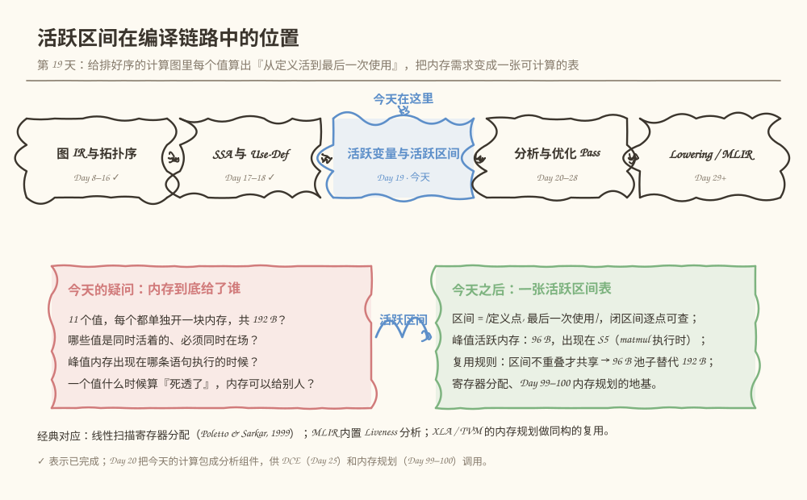
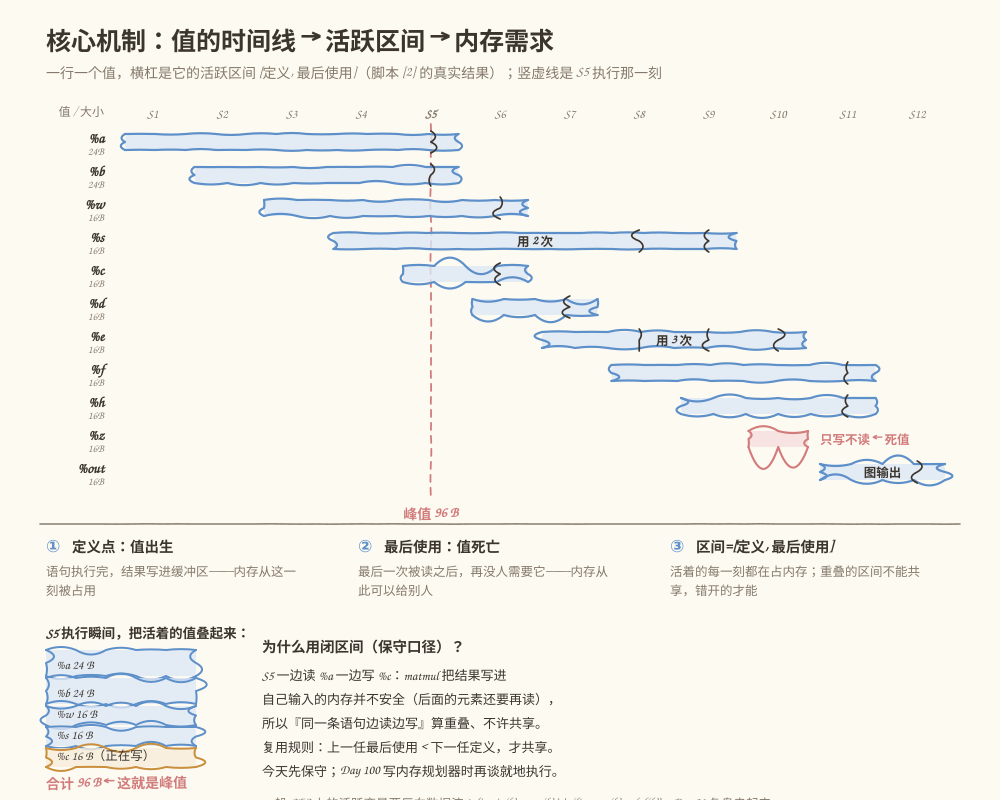
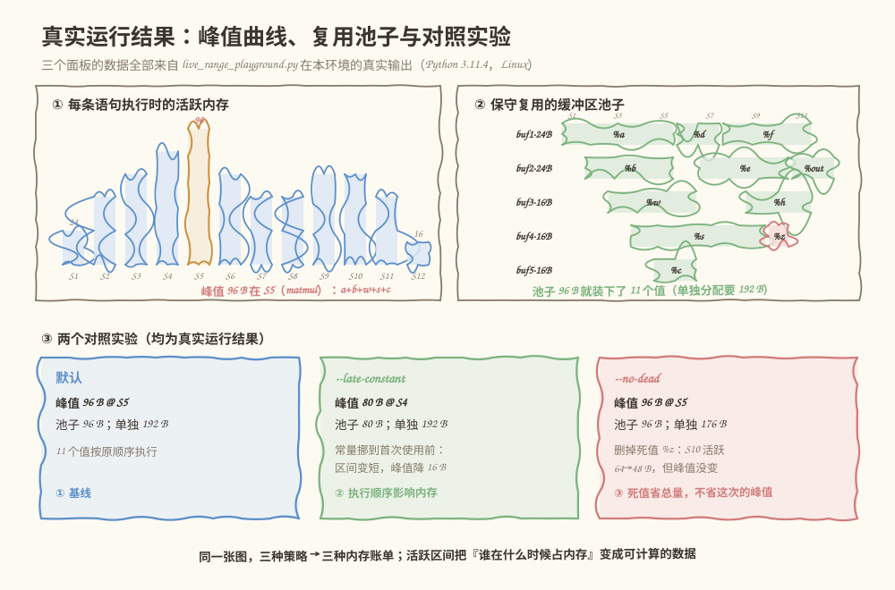

# 第 019 天：一个值要占多久内存？——活跃变量与活跃区间

> **今日目标**：读完本教程并完成实践后，你能为一个排好序的线性计算图手工算出每个值的定义点、首次使用、最后使用和活跃区间（Live Range），逐条语句算出活跃内存并找到峰值，实现"区间完全不重叠才共享"的保守缓冲区复用，并通过三个对照实验说出执行顺序和死值分别怎样影响内存账单。
> **预计时间**：学习 35 分钟 + 实践 45 分钟
> **前置准备**：Python 3（本教程用 3.11.4 实测）；回顾 Day 16 的拓扑排序（线性图的顺序就是执行顺序）、Day 17 的 Use-Def（值与它的使用）和 Day 4 的字节数计算（元素个数 × 每元素字节数）。
> **今日产出**：一张手工活跃区间表、`code/live_range_playground.py` 的真实运行记录，以及峰值曲线、缓冲区池子和两个对照实验的完整输出。

## 1. 今天解决什么问题？

看一张贯穿全文的图。它是前两周项目里那类计算图的一条线性执行序（拓扑排好序，Day 16），写成 12 条语句，每条语句定义至多一个值（SSA，Day 17）、使用若干个值；图的输出也当成一条语句：

```text
S1   %a   = input            shape 2×3   24 B     ┐
S2   %b   = input            shape 3×2   24 B     │ 四个“输入/常量”
S3   %w   = input            shape 2×2   16 B     │ 提前摆上桌
S4   %s   = const 0.5        shape 2×2   16 B     ┘
S5   %c   = matmul(%a, %b)   shape 2×2   16 B
S6   %d   = add(%c, %w)      shape 2×2   16 B
S7   %e   = relu(%d)         shape 2×2   16 B
S8   %f   = mul(%e, %s)      shape 2×2   16 B     ← %e 第 1 次被使用
S9   %h   = add(%e, %s)      shape 2×2   16 B     ← %e 第 2 次、%s 最后一次
S10  %z   = relu(%e)         shape 2×2   16 B     ← %e 第 3 次；%z 从未被使用
S11  %out = add(%f, %h)      shape 2×2   16 B
S12    →  output(%out)                     图输出
```

问一个很实际的问题：**运行这张图，内存该怎么给？** 最省事的做法是每个值单独开一块缓冲区——加起来 24+24+16×8 = 192 B。但直觉告诉我们这浪费得离谱：`%a` 在 S5 被读完就再也没人用了，它那 24 B 从 S6 起完全可以给别人。要回答"到底需要多少内存"，必须先回答三个更小的问题：

1. **哪些值是同时活着的？**（必须同时占着内存，谁也替不了谁）
2. **峰值出现在哪条语句执行的时候？**（内存最紧张的一刻）
3. **一个值什么时候算"死透了"？**（它的内存从此可以给别人用）

这三个问题的答案就是今天的主角——**活跃变量（live variable）与活跃区间（live range）**。它是传统编译器里寄存器分配的基础，也是 AI 编译器里内存规划的直接输入：Day 99 的 Tensor 生命周期、Day 100 的缓冲区复用，吃的就是今天这张表。

**前置补给**：今天只处理**线性**计算图（无分支、无循环），所以"活跃"可以用区间直接算。带分支的一般 CFG 上，活跃变量要靠反向数据流方程（今天末尾一句话带过，Day 21 复盘串起来）；Day 18 的支配关系回答的是"定义合不合法"，今天回答的是"值要占多久"——两个问题正交。

## 2. 先看全貌：活跃区间在编译链路中的位置



**图 1**：看这张图时注意两点——"活跃变量与活跃区间"处在结构分析（昨天为止）和优化 Pass（明天开始）之间，是第一份"给优化用的分析结果"；玫红框是今天的疑问（内存到底给了谁），绿框是今天之后你拥有的工具（一张逐点可查的活跃区间表）。

全局流程五步，今天做第四步：

1. 前端把源程序/模型变成图 IR（Day 8–14，已完成）；
2. 配上 CFG 与拓扑排序，知道执行的块和顺序（Day 15–16，已完成）；
3. SSA 与 Use-Def：每个值一次定义、使用可追（Day 17–18，已完成）；
4. **活跃区间：算出每个值从定义活到最后一次使用，以及每一刻的内存需求（今天）**；
5. 把分析喂给优化：Day 20 把今天的计算包成分析组件；Day 25 的 DCE 靠"未使用"删死代码；Day 99–100 的内存规划靠"区间不重叠"复用缓冲区。传统编译器对应物是寄存器分配——线性扫描寄存器分配（Poletto & Sarkar, 1999）被不少 JIT（HotSpot C1、LuaJIT 等）采用，思路和今天做的事同构；MLIR 也内置了 Liveness 分析，供 BufferDeallocation 等 Pass 使用。

## 3. 核心概念：从"出生和死亡"到"内存账单"

### 3.1 定义点与使用点：值的出生和每一次被读

- **通俗解释**：定义点（definition site，简称 def）是值"出生"的那条语句——结果写出来的地方；使用点（use site）是它"被读"的每一条语句。
- **最小例子**（就用 S1–S12）：`%e` 的定义点是 S7（`relu(%d)` 的结果）；使用点有三个——S8、S9、S10 各读它一次。SSA 保证了定义点**唯一**（Day 17 的核心约束），但使用点可以有任意多个。
- **首次使用与最后使用**：使用点里位置最早的叫首次使用（`%e` 是 S8），位置最晚的叫最后使用（`%e` 是 S10）。这两个位置就是今天所有计算的原料。
- **一个常见误解**："值的寿命到第一次用完就结束了。" 错——`%e` 在 S8 被读了一次，S9、S10 还要再读它，它的缓冲区一刻也不能动。**决定寿命的是最后一次使用，不是第一次。**

### 3.2 活跃区间：从出生到死亡的一条时间杠

- **通俗解释**：值 v 的活跃区间是 `[定义点, 最后使用点]`——从"结果写进缓冲区"到"最后一次被读完"的整段时间，这期间它必须随时"拿得出手"。
- **一个类比**：像酒店的房态板——入住（定义）到退房（最后使用）期间房间挂"在住"，房费照付；退房后房间才可能安排给下一位客人。**对应到技术上是**：活跃区间内值占着一块缓冲区（或一个寄存器），区间结束（最后使用完成）后这块内存才可能被分配给别的值。类比的边界有三条：① 真实房间退了不会自动住进新人，缓冲区也需要分配器显式安排（今天第 4 节的复用规则）；② 酒店改不了客人的入住时间，编译器却能通过**调整执行顺序**改变值的"入住时间"（5.4 的实验一）；③ 一块缓冲区同一时刻只能放一个值——正如一个房间不能同时住两位客人，这正是"区间不重叠才能共享"。
- **最小例子**：`%a` 的区间是 `[S1, S5]`（S5 被 matmul 读完就退房）；`%e` 的区间是 `[S7, S10]`（要一直挺到 S10 那次 relu 读完）。
- **两个特殊值**：`%z` 从未被使用——没有使用点，区间退化为"只写不读"，它就是**死值（dead value）**；`%out` 的最后使用是输出语句 S12——**图输出也是一种使用**，忘了这一点就会把输出当死值删掉（第 6 节错误三）。

### 3.3 内存意义：峰值、总量与复用

为什么要关心区间？因为它直接决定三笔内存账：

- **峰值（peak）**：任意一条语句执行时，活跃值字节总和的最大值。今天的图里峰值是 **96 B，出现在 S5**——matmul 执行那一刻，`%a + %b + %w + %s + %c`（正在写的也算）同时在场。峰值是"最紧张一刻"的下限：不管你怎么分配，内存容量低于它一定不够。
- **总量（naive total）**：每个值单独一块缓冲区之和，这里是 192 B。不做任何分析时的默认开销。
- **复用（reuse）**：区间完全不重叠的值可以共享同一块缓冲区。今天的图按保守规则只需要一个 **96 B 的池子**（5 块缓冲区），替代 192 B——省一半。

**一个类比**：厨房台面——同时要用的食材都得摆在台面上，用完的及时收走才能腾地方；台面至少要多大，取决于"同时在场"最多的那一刻。**对应到技术上是**：峰值 = 逐语句累加活跃字节的max；想压低峰值，要么减少同时活跃（调度），要么删掉根本没人吃的食材（死值）。类比边界：内存不是台面——它可以池化（一块大内存切开分）、可以分级（片上/片外），"收走"也要分配器显式做，不会自动发生。

对 AI 编译器来说，这套账就是内存规划的全部输入：XLA 的 buffer assignment 给活跃区间不重叠的缓冲区尽量共享内存；TVM 的图运行时按活跃情况复用存储；PyTorch 的缓存分配器在运行期做同构的事——张量一释放，空闲块就能被新张量复用。Day 99–100 你会亲手写一个简化版。

## 4. 图解核心机制



**图 2**：一行一个值，蓝色横杠是它的活跃区间，杠上的小竖线是一次次使用；玫红虚线是 S5 执行那一刻——所有被它穿过的杠就是"同时在场"的值。底部把这一刻的值叠成了一摞，合计 96 B。

按图里的编号讲一遍机制：

1. **① 定义点：值出生**。语句执行完，结果写进缓冲区——内存从这一刻被占用。`%c` 的杠从 S5 列开始，就是这个意思。
2. **② 最后使用：值死亡**。最后一次被读之后，再没有任何语句需要它——内存从此**可以**给别人（注意是"可以"，不是"自动"）。`%a` 的杠结束在 S5 列，那正是 matmul 读它的时刻。
3. **③ 区间 = [定义, 最后使用]**。活着的每一刻都在占内存。判断两个值能否共享缓冲区，就看两条杠是否**完全不重叠**——`%a`（[S1,S5]）和 `%d`（[S6,S7]）首尾相接、互不侵犯，可以共用一块 24 B；`%a` 和 `%c`（[S5,S6]）在 S5 撞车，不行。
4. **峰值 = 最挤的那一刻**。玫红虚线扫过 `%a %b %w %s %c` 五条杠，叠起来 24+24+16+16+16 = 96 B。注意 `%c` 也算——它正在被写入，同样是"占着地方"。
5. **为什么用闭区间（保守口径）**：S5 一边读 `%a` 一边写 `%c`，matmul 把结果写进自己输入的内存并不安全（后面的元素还要再读输入）。所以"同一条语句边读边写"算重叠，复用规则取**严格**的"上一任最后使用 < 下一任定义"。第 6 节错误二会用一个真实的数值实验证明这条保守不是多余的。

## 5. 动手实践：算出活跃区间，找到峰值，排出池子

### 5.1 先手工算（不要先看脚本输出）

拿出纸或打开编辑器，对第 1 节的 12 条语句完成下面这张表（前两行帮你起头了）：

| 值 | 定义 | 使用位置（全部） | 活跃区间 | 字节 |
|---|---|---|---|---|
| %a | S1 | S5 | [S1, S5] | 24 |
| %b | S2 | S5 | ？ | 24 |
| %w | S3 | S6 | ？ | 16 |
| %s | S4 | S8, S9 | ？ | 16 |
| %c | S5 | S6 | ？ | 16 |
| %d | S6 | S7 | ？ | 16 |
| %e | S7 | S8, S9, S10 | ？ | 16 |
| %f | S8 | S11 | ？ | 16 |
| %h | S9 | S11 | ？ | 16 |
| %z | S10 | （无） | ？ | 16 |
| %out | S11 | S12 | ？ | 16 |

算完再回答三个预测题：

1. `%e` 的区间终点是 S8 还是 S10？如果写成 S8，S10 的 `relu(%e)` 会发生什么？
2. 逐条语句把"还活着的值"的字节加起来（含正在写入的结果），峰值是多少、出现在哪条语句？
3. 缓冲区复用时，哪些值可以接在 `%a`（[S1,S5]）后面共用那块 24 B？

写完再往下走——下面用脚本来对答案。

### 5.2 准备文件

本教程目录结构如下，脚本已随教程提供：

```text
tutorials/day-019/
├── README.md
├── code/
│   └── live_range_playground.py      # 演练场：区间表 + 峰值曲线 + 保守复用池子 + 对照实验
└── images/
    ├── 01-overview.svg
    ├── 02-mechanism.svg
    └── 03-example.svg
```

下面是 `code/live_range_playground.py` 的完整实现（与仓库文件一致），重点看 `live_interval` 的闭区间、`live_bytes_at` 的双端包含判断、和 `plan_pool` 里那个**严格小于**的复用条件：

```python
#!/usr/bin/env python3
"""第 19 天演练场：线性计算图的活跃区间、峰值内存与缓冲区复用。

用法：
    python3 live_range_playground.py                    # 默认：11 个值的线性图
    python3 live_range_playground.py --late-constant    # 把常量的创建挪到首次使用之前
    python3 live_range_playground.py --no-dead          # 先删掉死值（预演 Day 25 的 DCE）
    python3 live_range_playground.py --no-reuse         # 每个值单独一块缓冲区（不复用）

图用“语句序列”表示：每条语句定义至多一个值、使用若干值（Day 17 的 SSA + Use-Def）。
语句位置从 S1 开始编号；图输出当成一条 output 语句，算作该值的最后一次使用。
活跃区间采用保守口径：[定义位置, 最后使用位置] 闭区间，两端都算“占着内存”——
同一条语句“边读旧值边写新值”视为重叠，不允许共享缓冲区（matmul 之类的算子
把结果写进自己输入的内存并不安全）。
"""

import argparse

FP32 = 4  # 每个 fp32 元素 4 字节

# (op, 结果值, 使用的值, shape)；None 表示 output 语句不定义值
BASE_GRAPH = [
    ("input",     "%a",   [],           (2, 3)),
    ("input",     "%b",   [],           (3, 2)),
    ("input",     "%w",   [],           (2, 2)),
    ("const 0.5", "%s",   [],           (2, 2)),
    ("matmul",    "%c",   ["%a", "%b"], (2, 2)),
    ("add",       "%d",   ["%c", "%w"], (2, 2)),
    ("relu",      "%e",   ["%d"],       (2, 2)),
    ("mul",       "%f",   ["%e", "%s"], (2, 2)),
    ("add",       "%h",   ["%e", "%s"], (2, 2)),
    ("relu",      "%z",   ["%e"],       (2, 2)),   # ← %z 从未被使用：死值
    ("add",       "%out", ["%f", "%h"], (2, 2)),
    ("output",    None,   ["%out"],     None),
]

PURE_OPS = {"matmul", "add", "relu", "mul"}  # 无副作用，删掉不影响图输出


def shape_bytes(shape):
    if shape is None:
        return 0
    n = 1
    for d in shape:
        n *= d
    return n * FP32


def fmt_shape(shape):
    return "×".join(str(d) for d in shape) if shape else "标量"


def count_uses(graph):
    """每个值被使用的次数（按语句位置收集）。"""
    used_at = {}
    for i, (_, _, uses, _) in enumerate(graph):
        for u in uses:
            used_at.setdefault(u, []).append(i)
    return used_at


def drop_dead(graph):
    """删除“结果从未被使用”的纯算子语句（一遍遍删到稳定，防连锁死代码）。"""
    graph = [list(s) for s in graph]
    changed = True
    while changed:
        changed = False
        used_at = count_uses(graph)
        for i, (op, res, _, _) in enumerate(graph):
            if res is not None and res not in used_at and op in PURE_OPS:
                del graph[i]
                changed = True
                break
    return [tuple(s) for s in graph]


def hoist_constants(graph):
    """把常量语句挪到“首次使用它的语句”紧前面，缩短活跃区间。"""
    graph = [list(s) for s in graph]
    used_at = count_uses(graph)
    for i, (op, res, _, _) in enumerate(graph):
        if op.startswith("const") and not graph[i][2] and res in used_at:
            first_use = min(used_at[res])
            if first_use > i + 1:  # 只有隔得远才值得挪
                stmt = graph.pop(i)
                graph.insert(first_use - 1, stmt)
                break  # 重新计算使用位置后再继续（本图只有一个常量）
    return [tuple(s) for s in graph]


def analyze(graph):
    """返回 labels 与每个值的 (定义位置, 使用位置列表, 字节数)。"""
    labels = [f"S{i + 1}" for i in range(len(graph))]
    info = {}
    for i, (_, res, _, shape) in enumerate(graph):
        if res is not None:
            assert res not in info, f"{res} 被定义了两次（违反 SSA）"
            info[res] = {"def": i, "uses": [], "bytes": shape_bytes(shape)}
    for i, (_, _, uses, _) in enumerate(graph):
        for u in uses:
            assert u in info, f"{u} 被使用但从未定义"
            assert info[u]["def"] < i, f"{u} 在定义之前被使用（图没有排好序）"
            info[u]["uses"].append(i)
    return labels, info


def live_interval(v):
    """闭区间 [def, last]；死值返回 [def, def]（结果还是被写进了缓冲区）。"""
    d = v["def"]
    last = max(v["uses"]) if v["uses"] else d
    return d, last


def live_bytes_at(graph, info, i):
    """语句 i 执行时活跃的总字节数（含正在写入的结果）。"""
    total = 0
    for v in info.values():
        d, last = live_interval(v)
        if d <= i <= last:
            total += v["bytes"]
    return total


def plan_pool(graph, info, reuse=True):
    """按定义顺序做 first-fit 缓冲区规划。

    保守复用规则：缓冲区上一任的“最后使用”必须严格早于新值的“定义”，
    即两条活跃区间完全不重叠；缓冲区大小取首个入住者的字节数。
    """
    order = sorted(info, key=lambda name: info[name]["def"])
    buffers = []  # 每项: {"size": int, "slots": [(name, d, last)]}
    for name in order:
        v = info[name]
        d, last = live_interval(v)
        placed = False
        if reuse:
            for buf in buffers:
                if buf["size"] >= v["bytes"] and all(l < d for (_, _, l) in buf["slots"]):
                    buf["slots"].append((name, d, last))
                    placed = True
                    break
        if not placed:
            buffers.append({"size": v["bytes"], "slots": [(name, d, last)]})
    return buffers


def main():
    ap = argparse.ArgumentParser(description="活跃区间演练场")
    ap.add_argument("--late-constant", action="store_true",
                    help="把常量的创建挪到首次使用之前")
    ap.add_argument("--no-dead", action="store_true",
                    help="先删掉死值（预演 Day 25 的 DCE）")
    ap.add_argument("--no-reuse", action="store_true",
                    help="每个值单独一块缓冲区（不复用）")
    args = ap.parse_args()

    graph = [tuple(s) for s in BASE_GRAPH]
    notes = []
    if args.late_constant:
        graph = hoist_constants(graph)
        notes.append("常量创建被挪到首次使用之前（--late-constant）")
    if args.no_dead:
        before = len(graph)
        graph = drop_dead(graph)
        notes.append(f"先删掉死值再分析（--no-dead）：{before} 条语句 → {len(graph)} 条")

    labels, info = analyze(graph)

    print("== [1] 线性计算图（已排好的执行顺序） ==")
    for i, (op, res, uses, shape) in enumerate(graph):
        lhs = f"{res:<5}= " if res else "  →   "
        rhs = op if not uses else f"{op}({', '.join(uses)})"
        meta = f"shape {fmt_shape(shape)}" if shape else "图输出"
        b = shape_bytes(shape)
        btxt = f"   {b} B" if b else ""
        print(f"{labels[i]:<5}{lhs}{rhs:<24}{meta:<10}{btxt}")
    for n in notes:
        print("（" + n + "）")

    print("\n== [2] 活跃区间表：每个值的首次和最后使用 ==")
    print(f"{'值':<6}{'定义':<7}{'首次使用':<10}{'最后使用':<10}{'活跃区间':<20}{'字节':<6}备注")
    for name in sorted(info, key=lambda n: info[n]["def"]):
        v = info[name]
        d, last = live_interval(v)
        if not v["uses"]:
            interval, remark = "（死值：只写不读）", "从未被使用 ← 死代码"
        else:
            interval = f"[{labels[d]}, {labels[last]}]"
            remark = f"被使用 {len(v['uses'])} 次" if len(v["uses"]) > 1 else ""
            if labels[last] == labels[len(graph) - 1]:
                remark = (remark + "；" if remark else "") + "图输出"
        print(f"{name:<6}{labels[d]:<7}{labels[v['uses'][0]] if v['uses'] else '—':<10}"
              f"{labels[max(v['uses'])] if v['uses'] else '—':<10}{interval:<20}{v['bytes']:<6}{remark}")

    print("\n== [3] 每条语句执行时的活跃内存（含正在写入的结果） ==")
    curve = [live_bytes_at(graph, info, i) for i in range(len(graph))]
    peak_b = max(curve)
    peak_at = [labels[i] for i, b in enumerate(curve) if b == peak_b]
    for i, b in enumerate(curve):
        mark = "  ← 峰值" if b == peak_b else ""
        print(f"{labels[i]:<5}{b:>4} B  {'█' * (b // 8)}{mark}")
    print(f"峰值：{peak_b} B（出现在 {'、'.join(peak_at)}）")

    print("\n== [4] 缓冲区规划：区间完全不重叠才复用（保守规则） ==")
    buffers = plan_pool(graph, info, reuse=not args.no_reuse)
    for k, buf in enumerate(buffers, 1):
        chain = " → ".join(f"{name}[{labels[d]}..{labels[l]}]" for name, d, l in buf["slots"])
        print(f"buf{k}（{buf['size']} B）: {chain}")
    pool = sum(buf["size"] for buf in buffers)
    naive = sum(v["bytes"] for v in info.values())
    mode = "每个值单独一块" if args.no_reuse else "保守复用"
    print(f"模式：{mode}")
    print(f"每个值单独分配合计：{naive} B；缓冲区池子合计：{pool} B"
          f"（{'节省' if naive > pool else '相差'} {abs(naive - pool)} B）")

    print("\n== [5] 检查与发现 ==")
    dead = [n for n in info if not info[n]["uses"]]
    multi = [n for n in info if len(info[n]["uses"]) > 1]
    outputs = [n for n in info if info[n]["uses"] and info[n]["uses"][-1] == len(graph) - 1]
    if dead:
        print("死值：" + "、".join(f"{n}（{labels[info[n]['def']]} 定义，从未被使用）" for n in dead)
              + " —— Day 20 的未使用分析、Day 25 的 DCE 会处理它")
    else:
        print("死值：无（本图没有只写不读的值）")
    print("多次使用的值：" + "、".join(f"{n}（{len(info[n]['uses'])} 次）" for n in multi)
          + " —— 活跃区间必须延伸到最后一次使用" if multi else "多次使用的值：无")
    print("图输出：" + "、".join(f"{n}（最后使用是输出语句 {labels[len(graph) - 1]}）" for n in outputs))
    if dead:
        wasted = sum(info[n]["bytes"] for n in dead)
        print(f"死值白白占用的分配量：{wasted} B（它们的结果被写进内存，却从未被读过）")
    return 0


if __name__ == "__main__":
    raise SystemExit(main())
```

代码里最关键的四处：

- `analyze` 里的几个 `assert`：SSA 不许重复定义、使用必须先有定义且晚于定义——Day 17/18 的合法性在这套数据结构里是一道闸门，图没排好序当场报错；
- `live_interval` 的 `max(v["uses"])`：区间终点取**最后**使用——整个教程最重要的一行，第 6 节错误一会展示把它写错的下场；
- `live_bytes_at` 的 `d <= i <= last`：闭区间双端包含，正在写入的结果也算占用（峰值的口径）；
- `plan_pool` 的 `all(l < d ...)`：**严格**小于才复用——"上一任最后使用 < 下一任定义"，同一条语句边读边写不许共享（第 6 节错误二证明为什么）。

### 5.3 运行与观察

在 `tutorials/day-019/` 目录下运行：

```bash
python3 code/live_range_playground.py
```

以下是本环境的**真实运行结果**（Python 3.11.4，Linux），不是预期输出：

```text
== [1] 线性计算图（已排好的执行顺序） ==
S1   %a   = input                   shape 2×3    24 B
S2   %b   = input                   shape 3×2    24 B
S3   %w   = input                   shape 2×2    16 B
S4   %s   = const 0.5               shape 2×2    16 B
S5   %c   = matmul(%a, %b)          shape 2×2    16 B
S6   %d   = add(%c, %w)             shape 2×2    16 B
S7   %e   = relu(%d)                shape 2×2    16 B
S8   %f   = mul(%e, %s)             shape 2×2    16 B
S9   %h   = add(%e, %s)             shape 2×2    16 B
S10  %z   = relu(%e)                shape 2×2    16 B
S11  %out = add(%f, %h)             shape 2×2    16 B
S12    →   output(%out)            图输出       

== [2] 活跃区间表：每个值的首次和最后使用 ==
值     定义     首次使用      最后使用      活跃区间                字节    备注
%a    S1     S5        S5        [S1, S5]            24    
%b    S2     S5        S5        [S2, S5]            24    
%w    S3     S6        S6        [S3, S6]            16    
%s    S4     S8        S9        [S4, S9]            16    被使用 2 次
%c    S5     S6        S6        [S5, S6]            16    
%d    S6     S7        S7        [S6, S7]            16    
%e    S7     S8        S10       [S7, S10]           16    被使用 3 次
%f    S8     S11       S11       [S8, S11]           16    
%h    S9     S11       S11       [S9, S11]           16    
%z    S10    —         —         （死值：只写不读）           16    从未被使用 ← 死代码
%out  S11    S12       S12       [S11, S12]          16    图输出

== [3] 每条语句执行时的活跃内存（含正在写入的结果） ==
S1     24 B  ███
S2     48 B  ██████
S3     64 B  ████████
S4     80 B  ██████████
S5     96 B  ████████████  ← 峰值
S6     64 B  ████████
S7     48 B  ██████
S8     48 B  ██████
S9     64 B  ████████
S10    64 B  ████████
S11    48 B  ██████
S12    16 B  ██
峰值：96 B（出现在 S5）

== [4] 缓冲区规划：区间完全不重叠才复用（保守规则） ==
buf1（24 B）: %a[S1..S5] → %d[S6..S7] → %f[S8..S11]
buf2（24 B）: %b[S2..S5] → %e[S7..S10] → %out[S11..S12]
buf3（16 B）: %w[S3..S6] → %h[S9..S11]
buf4（16 B）: %s[S4..S9] → %z[S10..S10]
buf5（16 B）: %c[S5..S6]
模式：保守复用
每个值单独分配合计：192 B；缓冲区池子合计：96 B（节省 96 B）

== [5] 检查与发现 ==
死值：%z（S10 定义，从未被使用） —— Day 20 的未使用分析、Day 25 的 DCE 会处理它
多次使用的值：%s（2 次）、%e（3 次） —— 活跃区间必须延伸到最后一次使用
图输出：%out（最后使用是输出语句 S12）
死值白白占用的分配量：16 B（它们的结果被写进内存，却从未被读过）
```

对照检查：`[2]` 的区间应与你 5.1 节的手工答案一致——尤其 `%e` 的区间是 `[S7, S10]`（预测题 1：终点是 S10；若写成 S8，S10 的 relu 会读到被覆盖的内存，第 6 节错误一真实演示）。预测题 2 对上 `[3]`：峰值 96 B 在 S5。预测题 3 对上 `[4]`：能接在 `%a` 后面的是 `%d`（S6 定义 > S5）和 `%f`（S8），first-fit 把 `%d` 放进了 buf1；`%e` 其实也满足"S7 > S5"，但轮到它时 buf1 已被 `%d` 占着，所以去了 buf2——**能共享是一回事，分配顺序决定实际和谁共享**。

注意 `[4]` 的一个漂亮巧合：池子 96 B 恰好等于峰值 96 B——这次没有碎片。还要注意 buf4 里那个别扭的 `%z[S10..S10]`：死值也占了 16 B 的分配量（`[5]` 专门报告了这笔浪费）。



**图 3**：三个面板全部来自上面的真实输出——① 每条语句的活跃内存，峰值的柱子在 S5；② 五条缓冲区泳道，池子 96 B 装下了 11 个值；③ 两个对照实验的内存账单（下一节逐个讲）。这三张面板合起来说明：**"谁在什么时候占内存"是一件可以逐点计算、逐点验证的事**，不是拍脑袋的估计。

### 5.4 修改图再观察

活跃区间由"定义和使用在时间轴上的位置"决定，所以**改执行顺序**和**删死值**都会改内存账单。三个对照实验（输出均为真实运行结果）：

**实验一：把常量的创建挪到首次使用之前（`--late-constant`）**

```bash
python3 code/live_range_playground.py --late-constant | sed -n '/== \[1\]/,/== \[2\]/p; /== \[3\]/,/== \[4\]/p'
```

```text
== [1] 线性计算图（已排好的执行顺序） ==
S1   %a   = input                   shape 2×3    24 B
S2   %b   = input                   shape 3×2    24 B
S3   %w   = input                   shape 2×2    16 B
S4   %c   = matmul(%a, %b)          shape 2×2    16 B
S5   %d   = add(%c, %w)             shape 2×2    16 B
S6   %e   = relu(%d)                shape 2×2    16 B
S7   %s   = const 0.5               shape 2×2    16 B
S8   %f   = mul(%e, %s)             shape 2×2    16 B
S9   %h   = add(%e, %s)             shape 2×2    16 B
S10  %z   = relu(%e)                shape 2×2    16 B
S11  %out = add(%f, %h)             shape 2×2    16 B
S12    →   output(%out)            图输出       
（常量创建被挪到首次使用之前（--late-constant））

== [3] 每条语句执行时的活跃内存（含正在写入的结果） ==
S1     24 B  ███
S2     48 B  ██████
S3     64 B  ████████
S4     80 B  ██████████  ← 峰值
S5     48 B  ██████
S6     32 B  ████
S7     32 B  ████
S8     48 B  ██████
S9     64 B  ████████
S10    64 B  ████████
S11    48 B  ██████
S12    16 B  ██
峰值：80 B（出现在 S4）
```

解读：

- `%s` 从 S4 挪到 S7（首次使用 S8 的紧前面），区间从 `[S4,S9]` 缩到 `[S7,S9]`——常量不需要早早摆上桌，贴着用它的地方创建就行；
- 还有连锁反应：`%s` 挪走后，matmul 从 S5 提前到了 S4。执行 matmul 那一刻在场的是 `%a+%b+%w+%c` = 80 B，比原来（还带着 `%s`）少 16 B——**峰值从 96 B 降到 80 B**；S6、S7 时刻的活跃也从 64/48 B 降到 48/32 B（`[4]` 的池子跟着从 96 B 降到 80 B，节省从 96 B 涨到 112 B）；
- 这就是"调度影响内存"的最小证据：**同一张图，执行顺序不同，内存账单不同**。真实的编译器会把常量物化、输入搬运尽量排到使用点附近，背后的账和这里一模一样。

**实验二：先删掉死值再分析（`--no-dead`，预演 Day 25 的 DCE）**

```bash
python3 code/live_range_playground.py --no-dead | sed -n '/== \[3\]/,/峰值/p; /== \[4\]/,/节省/p'
```

```text
== [3] 每条语句执行时的活跃内存（含正在写入的结果） ==
S1     24 B  ███
S2     48 B  ██████
S3     64 B  ████████
S4     80 B  ██████████
S5     96 B  ████████████  ← 峰值
S6     64 B  ████████
S7     48 B  ██████
S8     48 B  ██████
S9     64 B  ████████
S10    48 B  ██████
S11    16 B  ██
峰值：96 B（出现在 S5）

== [4] 缓冲区规划：区间完全不重叠才复用（保守规则） ==
buf1（24 B）: %a[S1..S5] → %d[S6..S7] → %f[S8..S10]
buf2（24 B）: %b[S2..S5] → %e[S7..S9] → %out[S10..S11]
buf3（16 B）: %w[S3..S6] → %h[S9..S10]
buf4（16 B）: %s[S4..S9]
buf5（16 B）: %c[S5..S6]
模式：保守复用
每个值单独分配合计：176 B；缓冲区池子合计：96 B（节省 80 B）
```

解读：

- 删掉 `%z` 后 S10 的活跃从 64 B 降到 48 B，单独分配总量从 192 B 降到 176 B——**死值的浪费是真实的**；
- 但**峰值纹丝不动，还是 S5 的 96 B**，池子也还是 96 B（`%z` 本来就复用空闲的 buf4，没有专属份额）。死值省的是"总量"和"它活着那几刻"，**不省瓶颈处的峰值**——想降这次的峰值，得去动 S5（实验一动了 S4/S5 才降下来）；
- 这给 DCE 的收益一个精确的说法：删死代码一定减少分配总量，但不一定降低峰值——降峰值要配合调度。

**实验三：完全不复用（`--no-reuse`）**

```bash
python3 code/live_range_playground.py --no-reuse | sed -n '/== \[4\]/,/模式/p'
```

```text
== [4] 缓冲区规划：区间完全不重叠才复用（保守规则） ==
buf1（24 B）: %a[S1..S5]
buf2（24 B）: %b[S2..S5]
buf3（16 B）: %w[S3..S6]
buf4（16 B）: %s[S4..S9]
buf5（16 B）: %c[S5..S6]
buf6（16 B）: %d[S6..S7]
buf7（16 B）: %e[S7..S10]
buf8（16 B）: %f[S8..S11]
buf9（16 B）: %h[S9..S11]
buf10（16 B）: %z[S10..S10]
buf11（16 B）: %out[S11..S12]
模式：每个值单独一块
```

11 块缓冲区、192 B——这就是"不做分析"的默认账单。和保守复用的 96 B 对比，**活跃区间分析本身值 96 B**。图放大到真实模型（几万个中间张量）时，这笔账就是几百 MB 和几十 GB 的差别。

## 6. 常见错误与排查

**错误一：把"首次使用"当成"最后使用"来截区间。**
- **现象**：我把脚本副本里 `live_interval` 的 `max(v["uses"])` 改成 `v["uses"][0]` 后运行，`[2]` 的表自相矛盾、`[4]` 的池子开始撒谎（真实运行结果，节选）：

```text
%e    S7     S8        S10       [S7, S8]            16    被使用 3 次
...
buf2（24 B）: %b[S2..S5] → %e[S7..S8] → %h[S9..S11]
```

- **原因**：`%e` 的区间被截到 S8，分配器以为它 S8 就死了，把 S9 的 `%h` 塞进同一块缓冲区。但 S10 的 `relu(%e)` 还要读 `%e`——读到的已经是 `%h` 覆盖后的数据。这是内存规划里典型的**用后释放读（use-after-free 式的读脏数据）**：不崩溃、不报错，只是悄悄算错。
- **定位**：`[2]` 表里"最后使用 S10"和区间"[S7, S8]"当场打架——一张表内部自相矛盾就是最快的事故信号。
- **修复**：区间终点一律取 `max(uses)`；写测试时专门构造多使用者（本图的 `%e` 用 3 次、`%s` 用 2 次就是干这个的）。

**错误二：把复用条件从 `<` 放宽成 `<=`。**
- **现象**：我把副本里 `all(l < d ...)` 改成 `all(l <= d ...)` 后运行，池子看起来更漂亮了——80 B，buf1 变成一条长链（真实运行结果，节选）：

```text
buf1（24 B）: %a[S1..S5] → %c[S5..S6] → %d[S6..S7] → %e[S7..S10] → %z[S10..S10] → %out[S11..S12]
buf2（24 B）: %b[S2..S5] → %f[S8..S11]
buf3（16 B）: %w[S3..S6] → %h[S9..S11]
buf4（16 B）: %s[S4..S9]
```

- **原因**：`<=` 允许"上一任最后使用的语句 = 下一任出生的语句"——S5 的 matmul **一边读 `%a` 一边把 `%c` 写进 `%a` 的内存**。这行不行，做个 5 行的数值实验就知道（真实运行结果）：

```python
a = [[1.0, 2.0, 3.0], [4.0, 5.0, 6.0]]
b = [[7.0, 8.0], [9.0, 10.0], [11.0, 12.0]]
# 独立缓冲：正确
c = [[0.0] * 2 for _ in range(2)]
for i in range(2):
    for j in range(2):
        for k in range(3):
            c[i][j] += a[i][k] * b[k][j]
print("独立缓冲（正确）   :", c)
# 共享缓冲：c 直接写进 a 的内存（别名）
for i in range(2):
    for j in range(2):
        acc = 0.0
        for k in range(3):
            acc += a[i][k] * b[k][j]
        a[i][j] = acc
print("结果写进 a（别名） :", a)
```

```text
独立缓冲（正确）   : [[58.0, 64.0], [139.0, 154.0]]
结果写进 a（别名） : [[58.0, 520.0, 3.0], [139.0, 1234.0, 6.0]]
```

  64 变成 520、154 变成 1234：算 `c[0][1]` 时 `a[0][0]` 已被 `c[0][0]` 的结果覆盖，后面的乘法全用脏数据。逐元素算子（如 add）读完后写同位置是安全的，但 matmul 不行——**"能不能就地执行"是算子各自的属性**，统一的分配器没法逐个判断时，就统一保守。
- **定位**：池子大小突然变得"太好"（80 B < 峰值 96 B 不可能出现在合法方案里——池子连峰值时刻的并发都装不下，一眼假）；再用上面的别名实验复现数值错误。
- **修复**：复用条件保持严格 `last(prev) < def(next)`。想要"`<=` + 算子就地属性"的更激进方案，等 Day 100 的内存规划器把"算子是否支持就地"作为显式输入再做。

**错误三：忘记图输出也是一种使用。**
- **现象**：手工表里 `%out` 的"使用位置"画了"—"，于是它和 `%z` 一样成了"从未被使用"。
- **原因**：只扫了算子的输入，忘了图的输出列表同样是使用。`%out` 没有任何算子使用者——它的唯一"消费者"是图的输出。
- **定位**：跑一遍脚本，`[2]` 里 `%out` 的最后使用是输出语句 S12、备注"图输出"；如果你的表把它标成死值，答案就在这。
- **修复**：把 output 显式建成一条语句（本脚本 S12），这样它天然参与 Use-Def。这也正是 Day 25 的 DCE 必须"反向遍历保留图输出"的原因——删除判断的边界不是"没有使用者"，而是"没有使用者**且**不是图输出"。

**错误四：字节算成了元素个数。**
- **现象**：表里 `%a` 写成 6 B（2×3 的元素个数），峰值跟着变成 24 B。
- **原因**：shape 只给元素个数，内存要的是字节数 = 元素个数 × 每元素字节数。fp32 是 4 B，差整整 4 倍。
- **定位**：拿 `%a` 自检：2×3 的 fp32 应为 24 B；任何"峰值等于元素总数"的结果都可疑。
- **修复**：统一走 `元素个数 × dtype 大小`（脚本里的 `shape_bytes`），dtype 信息必须跟着 shape 走——这正是 Day 4 的 `TensorDesc` 把 shape、dtype、字节数放在一起管理的原因。

## 7. 今日练习

### 必做练习

把 `BASE_GRAPH` 第 10 行改成 `("relu", "%z", ["%f"], (2, 2))`——死值 `%z` 换了个爹，从 `relu(%e)` 变成 `relu(%f)`。先手工预测，再运行对答案：

- `%e` 和 `%f` 的活跃区间分别怎么变？（提示：`%f` 多了一次使用，但它的**最后**使用变了吗？）
- S10 时刻的活跃内存变不变？峰值变不变？
- `[4]` 的池子大小变不变？

预期产出：改前的预测笔记 + 运行后的 `[2]`、`[3]`、`[4]` 三段输出。一个值得写进笔记的观察：**中间多一次使用不一定改变区间——只有"新的最后使用"才会**；反过来，少一次中间使用也不一定缩短区间。区间只认两端。

### 选做挑战

只调整 `BASE_GRAPH` 的语句顺序（不删语句、不改任何算子的输入输出），把峰值从 96 B 压到 **64 B**。提示：`%c = matmul(%a, %b)` 只依赖 `%a`、`%b`，可以提前；四个输入/常量都不必抢跑，都可以贴着自己的首次使用创建。验证方式：改完后运行脚本，看 `[3]` 的峰值行。再想想：64 B 是这张图的下限吗——S 时刻最早也要同时有 `%a`、`%b` 和正在写的 `%c`，它们的和是多少？

## 8. 今日验收

- [ ] 我能用自己的话说清"活跃区间为什么是 [定义, 最后使用]，而不是 [定义, 首次使用]"，并举出本图里 `%e` 的三处使用作证；
- [ ] 我独立完成了 5.1 的手工区间表和峰值计算，并与脚本 `[2]`、`[3]` 的真实输出逐行核对一致，包括峰值 96 B 出现在 S5；
- [ ] 我运行了三组对照实验，能解释：常量延迟创建为什么把峰值降到 80 B；删死值为什么把 S10 降到 48 B 却不动 96 B 的峰值；
- [ ] 我知道复用规则为什么用严格 `<`——我能用 matmul 写进输入内存得到 520/1234 的别名实验说明"同语句边读边写"的危险；
- [ ] 我保存了 `code/live_range_playground.py`、三张图和本次真实运行记录，`python3 code/live_range_playground.py` 随时可以复现全部输出。

## 9. 一句话总结与明天预告

今天的问题是"一张 12 条语句的图，内存到底该怎么给"；机制是活跃区间——`[定义, 最后使用]` 闭区间逐点判断"谁在场"，加出每一时刻的活跃字节（峰值 96 B @ S5），再按"上一任最后使用严格早于下一任定义"做保守复用（96 B 池子替代 192 B）；实践是手工算表、跑通脚本、用延迟常量（峰值 96→80 B）、删死值（S10 64→48 B）和关闭复用（192 B）三组实验看清执行顺序、死代码和复用各自省的是哪笔钱；验证靠脚本 `[2]`–`[5]` 与手工表逐行对账，外加两个真实 bug 演示（首末使用写错、`<` 放宽成 `<=`）。明天（Day 20）把今天的计算从"演练场脚本"升级成"编译器的分析组件"——未使用节点分析和最后使用位置分析各自包装成可被优化 Pass 调用的模块，并直面"分析结果什么时候会失效"这个工程问题：图一变，昨天的活跃区间表就是废纸。
