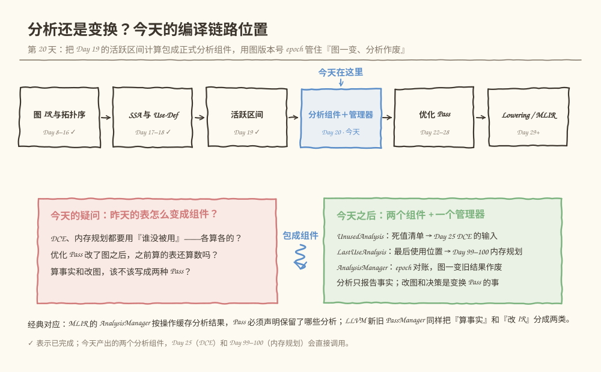
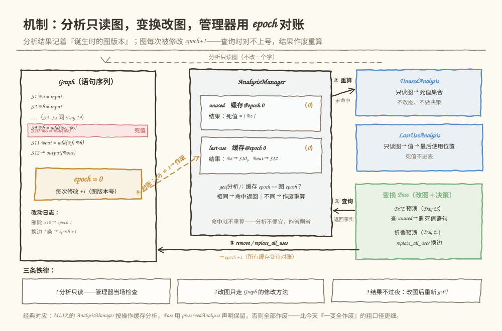
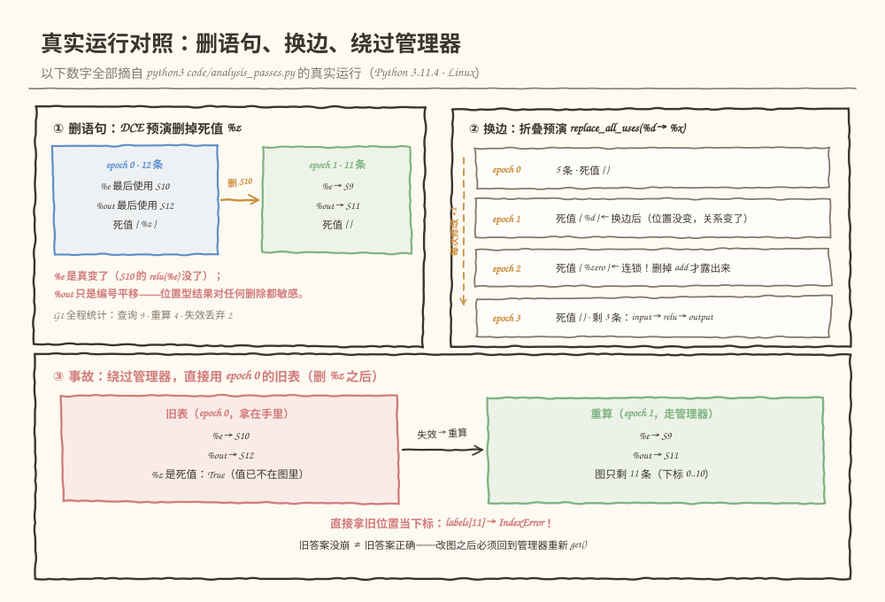

# 第 020 天：图一变，昨天的分析就是废纸？——分析 Pass 与变换 Pass 的分离

> **今日目标**：读完本教程并完成实践后，你能把 Day 19 在演练场脚本里顺手算的"谁没被使用 / 谁最后被使用"包装成两个正式的分析组件（UnusedAnalysis、LastUseAnalysis），说出分析 Pass 与变换 Pass 的三条边界（只读、走方法改图、决策归变换），实现一个用图版本号 epoch 做"对账"的 AnalysisManager，并通过删语句、换边、绕过管理器三组真实实验分别解释分析结果为什么会失效、怎么被抓住、失效了会出什么事。
> **预计时间**：学习 35 分钟 + 实践 45 分钟
> **前置准备**：Python 3（本教程用 3.11.4 实测）；回顾 Day 17 的 Use-Def（值与使用）、Day 19 的活跃区间（最后使用决定"退房时刻"）和 Day 19 的严格复用规则（上一任最后使用 < 下一任定义）。
> **今日产出**：`code/analysis_passes.py`（两个分析组件 + 管理器 + DCE/折叠两个消费者预演 + 19 项自测）的真实运行记录，以及一份给后续 Pass 作者的接口说明。

## 1. 今天解决什么问题？

Day 19 结束时你手里有一张漂亮的活跃区间表——但它躺在脚本的局部变量里，算完就扔。现在想象你要当 PassManager 的作者（Day 22 的预告）：

- Day 25 的 DCE 要问："**哪些值从未被使用？**"（删死代码的依据）
- Day 99–100 的内存规划要问："**每个值最后什么时候被使用？**"（缓冲区回收的依据）
- 以后还会有调度、融合收益判断……每个优化都自己写一遍遍历？代码重复还是小事，**两个 Pass 对同一张图算出两套互相矛盾的"事实"** 才是灾难。

于是你把"算事实"抽成了组件。但第二天就撞上一个更阴险的问题：**优化 Pass 会改图**。DCE 删掉一条语句，后面所有语句位置整体前移；折叠把一条边换个方向，Use-Def 关系全变——昨天缓存的那张区间表，现在是一张**过期地图**。拿着它做决策，轻则错过优化，重则删错节点、索引越界。

今天用贯穿全文的同一个例子解决这两件事。图还是 Day 19 那张 12 条语句的图（S1–S12，`%a` 到 `%out`，`%z` 是死值），任务清单：

1. 把"未使用"和"最后使用位置"写成两个**只读的分析组件**，接口清晰、可测试；
2. 写一个 **AnalysisManager** 管缓存：图版本号 epoch 对账，图一变旧结果作废；
3. 用三组实验看清失效的全部面貌：删语句（位置平移）、换边（位置不动关系变）、以及绕过管理器直接用旧表的真实事故。

**前置补给**：分析 Pass 与变换 Pass 的分离不是本教程发明的——MLIR 的 `AnalysisManager` 按操作缓存分析结果，Pass 必须显式声明保留了哪些分析，否则全部作废；LLVM 新旧 PassManager 同样把"算事实"和"改 IR"分成两类东西。今天我们用 200 行 Python 造一个同构的最小版本。

## 2. 先看全貌：今天的内容位于哪里？



**图 1**：看这张图时注意两点——"分析组件＋管理器"处在结构分析（活跃区间是最后一块）和优化 Pass（明天开始）之间，是优化们**共享的地基**；玫红框是今天的三个疑问，绿框是今天之后你拥有的东西：两个组件加一个管理器。

全局流程五步，今天做第四步：

1. 前端把模型变成图 IR（Day 8–14，已完成）；
2. 配上拓扑排序，知道执行顺序（Day 15–16，已完成）；
3. SSA 与 Use-Def：每个值一次定义、使用可追（Day 17–19，已完成）；
4. **把分析包装成组件并用 epoch 管住失效（今天）**；
5. 优化 Pass 开工：Day 22 的 PassManager 调度它们；Day 25 的 DCE 调用 `UnusedAnalysis`；Day 99–100 的内存规划调用 `LastUseAnalysis`。

## 3. 核心概念：从"体检报告和手术"到"epoch 对账"

### 3.1 分析 Pass 与变换 Pass：算事实的和改图的

- **通俗解释**：分析 Pass（Analysis Pass）是**只读**的——遍历图、算出某个事实、把结果交出去，一个字都不改；变换 Pass（Transform Pass）是**改图的**——根据事实做决策、动手修改 IR。
- **一个类比**：体检报告和手术。化验科抽血出报告，不动你一根手指；外科医生读报告、拍板、下刀。**对应到技术上是**：分析组件产出"死值集合""最后使用位置"这类事实并可以缓存共享；变换 Pass 消费事实、决定删不删、怎么改，改完图版本变化。类比的边界有两条：① 报告不会因为手术自动更新，但分析缓存可以被管理器作废重算；② 手术医生可以申请复查（重新查询），化验科却不该自己拿手术刀——**分析里改图是今天最典型的契约违反**（第 6 节错误二有真实演示）。
- **最小例子**：今天的 `UnusedAnalysis` 是分析（扫一遍使用关系，报告 `{%z}`）；`run_dce_preview` 是变换（读报告 → 决定删 `relu %z` 这条语句）。
- **为什么值得分**：DCE 和内存规划**共享同一份事实**而不是各算各的；分析可以独立测试（19 项自测全对着它）；失效语义有了唯一的归属地——管理器。

### 3.2 两个分析组件的契约：只报告，不决策

- **UnusedAnalysis（未使用分析）**：输入图，输出**死值集合**——定义了但从未被任何语句（**包括图输出语句**）读过的值。它只回答"谁死、死在哪"；"死值能不能删（纯算子/常量才行）、要不要删"是 Day 25 DCE 的决策，不归它管。
- **LastUseAnalysis（最后使用分析）**：输入图，输出**值 → 最后一次被使用的位置**，外加"语句 i 执行完哪些值可以回收"（`dies_after`，就是 Day 19 的退房时刻）。死值没有"最后使用"，不进这张表——归 UnusedAnalysis 管。
- **最小例子**（就用 S1–S12）：`UnusedAnalysis` 报告 `{%z}`；`LastUseAnalysis` 报告 `%e → S10`（用了 3 次的值，终点是最晚那次）、`%out → S12`（图输出也是一种使用）。这两个答案和 Day 19 的手工表逐项一致——**同源、可对账**，这正是抽成组件的好处。
- **一个常见误解**："分析组件应该顺便把能删的删了。" 顺手就坏了：分析一旦改图，它自己刚算出的事实就过期了（第 6 节错误二），而且所有依赖它的缓存一起被污染。**分析和决策混在一起的 Pass，是没法写测试的。**

### 3.3 分析结果失效：epoch 对账

- **通俗解释**：分析结果只在"它诞生时的那张图"上有效。图被改了（删语句、插语句、换边），旧结果就**失效**了——哪怕它看起来还人模人样。
- **一个类比**：地图 App 首页那行小字"道路数据截至 3 月 1 日"。道路数据是分析结果，"3 月 1 日"是它诞生的版本；城市一修路（图一改），旧地图导航就会把你带进工地。**对应到技术上是**：给图配一个版本号 epoch，每次修改 +1；分析结果记录自己诞生时的 epoch；每次查询先对账——两边一致直接返回缓存，不一致作废重算。类比的边界：地图有"截至时间"是因为世界自己会变，图**只会在别人调用修改方法时变**——所以失效是可以被编译器精确抓住的，不需要猜测。
- **失效的两种触发方式**（今天用实验各演示一次）：
  1. **删/插语句**：后面所有语句位置整体平移。删的是 `%z`，遭殃的是 `%out` 的"S12"——哪怕八竿子打不着的值，位置型结果也全部要重算；
  2. **换边**（`replace_all_uses`）：一条语句的位置都没动，但 Use-Def 关系变了——昨天还有人读 `%d`，今天全改读 `%x`，`%d` 瞬间变死值。**位置没变 ≠ 结果没变。**
- **保守策略的取舍**：我们的 epoch 是"一变全作废"的粗口径——任何修改让所有缓存作废。代价是可能多算几遍；收益是**永远不会用错**。MLIR 走得更细：按被改的操作子树失效、Pass 还能声明"我这个改动不影响某分析"（preserved analyses）——那是 Day 27 讨论不动点时的进阶话题。

## 4. 图解核心机制



**图 2**：左边是图（左下角琥珀色的 epoch 徽章就是版本号，改动日志记着每次修改）；中间是管理器，两张缓存卡各带一个"诞生版本"标记 ⟨0⟩；右边上是两个只读的分析组件，右下是改图的变换 Pass。看四条带编号的箭头：

1. **① 查询**：变换 Pass 向管理器要分析——不是自己算，也不是把分析对象存成自己的成员变量；
2. **② 重算**：缓存版本对不上（或首次查询）时，管理器调用分析的 `run()` 重算——分析只读图，不改一个字（顶部虚线就是"只读"通道）；
3. **③ 改图**：变换 Pass 调用 Graph 的修改方法（`remove_statement` / `replace_all_uses`），epoch +1，所有缓存条目变成"待对账"状态；
4. **④ 对账**：下次查询时发现缓存 ⟨0⟩ ≠ 图 1，旧结果作废。注意这个方案不需要"通知"任何人——**对账发生在查询那一刻**，改图和查询完全解耦。

底部三条铁律是今天的全部契约：分析只读（管理器当场检查）、改图只走修改方法、结果不过夜（改图后必须重新 `get()`）。

## 5. 动手实践：两个组件、一个管理器、三组实验

### 5.1 准备文件

本教程目录结构如下，脚本已随教程提供：

```text
tutorials/day-020/
├── README.md
├── code/
│   └── analysis_passes.py      # 两个分析组件 + AnalysisManager + DCE/折叠预演 + 自测
└── images/
    ├── 01-overview.svg
    ├── 02-mechanism.svg
    └── 03-example.svg
```

### 5.2 编写代码

下面是 `code/analysis_passes.py` 的完整实现（与仓库文件一致）。重点看四处：`Graph` 的修改方法里那个 `_commit`（epoch +1 全靠它）、`AnalysisManager.get` 里的对账与"分析只读"检查、`UnusedAnalysis`/`LastUseAnalysis` 里**没有任何一行修改图**的代码、以及 `run_dce_preview` 每轮删除后**重新查询**的循环：

```python
#!/usr/bin/env python3
"""第 20 天演练场：分析 Pass 与变换 Pass 的分离，以及分析结果失效。

用法：
    python3 analysis_passes.py              # 演示主流程（含失效与事故演示）
    python3 analysis_passes.py --self-test  # 运行测试，全部通过退出码 0

Day 19 在“演练场脚本”里顺手算的活跃区间，今天升级成两个正式的分析组件：
  1. UnusedAnalysis   未使用分析   —— 哪些值从未被使用（死值），Day 25 的 DCE 要用；
  2. LastUseAnalysis  最后使用分析 —— 每个值最后一次被读的位置，Day 99–100 内存规划要用。
再配一个 AnalysisManager：用“图版本号 epoch”管理缓存——
图一变（删语句、换边），旧结果作废，下次查询自动重算。

设计契约（对应 MLIR 的 AnalysisManager / Pass 分离）：
  * 分析 Pass 只读图、只报告事实，不改图（管理器会当场检查）；
  * 变换 Pass 改图，一律通过 Graph 的修改方法，每次修改 epoch + 1；
  * 分析结果只在“诞生时的图版本”下有效，改图后必须重新查询；
  * “能不能删、要不要删”这类决策写在变换 Pass 里，分析只供事实。
"""

from __future__ import annotations

import argparse

PURE_OPS = {"matmul", "add", "relu", "mul"}  # 无副作用的算子（Day 19 同款口径）

# (op, 结果值, 使用的值, shape)；None 表示 output 语句不定义值（Day 19 同款）
BASE_GRAPH = [
    ("input",     "%a",   [],           (2, 3)),
    ("input",     "%b",   [],           (3, 2)),
    ("input",     "%w",   [],           (2, 2)),
    ("const 0.5", "%s",   [],           (2, 2)),
    ("matmul",    "%c",   ["%a", "%b"], (2, 2)),
    ("add",       "%d",   ["%c", "%w"], (2, 2)),
    ("relu",      "%e",   ["%d"],       (2, 2)),
    ("mul",       "%f",   ["%e", "%s"], (2, 2)),
    ("add",       "%h",   ["%e", "%s"], (2, 2)),
    ("relu",      "%z",   ["%e"],       (2, 2)),   # %z 从未被使用：死值
    ("add",       "%out", ["%f", "%h"], (2, 2)),
    ("output",    None,   ["%out"],     None),
]

# 预演 Day 23 的 add(x, 0) → x 折叠：换边（replace_all_uses）专用小图
FOLD_GRAPH = [
    ("input",   "%x",    [],             (2, 2)),
    ("const 0", "%zero", [],             (2, 2)),
    ("add",     "%d",    ["%x", "%zero"], (2, 2)),
    ("relu",    "%e",    ["%d"],         (2, 2)),
    ("output",  None,    ["%e"],         None),
]


class GraphError(Exception):
    """图不合法，或违反“分析只读 / 改图走方法”的契约。"""


class Graph:
    """语句序列表示的线性计算图（Day 19 同款数据，套上“可变更”的正式外壳）。

    契约：
      * 只读查询（labels / used_at / validate / find_statement）不改图；
      * 修改必须走 remove_statement / replace_all_uses，每次修改 epoch + 1
        并写改动日志——直接改 self.statements 会绕过 epoch，属于调用方 bug；
      * epoch 是“图版本号”：分析结果记录自己诞生时的 epoch，对不上就作废。
    """

    def __init__(self, statements):
        self.statements = [list(s) for s in statements]
        self.epoch = 0
        self.change_log = []

    # ---------- 只读查询 ----------

    def labels(self):
        return [f"S{i + 1}" for i in range(len(self.statements))]

    def used_at(self):
        """每个值被使用的位置列表。图输出语句的输入也算使用（Day 19 教训三）。"""
        used = {}
        for i, (_, _, uses, _) in enumerate(self.statements):
            for u in uses:
                used.setdefault(u, []).append(i)
        return used

    def validate(self):
        """Day 17/18 的合法性闸门：SSA 唯一定义、使用必须先于定义。"""
        defined = {}
        for i, (_, res, _, _) in enumerate(self.statements):
            if res is None:
                continue
            if res in defined:
                raise GraphError(f"{res} 被定义两次（违反 SSA）：S{defined[res] + 1} 和 S{i + 1}")
            defined[res] = i
        for i, (_, _, uses, _) in enumerate(self.statements):
            for u in uses:
                if u not in defined:
                    raise GraphError(f"{u} 被使用但从未定义（S{i + 1}）")
                if defined[u] >= i:
                    raise GraphError(f"{u} 在定义之前被使用（S{i + 1}）")
        return True

    def find_statement(self, result):
        """返回定义 result 的语句下标。"""
        for i, (_, res, _, _) in enumerate(self.statements):
            if res == result:
                return i
        raise KeyError(f"图中没有定义 {result} 的语句")

    # ---------- 修改接口（每个都会 bump epoch）----------

    def _commit(self, note):
        self.epoch += 1
        self.change_log.append(f"epoch {self.epoch}：{note}")

    def remove_statement(self, index):
        stmt = self.statements[index]
        del self.statements[index]
        self._commit(f"删除 S{index + 1}（{stmt[0]} {stmt[1] or ''}）——后面所有语句位置前移")

    def replace_all_uses(self, old, new):
        """把所有读 old 的语句改成读 new（Day 23 折叠 Pass 的核心动作）。"""
        rewired = 0
        for stmt in self.statements:
            if old in stmt[2]:
                stmt[2] = [new if u == old else u for u in stmt[2]]
                rewired += 1
        if rewired == 0:
            raise GraphError(f"没有任何语句使用 {old}，无事可换")
        self._commit(f"换边：{rewired} 条语句改读 {new}（原来读 {old}）——位置没变，Use-Def 变了")
        return rewired


# ---------- 分析 Pass：只读图、报告事实 ----------


class Analysis:
    """分析 Pass 基类。契约：run 期间不许改图，违反会被管理器当场抓住。"""

    name = "analysis"

    def run(self, graph):
        raise NotImplementedError


class UnusedResult:
    """未使用分析的结果：死值集合 + 定义位置。"""

    def __init__(self, dead, where):
        self.dead = frozenset(dead)   # 从未被任何语句（含图输出）使用的值
        self.where = dict(where)      # 值 → 定义位置（打印用）

    def is_dead(self, name):
        return name in self.dead

    def format(self, labels):
        if not self.dead:
            return "（无死值：每个定义的值都至少被使用一次）"
        lines = []
        for name in sorted(self.dead, key=lambda n: self.where[n]):
            lines.append(f"  {name:<6}定义于 {labels[self.where[name]]}，从未被任何语句使用 ← 死值")
        return "\n".join(lines)


class UnusedAnalysis(Analysis):
    """未使用分析：找出“定义了但从未被使用”的值。

    只报告事实：哪些值死、定义在哪。哪些能删（纯算子/常量）、要不要删，
    是变换 Pass（Day 25 的 DCE）的决策，不在这里做。
    """

    name = "unused"

    def run(self, graph):
        used = graph.used_at()
        dead, where = [], {}
        for i, (_, res, _, _) in enumerate(graph.statements):
            if res is None:
                continue
            where[res] = i
            if res not in used:
                dead.append(res)
        return UnusedResult(dead, where)


class LastUseResult:
    """最后使用分析的结果：值 → 最后一次被读的位置（0 基）。"""

    def __init__(self, def_at, last_use, n_stmts):
        self.def_at = dict(def_at)
        self.last_use = dict(last_use)
        self.n_stmts = n_stmts

    def at(self, name):
        """最后使用位置；死值返回 None（归 UnusedAnalysis 管）。"""
        return self.last_use.get(name)

    def dies_after(self, index):
        """语句 index 执行完就可以回收内存的值（最后使用恰好在 index）。"""
        return sorted(n for n, p in self.last_use.items() if p == index)

    def format(self, labels):
        lines = []
        for name in sorted(self.def_at, key=lambda n: self.def_at[n]):
            if name not in self.last_use:
                continue
            d, last = self.def_at[name], self.last_use[name]
            lines.append(f"  {name:<6}定义 {labels[d]:<6}最后使用 {labels[last]:<6}区间 [{labels[d]}, {labels[last]}]")
        return "\n".join(lines)


class LastUseAnalysis(Analysis):
    """最后使用分析：每个值最后一次被读的位置。

    供 Day 99–100 的内存规划调用：dies_after(i) 就是 Day 19 说的“退房时刻”。
    死值没有“最后使用”，不进这张表。
    """

    name = "last-use"

    def run(self, graph):
        used = graph.used_at()
        def_at = {res: i for i, (_, res, _, _) in enumerate(graph.statements) if res is not None}
        last = {name: max(pos) for name, pos in used.items()}
        return LastUseResult(def_at, last, len(graph.statements))


# ---------- 管理器：缓存 + epoch 对账 ----------


class AnalysisManager:
    """分析缓存管理器：分析结果与图版本（epoch）对账。

    get(analysis) 的契约：
      * 图自上次计算以来没变（epoch 相同）→ 直接返回缓存；
      * 图变了（epoch 不同）→ 旧结果作废，重算后再返回；
      * 分析在 run 期间改图 → 当场抛 GraphError（分析只读）；
      * 调用方改图后继续使用手里的旧结果对象，属于调用方 bug（见演示 [7]）。
    """

    def __init__(self, graph):
        self.graph = graph
        self._cache = {}  # name -> (诞生时的 epoch, result)
        self.stats = {"queries": 0, "recomputed": 0, "invalidated": 0}

    def get(self, analysis):
        self.stats["queries"] += 1
        entry = self._cache.get(analysis.name)
        if entry is not None and entry[0] == self.graph.epoch:
            return entry[1]
        if entry is not None:
            self.stats["invalidated"] += 1
        epoch_before = self.graph.epoch
        result = analysis.run(self.graph)
        if self.graph.epoch != epoch_before:
            raise GraphError(
                f"分析 {analysis.name} 在 run 期间修改了图"
                f"（epoch {epoch_before} → {self.graph.epoch}）：分析 Pass 只读，改图请写成变换 Pass")
        self._cache[analysis.name] = (self.graph.epoch, result)
        self.stats["recomputed"] += 1
        return result

    def describe(self):
        lines = [f"缓存对账（图当前 epoch = {self.graph.epoch}）："]
        if not self._cache:
            lines.append("  （还没有任何缓存条目）")
        for name, (epoch, _) in sorted(self._cache.items()):
            state = "有效" if epoch == self.graph.epoch else "已失效"
            lines.append(f"  {name:<10}缓存于 epoch {epoch} → {state}")
        s = self.stats
        lines.append(f"  统计：查询 {s['queries']} 次，重算 {s['recomputed']} 次，"
                     f"失效丢弃 {s['invalidated']} 次")
        return "\n".join(lines)


# ---------- 变换 Pass：改图 + 决策（今天的两个“消费者”预演）----------


def removable(stmt):
    """这条语句的结果若无人使用，是否可以安全删除？

    纯算子和常量没有副作用，可删；input 语句代表外部输入，今天先不删
    （副作用边界的正式化是 Day 25 的事）。
    """
    op, res = stmt[0], stmt[1]
    return res is not None and (op in PURE_OPS or op.startswith("const"))


def run_dce_preview(graph, mgr):
    """最小 DCE（Day 25 的预演）：反复“查未使用 → 删一条”，直到干净。

    每删一条 epoch 就变，下一轮 mgr.get() 自动拿到重算的新结果——
    连锁死代码（删掉一层才露出下一层）就是这样被逐层剥掉的。
    """
    removed = []
    while True:
        unused = mgr.get(UnusedAnalysis())
        target = None
        for i, stmt in enumerate(graph.statements):
            if unused.is_dead(stmt[1]) and removable(stmt):
                target = i
                break
        if target is None:
            return removed
        removed.append(graph.statements[target])
        graph.remove_statement(target)


def recycle_points(graph, mgr):
    """回收点表（Day 99–100 内存规划的预演）：每条语句执行完，谁的内存可回收。"""
    lu = mgr.get(LastUseAnalysis())
    rows = []
    for i, lbl in enumerate(graph.labels()):
        dying = lu.dies_after(i)
        if dying:
            rows.append((lbl, dying))
    return rows


# ---------- 工具 ----------


def fmt_names(names):
    if not names:
        return "（无）"
    return "、".join(sorted(names))


def print_graph(g):
    labels = g.labels()
    for i, (op, res, uses, _) in enumerate(g.statements):
        lhs = f"{res:<6}= " if res else "  →   "
        rhs = f"{op}({', '.join(uses)})" if uses else op
        print(f"{labels[i]:<5}{lhs}{rhs}")


# ---------- 演示 ----------


def demo():
    g = Graph(BASE_GRAPH)
    g.validate()
    mgr = AnalysisManager(g)
    unused_a, lastuse_a = UnusedAnalysis(), LastUseAnalysis()

    print("== [1] 图 G1：Day 19 同款 12 条语句，epoch = 0 ==")
    print_graph(g)
    print(f"图版本号 epoch = {g.epoch}（还没被修改过）；合法性与 Use-Def 由 validate() 把关")

    print("\n== [2] 分析组件一：UnusedAnalysis —— 谁从未被使用 ==")
    unused = mgr.get(unused_a)
    print(unused.format(g.labels()))
    print("契约：只报告事实（哪些值没人读、定义在哪）。能不能删、要不要删，是变换 Pass 的决策。")

    print("\n== [3] 分析组件二：LastUseAnalysis —— 每个值最后被读的位置 ==")
    lu = mgr.get(lastuse_a)
    print(lu.format(g.labels()))
    print("死值 %z 不进这张表：没有“最后使用”可言，归 UnusedAnalysis 管。")
    print("\n回收点表（Day 99–100 内存规划的输入，即 Day 19 的“退房时刻”）：")
    for lbl, dying in recycle_points(g, mgr):
        print(f"  {lbl} 执行完：{fmt_names(dying)} 的缓冲区可回收")
    print("与 Day 19 的严格复用规则严丝合缝：S5 执行完回收 %a，S6 起定义的值才能进那块内存。")

    print("\n== [4] AnalysisManager：缓存与命中（epoch 对账） ==")
    print(mgr.describe())
    print("图没变，再各查一次（应当命中缓存、不重算）：")
    mgr.get(unused_a)
    mgr.get(lastuse_a)
    print(mgr.describe())

    print("\n== [5] 失效第一例：删除语句（DCE 预演，Day 25） ==")
    old_e, old_out = lu.at("%e"), lu.at("%out")
    removed = run_dce_preview(g, mgr)
    print("DCE 预演删除了：")
    for stmt in removed:
        print(f"  {stmt[0]} {stmt[1]}（结果从未被使用，且是无副作用的纯算子）")
    print("改动日志：")
    for entry in g.change_log:
        print("  " + entry)
    fresh_lu = mgr.get(lastuse_a)
    print("重算后对照（两行都变了，但原因不同）：")
    print(f"  %e    最后使用 S{old_e + 1} → S{fresh_lu.at('%e') + 1}   真变了：S10 的 relu(%e) 没了")
    print(f"  %out  最后使用 S{old_out + 1} → S{fresh_lu.at('%out') + 1}   只是挪了编号：还是那条 output 语句")
    print("死值重算：" + fmt_names(mgr.get(unused_a).dead))
    print(mgr.describe())

    print("\n== [6] 失效第二例：换边（折叠预演，Day 23 的 replace_all_uses） ==")
    g2 = Graph(FOLD_GRAPH)
    g2.validate()
    mgr2 = AnalysisManager(g2)
    print("小图 G2：预演 Day 23 的 add(x, 0) → x 折叠")
    print_graph(g2)
    print("初始死值：" + fmt_names(mgr2.get(UnusedAnalysis()).dead))
    n = g2.replace_all_uses("%d", "%x")
    print(f"换边完成：改写 {n} 条语句的输入（relu 的输入从 %d 改成 %x）")
    print("换边后死值：" + fmt_names(mgr2.get(UnusedAnalysis()).dead)
          + " —— 位置一个没动，Use-Def 关系变了，epoch 对账照样抓住")
    removed2 = run_dce_preview(g2, mgr2)
    print("DCE 预演连锁删除：")
    for stmt in removed2:
        print(f"  {stmt[0]} {stmt[1]}")
    print("改动日志：")
    for entry in g2.change_log:
        print("  " + entry)
    print("最终 G2：")
    print_graph(g2)
    print("这就是 Day 23＋Day 25 的完整剧本：折叠换边 → DCE 清扫 → 中间算子消失。")
    print(mgr2.describe())

    print("\n== [7] 事故演示：绕过管理器，直接用旧结果 ==")
    g3 = Graph(BASE_GRAPH)
    mgr3 = AnalysisManager(g3)
    stale_lu = mgr3.get(LastUseAnalysis())
    stale_unused = mgr3.get(UnusedAnalysis())
    print("复制一份 G3（epoch 0），把两份结果取走放在手里，然后删掉死值 %z：")
    g3.remove_statement(g3.find_statement("%z"))
    labels3 = g3.labels()
    fresh_lu3 = mgr3.get(LastUseAnalysis())
    print(f"{'值':<6}{'旧表（epoch 0）':<15}{'重算（epoch 1）':<15}后果")
    for name in ("%e", "%out"):
        old_pos, new_pos = stale_lu.at(name), fresh_lu3.at(name)
        if old_pos >= len(labels3):
            print(f"{name:<6}S{old_pos + 1:<14}S{new_pos + 1:<14}越界：图只剩 {len(labels3)} 条（下标 0..{len(labels3) - 1}）")
        else:
            verdict = "碰巧没撞上（这次）" if old_pos == new_pos else "悄悄错：拿着旧位置当新事实"
            print(f"{name:<6}S{old_pos + 1:<14}S{new_pos + 1:<14}{verdict}")
    try:
        labels3[stale_lu.at("%out")]
    except IndexError as exc:
        print(f"直接拿旧位置当下标：labels[{stale_lu.at('%out')}] → IndexError: {exc}")
    print(f"旧表还认为 %z 是死值：{stale_unused.is_dead('%z')} —— 但它已经不在图里了")
    print("旧答案没崩 ≠ 旧答案正确。结论：改图之后，必须回到管理器重新查询。")
    print(mgr3.describe())

    print("\n== [8] 接口契约（给后续 Pass 作者，详见教程 5.5 节） ==")
    print("  分析只读；改图只走 Graph 的修改方法；分析结果不过夜——改图后重新 get()。")
    return 0


# ---------- 自测 ----------


def self_test():
    results = []

    def check(name, cond):
        results.append((name, bool(cond)))
        print(f"  {'✓' if cond else '✗'} {name}")

    print("== 自测：两个分析组件 + 缓存与失效 ==")

    g = Graph(BASE_GRAPH)
    g.validate()
    mgr = AnalysisManager(g)

    unused = mgr.get(UnusedAnalysis())
    check("未使用分析：基图死值只有 %z", unused.dead == {"%z"})
    check("图输出算使用：%out 不是死值", not unused.is_dead("%out"))

    lu = mgr.get(LastUseAnalysis())
    expect = {"%a": 4, "%b": 4, "%w": 5, "%s": 8, "%c": 5, "%d": 6,
              "%e": 9, "%f": 10, "%h": 10, "%out": 11}
    check("最后使用：与 Day 19 手工表逐项一致", all(lu.at(k) == v for k, v in expect.items()))
    check("死值 %z 不在最后使用表里", lu.at("%z") is None)
    check("S5 执行完可回收 %a、%b", lu.dies_after(4) == ["%a", "%b"])

    recomputed_before = mgr.stats["recomputed"]
    mgr.get(UnusedAnalysis())
    check("图没变时第二次查询命中缓存（不重算）", mgr.stats["recomputed"] == recomputed_before)

    g.remove_statement(g.find_statement("%z"))
    check("删除语句后 epoch 加一", g.epoch == 1)
    lu2 = mgr.get(LastUseAnalysis())
    check("失效重算：%e 最后使用前移到 S9", lu2.at("%e") == 8)
    check("失效重算：%out 最后使用前移到 S11", lu2.at("%out") == 10)
    check("这次查询触发了重算", mgr.stats["recomputed"] == recomputed_before + 1)

    g2 = Graph(FOLD_GRAPH)
    g2.validate()
    mgr2 = AnalysisManager(g2)
    check("折叠图初始没有死值", mgr2.get(UnusedAnalysis()).dead == set())
    g2.replace_all_uses("%d", "%x")
    check("换边后 %d 变成死值（位置没变，关系变了）", mgr2.get(UnusedAnalysis()).dead == {"%d"})

    removed = run_dce_preview(g2, mgr2)
    check("DCE 连锁删掉 %d 和 %zero 两条", [s[1] for s in removed] == ["%d", "%zero"])
    check("删完之后 G2 只剩 3 条语句", len(g2.statements) == 3)
    check("删完之后没有死值", mgr2.get(UnusedAnalysis()).dead == set())

    g1 = Graph(BASE_GRAPH)
    m1 = AnalysisManager(g1)
    removed1 = run_dce_preview(g1, m1)
    check("基图 DCE 预演只删掉 %z 一条", [s[1] for s in removed1] == ["%z"])

    class BadAnalysis(Analysis):
        name = "bad"

        def run(self, graph):
            graph.remove_statement(graph.find_statement("%z"))
            return None

    g4 = Graph(BASE_GRAPH)
    m4 = AnalysisManager(g4)
    try:
        m4.get(BadAnalysis())
        check("改图的分析被管理器当场拒绝", False)
    except GraphError:
        check("改图的分析被管理器当场拒绝（分析只读）", True)

    g3 = Graph(BASE_GRAPH)
    m3 = AnalysisManager(g3)
    stale = m3.get(LastUseAnalysis())
    g3.remove_statement(g3.find_statement("%z"))
    fresh = m3.get(LastUseAnalysis())
    check("旧结果与新结果不是同一份对象", stale is not fresh)
    check("旧结果里 %out 的位置已经越界", stale.at("%out") >= len(g3.statements))

    passed = sum(1 for _, ok in results if ok)
    print(f"\n{passed}/{len(results)} 项通过")
    return 0 if passed == len(results) else 1


def main():
    ap = argparse.ArgumentParser(description="分析组件与分析失效演练场")
    ap.add_argument("--self-test", action="store_true", help="运行测试而不是演示")
    args = ap.parse_args()
    if args.self_test:
        return self_test()
    return demo()


if __name__ == "__main__":
    raise SystemExit(main())
```

### 5.3 运行主流程：两个组件 + 缓存命中

在 `tutorials/day-020/` 目录下运行：

```bash
python3 code/analysis_passes.py
```

以下是本环境的**真实运行结果**（Python 3.11.4，Linux），不是预期输出。先看 `[1]`–`[4]` 段：

```text
== [1] 图 G1：Day 19 同款 12 条语句，epoch = 0 ==
S1   %a    = input
S2   %b    = input
S3   %w    = input
S4   %s    = const 0.5
S5   %c    = matmul(%a, %b)
S6   %d    = add(%c, %w)
S7   %e    = relu(%d)
S8   %f    = mul(%e, %s)
S9   %h    = add(%e, %s)
S10  %z    = relu(%e)
S11  %out  = add(%f, %h)
S12    →   output(%out)
图版本号 epoch = 0（还没被修改过）；合法性与 Use-Def 由 validate() 把关

== [2] 分析组件一：UnusedAnalysis —— 谁从未被使用 ==
  %z    定义于 S10，从未被任何语句使用 ← 死值
契约：只报告事实（哪些值没人读、定义在哪）。能不能删、要不要删，是变换 Pass 的决策。

== [3] 分析组件二：LastUseAnalysis —— 每个值最后被读的位置 ==
  %a    定义 S1    最后使用 S5    区间 [S1, S5]
  %b    定义 S2    最后使用 S5    区间 [S2, S5]
  %w    定义 S3    最后使用 S6    区间 [S3, S6]
  %s    定义 S4    最后使用 S9    区间 [S4, S9]
  %c    定义 S5    最后使用 S6    区间 [S5, S6]
  %d    定义 S6    最后使用 S7    区间 [S6, S7]
  %e    定义 S7    最后使用 S10   区间 [S7, S10]
  %f    定义 S8    最后使用 S11   区间 [S8, S11]
  %h    定义 S9    最后使用 S11   区间 [S9, S11]
  %out  定义 S11   最后使用 S12   区间 [S11, S12]
死值 %z 不进这张表：没有“最后使用”可言，归 UnusedAnalysis 管。

回收点表（Day 99–100 内存规划的输入，即 Day 19 的“退房时刻”）：
  S5 执行完：%a、%b 的缓冲区可回收
  S6 执行完：%c、%w 的缓冲区可回收
  S7 执行完：%d 的缓冲区可回收
  S9 执行完：%s 的缓冲区可回收
  S10 执行完：%e 的缓冲区可回收
  S11 执行完：%f、%h 的缓冲区可回收
  S12 执行完：%out 的缓冲区可回收
与 Day 19 的严格复用规则严丝合缝：S5 执行完回收 %a，S6 起定义的值才能进那块内存。

== [4] AnalysisManager：缓存与命中（epoch 对账） ==
缓存对账（图当前 epoch = 0）：
  last-use  缓存于 epoch 0 → 有效
  unused    缓存于 epoch 0 → 有效
  统计：查询 3 次，重算 2 次，失效丢弃 0 次
图没变，再各查一次（应当命中缓存、不重算）：
缓存对账（图当前 epoch = 0）：
  last-use  缓存于 epoch 0 → 有效
  unused    缓存于 epoch 0 → 有效
  统计：查询 5 次，重算 2 次，失效丢弃 0 次
```

对照检查三点：`[2]` 的死值正是 Day 19 手工找出的 `%z`；`[3]` 的每个区间与 Day 19 的手工表**逐项一致**（`%e` 的终点是 S10 不是 S8——昨天最重要的那条结论，今天由组件自动保证）；`[4]` 的统计是缓存的证据——5 次查询只发生 2 次重算，后面 3 次全是命中，**分析没有重复劳动**。

### 5.4 修改图再观察：三组对照实验

**实验一：删除语句（DCE 预演）——位置整体平移。** 紧接着上面，脚本用 `run_dce_preview` 删掉了死值 `%z`（真实运行结果，节选）：

```text
== [5] 失效第一例：删除语句（DCE 预演，Day 25） ==
DCE 预演删除了：
  relu %z（结果从未被使用，且是无副作用的纯算子）
改动日志：
  epoch 1：删除 S10（relu %z）——后面所有语句位置前移
重算后对照（两行都变了，但原因不同）：
  %e    最后使用 S10 → S9   真变了：S10 的 relu(%e) 没了
  %out  最后使用 S12 → S11   只是挪了编号：还是那条 output 语句
死值重算：（无）
缓存对账（图当前 epoch = 1）：
  last-use  缓存于 epoch 1 → 有效
  unused    缓存于 epoch 1 → 有效
  统计：查询 9 次，重算 4 次，失效丢弃 2 次
```

解读：DCE 循环里**每一轮删除后都重新查询**——round 1 命中 epoch 0 的缓存拿到 `{%z}`，删掉 S10（epoch → 1）；round 2 对账发现作废，重算得 `{}`，循环结束。注意那两行对照：`%e` 的 S10→S9 是**事实真的变了**（读它的那条 relu 没了）；`%out` 的 S12→S11 只是**编号平移**（还是同一条 output 语句）。但不管是哪种变化，位置型结果都必须整体重算——**删的是 `%z`，挪的是所有人的位置**。

**实验二：换边（折叠预演）——位置没动，关系变了。** 换一张 5 条语句的小图 G2，预演 Day 23 的 `add(x, 0) → x`（真实运行结果）：

```text
== [6] 失效第二例：换边（折叠预演，Day 23 的 replace_all_uses） ==
小图 G2：预演 Day 23 的 add(x, 0) → x 折叠
S1   %x    = input
S2   %zero = const 0
S3   %d    = add(%x, %zero)
S4   %e    = relu(%d)
S5     →   output(%e)
初始死值：（无）
换边完成：改写 1 条语句的输入（relu 的输入从 %d 改成 %x）
换边后死值：%d —— 位置一个没动，Use-Def 关系变了，epoch 对账照样抓住
DCE 预演连锁删除：
  add %d
  const 0 %zero
改动日志：
  epoch 1：换边：1 条语句改读 %x（原来读 %d）——位置没变，Use-Def 变了
  epoch 2：删除 S3（add %d）——后面所有语句位置前移
  epoch 3：删除 S2（const 0 %zero）——后面所有语句位置前移
最终 G2：
S1   %x    = input
S2   %e    = relu(%x)
S3     →   output(%e)
这就是 Day 23＋Day 25 的完整剧本：折叠换边 → DCE 清扫 → 中间算子消失。
缓存对账（图当前 epoch = 3）：
  unused    缓存于 epoch 3 → 有效
  统计：查询 5 次，重算 4 次，失效丢弃 3 次
```

解读有三层：① 换边之后**一条语句的位置都没变**，但 `%d` 从"有人读"变成"没人读"——失效不只来自增删，**改边同样要 bump epoch**；② DCE 的连锁在这里现出原形：删掉 `add %d` 之后，`%zero` 才暴露成死值（它的唯一使用者就是那个 add），循环第二轮接着删——**每轮删完都靠失效重算拿到新事实**；③ 最终图 `relu(%x)` 干干净净，这正是 Day 23＋25 将要正式实现的完整剧本。

**实验三：绕过管理器直接用旧表——真实事故。** 复制一份 G3，先把两份结果**拿在手里**，再删掉 `%z`，然后比较"旧表"和"重算"（真实运行结果）：

```text
== [7] 事故演示：绕过管理器，直接用旧结果 ==
复制一份 G3（epoch 0），把两份结果取走放在手里，然后删掉死值 %z：
值     旧表（epoch 0）    重算（epoch 1）    后果
%e    S10            S9             悄悄错：拿着旧位置当新事实
%out  S12            S11            越界：图只剩 11 条（下标 0..10）
直接拿旧位置当下标：labels[11] → IndexError: list index out of range
旧表还认为 %z 是死值：True —— 但它已经不在图里了
旧答案没崩 ≠ 旧答案正确。结论：改图之后，必须回到管理器重新查询。
缓存对账（图当前 epoch = 1）：
  last-use  缓存于 epoch 1 → 有效
  unused    缓存于 epoch 0 → 已失效
  统计：查询 3 次，重算 3 次，失效丢弃 1 次
```



**图 3**：三个面板全部来自上面的真实输出——① 删语句的前后对照（`%e` 真变了、`%out` 只是平移）；② 换边的四轮 epoch 变化（连锁死代码逐层暴露）；③ 事故的两副面孔：`%e` 悄悄错（S10 现在是 `%h` 的位置），`%out` 直接越界崩溃。合起来的结论只有一句话：**失效有两种死法（安静地错 / 大声地崩），管理器让两种都不会发生**——前提是你改图之后回到它那里重新查询。

### 5.5 接口说明（给后续 Pass 作者）

| 接口 | 输入 | 输出 | 语义要点 | 谁在用 |
|---|---|---|---|---|
| `UnusedAnalysis().run(g)` | 图（只读） | `UnusedResult` | `.dead` 死值集合；`.is_dead(name)`；图输出算使用 | Day 25 DCE |
| `LastUseAnalysis().run(g)` | 图（只读） | `LastUseResult` | `.at(name)` 返回位置或 `None`；`.dies_after(i)` 回收点；死值不进表 | Day 99–100 内存规划 |
| `mgr.get(analysis)` | 分析实例 | 结果（缓存或重算） | epoch 相同→命中；不同→作废重算；分析改图→当场 `GraphError` | 所有变换 Pass |
| `g.remove_statement(i)` | 语句下标 | 改图 | epoch +1，写改动日志，后面语句前移 | 变换 Pass |
| `g.replace_all_uses(old, new)` | 两个值名 | 改图 | epoch +1；位置不变、Use-Def 变 | Day 23 折叠 |

三条铁律（违反任何一条，第 6 节的错误等着你）：

1. **分析只读**：分析 Pass 的 `run` 里不许调用任何修改方法——管理器在 `get` 里检查 epoch，当场抓；
2. **改图只走方法**：直接改 `g.statements` 会绕过 epoch，管理器从此失明；
3. **结果不过夜**：`result = mgr.get(...)` 拿到的对象只在当前 epoch 有效；改图之后必须重新 `get()`，旧对象只能当历史记录看。

### 5.6 运行自测

```bash
python3 code/analysis_passes.py --self-test
```

真实运行结果（19/19 通过，退出码 0）：

```text
== 自测：两个分析组件 + 缓存与失效 ==
  ✓ 未使用分析：基图死值只有 %z
  ✓ 图输出算使用：%out 不是死值
  ✓ 最后使用：与 Day 19 手工表逐项一致
  ✓ 死值 %z 不在最后使用表里
  ✓ S5 执行完可回收 %a、%b
  ✓ 图没变时第二次查询命中缓存（不重算）
  ✓ 删除语句后 epoch 加一
  ✓ 失效重算：%e 最后使用前移到 S9
  ✓ 失效重算：%out 最后使用前移到 S11
  ✓ 这次查询触发了重算
  ✓ 折叠图初始没有死值
  ✓ 换边后 %d 变成死值（位置没变，关系变了）
  ✓ DCE 连锁删掉 %d 和 %zero 两条
  ✓ 删完之后 G2 只剩 3 条语句
  ✓ 删完之后没有死值
  ✓ 基图 DCE 预演只删掉 %z 一条
  ✓ 改图的分析被管理器当场拒绝（分析只读）
  ✓ 旧结果与新结果不是同一份对象
  ✓ 旧结果里 %out 的位置已经越界

19/19 项通过
```

## 6. 常见错误与排查

**错误一：绕过管理器，改图后继续用旧结果。**
- **现象**：演示 `[7]` 的真实输出——`%e` 的旧表写着 S10（新图里那是 `%h` 的位置，**悄悄错**）；`%out` 的旧表写着 S12，直接当下标就 `IndexError: list index out of range`（图只剩 11 条）。
- **原因**：`result = mgr.get(...)` 拿到的是**普通对象**，Python 不会因为你改了图就把它变成"无效"。旧结果要么安静地错，要么大声地崩——取决于你恰好拿它干什么。
- **定位**：对账表是第一现场：`mgr.describe()` 打印每个缓存条目的 epoch 和图的 epoch；另外"旧表里的位置 ≥ 图的语句数"是一眼假的信号。
- **修复**：改图之后一律重新 `get()`。把"结果不过夜"写进代码评审清单：**任何跨着修改持有的分析结果都是嫌疑对象**。

**错误二：分析 Pass 里顺手改图。**
- **现象**：把 UnusedAnalysis 复制一份，在 `run` 末尾加了一句"顺手删掉死值"，运行（真实结果）：

```text
GraphError: 分析 bad-unused 在 run 期间修改了图（epoch 0 → 1）：分析 Pass 只读，改图请写成变换 Pass
```

- **原因**：分析在改图前算好了事实，改图后返回——如果管理器不检查，就会把"旧图的事实"盖上"新图的 epoch"存进缓存，**一份永远撒谎的缓存**：之后每次查询都命中它，永远拿不到真相。
- **定位**：本脚本的 `AnalysisManager.get` 在 `run` 前后各读一次 epoch，不一致当场抛 `GraphError`——把失效问题拦在源头，而不是等结果用错再查。
- **修复**：想删东西？写成变换 Pass（`run_dce_preview` 就是标准写法：查 → 决策 → 改图）。"分析只读"这条契约同时写进文档和自测（自测第 17 项专测它）。

**错误三：忘了图输出也是一种使用。**
- **现象**：把 `used_at` 复制出来改了一版——跳过 `output` 语句再统计（真实结果）：

```text
错误版本的死值清单： ['%out', '%z']
```

- **原因**：`%out` 的唯一"消费者"是图输出语句 S12。把 output 语句的使用漏掉，`%out` 就被误判成死值——如果 DCE 信任这份分析，会**把图的输出删掉**，这是编译器最丢人的一类 bug。
- **定位**：死值清单里出现 `%out` 立刻可疑（它是图输出）；跑自测，"图输出算使用"那一项专门抓这个。
- **修复**：`used_at` 统计**所有**语句的输入，output 语句天然在内（Day 19 把 output 建成一条语句的设计在这里兑现了价值）。

**错误四：绕过修改方法，直接改 `g.statements`。**
- **现象**：不调用 `remove_statement`，直接 `g.statements.append(...)`（真实结果）：

```text
直接 append 一条语句（绕过 Graph 的修改方法）：
图现在有 13 条语句，epoch 仍是 0
管理器返回的还是同一份缓存： True ——图变了它毫无察觉，%r 没被报告
```

- **原因**：epoch 只在 `Graph` 的修改方法里 +1。直接操作列表，版本号纹丝不动，管理器的对账永远"通过"——**不是管理器错了，是它被蒙在鼓里**。
- **定位**：`mgr.get()` 返回的对象和上一次是同一个（`is` 判断为 True）且统计里没有新增重算——图明明变了却什么都没发生，这就是被绕过的信号。
- **修复**：改图只走 `remove_statement` / `replace_all_uses`；把这条写进 Graph 的 docstring 契约。要更硬的保证，可以把 `statements` 收成 `_statements` 并只暴露只读属性（返回副本），让"绕过"从约定问题变成语法问题——代价是每次读取多一次拷贝，今天先靠约定 + 评审。

## 7. 今日练习

### 必做练习

给 `BASE_GRAPH` 的 S10 之后插入一条语句：`("mul", "%y", ["%z"], (2, 2))`（`%y = mul(%z, …)`，插入后共 13 条）。先手工预测，再运行对答案：

- 新图初始的死值是谁？`run_dce_preview` 会按什么顺序删、一共删几条？
- 删除过程中 `UnusedAnalysis` 被查询几次、重算几次？为什么"删掉一条才露出下一条"？
- 全部删完之后，`%e` 的最后使用位置是多少？

预期产出：改前的预测笔记 + 运行后的真实输出。一个值得写进笔记的观察：**连锁死代码不是一次分析能全部看见的——它依赖"删除 → 失效 → 重算"的循环**，这正是 DCE 要迭代到不动点的原因（Day 27 会正面讨论不动点）。

### 选做挑战

仿照 `LastUseAnalysis` 实现一个 `FirstUseAnalysis`（每个值**首次**被使用的位置），再写一个消费者 `schedule_hints(graph, mgr)`：对每个 input/const 语句，如果"定义位置"和"首次使用位置"隔了超过 2 条语句，就建议把它挪到首次使用之前（Day 19 实验一 `--late-constant` 的自动化版本）。验证方式：对原 `BASE_GRAPH` 运行，它应该对 `%s`（定义 S4、首用 S8）给出建议，对 `%a`（定义 S1、首用 S5）不给出或给出后解释原因。想一想：**哪些图变换会保留你的 FirstUseAnalysis 结果、哪些一定会作废？**——这就是 MLIR 里"声明保留分析"要回答的问题。

## 8. 今日验收

- [ ] 我能用自己的话说清分析 Pass 和变换 Pass 的边界——为什么"分析顺手改图"比"不抽分析"更糟，并能引用管理器抛出的那条 `GraphError` 作证；
- [ ] 我独立运行了 `python3 code/analysis_passes.py`，`[2]`、`[3]` 的输出与 Day 19 的手工表逐项对上，`[4]` 的统计证明缓存命中（5 次查询 2 次重算）；
- [ ] 我能解释三组实验各自的要点：删语句时 `%e` 真变而 `%out` 只是平移；换边时位置没动但 `%d` 变死值、连锁删除靠失效重算逐层剥；绕过管理器时旧表"要么悄悄错、要么越界崩"；
- [ ] 我运行了 `--self-test`（19/19 通过），并知道其中至少 3 项分别在防哪个常见错误；
- [ ] 我保存了 `code/analysis_passes.py`、三张图和本次真实运行记录，`python3 code/analysis_passes.py` 随时可以复现全部输出。

## 9. 一句话总结与明天预告

今天的问题是"昨天的活跃区间表怎么变成优化能用的东西，图一变又怎么办"；机制是把"算事实"和"改图"拆成两类 Pass——`UnusedAnalysis` 报死值、`LastUseAnalysis` 报最后使用（两者与 Day 19 手工表逐项同源），`AnalysisManager` 用图版本号 epoch 对账：命中就返回缓存，图一改全部作废、下次重算；实践是跑通主流程（5 次查询 2 次重算）和三组实验——删语句（`%e` S10→S9 真变、`%out` S12→S11 平移）、换边（`%d` 变死值、连锁删除剥两层）、绕过管理器（旧表要么悄悄错要么 `IndexError`）；验证靠 19 项自测加上四个真实事故演示（旧结果、分析改图、漏算图输出、绕过修改方法）。明天（Day 21）是第 3 周复盘：把 CFG、SSA、支配关系和活跃区间串成一张完整的图，画一个含分支的例子，并补上今天刻意绕开的一角——带分支的一般 CFG 上，活跃变量得靠反向数据流方程来算。
