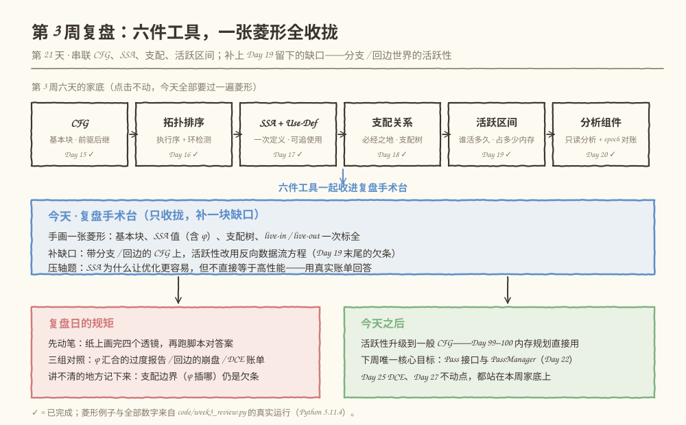
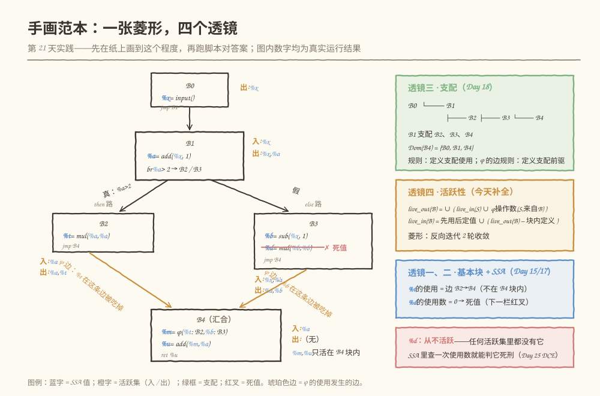
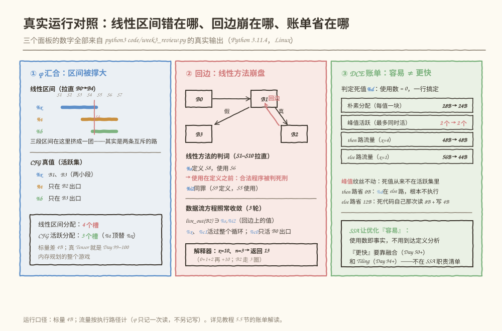

# 第 021 天：第 3 周复盘——把 CFG、SSA、支配、活跃区间画进同一张图

> **今日目标**：完成本教程后，你能不看笔记说出第 3 周六天（CFG、拓扑排序、SSA、支配、活跃区间、分析组件）各自回答的问题和依赖关系；先在纸上手画一个含分支的菱形例子——标出基本块、SSA 值（含 φ）、支配树和每块的 live-in / live-out——再运行脚本机器阅卷对答案；把 Day 19 明确留下的缺口补上（带分支 / 回边的 CFG 用反向数据流方程算活跃性），并用两个反例说清"线性区间"在分支世界的两处失效；最后用一份真实运行的账单回答压轴题："SSA 为什么让优化更容易，但不直接等于高性能"。
> **预计时间**：学习 35 分钟 + 实践 45 分钟（手画约 15 分钟）
> **前置准备**：Python 3（本教程用 3.11.4 实测）；一张纸、一支笔；第 15～20 天教程——今天的每个透镜都对应其中一天，新概念只有"反向数据流方程"一块。
> **今日产出**：一张手画的菱形草图（四个透镜一次标全）；`code/week3_review.py` 的真实运行记录（27 项自测全过）；一页复盘（第 8 节）和压轴题的五句话标准回答。

## 1. 今天解决什么问题？

第 3 周攒了六件工具，但它们散落在六个演练场里：CFG 在 `mini-cfg-v1`，拓扑排序在 `mini-graph-v8`，SSA、支配、活跃区间、分析组件各有一个 Python 脚本。昨天（Day 20）结尾预告了今天的两笔账：

> "明天（Day 21）是第 3 周复盘：把 CFG、SSA、支配关系和活跃区间串成一张完整的图，画一个含分支的例子，并补上今天刻意绕开的一角——带分支的一般 CFG 上，活跃变量得靠反向数据流方程来算。"

第一笔是**串联**。复盘日（同第 7、14 天的规矩）只收拢、不扩张——六件工具要在**同一个例子**上同时营业，而不是把六天的目录再念一遍。Day 19 末尾那句白纸黑字的欠条——"带分支的一般 CFG 上，活跃变量要靠反向数据流方程（Day 21 复盘串起来）"——今天必须兑现，这是唯一的新内容。

第二笔是**压轴题**：**SSA 为什么让优化更容易，但不直接等于高性能？** 前半句你上周就有体感（DCE 就是查一次使用数）；后半句容易被忽略。今天用一份真实运行的账单把两半都算清楚。

贯穿全文的例子是 Day 18 那个菱形的"修复版"。Day 18 的版本故意留了个 bug：汇合点 B5 读 `t`，但 `t` 只在 then 路定义——检查器用支配关系当场拒收。今天把它修成合法 SSA：**两条路各定义一个值，汇合处用 φ（phi）按来路选版本**。顺手在 else 路塞一个死值 `%d`（Day 20 的老朋友），让四个透镜都有戏份：

```text
B0:  %x = input                     （入口）
B1:  %a = add(%x, 1)
     br %a > 2 → B2 / B3            （分支：真走 B2，假走 B3）
B2:  %t = mul(%a, %a)               （then 路）
B3:  %b = sub(%x, 1)
     %d = mul(%b, %b)               （死值：从未被使用）
B4:  %m = φ(%t : B2, %b : B3)       （汇合：φ 按来路选版本）
     %u = add(%m, %a)
     ret %u
```

手算两个输入热身：`x=4` → `%a=5`，`5>2` 为真 → 走 B2，`%t=25`，φ 选 `%t` → `%m=25`，`%u=30`；`x=1` → `%a=2`，`2>2` 为假 → 走 B3，`%b=0`（`%d=0` 白算一场），φ 选 `%b` → `%m=0`，`%u=2`。同一个程序，不同输入走不同路、得不同结果——这五行账，今天要让六件工具全部看得懂。

## 2. 先看全貌：今天的内容位于哪里？



**图 1**：看三个区域。顶部六张卡是本周六天的家底，全带 ✓——今天它们不再各自营业，全部要在一张菱形上同时过关；中间蓝框是复盘手术台的三件事（手画验收、补数据流方程的缺口、算压轴题账单）；底部两个框是今天的规矩（先动笔再对答案）和今天之后的东西（下周 Day 22 的 PassManager 正好接住本周的全部产出）。

全局路线四步，今天做第四步：

1. **第 1～2 周**：C++、Tensor、图 IR、Use-Def、Verifier（已完成，`mini-graph` 封存）；
2. **第 3 周上半**：CFG 与拓扑排序——"顺序"从数据依赖升级成控制流（Day 15–16）；
3. **第 3 周下半**：SSA、支配、活跃区间、分析组件——每个值一次定义、每条路径先定义后使用、每个值有退房时刻、分析可以缓存共享（Day 17–20）；
4. **今天（第 21 天）**：一张菱形把四个透镜串完，补上反向数据流方程；明天（Day 22）起，Pass 接口和 PassManager 开张，DCE（Day 25）、融合（Day 50+）、内存规划（Day 99–100）都会回头来用本周的这些事实。

## 3. 核心概念：一张菱形，四个透镜

复盘的写法：每个透镜用三句话说清"它回答什么问题"，再给出今天例子上的答案。你已经学过细节，这里只留结论和最容易翻车的那一点。

### 3.1 基本块与边：秩序从数据依赖升级为控制流（Day 15–16 收拢）

- **一句通俗解释**：基本块（Basic Block）是"只能从第一句进、从最后一句出"的直线代码段；CFG 的边说的不再是"我需要你的结果"（数据依赖），而是"下一步可能去哪"（控制转移）。
- **一个类比**：DAG 是流水线交接单——上游做完下游才能开工；CFG 是路网导航——每个路口都有几条可走的路，具体走哪条看运行期。**对应到技术上是**：DAG 里每个节点必须执行且恰好一次，CFG 里"要不要执行、执行几次"由边和运行期输入决定。类比的边界：CFG 不是任意图——它有唯一的入口、每个块有唯一的"最后一跳"（终结符），这两条 Day 15 的 Verifier 查过。
- **今天的答案**：5 个块、5 条边。B1 是全图唯一的分支（两个后继），B4 的两个前驱各带一个"版本"来汇合——菱形的最小完整形态。
- **容易翻车的点**：块序不等于执行顺序。拓扑排序对 DAG 给的是"执行时间表"；对 CFG 最多给一个"观察顺序"——`B0,B1,B2,B3,B4` 只是合法的块排列之一，**没有一条真实执行路径长这样**（then 路跳过 B3，else 路跳过 B2）。5.4 节的回边实验会把这层窗户纸彻底捅破。

### 3.2 SSA 与 Use-Def：每个值只出生一次，φ 的使用发生在"边"上（Day 17 收拢）

- **一句通俗解释**：SSA（Static Single Assignment）要求每个值只定义一次；于是"这个使用用的是哪个值"不再靠回溯名字，而是直接沿 Use-Def 链查表。
- **一个类比**：非 SSA 的名字像"王师傅"——厂里有三个王师傅，喊一声得问"哪个车间的"；SSA 给每个人发唯一工号。**对应到技术上是**：每个值一个定义点、零到多个使用点；φ 是汇合处的"分诊台"——它本身是汇合块里的一次**新定义**（结果 `%m` 是新值），输入按"从哪条边来"选择。类比的边界：φ 的**输入**不是"在汇合块里读了一次"——这是今天最容易画错的地方，马上展开。
- **今天的答案**：7 个值里，`%t` 和 `%b` 的使用点不在任何"块内语句"上，而在**边 B2→B4、边 B3→B4** 上——值要在前驱块执行结束时还活着，被边带走交给 φ。这个细节（使用记在边上）是今天反复兑现的主线。
- **容易翻车的点**：把 `%m = φ(%t, %b)` 读成"B4 里读了一次 %t 和 %b"。如果这么记，活跃性、缓冲区共享全都会算错——第 6 节错误一有真实翻车现场。

### 3.3 支配：定义是使用的必经之地（Day 18 收拢）

- **一句通俗解释**：块 D 支配块 U = 从入口到 U 的**每一条路径**都经过 D。"定义必须支配使用"是 SSA 在分支世界的合法性规则；汇合点需要的 φ 插在哪个块，也由支配关系决定。
- **一个类比**：门禁。1 号楼的门禁（B1）谁进楼都逃不掉，所以"在 1 号楼领的工牌"全楼有效；2 号库房（B2）的门禁只有去库房的人经过，所以"库房里的条子"出了库房不一定存在。**对应到技术上是**：`Dom(U)` 用"迭代求交集"算（Day 18 的算法今天原样复刻）；从支配集里挑"支配集最大的严格支配者"就是直接支配者 idom，idom 的父子关系连成支配树。类比的边界：支配说的是"路径必经"，**不是时间先后**——B2 在块序里排在 B3 前，但 B2 不支配 B3（else 路根本不路过 B2）。
- **今天的答案**：`Dom(B4) = {B0, B1, B4}`——分支的两个孩子 B2、B3 **都不在**里面；支配树是 B0 → B1 → {B2, B3, B4} 一层展开。
- **新细节（本周欠的半句）**：φ 的使用在边上，那么支配规则怎么跟？答案是**边规则：φ 操作数（边 P→M）的定义块必须支配前驱 P**。直觉：值要在 P 执行完时还活着才能被边带走。今天的例子里 `%t` 定义在 B2、被边 B2→B4 使用——要求"B2 支配 B2"，天然成立；反例（B3 直接使用 `%t`）则要求 B2 支配 B3——不成立，检查器当场拒收（自测第 9 项专测它）。

### 3.4 活跃性：从线性区间到反向数据流方程（Day 19 收拢 + 今天补的缺口）

- **一句通俗解释**：一个值"活跃"= 从上次定义到下次使用之间，它必须占着内存。Day 19 在**线性**图上用区间 `[定义, 最后使用]` 一笔算完；到了分支 / 回边世界，区间这条腿瘸了——今天换方程：

```text
live_out(B) = ∪ ( live_in(S) ∪ φ操作数(S, 来自 B) )     对 B 的每个后继 S
live_in(B)  = 块内先使用后定义的值 ∪ ( live_out(B) − 块内定义 )
```

- **为什么是"反向"**：定义合不合法，问的是"从入口一路走来经过了谁"（前向，Day 18 的支配）；值还活不活，问的是"往后还有没有人用我"（后向，今天）。两个问题方向相反、互相正交——Day 19 就埋了这句话。
- **φ 的边语义在这里兑现**：`live_out(B2)` 除了合并后继的 `live_in(B4)`，还要加上"B4 的 φ 从 B2 这条边要的 `%t`"——所以 `%t ∈ live_out(B2)`，但 `%t ∉ live_in(B4)`（它已经被 φ 消费掉了）。如果记错这一条，方程就白写。
- **一个类比**：Day 19 说活跃区间像"酒店的入住和退房"；分支世界里退房时刻不再是一个点，而是"每个路口盘点一次手上的行李"。**对应到技术上是**：每个块的入口 / 出口各有一个活跃集（live-in / live-out），从图的出口开始**反向**迭代，直到所有集合不再变化（不动点）。类比的边界：不动点迭代不是可选的优化——5.4 节会看到，回边上的信息要绕图一圈才能传到，**一轮迭代根本传不完**。
- **预告一句话**："迭代到不变"这个概念下周还会再见面：Day 27 讲 Pass 组合时，"反复跑到不动点"是优化的常态。

## 4. 图解核心机制



**图 2**：这就是 5.2 节你要在纸上画出来的东西（机器阅卷的满分卷面）。看五个要素：

1. **块与边**：五个圆角框、五条边；B1 出去的两条边标了"真：`%a>2` / 假"——边的形状是编译期事实，走哪条是运行期事（Day 15 的结论在分支处兑现）；
2. **SSA 值**：蓝色字是全部 7 个值；两条琥珀色的边是 φ 的"进食通道"——`%t`、`%b` 的使用点画在**边上**而不是 B4 框里；
3. **死值**：B3 里 `%d` 一整行被划掉——SSA 下判死刑只需看一眼"使用数 = 0"；
4. **支配**：右上的绿框是支配树（B0 → B1 → {B2, B3, B4}）和 φ 的边规则；
5. **活跃**：每个块旁边橙色的"入 / 出"就是 live-in / live-out（真实运行结果，见 5.3 节 [4]）——注意 B4 的入口只有 `%a`：`%t`、`%b` 在边上就被 φ 吃掉了，没资格活着走进 B4。

## 5. 动手实践：手画菱形，机器阅卷

### 5.1 准备文件

本教程目录结构如下，脚本已随教程提供：

```text
tutorials/day-021/
├── README.md
├── code/
│   └── week3_review.py      # 复盘演练场：CFG + SSA + 支配 + 活跃 + 回边 + 账单，27 项自测
└── images/
    ├── 01-week3-map.svg
    ├── 02-diamond-four-lenses.svg
    └── 03-example.svg
```

### 5.2 先手画：纸上菱形必标清单

**先别运行脚本**（答案在 5.3 节就会打印出来）。拿纸笔照第 1 节的程序画出菱形，必标六项：

1. 5 个基本块和 5 条边；B1 的两条出边标"真 / 假"；
2. 每条语句定义的 SSA 值；`%t`、`%b` 的使用点画在 B2→B4、B3→B4 的**边上**；
3. `%d` 划掉，标"死值"；
4. 支配树（从 B0 画到每个块）和 `Dom(B4)`；
5. 每个块的 live-in / live-out（从 B4 往 B0 倒着推）；
6. 自查三问：B1 的出口谁还活着？`%t` 最远活到哪？为什么 live-in(B4) 里**没有** `%t`？

大约 15 分钟。画完再往下读——复盘日的价值全在"先预测、后对答案"。

### 5.3 机器阅卷：跑脚本对答案

下面是 `code/week3_review.py` 的完整实现（与仓库文件一致）。重点看五处：`use_def` 里 φ 的使用怎么记成 `("edge", 前驱, 汇合块)`；`dominators` 的初始化两行和 idom 取最大；`check_domination` 里普通使用与 φ 边规则合用一条 `dom[use[1]]`；`liveness` 里 `phi_args` 怎么把操作数挂到**前驱的出口**；以及 `run` 里 φ 的求值顺序（先按来路取走所有 φ 的入参、再统一生效）。

```python
#!/usr/bin/env python3
"""第 21 天演练场（第 3 周复盘）：CFG、SSA、支配、活跃区间，画进同一张图。

用法：
    python3 week3_review.py               # 演示主流程：菱形 CFG 全套分析 + 回边对照 + DCE 账单
    python3 week3_review.py --self-test   # 运行测试，全部通过退出码 0

第 3 周六天各留了一件工具：CFG（Day 15）、拓扑排序（Day 16）、SSA（Day 17）、
支配关系（Day 18）、活跃区间（Day 19）、分析组件（Day 20）。今天把它们串在
同一个含分支的菱形例子上，外加补上 Day 19 明确留下的一块缺口——
带分支的一般 CFG 上，活跃变量要靠反向数据流方程：

    live_out(B) = ∪ ( live_in(S) ∪ φ操作数(S, 来自 B) )    对 B 的每个后继 S
    live_in(B)  = 块内先使用后定义的值 ∪ ( live_out(B) − 块内定义的值 )

主流程八幕：
  [1] 菱形 CFG：基本块、边、前驱 / 后继
  [2] SSA 与 Use-Def：每个值只出生一次；φ 的使用发生在“边”上
  [3] 支配集 / 支配树：Day 18 的迭代求交集复刻 + φ 的边规则（定义支配前驱）
  [4] 活跃性：反向数据流方程（今天的缺口补全）
  [5] 对照一：线性区间在 φ 汇合处过度报告 → 缓冲区共享泡汤（4 槽 vs 3 槽）
  [6] 对照二：回边让线性方法崩溃（使用在定义之前），数据流方程照常收敛
  [7] 压轴题账单：SSA 式 DCE 一行判定死值 %d，但峰值活跃纹丝不动
  [8] 一页复盘速览

手画验收：先在纸上画出菱形（标基本块、SSA 值、支配树、live-in / live-out），
再运行本脚本对答案——[1]～[4] 就是标准答案。
"""

from __future__ import annotations

import argparse

PURE_OPS = {"add", "sub", "mul", "relu", "lt"}   # 无副作用算子（Day 20 同款口径）
ELEM_BYTES = 4                                    # 标量 4 字节（i32 / f32，与 Day 19 口径一致）

# 语句 stmt = (op, result, operands)；operands 是值名（% 开头）或字面量数字
# φ 语句 = ("phi", result, {前驱块名: 操作数})
# 终结符 term = ("jmp", None, [后继]) / ("br", cond, [真后继, 假后继]) / ("ret", [输出值])
#   cond = ("gt"/"lt"/"nz", 值名, 字面量或 None)

# 菱形：Day 18 那个“汇合点读未定义 t”的 bug，今天用 φ 修成合法 SSA
DIAMOND = {
    "entry": "B0",
    "blocks": [
        ("B0", [("input", "%x", [])], ("jmp", None, ["B1"])),
        ("B1", [("add", "%a", ["%x", "1"])], ("br", ("gt", "%a", 2), ["B2", "B3"])),
        ("B2", [("mul", "%t", ["%a", "%a"])], ("jmp", None, ["B4"])),
        ("B3", [("sub", "%b", ["%x", "1"]),
                ("mul", "%d", ["%b", "%b"])], ("jmp", None, ["B4"])),   # %d：死值（从未被使用）
        ("B4", [("phi", "%m", {"B2": "%t", "B3": "%b"}),
                ("add", "%u", ["%m", "%a"])], ("ret", None, ["%u"])),
    ],
}

# 反例：B3 使用 %t——%t 定义在 B2，B2 不支配 B3（走 else 路时 %t 还没出生）
BAD_DIAMOND = {
    "entry": "B0",
    "blocks": [
        ("B0", [("input", "%x", [])], ("jmp", None, ["B1"])),
        ("B1", [("add", "%a", ["%x", "1"])], ("br", ("gt", "%a", 2), ["B2", "B3"])),
        ("B2", [("mul", "%t", ["%a", "%a"])], ("jmp", None, ["B4"])),
        ("B3", [("sub", "%b", ["%x", "1"]),
                ("add", "%q", ["%t", "1"])], ("jmp", None, ["B4"])),
        ("B4", [("phi", "%m", {"B2": "%t", "B3": "%b"}),
                ("add", "%u", ["%m", "%a"])], ("ret", None, ["%u"])),
    ],
}

# 回边实验：累加循环（x=10, n=3 → r = 0+1+2+10 = 13）
LOOP = {
    "entry": "B0",
    "blocks": [
        ("B0", [("input", "%x", []),
                ("const", "%c0", ["0"]),
                ("const", "%c1", ["1"]),
                ("const", "%n", ["3"])], ("jmp", None, ["B1"])),
        ("B1", [("phi", "%i", {"B0": "%c0", "B2": "%i2"}),
                ("phi", "%acc", {"B0": "%c0", "B2": "%s"}),
                ("lt", "%cont", ["%i", "%n"])], ("br", ("nz", "%cont", None), ["B2", "B3"])),
        ("B2", [("add", "%s", ["%acc", "%i"]),
                ("add", "%i2", ["%i", "%c1"])], ("jmp", None, ["B1"])),   # 回边 B2 → B1
        ("B3", [("add", "%r", ["%acc", "%x"])], ("ret", None, ["%r"])),
    ],
}


class CfgError(Exception):
    """CFG 不合法，或违反本演练场的契约。"""


def is_value(x):
    return isinstance(x, str) and x.startswith("%")


def cond_values(cond):
    return [cond[1]] if cond is not None else []


class Cfg:
    """块表表示的最小 CFG（Day 15 的四件套瘦身版）。"""

    def __init__(self, spec):
        self.entry = spec["entry"]
        self.order = [name for name, _, _ in spec["blocks"]]
        self.blocks = {name: {"stmts": [tuple(s) for s in stmts], "term": tuple(term)}
                       for name, stmts, term in spec["blocks"]}
        if self.entry not in self.blocks:
            raise CfgError(f"入口 {self.entry} 不存在")
        self._preds = {b: [] for b in self.order}
        for name in self.order:
            for s in self.succs(name):
                if s not in self.blocks:
                    raise CfgError(f"{name} 的后继 {s} 不存在")
                self._preds[s].append(name)
        for name in self.order:
            phi_keys = set()
            for op, _, args in self.stmts(name):
                if op == "phi":
                    phi_keys |= set(args.keys())
            if phi_keys and phi_keys != set(self.preds(name)):
                raise CfgError(
                    f"{name} 的 φ 来源 {sorted(phi_keys)} 与真实前驱 {sorted(self.preds(name))} 不一致")

    def succs(self, name):
        kind, _, ss = self.blocks[name]["term"]
        return list(ss) if kind in ("jmp", "br") else []

    def preds(self, name):
        return list(self._preds[name])

    def stmts(self, name):
        return self.blocks[name]["stmts"]

    def term(self, name):
        return self.blocks[name]["term"]

    def spec(self):
        return {"entry": self.entry,
                "blocks": [(n, list(self.blocks[n]["stmts"]), tuple(self.blocks[n]["term"]))
                           for n in self.order]}


# ---------- 打印 ----------


def fmt_stmt(stmt):
    op, res, args = stmt
    if op == "phi":
        inner = ", ".join(f"{v} : {p}" for p, v in args.items())
        return f"{res} = φ({inner})"
    return f"{res} = {op}({', '.join(str(a) for a in args)})"


def fmt_cond(cond):
    op, v, lit = cond
    if op == "gt":
        return f"{v} > {lit}"
    if op == "lt":
        return f"{v} < {lit}"
    return f"{v} ≠ 0"


def fmt_term(term):
    kind, cond, ss = term
    if kind == "jmp":
        return f"jmp {ss[0]}"
    if kind == "br":
        return f"br {fmt_cond(cond)} → {ss[0]} / {ss[1]}"
    return "ret " + ", ".join(ss)


def print_cfg(cfg):
    for name in cfg.order:
        print(f"{name}:")
        for stmt in cfg.stmts(name):
            print(f"  {fmt_stmt(stmt)}")
        print(f"  {fmt_term(cfg.term(name))}")
    print("前驱 / 后继：")
    for name in cfg.order:
        ps = "、".join(cfg.preds(name)) or "（入口）"
        ss = "、".join(cfg.succs(name)) or "（返回）"
        print(f"  {name}  前驱 {ps}   后继 {ss}")


def fmt_set(names):
    if not names:
        return "（无）"
    return "、".join(sorted(names))


# ---------- SSA 与 Use-Def（Day 17 收拢，φ 的使用记在边上）----------


def use_def(cfg):
    """每个值：定义点 + 使用点列表。

    使用点三种：
      ("stmt", 块, 语句序号)   —— 普通语句里的操作数；
      ("term", 块)             —— 终结符里的条件 / 返回值；
      ("edge", 前驱, 汇合块)   —— φ 的操作数：使用发生在“前驱 → 汇合块”的边上。
    φ 的使用记在边上（而不是 φ 所在块内），是今天全篇最重要的一个细节。
    """
    info = {}
    for name in cfg.order:
        for i, (op, res, _) in enumerate(cfg.stmts(name)):
            if res is None:
                continue
            if res in info:
                raise CfgError(f"{res} 定义了两次（违反 SSA）")
            info[res] = {"def": (name, i, op), "uses": []}
    for name in cfg.order:
        for i, (op, _, args) in enumerate(cfg.stmts(name)):
            if op == "phi":
                for p, v in args.items():
                    if is_value(v):
                        info[v]["uses"].append(("edge", p, name))
            else:
                for v in args:
                    if is_value(v):
                        info[v]["uses"].append(("stmt", name, i))
        kind, cond, ss = cfg.term(name)
        for v in cond_values(cond):
            info[v]["uses"].append(("term", name))
        if kind == "ret":
            for v in ss:
                info[v]["uses"].append(("term", name))
    for v, d in info.items():
        for use in d["uses"]:
            if use[0] == "edge":
                if use[1] not in cfg.preds(use[2]):
                    raise CfgError(f"{v} 的 φ 使用边 {use[1]}→{use[2]} 不是真实前驱边")
    return info


def fmt_use(use):
    kind = use[0]
    if kind == "edge":
        return f"边 {use[1]}→{use[2]}（φ）"
    if kind == "term":
        return f"{use[1]}（终结符）"
    return f"{use[1]}（语句 {use[2] + 1}）"


def fmt_use_list(uses):
    """同一使用点读多次（如 mul(%a, %a)）合并显示为 ×N。"""
    seen, order = {}, []
    for u in uses:
        if u not in seen:
            seen[u] = 0
            order.append(u)
        seen[u] += 1
    return "、".join(fmt_use(u) + (f" ×{seen[u]}" if seen[u] > 1 else "") for u in order)


# ---------- 支配（Day 18 收拢：迭代求交集 + idom + 支配树）----------


def dominators(cfg):
    """迭代求交集：dom(入口)={入口}，其余初始化为全集，
    反复 dom(b) = {b} ∪ ∩ dom(p)（对 b 的所有前驱 p）直到不动点。"""
    all_blocks = set(cfg.order)
    dom = {cfg.entry: {cfg.entry}}
    for b in cfg.order:
        if b != cfg.entry:
            dom[b] = set(all_blocks)
    rounds = 0
    changed = True
    while changed:
        changed = False
        rounds += 1
        for b in cfg.order:
            if b == cfg.entry:
                continue
            new = set(all_blocks)
            for p in cfg.preds(b):
                new &= dom[p]
            new.add(b)
            if new != dom[b]:
                dom[b] = new
                changed = True
    idom = {}
    for b in cfg.order:
        if b == cfg.entry:
            continue
        strict = dom[b] - {b}
        # 严格支配者是一条链：离 b 最近的就是支配集最大的那个
        idom[b] = max(strict, key=lambda d: len(dom[d]))
    return dom, idom, rounds


def dom_tree_lines(cfg, idom):
    children = {b: [] for b in cfg.order}
    for b, d in idom.items():
        children[d].append(b)
    for b in children:
        children[b].sort()
    lines = []

    def rec(b, depth):
        lines.append(("    " * depth) + ("" if depth == 0 else "└── ") + b)
        for c in children[b]:
            rec(c, depth + 1)

    rec(cfg.entry, 0)
    return lines


def check_domination(cfg, dom, ud):
    """Day 18 的规则 + φ 的边规则：
    普通使用：定义块必须支配使用块；
    φ 操作数（边 P→M）：定义块必须支配前驱 P——值要在 P 执行完时还活着，被边带走。
    返回 (检查次数, 问题列表)。"""
    problems = []
    checks = 0
    for v, d in ud.items():
        defb = d["def"][0]
        for use in d["uses"]:
            if use[0] == "edge":
                ok = defb in dom[use[1]]
            else:
                ok = defb in dom[use[1]]
            checks += 1
            if not ok:
                problems.append((v, defb, use))
    return checks, problems


# ---------- 活跃性（今天补的缺口：反向数据流方程）----------


def block_defs(cfg, name):
    return {res for _, res, _ in cfg.stmts(name) if res is not None}


def phi_args(cfg, name):
    """{前驱: 操作数集合}——φ 的使用发生在前驱块的出口（边上）。"""
    out = {}
    for op, _, args in cfg.stmts(name):
        if op == "phi":
            for p, v in args.items():
                if is_value(v):
                    out.setdefault(p, set()).add(v)
    return out


def upward_uses(cfg, name):
    """块内“先使用、后定义”的值（SSA 下：使用点早于本块定义点，或根本不在本块定义）。
    φ 的操作数不算——它们的使用在边上。"""
    b = cfg.blocks[name]
    defs = {}
    for i, (_, res, _) in enumerate(b["stmts"]):
        if res is not None:
            defs[res] = i
    used = set()

    def note(v, pos):
        if is_value(v) and (v not in defs or defs[v] > pos):
            used.add(v)

    for i, (op, _, args) in enumerate(b["stmts"]):
        if op == "phi":
            continue
        for v in args:
            note(v, i)
    kind, cond, ss = b["term"]
    for v in cond_values(cond):
        note(v, len(b["stmts"]))
    if kind == "ret":
        for v in ss:
            note(v, len(b["stmts"]))
    return used


def liveness(cfg, ud):
    """反向数据流方程，迭代到不动点：
    live_out(B) = ∪ ( live_in(S) ∪ φ操作数(S, 来自 B) )   对 B 的每个后继 S
    live_in(B)  = 先使用后定义的值 ∪ ( live_out(B) − 块内定义 )
    返回 (live_in, live_out, 收敛轮数)。"""
    live_in = {b: set() for b in cfg.order}
    live_out = {b: set() for b in cfg.order}
    rounds = 0
    changed = True
    while changed:
        changed = False
        rounds += 1
        for b in reversed(cfg.order):
            out = set()
            for s in cfg.succs(b):
                out |= live_in[s]
                out |= phi_args(cfg, s).get(b, set())
            inn = upward_uses(cfg, b) | (out - block_defs(cfg, b))
            if out != live_out[b] or inn != live_in[b]:
                live_out[b], live_in[b] = out, inn
                changed = True
    return live_in, live_out, rounds


def live_shapes(cfg, ud, live_in, live_out):
    """每个值的活跃形态（给手画对答案用）。"""
    shapes = {}
    for v, d in ud.items():
        at = []
        for b in cfg.order:
            marks = []
            if v in live_in[b]:
                marks.append("入")
            if v in live_out[b]:
                marks.append("出")
            if marks:
                at.append(f"{b}({'/'.join(marks)})")
        if at:
            shapes[v] = "、".join(at)
        elif not d["uses"]:
            shapes[v] = "从不活跃（死值）"
        else:
            blocks = sorted({d["def"][0]} | {u[1] for u in d["uses"]})
            shapes[v] = "只活在 " + "、".join(blocks) + " 块内"
    return shapes


# ---------- 线性方法（Day 19）硬套在块序上：暴露两处失效 ----------


def linear_view(cfg, order):
    """Day 19 的线性方法套在给定块序上：语句全局编号，区间 = [定义, 最后使用]。
    φ 的使用按最天真的处理记在 φ 语句的位置上——这正是要暴露的问题。
    返回 (intervals, pos_block, 总语句数)；intervals[v] = (kind, def位置, 最后使用位置, 使用列表, 末次使用是不是 φ)。"""
    pos = 0
    block_end = {}
    defb = {}
    uses = {}
    edge_uses = set()
    pos_block = []
    for b in order:
        stmts = cfg.stmts(b)
        for i, (op, res, args) in enumerate(stmts):
            pos += 1
            pos_block.append(b)
            if res is not None:
                defb[res] = pos
            if op == "phi":
                for v in args.values():
                    if is_value(v):
                        uses.setdefault(v, []).append(pos)
                        edge_uses.add((v, pos))
            else:
                for v in args:
                    if is_value(v):
                        uses.setdefault(v, []).append(pos)
        block_end[b] = pos
        kind, cond, ss = cfg.term(b)
        for v in cond_values(cond) + (list(ss) if kind == "ret" else []):
            if is_value(v):
                uses.setdefault(v, []).append(block_end[b])
    n = pos
    intervals = {}
    for v, d in defb.items():
        us = uses.get(v, [])
        if not us:
            intervals[v] = ("dead", d, None, us, False)
        else:
            last = max(us)
            if last < d:
                intervals[v] = ("broken", d, last, us, False)
            else:
                intervals[v] = ("ok", d, last, us, (v, last) in edge_uses)
    return intervals, pos_block, n


def linear_slots(intervals):
    """Day 19 的保守分配：区间有重叠就不许共享（上一任最后使用 < 下一任定义）。"""
    alive = [(v, s, e) for v, (kind, s, e, _, _) in intervals.items() if kind == "ok"]
    alive.sort(key=lambda x: (x[1], x[2], x[0]))
    slot_end = []
    assign = {}
    for v, s, e in alive:
        placed = False
        for sid in range(len(slot_end)):
            if slot_end[sid] < s:
                slot_end[sid] = e
                assign[v] = sid
                placed = True
                break
        if not placed:
            slot_end.append(e)
            assign[v] = len(slot_end) - 1
    return assign


def cfg_slots(cfg, live_in, live_out):
    """CFG 真值的保守分配：两个值只要在某个程序点共存过就不许共享。
    程序点 = 每块的入口 / 出口活跃集 + 块内逐语句回推的活跃集（读入与写出共存算冲突）。"""
    conflict = set()

    def clique(s):
        s = sorted(s)
        for i in range(len(s)):
            for j in range(i + 1, len(s)):
                conflict.add((s[i], s[j]))

    alive_blocks = {v: set() for v in live_all_values(cfg)}
    for b in cfg.order:
        for s in (live_in[b], live_out[b]):
            clique(s)
            for v in s:
                alive_blocks[v].add(b)
        live = set(live_out[b])
        for i in range(len(cfg.stmts(b)) - 1, -1, -1):
            op, res, args = cfg.stmts(b)[i]
            if op == "phi":
                live = live - {res}
            else:
                live = (live - {res}) | {v for v in args if is_value(v)}
            for v in live:
                alive_blocks[v].add(b)
            clique(live | ({res} if res else set()))
    order_vals = [v for v in alive_blocks if alive_blocks[v]]
    order_vals.sort(key=lambda v: (min(alive_blocks[v]), v))
    slot_vals = []
    assign = {}
    for v in order_vals:
        for sid in range(len(slot_vals)):
            if all((min(v, w), max(v, w)) not in conflict for w in slot_vals[sid]):
                slot_vals[sid].append(v)
                assign[v] = sid
                break
        else:
            slot_vals.append([v])
            assign[v] = len(slot_vals) - 1
    return assign


def live_all_values(cfg):
    vals = set()
    for b in cfg.order:
        for _, res, _ in cfg.stmts(b):
            if res is not None:
                vals.add(res)
    return vals


# ---------- 解释器（Day 15 复刻：沿控制流执行 + 流量记账）----------


def eval_op(op, vals):
    if op == "add":
        return vals[0] + vals[1]
    if op == "sub":
        return vals[0] - vals[1]
    if op == "mul":
        return vals[0] * vals[1]
    if op == "lt":
        return 1 if vals[0] < vals[1] else 0
    if op == "relu":
        return max(vals[0], 0)
    raise CfgError(f"不认识的算子 {op}")


def run(cfg, inputs):
    """沿控制流执行；φ 按来路在前驱出口取值；统计流量。
    口径：值操作数每次读取 4B，每个结果写出 4B（input / const 也算一次写出）；
    立即数不走内存，不计流量。返回 (返回值, 读字节, 写字节, 路径)。"""
    env = {}
    reads = writes = 0
    path = []
    cur, pred = cfg.entry, None
    fuel = 10000
    while True:
        fuel -= 1
        if fuel <= 0:
            raise CfgError("燃料耗尽（死循环？）")
        path.append(cur)
        b = cfg.blocks[cur]
        phi_new = {}
        for op, res, args in b["stmts"]:
            if op == "phi":
                if pred is None:
                    raise CfgError(f"{cur} 是入口块却带 φ")
                phi_new[res] = env[args[pred]]
                reads += ELEM_BYTES
        for res, val in phi_new.items():
            env[res] = val
        for op, res, args in b["stmts"]:
            if op == "phi":
                continue
            if op == "input":
                if res not in inputs:
                    raise CfgError(f"输入 {res} 未绑定")
                env[res] = inputs[res]
            elif op == "const":
                env[res] = int(args[0])
            else:
                vals = []
                for a in args:
                    if is_value(a):
                        vals.append(env[a])
                        reads += ELEM_BYTES
                    else:
                        vals.append(int(a))
                env[res] = eval_op(op, vals)
            writes += ELEM_BYTES
        kind, cond, ss = b["term"]
        if kind == "jmp":
            pred, cur = cur, ss[0]
        elif kind == "br":
            v = env[cond[1]]
            reads += ELEM_BYTES
            op, _, lit = cond
            if op == "gt":
                taken = v > int(lit)
            elif op == "lt":
                taken = v < int(lit)
            else:
                taken = v != 0
            pred, cur = cur, ss[0] if taken else ss[1]
        else:
            outs = [env[v] for v in ss]
            reads += ELEM_BYTES * len(ss)
            return outs, reads, writes, path


# ---------- SSA 式 DCE（Day 25 预演，今天只做“一行判定”展示）----------


def dead_values(ud):
    """使用数为 0 且无副作用的语句结果。input 不删（Day 20 同款口径）。"""
    out = []
    for v, d in ud.items():
        name, _, op = d["def"]
        if not d["uses"] and (op in PURE_OPS or op == "const"):
            out.append((v, name, op))
    return sorted(out)


def remove_values(cfg, names):
    spec = cfg.spec()
    for blk in spec["blocks"]:
        blk[1][:] = [s for s in blk[1] if s[1] not in names]
    return Cfg(spec)


def peak_live(live_in, live_out):
    return max(max((len(s) for s in live_in.values()), default=0),
               max((len(s) for s in live_out.values()), default=0))


# ---------- 演示 ----------


def demo():
    cfg = Cfg(DIAMOND)
    ud = use_def(cfg)

    print("== [1] 菱形 CFG：第 3 周六天家底，一张图验收 ==")
    print_cfg(cfg)
    print("看四样东西：5 个基本块、4 条普通边 + 1 个分支（B1 有两个后继）、"
          "B4 的 φ 按来路选版本、B3 的 %d 谁也不理它（Day 20 的死值）。")

    print("\n== [2] SSA 与 Use-Def：每个值只出生一次 ==")
    for v in sorted(ud, key=lambda n: ud[n]["def"]):
        d = ud[v]
        where, idx, op = d["def"]
        uses = fmt_use_list(d["uses"]) if d["uses"] else "（无使用 —— 死值）"
        print(f"  {v:<5} 定义于 {where}（{op}）   使用于 {uses}")
    print("φ 的使用记在“边”上：%t 的使用是边 B2→B4，不是 B4 块内——这个细节下面反复用。")

    print("\n== [3] 支配关系：Day 18 的迭代求交集复刻 ==")
    dom, idom, rounds = dominators(cfg)
    for b in cfg.order:
        print(f"  Dom({b}) = {{ {', '.join(sorted(dom[b]))} }}   ({rounds} 轮迭代收敛)")
    print("  直接支配者 idom：" + "、".join(f"{b} ← {idom[b]}" for b in cfg.order if b != cfg.entry))
    print("  支配树：")
    for line in dom_tree_lines(cfg, idom):
        print("    " + line)
    checks, problems = check_domination(cfg, dom, ud)
    print(f"  “定义支配使用”检查：{checks} 处使用全部通过" if not problems
          else f"  “定义支配使用”检查：{len(problems)} 处不通过")
    print("  φ 的边规则：%t 定义在 B2、被边 B2→B4 带走 —— 要求 B2 支配 B2（前驱自己）✓；"
          "普通使用仍要求定义块支配使用块（Day 18 原规则）。")

    print("\n== [4] 活跃性：反向数据流方程（Day 19 留下的缺口，今天补上） ==")
    print("  live_out(B) = ∪ ( live_in(S) ∪ φ操作数(S, 来自 B) )   对 B 的每个后继 S")
    print("  live_in(B)  = 块内先使用后定义的值 ∪ ( live_out(B) − 块内定义 )")
    live_in, live_out, lrounds = liveness(cfg, ud)
    for b in cfg.order:
        print(f"  {b}   live_in  = {fmt_set(live_in[b]):<14} live_out = {fmt_set(live_out[b])}")
    print(f"  （反向迭代 {lrounds} 轮收敛；φ 操作数落在前驱出口：live_out(B2) 里的 %t、live_out(B3) 里的 %b）")
    print("  每个值的活跃形态：")
    shapes = live_shapes(cfg, ud, live_in, live_out)
    for v in sorted(shapes, key=lambda n: ud[n]["def"]):
        print(f"    {v:<5} {shapes[v]}")

    print("\n== [5] 对照一：线性区间在 φ 汇合处过度报告 ==")
    order = list(cfg.order)
    intervals, pos_block, n = linear_view(cfg, order)
    shapes = live_shapes(cfg, ud, live_in, live_out)
    print(f"  把块按 {'→'.join(order)} 拉直（Day 19 的做法），语句全局编号 S1–S{n}：")
    for v in sorted(intervals, key=lambda v2: intervals[v2][1]):
        kind, d, last, _, last_is_edge = intervals[v]
        if kind == "dead":
            print(f"    {v:<5} 死值（无使用）")
            continue
        covered = sorted(set(pos_block[d - 1:last]))
        if kind == "broken":
            print(f"    {v:<5} 定义 S{d}，使用 S{last} → 使用在定义之前（回边世界的警报）")
            continue
        boundary = [b for b in cfg.order if v in live_in[b] or v in live_out[b]]
        truth = boundary if boundary else sorted({ud[v]["def"][0]} | {u[1] for u in ud[v]["uses"]})
        extra = sorted(set(covered) - set(truth))
        if extra:
            why = "φ 的使用被记在 φ 所在块，区间末端被撑大" if last_is_edge else "两条路各自需要，区间只能取并集"
            print(f"    {v:<5} 定义 S{d}  最后使用 S{last}  区间 [S{d}, S{last}] 覆盖 {'、'.join(covered)}"
                  f"  ← 多算了 {'、'.join(extra)}（{why}；真值：{shapes[v]}）")
        else:
            print(f"    {v:<5} 定义 S{d}  最后使用 S{last}  区间 [S{d}, S{last}] 覆盖 {'、'.join(covered)}（与真值一致）")
    lin_assign = linear_slots(intervals)
    n_lin = 1 + max(lin_assign.values()) if lin_assign else 0
    print(f"  线性区间的缓冲区分配（Day 19 规则：区间重叠不许共享）：{n_lin} 个槽")
    print("    " + "   ".join(
        f"槽{sid}={fmt_set([v for v, s in sorted(lin_assign.items()) if s == sid])}"
        for sid in range(n_lin)))
    cfg_assign = cfg_slots(cfg, live_in, live_out)
    n_cfg = 1 + max(cfg_assign.values()) if cfg_assign else 0
    print(f"  CFG 活跃集的缓冲区分配（同一保守规则，用真值活跃集）：{n_cfg} 个槽")
    print("    " + "   ".join(
        f"槽{sid}={fmt_set([v for v, s in sorted(cfg_assign.items()) if s == sid])}"
        for sid in range(n_cfg)))
    print("  结论：线性区间让 %t 和 %b 假重叠（真值：一个只在 B2 出口、一个只在 B3 出口——互斥的两条路），"
          "又让 %t 和 %x 脱不开身（真值：%x 在 B2 根本不活）；CFG 活跃集把两条都看得清——"
          f"3 个槽干完 {n_lin} 个槽的活。标量只差 {ELEM_BYTES}B；换成真 Tensor，这就是 Day 99–100 内存规划的整个游戏。")

    print("\n== [6] 对照二：回边让线性方法彻底崩溃 ==")
    lcfg = Cfg(LOOP)
    print_cfg(lcfg)
    lud = use_def(lcfg)
    lorder = list(lcfg.order)
    lintervals, lpos_block, ln = linear_view(lcfg, lorder)
    print(f"  线性方法硬套块序 {'→'.join(lorder)}（S1–S{ln}）：")
    for v in sorted(lintervals, key=lambda v2: lintervals[v2][1]):
        kind, d, last, _, _ = lintervals[v]
        if kind == "dead":
            print(f"    {v:<6} 死值（无使用）")
        elif kind == "broken":
            print(f"    {v:<6} 定义于 S{d}，使用于 S{last} → 使用在定义之前——合法程序被判死刑")
        elif lud[v]["def"][2] == "phi":
            print(f"    {v:<6} 区间 [S{d}, S{last}] 看似正常，但它是 φ：每圈都是新值，区间表达不了“活一整圈”")
        else:
            print(f"    {v:<6} 区间 [S{d}, S{last}]（%x 活过整个循环，这个倒算对了）" if v == "%x"
                  else f"    {v:<6} 区间 [S{d}, S{last}]")
    llive_in, llive_out, llrounds = liveness(lcfg, lud)
    print(f"  数据流方程（反向迭代 {llrounds} 轮收敛）：")
    for b in lcfg.order:
        print(f"    {b}   live_in  = {fmt_set(llive_in[b]):<22} live_out = {fmt_set(llive_out[b])}")
    print("  读三行：回边上的 %s、%i2 活在 B2 出口（被 B1 的 φ 在边上吃掉）；"
          "%x、%c1 活过整个循环（B3 / B2 要用）；%c0 只活在 B0 出口——第一圈之后 φ 吃的是 B2 来的新值。")
    outs, lr, lw, lpath = run(lcfg, {"%x": 10})
    print(f"  解释器验证：x=10、n=3 → 返回 {outs[0]}；路径 {' → '.join(lpath)}"
          f"（B2 走了 {lpath.count('B2')} 次 = 循环 3 圈）")

    print("\n== [7] 压轴题账单：SSA 让优化容易，但不等于高性能 ==")
    dead = dead_values(ud)
    print("  SSA 式死代码判定：使用数为 0 的纯算子 → " +
          ("、".join(f"{v}（{blk} 的 {op}）" for v, blk, op in dead) or "（无）"))
    print("  对比：名字可重复赋值的世界里“名字被用过”≠“这次赋值被用过”——"
          "得先做到达定义分析才敢删（Day 17 的 S1–S7 里 a 被赋值 3 次就是例子）。")
    names = {v for v, _, _ in dead}
    cfg2 = remove_values(cfg, names)
    ud2 = use_def(cfg2)
    li2, lo2, _ = liveness(cfg2, ud2)
    naive_before = ELEM_BYTES * len(ud)
    naive_after = ELEM_BYTES * len(ud2)
    peak_before = peak_live(live_in, live_out)
    peak_after = peak_live(li2, lo2)
    print(f"  删除 {fmt_set(names)} 前后的账单（标量 {ELEM_BYTES}B；流量按执行路径计）：")
    print(f"    {'':<18}{'删前':>8}{'删后':>9}   说明")
    print(f"    {'朴素分配（每值一块）':<18}{naive_before:>7}B{naive_after:>8}B   死值也要占一块 → 省它自己那块")
    print(f"    {'峰值活跃（最多同时活）':<18}{peak_before:>7} 个{peak_after:>8} 个   死值从来不在活跃集里：峰值纹丝不动")
    flows = {}
    for label, xv in (("then", 4), ("else", 1)):
        o1, r1, w1, _ = run(cfg, {"%x": xv})
        o2, r2, w2, _ = run(cfg2, {"%x": xv})
        flows[label] = (r1 + w1, r2 + w2)
        print(f"    {f'{label} 路（x={xv}）':<18}{r1 + w1:>7}B{r2 + w2:>8}B   返回值 {o1[0]} → {o2[0]}（语义不变）")
    print(f"  then 路省 {flows['then'][0] - flows['then'][1]}B（%d 在 else 路，then 路根本不执行它）；"
          f"else 路省 {flows['else'][0] - flows['else'][1]}B（死代码自己那次读 8B + 写 4B）")
    print("  结论：SSA 把“找出死代码”变成查一次使用数——这是“容易”；"
          "但删掉它省的是边角料，峰值活跃没动、大头流量没动——性能的大头在访存结构和循环结构"
          "（Day 50+ 的融合、Day 94+ 的 Tiling），都不在 SSA 的职责清单上。")

    print("\n== [8] 一页复盘速览（完整版见教程第 8 节） ==")
    print("  本周目标：给计算图配上控制流、SSA 和程序分析")
    print("  最重要的一个技术问题：线性世界天经地义的“区间”，到分支 / 循环世界为什么失效")
    print("  根因：区间假设存在全序；CFG 只有偏序——φ 的使用发生在边上、回边让使用先于定义")
    print("  验证：反向数据流方程 + 两个反例（%t 过度报告、回边判死刑）")
    print("  压轴题：SSA 让优化更容易（使用数即事实），但不直接等于高性能（见上面账单）")
    return 0


# ---------- 自测 ----------


def self_test():
    results = []

    def check(name, cond):
        results.append((name, bool(cond)))
        print(f"  {'✓' if cond else '✗'} {name}")

    print("== 自测：第 3 周复盘（CFG + SSA + 支配 + 活跃 + 回边 + DCE 账单） ==")

    cfg = Cfg(DIAMOND)
    ud = use_def(cfg)
    dom, idom, _ = dominators(cfg)
    live_in, live_out, lrounds = liveness(cfg, ud)

    check("菱形：B1 的后继是 B2、B3（一个分支两个出口）", cfg.succs("B1") == ["B2", "B3"])
    check("菱形：B4 的前驱是 B2、B3", set(cfg.preds("B4")) == {"B2", "B3"})
    check("Use-Def：%a 的使用覆盖 3 个位置（B1 条件、B2、B4；mul 读它两次）",
          len(ud["%a"]["uses"]) == 4 and len(set(ud["%a"]["uses"])) == 3)
    check("Use-Def：%d 使用数为 0（死值）", not ud["%d"]["uses"])
    check("φ 的使用记在边上：%t 的使用是边 B2→B4", ud["%t"]["uses"] == [("edge", "B2", "B4")])
    check("支配集：Dom(B4) = {B0, B1, B4}", dom["B4"] == {"B0", "B1", "B4"})
    check("idom：B2、B3、B4 的直接支配者都是 B1",
          all(idom[b] == "B1" for b in ("B2", "B3", "B4")))
    _, problems = check_domination(cfg, dom, ud)
    check("“定义支配使用”检查：菱形全部使用通过（含 φ 边规则）", not problems)

    bad = Cfg(BAD_DIAMOND)
    bad_ud = use_def(bad)
    bad_dom, _, _ = dominators(bad)
    _, bad_problems = check_domination(bad, bad_dom, bad_ud)
    check("反例：B3 使用 %t（定义在 B2）被支配检查拒绝", any(v == "%t" for v, _, _ in bad_problems))

    check("活跃：live_out(B1) = {%x, %a}", live_out["B1"] == {"%x", "%a"})
    check("活跃：live_in(B4) = {%a}（φ 操作数不进块入口）", live_in["B4"] == {"%a"})
    check("活跃：live_out(B2) = {%a, %t}（φ 边使用落在前驱出口）", live_out["B2"] == {"%a", "%t"})
    check("活跃：死值 %d 不出现在任何活跃集里",
          all("%d" not in live_in[b] and "%d" not in live_out[b] for b in cfg.order))
    check("活跃：菱形反向迭代 2~3 轮收敛", 2 <= lrounds <= 3)

    intervals, pos_block, _ = linear_view(cfg, list(cfg.order))
    covered_t = set(pos_block[intervals["%t"][1] - 1:intervals["%t"][2]])
    check("线性过度报告：%t 的区间覆盖 B3，但 %t 在 B3 根本不活",
          "B3" in covered_t and "%t" not in live_in["B3"] and "%t" not in live_out["B3"])
    lin_assign = linear_slots(intervals)
    cfg_assign = cfg_slots(cfg, live_in, live_out)
    n_lin = 1 + max(lin_assign.values())
    n_cfg = 1 + max(cfg_assign.values())
    check("缓冲区：线性区间要 4 槽，CFG 活跃只要 3 槽", n_lin == 4 and n_cfg == 3)
    check("缓冲区：%t 在 CFG 方案里顶替 %x 的槽（%x 在 B2 不活），线性方案却因假重叠拆开它们",
          cfg_assign["%t"] == cfg_assign["%x"] and lin_assign["%t"] != lin_assign["%x"])

    lcfg = Cfg(LOOP)
    lud = use_def(lcfg)
    lintervals, _, _ = linear_view(lcfg, list(lcfg.order))
    check("回边：线性方法把 %s、%i2 判成“使用在定义之前”",
          lintervals["%s"][0] == "broken" and lintervals["%i2"][0] == "broken")
    llive_in, llive_out, _ = liveness(lcfg, lud)
    check("回边：%s 活在 B2 出口（绕回 B1 的 φ）", "%s" in llive_out["B2"])
    check("回边：%x、%c1 活过整个循环（live_in(B1)）",
          {"%x", "%c1"} <= llive_in["B1"])
    check("回边：%c0 只活在 B0 出口（第一圈之后 φ 吃 B2 的新值）",
          "%c0" in llive_out["B0"] and all("%c0" not in llive_in[b] for b in lcfg.order if b != "B0"))

    outs, _, _, _ = run(lcfg, {"%x": 10})
    check("解释器：循环 x=10、n=3 → 返回 13（0+1+2+10）", outs == [13])
    o4, _, _, _ = run(cfg, {"%x": 4})
    o1, _, _, _ = run(cfg, {"%x": 1})
    check("解释器：菱形 x=4 → 30；x=1 → 2（φ 按来路选对版本）", o4 == [30] and o1 == [2])

    dead = dead_values(ud)
    check("DCE：死值只有 %d 一条", [v for v, _, _ in dead] == ["%d"])
    cfg2 = remove_values(cfg, {"%d"})
    ud2 = use_def(cfg2)
    li2, lo2, _ = liveness(cfg2, ud2)
    o4b, _, _, _ = run(cfg2, {"%x": 4})
    o1b, r1b, w1b, _ = run(cfg2, {"%x": 1})
    _, r1, w1, _ = run(cfg, {"%x": 1})
    check("DCE：删后两路结果不变（语义不变）", o4b == [30] and o1b == [2])
    check("DCE：else 路流量省 12B（死代码自己那次读 8B + 写 4B）", (r1 + w1) - (r1b + w1b) == 12)
    check("DCE：峰值活跃删前删后都是 2 个（死值从来不在活跃集里）",
          peak_live(live_in, live_out) == peak_live(li2, lo2) == 2)

    passed = sum(1 for _, ok in results if ok)
    print(f"\n{passed}/{len(results)} 项通过")
    return 0 if passed == len(results) else 1


def main():
    ap = argparse.ArgumentParser(description="第 3 周复盘演练场：CFG + SSA + 支配 + 活跃区间")
    ap.add_argument("--self-test", action="store_true", help="运行测试而不是演示")
    args = ap.parse_args()
    if args.self_test:
        return self_test()
    return demo()


if __name__ == "__main__":
    raise SystemExit(main())
```

在 `tutorials/day-021/` 目录下运行：

```bash
python3 code/week3_review.py
```

以下是本环境的**真实运行结果**（Python 3.11.4，Linux），不是预期输出。先看 `[1]`～`[4]` 段——这就是你 5.2 节手画的答案：

```text
== [1] 菱形 CFG：第 3 周六天家底，一张图验收 ==
B0:
  %x = input()
  jmp B1
B1:
  %a = add(%x, 1)
  br %a > 2 → B2 / B3
B2:
  %t = mul(%a, %a)
  jmp B4
B3:
  %b = sub(%x, 1)
  %d = mul(%b, %b)
  jmp B4
B4:
  %m = φ(%t : B2, %b : B3)
  %u = add(%m, %a)
  ret %u
前驱 / 后继：
  B0  前驱 （入口）   后继 B1
  B1  前驱 B0   后继 B2、B3
  B2  前驱 B1   后继 B4
  B3  前驱 B1   后继 B4
  B4  前驱 B2、B3   后继 （返回）
看四样东西：5 个基本块、4 条普通边 + 1 个分支（B1 有两个后继）、B4 的 φ 按来路选版本、B3 的 %d 谁也不理它（Day 20 的死值）。

== [2] SSA 与 Use-Def：每个值只出生一次 ==
  %x    定义于 B0（input）   使用于 B1（语句 1）、B3（语句 1）
  %a    定义于 B1（add）   使用于 B1（终结符）、B2（语句 1） ×2、B4（语句 2）
  %t    定义于 B2（mul）   使用于 边 B2→B4（φ）
  %b    定义于 B3（sub）   使用于 B3（语句 2） ×2、边 B3→B4（φ）
  %d    定义于 B3（mul）   使用于 （无使用 —— 死值）
  %m    定义于 B4（phi）   使用于 B4（语句 2）
  %u    定义于 B4（add）   使用于 B4（终结符）
φ 的使用记在“边”上：%t 的使用是边 B2→B4，不是 B4 块内——这个细节下面反复用。

== [3] 支配关系：Day 18 的迭代求交集复刻 ==
  Dom(B0) = { B0 }   (2 轮迭代收敛)
  Dom(B1) = { B0, B1 }   (2 轮迭代收敛)
  Dom(B2) = { B0, B1, B2 }   (2 轮迭代收敛)
  Dom(B3) = { B0, B1, B3 }   (2 轮迭代收敛)
  Dom(B4) = { B0, B1, B4 }   (2 轮迭代收敛)
  直接支配者 idom：B1 ← B0、B2 ← B1、B3 ← B1、B4 ← B1
  支配树：
    B0
        └── B1
            └── B2
            └── B3
            └── B4
  “定义支配使用”检查：12 处使用全部通过
  φ 的边规则：%t 定义在 B2、被边 B2→B4 带走 —— 要求 B2 支配 B2（前驱自己）✓；普通使用仍要求定义块支配使用块（Day 18 原规则）。

== [4] 活跃性：反向数据流方程（Day 19 留下的缺口，今天补上） ==
  live_out(B) = ∪ ( live_in(S) ∪ φ操作数(S, 来自 B) )   对 B 的每个后继 S
  live_in(B)  = 块内先使用后定义的值 ∪ ( live_out(B) − 块内定义 )
  B0   live_in  = （无）            live_out = %x
  B1   live_in  = %x             live_out = %a、%x
  B2   live_in  = %a             live_out = %a、%t
  B3   live_in  = %a、%x          live_out = %a、%b
  B4   live_in  = %a             live_out = （无）
  （反向迭代 2 轮收敛；φ 操作数落在前驱出口：live_out(B2) 里的 %t、live_out(B3) 里的 %b）
  每个值的活跃形态：
    %x    B0(出)、B1(入/出)、B3(入)
    %a    B1(出)、B2(入/出)、B3(入/出)、B4(入)
    %t    B2(出)
    %b    B3(出)
    %d    从不活跃（死值）
    %m    只活在 B4 块内
    %u    只活在 B4 块内
```

对照检查四点，每点都在验收一个透镜：

1. `[1]` 的前驱 / 后继表和图 2 的块与边一致——B1 是唯一的"一分为二"，B4 是唯一的"合二为一"；
2. `[2]` 里 `%t`、`%b` 的使用点是**边**，`%d` 零使用——SSA 的账本在分支世界照样一行一清二楚（注意 `%a` 在 B2 被读两次，`×2` 是诚实的账）；
3. `[3]` 的支配树是一棵"扇子"：B1 直接支配 B2、B3、B4 三个——分支的两条路在支配关系上是**平级**的，谁也不支配谁；
4. `[4]` 是今天的新答案，两个最容易画错的点：`live_in(B4) = {%a}`（`%t`、`%b` 呢？——被 φ 在边上吃掉了，见 `[2]`）；`live_out(B1) = {%a, %x}`（`%x` 走 else 路才有下文，但出口处必须保守地算它活着——因为你还不知道要走哪条路）。

### 5.4 对照实验：线性方法的两处失效

**实验一（菱形）：把 Day 19 的方法硬套上去。** 按块序 `B0→B1→B2→B3→B4` 拉直、语句全局编号，用 Day 19 的"区间 = [定义, 最后使用]"重算一遍（真实运行结果，节选）：

```text
== [5] 对照一：线性区间在 φ 汇合处过度报告 ==
  把块按 B0→B1→B2→B3→B4 拉直（Day 19 的做法），语句全局编号 S1–S7：
    %x    定义 S1  最后使用 S4  区间 [S1, S4] 覆盖 B0、B1、B2、B3  ← 多算了 B2（两条路各自需要，区间只能取并集；真值：B0(出)、B1(入/出)、B3(入)）
    %a    定义 S2  最后使用 S7  区间 [S2, S7] 覆盖 B1、B2、B3、B4（与真值一致）
    %t    定义 S3  最后使用 S6  区间 [S3, S6] 覆盖 B2、B3、B4  ← 多算了 B3、B4（φ 的使用被记在 φ 所在块，区间末端被撑大；真值：B2(出)）
    %b    定义 S4  最后使用 S6  区间 [S4, S6] 覆盖 B3、B4  ← 多算了 B4（φ 的使用被记在 φ 所在块，区间末端被撑大；真值：B3(出)）
    %d    死值（无使用）
    %m    定义 S6  最后使用 S7  区间 [S6, S7] 覆盖 B4（与真值一致）
    %u    定义 S7  最后使用 S7  区间 [S7, S7] 覆盖 B4（与真值一致）
  线性区间的缓冲区分配（Day 19 规则：区间重叠不许共享）：4 个槽
    槽0=%m、%x   槽1=%a   槽2=%t、%u   槽3=%b
  CFG 活跃集的缓冲区分配（同一保守规则，用真值活跃集）：3 个槽
    槽0=%m、%t、%x   槽1=%a   槽2=%b
```

读三行：① `%t` 的区间被撑到 B4——因为天真地把"φ 用它"记在了 B4 头上，实际它只活到 B2 出口；② 后果直接落在钱包上：`%t` 和 `%b` 的区间在 S4–S6 "重叠"，Day 19 的共享规则放行不了——可它们是**互斥的两条路**上的值，根本不可能同时占内存；③ `%t` 还和 `%x` 缠上了（线性序里 B2 夹在 B1、B3 之间）——而真值是 `%x` 在 B2 压根不活。**同一个保守规则，喂真值活跃集只要 3 个槽，喂线性区间要 4 个**——标量只差 4B，换成本周一直在用的 2×2 f32 Tensor，一个"假重叠"就是一块完整的缓冲区；Day 99–100 的内存规划做的就是这件事。

**实验二（换输入）：给图加一条回边。** 借 Day 15 循环例子的骨架——累加循环，B2 的出口有一条**回边**指回 B1（真实运行结果，节选）：

```text
== [6] 对照二：回边让线性方法彻底崩溃 ==
B1:
  %i = φ(%c0 : B0, %i2 : B2)
  %acc = φ(%c0 : B0, %s : B2)
  %cont = lt(%i, %n)
  br %cont ≠ 0 → B2 / B3
B2:
  %s = add(%acc, %i)
  %i2 = add(%i, %c1)
  jmp B1
前驱 / 后继：
  B1  前驱 B0、B2   后继 B2、B3
  B2  前驱 B1   后继 B1
  线性方法硬套块序 B0→B1→B2→B3（S1–S10）：
    %i     区间 [S5, S9] 看似正常，但它是 φ：每圈都是新值，区间表达不了“活一整圈”
    %acc   区间 [S6, S10] 看似正常，但它是 φ：每圈都是新值，区间表达不了“活一整圈”
    %s     定义于 S8，使用于 S6 → 使用在定义之前——合法程序被判死刑
    %i2    定义于 S9，使用于 S5 → 使用在定义之前——合法程序被判死刑
  数据流方程（反向迭代 3 轮收敛）：
    B0   live_in  = （无）                    live_out = %c0、%c1、%n、%x
    B1   live_in  = %c1、%n、%x              live_out = %acc、%c1、%i、%n、%x
    B2   live_in  = %acc、%c1、%i、%n、%x      live_out = %c1、%i2、%n、%s、%x
    B3   live_in  = %acc、%x                live_out = （无）
  读三行：回边上的 %s、%i2 活在 B2 出口（被 B1 的 φ 在边上吃掉）；%x、%c1 活过整个循环（B3 / B2 要用）；%c0 只活在 B0 出口——第一圈之后 φ 吃的是 B2 来的新值。
  解释器验证：x=10、n=3 → 返回 13；路径 B0 → B1 → B2 → B1 → B2 → B1 → B2 → B1 → B3（B2 走了 3 次 = 循环 3 圈）
```

这一段每行都值得停一下：① 线性方法当场崩溃——`%s` 定义在 S8、使用在 S6（B1 的 φ），"使用在定义之前"，Day 17 立的合法性规则会把这份**完全合法**的循环程序判死刑。回边让"区间"从一条线段变成一个**环**，线性叙事（先定义后使用）从根上失效；② 数据流方程需要 **3 轮**才收敛（菱形只要 2 轮）——`%s` 活在 B2 出口这个事实要**沿回边绕一圈**才能传回 B1 的入口，这正是"迭代到不动点"不是可选项的原因；③ 注意 `%c0` 只活在 B0 出口：第一圈之后 φ 吃的永远是 B2 送来的新值——活跃性看得见"同一名字的圈"，这是区间永远给不了的答案；④ 解释器跑出 13（0+1+2+10），路径里 B2 出现 3 次——执行顺序里 B2 在 B3 **之后**反复出现，块序"排"不出执行序的实锤。

### 5.5 压轴题账单：SSA 让优化容易，但不等于高性能



**图 3**：三个面板全部来自上面的真实输出——面板 ① 是 5.4 实验一（区间被撑大 → 4 槽 vs 3 槽）；面板 ② 是实验二（线性方法判合法程序死刑，数据流方程 3 轮收敛）；面板 ③ 是马上要算的账单。合起来是本周最重要的一句话：**分析工具要跟着图的形状走**——DAG 用区间够用，CFG 必须用方程。

现在算压轴题的账。SSA 式 DCE 判死值只要一行（使用数 = 0）；删掉 `%d` 之后，省了多少真金白银？（真实运行结果）

```text
== [7] 压轴题账单：SSA 让优化容易，但不等于高性能 ==
  SSA 式死代码判定：使用数为 0 的纯算子 → %d（B3 的 mul）
  对比：名字可重复赋值的世界里“名字被用过”≠“这次赋值被用过”——得先做到达定义分析才敢删（Day 17 的 S1–S7 里 a 被赋值 3 次就是例子）。
  删除 %d 前后的账单（标量 4B；流量按执行路径计）：
                            删前       删后   说明
    朴素分配（每值一块）             28B      24B   死值也要占一块 → 省它自己那块
    峰值活跃（最多同时活）             2 个       2 个   死值从来不在活跃集里：峰值纹丝不动
    then 路（x=4）            48B      48B   返回值 30 → 30（语义不变）
    else 路（x=1）            56B      44B   返回值 2 → 2（语义不变）
  then 路省 0B（%d 在 else 路，then 路根本不执行它）；else 路省 12B（死代码自己那次读 8B + 写 4B）
  结论：SSA 把“找出死代码”变成查一次使用数——这是“容易”；但删掉它省的是边角料，峰值活跃没动、大头流量没动——性能的大头在访存结构和循环结构（Day 50+ 的融合、Day 94+ 的 Tiling），都不在 SSA 的职责清单上。
```

流量口径（`run` 的记账规则）：值操作数每读一次 4B；非 φ 语句的结果算一次写出 4B（φ 是按来路改名 / 选值，只记一次读）；立即数不走内存不计。读账单三行：① **朴素分配** 28B→24B——省的是"给死值白开的那一块"，这是 DCE 实打实的收益；② **峰值活跃 2 个 → 2 个**——死值从来不在活跃集里（`[4]` 的每张表都没有 `%d`），所以**内存最紧张的那一刻一点没松**；③ **then 路省 0B**——`%d` 长在 else 路上，then 路压根不执行它；else 路省的 12B 正是那条死语句自己的一次读（8B）加一次写（4B）。压轴题的完整回答在第 8 节，账单就是它的证据。

### 5.6 运行自测

```bash
python3 code/week3_review.py --self-test
```

真实运行结果（27/27 通过，退出码 0）：

```text
== 自测：第 3 周复盘（CFG + SSA + 支配 + 活跃 + 回边 + DCE 账单） ==
  ✓ 菱形：B1 的后继是 B2、B3（一个分支两个出口）
  ✓ 菱形：B4 的前驱是 B2、B3
  ✓ Use-Def：%a 的使用覆盖 3 个位置（B1 条件、B2、B4；mul 读它两次）
  ✓ Use-Def：%d 使用数为 0（死值）
  ✓ φ 的使用记在边上：%t 的使用是边 B2→B4
  ✓ 支配集：Dom(B4) = {B0, B1, B4}
  ✓ idom：B2、B3、B4 的直接支配者都是 B1
  ✓ “定义支配使用”检查：菱形全部使用通过（含 φ 边规则）
  ✓ 反例：B3 使用 %t（定义在 B2）被支配检查拒绝
  ✓ 活跃：live_out(B1) = {%x, %a}
  ✓ 活跃：live_in(B4) = {%a}（φ 操作数不进块入口）
  ✓ 活跃：live_out(B2) = {%a, %t}（φ 边使用落在前驱出口）
  ✓ 活跃：死值 %d 不出现在任何活跃集里
  ✓ 活跃：菱形反向迭代 2~3 轮收敛
  ✓ 线性过度报告：%t 的区间覆盖 B3，但 %t 在 B3 根本不活
  ✓ 缓冲区：线性区间要 4 槽，CFG 活跃只要 3 槽
  ✓ 缓冲区：%t 在 CFG 方案里顶替 %x 的槽（%x 在 B2 不活），线性方案却因假重叠拆开它们
  ✓ 回边：线性方法把 %s、%i2 判成“使用在定义之前”
  ✓ 回边：%s 活在 B2 出口（绕回 B1 的 φ）
  ✓ 回边：%x、%c1 活过整个循环（live_in(B1)）
  ✓ 回边：%c0 只活在 B0 出口（第一圈之后 φ 吃 B2 的新值）
  ✓ 解释器：循环 x=10、n=3 → 返回 13（0+1+2+10）
  ✓ 解释器：菱形 x=4 → 30；x=1 → 2（φ 按来路选对版本）
  ✓ DCE：死值只有 %d 一条
  ✓ DCE：删后两路结果不变（语义不变）
  ✓ DCE：else 路流量省 12B（死代码自己那次读 8B + 写 4B）
  ✓ DCE：峰值活跃删前删后都是 2 个（死值从来不在活跃集里）

27/27 项通过
```

27 项里至少 6 项在防第 6 节的真实错误（φ 边语义、支配反例、线性假重叠、回边崩溃、流量口径）——复盘日的测试不是仪式，是给手画答案上的保险。

## 6. 常见错误与排查

**错误一：把 φ 的操作数当成本块里的使用。**
- **现象**：手画或自己实现活跃性时，把 `%m = φ(%t, %b)` 记成"B4 里读了 %t 和 %b"。我按这个错误口径真实跑了一遍错误版本的方程，结果（真实运行结果）：

```text
错误版本 live_in(B4) = ['%a', '%b', '%t']
错误版本 live_in(B3) = ['%a', '%t', '%x']
错误版本 live_out(B2) = ['%a', '%b', '%t']
```

- **原因**：φ 的使用发生在**前驱出口的边上**。记进块内之后，错误沿着方程反向蔓延——`%t` 被迫"活着走进"B4，甚至 `%t` 出现在 `live_in(B3)` 里：else 路根本没定义过它，一张活跃集里出现了"不存在的东西"；`live_out(B2)` 里还混进了 `%b`（B3 的值）。
- **定位**：两副面孔：要么 `live_in(汇合块)` 里出现了前驱路的值（%t、%b 不该在 B4 入口），要么活跃集里出现"这条路根本没定义过的值"——后者一眼假。
- **修复**：使用点记成 `("edge", 前驱, 汇合块)`（`use_def` 的做法），活跃性方程里用 `phi_args` 把操作数挂到前驱的 `live_out`（`liveness` 的做法）。自测第 11、12 项专门盯这条。

**错误二：拿线性区间的方法处理带回边的图。**
- **现象**：5.4 实验二的真实输出——`%s 定义于 S8，使用于 S6 → 使用在定义之前——合法程序被判死刑`。合法的循环程序被自己的合法性检查器拒收。
- **原因**：区间假设存在**全序**（每个位置可比先后）；回边让"定义 S8 → 使用 S6"合法地出现——值沿着回边流回 φ，"先定义后使用"在环上不成立。这不是循环程序的 bug，是线性方法的 bug。
- **定位**：凡是"使用位置 < 定义位置"的报告，先看图里有没有回边，别急着改程序。
- **修复**：带环的图一律用数据流方程（`liveness`）；菱形这种无环图线性方法也只敢说"保守"（实验一的假重叠），不敢说"正确"。

**错误三：漏算终结符里的使用（br 的条件、ret 的返回值）。**
- **现象**：把 `use_def` 里终结符那几行删掉再跑（真实运行结果）：

```text
错误版本的死值清单: [('%d', 'B3', 'mul'), ('%u', 'B4', 'add')]
```

- **原因**：`%u` 的唯一使用者是 `ret %u` 这条终结符。漏了它，`%u` 被判成死值——如果 DCE 信任这份账本，会**把图的返回值删掉**，这是编译器最丢人的一类 bug（Day 20 错误三的同款教训，换个马甲又来一次）。
- **定位**：死值清单里出现 `ret` 相关的值立刻可疑；活跃集里 `live_in(B1)` 丢了 `%x`（`br` 还要用它）也是信号。
- **修复**：使用点收集要覆盖**所有**语句加终结符——`use_def` 里 `cond_values(cond)` 和 `kind == "ret"` 两处一个都不能少。

**错误四：复盘日把六天的目录再念一遍。**
- **现象**：读完一遍笔记，感觉"都学过"，合上笔记说不出：`live_in(B4)` 里为什么没有 `%t`；线性区间在回边图上会发生什么；DCE 删掉死值之后峰值内存动没动。
- **原因**：串联靠"看"是看不出来的——六件工具的化学反应（φ 边使用 × 活跃性 × 支配规则 × 缓冲区共享）只在**动手算同一个例子**时才显形。
- **定位**：三个自检问题答不上任何一个，就退回 5.2 节重新手画。
- **修复**：今天的结构就是药方：先手画（强制输出预测）→ 机器阅卷（对账）→ 两个反例（看清边界）→ 一份账单（回答压轴题）。第 14 天"让设计决定接受真实审判"的复盘方法论，这一周轮到六件工具受审。

## 7. 今日练习

### 必做练习

**练习一**：把 LOOP 图（5.4 实验二那张）也手画一遍——块、边（回边单独标出来）、两个 φ、支配树、每块的 live-in / live-out，**先预测再运行对答案**。三个预测点：(a) `%c0` 活到哪为止？(b) 支配树是什么形状——B1 支配 B2 和 B3 吗？回边 B2→B1 有没有改变任何支配关系？(c) 数据流方程要几轮才收敛，为什么比菱形多一轮？

**练习二**：在菱形的 **B2**（then 路）里加一条死值 `%e = add(%t, 1)`（未被任何人使用），先手工预测再改代码验证：朴素分配变成多少？then 路和 else 路的流量各变多少？峰值活跃变不变？——注意这次死代码长在 then 路上，账单和 5.5 节那张恰好是镜像关系。

预期产出：两份"预测笔记 + 真实输出"。练习二值得写进笔记的观察：**死代码删掉省的是"会走到它的那条路径"上的浪费**——5.5 节 else 路省 12B、then 路省 0B；死值挪个块，账单就换个方向。

### 选做挑战

给 LOOP 的 B3 动个手术：把 `%r = add(%acc, %x)` 改成 `%r = add(%s, %x)`——即**在 B3 里使用 `%s`**（它定义在 B2）。先预测：(a) "定义支配使用"检查会报什么？（提示：走 `B1 → B3` 这条路时 `%s` 出生过吗？）(b) 环形的存在会不会救它一把——回边不是也能把 B2 的值带到 B3 吗？想清楚 (b) 再运行：修改 `LOOP` 定义后跑 `check_domination`，对照预测。想再深一步：为什么回边帮不上忙——支配看的是"**每一条**从入口到 B3 的路径"，有一条路（B1 直接到 B3）绕过了 B2，一条就够否决；这也解释了为什么循环里的值要靠 φ"接力"，而不是靠"上一圈残留"。

## 8. 一页复盘（第 3 周）

按学习计划的每周模板填写（也是本周最后一份必须落在纸上的产出）：

```text
本周目标：给计算图配上控制流、SSA 和程序分析（Day 15～20 六天）
本周可运行产出：mini-cfg-v1（Day 15，140 条断言）；mini-graph-v8 拓扑排序＋环检测
  （Day 16，新增 156 条断言、累计 489 条三构建全绿）；ssa_playground.py、
  dominator_playground.py、live_range_playground.py、analysis_passes.py
  （Day 17～20 四个 Python 演练场）；week3_review.py（今天，27 项自测）
新增测试数量：今天 27 项；本周合计 489 条 C++ 断言 ＋ 四个演练场自测 ＋ 今天的 27 项
最重要的一个技术问题：线性世界天经地义的“区间”，到分支 / 循环世界为什么失效
问题根因：区间假设存在全序；CFG 只有偏序——φ 的使用发生在“边”上、回边让
  “使用先于定义”合法出现
如何验证修复：反向数据流方程（live-in / live-out，迭代到不动点）＋两个反例：
  %t 区间被撑大（4 槽 vs 3 槽）、回边把合法程序判死刑
一个优化前后对照：删死值 %d——朴素分配 28B→24B、else 路流量 56B→44B、
  then 路流量 48B 不变、峰值活跃 2→2（纹丝不动）
能脱稿回答的问题：CFG 与 DAG 在节点、边、成环、执行顺序、执行次数上的差别；
  φ 的使用为什么在边上；支配为什么是“每条路径必经”而不是“时间先后”；
  死值为什么不在任何活跃集里；SSA 为什么让优化更容易（见下面压轴题）
仍然讲不清楚的问题：支配边界（dominance frontier）怎么系统性地决定 φ 的
  插入位置——Day 18 记了结论，还没推导；Day 31 讲 Region/Block 时再补
下周唯一核心目标：Pass 接口与 PassManager（Day 22）——把本周攒的分析喂给优化
```

**压轴题标准回答**（"SSA 为什么让优化更容易，但不直接等于高性能"，五句话，面试可用）：

1. **容易的机制**：SSA 让每个值只有唯一定义，Use-Def 链变成现成的数据结构——常量传播沿链走（Day 17 已做）、DCE 查一次使用数（今天一行判出 `%d`）、合法性靠"定义支配使用"逐点检查（Day 18）——都不需要"到达定义"这类先跑一遍才能回答的分析；名字可复用的世界里，"名字被用过"不等于"这次赋值被用过"，那是又慢又容易错的另一道工序。
2. **容易的边界**：SSA 自己不做任何优化，它只是把事实整理好——决策和改图仍然是 Pass 的活（Day 22 起）；今天能"一行判死值"，靠的是 Day 20 那套"分析只读、变换改图"的契约在兜底。
3. **不等于高性能的机制**：性能 ≈ 访存 × 计算 × 并行度，SSA 三样都不直接改善。今天的账单是证据：删掉死值，朴素分配 28B→24B 是白占的那块；但峰值活跃 2→2 纹丝不动（死值从来不在活跃集里），then 路 0B（死代码不在它那条路上）——省的全是边角料。
4. **更深一层**：SSA 甚至会"制造"一点工作——φ 在真机上并不存在，落地时要靠活跃性信息插入拷贝或分配寄存器（寄存器分配正是活跃分析最经典的消费者）；今天的 live-in / live-out 就是那套信息在块粒度上的样子。
5. **一句话收尾**：SSA 是让优化器"看得清"的 IR，不是让程序"跑得快"的开关；看得清之后，快不快取决于融合（Day 50+）、循环结构与 Tiling（Day 94+）——那才是性能的主战场。

## 9. 今日验收

- [ ] 我能不看笔记说出六件工具各自回答的问题，并指出它们在菱形上的落点：块与边（结构）、Use-Def 与 φ 边使用（账本）、支配树与 φ 边规则（合法性）、live-in / live-out（内存）；
- [ ] 我先在纸上画完了菱形（含支配树和每块的活跃集），再运行 `python3 code/week3_review.py`，`[1]`～`[4]` 与我的手画逐项对上——尤其 `live_in(B4)` 里没有 `%t` 这一条我能解释；
- [ ] 我能复述线性方法的两处失效及证据：φ 汇合处 `%t` 区间被撑大（4 槽 vs 3 槽，共享泡汤）；回边图上 `%s` 被判"使用在定义之前"（合法程序死刑），且能解释为什么数据流方程要多迭代一轮；
- [ ] 我能背出压轴题账单的三个数字并解释：峰值活跃 2→2（死值不在活跃集）、then 路省 0B（死代码不在那条路）、else 路省 12B（死语句自己的一次读 + 写）；
- [ ] 我运行了 `--self-test`（27/27 通过），并知道其中至少 3 项分别在防哪个常见错误；
- [ ] 我把一页复盘和压轴题五句话写在了纸上，并标出了"仍然讲不清楚"的那一条（支配边界）——它是下周回头看 Day 31 的钩子。

## 10. 一句话总结与明天预告

今天的问题是"六件工具散在六个演练场、线性区间还欠着分支世界一笔账"；机制是四个透镜一张图——块与边给结构、SSA 给账本（φ 的使用记在边上是全篇的钥匙）、支配给合法性（含"定义支配前驱"的 φ 边规则）、反向数据流方程给内存账（`live_out` 合并后继入口加 φ 边操作数，迭代到不动点）；实践是手画菱形再机器阅卷，加上两个反例（区间假重叠让 4 槽变 3 槽的浪费、回边把合法程序判死刑的崩盘）和一份真实账单（删死值：朴素分配 28B→24B，峰值活跃 2→2，else 路省 12B、then 路省 0B）；验证靠 27 项自测和第 8 节的一页复盘——压轴题的答案是：SSA 让优化**容易**（使用数即事实），但高性能要靠融合与 Tiling，不在它的职责清单上。明天（Day 22）进入第 4 周：定义最小 Pass 接口和 PassManager——今天末尾的 DCE 预演、Day 20 的分析组件和 epoch 对账，全都排队等着被它调度。
