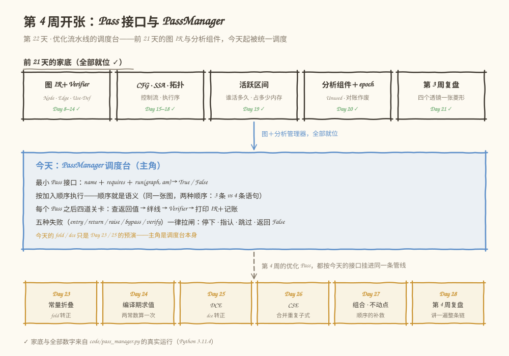
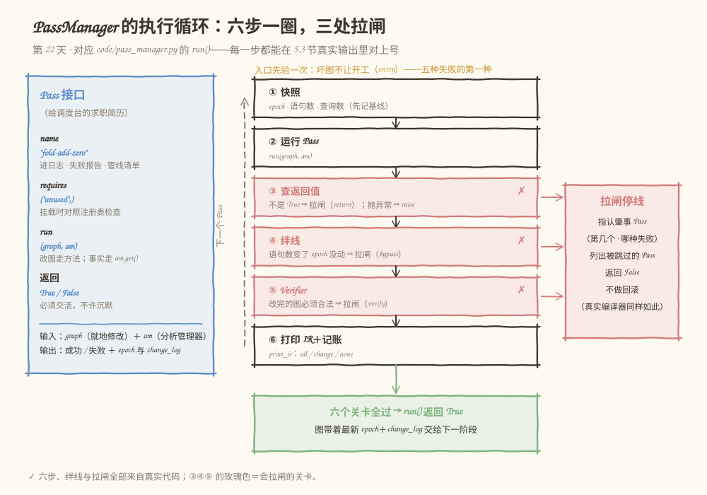
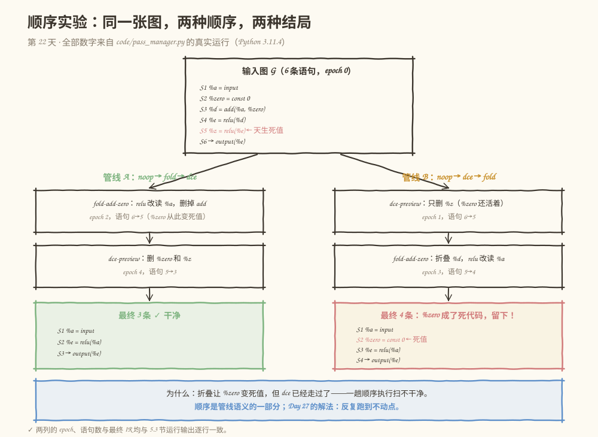

# 第 022 天：Pass 接口与执行管理——给你的编译器装上流水线调度台

> **今日目标**：完成本教程后，你能写出符合契约的最小 Pass（name ＋ requires ＋ `run(graph, am)` → True/False）和一个什么都不做但必定成功的空 Pass；实现一个 PassManager，提供按顺序执行、每个 Pass 之后验证、按需打印 IR、记账四种服务；用同一张图的两种执行顺序（3 条 vs 4 条语句）解释"顺序是管线语义的一部分"；最后把五种失败（entry / return / raise / bypass / verify）各自的含义、谁抓住它、抓住之后发生什么全部说清。
> **预计时间**：学习 35 分钟 + 实践 45 分钟
> **前置准备**：Python 3（本教程用 3.11.4 实测）；Day 20 的分析组件与 epoch 对账（今天直接复用它的 AnalysisManager）；Day 12 的 Verifier 与"构造失败 / 验证失败 / 运行失败"三分法。
> **今日产出**：`code/pass_manager.py`（Pass 接口 ＋ PassManager ＋ 空 Pass ＋ 两个 Day 23/25 预演 Pass ＋ 33 项自测）的真实运行记录，以及一份给后续 Pass 作者的接口契约。

## 1. 今天解决什么问题？

Day 20 的结尾留了一句话："现在想象你要当 PassManager 的作者（Day 22 的预告）"。那天的 DCE 预演长这样：

```python
unused = mgr.get(UnusedAnalysis())   # 查事实
graph.remove_statement(target)       # 改图
```

两行代码在 `demo()` 里手写手调，跑一遍就完。但学习计划从明天起要连着上新优化：Day 23 常量折叠、Day 24 编译期求值、Day 25 DCE、Day 26 CSE。想象一下两周后的 `main()`：

```python
fold(g); dce(g); fold(g); cse(g); ...   # 谁先谁后写在调用方手里
```

四件事立刻失控：

1. **顺序**：`fold` 在 `dce` 前还是后，结果不一样（今天 5.3 节有真实对照）——但顺序散落在调用方代码里，没人对它负责；
2. **失败**：某个 Pass 发现"这活我干不了"怎么办？继续跑？后面的 Pass 会在半成品上继续改，错上加错；直接崩溃？调用方连哪个 Pass 出的事都不知道；
3. **观测**：跑完一条管线，中间每一步的 IR 长什么样？现在只能靠手工加 print；
4. **依赖**：Day 20 辛苦做成的 AnalysisManager＋epoch 对账，每个 Pass 都得自己记得"改图后重新查询"——靠自觉。

今天的任务对应学习计划的三行（Pass 的输入、输出、依赖、执行顺序和失败处理）：**定义最小 Pass 接口；实现 PassManager，按顺序运行并打印图；交付一个空 Pass 示例**。贯穿全文的还是一张小图：

```text
S1   %a    = input
S2   %zero = const 0
S3   %d    = add(%a, %zero)      ← Day 23 折叠的素材
S4   %e    = relu(%d)
S5   %z    = relu(%e)            ← 天生死值（没人用它）
S6   →     output(%e)
```

`%z` 一出生就是死代码（DCE 自己的活）；`add(%a, %zero)` 要等折叠把它拆掉之后，`%zero` 才变成死值——**这个"先后手"就是今天顺序实验的全部戏份**。今天写的两个"真优化"（`fold-add-zero`、`dce-preview`）只是 Day 23 和 Day 25 的预演，主角是接口和管理器本身。

**前置补给**：Pass（读作"一趟"）是编译器里对整份 IR 做一次处理的最小单位——可以是变换（改图）也可以是分析（算事实，Day 20 已做）。PassManager（管线管理器）负责把它们按顺序串起来跑。MLIR 和 LLVM 里这两个词一模一样，今天的 Python 演练场与它们同构。

## 2. 先看全貌：今天的内容位于哪里？



**图 1**：看三个区域。顶部五张卡是前 21 天的家底（图 IR＋Verifier、控制流与 SSA、活跃区间、分析组件＋epoch、第 3 周复盘），今天它们不再各自营业——中间蓝框的调度台把"图"和"分析管理器"统一接管；底部琥珀色的一排是第 4 周剩余日程，从明天起每个优化 Pass 都按今天的接口挂进同一条管线。

全局流程五步，今天做第四步：

1. 前端把模型变成图 IR，配 Verifier（Day 8–14，已完成）；
2. 配上拓扑排序与控制流分析（Day 15–18，已完成）；
3. SSA、Use-Def、活跃区间，抽成可缓存的分析组件并用 epoch 管失效（Day 17–20，已完成）；
4. **今天：Pass 接口＋PassManager——优化们共享的调度台开张**；
5. 优化 Pass 逐个上岗：Day 23 常量折叠（`fold-add-zero` 转正）、Day 25 DCE（`dce-preview` 转正）、Day 26 CSE、Day 27 组合与不动点——全部挂在今天的管理器上跑。

## 3. 核心概念：从"求职简历"到"拉闸停线"

### 3.1 Pass：一份给调度台的求职简历

- **一句通俗解释**：一个 Pass 就是一趟对整张图的编译步骤——给它一张图，它要么把图改得更好，要么算出一些事实，要么明确说"我干不了"。
- **一个类比**：给调度台投简历。简历上有姓名（`name`）、会用的工具（`requires`）、干活的手艺（`run`），并且**必须交活**：干完了要报告"成了"还是"没成"，不许沉默消失。**对应到技术上是**：`run(graph, am)` 就地修改图、通过分析管理器拿事实，成功返回 `True`，干不了返回 `False` 或抛 `PassFailure`——这对应 MLIR 里 `Pass::runOnOperation()` 返回的 LogicalResult（成功 `success()` / 失败 `failure()`），失败会中断整条管线。类比的边界：真简历可以夸大，Pass 的 `requires` 写了不存在的分析，管理器在**挂载时**就拒绝（`add()` 对照注册表检查）；反过来，管理器查得出"声明了却没用"（死声明提醒），查不出"活干得好不好"——一个把图改合法但变慢的 Pass，纪律上完全合规。
- **最小例子（今天的官方交付之一：空 Pass）**：

  ```python
  class NoOpPass(Pass):
      name = "noop"

      def run(self, graph, am):
          return True     # 什么都不做，必定成功
  ```

  空 Pass 不是装饰：① 先证明调度台自己能转；② 开发期占位（先把管线骨架搭好，Pass 以后再写）；③ 隔离测量（空 Pass 的耗时≈管理器自身开销，真实编译器里也是这么用的）。
- **一个常见误解**："Pass 必须改图。" 只读的 Pass（观察器、统计器）同样合法——今天必做练习的 `DeadReportPass` 就是一个。判定标准不是"改没改"，而是**守不守契约**：改图走方法、要事实走 `am.get()`、必交活。

### 3.2 PassManager：调度台的四件服务，顺序就是语义

- **一句通俗解释**：PassManager 是车间主任——不亲自加工，但负责放行顺序、每站完工后质检、留档、以及任何一站出事就拉闸停线。
- **四件服务**（今天的实现逐条对应）：
  1. **顺序**：`add()` 的顺序就是执行顺序。别小看它——5.3 节的顺序实验里，同一张图 `fold→dce` 得 3 条语句、`dce→fold` 得 4 条：**顺序是管线语义的一部分**，所以它必须被管理而不是散落在调用方；
  2. **验证**：入口验一次，每个 Pass 跑完再验一次（复用 Day 12 的 Verifier）。Pass 有权改图，但改出来的必须是**合法的图**；
  3. **观测**：`print_ir` 三档——`"all"` 每个 Pass 后打印 IR（对应 `mlir-opt --mlir-print-ir-after-all`）、`"change"` 只打印真正改了图的 Pass（mlir-opt 也有只在有变化时打印的变体）、`"none"` 关闭。大图上这一档差的是九成刷屏；
  4. **记账**：每个 Pass 的修改次数（epoch 差）、语句数变化、依赖查询数，全部进日志。
- **对应到技术上是**：MLIR 的 PassManager 同样按声明顺序跑 Pass、默认在每个 Pass 之后运行 Verifier（`--mlir-disable-verifier` 可关）、提供 IR 打印开关；LLVM 的 `-print-after-all`、`-time-passes` 是同一类可观测性服务（选做练习会给我们的管理器补上耗时列）。类比的边界有两条：① 主任不懂工艺——PassManager 里没有一行优化逻辑，优化质量好坏它判不了（那是测试和 Day 27 对照 IR 的活）；② 拉闸不回滚——停线时车上的件停在哪个工位就停在哪个工位，真实编译器同样如此：失败直接终止编译，没人把 IR 恢复原样。
- **一个容易混淆的点**：今天的"顺序"是**管线顺序**（编译期改图的先后），不是 Day 16 拓扑排序的**执行顺序**（运行期算谁的先后）。两个"顺序"都真实存在、互不相干：拓扑序说 `%d` 算完才能算 `%e`；管线序说先折叠还是先清死代码。前者图自己长什么样就定死，后者是编译器作者的选择——今天实验证明这个选择影响产物。

### 3.3 失败处理：五种失败，一张表，三条原则

Day 12 教过"构造失败、验证失败、运行失败"三分法，今天它长出了具体的形状。管理器认得五种失败，每种都有明确的"谁抓的"：

| kind | 谁抓住 | 含义 | Day 12 对应 |
|---|---|---|---|
| `entry` | 入口验证 | 图进管线前就不合法——压根不让开工 | 验证失败 |
| `return` | 返回值检查 | Pass 明确返回 False："这活我干不了" | 运行失败（自觉上报） |
| `raise` | 异常捕获 | Pass 抛 `PassFailure`/`GraphError`：跑到一半前提崩了 | 运行失败（半路暴露） |
| `bypass` | 记账绊线 | 语句数变了 epoch 却没动——绕过了修改方法直接改表 | 契约违反 |
| `verify` | Verifier | Pass 把图改坏了（改完不合法） | 验证失败（事后暴露） |

- **绊线（tripwire）是今天的新词**：我们在记账时对账"语句数变化 vs epoch 变化"——数量变了版本没动，只可能是有人绕过了 `remove_statement`/`replace_all_uses` 这类修改方法、直接摸了 `statements` 表。**它的局限要诚实**：只能抓"数量变了"的一类；原地改写字段（改个输入名）数量不变、epoch 也不动，绊线是瞎的，那种只能靠 Verifier（改坏到不合法时）或代码评审兜底——第 6 节错误四有真实对照。
- **三条原则**：① **越早越好**——依赖写错在挂载时就炸，图坏在入口就不开工；② **绝不静默**——返回值必查、异常必接，5.3 节 [4] 的失败报告里有肇事 Pass 名、失败种类、原因和被跳过清单；③ **不回滚**——图停在失败那一刻的状态，调用方拿到 False 自己决定怎么办。**对应到 MLIR 是**：`failure()` 沿管线向上传播，编译驱动直接以失败退出。
- **一个类比**：机场安检。入口验证是证件预检（`entry`），每站复查是安检门（`verify`），安检员开箱检查是绊线（`bypass`），旅客自己说"我带不走了"是 `return`。类比的边界：安检拦得下违规品，拦不下"合法但没用"的东西——合法性与最优性是两回事，跟 3.1 的边界一样。

### 3.4 依赖：requires 声明，AnalysisManager 原样复用

Day 20 的 AnalysisManager 今天一行不改地被请进调度台：`PassManager.run()` 开场创建一个，作为 `run(graph, am)` 的第二个参数发给每个 Pass。三件事让"依赖"从口号变成机制：

1. **挂载检查**：`add()` 时对照注册表 `ANALYSES`（目前只有 `unused`）核对 `requires`——写错当场 `ValueError`，不等运行到一半才炸（失败要趁早，3.3 原则①）；
2. **死声明提醒**：声明了 `requires` 却一次分析都没查询，日志里给一行提醒——不拉闸，但留案底；
3. **失效照旧**：epoch 对账原样生效。5.3 节顺序一的统计是真实数字：`dce-preview` 查询 3 次、重算 3 次、失效丢弃 2 次——每删一条语句 epoch 就变，它必须回到管理器重新查询（Day 20 的铁律在 Pass 场景的重演）。

**为什么 Pass 不自己 new 一个分析**：两个 Pass 各自算各自的，就会回到 Day 20 之前的世界——两套互相矛盾的事实；缓存共享和失效语义都必须有唯一的归属地。`requires` 的作用是把这份依赖**写在读代码就能看见的地方**，而不是藏在函数体里。

## 4. 图解核心机制



**图 2**：左边蓝卡是 Pass 接口（求职简历的四行）；右边是 `run()` 的执行循环。看六个带编号的步骤和三个玫瑰色（会拉闸的）关卡：

1. **① 快照**：进入每个 Pass 前记下 `epoch`、语句数、分析查询数——这是后面所有对账的基线。为什么需要它："这个 Pass 改了几次图"没法事后问图，只能拿差值；
2. **② 运行 Pass**：`run(graph, am)`——改图只准走修改方法（Day 20 的契约），要事实只准 `am.get()`；
3. **③ 查返回值**：契约要求成功返回 `True`。返回 False 或抛异常（`PassFailure`/`GraphError`）都拉闸——"抛 `PassFailure`"对应 MLIR 的 `failure()`，是 Pass 主动认输，不是崩溃；
4. **④ 绊线**：语句数变了 epoch 没动 ⇒ 有人绕过修改方法（3.3 说过它抓哪类、抓不到哪类）；
5. **⑤ Verifier**：改完的图必须合法——Pass 的自由止于图不变式；
6. **⑥ 打印 IR＋记账**：`print_ir` 三档决定打不打；日志记录修改次数、语句数、依赖查询数，然后回到 ① 换下一个 Pass。

右下的玫瑰框是拉闸之后的标准动作：指认肇事 Pass（第几个、哪种失败）→ 列出被跳过的 Pass → 返回 False，不做回滚。左下的绿框是另一头：六个关卡全过，`run()` 返回 True，图带着最新的 epoch 和 change_log 交给下一阶段。六步、绊线、拉闸在 5.3 节的真实输出里逐行可查——图的右上角那行入口检查提示（`entry`）也是五种失败里的第一种。

## 5. 动手实践：一个接口、一个管理器、六个演员

### 5.1 准备文件

本教程目录结构如下，脚本已随教程提供：

```text
tutorials/day-022/
├── README.md
├── code/
│   └── pass_manager.py     # Pass 接口 + PassManager + 空 Pass + 两个预演 Pass + 33 项自测
└── images/
    ├── 01-overview.svg
    ├── 02-mechanism.svg
    └── 03-example.svg
```

运行环境：Python 3.11.4（Linux），无任何第三方依赖，`Graph`/`UnusedAnalysis`/`AnalysisManager` 从 Day 20 原样搬来，保证前后两周的演练场可以互相印证。

### 5.2 编写代码

下面是 `code/pass_manager.py` 的完整实现（与仓库文件一致）。重点看五处：`Pass` 基类的三行契约；`PassManager.run()` 里六步循环的顺序（快照→运行→查返回值→绊线→验证→打印记账）；`add()` 里对 `requires` 的挂载检查；`_stop()` 拉闸时记录的三样东西（肇事者、跳过清单、失败时刻的图状态）；以及 `DcePreviewPass` 循环里"每删一条就重新 `am.get()`"的那一行。

```python
#!/usr/bin/env python3
"""第 22 天演练场：Pass 接口与 PassManager——优化流水线的调度台。

用法：
    python3 pass_manager.py               # 演示主流程：空 Pass、两种执行顺序、四类失败处理
    python3 pass_manager.py --self-test   # 运行测试，全部通过退出码 0

Day 20 把“算事实”做成了组件（UnusedAnalysis / LastUseAnalysis），并用
AnalysisManager＋epoch 管住了缓存失效；Day 21 复盘收拢了全套家底。今天补上
优化流水线的最后一块地基：变换怎么被组织起来——

    Pass        最小编译步骤：name ＋ requires ＋ run(graph, am) → True / False
    PassManager 调度台：按加入顺序执行；每个 Pass 跑完依次过四道关卡——
                ① 查返回值 ② 绊线（语句数变了 epoch 却没动 → 有人绕过修改方法）
                ③ Verifier ④ 打印 IR ＋ 记账；任何一道不过 → 拉闸停线

失败共五种，全部立即停止、指认肇事 Pass、列出被跳过的 Pass、返回 False：
    entry   进管线前图就不合法（Day 12 说的“验证失败”，压根不让开工）
    return  Pass 明确返回 False（“这活我干不了”）
    raise   Pass 抛出 PassFailure / GraphError（跑到一半发现前提不成立）
    bypass  绕过修改方法直接改表（记账绊线抓住：epoch 没动）
    verify  Pass 把图改坏，Verifier 当场拒绝

今天的两个“真优化”（fold-add-zero / dce-preview）分别是 Day 23 常量折叠和
Day 25 DCE 的预演，只为让管线有东西可跑；今天的主角是接口和管理器本身。

对应到 MLIR / LLVM 的同构设计：
    * Pass::runOnOperation() 返回 LogicalResult，failure() 会中断整条管线；
    * mlir-opt --mlir-print-ir-after-all 在每个 Pass 之后打印 IR（我们的 print_ir）；
    * mlir-opt 默认在每个 Pass 之后运行 Verifier（--mlir-disable-verifier 可关）；
    * LLVM 的 -print-after-all / -time-passes 是同一类“可观测性”服务。
"""

from __future__ import annotations

import argparse

PURE_OPS = {"matmul", "add", "relu", "mul"}   # 无副作用算子（Day 20 同款口径）

# 贯穿全文的例子：一张 6 条语句的小图。
#   %z 天生死代码（DCE 自己的活）；add(%a, %zero) 是 Day 23 折叠的活——
#   折叠之后 %zero 才变死值，这个“先后手”就是今天顺序实验的全部戏份。
PIPELINE_GRAPH = [
    ("input",   "%a",    [],              (2, 3)),
    ("const 0", "%zero", [],              (2, 3)),
    ("add",     "%d",    ["%a", "%zero"], (2, 3)),
    ("relu",    "%e",    ["%d"],          (2, 3)),
    ("relu",    "%z",    ["%e"],          (2, 3)),   # 从未被使用：天生死代码
    ("output",  None,    ["%e"],          None),
]


class GraphError(Exception):
    """图不合法，或违反“改图走方法”的契约。"""


class PassFailure(Exception):
    """Pass 主动上报的失败（对应 MLIR 的 failure()）。"""


# ---------- 图：Day 20 同款，可变更的正式外壳 ----------


class Graph:
    """语句序列表示的线性计算图（Day 20 同款契约）。

      * 只读查询（labels / used_at / validate）不改图；
      * 修改必须走 remove_statement / replace_all_uses，每次修改 epoch + 1
        并写改动日志——直接改 self.statements 属于调用方 bug，
        今天 PassManager 的记账绊线能抓到其中一类（数量变了版本没动）。
    """

    def __init__(self, statements):
        self.statements = [list(s) for s in statements]
        self.epoch = 0
        self.change_log = []

    # ---------- 只读查询 ----------

    def labels(self):
        return [f"S{i + 1}" for i in range(len(self.statements))]

    def used_at(self):
        """每个值被使用的位置列表。图输出语句的输入也算使用（Day 19 教训三）。"""
        used = {}
        for i, (_, _, uses, _) in enumerate(self.statements):
            for u in uses:
                used.setdefault(u, []).append(i)
        return used

    def validate(self):
        """Day 17/18 的合法性闸门：SSA 唯一定义、使用必须先于定义。"""
        defined = {}
        for i, (_, res, _, _) in enumerate(self.statements):
            if res is None:
                continue
            if res in defined:
                raise GraphError(f"{res} 被定义两次（违反 SSA）：S{defined[res] + 1} 和 S{i + 1}")
            defined[res] = i
        for i, (_, _, uses, _) in enumerate(self.statements):
            for u in uses:
                if u not in defined:
                    raise GraphError(f"{u} 被使用但从未定义（S{i + 1}）")
                if defined[u] >= i:
                    raise GraphError(f"{u} 在定义之前被使用（S{i + 1}）")
        return True

    # ---------- 修改接口（每个都会 bump epoch）----------

    def _commit(self, note):
        self.epoch += 1
        self.change_log.append(f"epoch {self.epoch}：{note}")

    def remove_statement(self, index):
        stmt = self.statements[index]
        del self.statements[index]
        self._commit(f"删除 S{index + 1}（{stmt[0]} {stmt[1] or ''}）——后面所有语句位置前移")

    def replace_all_uses(self, old, new):
        """把所有读 old 的语句改成读 new（Day 23 折叠 Pass 的核心动作）。"""
        rewired = 0
        for stmt in self.statements:
            if old in stmt[2]:
                stmt[2] = [new if u == old else u for u in stmt[2]]
                rewired += 1
        if rewired == 0:
            raise GraphError(f"没有任何语句使用 {old}，无事可换")
        self._commit(f"换边：{rewired} 条语句改读 {new}（原来读 {old}）——位置没变，Use-Def 变了")
        return rewired


# ---------- 分析：Day 20 的组件原样搬来（今天只用到 unused）----------


class Analysis:
    name = "analysis"

    def run(self, graph):
        raise NotImplementedError


class UnusedResult:
    def __init__(self, dead, where):
        self.dead = frozenset(dead)
        self.where = dict(where)

    def is_dead(self, name):
        return name in self.dead


class UnusedAnalysis(Analysis):
    """未使用分析：哪些值从未被任何语句（含图输出）使用。只报告，不决策。"""

    name = "unused"

    def run(self, graph):
        used = graph.used_at()
        dead, where = [], {}
        for i, (_, res, _, _) in enumerate(graph.statements):
            if res is None:
                continue
            where[res] = i
            if res not in used:
                dead.append(res)
        return UnusedResult(dead, where)


ANALYSES = {"unused": UnusedAnalysis}   # 依赖名 → 分析类（挂载 Pass 时对照检查）


class AnalysisManager:
    """分析缓存管理器（Day 20 同款）：epoch 对账，图一变旧结果作废。"""

    def __init__(self, graph):
        self.graph = graph
        self._cache = {}   # name -> (诞生时的 epoch, result)
        self.stats = {"queries": 0, "recomputed": 0, "invalidated": 0}

    def get(self, analysis):
        self.stats["queries"] += 1
        entry = self._cache.get(analysis.name)
        if entry is not None and entry[0] == self.graph.epoch:
            return entry[1]
        if entry is not None:
            self.stats["invalidated"] += 1
        epoch_before = self.graph.epoch
        result = analysis.run(self.graph)
        if self.graph.epoch != epoch_before:
            raise GraphError(f"分析 {analysis.name} 在 run 期间修改了图：分析 Pass 只读")
        self._cache[analysis.name] = (self.graph.epoch, result)
        self.stats["recomputed"] += 1
        return result

    def describe(self):
        lines = [f"分析管理器对账（图当前 epoch = {self.graph.epoch}）："]
        if not self._cache:
            lines.append("  （还没有任何缓存条目）")
        for name, (epoch, _) in sorted(self._cache.items()):
            state = "有效" if epoch == self.graph.epoch else "已失效"
            lines.append(f"  {name:<10}缓存于 epoch {epoch} → {state}")
        s = self.stats
        lines.append(f"  统计：查询 {s['queries']} 次，重算 {s['recomputed']} 次，"
                     f"失效丢弃 {s['invalidated']} 次")
        return "\n".join(lines)


# ---------- Pass 接口：今天的主角一 ----------


class Pass:
    """最小 Pass 接口——一份给调度台的“求职简历”。

      name      名字（进日志、进失败报告、进管线清单）；
      requires  声明依赖的分析名（挂载时就对照 ANALYSES 检查，写错当场拒绝）；
      run       干活：输入 graph（就地修改，只准走修改方法）和 am（拿事实），
                成功必须返回 True；干不了返回 False 或抛 PassFailure。
    """

    name = "pass"
    requires = ()

    def run(self, graph, am):
        raise NotImplementedError

    def __repr__(self):
        return f"<Pass {self.name}>"


class PassManager:
    """流水线调度台：按加入顺序执行 Pass，并提供四件配套服务。

      ① 顺序：add() 的顺序就是执行顺序——今天的顺序实验证明这是语义的一部分；
      ② 验证：入口验一次，每个 Pass 之后再验一次（Verifier，Day 12 的闸门）；
      ③ 观测：print_ir = "all" / "change" / "none"，对应 mlir-opt 的 IR 打印开关；
      ④ 记账：每个 Pass 的修改次数（epoch 差）、语句数变化、是否打印、依赖查询数。
      失败处理：五种失败（entry/return/raise/bypass/verify）一律立即停止，
      指认肇事 Pass、列出被跳过的 Pass、返回 False——不回滚、不静默。
    """

    def __init__(self, print_ir="all", verify=True, verbose=True, title="PassManager"):
        self.print_ir = print_ir     # "all" / "change" / "none"
        self.verify = verify
        self.verbose = verbose
        self.title = title
        self.passes = []
        self.log = []
        self.failure = None
        self.skipped = []
        self.am = None

    def add(self, *passes):
        """把 Pass 挂上管线（顺序即执行顺序）。依赖名写错在这里就炸，不等到运行。"""
        for p in passes:
            if not isinstance(p, Pass):
                raise TypeError(f"add 只收 Pass，收到 {type(p).__name__}")
            for dep in p.requires:
                if dep not in ANALYSES:
                    raise ValueError(f"Pass {p.name} 声明了未知分析依赖 {dep!r}（可用：{sorted(ANALYSES)}）")
            self.passes.append(p)
        return self

    def pipeline(self):
        return " → ".join(p.name for p in self.passes) if self.passes else "（空管线）"

    def _say(self, text):
        if self.verbose:
            for line in text.split("\n"):
                print(line)

    def run(self, graph):
        self.log, self.failure, self.skipped = [], None, []
        self.am = AnalysisManager(graph)
        self._say(f"== {self.title}：管线 [{self.pipeline()}] ==")

        # 入口验证：坏图根本不让开工（对应“验证失败”而不是“运行失败”）
        try:
            graph.validate()
        except GraphError as exc:
            self.failure = {"kind": "entry", "pass": "（入口）", "reason": f"进管线前图就不合法：{exc}"}
            self.skipped = [p.name for p in self.passes]
            self._say(f"*** 管线未启动：{self.failure['reason']}")
            if self.skipped:
                self._say(f"    全部跳过：{'、'.join(self.skipped)}")
            return False

        total = len(self.passes)
        for i, p in enumerate(self.passes):
            deps = "、".join(p.requires)
            self._say(f"--- [{i + 1}/{total}] {p.name}" + (f"（声明依赖：{deps}）" if deps else ""))
            epoch_before = graph.epoch
            n_before = len(graph.statements)
            q_before = self.am.stats["queries"]

            # ② 运行 Pass（① 快照已取：epoch_before / n_before / q_before）
            try:
                ok = p.run(graph, self.am)
            except (GraphError, PassFailure) as exc:
                return self._stop(graph, i, p, "raise",
                                  f"{p.name} 抛出 {type(exc).__name__}：{exc}",
                                  epoch_before, n_before, q_before)

            # ③ 查返回值：契约要求成功返回 True
            if ok is not True:
                extra = getattr(p, "reason", "")
                why = f"：{extra}" if extra else ""
                return self._stop(graph, i, p, "return",
                                  f"{p.name} 返回 {ok!r}，不是 True{why}",
                                  epoch_before, n_before, q_before)

            changes = graph.epoch - epoch_before
            n_after = len(graph.statements)

            # ④ 绊线：语句数变了 epoch 却没动 → 有人绕过了修改方法
            if n_after != n_before and changes == 0:
                return self._stop(graph, i, p, "bypass",
                                  f"{p.name} 之后语句数 {n_before}→{n_after}，但 epoch 没动"
                                  f"——绕过了修改方法，change_log 里不会有这条改动的记录",
                                  epoch_before, n_before, q_before)

            # ⑤ Verifier：Pass 可以改图，但改出来的必须是合法的图
            if self.verify:
                try:
                    graph.validate()
                except GraphError as exc:
                    return self._stop(graph, i, p, "verify",
                                      f"{p.name} 之后图不合法：{exc}",
                                      epoch_before, n_before, q_before)

            # ⑥ 打印 IR ＋ 记账
            printed = self.print_ir == "all" or (self.print_ir == "change" and changes > 0)
            entry = {"name": p.name, "deps": list(p.requires), "changes": changes,
                     "before": n_before, "after": n_after,
                     "deps_queried": self.am.stats["queries"] - q_before, "printed": printed}
            self.log.append(entry)
            if printed:
                self._say(f"// IR after {p.name}（修改 {changes} 次，语句 {n_before}→{n_after}，epoch {graph.epoch}）")
                self._say(ir_dump(graph))
            if p.requires and entry["deps_queried"] == 0:
                self._say(f"    （提醒：{p.name} 声明了依赖 {deps}，但一次分析都没查询——死声明？）")

        self._say(f"== 管线完成：{total} 个 Pass 全部成功，图停在 epoch {graph.epoch} ==")
        return True

    def _stop(self, graph, i, p, kind, reason, epoch_before, n_before, q_before):
        """拉闸：记录失败、列出跳过清单、返回 False。不做回滚——真实编译器同样如此。"""
        changes = graph.epoch - epoch_before
        self.failure = {"kind": kind, "pass": p.name, "reason": reason}
        self.log.append({"name": p.name, "deps": list(p.requires), "changes": changes,
                         "before": n_before, "after": len(graph.statements),
                         "deps_queried": self.am.stats["queries"] - q_before,
                         "printed": False, "failed": True})
        self.skipped = [q.name for q in self.passes[i + 1:]]
        self._say(f"*** 管线停止：[{i + 1}/{len(self.passes)}] {p.name} 失败（{kind}）")
        self._say(f"    {reason}")
        if self.skipped:
            self._say(f"    已跳过：{'、'.join(self.skipped)}")
        self._say(f"    图停留在失败那一刻：epoch {graph.epoch}，{len(graph.statements)} 条语句（不做回滚）")
        return False

    def describe(self):
        lines = [f"管线记录（{len(self.log)} 条，共挂 {len(self.passes)} 个 Pass）："]
        if not self.log:
            lines.append("  （一个 Pass 都没跑）")
        for e in self.log:
            mark = "  ← 失败" if e.get("failed") else ""
            lines.append(f"  {e['name']:<16}修改 {e['changes']:>2} 次   语句 {e['before']}→{e['after']}{mark}")
        if self.failure:
            lines.append(f"  失败：{self.failure['pass']}（kind = {self.failure['kind']}）")
        if self.skipped:
            lines.append(f"  跳过：{'、'.join(self.skipped)}")
        return "\n".join(lines)


# ---------- 工具 ----------


def ir_dump(g):
    lines = []
    for i, (op, res, uses, _) in enumerate(g.statements):
        lhs = f"{res:<6}= " if res else "  →   "
        rhs = f"{op}({', '.join(uses)})" if uses else op
        lines.append(f"  S{i + 1:<4}{lhs}{rhs}")
    return "\n".join(lines)


def removable(stmt):
    """结果无人使用且无副作用时可删；input 代表外部输入，不删（Day 25 再正式化）。"""
    op, res = stmt[0], stmt[1]
    return res is not None and (op in PURE_OPS or op.startswith("const"))


def fmt_names(names):
    return "、".join(sorted(names)) if names else "（无）"


# ---------- 今天的四个“演员” Pass ----------


class NoOpPass(Pass):
    """空 Pass：什么都不做，必定成功。

    用途：① 验证调度台本身能转（今天的第一个实验）；
          ② 开发期占位（先把管线骨架搭好，Pass 以后再写）；
          ③ 隔离测量（空 Pass 的耗时 ≈ 管理器自身的开销）。
    """

    name = "noop"

    def run(self, graph, am):
        return True


class FoldAddZeroPass(Pass):
    """Day 23 常量折叠的预演：add(x, 0) → x。

    动作：把 %d 的所有使用者改读 %x（replace_all_uses，epoch +1），
    再删掉 add 语句（epoch 再 +1）。%zero 从此变死值——但清不清理是后面
    DCE 的事，这就是“顺序”要出场的地方。
    """

    name = "fold-add-zero"

    def run(self, graph, am):
        zeros = {res for op, res, _, _ in graph.statements
                 if res and op.startswith("const") and _const_is_zero(op)}
        i = 0
        while i < len(graph.statements):
            op, res, inputs, _ = graph.statements[i]
            if op == "add" and res is not None and len(inputs) == 2:
                if inputs[1] in zeros:
                    other = inputs[0]
                elif inputs[0] in zeros:
                    other = inputs[1]
                else:
                    other = None
                if other is not None:
                    if res in graph.used_at():
                        graph.replace_all_uses(res, other)
                    graph.remove_statement(i)
                    continue     # 删完一条，后面的语句滑到当前位置，i 不动
            i += 1
        return True


def _const_is_zero(op):
    try:
        return float(op.split()[1]) == 0.0
    except (IndexError, ValueError):
        return False


class DcePreviewPass(Pass):
    """Day 25 DCE 的预演：删掉“无使用者且无副作用”的语句。

    依赖声明 requires = ("unused",)：事实由 Day 20 的 UnusedAnalysis 提供。
    每删一条 epoch 就变，循环里必须回到管理器重新查询（Day 20 的铁律）。
    """

    name = "dce-preview"
    requires = ("unused",)

    def run(self, graph, am):
        while True:
            unused = am.get(UnusedAnalysis())
            target = None
            for i, stmt in enumerate(graph.statements):
                if unused.is_dead(stmt[1]) and removable(stmt):
                    target = i
                    break
            if target is None:
                return True
            graph.remove_statement(target)


# ---------- 三个反面教材（失败处理的实验材料）----------


class FailPass(Pass):
    """声明式失败：不干活，直接返回 False。reason 会被写进失败报告。"""

    def __init__(self, name="fail", reason=""):
        self.name = name
        self.reason = reason

    def run(self, graph, am):
        return False


class CorruptInsertPass(Pass):
    """反面教材一：绕过修改方法直接插语句。绊线会抓住它——epoch 没动。"""

    name = "corrupt-insert"

    def run(self, graph, am):
        graph.statements.insert(0, ["add", "%junk", ["%nope"], (2, 3)])
        return True


class CorruptRewritePass(Pass):
    """反面教材二：原地改写输入。语句数不变、epoch 不动，绊线瞎了——只剩 Verifier 抓得住。"""

    name = "corrupt-rewrite"

    def run(self, graph, am):
        for stmt in graph.statements:
            if stmt[0] == "relu":
                stmt[2] = ["%nope"]
                break
        return True


# ---------- 演示 ----------


def demo():
    print("== [1] 空管线热身：一个空 Pass，先把调度台转起来 ==")
    g = Graph(PIPELINE_GRAPH)
    pm = PassManager(title="PM-0")
    pm.add(NoOpPass())
    ok = pm.run(g)
    print(f"run() 返回 {ok}；epoch = {g.epoch}，{len(g.statements)} 条语句——空 Pass 一根手指都没动")
    print(pm.describe())

    print("\n== [2] 顺序一：noop → fold → dce（先折叠，再清扫） ==")
    g1 = Graph(PIPELINE_GRAPH)
    pm1 = PassManager(title="PM-A")
    pm1.add(NoOpPass(), FoldAddZeroPass(), DcePreviewPass())
    ok1 = pm1.run(g1)
    print(f"run() 返回 {ok1}；最终 {len(g1.statements)} 条语句")
    print(pm1.describe())
    print(pm1.am.describe())
    print("改动日志：")
    for entry in g1.change_log:
        print("  " + entry)

    print("\n== [3] 顺序二：noop → dce → fold（先清扫，再折叠） ==")
    g2 = Graph(PIPELINE_GRAPH)
    pm2 = PassManager(title="PM-B")
    pm2.add(NoOpPass(), DcePreviewPass(), FoldAddZeroPass())
    ok2 = pm2.run(g2)
    unused = pm2.am.get(UnusedAnalysis())
    print(f"run() 返回 {ok2}；最终 {len(g2.statements)} 条语句")
    print(f"死值：{fmt_names(unused.dead)} ← %zero 留下来了！dce 走的时候它还不死，fold 走完才变死")
    print("同一张输入图，顺序一得 3 条、顺序二得 4 条——顺序是管线语义的一部分（Day 27 补救）")

    print("\n== [4] 失败一：Pass 明确返回 False ==")
    g3 = Graph(PIPELINE_GRAPH)
    pm3 = PassManager(title="PM-F1")
    pm3.add(NoOpPass(), FailPass("no-support", "场景不支持：演示用的假原因"), FoldAddZeroPass())
    ok3 = pm3.run(g3)
    print(f"run() 返回 {ok3}；图 epoch = {g3.epoch}，{len(g3.statements)} 条语句——fold 根本没跑")
    print(pm3.describe())

    print("\n顺手看入口检查：直接塞一张非法图——")
    bad = Graph(PIPELINE_GRAPH)
    bad.statements.append(["add", "%bad", ["%missing"], (2, 3)])   # %missing 从未定义
    pm_e = PassManager(title="PM-entry", print_ir="none")
    pm_e.add(NoOpPass())
    ok_e = pm_e.run(bad)
    print(f"run() 返回 {ok_e}；失败种类 = {pm_e.failure['kind']}，跑了 {len(pm_e.log)} 个 Pass——压根没让开工")

    print("\n== [5] 失败二：绕过修改方法（记账绊线当场抓住） ==")
    g4 = Graph(PIPELINE_GRAPH)
    pm4 = PassManager(title="PM-F2")
    pm4.add(CorruptInsertPass(), FoldAddZeroPass())
    ok4 = pm4.run(g4)
    print(f"run() 返回 {ok4}；失败种类 = {pm4.failure['kind']}；"
          f"epoch = {g4.epoch}，change_log {len(g4.change_log)} 条——插语句的人没留任何记录，证据确凿")

    print("\n== [6] 失败三：改坏图（Verifier 抓住） ==")
    g5 = Graph(PIPELINE_GRAPH)
    pm5 = PassManager(title="PM-F3")
    pm5.add(CorruptRewritePass(), FoldAddZeroPass())
    ok5 = pm5.run(g5)
    print(f"run() 返回 {ok5}；失败种类 = {pm5.failure['kind']}——绊线瞎了（语句数没变），Verifier 顶住了")

    print("\n== [7] 可观测性开关：print_ir='change'（只打印真正改了图的 Pass） ==")
    g6 = Graph(PIPELINE_GRAPH)
    pm6 = PassManager(title="PM-C", print_ir="change")
    pm6.add(NoOpPass(), FoldAddZeroPass(), DcePreviewPass())
    ok6 = pm6.run(g6)
    print(f"run() 返回 {ok6}；注意 noop 没改图，IR 一行没打——大图上这个开关省掉九成刷屏")

    print("\n== [8] Pass 作者契约（完整版见教程 5.5 节） ==")
    print("  1. 改图只走 graph 的修改方法；要事实就 am.get()——别把分析结果攥在手里过夜；")
    print("  2. 成功返回 True；干不了 / 前提不成立，返回 False 或抛 PassFailure——别硬撑；")
    print("  3. 需要什么分析，写进 requires——挂载时就检查，别等运行到一半才炸。")
    return 0


# ---------- 自测 ----------


def self_test():
    results = []

    def check(name, cond):
        results.append((name, bool(cond)))
        print(f"  {'✓' if cond else '✗'} {name}")

    print("== 自测：Pass 接口与 PassManager ==")

    # A. 空 Pass 与空管线
    g = Graph(PIPELINE_GRAPH)
    pm = PassManager(print_ir="none", verbose=False)
    pm.add(NoOpPass())
    check("空 Pass：run 返回 True", pm.run(g) is True)
    check("空 Pass：图纹丝不动（epoch 0、6 条语句）", g.epoch == 0 and len(g.statements) == 6)
    check("空 Pass：日志记了修改 0 次、语句 6→6", pm.log[0]["changes"] == 0 and pm.log[0]["after"] == 6)
    pm_empty = PassManager(verbose=False)
    check("空管线：一个 Pass 都不挂也能跑，返回 True", pm_empty.run(Graph(PIPELINE_GRAPH)) is True)

    # B. 顺序一：noop → fold → dce
    g1 = Graph(PIPELINE_GRAPH)
    pm1 = PassManager(print_ir="none", verbose=False)
    pm1.add(NoOpPass(), FoldAddZeroPass(), DcePreviewPass())
    check("顺序一：整条管线成功", pm1.run(g1) is True)
    check("顺序一：最终 3 条语句", len(g1.statements) == 3)
    check("顺序一：只剩 input %a / relu %e / output",
          [s[0] for s in g1.statements] == ["input", "relu", "output"])
    check("顺序一：relu 的输入已改读 %a", g1.statements[1][2] == ["%a"])
    check("顺序一：change_log 四条（fold 换边+删除，dce 删 %zero、%z）", len(g1.change_log) == 4)
    q = pm1.am.stats
    check("依赖由管理器供给：dce 查询 unused ≥3 次且全部重算（每删一条 epoch 就变）",
          q["queries"] >= 3 and q["recomputed"] == q["queries"])
    check("执行顺序就是加入顺序", [e["name"] for e in pm1.log] == ["noop", "fold-add-zero", "dce-preview"])

    # C. 顺序二：noop → dce → fold
    g2 = Graph(PIPELINE_GRAPH)
    pm2 = PassManager(print_ir="none", verbose=False)
    pm2.add(NoOpPass(), DcePreviewPass(), FoldAddZeroPass())
    check("顺序二：整条管线成功", pm2.run(g2) is True)
    check("顺序二：最终 4 条语句", len(g2.statements) == 4)
    check("顺序二：%zero 成了死值（dce 走过之后 fold 才让它变死）",
          pm2.am.get(UnusedAnalysis()).is_dead("%zero"))
    check("顺序对照：同一输入两种顺序，3 条 vs 4 条——顺序是语义的一部分",
          len(g1.statements) == 3 and len(g2.statements) == 4)

    # D. 失败：return
    g3 = Graph(PIPELINE_GRAPH)
    pm3 = PassManager(print_ir="none", verbose=False)
    pm3.add(NoOpPass(), FailPass("no-support", "假原因"), FoldAddZeroPass())
    check("失败一：run 返回 False", pm3.run(g3) is False)
    check("失败一：指认肇事 Pass（no-support，kind = return）",
          pm3.failure["kind"] == "return" and pm3.failure["pass"] == "no-support")
    check("失败一：原因带进报告", "假原因" in pm3.failure["reason"])
    check("失败一：后续 fold 被跳过", pm3.skipped == ["fold-add-zero"])
    check("失败一：图停在最后一次合法状态（epoch 0、6 条语句）",
          g3.epoch == 0 and len(g3.statements) == 6)

    # E. 失败：entry
    bad = Graph(PIPELINE_GRAPH)
    bad.statements.append(["add", "%bad", ["%missing"], (2, 3)])
    pm_e = PassManager(verbose=False)
    pm_e.add(NoOpPass())
    check("入口检查：非法图不让开工（kind = entry，一个 Pass 都没跑）",
          pm_e.run(bad) is False and pm_e.failure["kind"] == "entry" and len(pm_e.log) == 0)

    # F. 失败：bypass
    g4 = Graph(PIPELINE_GRAPH)
    pm4 = PassManager(print_ir="none", verbose=False)
    pm4.add(CorruptInsertPass(), FoldAddZeroPass())
    check("失败二：绕过修改方法被绊线抓住（kind = bypass）",
          pm4.run(g4) is False and pm4.failure["kind"] == "bypass")
    check("失败二：epoch 没动、change_log 为空——绕过者不留记录",
          g4.epoch == 0 and len(g4.change_log) == 0)

    # G. 失败：verify
    g5 = Graph(PIPELINE_GRAPH)
    pm5 = PassManager(print_ir="none", verbose=False)
    pm5.add(CorruptRewritePass(), FoldAddZeroPass())
    check("失败三：改坏图被 Verifier 抓住（kind = verify）",
          pm5.run(g5) is False and pm5.failure["kind"] == "verify")
    check("失败三：后续 Pass 被跳过", pm5.skipped == ["fold-add-zero"])

    # H. 失败：raise
    class BoomPass(Pass):
        name = "boom"

        def run(self, graph, am):
            raise PassFailure("演示：跑到一半发现前提不成立")

    g6 = Graph(PIPELINE_GRAPH)
    pm6 = PassManager(print_ir="none", verbose=False)
    pm6.add(NoOpPass(), BoomPass(), DcePreviewPass())
    check("失败四：抛 PassFailure 同样被拦下（kind = raise）",
          pm6.run(g6) is False and pm6.failure["kind"] == "raise")
    check("失败四：跳过 dce-preview", pm6.skipped == ["dce-preview"])

    # I. print_ir 模式
    g7 = Graph(PIPELINE_GRAPH)
    pm7 = PassManager(print_ir="change", verbose=False)
    pm7.add(NoOpPass(), FoldAddZeroPass())
    pm7.run(g7)
    check("print_ir='change'：noop 不打印 IR，fold 打印",
          pm7.log[0]["printed"] is False and pm7.log[1]["printed"] is True)
    g8 = Graph(PIPELINE_GRAPH)
    pm8 = PassManager(print_ir="all", verbose=False)
    pm8.add(NoOpPass())
    pm8.run(g8)
    check("print_ir='all'：空 Pass 也打印（IR 原样，用于确认管线确实经过）", pm8.log[0]["printed"] is True)

    # J. 依赖声明在挂载时检查
    class GhostDepPass(Pass):
        name = "ghost"
        requires = ("no-such-analysis",)

        def run(self, graph, am):
            return True

    try:
        PassManager(verbose=False).add(GhostDepPass())
        check("依赖声明：未知分析在挂载时就被拒绝", False)
    except ValueError:
        check("依赖声明：未知分析在挂载时就被拒绝", True)
    check("dce-preview 声明依赖 unused", DcePreviewPass().requires == ("unused",))

    # K. 死声明提醒（声明了依赖却一次都不查询）
    class LazyPass(Pass):
        name = "lazy-deps"
        requires = ("unused",)

        def run(self, graph, am):
            return True

    import io
    import contextlib
    g9 = Graph(PIPELINE_GRAPH)
    pm9 = PassManager(print_ir="none", verbose=True, title="PM-L")
    pm9.add(LazyPass())
    buf = io.StringIO()
    with contextlib.redirect_stdout(buf):
        pm9.run(g9)
    check("死声明提醒：声明了 unused 却没查询，日志里有提醒", "死声明" in buf.getvalue())
    check("死声明不拉闸：run 仍返回 True", pm9.log[-1].get("failed") is None)

    passed = sum(1 for _, ok in results if ok)
    print(f"\n{passed}/{len(results)} 项通过")
    return 0 if passed == len(results) else 1


def main():
    ap = argparse.ArgumentParser(description="第 22 天演练场：Pass 接口与 PassManager")
    ap.add_argument("--self-test", action="store_true", help="运行自测")
    args = ap.parse_args()
    return self_test() if args.self_test else demo()


if __name__ == "__main__":
    raise SystemExit(main())
```

### 5.3 运行与观察

以下为**真实执行结果**（`python3 code/pass_manager.py`，Python 3.11.4，Linux；同目录下运行）：

```text
== [1] 空管线热身：一个空 Pass，先把调度台转起来 ==
== PM-0：管线 [noop] ==
--- [1/1] noop
// IR after noop（修改 0 次，语句 6→6，epoch 0）
  S1   %a    = input
  S2   %zero = const 0
  S3   %d    = add(%a, %zero)
  S4   %e    = relu(%d)
  S5   %z    = relu(%e)
  S6     →   output(%e)
== 管线完成：1 个 Pass 全部成功，图停在 epoch 0 ==
run() 返回 True；epoch = 0，6 条语句——空 Pass 一根手指都没动
管线记录（1 条，共挂 1 个 Pass）：
  noop            修改  0 次   语句 6→6

== [2] 顺序一：noop → fold → dce（先折叠，再清扫） ==
== PM-A：管线 [noop → fold-add-zero → dce-preview] ==
--- [1/3] noop
// IR after noop（修改 0 次，语句 6→6，epoch 0）
  S1   %a    = input
  S2   %zero = const 0
  S3   %d    = add(%a, %zero)
  S4   %e    = relu(%d)
  S5   %z    = relu(%e)
  S6     →   output(%e)
--- [2/3] fold-add-zero
// IR after fold-add-zero（修改 2 次，语句 6→5，epoch 2）
  S1   %a    = input
  S2   %zero = const 0
  S3   %e    = relu(%a)
  S4   %z    = relu(%e)
  S5     →   output(%e)
--- [3/3] dce-preview（声明依赖：unused）
// IR after dce-preview（修改 2 次，语句 5→3，epoch 4）
  S1   %a    = input
  S2   %e    = relu(%a)
  S3     →   output(%e)
== 管线完成：3 个 Pass 全部成功，图停在 epoch 4 ==
run() 返回 True；最终 3 条语句
管线记录（3 条，共挂 3 个 Pass）：
  noop            修改  0 次   语句 6→6
  fold-add-zero   修改  2 次   语句 6→5
  dce-preview     修改  2 次   语句 5→3
分析管理器对账（图当前 epoch = 4）：
  unused    缓存于 epoch 4 → 有效
  统计：查询 3 次，重算 3 次，失效丢弃 2 次
改动日志：
  epoch 1：换边：1 条语句改读 %a（原来读 %d）——位置没变，Use-Def 变了
  epoch 2：删除 S3（add %d）——后面所有语句位置前移
  epoch 3：删除 S2（const 0 %zero）——后面所有语句位置前移
  epoch 4：删除 S3（relu %z）——后面所有语句位置前移

== [3] 顺序二：noop → dce → fold（先清扫，再折叠） ==
== PM-B：管线 [noop → dce-preview → fold-add-zero] ==
--- [1/3] noop
// IR after noop（修改 0 次，语句 6→6，epoch 0）
  S1   %a    = input
  S2   %zero = const 0
  S3   %d    = add(%a, %zero)
  S4   %e    = relu(%d)
  S5   %z    = relu(%e)
  S6     →   output(%e)
--- [2/3] dce-preview（声明依赖：unused）
// IR after dce-preview（修改 1 次，语句 6→5，epoch 1）
  S1   %a    = input
  S2   %zero = const 0
  S3   %d    = add(%a, %zero)
  S4   %e    = relu(%d)
  S5     →   output(%e)
--- [3/3] fold-add-zero
// IR after fold-add-zero（修改 2 次，语句 5→4，epoch 3）
  S1   %a    = input
  S2   %zero = const 0
  S3   %e    = relu(%a)
  S4     →   output(%e)
== 管线完成：3 个 Pass 全部成功，图停在 epoch 3 ==
run() 返回 True；最终 4 条语句
死值：%zero ← %zero 留下来了！dce 走的时候它还不死，fold 走完才变死
同一张输入图，顺序一得 3 条、顺序二得 4 条——顺序是管线语义的一部分（Day 27 补救）

== [4] 失败一：Pass 明确返回 False ==
== PM-F1：管线 [noop → no-support → fold-add-zero] ==
--- [1/3] noop
// IR after noop（修改 0 次，语句 6→6，epoch 0）
  S1   %a    = input
  S2   %zero = const 0
  S3   %d    = add(%a, %zero)
  S4   %e    = relu(%d)
  S5   %z    = relu(%e)
  S6     →   output(%e)
--- [2/3] no-support
*** 管线停止：[2/3] no-support 失败（return）
    no-support 返回 False，不是 True：场景不支持：演示用的假原因
    已跳过：fold-add-zero
    图停留在失败那一刻：epoch 0，6 条语句（不做回滚）
run() 返回 False；图 epoch = 0，6 条语句——fold 根本没跑
管线记录（2 条，共挂 3 个 Pass）：
  noop            修改  0 次   语句 6→6
  no-support      修改  0 次   语句 6→6  ← 失败
  失败：no-support（kind = return）
  跳过：fold-add-zero

顺手看入口检查：直接塞一张非法图——
== PM-entry：管线 [noop] ==
*** 管线未启动：进管线前图就不合法：%missing 被使用但从未定义（S7）
    全部跳过：noop
run() 返回 False；失败种类 = entry，跑了 0 个 Pass——压根没让开工

== [5] 失败二：绕过修改方法（记账绊线当场抓住） ==
== PM-F2：管线 [corrupt-insert → fold-add-zero] ==
--- [1/2] corrupt-insert
*** 管线停止：[1/2] corrupt-insert 失败（bypass）
    corrupt-insert 之后语句数 6→7，但 epoch 没动——绕过了修改方法，change_log 里不会有这条改动的记录
    已跳过：fold-add-zero
    图停留在失败那一刻：epoch 0，7 条语句（不做回滚）
run() 返回 False；失败种类 = bypass；epoch = 0，change_log 0 条——插语句的人没留任何记录，证据确凿

== [6] 失败三：改坏图（Verifier 抓住） ==
== PM-F3：管线 [corrupt-rewrite → fold-add-zero] ==
--- [1/2] corrupt-rewrite
*** 管线停止：[1/2] corrupt-rewrite 失败（verify）
    corrupt-rewrite 之后图不合法：%nope 被使用但从未定义（S4）
    已跳过：fold-add-zero
    图停留在失败那一刻：epoch 0，6 条语句（不做回滚）
run() 返回 False；失败种类 = verify——绊线瞎了（语句数没变），Verifier 顶住了

== [7] 可观测性开关：print_ir='change'（只打印真正改了图的 Pass） ==
== PM-C：管线 [noop → fold-add-zero → dce-preview] ==
--- [1/3] noop
--- [2/3] fold-add-zero
// IR after fold-add-zero（修改 2 次，语句 6→5，epoch 2）
  S1   %a    = input
  S2   %zero = const 0
  S3   %e    = relu(%a)
  S4   %z    = relu(%e)
  S5     →   output(%e)
--- [3/3] dce-preview（声明依赖：unused）
// IR after dce-preview（修改 2 次，语句 5→3，epoch 4）
  S1   %a    = input
  S2   %e    = relu(%a)
  S3     →   output(%e)
== 管线完成：3 个 Pass 全部成功，图停在 epoch 4 ==
run() 返回 True；注意 noop 没改图，IR 一行没打——大图上这个开关省掉九成刷屏

== [8] Pass 作者契约（完整版见教程 5.5 节） ==
  1. 改图只走 graph 的修改方法；要事实就 am.get()——别把分析结果攥在手里过夜；
  2. 成功返回 True；干不了 / 前提不成立，返回 False 或抛 PassFailure——别硬撑；
  3. 需要什么分析，写进 requires——挂载时就检查，别等运行到一半才炸。
```



**图 3**：这就是 [2] 和 [3] 两次真实运行的并排对照。左列（绿）：`fold` 先把 `relu` 的输入从 `%d` 改读 `%a`、删掉 `add`（epoch 2，6→5 条），`dce` 随后把刚变死的 `%zero` 和天生的 `%z` 一起删掉（epoch 4，5→3 条）——图干净。右列（琥珀＋玫红）：`dce` 先走时 `%zero` 还被 `add` 用着，只能删 `%z`（epoch 1）；等 `fold` 拆掉 `add` 之后（epoch 3），`%zero` 才变死值——但清扫车已经开走了，**4 条语句里留下一个死常量**。结论不是"顺序二写错了"，而是：**死值是随管线推进而变化的状态，一趟顺序执行天然扫不干净**——这正是 Day 27 要用"反复跑到不动点"补救的问题。两列的 epoch、语句数、最终 IR 与上面的运行输出逐行一致。

再跑自测（`python3 code/pass_manager.py --self-test`，真实结果）：

```text
== 自测：Pass 接口与 PassManager ==
  ✓ 空 Pass：run 返回 True
  ✓ 空 Pass：图纹丝不动（epoch 0、6 条语句）
  ✓ 空 Pass：日志记了修改 0 次、语句 6→6
  ✓ 空管线：一个 Pass 都不挂也能跑，返回 True
  ✓ 顺序一：整条管线成功
  ✓ 顺序一：最终 3 条语句
  ✓ 顺序一：只剩 input %a / relu %e / output
  ✓ 顺序一：relu 的输入已改读 %a
  ✓ 顺序一：change_log 四条（fold 换边+删除，dce 删 %zero、%z）
  ✓ 依赖由管理器供给：dce 查询 unused ≥3 次且全部重算（每删一条 epoch 就变）
  ✓ 执行顺序就是加入顺序
  ✓ 顺序二：整条管线成功
  ✓ 顺序二：最终 4 条语句
  ✓ 顺序二：%zero 成了死值（dce 走过之后 fold 才让它变死）
  ✓ 顺序对照：同一输入两种顺序，3 条 vs 4 条——顺序是语义的一部分
  ✓ 失败一：run 返回 False
  ✓ 失败一：指认肇事 Pass（no-support，kind = return）
  ✓ 失败一：原因带进报告
  ✓ 失败一：后续 fold 被跳过
  ✓ 失败一：图停在最后一次合法状态（epoch 0、6 条语句）
  ✓ 入口检查：非法图不让开工（kind = entry，一个 Pass 都没跑）
  ✓ 失败二：绕过修改方法被绊线抓住（kind = bypass）
  ✓ 失败二：epoch 没动、change_log 为空——绕过者不留记录
  ✓ 失败三：改坏图被 Verifier 抓住（kind = verify）
  ✓ 失败三：后续 Pass 被跳过
  ✓ 失败四：抛 PassFailure 同样被拦下（kind = raise）
  ✓ 失败四：跳过 dce-preview
  ✓ print_ir='change'：noop 不打印 IR，fold 打印
  ✓ print_ir='all'：空 Pass 也打印（IR 原样，用于确认管线确实经过）
  ✓ 依赖声明：未知分析在挂载时就被拒绝
  ✓ dce-preview 声明依赖 unused
  ✓ 死声明提醒：声明了 unused 却没查询，日志里有提醒
  ✓ 死声明不拉闸：run 仍返回 True

33/33 项通过
```

### 5.4 修改一个参数再观察

三个低成本实验，改的都是 `PassManager` 的参数而不是 Pass 本身：

1. **`print_ir` 三档对照**：把 [2] 的管线从默认 `"all"` 换成 `"change"`（见 [7] 的真实输出）——`noop` 整块 IR 消失，`fold`/`dce` 照打。再换成 `"none"`：所有 IR 都不打，只剩管线记录——这正是把管理器**当库用**的形态，`verbose=False` 一并关掉后连标题都没有，日志全在 `pm.log` 里。
2. **顺序调换**（本天的核心实验）：把 `add()` 里 `FoldAddZeroPass()` 和 `DcePreviewPass()` 两个参数对调——其余一行不动，最终图从 3 条变成 4 条。预测再验证：你可以先在纸上写出两种最终 IR，再跑一遍对答案。
3. **`verify=False`**：跑 [6] 的管线并关掉验证——`corrupt-rewrite` 这次**不会**被拦下，管线返回 True，但图里 `relu` 的输入是未定义的 `%nope`。这一个实验就能让你体会"绊线抓不到的那类改坏，只剩 Verifier 拦得住"——下次谁再说"跑通了就是对的"，把这张坏图给他看。

### 5.5 Pass 作者契约（给 Day 23 之后的每一位 Pass 作者）

三条契约，每条都注明"谁强制、抓不到时靠什么兜底"：

| 条款 | 内容 | 谁强制 | 兜底 |
|---|---|---|---|
| 改图走方法 | 修改只经 `remove_statement` / `replace_all_uses`，epoch 和 change_log 自动留痕 | 记账绊线（只抓数量变化一类） | 代码评审＋IR dump 对读 |
| 必须交活 | 成功返回 `True`；干不了返回 `False` 或抛 `PassFailure`；调用方必查 `run()` 返回值 | 返回值检查（`return` / `raise` 拉闸） | 退出码 / CI 拦截 |
| 依赖写全 | 用到什么分析就写进 `requires`，事实只从 `am.get()` 拿，改图后重查 | 挂载检查＋死声明提醒 | 分析管理器对账统计 |

最后一句给明天的自己：**写一个新 Pass 时，先写它的 `requires` 和返回值语义，再写变换逻辑**——接口想清楚了，失败处理和测试位置就都定了（Day 25 的 DCE 正式版会直接继承今天这份契约和 `dce-preview` 的骨架）。

## 6. 常见错误与排查

**错误一：不检查 `run()` 的返回值，半途而废的图被当成成功产物。**
现象：管线 [4] 里 `no-support` 失败、`fold` 被跳过，但调用方不看返回值，继续拿 `g3` 当优化完的图去打印、去跑——得到一张没折叠的图，还以为管线没事。原因：`run()` 用 `False` 报告失败，语言本身不会强制你处理（C++ 里 `LogicalResult` 同样能被无视）。定位：`pm.describe()` 最后一行就是失败行，`pm.failure` 里有肇事者和原因。修复：把 `if not pm.run(g): ...` 当成调用管线的固定姿势——真实世界里 `mlir-opt` 编译失败时进程退出码非 0，CI 靠它拦住坏产物。

**错误二：管线顺序写反，死代码留尾。**
现象：就是 [3]——最终 4 条语句，`const 0 %zero` 留在图里没人用。原因：`%zero` 在 `dce` 走过之后才变死值，一趟顺序执行扫不到它；这不是 Pass 写错，是顺序与"死值随管线推进而变化"这个性质冲突。定位：看 `// IR after dce-preview` 那块 dump——若你预期它删 `%zero` 却没删，说明当时它还有使用者。修复：调整顺序（先制造死值、再清扫），或等 Day 27 的不动点方案（跑到没有变化为止）——两者今天的演练场都只演示了前者的必要条件。

**错误三：Pass 里把分析结果攥在手里，跨修改继续用。**
现象：一个自作聪明的 DCE 把 `unused = am.get(...)` 提到循环外，删一条之后继续用旧表判断下一个目标——漏删（旧表里的位置已平移）甚至误删（旧表认为没死的值其实死了，反之旧表里的"死值"早该重判）。原因：Day 20 的铁律在新场景重演：**每删一条 epoch 就变，事实必须重查**。定位：对比 [2] 的统计行——正确版本"查询 3 次、重算 3 次"，攥在手里的版本只会查 1 次。修复：把 `am.get(UnusedAnalysis())` 放进 `while` 循环（看 `DcePreviewPass.run` 的第一行），缓存命中时它自然便宜，失效时它自然重算。

**错误四：绕过修改方法直接改表，以为没人看见。**
现象：`CorruptInsertPass` 直接 `statements.insert(...)`——epoch 没动，所有分析缓存**保持"有效"但其实过期**（Day 20 的隐患今天原样存在）；幸运时被绊线当场按住（[5]：语句数变了版本没动），不幸时（`CorruptRewritePass` 原地改输入，[6]）绊线是瞎的，只有把图改到**不合法**才轮到 Verifier 出手；最不幸的是改的字段碰巧合法——谁都抓不住，只能靠代码评审和 IR dump 对读。定位与修复：改图一律走 `remove_statement` / `replace_all_uses`；同时诚实记下绊线的覆盖范围——它是便宜的tripwire，不是安全边界。

## 7. 今日练习

### 必做练习：写一个"观察器 Pass"，看死值随管线推进而变化

写一个 `DeadReportPass`：`requires = ("unused",)`，`run` 里 `am.get(UnusedAnalysis())` 拿一次死值集合、打印一行报告，**不改图**（空 Pass 的近亲——只读 Pass）。然后把它挂进这条管线：

```python
pm = PassManager(print_ir="none")
pm.add(NoOpPass(), FoldAddZeroPass(), DeadReportPass(), DcePreviewPass())
```

预期产出（先在纸上预测再跑对答案）：`DeadReportPass` 报告的死值有**两个**——一个天生的、一个刚被 `fold` 制造出来的；想一想各自是谁、为什么这个时刻它们同时在死值名单上（提示：`fold` 只删 `add`，`dce` 还排在后面没跑）。再观察两件事：它的记账行是"修改 0 次"（只读 Pass 的标志），管线最终仍收敛到 3 条语句。这个练习考的是：声明依赖、只读契约，以及"死值是随管线推进而变化的状态，不是节点的固有属性"——如果你把它挪到 `noop` 之后（`fold` 之前）再跑一遍，报告里会少一个名字。

### 选做挑战：给 `describe()` 加一列耗时

用 `time.perf_counter()` 给每个 Pass 记录运行耗时（毫秒，保留一位小数），在 `describe()` 的表格里加一列，跑 [2] 的管线看结果。对照：MLIR 的 `--mlir-timing`、LLVM 的 `-time-passes` 就是这个服务的真身。注意两点：① 计时数字随机器和负载波动，**别把它当稳定基准**，只能当"数量级与相对大小"的参考；② 你会发现 `noop` 的耗时就是管理器循环本身的开销——这正是 3.1 里空 Pass 的第三个用途。

## 8. 今日验收

- [ ] 我能用自己的话讲出 Pass 接口的四要素（name / requires / run(graph, am) / 必须交活的返回值），并说明它对应 MLIR 的哪套东西；
- [ ] 我能运行 `code/pass_manager.py`，指着 [2] 和 [3] 的输出解释：为什么同一张图、同样的三个 Pass，只调换顺序就得到 3 条和 4 条两种结果；
- [ ] 我能背出五种失败（entry / return / raise / bypass / verify）各自的含义、谁抓住它，以及绊线抓不到哪一类；
- [ ] 我能修改 `print_ir` 与管线顺序并**先预测输出再验证**（5.4 的三个实验至少做完顺序那个）；
- [ ] 我保存了 `pass_manager.py`、33/33 的自测记录和顺序实验结论——Day 23 的常量折叠、Day 25 的 DCE、Day 27 的组合都要回来用它们。

## 9. 一句话总结与明天预告

今天的问题是"优化从两个变二十个之后，调用顺序、失败、观测、依赖谁来管"；机制是 Pass 的求职简历式契约（name ＋ requires ＋ run(graph, am) → True/False）加上调度台的六步循环——快照、运行、查返回值、绊线、验证、打印记账，五种失败一律拉闸：停下、指认、跳过、返回 False、不回滚；实践是一个约 180 行的调度台核心（Pass 接口＋PassManager，图与分析组件从 Day 20 原样搬来）：空 Pass 证明调度台能转，`fold→dce` 与 `dce→fold` 的真实对照证明顺序是语义的一部分（3 条 vs 4 条），三个反面教材把 return / bypass / verify 三种失败各演示了一遍；验证靠 33 项自测和逐行可对账的 IR dump。明天（Day 23）常量折叠转正：`fold-add-zero` 要长成完整的常量折叠 Pass——成立条件（什么类型才折）、类型提升和溢出风险，以及为什么有些"看似能折"的场合必须拒绝。
