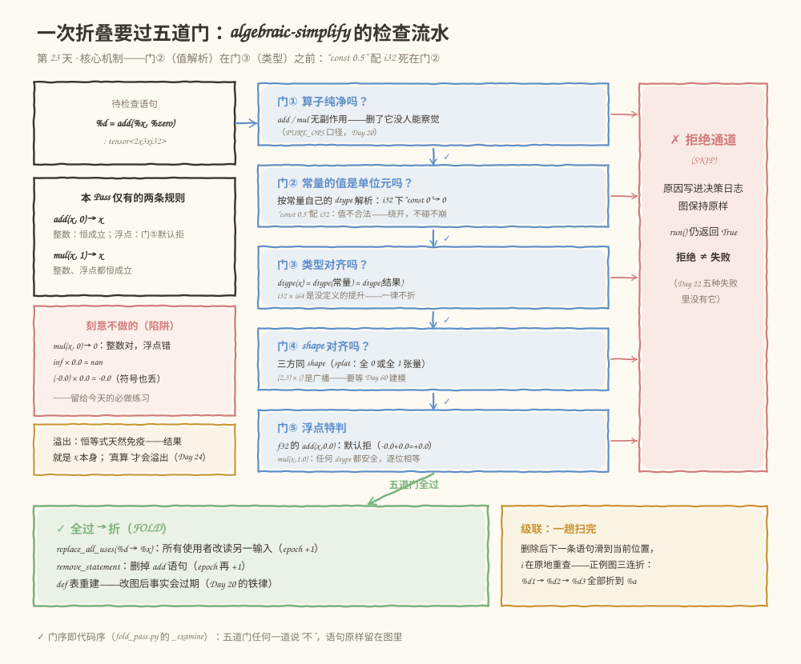
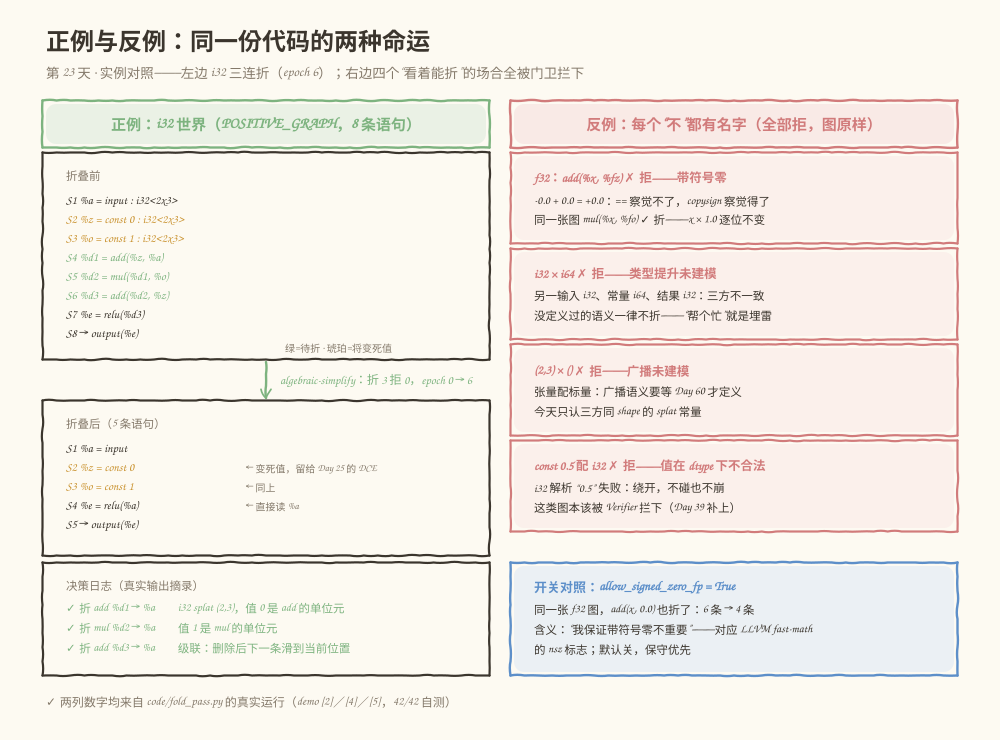

# 第 023 天：常量折叠——x + 0 为什么不能无脑换成 x

> **今日目标**：完成本教程后，你能说出 `add(x, 0) → x` 与 `mul(x, 1) → x` 成立的全部条件（算子纯净、值是单位元、类型对齐、shape 对齐、浮点特判），并解释为什么 f32 的 x + 0.0 默认不能折（-0.0 的符号会丢）、为什么 i32 × i64 不能折（类型提升没有定义）、为什么恒等式不会溢出而"真算"会；实现带五道门和决策日志的 `algebraic-simplify` Pass，挂进 Day 22 的 PassManager 跑通正例与反例。
> **预计时间**：学习 35 分钟 + 实践 50 分钟
> **前置准备**：Python 3（本教程用 3.11.4 实测）；Day 22 的 Pass 接口与 PassManager（今天原样复用）；Day 20 的分析组件与 epoch 对账（`dce-preview` 继续要用）。
> **今日产出**：`code/fold_pass.py`（`algebraic-simplify` Pass ＋ 五道门 ＋ 决策日志 ＋ 42 项自测）的真实运行记录，以及一组正例／反例。

## 1. 今天解决什么问题？

Day 22 的结尾留了一句话："明天（Day 23）常量折叠转正——成立条件（什么类型才折）、类型提升和溢出风险，以及为什么有些'看似能折'的场合必须拒绝。"今天兑现。

先看一个会真实发生的翻车现场。假设你把 Day 22 的 `fold-add-zero`"加强"了两下：① 顺手支持浮点（"0 加谁都一样嘛"）；② 把 `mul(x, 0) → 0` 也加上（"乘零得零嘛"）。单元测试全绿——因为你喂的随机数几乎不可能产生 -0.0。上线之后用户报了一个诡异的 bug：模型输出在 `==` 意义下全对，但下游一个符号敏感的计算（比如判断 `1/y` 的正负）行为变了。定位三天，最后发现在这行：

```python
x = x + 0.0   # 你的"无害优化"把它折成了 x
```

当 x 是 -0.0 时，`x + 0.0` 的结果是 +0.0——数值相等（IEEE 754 里 `-0.0 == 0.0` 是 True），但符号位丢了：`1/(-0.0)` 是 -inf，`1/(+0.0)` 是 +inf。`==` 看不见这个差别，copysign 和位模式看得见。**优化"看起来免费"和"真的免费"之间，隔着一整个 IEEE 754。**

今天对应学习计划的三行：

- **学习**：常量折叠成立的条件、类型提升和溢出风险；
- **实践**：实现 `Add(x, 0) → x`、`Mul(x, 1) → x`，避免处理不合法类型；
- **产出**：代数化简 Pass、正例和反例。

**术语先对齐**：计划标题写"常量折叠"（constant folding），但今天的实践其实是"代数化简"（algebraic simplification）——把 `x + 0` 替换成它的**输入** `x`，全程不算任何东西。真正的常量计算（`const + const → 新 const`）是明天 Day 24；MLIR 把今天这类规则叫 canonicalization pattern（规范化模式）。标题沿用计划的叫法，正文用准确的词。

贯穿全文的还是 Day 22 那张六语句图，只是从今天起每条语句带上了类型——第 4 格从 shape 升级为 `(shape, dtype)`，打印成 MLIR 风格的 `tensor<2x3xi32>`：

```text
S1   %a    = input              : tensor<2x3xi32>
S2   %zero = const 0            : tensor<2x3xi32>   ← splat：全 0 张量
S3   %d    = add(%a, %zero)     : tensor<2x3xi32>   ← 今天的主角
S4   %e    = relu(%d)           : tensor<2x3xi32>
S5   %z    = relu(%e)           : tensor<2x3xi32>   ← 天生死代码
S6     →   output(%e)
```

**前置补给**：单位元（identity element）——一个数，与它运算不改变另一个数：加法的单位元是 0（x + 0 = x），乘法的单位元是 1（x × 1 = x）。splat 常量——"张量每个元素都是同一个值"的常量，比如 shape (2,3)、值全 0；MLIR 里写作 `dense<0>`。

## 2. 先看全貌：今天的内容位于哪里？


**图 1**：看三个区域。顶部四张卡是前 22 天的家底（图 IR＋Verifier、控制流与活跃区间、分析组件＋epoch、Day 22 的调度台）；中间蓝框是今天的主角 `algebraic-simplify`——两条规则、五道门、决策日志，挂在 Day 22 的调度台上跑；底部琥珀色一排是第 4 周剩余日程，从明天起每个优化 Pass 都按 Day 22 的接口进场。

全局流程五步，今天做第五步：

1. 前端把模型变成图 IR，配 Verifier（Day 8–14，已完成）；
2. 控制流、SSA、活跃区间（Day 15–19，已完成）；
3. 分析做成组件，epoch 管失效（Day 20，已完成）；
4. Pass 接口＋PassManager 调度台（Day 22，已完成）；
5. **今天：第一个"真"优化 Pass——`algebraic-simplify` 上岗；Day 24 常量计算、Day 25 DCE、Day 26 CSE 随后进场。**

## 3. 核心概念：从"-0.0 的指纹"到"五道门"

### 3.1 先看真相：x + 0.0 不总是 x

四个事实（5.3 节 [1] 有真实运行记录，每个都可以在 Python 里当场验证）：

1. **`-0.0 == 0.0` 是 True**——IEEE 754 规定正负零相等。所以"折叠前后 `==` 不变"这句话对任何 x 都成立，这就是测试全绿的原因；
2. **但位模式不同**：-0.0 的 64 位是 `00 00 00 00 00 00 00 80`，`-0.0 + 0.0` 的结果是 `00 00 00 00 00 00 00 00`——最高位符号位丢了。`copysign(1, -0.0) = -1.0`，`copysign(1, -0.0 + 0.0) = +1.0`；
3. **`-0.0 * 1.0` 逐位不变**——乘以 1 连符号零都原样保留（inf、NaN 同理：`inf * 1.0 = inf`，`nan * 1.0` 还是 nan）。这就是 `mul(x, 1)` 对浮点安全、`add(x, 0)` 不安全的全部原因；
4. **`inf * 0.0 = nan`**——所以 `mul(x, 0) → 0` 对浮点是彻底错的：x = inf 时结果从"确定的 0"变成 NaN。这不是精度误差，是语义灾难。

- **一个类比**：0 在加法里像"透明人"——加进去等于没加。**对应到技术上是**：整数（补码回绕算术）下这个类比严格成立；浮点下 0 是"会留指纹的透明人"——值不变，但 -0.0 被洗成 +0.0，而符号零在 copysign、1/x、位级序列化等场合**可观察**。类比的边界：在"只做 == 比较"的世界里，指纹确实不存在——如果语言或框架明确保证"带符号零不可观察"，这个指纹就可以合法忽略（3.2 的开关）。
- **真实编译器的做法**（锚点）：LLVM 的 InstCombine 把 `fadd x, 0.0` 折成 `x` 要求 fast-math 的 `nsz`（no signed zeros）标志；`fmul x, 1.0` 折成 `x` 则不需要任何标志。今天的 `allow_signed_zero_fp` 开关就是 nsz 的迷你版，**默认关**。
- **一个 Python 彩蛋**（写本教程时真实踩到）：`1 / -0.0` 在 Python 里抛 `ZeroDivisionError`，不是 C/IEEE 的 ±inf——别拿 Python 的直觉猜 C 语义；想观察符号用 `math.copysign` 或 `struct.pack`。

### 3.2 五道门：一次折叠的成立条件

把"能不能折"写成一个函数，它的判断序列就是五道门。任何一道说"不"，语句**原样留在图里**，原因写进决策日志：

| 门 | 问题 | 不过的真实例子 |
|---|---|---|
| ① 算子纯净 | add / mul 无副作用吗？ | 本 IR 里 add/mul 都纯净（PURE_OPS）；有副作用的算子谈不上"等价替换" |
| ② 值是单位元 | 常量按它**自己的 dtype** 解析后，恰是 0 / 1 吗？ | `const 0.5` 配 i32：解析失败，绕开 |
| ③ 类型对齐 | dtype(x) = dtype(常量) = dtype(结果)？ | i32 × i64：没定义过的提升 |
| ④ shape 对齐 | 三方 shape 相同（splat）？ | (2,3) × ()：那是广播 |
| ⑤ 浮点特判 | 这条规则对浮点安全吗？ | f32 的 add(x, 0.0)：-0.0 问题，默认拒 |

为什么门②排在门③前面：值必须先按**常量自己的 dtype** 解析——`const 0.5` 配 i32 连值都不合法，根本轮不到讨论类型对齐。顺序不是审美，是依赖。

一个容易混淆的点：**"拒"和"失败"是两回事**。Day 22 的五种失败（entry / return / raise / bypass / verify）任何一种都会拉闸停线；今天的 SKIP 只是"这条语句不该我动"——图原样、`run()` 照样返回 True、原因进日志。优化 Pass 的本职就是"该折的折，不该折的明确放过"，而不是"能折的都折"。

### 3.3 类型提升：没定义的语义不折

看这张图（5.3 节 [4b] 的真实输入）：

```text
S1   %x  = input    : tensor<2x3xi32>
S2   %w  = const 0  : tensor<2x3xi64>
S3   %d  = add(%x, %w)   : tensor<2x3xi32>
```

"0 就是 0 嘛，折了得了"——不行。i64 的 0 参与一个 i32 的加法，中间必然发生了某种**类型提升**（type promotion，把一个类型转换成另一个类型的隐式规则）；而我们的 IR 根本没定义这条规则。C 语言有完整的整型提升规则，所以 C 编译器知道 `int + long` 怎么算；我们的 IR 没写过，**没定义的语义就没有"等价替换"可言**——你以为"截断成 i32 再加"，他以为"提升到 i64 加完再截断"，两种理解在不溢出时碰巧一致，溢出时分道扬镳（3.4）。

今天的原则：**门卫不猜语义**。三方 dtype 不一致 → 拒，原因写进日志。同理：

- `const 0.5` 配 i32（值在 dtype 下不合法）→ 拒，而且**不崩**——解析返回 None，语句原样留下。"避免处理不合法类型"的字面意思就是这个：不碰、不崩、留案底；
- dtype 是不认识的 `q42` → 拒；
- 标量 0 配 (2,3) 张量 → 拒（这是广播，Day 60 的地界）。

**为什么 Pass 要自己当心**：Day 12 讲过"构造失败、验证失败、运行失败"三分法，但我们的 Verifier 目前只查 SSA（Day 39 的 MLIR Verifier 才补类型检查）。在 Verifier 长出火眼金睛之前，每个 Pass 都得自带门卫。

### 3.4 溢出风险：恒等式天然免疫，"真算"才会踩雷

先说结论：**今天的两条规则不可能溢出**——`x + 0` 和 `x × 1` 的结果就是 x 本身，x 已经在它的 dtype 里好好待着，天然可表示。这是恒等式的特权。

会溢出的是"真算"（明天 Day 24 的活）。两个真实数据（5.3 节 [6]）：

- Python 里 `2147483647 + 1 = 2147483648`——Python 的 int 无限宽，**不会替你踩刹车**；但 i32 装不下 2147483648，硬塞回去（补码回绕）变成 -2147483648。明天写常量求值时如果直接 `a + b` 存进图里，就造出了一个"写着 i32、值却不在 i32 里"的谎言常量；
- 浮点更隐蔽：`1e308 * 10 = inf`——不抛异常、不回绕，直接变成 inf，数值静悄悄地错掉。

类型提升和溢出在这里汇合：3.3 那张 i32 × i64 图，如果有人"好心"把 i64 的 0 当成 i32 的 0 折掉，语义靠什么保证？靠"0 加谁都不变"——对 0 恰好成立。但同样的好心放到 `const 4294967296`（2^32，i64 装得下、i32 装不下）上，就是静默的数值错误。**门卫不猜语义，不是洁癖，是防火墙。**

## 4. 图解核心机制



**图 2**：从左上的待检查语句 `%d = add(%x, %zero)` 开始，按编号看：

1. **门① → 门⑤**：五个蓝框是顺序检查，每道门都写着真实的拒绝案例；门②在门③之前——值先按常量自己的 dtype 解析；
2. **右侧玫瑰色通道（SKIP）**：任何一道门说"不"就走这里——原因进决策日志、图保持原样、`run()` 仍返回 True。注意它和 Day 22 五种失败的区别：**拒绝是正常业务，失败才拉闸**；
3. **左中两张卡**：本 Pass 仅有的两条规则（add 的 0 对浮点默认不放行；mul 的 1 全放行），以及刻意不做的 `mul(x, 0)`——它对整数是恒等式，对浮点是错的（`inf × 0 = nan`），留给必做练习；
4. **底部绿色（FOLD）**：五道门全过后的两个动作——`replace_all_uses(%d → %x)`（所有使用者改读另一输入，epoch +1）和 `remove_statement`（删掉 add 语句，epoch 再 +1）；然后 **def 表重建**：图变了，"值名 → 定义语句"的映射就是过期事实（Day 20 的铁律在 Pass 内部的重演）；
5. **底部琥珀色（级联）**：删除后下一条语句滑到当前位置，扫描下标原地不动——`%d1 → %d2 → %d3` 的链式化简在一趟内完成，不用跑第二遍管线。

**换边为什么不会破坏 def-before-use**：使用者们原本在 add 之后（位置 > i），改读的 %x 是 add 的输入（定义位置 < i）——新边"定义早于使用"自动成立。当然，PassManager 跑完还会再过一遍 Verifier（Day 22 的第⑤道关卡），双保险。

## 5. 动手实践：五道门＋决策日志＋正反例

### 5.1 准备文件

```text
tutorials/day-023/
├── README.md
├── code/
│   └── fold_pass.py     # algebraic-simplify + 五道门 + 决策日志 + 42 项自测
└── images/
    ├── 01-overview.svg
    ├── 02-mechanism.svg
    └── 03-example.svg
```

运行环境：Python 3.11.4（Linux），无第三方依赖。`Graph` / `AnalysisManager` / `Pass` / `PassManager` 从 Day 22 原样搬来——唯一的升级是语句第 4 格从 `shape` 变成 `(shape, dtype)`，`ir_dump` 顺手打印成 MLIR 风格的 `tensor<2x3xi32>`。

### 5.2 编写代码

下面是 `code/fold_pass.py` 的完整实现（与仓库文件一致，共 798 行）。重点看六处：模块 docstring 里的五道门总纲；`IDENTITY` / `FLOAT_UNSAFE` 两张规则表（**规则是数据，不是散弹 if-else**）；`const_value`（按 dtype 解析、不合法返回 None——"避免处理不合法类型"的落点）；`_examine`（五道门的判断序列与拒绝理由）；`run` 里的死结果分支（`if res in graph.used_at()`——为什么必须有它，见第 6 节错误四）；以及每折一条后的 `defs = self._defs(graph)`（事实过期就重建）。

```python
#!/usr/bin/env python3
"""第 23 天演练场：代数化简 Pass——常量折叠的第一步。

用法：
    python3 fold_pass.py               # 演示主流程：浮点真相、正例、反例、开关对照、溢出演示
    python3 fold_pass.py --self-test   # 运行自测，全部通过退出码 0

Day 22 交付了调度台（Pass 接口＋PassManager）；今天第一个“真”优化 Pass 上岗：
algebraic-simplify。它只做两条恒等替换——

    add(x, 0) → x    整数下恒成立；浮点下默认不折（-0.0 + 0.0 = +0.0，符号会丢）
    mul(x, 1) → x    整数、浮点下都恒成立（IEEE 754 下 x * 1.0 逐位等于 x）

术语先对齐：学习计划标题写“常量折叠”（constant folding），但今天的实践是
“代数化简”（algebraic simplification）——把 x + 0 这样的式子替换成它的输入 x，
并不“计算”任何东西。真正的常量计算（const + const → 新 const）是明天 Day 24。
MLIR 把这类规则叫 canonicalization pattern（规范化模式）。

每条替换动身前要过五道门，任何一道不过就拒绝，并把原因写进决策日志：
    门① 算子纯净：add / mul 无副作用，替换后没人能察觉（Day 20 的 PURE_OPS 口径）；
    门② 值是单位元：常量按它自己的 dtype 解析，值必须恰为 0 / 1；
        “const 0.5” 配 i32 解析失败——不合法类型不碰、也不崩；
    门③ 类型对齐：dtype(常量) == dtype(另一输入) == dtype(结果)。
        类型提升（i32 × i64）本 IR 没有定义——没定义的语义一律不折；
    门④ Shape 对齐：三方 shape 相同（splat 常量）。标量配张量是广播，
        广播要等 Day 60；
    门⑤ 浮点特判：add 对浮点默认拒绝（带符号零问题），mul 对浮点放行。
        allow_signed_zero_fp=True 表示“我保证带符号零不重要”，
        对应 LLVM fast-math 的 nsz 标志——真实编译器同样如此。

为什么今天不碰 mul(x, 0) → 0：整数下它是恒等式，浮点下 Inf×0=NaN、
(-0.0)×0=-0.0——留给必做练习，亲手体会“看着能折其实不能”。

溢出风险（今天的学习目标）：恒等式不会溢出——x+0 和 x*1 的结果就是 x 本身，
天然可表示。会溢出的是“真算”：const 2147483647 + const 1 在 i32 下装不下，
那是 Day 24 编译期求值要处理的事——先检查可表示，再落笔。
"""

from __future__ import annotations

import argparse
import math
import re
import struct

PURE_OPS = {"matmul", "add", "relu", "mul"}   # 无副作用算子（Day 20 同款口径）

INT_DTYPES = {"i8", "i16", "i32", "i64"}
FLOAT_DTYPES = {"f16", "bf16", "f32", "f64"}
KNOWN_DTYPES = INT_DTYPES | FLOAT_DTYPES

IDENTITY = {"add": 0, "mul": 1}   # 算子 → 单位元（identity element）
FLOAT_UNSAFE = {"add"}            # 对浮点默认不安全的规则（-0.0 + 0.0 = +0.0）


# ---------- 图：Day 22 同款外壳，语句第 4 格从 shape 升级为 (shape, dtype) ----------

# 贯穿全文的例子（Day 22 的六语句图，本天起带 dtype）：
PIPELINE_GRAPH = [
    ("input",   "%a",    [],              ((2, 3), "i32")),
    ("const 0", "%zero", [],              ((2, 3), "i32")),   # splat：全 0 张量
    ("add",     "%d",    ["%a", "%zero"], ((2, 3), "i32")),   # add(x, 0) → x
    ("relu",    "%e",    ["%d"],          ((2, 3), "i32")),
    ("relu",    "%z",    ["%e"],          ((2, 3), "i32")),   # 从未被使用：天生死代码
    ("output",  None,    ["%e"],          None),
]

# 正例图：i32 世界——常量在左、在右、级联、mul 单位元，一网打尽
POSITIVE_GRAPH = [
    ("input",   "%a",    [],              ((2, 3), "i32")),
    ("const 0", "%z",    [],              ((2, 3), "i32")),
    ("const 1", "%o",    [],              ((2, 3), "i32")),
    ("add",     "%d1",   ["%z", "%a"],    ((2, 3), "i32")),   # 0 在左边：add(0, x) → x
    ("mul",     "%d2",   ["%d1", "%o"],   ((2, 3), "i32")),   # mul(x, 1) → x
    ("add",     "%d3",   ["%d2", "%z"],   ((2, 3), "i32")),   # 再 +0：级联
    ("relu",    "%e",    ["%d3"],         ((2, 3), "i32")),
    ("output",  None,    ["%e"],          None),
]

# 反例图一：浮点的两张面孔（add 拒、mul 折）
FLOAT_GRAPH = [
    ("input",   "%x",    [],               ((2, 3), "f32")),
    ("const 0", "%fz",   [],               ((2, 3), "f32")),
    ("const 1", "%fo",   [],               ((2, 3), "f32")),
    ("add",     "%s1",   ["%x", "%fz"],    ((2, 3), "f32")),   # 拒：-0.0 问题
    ("mul",     "%s2",   ["%x", "%fo"],    ((2, 3), "f32")),   # 折：×1 安全
    ("output",  None,    ["%s1", "%s2"],   None),
]

# 反例图二：类型提升（i32 结果 × i64 常量）
PROMO_GRAPH = [
    ("input",   "%x",   [],             ((2, 3), "i32")),
    ("const 0", "%w",   [],             ((2, 3), "i64")),
    ("add",     "%d",   ["%x", "%w"],   ((2, 3), "i32")),
    ("output",  None,   ["%d"],         None),
]

# 反例图三：shape 不一致（张量 × 标量 = 广播，未建模）
BCAST_GRAPH = [
    ("input",   "%x",   [],            ((2, 3), "i32")),
    ("const 0", "%s",   [],            ((), "i32")),
    ("add",     "%d",   ["%x", "%s"],  ((2, 3), "i32")),
    ("output",  None,   ["%d"],        None),
]

# 反例图四：值在 dtype 下不合法（“const 0.5” 配 i32）
BADVAL_GRAPH = [
    ("input",     "%x",   [],             ((2, 3), "i32")),
    ("const 0.5", "%h",   [],             ((2, 3), "i32")),
    ("add",       "%d",   ["%x", "%h"],   ((2, 3), "i32")),
    ("output",    None,   ["%d"],         None),
]

# 反例图五：未知 dtype（q42）——不认识的一律不碰
UNKNOWN_GRAPH = [
    ("input",   "%x",   [],            ((2, 3), "q42")),
    ("const 0", "%z",   [],            ((2, 3), "q42")),
    ("add",     "%d",   ["%x", "%z"],  ((2, 3), "q42")),
    ("output",  None,   ["%d"],        None),
]


class GraphError(Exception):
    """图不合法，或违反“改图走方法”的契约。"""


class PassFailure(Exception):
    """Pass 主动上报的失败（对应 MLIR 的 failure()）。"""


class Graph:
    """语句序列表示的线性计算图（Day 22 同款契约，info 升级为 (shape, dtype)）。

      * 只读查询（labels / used_at / validate）不改图；
      * 修改必须走 remove_statement / replace_all_uses，每次修改 epoch + 1
        并写改动日志；
      * validate 仍是 Day 17/18 的 SSA 闸门：唯一定义、使用先于定义。
        类型合法性（const 0.5 配 i32、i32 × i64）目前 Verifier 还不懂——
        Day 39 的 MLIR Verifier 才补上；在那之前，Pass 必须自己当心。
    """

    def __init__(self, statements):
        self.statements = [list(s) for s in statements]
        self.epoch = 0
        self.change_log = []

    def labels(self):
        return [f"S{i + 1}" for i in range(len(self.statements))]

    def used_at(self):
        """每个值被使用的位置列表。图输出语句的输入也算使用（Day 19 教训三）。"""
        used = {}
        for i, (_, _, uses, _) in enumerate(self.statements):
            for u in uses:
                used.setdefault(u, []).append(i)
        return used

    def validate(self):
        """Day 17/18 的合法性闸门：SSA 唯一定义、使用必须先于定义。"""
        defined = {}
        for i, (_, res, _, _) in enumerate(self.statements):
            if res is None:
                continue
            if res in defined:
                raise GraphError(f"{res} 被定义两次（违反 SSA）：S{defined[res] + 1} 和 S{i + 1}")
            defined[res] = i
        for i, (_, _, uses, _) in enumerate(self.statements):
            for u in uses:
                if u not in defined:
                    raise GraphError(f"{u} 被使用但从未定义（S{i + 1}）")
                if defined[u] >= i:
                    raise GraphError(f"{u} 在定义之前被使用（S{i + 1}）")
        return True

    def _commit(self, note):
        self.epoch += 1
        self.change_log.append(f"epoch {self.epoch}：{note}")

    def remove_statement(self, index):
        stmt = self.statements[index]
        del self.statements[index]
        self._commit(f"删除 S{index + 1}（{stmt[0]} {stmt[1] or ''}）——后面所有语句位置前移")

    def replace_all_uses(self, old, new):
        """把所有读 old 的语句改成读 new（今天折叠 Pass 的核心动作）。"""
        rewired = 0
        for stmt in self.statements:
            if old in stmt[2]:
                stmt[2] = [new if u == old else u for u in stmt[2]]
                rewired += 1
        if rewired == 0:
            raise GraphError(f"没有任何语句使用 {old}，无事可换")
        self._commit(f"换边：{rewired} 条语句改读 {new}（原来读 {old}）——位置没变，Use-Def 变了")
        return rewired


# ---------- 分析：Day 20 的组件原样搬来（今天只用到 unused）----------


class Analysis:
    name = "analysis"

    def run(self, graph):
        raise NotImplementedError


class UnusedResult:
    def __init__(self, dead, where):
        self.dead = frozenset(dead)
        self.where = dict(where)

    def is_dead(self, name):
        return name in self.dead


class UnusedAnalysis(Analysis):
    """未使用分析：哪些值从未被任何语句（含图输出）使用。只报告，不决策。"""

    name = "unused"

    def run(self, graph):
        used = graph.used_at()
        dead, where = [], {}
        for i, (_, res, _, _) in enumerate(graph.statements):
            if res is None:
                continue
            where[res] = i
            if res not in used:
                dead.append(res)
        return UnusedResult(dead, where)


ANALYSES = {"unused": UnusedAnalysis}


class AnalysisManager:
    """分析缓存管理器（Day 20 同款）：epoch 对账，图一变旧结果作废。"""

    def __init__(self, graph):
        self.graph = graph
        self._cache = {}
        self.stats = {"queries": 0, "recomputed": 0, "invalidated": 0}

    def get(self, analysis):
        self.stats["queries"] += 1
        entry = self._cache.get(analysis.name)
        if entry is not None and entry[0] == self.graph.epoch:
            return entry[1]
        if entry is not None:
            self.stats["invalidated"] += 1
        epoch_before = self.graph.epoch
        result = analysis.run(self.graph)
        if self.graph.epoch != epoch_before:
            raise GraphError(f"分析 {analysis.name} 在 run 期间修改了图：分析 Pass 只读")
        self._cache[analysis.name] = (self.graph.epoch, result)
        self.stats["recomputed"] += 1
        return result


# ---------- Pass 接口与 PassManager：Day 22 原样搬来 ----------


class Pass:
    """最小 Pass 接口（Day 22 契约）：name ＋ requires ＋ run(graph, am) → True/False。"""

    name = "pass"
    requires = ()

    def run(self, graph, am):
        raise NotImplementedError

    def __repr__(self):
        return f"<Pass {self.name}>"


class PassManager:
    """流水线调度台（Day 22 同款）：顺序执行、逐 Pass 验证、打印 IR、记账。"""

    def __init__(self, print_ir="all", verify=True, verbose=True, title="PassManager"):
        self.print_ir = print_ir
        self.verify = verify
        self.verbose = verbose
        self.title = title
        self.passes = []
        self.log = []
        self.failure = None
        self.skipped = []
        self.am = None

    def add(self, *passes):
        for p in passes:
            if not isinstance(p, Pass):
                raise TypeError(f"add 只收 Pass，收到 {type(p).__name__}")
            for dep in p.requires:
                if dep not in ANALYSES:
                    raise ValueError(f"Pass {p.name} 声明了未知分析依赖 {dep!r}（可用：{sorted(ANALYSES)}）")
            self.passes.append(p)
        return self

    def pipeline(self):
        return " → ".join(p.name for p in self.passes) if self.passes else "（空管线）"

    def _say(self, text):
        if self.verbose:
            for line in text.split("\n"):
                print(line)

    def run(self, graph):
        self.log, self.failure, self.skipped = [], None, []
        self.am = AnalysisManager(graph)
        self._say(f"== {self.title}：管线 [{self.pipeline()}] ==")

        try:
            graph.validate()
        except GraphError as exc:
            self.failure = {"kind": "entry", "pass": "（入口）", "reason": f"进管线前图就不合法：{exc}"}
            self.skipped = [p.name for p in self.passes]
            self._say(f"*** 管线未启动：{self.failure['reason']}")
            return False

        total = len(self.passes)
        for i, p in enumerate(self.passes):
            self._say(f"--- [{i + 1}/{total}] {p.name}")
            epoch_before = graph.epoch
            n_before = len(graph.statements)
            q_before = self.am.stats["queries"]

            try:
                ok = p.run(graph, self.am)
            except (GraphError, PassFailure) as exc:
                return self._stop(graph, i, p, "raise",
                                  f"{p.name} 抛出 {type(exc).__name__}：{exc}",
                                  epoch_before, n_before, q_before)

            if ok is not True:
                return self._stop(graph, i, p, "return",
                                  f"{p.name} 返回 {ok!r}，不是 True",
                                  epoch_before, n_before, q_before)

            changes = graph.epoch - epoch_before
            n_after = len(graph.statements)

            if n_after != n_before and changes == 0:
                return self._stop(graph, i, p, "bypass",
                                  f"{p.name} 之后语句数 {n_before}→{n_after}，但 epoch 没动",
                                  epoch_before, n_before, q_before)

            if self.verify:
                try:
                    graph.validate()
                except GraphError as exc:
                    return self._stop(graph, i, p, "verify",
                                      f"{p.name} 之后图不合法：{exc}",
                                      epoch_before, n_before, q_before)

            printed = self.print_ir == "all" or (self.print_ir == "change" and changes > 0)
            self.log.append({"name": p.name, "changes": changes,
                             "before": n_before, "after": n_after, "printed": printed})
            if printed:
                self._say(f"// IR after {p.name}（修改 {changes} 次，语句 {n_before}→{n_after}，epoch {graph.epoch}）")
                self._say(ir_dump(graph))

        self._say(f"== 管线完成：{total} 个 Pass 全部成功，图停在 epoch {graph.epoch} ==")
        return True

    def _stop(self, graph, i, p, kind, reason, epoch_before, n_before, q_before):
        changes = graph.epoch - epoch_before
        self.failure = {"kind": kind, "pass": p.name, "reason": reason}
        self.log.append({"name": p.name, "changes": changes,
                         "before": n_before, "after": len(graph.statements),
                         "printed": False, "failed": True})
        self.skipped = [q.name for q in self.passes[i + 1:]]
        self._say(f"*** 管线停止：[{i + 1}/{len(self.passes)}] {p.name} 失败（{kind}）")
        self._say(f"    {reason}")
        return False


# ---------- 工具 ----------


def fmt_type(info):
    """(shape, dtype) → MLIR 风格类型文本：((2,3),'i32') → tensor<2x3xi32>。"""
    if info is None:
        return ""
    shape, dtype = info
    dims = "x".join(str(d) for d in shape)
    return f"tensor<{dims + 'x' if dims else ''}{dtype}>"


def ir_dump(g):
    lines = []
    for i, (op, res, uses, info) in enumerate(g.statements):
        lhs = f"{res:<6}= " if res else "  →   "
        rhs = f"{op}({', '.join(uses)})" if uses else op
        ty = f"    : {fmt_type(info)}" if info else ""
        lines.append(f"  S{i + 1:<4}{lhs}{rhs}{ty}")
    return "\n".join(lines)


def is_const(op):
    return op.startswith("const ")


def const_value(op, dtype):
    """按 dtype 解析常量数值；类型不合法（或未知 dtype）返回 None。

    范围检查（值是否真能装进 i32）是 Day 24 常量求值的事——今天的单位元
    判断用不到它：0 和 1 任何整型都装得下。
    """
    try:
        text = op.split(" ", 1)[1].strip()
    except IndexError:
        return None
    if dtype in INT_DTYPES:
        return int(text) if re.fullmatch(r"[+-]?\d+", text) else None
    if dtype in FLOAT_DTYPES:
        try:
            return float(text)
        except ValueError:
            return None
    return None


def removable(stmt):
    """结果无人使用且无副作用时可删；input 代表外部输入，不删（Day 25 再正式化）。"""
    op, res = stmt[0], stmt[1]
    return res is not None and (op in PURE_OPS or op.startswith("const"))


# ---------- 今天的主角：代数化简 Pass ----------


class AlgebraicSimplifyPass(Pass):
    """add(x, 0) → x、mul(x, 1) → x——常量折叠的第一步。

    每条替换过五道门（见模块 docstring）；拒绝也要留下原因（决策日志），
    因为“为什么没折”和“折了什么”同样是需要审计的信息。

    def 表（值名 → 定义语句）在本 Pass 内部自建自弃：每折一条图就变，
    事实必须重建（Day 20 的铁律）。它今天还不是注册分析——Day 26 的 CSE
    需要结构等价时再把它升级进 ANALYSES。
    """

    name = "algebraic-simplify"

    def __init__(self, allow_signed_zero_fp=False):
        self.allow_signed_zero_fp = allow_signed_zero_fp
        self.decisions = []

    def run(self, graph, am):
        self.decisions = []
        defs = self._defs(graph)
        i = 0
        while i < len(graph.statements):
            verdict = self._examine(graph, i, defs)
            if verdict is None:            # 不是 add/mul 目标，不进日志
                i += 1
                continue
            kind, other, reason = verdict
            op, res, inputs, info = graph.statements[i]
            if kind == "skip":
                self.decisions.append({"verdict": "skip", "op": op, "res": res, "reason": reason})
                i += 1
                continue
            note = ""
            if res in graph.used_at():
                graph.replace_all_uses(res, other)   # 使用者全部改读另一输入
            else:
                note = "（结果无人使用，无需换边）"
            self.decisions.append({"verdict": "fold", "op": op, "res": res,
                                   "to": other, "reason": reason + note})
            graph.remove_statement(i)
            defs = self._defs(graph)        # 图变了，def 表重建——事实会过期
            # i 不动：下一条语句滑到当前位置，级联在一趟内完成
        return True

    @staticmethod
    def _defs(graph):
        return {stmt[1]: stmt for stmt in graph.statements if stmt[1] is not None}

    def _examine(self, graph, i, defs):
        """检查第 i 条语句：返回 None（非目标）/ ('skip', None, 原因) / ('fold', 替换目标, 原因)。"""
        op, res, inputs, info = graph.statements[i]
        if op not in IDENTITY or res is None:
            return None
        if len(inputs) != 2:
            return ("skip", None, f"输入数量 {len(inputs)} ≠ 2——先不碰")

        shape, dtype = info
        if dtype not in KNOWN_DTYPES:
            return ("skip", None, f"结果 dtype {dtype} 不认识——未知类型一律不碰")

        for k in (0, 1):
            name, other = inputs[k], inputs[1 - k]
            dstmt = defs.get(name)
            if dstmt is None or not is_const(dstmt[0]):
                continue
            cshape, cdtype = dstmt[3]

            # 门②：值按常量自己的 dtype 解析，必须恰为单位元
            if cdtype not in KNOWN_DTYPES:
                return ("skip", None, f"常量 {name} 的 dtype {cdtype} 不认识——未知类型一律不碰")
            val = const_value(dstmt[0], cdtype)
            if val is None:
                return ("skip", None, f"常量 {name}（{dstmt[0]}）的值在 {cdtype} 下不合法——绕开，不碰也不崩")
            if val != IDENTITY[op]:
                continue                    # 值不是单位元，看看另一个输入

            # 门③：类型对齐——没有定义过的提升规则，一律不折
            ostmt = defs.get(other)
            if ostmt is None:
                return ("skip", None, f"输入 {other} 没有定义——图有问题，交给 Verifier")
            oshape, odtype = ostmt[3]
            if cdtype != dtype or odtype != dtype:
                return ("skip", None,
                        f"类型提升未建模：另一输入 {odtype}、常量 {cdtype}、结果 {dtype} 三方不一致")

            # 门④：shape 对齐——广播未建模
            if cshape != shape or oshape != shape:
                return ("skip", None,
                        f"shape 不一致：{oshape} / {cshape} vs 结果 {shape}——广播是 Day 60 的事")

            # 门⑤：浮点特判——add 的 0 在浮点下不是“无害”的单位元
            if dtype in FLOAT_DTYPES and op in FLOAT_UNSAFE and not self.allow_signed_zero_fp:
                return ("skip", None,
                        f"{dtype} 的 {op}(x, {val}) 不恒等：-0.0 + 0.0 = +0.0，符号会丢"
                        f"（未开 allow_signed_zero_fp）")

            return ("fold", other,
                    f"{dtype} splat {shape}，值 {val} 是 {op} 的单位元，五道门全过")
        return ("skip", None, "没有值为单位元的常量输入")


class DcePreviewPass(Pass):
    """Day 25 DCE 的预演：删掉“无使用者且无副作用”的语句（Day 22 同款）。"""

    name = "dce-preview"
    requires = ("unused",)

    def run(self, graph, am):
        while True:
            unused = am.get(UnusedAnalysis())
            target = None
            for i, stmt in enumerate(graph.statements):
                if unused.is_dead(stmt[1]) and removable(stmt):
                    target = i
                    break
            if target is None:
                return True
            graph.remove_statement(target)


# ---------- 演示 ----------


def run_quiet(graph, **kw):
    """安静地跑一遍代数化简（用于反例/开关对照），返回 (ok, pass, manager)。"""
    p = AlgebraicSimplifyPass(**kw)
    pm = PassManager(print_ir="none", verbose=False, title="PM-quiet")
    pm.add(p)
    return pm.run(graph), p, pm


def print_decisions(p):
    folds = [d for d in p.decisions if d["verdict"] == "fold"]
    skips = [d for d in p.decisions if d["verdict"] == "skip"]
    print(f"决策日志：检查 {len(p.decisions)} 条 add/mul——折 {len(folds)} 条，拒 {len(skips)} 条")
    for d in p.decisions:
        if d["verdict"] == "fold":
            print(f"  ✓ 折  {d['op']:<4}{d['res']} → {d['to']}")
        else:
            print(f"  ✗ 拒  {d['op']:<4}{d['res']}")
        print(f"        {d['reason']}")


def demo():
    print("== [1] 先看真相：浮点数下，x + 0.0 真的等于 x 吗？ ==")

    def bits(x):
        return " ".join(f"{b:02x}" for b in struct.pack("<d", x))

    nz = -0.0
    print(f"  -0.0        的 64 位：{bits(nz)}")
    print(f"  -0.0 + 0.0  的 64 位：{bits(nz + 0.0)}   ← 符号位丢了（但 == 仍然是 True！）")
    print(f"  -0.0 * 1.0  的 64 位：{bits(nz * 1.0)}   ← 逐位不变")
    print(f"  copysign(1, -0.0) = {math.copysign(1.0, nz)}，copysign(1, -0.0 + 0.0) = {math.copysign(1.0, nz + 0.0)}   ← 符号差异可观察")
    print("  （注：Python 里 1 / -0.0 会直接抛 ZeroDivisionError，C/IEEE 里才是 ±inf——浮点水很深）")
    print(f"  inf * 0.0 = {float('inf') * 0.0}   ← 所以 mul(x, 0) → 0 对浮点是错的")
    print(f"  1e308 * 10 = {1e308 * 10}   ← 浮点“溢出”不报错，直接变 inf")

    print("\n== [2] 正例：i32 世界，五道门全过 ==")
    g = Graph(POSITIVE_GRAPH)
    print("// 折叠前：")
    print(ir_dump(g))
    p = AlgebraicSimplifyPass()
    pm = PassManager(print_ir="none", verbose=False, title="PM-A")
    pm.add(p)
    ok = pm.run(g)
    print_decisions(p)
    print(f"run() 返回 {ok}；epoch = {g.epoch}（3 次折叠 × 换边+删除 = 6 次修改），最终 {len(g.statements)} 条语句")
    print("// 折叠后：")
    print(ir_dump(g))
    print("三个中间值 %d1/%d2/%d3 全部蒸发，%e 直接读 %a——级联在一趟内完成（删除后下一条滑到当前位置）")
    print("注意：const %z、%o 留下来了——它们变成死值是 DCE 的活（Day 25），今天的 Pass 不越界")

    print("\n== [3] Day 22 同款图接进管线：algebraic-simplify → dce-preview ==")
    g2 = Graph(PIPELINE_GRAPH)
    pm2 = PassManager(title="PM-B")
    pm2.add(AlgebraicSimplifyPass(), DcePreviewPass())
    ok2 = pm2.run(g2)
    print(f"run() 返回 {ok2}；最终 {len(g2.statements)} 条语句，epoch = {g2.epoch}")
    print("改动日志：")
    for entry in g2.change_log:
        print("  " + entry)
    print("与 Day 22 的顺序一（fold→dce）逐字节一致：3 条语句、epoch 4——今天只是把预演转正并加上类型门卫")

    print("\n== [4] 反例集中营：每一条拒绝都有名字 ==")
    for title, graph, kw in [
        ("[4a] f32：add(x, 0.0) 拒（-0.0），mul(x, 1.0) 折（安全）", FLOAT_GRAPH, {}),
        ("[4b] 类型提升：i32 × i64，没有定义过的语义不折", PROMO_GRAPH, {}),
        ("[4c] shape 不一致：(2,3) × ()——广播未建模", BCAST_GRAPH, {}),
        ("[4d] 值不合法：const 0.5 配 i32——绕开，不碰也不崩", BADVAL_GRAPH, {}),
        ("[4e] 未知 dtype q42：不认识的一律不碰", UNKNOWN_GRAPH, {}),
    ]:
        print(title)
        gx = Graph(graph)
        ok, px, _ = run_quiet(gx, **kw)
        print_decisions(px)
        print(f"  run() 返回 {ok}；{len(graph)} 条语句 → {len(gx.statements)} 条\n")

    print("== [5] 参数对照：同一张 f32 图，打开 allow_signed_zero_fp ==")
    g5 = Graph(FLOAT_GRAPH)
    ok5, p5, _ = run_quiet(g5, allow_signed_zero_fp=True)
    print_decisions(p5)
    print(f"run() 返回 {ok5}；{len(FLOAT_GRAPH)} 条语句 → {len(g5.statements)} 条")
    print(ir_dump(g5))
    print("add(x, 0.0) 也折了——开关的含义是“我保证带符号零不重要”，对应 LLVM fast-math 的 nsz；默认关")

    print("\n== [6] 溢出风险：恒等式天然免疫，“真算”才会踩雷 ==")
    i32_max = 2 ** 31 - 1
    print(f"  Python：{i32_max} + 1 = {i32_max + 1}（int 无限宽，不会替你踩刹车）")
    wrapped = struct.unpack("<i", struct.pack("<I", (i32_max + 1) & 0xFFFFFFFF))[0]
    print(f"  硬塞回 i32：{wrapped}（补码回绕）——数值已经变了")
    print("  今天的两条规则不会溢出：x+0、x*1 的结果就是 x 本身，天然可表示；")
    print("  会溢出的是 const + const 这类“真算”——那是 Day 24 的活：先查可表示，再落笔。")
    return 0


# ---------- 自测 ----------


def self_test():
    results = []

    def check(name, cond):
        results.append((name, bool(cond)))
        print(f"  {'✓' if cond else '✗'} {name}")

    print("== 自测：代数化简 Pass ==")

    # A. 常量解析：值必须按 dtype 解析
    check("const_value：i32 解析 'const 0' → 0", const_value("const 0", "i32") == 0)
    check("const_value：i32 解析 'const -3' → -3", const_value("const -3", "i32") == -3)
    check("const_value：i32 解析 'const 0.5' → None（不是整数）", const_value("const 0.5", "i32") is None)
    check("const_value：f32 解析 'const 0' → 0.0", const_value("const 0", "f32") == 0.0)
    check("const_value：f32 解析 'const 1.5' → 1.5", const_value("const 1.5", "f32") == 1.5)
    check("const_value：f32 解析 'const abc' → None", const_value("const abc", "f32") is None)
    check("const_value：未知 dtype q42 → None", const_value("const 0", "q42") is None)
    check("const_value：没有值（'const'）→ None", const_value("const", "i32") is None)

    # B. 正例：i32 图，级联一趟完成
    g = Graph(POSITIVE_GRAPH)
    pm = PassManager(print_ir="none", verbose=False)
    p = AlgebraicSimplifyPass()
    pm.add(p)
    check("正例：run 返回 True", pm.run(g) is True)
    folds = [d for d in p.decisions if d["verdict"] == "fold"]
    check("正例：一趟折 3 条（级联）", len(folds) == 3 and len(p.decisions) == 3)
    check("正例：最终 5 条语句（const 留给 DCE）", len(g.statements) == 5)
    check("正例：relu 直接读 %a", g.statements[3][2] == ["%a"])
    check("正例：output 仍读 %e", g.statements[4][2] == ["%e"])
    check("正例：epoch = 6（3 折 × 换边+删除）", g.epoch == 6 and len(g.change_log) == 6)
    check("正例：图仍合法（SSA 闸门通过）", g.validate() is True)

    # C. Day 22 连续性：同款图 + 管线
    g2 = Graph(PIPELINE_GRAPH)
    pm2 = PassManager(print_ir="none", verbose=False)
    pm2.add(AlgebraicSimplifyPass(), DcePreviewPass())
    check("管线：run 返回 True", pm2.run(g2) is True)
    check("管线：最终 3 条语句（与 Day 22 顺序一一致）", len(g2.statements) == 3)
    check("管线：只剩 input %a / relu %e / output",
          [s[0] for s in g2.statements] == ["input", "relu", "output"])
    check("管线：epoch = 4", g2.epoch == 4)
    check("管线：dce 清掉了 %zero 和 %z", all("%z" != s[1] for s in g2.statements))

    # D. 浮点反例：add 拒、mul 折
    g3 = Graph(FLOAT_GRAPH)
    ok3, p3, _ = run_quiet(g3)
    verdicts = {d["res"]: d["verdict"] for d in p3.decisions}
    check("f32：run 返回 True（拒绝不是失败）", ok3 is True)
    check("f32：add(x, 0.0) 被拒绝", verdicts.get("%s1") == "skip")
    check("f32：mul(x, 1.0) 被折叠", verdicts.get("%s2") == "fold")
    reason = next(d["reason"] for d in p3.decisions if d["res"] == "%s1")
    check("f32：拒绝原因提到 -0.0", "-0.0" in reason)
    check("f32：最终 5 条语句（add 留下）", len(g3.statements) == 5)
    check("f32：output 改读 %x（只换了 mul 那条边）", g3.statements[-1][2] == ["%s1", "%x"])

    # E. 开关对照
    g4 = Graph(FLOAT_GRAPH)
    ok4, p4, _ = run_quiet(g4, allow_signed_zero_fp=True)
    verdicts4 = {d["res"]: d["verdict"] for d in p4.decisions}
    check("开关：allow_signed_zero_fp=True 时 add 也折", verdicts4.get("%s1") == "fold")
    check("开关：最终 4 条语句", len(g4.statements) == 4)

    # F. 其余反例
    for name, graph, keyword in [
        ("类型提升：i32 × i64 拒", PROMO_GRAPH, "类型提升"),
        ("shape 广播：拒", BCAST_GRAPH, "广播"),
        ("值不合法：const 0.5 配 i32 拒且不崩", BADVAL_GRAPH, "不合法"),
        ("未知 dtype：拒", UNKNOWN_GRAPH, "不认识"),
    ]:
        gx = Graph(graph)
        ok, px, _ = run_quiet(gx)
        skipped = [d for d in px.decisions if d["verdict"] == "skip"]
        check(f"{name}（原因提到“{keyword}”）",
              ok is True and len(skipped) == 1 and keyword in skipped[0]["reason"]
              and len(gx.statements) == len(graph))

    # G. 边界：结果无人使用 / 双零常量 / 值不是单位元
    dead = Graph([
        ("input", "%x", [], ((), "i32")),
        ("const 0", "%z", [], ((), "i32")),
        ("add", "%d", ["%x", "%z"], ((), "i32")),   # %d 无人使用
        ("output", None, ["%x"], None),
    ])
    okd, pd, _ = run_quiet(dead)
    check("死结果：add 被删除且没有换边崩溃", okd is True and len(dead.statements) == 3
          and any(d["res"] == "%d" and d["verdict"] == "fold" and "无需换边" in d["reason"]
                  for d in pd.decisions))

    both = Graph([
        ("const 0", "%z1", [], ((), "i32")),
        ("const 0", "%z2", [], ((), "i32")),
        ("add", "%d", ["%z1", "%z2"], ((), "i32")),
        ("output", None, ["%d"], None),
    ])
    okb, pb, _ = run_quiet(both)
    check("双零常量：add(%z1, %z2) 折成其中一个（add(0,0)=0）",
          okb is True and len(both.statements) == 3 and both.statements[-1][2] == ["%z2"])

    wrong = Graph([
        ("input", "%x", [], ((), "i32")),
        ("const 1", "%o", [], ((), "i32")),
        ("add", "%d", ["%x", "%o"], ((), "i32")),   # 1 不是 add 的单位元
        ("mul", "%e", ["%x", "%o"], ((), "i32")),   # 1 正是 mul 的单位元
        ("output", None, ["%d", "%e"], None),
    ])
    okw, pw, _ = run_quiet(wrong)
    vw = {d["res"]: d["verdict"] for d in pw.decisions}
    check("单位元配对：add(x,1) 不折，mul(x,1) 折", vw.get("%d") == "skip" and vw.get("%e") == "fold")

    mulz = Graph([
        ("input", "%x", [], ((), "i32")),
        ("const 0", "%z", [], ((), "i32")),
        ("mul", "%d", ["%x", "%z"], ((), "i32")),   # mul(x,0)：今天没有这条规则
        ("output", None, ["%d"], None),
    ])
    okm, pmz, _ = run_quiet(mulz)
    check("陷阱守门：mul(x, 0) 不在规则表里，保持原样", okm is True and len(mulz.statements) == 4)

    # H. 溢出事实（今天学习目标的原材料）
    i32_max = 2 ** 31 - 1
    wrapped = struct.unpack("<i", struct.pack("<I", (i32_max + 1) & 0xFFFFFFFF))[0]
    check("溢出事实：Python int 不回绕（2147483647+1 = 2147483648）", i32_max + 1 == 2147483648)
    check("溢出事实：硬塞回 i32 回绕成 -2147483648", wrapped == -2147483648)
    check("溢出事实：浮点上溢到 inf（1e308*10）", 1e308 * 10 == float("inf"))

    # I. 浮点语义事实（门⑤的依据）
    nz = -0.0
    check("浮点事实：-0.0 + 0.0 的符号位丢失（copysign 可观察）",
          nz == 0.0 and nz + 0.0 == nz and math.copysign(1.0, nz + 0.0) != math.copysign(1.0, nz))
    check("浮点事实：-0.0 * 1.0 逐位不变", struct.pack("<d", nz * 1.0) == struct.pack("<d", nz))
    check("浮点事实：inf * 0.0 = nan", float("inf") * 0.0 != float("inf") * 0.0)

    passed = sum(1 for _, ok in results if ok)
    print(f"\n{passed}/{len(results)} 项通过")
    return 0 if passed == len(results) else 1


def main():
    ap = argparse.ArgumentParser(description="第 23 天演练场：代数化简 Pass（常量折叠第一步）")
    ap.add_argument("--self-test", action="store_true", help="运行自测")
    args = ap.parse_args()
    return self_test() if args.self_test else demo()


if __name__ == "__main__":
    raise SystemExit(main())
```

### 5.3 运行与观察

以下为**真实执行结果**（`python3 code/fold_pass.py`，Python 3.11.4，Linux；同目录下运行）：

```text
== [1] 先看真相：浮点数下，x + 0.0 真的等于 x 吗？ ==
  -0.0        的 64 位：00 00 00 00 00 00 00 80
  -0.0 + 0.0  的 64 位：00 00 00 00 00 00 00 00   ← 符号位丢了（但 == 仍然是 True！）
  -0.0 * 1.0  的 64 位：00 00 00 00 00 00 00 80   ← 逐位不变
  copysign(1, -0.0) = -1.0，copysign(1, -0.0 + 0.0) = 1.0   ← 符号差异可观察
  （注：Python 里 1 / -0.0 会直接抛 ZeroDivisionError，C/IEEE 里才是 ±inf——浮点水很深）
  inf * 0.0 = nan   ← 所以 mul(x, 0) → 0 对浮点是错的
  1e308 * 10 = inf   ← 浮点“溢出”不报错，直接变 inf

== [2] 正例：i32 世界，五道门全过 ==
// 折叠前：
  S1   %a    = input    : tensor<2x3xi32>
  S2   %z    = const 0    : tensor<2x3xi32>
  S3   %o    = const 1    : tensor<2x3xi32>
  S4   %d1   = add(%z, %a)    : tensor<2x3xi32>
  S5   %d2   = mul(%d1, %o)    : tensor<2x3xi32>
  S6   %d3   = add(%d2, %z)    : tensor<2x3xi32>
  S7   %e    = relu(%d3)    : tensor<2x3xi32>
  S8     →   output(%e)
决策日志：检查 3 条 add/mul——折 3 条，拒 0 条
  ✓ 折  add %d1 → %a
        i32 splat (2, 3)，值 0 是 add 的单位元，五道门全过
  ✓ 折  mul %d2 → %a
        i32 splat (2, 3)，值 1 是 mul 的单位元，五道门全过
  ✓ 折  add %d3 → %a
        i32 splat (2, 3)，值 0 是 add 的单位元，五道门全过
run() 返回 True；epoch = 6（3 次折叠 × 换边+删除 = 6 次修改），最终 5 条语句
// 折叠后：
  S1   %a    = input    : tensor<2x3xi32>
  S2   %z    = const 0    : tensor<2x3xi32>
  S3   %o    = const 1    : tensor<2x3xi32>
  S4   %e    = relu(%a)    : tensor<2x3xi32>
  S5     →   output(%e)
三个中间值 %d1/%d2/%d3 全部蒸发，%e 直接读 %a——级联在一趟内完成（删除后下一条滑到当前位置）
注意：const %z、%o 留下来了——它们变成死值是 DCE 的活（Day 25），今天的 Pass 不越界

== [3] Day 22 同款图接进管线：algebraic-simplify → dce-preview ==
== PM-B：管线 [algebraic-simplify → dce-preview] ==
--- [1/2] algebraic-simplify
// IR after algebraic-simplify（修改 2 次，语句 6→5，epoch 2）
  S1   %a    = input    : tensor<2x3xi32>
  S2   %zero = const 0    : tensor<2x3xi32>
  S3   %e    = relu(%a)    : tensor<2x3xi32>
  S4   %z    = relu(%e)    : tensor<2x3xi32>
  S5     →   output(%e)
--- [2/2] dce-preview
// IR after dce-preview（修改 2 次，语句 5→3，epoch 4）
  S1   %a    = input    : tensor<2x3xi32>
  S2   %e    = relu(%a)    : tensor<2x3xi32>
  S3     →   output(%e)
== 管线完成：2 个 Pass 全部成功，图停在 epoch 4 ==
run() 返回 True；最终 3 条语句，epoch = 4
改动日志：
  epoch 1：换边：1 条语句改读 %a（原来读 %d）——位置没变，Use-Def 变了
  epoch 2：删除 S3（add %d）——后面所有语句位置前移
  epoch 3：删除 S2（const 0 %zero）——后面所有语句位置前移
  epoch 4：删除 S3（relu %z）——后面所有语句位置前移
与 Day 22 的顺序一（fold→dce）逐字节一致：3 条语句、epoch 4——今天只是把预演转正并加上类型门卫

== [4] 反例集中营：每一条拒绝都有名字 ==
[4a] f32：add(x, 0.0) 拒（-0.0），mul(x, 1.0) 折（安全）
决策日志：检查 2 条 add/mul——折 1 条，拒 1 条
  ✗ 拒  add %s1
        f32 的 add(x, 0.0) 不恒等：-0.0 + 0.0 = +0.0，符号会丢（未开 allow_signed_zero_fp）
  ✓ 折  mul %s2 → %x
        f32 splat (2, 3)，值 1.0 是 mul 的单位元，五道门全过
  run() 返回 True；6 条语句 → 5 条

[4b] 类型提升：i32 × i64，没有定义过的语义不折
决策日志：检查 1 条 add/mul——折 0 条，拒 1 条
  ✗ 拒  add %d
        类型提升未建模：另一输入 i32、常量 i64、结果 i32 三方不一致
  run() 返回 True；4 条语句 → 4 条

[4c] shape 不一致：(2,3) × ()——广播未建模
决策日志：检查 1 条 add/mul——折 0 条，拒 1 条
  ✗ 拒  add %d
        shape 不一致：(2, 3) / () vs 结果 (2, 3)——广播是 Day 60 的事
  run() 返回 True；4 条语句 → 4 条

[4d] 值不合法：const 0.5 配 i32——绕开，不碰也不崩
决策日志：检查 1 条 add/mul——折 0 条，拒 1 条
  ✗ 拒  add %d
        常量 %h（const 0.5）的值在 i32 下不合法——绕开，不碰也不崩
  run() 返回 True；4 条语句 → 4 条

[4e] 未知 dtype q42：不认识的一律不碰
决策日志：检查 1 条 add/mul——折 0 条，拒 1 条
  ✗ 拒  add %d
        结果 dtype q42 不认识——未知类型一律不碰
  run() 返回 True；4 条语句 → 4 条

== [5] 参数对照：同一张 f32 图，打开 allow_signed_zero_fp ==
决策日志：检查 2 条 add/mul——折 2 条，拒 0 条
  ✓ 折  add %s1 → %x
        f32 splat (2, 3)，值 0.0 是 add 的单位元，五道门全过
  ✓ 折  mul %s2 → %x
        f32 splat (2, 3)，值 1.0 是 mul 的单位元，五道门全过
run() 返回 True；6 条语句 → 4 条
  S1   %x    = input    : tensor<2x3xf32>
  S2   %fz   = const 0    : tensor<2x3xf32>
  S3   %fo   = const 1    : tensor<2x3xf32>
  S4     →   output(%x, %x)
add(x, 0.0) 也折了——开关的含义是“我保证带符号零不重要”，对应 LLVM fast-math 的 nsz；默认关

== [6] 溢出风险：恒等式天然免疫，“真算”才会踩雷 ==
  Python：2147483647 + 1 = 2147483648（int 无限宽，不会替你踩刹车）
  硬塞回 i32：-2147483648（补码回绕）——数值已经变了
  今天的两条规则不会溢出：x+0、x*1 的结果就是 x 本身，天然可表示；
  会溢出的是 const + const 这类“真算”——那是 Day 24 的活：先查可表示，再落笔。
```

对照输出看五件事：

1. **[1] 浮点真相**：-0.0 的位模式 `…80`，加 0.0 后变 `…00`——`==` 看不见，copysign 看得见；`inf * 0.0 = nan` 是 `mul(x, 0)` 的死刑判决；
2. **[2] 正例**：三条决策全部 FOLD，`%d1/%d2/%d3` 一趟蒸发，relu 直接读 %a；注意 **const %z、%o 留下来了**——它们变死值是 DCE 的活，今天的 Pass 不越界（Day 22 顺序实验的教训长在代码里）；
3. **[3] 管线连续性**：Day 22 的六语句图，`algebraic-simplify → dce-preview` 得 3 条语句、epoch 4——与 Day 22 的顺序一逐字节一致，变化只有一处：Pass 换成了带类型门卫的正式版；
4. **[4] 反例集中营**：五个"看着能折"的场合（f32 的 +0.0、i32 × i64、(2,3) × ()、const 0.5 配 i32、未知 dtype q42）全部被拦，每条拒绝都有名字，图原样、`run()` 返回 True；
5. **[6] 溢出**：Python int 不踩刹车（2147483648），硬塞回 i32 回绕成 -2147483648——明天写常量求值时的头号坑。



**图 3**：左列（绿）是 [2] 的完整记录：折叠前 8 条 → 折叠后 5 条，决策日志与真实输出逐字一致；绿色语句是待折目标，琥珀色 const 在折完后变死值、留给 Day 25。右列（玫红）是 [4] 的四个反例，每个"✗"都对应一道具体的门。底部蓝卡是 [5] 的开关对照：同一张 f32 图，`allow_signed_zero_fp=True` 时 add 也折（6 → 4 条）——开关的含义是"我保证带符号零不重要"，对应 LLVM 的 nsz，默认关。

再跑自测（`python3 code/fold_pass.py --self-test`，真实结果）：

```text
== 自测：代数化简 Pass ==
  ✓ const_value：i32 解析 'const 0' → 0
  ✓ const_value：i32 解析 'const -3' → -3
  ✓ const_value：i32 解析 'const 0.5' → None（不是整数）
  ✓ const_value：f32 解析 'const 0' → 0.0
  ✓ const_value：f32 解析 'const 1.5' → 1.5
  ✓ const_value：f32 解析 'const abc' → None
  ✓ const_value：未知 dtype q42 → None
  ✓ const_value：没有值（'const'）→ None
  ✓ 正例：run 返回 True
  ✓ 正例：一趟折 3 条（级联）
  ✓ 正例：最终 5 条语句（const 留给 DCE）
  ✓ 正例：relu 直接读 %a
  ✓ 正例：output 仍读 %e
  ✓ 正例：epoch = 6（3 折 × 换边+删除）
  ✓ 正例：图仍合法（SSA 闸门通过）
  ✓ 管线：run 返回 True
  ✓ 管线：最终 3 条语句（与 Day 22 顺序一一致）
  ✓ 管线：只剩 input %a / relu %e / output
  ✓ 管线：epoch = 4
  ✓ 管线：dce 清掉了 %zero 和 %z
  ✓ f32：run 返回 True（拒绝不是失败）
  ✓ f32：add(x, 0.0) 被拒绝
  ✓ f32：mul(x, 1.0) 被折叠
  ✓ f32：拒绝原因提到 -0.0
  ✓ f32：最终 5 条语句（add 留下）
  ✓ f32：output 改读 %x（只换了 mul 那条边）
  ✓ 开关：allow_signed_zero_fp=True 时 add 也折
  ✓ 开关：最终 4 条语句
  ✓ 类型提升：i32 × i64 拒（原因提到“类型提升”）
  ✓ shape 广播：拒（原因提到“广播”）
  ✓ 值不合法：const 0.5 配 i32 拒且不崩（原因提到“不合法”）
  ✓ 未知 dtype：拒（原因提到“不认识”）
  ✓ 死结果：add 被删除且没有换边崩溃
  ✓ 双零常量：add(%z1, %z2) 折成其中一个（add(0,0)=0）
  ✓ 单位元配对：add(x,1) 不折，mul(x,1) 折
  ✓ 陷阱守门：mul(x, 0) 不在规则表里，保持原样
  ✓ 溢出事实：Python int 不回绕（2147483647+1 = 2147483648）
  ✓ 溢出事实：硬塞回 i32 回绕成 -2147483648
  ✓ 溢出事实：浮点上溢到 inf（1e308*10）
  ✓ 浮点事实：-0.0 + 0.0 的符号位丢失（copysign 可观察）
  ✓ 浮点事实：-0.0 * 1.0 逐位不变
  ✓ 浮点事实：inf * 0.0 = nan

42/42 项通过
```

42 项覆盖：常量解析 8 项（含"`const 0.5` 配 i32 → None"）、正例 7 项、管线连续性 5 项、f32 反例 6 项、开关对照 2 项、其余反例 4 项、边界 4 项（死结果／双零常量／单位元配对／`mul(x, 0)` 守门）、溢出与浮点事实 6 项。

### 5.4 修改一个参数再观察

三个低成本实验，每个都先在纸上预测再跑：

1. **开关对照**（demo [5] 已演示，值得亲手再敲一遍）：把 `run_quiet(g5)` 改成 `run_quiet(g5, allow_signed_zero_fp=True)`——FLOAT_GRAPH 从 5 条变 4 条，`add %s1` 的决策从"✗ 拒"翻成"✓ 折"。预测点：mul 那条不受开关影响（它本来就安全）；
2. **篡改常量值**：把 FLOAT_GRAPH 里 %fo 的 `const 1` 改成 `const 1.5`——预测 `mul %s2` 还折吗？（不折：1.5 不是 mul 的单位元，门②拦下，6 条 → 6 条。再想一层：如果把 %fz 的 `const 0` 改成 `const -0.0`，add 的决策会变吗？——不会，-0.0 解析出来值就是 0，门②照样放行、门⑤照样拦；门⑤拦的是"x 可能是 -0.0"，不是"常量是 -0.0"）；
3. **管线顺序**（Day 22 顺序实验的今日重演）：把 [3] 的管线改成 `pm.add(DcePreviewPass(), AlgebraicSimplifyPass())`——预测最终几条？（4 条：dce 先走时 %zero 还被 add 用着，只能删 %z；等 fold 拆掉 add 之后 %zero 才变死值，但清扫车已经开走了——和 Day 22 顺序二完全同构，Day 27 的不动点再来收这个尾巴。）

## 6. 常见错误与排查

**错误一：对浮点无条件折 add(x, 0.0)。**
现象：测试全绿（`==` 比较看不见 -0.0 和 +0.0 的差别），上线后符号敏感的计算行为改变（copysign、1/y 的符号、位级序列化）。原因：IEEE 754 里 `-0.0 + 0.0 = +0.0`，值相等但符号位不同，`==` 掩盖了这个差别。定位：`struct.pack("<d", x)` 对比折叠前后的位模式，或 `math.copysign`；今天的决策日志里 f32 add 的拒绝原因就是答案。修复：门⑤——浮点 add 默认拒，除非 `allow_signed_zero_fp=True`（对应 LLVM 的 nsz）。

**错误二：把 mul(x, 0) → 0 当万能规则。**
现象：整数测试全过，浮点模型的输出里冒出 NaN。原因：`inf × 0.0 = nan`、`nan × 0.0 = nan`、`(-0.0) × 0.0 = -0.0`——对浮点，"乘零得零"三个字每个字都是错的。定位：最小复现一行：`float("inf") * 0.0`。修复：今天干脆不实现这条规则（必做练习会让你以"整数专属"的方式实现它）；任何单位元化简清单在加入浮点支持前，都要逐条过 3.1 的四个事实。

**错误三：不查 dtype，"0 就是 0"。**
现象：`add(%x_i32, %w_i64)` 被折叠，图看起来更干净了；两周后某个大值用例的数值悄悄错了。原因：i32 与 i64 之间存在未定义的类型提升，"帮个忙"等于替 IR 发明了语义；对 0 恰好无害，对 `const 4294967296`（i64 装得下、i32 装不下）就是静默的数据错误。定位：决策日志——今天每个拒绝都有原因，翻日志就能看到"类型提升未建模"；如果当时没留日志，这种 bug 要靠二分 Pass 才能定位（Day 136 的活）。修复：门③——三方 dtype 必须一致；顺带把 `const 0.5` 配 i32 这类不合法类型拦在门②。

**错误四：结果无人使用时直接换边，管线被拉闸。**
现象：给一张"add 的结果 %d 没人用"的图跑 Pass，`run()` 返回 False，失败种类 raise，原因写着"没有任何语句使用 %d，无事可换"。原因：Day 22 的 `replace_all_uses` 对零使用者抛 `GraphError`（无事可换是异常，不是静默跳过）；Pass 里不加判断直接调用，这个异常就被 PassManager 当成第③种失败（raise）拉闸停线。定位：`pm.failure` 里肇事 Pass 和原因一清二楚。修复：折叠前先 `if res in graph.used_at():` 再换边（`AlgebraicSimplifyPass.run` 里的那三行）——今天自测的"死结果"用例专门守着这条路径。

## 7. 今日练习

### 必做练习：实现整数专属的 mul(x, 0) → 常量输入

给 `AlgebraicSimplifyPass` 加第三条规则：`mul(x, 0) → %zero`。注意替换目标是**常量输入本身**，不是新建常量——`mul(%x, %zero)` 的结果恒等于 %zero 的 splat 值，直接换边即可（门④已保证 shape 一致）。要求：

1. 规则对 i32 / i64 等整数 dtype 生效；对 f32 必须拒绝，理由进决策日志。提示：`FLOAT_UNSAFE` 现在按**算子**区分浮点安全性，但 `mul(x, 1)` 安全、`mul(x, 0)` 不安全——同一算子、不同常数，安全性不同。想清楚数据结构再动手：比如把 `IDENTITY` 从 `{op: value}` 升级成 `{op: [(value, float_ok), ...]}`，让规则表自己携带"这条对浮点是否安全"；
2. 预期产出：i32 图 `mul(%x, %zero)` 折成 %zero（使用者换边、语句删除）；f32 同款图原样保留，日志里能看到 `inf × 0 = nan` 相关的拒绝理由；
3. 为它补至少两条自测（正例＋反例），`--self-test` 全绿。

### 选做挑战：调查 sub(x, 0) 的浮点安全性

假设要加 `sub` 算子和 `sub(x, 0) → x` 规则。先别写代码，回答两个问题并用 `struct.pack` 验证：

1. `x - 0.0` 对所有浮点 x（包括 -0.0、inf、nan）都逐位等于 x 吗？（提示：a - b = a + (-b)，那 `-0.0 - 0.0 = -0.0 + (-0.0) = ?`）
2. `0.0 - x → -x` 呢？（提示：`0.0 - 0.0 = +0.0`，而 `-(0.0) = -0.0`——操作数一换位，性质完全不同。）

把结论写成两句话放进笔记，再决定规则表里 sub 的浮点安全性该怎么填。这个练习的真正考点：**恒等式的"方向"不是废话，交换律失效的地方就是坑。**

## 8. 今日验收

- [ ] 我能不看资料说出五道门（纯净、值、类型、shape、浮点）各自拦什么，并各举一个真实反例；
- [ ] 我能解释为什么 f32 的 `add(x, 0.0)` 默认不折而 `mul(x, 1.0)` 放行——用 -0.0 的位模式和 `inf * 0.0 = nan` 说话；
- [ ] 我能运行 `code/fold_pass.py`，指着 [2] 的输出解释级联为什么一趟完成、const 为什么留下来；指着 [4] 说出每条拒绝对应哪道门；
- [ ] 我能修改 `allow_signed_zero_fp` 与管线顺序并**先预测输出再验证**（5.4 的三个实验至少做完开关那个）；
- [ ] 我保存了 `fold_pass.py`、42/42 的自测记录和正反例结论——Day 24 的常量求值、Day 25 的 DCE、Day 27 的组合都要回来用它们。

## 9. 一句话总结与明天预告

今天的问题是"x + 0 看似免费，什么时候其实不免费"；机制是五道门——算子纯净、值按 dtype 解析恰为单位元、三方类型对齐、三方 shape 对齐、浮点特判（add 的 0 会洗掉 -0.0 的符号，mul 的 1 逐位安全），任何一门不过就走 SKIP 通道：图原样、原因进决策日志、`run()` 照常返回 True——拒绝不是失败；实践是一个 798 行的 `algebraic-simplify`：i32 正例三连折（epoch 6）、Day 22 六语句图复现 3 条／epoch 4、五个反例（f32 的 +0.0、i32 × i64、广播、const 0.5 配 i32、未知 dtype）全部被拦；验证靠 42 项自测和逐行可对账的决策日志。溢出的结论留给明天当引子：恒等式天然免疫（结果就是 x 本身），"真算"（const + const）才会溢出——Day 24 就要写它：先检查结果在 dtype 里可表示，再落笔，拒绝同样要有名字。
