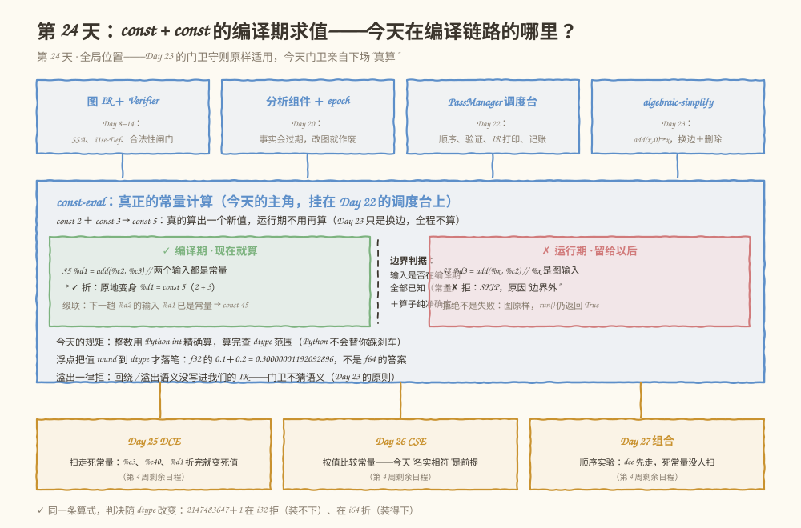
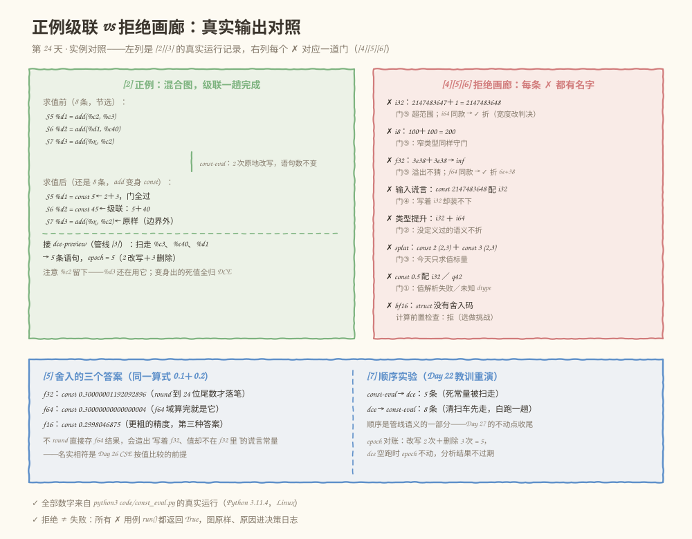

# 第 024 天：真正的常量计算——const + const 的编译期求值

> **今日目标**：完成本教程后，你能说出编译期求值与运行期求值的边界判据（输入编译期全部已知＋算子纯净确定，缺一个就留给运行期）；解释为什么 `2147483647 + 1` 在 i32 被拒、在 i64 被折，为什么 f32 的 `0.1 + 0.2` 是 `0.30000001192092896` 而 f64 是 `0.30000000000000004`；实现一个不产出"谎言常量"的 `const-eval` Pass——五道门、整数／浮点两条计算流水、原地变身与级联，并把每条拒绝的原因写进决策日志。
> **预计时间**：学习 35 分钟 + 实践 50 分钟
> **前置准备**：Python 3（本教程用 3.11.4 实测）；Day 23 的五道门与决策日志（门卫守则原样沿用）；Day 22 的 PassManager、Day 20 的 epoch 对账（今天全部复用）。
> **今日产出**：`code/const_eval.py`（`const-eval` Pass ＋ 五道门 ＋ 两条计算流水 ＋ 50 项自测）的真实运行记录，以及一组正例／反例。

## 1. 今天解决什么问题？

Day 23 的结尾留了一句话："会溢出的是 const + const 这类'真算'——那是 Day 24 的活：先检查可表示，再落笔，拒绝同样要有名字。"今天兑现。

先看一个会真实发生的翻车现场。假设你给 Day 23 的 Pass 加了"最后一小块"：两个常量的加法直接算出来。听起来只要三行：

```python
a = const_value(stmt_a[0], dtype)
b = const_value(stmt_b[0], dtype)
graph.statements[i] = ["const %d" % (a + b), res, [], info]   # 写回图里
```

单测全绿——因为你喂的测试值都是 `2 + 3` 这种小数。上线之后两张图先后出事：

1. `const 2147483647 + const 1`（i32）→ IR 里出现 `const 2147483648 : i32`——**写着 i32、值却不在 i32 里**的谎言常量。Python 的 int 无限宽，算的时候不报错；可下游代码生成、常量池加载都按 i32 的 32 位理解它，一读就错；
2. f32 的 `const 0.1 + const 0.2` → `const 0.30000000000000004 : f32`——这个值在 f32 里**根本不存在**（f32 只有 24 位尾数，16777217 同样不存在）。IR 文本和 dtype 从此名不副实。

今天的目标就是写一个**不产出谎言常量**的 `const-eval`。对应学习计划的三行：

- **学习**：编译期求值与运行期求值的边界；
- **实践**：对两个标量 Constant 的 Add 执行编译期计算，检查溢出和类型一致性；
- **产出**：常量求值实现及边界测试。

贯穿全文的是这张混合图——两条编译期能算的 add，夹一条边界外的 add：

```text
S1  %x    = input              : tensor<i32>   ← 运行期才知道的值
S2  %c2   = const 2            : tensor<i32>
S3  %c3   = const 3            : tensor<i32>
S4  %c40  = const 40           : tensor<i32>
S5  %d1   = add(%c2, %c3)      : tensor<i32>   ← 编译期：2 + 3 = 5
S6  %d2   = add(%d1, %c40)     : tensor<i32>   ← 级联：5 + 40 = 45
S7  %d3   = add(%x, %c2)       : tensor<i32>   ← 边界外：%x 等运行期
S8    →   output(%d2, %d3)
```

**术语先对齐**：编译期求值（compile-time evaluation）指编译器在编译时就把值算出来、运行期不再执行的优化；对常量算术它有个更专门的名字——常量折叠（constant folding）。C++ 的 `constexpr`、MLIR 的 `fold` 钩子（Day 47 会亲手写）都是这个概念的不同化身。标量（scalar）指 shape 为 `()` 的零维张量——一个光秃秃的数，今天求值的边界就画在这里；splat 张量（全元素同值的张量）是必做练习的地盘。

**前置补给**：补码（two's complement）——整数在计算机里的标准表示，i32 的可表示范围是 `[-2147483648, 2147483647]`；超出范围的值"回绕"（wrap around），`2147483648` 硬塞回去变成 `-2147483648`。

## 2. 先看全貌：今天的内容位于哪里？



**图 1**：看三个区域。顶部四张卡是前 23 天的家底（图 IR＋Verifier、分析＋epoch、Day 22 调度台、Day 23 的 algebraic-simplify）；中间蓝框是今天的主角 `const-eval`——左绿格是编译期能算的（两个输入都是常量），右玫红格是边界外留给运行期的（`%x` 是图输入），中间虚线就是今天的判据；底部琥珀色一排是第 4 周剩余日程：今天折出的死常量要等 Day 25 的 DCE 来扫。

全局流程五步，今天做第五步：

1. 前端把模型变成图 IR，配 Verifier（Day 8–14，已完成）；
2. 控制流、SSA、活跃区间（Day 15–19，已完成）；
3. 分析做成组件，epoch 管失效（Day 20，已完成）；
4. Pass 接口＋PassManager 调度台（Day 22，已完成）；第一个优化 algebraic-simplify（Day 23，已完成）；
5. **今天：第二个优化 Pass——`const-eval` 真正下场计算；Day 25 DCE、Day 26 CSE、Day 27 组合随后进场。**

## 3. 核心概念：边界、溢出、舍入、变身

### 3.1 编译期求值与运行期求值的边界

判据一句话：**输入在编译期全部已知（都是常量）＋ 算子纯净且确定 → 可以编译期求值；只要有一个输入要等运行期，就留给运行期。**

- **一个类比**：备菜时你会把"2 勺糖 + 3 勺糖"直接合并成一个写着"5 勺糖"的标签——客人点单前就办完了；但"客人到店后才定的辣度 + 2"只能等客人来了再说。**对应到技术上是**：常量在编译期就有值，图输入（`input` 节点）要等运行期喂数据才有值；`add(%c2, %c3)` 两边都是常量可以折，`add(%x, %c2)` 有一边是 input 就不折。类比的边界：菜谱合并永远精确，而编译期计算必须和运行期计算**产生同一个值**——同样的舍入、同样的溢出行为。这是今天所有门卫存在的原因：编译期算"快"是优化，算"错"就是事故。
- 边界的另一半是**成本**：编译期能算 ≠ 编译期该算。一亿元素的常量张量在编译期展开会把编译时间和 IR 体积撑爆——所以今天只求值标量（计划画定的边界），大张量的限制是 Day 47（MLIR fold 限制过大 Tensor）的话题。

今天的 Pass 把这条边界画进决策日志：`add(%x, %c2)` 的判决是 skip，原因"输入 %x 不是编译期常量——边界外，留给运行期"。**边界外不是失败**（Day 23 讲过：拒绝 ≠ 失败），`run()` 照样返回 True。

### 3.2 溢出：Python 不踩刹车

同一个算式 `2147483647 + 1`，四个世界给出四种答案（5.3 节 [1] 有真实运行记录）：

| 世界 | 结果 | 谁负责 |
|---|---|---|
| Python | `2147483648`（int 无限宽） | 不踩刹车，靠你自己查范围 |
| C 语言 | 未定义行为（UB） | 编译器可以假设有符号溢出不发生 |
| 硬件（补码） | 回绕成 `-2147483648` | CPU 的真实行为 |
| 我们的 IR | **没定义** | → 门卫不猜语义：拒 |

今天的原则延续 Day 23：**门卫不猜语义**。我们的 IR 没写过"i32 溢出后回绕"这句话，编译期求值就不能替运行期发明这个行为——直接拒绝，原因写进决策日志（"回绕语义未定义"）。拒绝的代价只是少一次优化（add 留在图里，运行期爱怎么算怎么算），而"帮个忙"的代价可能是静默的数值错误。

两个真实细节（[4] 节全部实测）：

- 负方向同样拦：`-2147483648 + -1 = -2147483649` 超出下界；`mul` 也拦：`65536 × 65536 = 4294967296`；连 i8 都拦：`100 + 100 = 200 > 127`；
- **宽度改判决**：同一条 `2147483647 + 1`，dtype 换成 i64 就被折成 `const 2147483648`——判决跟着 dtype 的可表示范围走，不跟直觉走。

还有输入侧的谎言：图里本来就有 `const 2147483648 : i32` 这种常量时（上游写错了），门④先拦——值在自己声明的 dtype 里就装不下，根本轮不到计算。

### 3.3 舍入：f32 的 0.1 + 0.2 不是 f64 的 0.1 + 0.2

Python 的 `float` 是 f64（64 位双精度），而我们的常量可以声明成 f32。**"const 0.1" 配 f32 的意思是 f32(0.1)**——C 字面量的同款约定（`0.1f`）。f32 只有 24 位尾数，f64 有 53 位，两个世界的算术不是一回事：

```text
f32 的 0.1 + 0.2 = 0.30000001192092896    ← round 到 24 位尾数
f64 的 0.1 + 0.2 = 0.30000000000000004    ← f64 域算完就是它
f16 的 0.1 + 0.2 = 0.2998046875           ← 更粗的精度，第三种答案
```

三个答案都"对"——对各自的 dtype 而言。今天浮点流水的规则：**输入先 round 到 dtype，在 f64 域计算，结果再 round 回 dtype**，落笔的常量永远名实相符。为什么较这个真：

1. 不 round 直接存 f64 结果，会造出"写着 f32、值却不在 f32 里"的常量（`0.30000000000000004` 在 f32 里不存在，`16777216 + 1 = 16777217` 同样不存在——f32 里它 round 回 `16777216.0`，见 [5c]）；
2. Day 26 的 CSE 要按**值**比较常量。IR 文本名实相符，比较才有意义。

两条浮点专属规则（[5d][5f] 实测）：

- **制造溢出拒**：f32 的 `3e38 + 3e38` → 结果在 f32 下是 inf。IEEE 754 机器的运行期确实会算出 inf，但"我们的 IR 运行期按 IEEE 舍入"这句话没写进 IR——不猜，拒。f64 同款算式被折成 `const 6e+38`（宽度改判决的浮点版）；
- **值传播放行**：`const inf + const 1 = inf` 被折。输入本身已是 inf，结果跟着走——这是值的传播，不是我们从有限值制造出溢出。

### 3.4 动作：原地变身，不是换边删除

Day 23 的 `add(x, 0) → x`：结果有现成的值（x 本身），所以**换边＋删除**——使用者改读 x，add 语句消失，语句数变少。今天的 `add(const, const) → const 5`：算出的是**新值**，图里没有现成的边可换——所以**原地改写**（`rewrite_statement`）：

```text
S5   %d1 = add(%c2, %c3)     →     S5   %d1 = const 5
```

名字 `%d1` 不变、使用者一行不用改、**语句数不变**（8 条还是 8 条）。但两个 Day 20 式的纪律必须守住：

1. **def 表重建**：原地改写后，缓存里 `%d1` 还指着旧的 add 语句——事实过期了，每折一条就重建；
2. **扫描下标前进**：Day 23 删除后下一条滑到当前位置（i 不动），今天没有删除，i 前进一格。级联靠 def 表刷新完成：`%d1` 刚变身常量，紧跟的 `%d2 = add(%d1, %c40)` 立刻满足"两个输入都是常量"，一趟折到 `const 45`。

## 4. 图解核心机制


**图 2**：从左上的待检查语句 `%d1 = add(%c2, %c3)` 开始，按编号看：

1. **门① → 门④**：四个蓝框顺序检查——两个输入都是编译期常量（边界）、类型三方一致、标量边界、输入可表示。每道门都写着真实的拒绝案例；
2. **绿色计算框**：门④之后整数与浮点分两条流水——整数用 Python int 精确算（无限宽，先算后查范围），浮点 round 输入 → f64 域算 → round 结果到 dtype；
3. **门⑤**：结果可表示——整数落在 `[min, max]`；浮点"有限输入算出非有限"拒，inf 的传播放行。门⑤拒的就是 `2147483647 + 1`（i32）和 `3e38 + 3e38`（f32）；
4. **右侧玫红通道（SKIP）**：任何一道门说"不"就走这里——原因进决策日志、图保持原样、`run()` 仍返回 True。边界外的 `add(%x, %c)` 也走这里，留给运行期；
5. **底部绿色（FOLD）**：全过后的一个动作——`rewrite_statement` 把 `add %d1` 原地改写成 `const 5 %d1`：名字不变、语句数不变、使用者不动；随后 def 表重建＋下标前进，级联一趟完成。左中两张卡对比 Day 23 的"换边＋删除"与今天的"原地变身"；左下琥珀卡是成本边界——编译期能算 ≠ 该算，今天只做标量。

**原地改写为什么不会破坏 SSA**：定义的名字没变、位置没变，Use-Def 关系一行都没动——变的只是这个名字的定义内容。当然 PassManager 跑完还会再过一遍 Verifier（Day 22 的第⑤道关卡），双保险。

## 5. 动手实践：五道门＋两条流水＋原地变身

### 5.1 准备文件

```text
tutorials/day-024/
├── README.md
├── code/
│   └── const_eval.py     # const-eval + 五道门 + 两条计算流水 + 50 项自测
└── images/
    ├── 01-overview.svg
    ├── 02-mechanism.svg
    └── 03-example.svg
```

运行环境：Python 3.11.4（Linux），无第三方依赖。`Graph` / `AnalysisManager` / `Pass` / `PassManager` 从 Day 22/23 原样搬来——唯一的升级是 `Graph` 新增 `rewrite_statement` 方法（原地改写，走 `_commit` 让 epoch +1），这是今天折叠动作的落点。

### 5.2 编写代码

下面是 `code/const_eval.py` 的完整实现（与仓库文件一致，共 946 行）。重点看六处：模块 docstring 里的边界判据与五道门总纲；`INT_RANGE` / `FLOAT_CODES` 两张表（**范围和舍入码是数据，不是散弹 if-else**）；`round_float`（用 struct 把值 round 到 f16/f32/f64 精度，pack 溢出按 IEEE 给 ±inf，bf16 没有 struct 码返回 None）；`Graph.rewrite_statement`（今天的新方法：原地改写也走 `_commit`，epoch 必须动）；`_examine`（五道门的判断序列，整数／浮点在门④后分流）；以及 `run` 里的 `defs = self._defs(graph)`（原地改写同样让 def 表过期）。

```python
#!/usr/bin/env python3
"""第 24 天演练场：真正的常量计算——const + const 的编译期求值。

用法：
    python3 const_eval.py               # 演示主流程：边界、正例、溢出、舍入、管线、顺序实验
    python3 const_eval.py --self-test   # 运行自测，全部通过退出码 0

Day 23 做的是“代数化简”：add(x, 0) → x，把语句替换成它的输入，全程不算任何东西。
今天做学习计划说的“真正的常量计算”（constant folding / compile-time evaluation）：

    const 2 + const 3  →  const 5        ← 真的算出一个新值，运行期不用再算

学习目标的第一半是“编译期求值与运行期求值的边界”。判据一句话：
    输入在编译期全部已知（都是常量）＋ 算子纯净且确定 → 可以编译期求值；
    只要有一个输入要等运行期（图输入、运行期 Shape），就留给运行期。
今天的 Pass 把这条边界画在决策日志里：add(%x, %c2) 的 %x 是运行期值——
skip，原因“边界外”，这不是失败（Day 23 讲过：拒绝 ≠ 失败）。

边界的另一半是“该不该”：编译期能算 ≠ 编译期该算。一亿元素的常量张量在
编译期展开会把编译时间和 IR 体积撑爆——所以今天只求值标量（计划划定的
边界），大张量是 Day 47（MLIR fold 限制过大 Tensor）的事。

每条求值动身前过五道门（顺序即依赖，Day 23 门②在门③之前的同款讲究）：
    门① 两个输入都是编译期常量，且值按各自 dtype 解析合法；
    门② 类型一致：dtype(a) = dtype(b) = dtype(结果)——没定义的提升不折；
    门③ 标量边界：三方 shape 都是 ()——splat 张量是必做练习；
    门④ 输入可表示：“const 2147483648” 配 i32 是写着 i32 却装不下的
        谎言常量，拒；浮点输入 round 到 dtype 后不能从有限变 inf；
    门⑤ 结果可表示：整数结果必须落在 dtype 范围内（Python int 无限宽，
        不会替你踩刹车——2147483647 + 1 = 2147483648，i32 装不下）；
        浮点结果若从有限输入算出非有限值（溢出为 inf），拒——
        溢出语义没写进我们的 IR，门卫不猜语义（Day 23 原则的重演）。

计算规则（门④和门⑤之间）：
    整数：用 Python int 精确算（无限宽，先算后查范围）；
    浮点：输入先 round 到 dtype 精度（“const 0.1” 配 f32 的意思是
        f32(0.1)，C 字面量同款约定），在 f64 域计算，结果再 round 回
        dtype——f32 的 0.1 + 0.2 = 0.30000001192092896，不是 f64 的
        0.30000000000000004。让 IR 里每个常量名实相符，Day 26 的 CSE
        才能按值比较。
        inf/nan 的传播例外：输入本身已是 inf（const inf + 1 = inf），
        结果跟着走——这是值的传播，不是我们制造的溢出。

折叠动作与 Day 23 不同：算出的是新值，图里没有现成的边可换——所以
原地改写（rewrite_statement）：%d1 = add(%c2, %c3) 变身 %d1 = const 5。
名字不变、使用者不动、语句数不变；Day 23 是换边＋删除（语句消失）。
原地改写同样让 def 表过期（缓存的是旧语句对象）——每折一条就重建，
i 前进一格，下一趟 %d2 的输入 %d1 已是常量，级联一趟完成。
"""

from __future__ import annotations

import argparse
import math
import re
import struct

PURE_OPS = {"matmul", "add", "relu", "mul"}   # 无副作用算子（Day 20 同款口径）

INT_DTYPES = {"i8", "i16", "i32", "i64"}
FLOAT_DTYPES = {"f16", "bf16", "f32", "f64"}
KNOWN_DTYPES = INT_DTYPES | FLOAT_DTYPES

EVAL_OPS = {"add", "mul"}       # 今天求值的算子：计划要求 add；mul 同机制顺手支持
OP_SYMBOL = {"add": "+", "mul": "×"}
OP_FUNCS = {"add": lambda a, b: a + b, "mul": lambda a, b: a * b}

INT_RANGE = {                   # dtype → (min, max)，补码范围
    "i8": (-(2 ** 7), 2 ** 7 - 1),
    "i16": (-(2 ** 15), 2 ** 15 - 1),
    "i32": (-(2 ** 31), 2 ** 31 - 1),
    "i64": (-(2 ** 63), 2 ** 63 - 1),
}

# struct 舍入码：f16/f32/f64 有；bf16 没有对应码——求值暂不支持（选做挑战）
FLOAT_CODES = {"f16": "<e", "f32": "<f", "f64": "<d"}


# ---------- 图：Day 23 同款外壳，新增一个“原地改写”方法 ----------

# 贯穿全文的混合图：两张编译期能算的 add ＋ 一张边界外的 add
PIPELINE_GRAPH = [
    ("input",    "%x",   [],              ((), "i32")),
    ("const 2",  "%c2",  [],              ((), "i32")),
    ("const 3",  "%c3",  [],              ((), "i32")),
    ("const 40", "%c40", [],              ((), "i32")),
    ("add",      "%d1",  ["%c2", "%c3"],  ((), "i32")),   # 编译期：2 + 3 = 5
    ("add",      "%d2",  ["%d1", "%c40"], ((), "i32")),   # 级联：5 + 40 = 45
    ("add",      "%d3",  ["%x", "%c2"],   ((), "i32")),   # 边界外：%x 运行期才知道
    ("output",   None,   ["%d2", "%d3"],  None),
]


def scalar_graph(op, aval, bval, dtype):
    """两条常量＋一个 add/mul 的最小反例/正例图。"""
    return [
        (f"const {aval}", "%a", [], ((), dtype)),
        (f"const {bval}", "%b", [], ((), dtype)),
        (op, "%d", ["%a", "%b"], ((), dtype)),
        ("output", None, ["%d"], None),
    ]


def splat_graph():
    """splat 张量：三方 shape 一致但不是标量——今天不折（练习）。"""
    return [
        ("const 2", "%a", [], ((2, 3), "i32")),
        ("const 3", "%b", [], ((2, 3), "i32")),
        ("add", "%d", ["%a", "%b"], ((2, 3), "i32")),
        ("output", None, ["%d"], None),
    ]


def promo_graph():
    """类型提升：i32 结果 × i64 常量——没定义过的语义不折。"""
    return [
        ("const 2", "%a", [], ((), "i32")),
        ("const 3", "%b", [], ((), "i64")),
        ("add", "%d", ["%a", "%b"], ((), "i32")),
        ("output", None, ["%d"], None),
    ]


def badval_graph():
    """值在 dtype 下不合法：“const 0.5” 配 i32——两个输入都是常量，值解析失败。"""
    return [
        ("const 0.5", "%h", [], ((), "i32")),
        ("const 3", "%b", [], ((), "i32")),
        ("add", "%d", ["%h", "%b"], ((), "i32")),
        ("output", None, ["%d"], None),
    ]


def unknown_graph():
    """未知 dtype q42：不认识的一律不碰。"""
    return [
        ("const 2", "%a", [], ((), "q42")),
        ("const 3", "%b", [], ((), "q42")),
        ("add", "%d", ["%a", "%b"], ((), "q42")),
        ("output", None, ["%d"], None),
    ]


def lying_graph():
    """输入侧谎言常量：“const 2147483648” 配 i32——写着 i32 却装不下。"""
    return [
        ("const 2147483648", "%a", [], ((), "i32")),
        ("const 1", "%b", [], ((), "i32")),
        ("add", "%d", ["%a", "%b"], ((), "i32")),
        ("output", None, ["%d"], None),
    ]


class GraphError(Exception):
    """图不合法，或违反“改图走方法”的契约。"""


class PassFailure(Exception):
    """Pass 主动上报的失败（对应 MLIR 的 failure()）。"""


class Graph:
    """语句序列表示的线性计算图（Day 23 同款契约）。

      * 只读查询（labels / used_at / validate）不改图；
      * 修改必须走 remove_statement / replace_all_uses / rewrite_statement，
        每次修改 epoch + 1 并写改动日志；
      * validate 是 Day 17/18 的 SSA 闸门：唯一定义、使用先于定义。
        类型与数值合法性（溢出、谎言常量）Verifier 还不懂——Pass 自己当门卫。
    """

    def __init__(self, statements):
        self.statements = [list(s) for s in statements]
        self.epoch = 0
        self.change_log = []

    def labels(self):
        return [f"S{i + 1}" for i in range(len(self.statements))]

    def used_at(self):
        """每个值被使用的位置列表。图输出语句的输入也算使用（Day 19 教训三）。"""
        used = {}
        for i, (_, _, uses, _) in enumerate(self.statements):
            for u in uses:
                used.setdefault(u, []).append(i)
        return used

    def validate(self):
        """Day 17/18 的合法性闸门：SSA 唯一定义、使用必须先于定义。"""
        defined = {}
        for i, (_, res, _, _) in enumerate(self.statements):
            if res is None:
                continue
            if res in defined:
                raise GraphError(f"{res} 被定义两次（违反 SSA）：S{defined[res] + 1} 和 S{i + 1}")
            defined[res] = i
        for i, (_, _, uses, _) in enumerate(self.statements):
            for u in uses:
                if u not in defined:
                    raise GraphError(f"{u} 被使用但从未定义（S{i + 1}）")
                if defined[u] >= i:
                    raise GraphError(f"{u} 在定义之前被使用（S{i + 1}）")
        return True

    def _commit(self, note):
        self.epoch += 1
        self.change_log.append(f"epoch {self.epoch}：{note}")

    def remove_statement(self, index):
        stmt = self.statements[index]
        del self.statements[index]
        self._commit(f"删除 S{index + 1}（{stmt[0]} {stmt[1] or ''}）——后面所有语句位置前移")

    def replace_all_uses(self, old, new):
        """把所有读 old 的语句改成读 new（Day 23 折叠的核心动作，今天备用）。"""
        rewired = 0
        for stmt in self.statements:
            if old in stmt[2]:
                stmt[2] = [new if u == old else u for u in stmt[2]]
                rewired += 1
        if rewired == 0:
            raise GraphError(f"没有任何语句使用 {old}，无事可换")
        self._commit(f"换边：{rewired} 条语句改读 {new}（原来读 {old}）——位置没变，Use-Def 变了")
        return rewired

    def rewrite_statement(self, index, new_stmt):
        """把第 index 条语句原地改写成 new_stmt——今天折叠的核心动作。

        算出来的是新值，图里没有现成的边可换（Day 23 换边、今天变身）：
        add %d1 变 const 5，结果名 %d1 不变，使用者一行都不用改。
        注意：def 表里 %d1 还指着旧 add 语句——缓存的事实过期了，
        调用方必须重建（Day 20 的铁律在“原地改写”上的重演）。
        """
        old = self.statements[index]
        self.statements[index] = list(new_stmt)
        self._commit(f"改写 S{index + 1}（{old[0]} {old[1] or ''} → {new_stmt[0]} {new_stmt[1] or ''}）"
                     f"——语句数不变，定义的名字没变")


# ---------- 分析：Day 20 的组件原样搬来（dce-preview 要用）----------


class Analysis:
    name = "analysis"

    def run(self, graph):
        raise NotImplementedError


class UnusedResult:
    def __init__(self, dead, where):
        self.dead = frozenset(dead)
        self.where = dict(where)

    def is_dead(self, name):
        return name in self.dead


class UnusedAnalysis(Analysis):
    """未使用分析：哪些值从未被任何语句（含图输出）使用。只报告，不决策。"""

    name = "unused"

    def run(self, graph):
        used = graph.used_at()
        dead, where = [], {}
        for i, (_, res, _, _) in enumerate(graph.statements):
            if res is None:
                continue
            where[res] = i
            if res not in used:
                dead.append(res)
        return UnusedResult(dead, where)


ANALYSES = {"unused": UnusedAnalysis}


class AnalysisManager:
    """分析缓存管理器（Day 20 同款）：epoch 对账，图一变旧结果作废。"""

    def __init__(self, graph):
        self.graph = graph
        self._cache = {}
        self.stats = {"queries": 0, "recomputed": 0, "invalidated": 0}

    def get(self, analysis):
        self.stats["queries"] += 1
        entry = self._cache.get(analysis.name)
        if entry is not None and entry[0] == self.graph.epoch:
            return entry[1]
        if entry is not None:
            self.stats["invalidated"] += 1
        epoch_before = self.graph.epoch
        result = analysis.run(self.graph)
        if self.graph.epoch != epoch_before:
            raise GraphError(f"分析 {analysis.name} 在 run 期间修改了图：分析 Pass 只读")
        self._cache[analysis.name] = (self.graph.epoch, result)
        self.stats["recomputed"] += 1
        return result


# ---------- Pass 接口与 PassManager：Day 22 原样搬来 ----------


class Pass:
    """最小 Pass 接口（Day 22 契约）：name ＋ requires ＋ run(graph, am) → True/False。"""

    name = "pass"
    requires = ()

    def run(self, graph, am):
        raise NotImplementedError

    def __repr__(self):
        return f"<Pass {self.name}>"


class PassManager:
    """流水线调度台（Day 22 同款）：顺序执行、逐 Pass 验证、打印 IR、记账。"""

    def __init__(self, print_ir="all", verify=True, verbose=True, title="PassManager"):
        self.print_ir = print_ir
        self.verify = verify
        self.verbose = verbose
        self.title = title
        self.passes = []
        self.log = []
        self.failure = None
        self.skipped = []
        self.am = None

    def add(self, *passes):
        for p in passes:
            if not isinstance(p, Pass):
                raise TypeError(f"add 只收 Pass，收到 {type(p).__name__}")
            for dep in p.requires:
                if dep not in ANALYSES:
                    raise ValueError(f"Pass {p.name} 声明了未知分析依赖 {dep!r}（可用：{sorted(ANALYSES)}）")
            self.passes.append(p)
        return self

    def pipeline(self):
        return " → ".join(p.name for p in self.passes) if self.passes else "（空管线）"

    def _say(self, text):
        if self.verbose:
            for line in text.split("\n"):
                print(line)

    def run(self, graph):
        self.log, self.failure, self.skipped = [], None, []
        self.am = AnalysisManager(graph)
        self._say(f"== {self.title}：管线 [{self.pipeline()}] ==")

        try:
            graph.validate()
        except GraphError as exc:
            self.failure = {"kind": "entry", "pass": "（入口）", "reason": f"进管线前图就不合法：{exc}"}
            self.skipped = [p.name for p in self.passes]
            self._say(f"*** 管线未启动：{self.failure['reason']}")
            return False

        total = len(self.passes)
        for i, p in enumerate(self.passes):
            self._say(f"--- [{i + 1}/{total}] {p.name}")
            epoch_before = graph.epoch
            n_before = len(graph.statements)
            q_before = self.am.stats["queries"]

            try:
                ok = p.run(graph, self.am)
            except (GraphError, PassFailure) as exc:
                return self._stop(graph, i, p, "raise",
                                  f"{p.name} 抛出 {type(exc).__name__}：{exc}",
                                  epoch_before, n_before, q_before)

            if ok is not True:
                return self._stop(graph, i, p, "return",
                                  f"{p.name} 返回 {ok!r}，不是 True",
                                  epoch_before, n_before, q_before)

            changes = graph.epoch - epoch_before
            n_after = len(graph.statements)

            if n_after != n_before and changes == 0:
                return self._stop(graph, i, p, "bypass",
                                  f"{p.name} 之后语句数 {n_before}→{n_after}，但 epoch 没动",
                                  epoch_before, n_before, q_before)

            if self.verify:
                try:
                    graph.validate()
                except GraphError as exc:
                    return self._stop(graph, i, p, "verify",
                                      f"{p.name} 之后图不合法：{exc}",
                                      epoch_before, n_before, q_before)

            printed = self.print_ir == "all" or (self.print_ir == "change" and changes > 0)
            self.log.append({"name": p.name, "changes": changes,
                             "before": n_before, "after": n_after, "printed": printed})
            if printed:
                self._say(f"// IR after {p.name}（修改 {changes} 次，语句 {n_before}→{n_after}，epoch {graph.epoch}）")
                self._say(ir_dump(graph))

        self._say(f"== 管线完成：{total} 个 Pass 全部成功，图停在 epoch {graph.epoch} ==")
        return True

    def _stop(self, graph, i, p, kind, reason, epoch_before, n_before, q_before):
        changes = graph.epoch - epoch_before
        self.failure = {"kind": kind, "pass": p.name, "reason": reason}
        self.log.append({"name": p.name, "changes": changes,
                         "before": n_before, "after": len(graph.statements),
                         "printed": False, "failed": True})
        self.skipped = [q.name for q in self.passes[i + 1:]]
        self._say(f"*** 管线停止：[{i + 1}/{len(self.passes)}] {p.name} 失败（{kind}）")
        self._say(f"    {reason}")
        return False


# ---------- 工具（Day 23 同款）----------


def fmt_type(info):
    """(shape, dtype) → MLIR 风格类型文本：(() ,'i32') → tensor<i32>。"""
    if info is None:
        return ""
    shape, dtype = info
    dims = "x".join(str(d) for d in shape)
    return f"tensor<{dims + 'x' if dims else ''}{dtype}>"


def ir_dump(g):
    lines = []
    for i, (op, res, uses, info) in enumerate(g.statements):
        lhs = f"{res:<6}= " if res else "  →   "
        rhs = f"{op}({', '.join(uses)})" if uses else op
        ty = f"    : {fmt_type(info)}" if info else ""
        lines.append(f"  S{i + 1:<4}{lhs}{rhs}{ty}")
    return "\n".join(lines)


def is_const(op):
    return op.startswith("const ")


def const_value(op, dtype):
    """按 dtype 解析常量数值；类型不合法（或未知 dtype）返回 None。"""
    try:
        text = op.split(" ", 1)[1].strip()
    except IndexError:
        return None
    if dtype in INT_DTYPES:
        return int(text) if re.fullmatch(r"[+-]?\d+", text) else None
    if dtype in FLOAT_DTYPES:
        try:
            return float(text)
        except ValueError:
            return None
    return None


def removable(stmt):
    """结果无人使用且无副作用时可删；input 代表外部输入，不删（Day 25 再正式化）。"""
    op, res = stmt[0], stmt[1]
    return res is not None and (op in PURE_OPS or op.startswith("const"))


def round_float(value, dtype):
    """把 value 舍入到 dtype 精度（f16/f32/f64）；不支持或无法表示返回 None/inf。

    “const 0.1” 配 f32 的意思是 f32(0.1)——C 字面量同款约定（0.1f）。
    pack 溢出（OverflowError）按 IEEE 舍入到 ±inf；bf16 没有 struct 码，
    返回 None——今天不求值（选做挑战：手写 bf16 的 round-to-nearest-even）。
    """
    code = FLOAT_CODES.get(dtype)
    if code is None:
        return None
    try:
        return struct.unpack(code, struct.pack(code, value))[0]
    except OverflowError:
        return math.inf if value > 0 else -math.inf


def fmt_const(value, dtype):
    """新常量的文本：整数用 str，浮点用 repr（'inf' 也能被 float() 解析回来）。"""
    if dtype in INT_DTYPES:
        return str(value)
    return repr(value)


# ---------- 今天的主角：常量求值 Pass ----------


class ConstEvalPass(Pass):
    """const + const → 新 const——真正的常量计算（编译期求值）。

    五道门见模块 docstring。拒绝同样要有名字（决策日志）——“为什么没折”
    和“折了什么”都是需要审计的信息（Day 23 的惯例延续）。

    折叠动作是原地改写（rewrite_statement）：add %d1 变身 const 5，
    名字不变、使用者不动、语句数不变。def 表在每次改写后重建——
    原地改写同样让缓存过期（Day 20 的铁律），级联靠它完成：
    %d1 刚变身常量，紧跟的 %d2 立刻可以被下一轮检查折掉。
    """

    name = "const-eval"

    def __init__(self):
        self.decisions = []

    def run(self, graph, am):
        self.decisions = []
        self._folded_names = set()
        defs = self._defs(graph)
        i = 0
        while i < len(graph.statements):
            verdict = self._examine(graph, i, defs)
            if verdict is None:            # 不是 add/mul 目标，不进日志
                i += 1
                continue
            kind, payload, reason = verdict
            op, res, inputs, info = graph.statements[i]
            if kind == "skip":
                self.decisions.append({"verdict": "skip", "op": op, "res": res, "reason": reason})
                i += 1
                continue
            text = payload                 # 新常量的文本，如 "5" / "0.30000001192092896"
            self.decisions.append({"verdict": "fold", "op": op, "res": res,
                                   "to": f"const {text}", "reason": reason})
            graph.rewrite_statement(i, (f"const {text}", res, [], info))
            self._folded_names.add(res)
            defs = self._defs(graph)       # 原地改写后 def 表同样过期——重建
            i += 1                         # 语句数不变，前进一格；级联靠 defs 刷新
        return True

    @staticmethod
    def _defs(graph):
        return {stmt[1]: stmt for stmt in graph.statements if stmt[1] is not None}

    def _examine(self, graph, i, defs):
        """检查第 i 条语句：返回 None / ('skip', None, 原因) / ('fold', 常量文本, 原因)。"""
        op, res, inputs, info = graph.statements[i]
        if op not in EVAL_OPS or res is None:
            return None
        if len(inputs) != 2:
            return ("skip", None, f"输入数量 {len(inputs)} ≠ 2——先不碰")

        shape, dtype = info
        if dtype not in KNOWN_DTYPES:
            return ("skip", None, f"结果 dtype {dtype} 不认识——未知类型一律不碰")

        # 门①：两个输入都是编译期常量，且值按各自 dtype 解析合法（边界检查）
        values = []
        for name in inputs:
            dstmt = defs.get(name)
            if dstmt is None:
                return ("skip", None, f"输入 {name} 没有定义——图有问题，交给 Verifier")
            if not is_const(dstmt[0]):
                return ("skip", None,
                        f"输入 {name} 不是编译期常量（{dstmt[0]}）——边界外，留给运行期")
            cshape, cdtype = dstmt[3]
            if cdtype not in KNOWN_DTYPES:
                return ("skip", None, f"常量 {name} 的 dtype {cdtype} 不认识——未知类型一律不碰")
            val = const_value(dstmt[0], cdtype)
            if val is None:
                return ("skip", None,
                        f"常量 {name}（{dstmt[0]}）的值在 {cdtype} 下不合法——绕开，不碰也不崩")
            values.append((name, val, cshape, cdtype))

        (n1, v1, s1, t1), (n2, v2, s2, t2) = values

        # 门②：类型一致——没有定义过的提升规则，一律不折（Day 23 门③ 的重演）
        if not (t1 == t2 == dtype):
            return ("skip", None,
                    f"类型提升未建模：{t1} / {t2} vs 结果 {dtype} 三方不一致")

        # 门③：shape 对齐＋标量边界（计划画定的今天边界；splat 是练习）
        if not (s1 == s2 == shape):
            return ("skip", None,
                    f"shape 不一致：{s1} / {s2} vs 结果 {shape}——广播是 Day 60 的事")
        if shape != ():
            return ("skip", None,
                    f"shape {shape} 是 splat 张量——今天只求值标量（大张量编译期展开是 Day 47 的事）")

        sym = OP_SYMBOL[op]
        # 门④＋计算＋门⑤：整数与浮点分两条流水
        if dtype in INT_DTYPES:
            lo, hi = INT_RANGE[dtype]
            for n, v, _, _ in values:
                if not (lo <= v <= hi):
                    return ("skip", None,
                            f"常量 {n} 的值 {v} 超出 {dtype} 范围 [{lo}, {hi}]"
                            f"——写着 {dtype} 却装不下的谎言常量")
            result = OP_FUNCS[op](v1, v2)          # Python int 精确算，无限宽
            if not (lo <= result <= hi):           # 门⑤：结果可表示
                return ("skip", None,
                        f"结果 {v1} {sym} {v2} = {result} 超出 {dtype} 范围 [{lo}, {hi}]"
                        f"——回绕语义未定义，门卫不猜语义")
            note = f"（级联：{n1} 本趟刚变身常量）" if n1 in self._folded_names else ""
            return ("fold", fmt_const(result, dtype),
                    f"{dtype} 标量，{v1} {sym} {v2} = {result}，精确可表示，原地变身{note}")

        # 浮点流水
        if dtype not in FLOAT_CODES:
            return ("skip", None,
                    f"{dtype} 求值暂不支持：struct 没有对应舍入码（选做挑战：手写 bf16 舍入）")
        a, b = round_float(v1, dtype), round_float(v2, dtype)
        for n, v, r in ((n1, v1, a), (n2, v2, b)):
            if math.isfinite(v) and not math.isfinite(r):
                return ("skip", None,
                        f"常量 {n} 的值 {v} 超出 {dtype} 范围——round 后变 {r}，名不副实的谎言常量")
        exact = OP_FUNCS[op](a, b)                 # f64 域计算
        result = round_float(exact, dtype)         # 结果 round 回 dtype
        if math.isfinite(a) and math.isfinite(b) and not math.isfinite(result):
            return ("skip", None,
                    f"结果 {a} {sym} {b} 在 {dtype} 下溢出为 {result}"
                    f"——浮点溢出语义没写进 IR，不猜（输入本身非有限则允许传播）")
        note = f"（级联：{n1} 本趟刚变身常量）" if n1 in self._folded_names else ""
        return ("fold", fmt_const(result, dtype),
                f"{dtype} 标量，round({v1}) {sym} round({v2}) = {result}，"
                f"round 到 {dtype} 名实相符，原地变身{note}")


class DcePreviewPass(Pass):
    """Day 25 DCE 的预演：删掉“无使用者且无副作用”的语句（Day 22 同款）。"""

    name = "dce-preview"
    requires = ("unused",)

    def run(self, graph, am):
        while True:
            unused = am.get(UnusedAnalysis())
            target = None
            for i, stmt in enumerate(graph.statements):
                if unused.is_dead(stmt[1]) and removable(stmt):
                    target = i
                    break
            if target is None:
                return True
            graph.remove_statement(target)


# ---------- 演示 ----------


def run_quiet(graph):
    """安静地跑一遍常量求值（用于反例/对照），返回 (ok, pass)。"""
    p = ConstEvalPass()
    pm = PassManager(print_ir="none", verbose=False, title="PM-quiet")
    pm.add(p)
    return pm.run(graph), p


def print_decisions(p):
    folds = [d for d in p.decisions if d["verdict"] == "fold"]
    skips = [d for d in p.decisions if d["verdict"] == "skip"]
    print(f"决策日志：检查 {len(p.decisions)} 条 add/mul——折 {len(folds)} 条，拒 {len(skips)} 条")
    for d in p.decisions:
        if d["verdict"] == "fold":
            print(f"  ✓ 折  {d['op']:<4}{d['res']} → {d['to']}")
        else:
            print(f"  ✗ 拒  {d['op']:<4}{d['res']}")
        print(f"        {d['reason']}")


def demo():
    print("== [1] 三个世界的一次加法：Python / 硬件 / 我们的 IR ==")
    i32_max = 2 ** 31 - 1
    print(f"  Python：{i32_max} + 1 = {i32_max + 1}（int 无限宽，不会替你踩刹车）")
    wrapped = struct.unpack("<i", struct.pack("<I", (i32_max + 1) & 0xFFFFFFFF))[0]
    print(f"  硬塞回 i32：{wrapped}（补码回绕——数值已经变了）")
    print("  C 语言：有符号溢出是未定义行为（UB），编译器可以假设它不发生")
    print("  我们的 IR：回绕语义没写进 IR——编译期求值直接拒绝（下面 [4a] 的真实行为）")
    print(f"  浮点的另一张脸：f32 的 0.1 + 0.2 = {round_float(round_float(0.1, 'f32') + round_float(0.2, 'f32'), 'f32')!r}")
    print(f"                f64 的 0.1 + 0.2 = {0.1 + 0.2!r}——不同精度，不同答案")
    print(f"  f32 的 16777216 + 1 = {round_float(16777216.0 + 1, 'f32')!r}（2^24+1 需要 25 位尾数，f32 只有 24 位）")

    print("\n== [2] 正例：混合图——编译期能算的算，边界外的留下 ==")
    g = Graph(PIPELINE_GRAPH)
    print("// 求值前：")
    print(ir_dump(g))
    p = ConstEvalPass()
    pm = PassManager(print_ir="none", verbose=False, title="PM-A")
    pm.add(p)
    ok = pm.run(g)
    print_decisions(p)
    print(f"run() 返回 {ok}；epoch = {g.epoch}（2 次原地改写），最终 {len(g.statements)} 条语句——语句数不变，add 变身 const")
    print("// 求值后：")
    print(ir_dump(g))
    print("级联一趟完成：%d1 先变身 const 5，def 表刷新后 %d2 的输入已是常量 → const 45")
    print("%d3 原样留下——%x 是运行期值，编译期求值的边界外（这不是失败）")

    print("\n== [3] 管线：const-eval → dce-preview ==")
    g2 = Graph(PIPELINE_GRAPH)
    pm2 = PassManager(title="PM-B")
    pm2.add(ConstEvalPass(), DcePreviewPass())
    ok2 = pm2.run(g2)
    print(f"run() 返回 {ok2}；最终 {len(g2.statements)} 条语句，epoch = {g2.epoch}")
    print("改动日志：")
    for entry in g2.change_log:
        print("  " + entry)
    print("dce 扫走 %c3、%c40、%d1（%d2 变身后 %d1 也没人读了）；%c2 留下——%d3 还在用它")
    print("const-eval 不越界删语句，清扫死值的活归 Day 25 的 DCE")

    print("\n== [4] 整数溢出集中营：门⑤各拦一条 ==")
    for title, graph in [
        ("[4a] i32：2147483647 + 1 = 2147483648，装不下 → 拒", scalar_graph("add", 2147483647, 1, "i32")),
        ("[4b] i32：-2147483648 + -1 = -2147483649，负方向也拦", scalar_graph("add", -2147483648, -1, "i32")),
        ("[4c] i32：65536 × 65536 = 4294967296，mul 同样拦", scalar_graph("mul", 65536, 65536, "i32")),
        ("[4d] i64：2147483647 + 1 = 2147483648，i64 装得下 → 折（宽度改判决）", scalar_graph("add", 2147483647, 1, "i64")),
        ("[4e] i8：100 + 100 = 200 > 127，窄类型同样守门", scalar_graph("add", 100, 100, "i8")),
        ("[4f] 输入谎言：const 2147483648 配 i32 → 门④拦（还没轮到算）", lying_graph()),
    ]:
        print(title)
        gx = Graph(graph)
        ok, px = run_quiet(gx)
        print_decisions(px)
        print(f"  run() 返回 {ok}；{len(graph)} 条语句 → {len(gx.statements)} 条\n")

    print("== [5] 浮点：舍入、溢出、传播 ==")
    for title, graph in [
        ("[5a] f32：0.1 + 0.2 → round 到 f32 才落笔", scalar_graph("add", 0.1, 0.2, "f32")),
        ("[5b] f64：0.1 + 0.2 → f64 自己的答案（对照）", scalar_graph("add", 0.1, 0.2, "f64")),
        ("[5c] f32：16777216 + 1 → 2^24+1 不存在，round 回 16777216", scalar_graph("add", 16777216, 1, "f32")),
        ("[5d] f32：3e38 + 3e38 → 溢出为 inf → 拒", scalar_graph("add", 3e38, 3e38, "f32")),
        ("[5e] f64：3e38 + 3e38 → 6e+38 装得下 → 折（宽度改判决）", scalar_graph("add", 3e38, 3e38, "f64")),
        ("[5f] f32：inf + 1 → inf（值传播，不是制造溢出）→ 折", scalar_graph("add", "inf", 1, "f32")),
        ("[5g] f16：0.1 + 0.2 → 更粗的精度", scalar_graph("add", 0.1, 0.2, "f16")),
        ("[5h] bf16：struct 没有对应舍入码 → 拒（选做挑战）", scalar_graph("add", 0.1, 0.2, "bf16")),
    ]:
        print(title)
        gx = Graph(graph)
        ok, px = run_quiet(gx)
        print_decisions(px)
        print(f"  run() 返回 {ok}；{len(graph)} 条语句 → {len(gx.statements)} 条\n")

    print("== [6] 反例其余：类型 / shape / 值 / 未知 dtype ==")
    for title, graph in [
        ("[6a] 类型提升：i32 + i64，没有定义过的语义不折", promo_graph()),
        ("[6b] splat 张量：(2,3) + (2,3)——今天只求值标量", splat_graph()),
        ("[6c] 值不合法：const 0.5 配 i32——绕开，不碰也不崩", badval_graph()),
        ("[6d] 未知 dtype q42：不认识的一律不碰", unknown_graph()),
    ]:
        print(title)
        gx = Graph(graph)
        ok, px = run_quiet(gx)
        print_decisions(px)
        print(f"  run() 返回 {ok}；{len(graph)} 条语句 → {len(gx.statements)} 条\n")

    print("== [7] 顺序实验：const-eval → dce vs dce → const-eval ==")
    g7 = Graph(PIPELINE_GRAPH)
    pm7 = PassManager(print_ir="none", verbose=False, title="PM-C1")
    pm7.add(ConstEvalPass(), DcePreviewPass())
    ok7 = pm7.run(g7)
    print(f"顺序一 const-eval → dce：run() 返回 {ok7}；最终 {len(g7.statements)} 条语句")
    g8 = Graph(PIPELINE_GRAPH)
    pm8 = PassManager(print_ir="none", verbose=False, title="PM-C2")
    pm8.add(DcePreviewPass(), ConstEvalPass())
    ok8 = pm8.run(g8)
    print(f"顺序二 dce → const-eval：run() 返回 {ok8}；最终 {len(g8.statements)} 条语句")
    print("dce 先走时谁都不是死值（清扫车空跑），const-eval 变身出的死常量没人扫——")
    print("和 Day 22 顺序实验完全同构：顺序是管线语义的一部分，Day 27 的不动点来收尾")
    return 0


# ---------- 自测 ----------


def self_test():
    results = []

    def check(name, cond):
        results.append((name, bool(cond)))
        print(f"  {'✓' if cond else '✗'} {name}")

    print("== 自测：常量求值 Pass ==")

    # A. 舍入与范围的原材料
    check("round_float：f32(0.1) = 0.10000000149011612", round_float(0.1, "f32") == 0.10000000149011612)
    check("round_float：f64(0.1) = 0.1（恒等）", round_float(0.1, "f64") == 0.1)
    check("round_float：6e38 在 f32 下溢出为 inf", round_float(6e38, "f32") == math.inf)
    check("round_float：70000 在 f16 下溢出为 inf", round_float(70000.0, "f16") == math.inf)
    check("round_float：bf16 返回 None（无 struct 码）", round_float(0.1, "bf16") is None)
    check("INT_RANGE：i32 上界 2147483647", INT_RANGE["i32"] == (-(2 ** 31), 2 ** 31 - 1))
    check("fmt_const：浮点 inf 的文本是 'inf'（可解析回来）", fmt_const(math.inf, "f32") == "inf")

    # B. 正例：混合图，级联一趟完成
    g = Graph(PIPELINE_GRAPH)
    pm = PassManager(print_ir="none", verbose=False)
    p = ConstEvalPass()
    pm.add(p)
    check("正例：run 返回 True", pm.run(g) is True)
    folds = [d for d in p.decisions if d["verdict"] == "fold"]
    skips = [d for d in p.decisions if d["verdict"] == "skip"]
    check("正例：折 2 拒 1（边界外那条）", len(folds) == 2 and len(skips) == 1)
    check("正例：%d1 变身 const 5", g.statements[4][:3] == ["const 5", "%d1", []])
    check("正例：%d2 级联变身 const 45", g.statements[5][:3] == ["const 45", "%d2", []])
    check("正例：%d3 原样保留 add(%x, %c2)", g.statements[6][:3] == ["add", "%d3", ["%x", "%c2"]])
    check("正例：语句数不变（8 → 8，变身不是删除）", len(g.statements) == 8)
    check("正例：epoch = 2（两次原地改写）", g.epoch == 2 and len(g.change_log) == 2)
    check("正例：级联原因提到“本趟刚变身”",
          any("本趟刚变身" in d["reason"] for d in folds if d["res"] == "%d2"))
    check("正例：边界拒的原因提到“边界外”", "边界外" in skips[0]["reason"])
    check("正例：图仍合法（SSA 闸门通过）", g.validate() is True)

    # C. 管线：const-eval → dce
    g2 = Graph(PIPELINE_GRAPH)
    pm2 = PassManager(print_ir="none", verbose=False)
    pm2.add(ConstEvalPass(), DcePreviewPass())
    check("管线：run 返回 True", pm2.run(g2) is True)
    check("管线：最终 5 条语句（dce 扫走 %c3 %c40 %d1）", len(g2.statements) == 5)
    check("管线：%c2 留下（%d3 还在用）", any(s[1] == "%c2" for s in g2.statements))
    check("管线：output 仍读 const 45 和 add", g2.statements[-1][2] == ["%d2", "%d3"])
    check("管线：epoch = 5（2 改写 + 3 删除）", g2.epoch == 5)

    # D. 整数溢出
    for name, graph, keyword, folded in [
        ("i32 上溢：2147483647 + 1 拒", scalar_graph("add", 2147483647, 1, "i32"), "超出", False),
        ("i32 下溢：-2147483648 + -1 拒", scalar_graph("add", -2147483648, -1, "i32"), "超出", False),
        ("i32 mul 溢出：65536 × 65536 拒", scalar_graph("mul", 65536, 65536, "i32"), "超出", False),
        ("i8 溢出：100 + 100 拒", scalar_graph("add", 100, 100, "i8"), "超出", False),
        ("i64 宽度改判决：2147483647 + 1 折", scalar_graph("add", 2147483647, 1, "i64"), "可表示", True),
        ("输入谎言：const 2147483648 配 i32 拒", lying_graph(), "谎言", False),
    ]:
        gx = Graph(graph)
        ok, px = run_quiet(gx)
        d = px.decisions[0]
        check(f"{name}（原因提到“{keyword}”）",
              ok is True and keyword in d["reason"]
              and (d["verdict"] == "fold") == folded
              and len(gx.statements) == len(graph))

    # E. 浮点：舍入、溢出、传播
    g = Graph(scalar_graph("add", 0.1, 0.2, "f32"))
    ok, px = run_quiet(g)
    check("f32：0.1 + 0.2 折成 const 0.30000001192092896",
          ok and g.statements[2][0] == "const 0.30000001192092896")
    g = Graph(scalar_graph("add", 0.1, 0.2, "f64"))
    ok, px = run_quiet(g)
    check("f64：0.1 + 0.2 折成 const 0.30000000000000004",
          ok and g.statements[2][0] == "const 0.30000000000000004")
    check("对照：f32 和 f64 的答案文本不同",
          round_float(round_float(0.1, "f32") + round_float(0.2, "f32"), "f32") != 0.1 + 0.2)
    g = Graph(scalar_graph("add", 16777216, 1, "f32"))
    ok, px = run_quiet(g)
    check("f32：16777216 + 1 折成 const 16777216.0（2^24+1 不存在）",
          ok and g.statements[2][0] == "const 16777216.0")
    g = Graph(scalar_graph("add", 3e38, 3e38, "f32"))
    ok, px = run_quiet(g)
    check("f32：3e38 + 3e38 拒（原因提到“溢出”）",
          ok and px.decisions[0]["verdict"] == "skip" and "溢出" in px.decisions[0]["reason"]
          and len(g.statements) == 4)
    g = Graph(scalar_graph("add", 3e38, 3e38, "f64"))
    ok, px = run_quiet(g)
    check("f64：3e38 + 3e38 折成 const 6e+38（宽度改判决）",
          ok and g.statements[2][0] == "const 6e+38")
    g = Graph(scalar_graph("add", "inf", 1, "f32"))
    ok, px = run_quiet(g)
    check("f32：inf + 1 折成 const inf（值传播不是制造溢出）",
          ok and g.statements[2][0] == "const inf")
    g = Graph(scalar_graph("add", 0.1, 0.2, "f16"))
    ok, px = run_quiet(g)
    check("f16：0.1 + 0.2 折成 const 0.2998046875",
          ok and g.statements[2][0] == "const 0.2998046875")
    g = Graph(scalar_graph("add", 0.1, 0.2, "bf16"))
    ok, px = run_quiet(g)
    check("bf16：拒（原因提到“不支持”）",
          ok and px.decisions[0]["verdict"] == "skip" and "不支持" in px.decisions[0]["reason"])

    # F. 其余反例
    for name, graph, keyword in [
        ("类型提升：i32 + i64 拒", promo_graph(), "类型提升"),
        ("splat 张量：拒（今天只求值标量）", splat_graph(), "标量"),
        ("值不合法：const 0.5 配 i32 拒且不崩", badval_graph(), "不合法"),
        ("未知 dtype：q42 拒", unknown_graph(), "不认识"),
    ]:
        gx = Graph(graph)
        ok, px = run_quiet(gx)
        check(f"{name}（原因提到“{keyword}”）",
              ok is True and px.decisions[0]["verdict"] == "skip"
              and keyword in px.decisions[0]["reason"] and len(gx.statements) == len(graph))

    # G. 边界与级联
    boundary = Graph([
        ("input", "%x", [], ((), "f32")),
        ("const 1.5", "%c", [], ((), "f32")),
        ("add", "%d", ["%x", "%c"], ((), "f32")),
        ("output", None, ["%d"], None),
    ])
    ok, px = run_quiet(boundary)
    check("边界：add(%x, %c) 拒（%x 是运行期值）",
          ok and px.decisions[0]["verdict"] == "skip" and "边界外" in px.decisions[0]["reason"]
          and len(boundary.statements) == 4)

    chain = Graph([
        ("const 1", "%c1", [], ((), "i32")),
        ("const 2", "%c2", [], ((), "i32")),
        ("const 3", "%c3", [], ((), "i32")),
        ("add", "%d1", ["%c1", "%c2"], ((), "i32")),
        ("add", "%d2", ["%d1", "%c3"], ((), "i32")),
        ("add", "%d3", ["%d2", "%c1"], ((), "i32")),
        ("output", None, ["%d3"], None),
    ])
    ok, px = run_quiet(chain)
    check("级联：三层链一趟全折（1+2=3, 3+3=6, 6+1=7）",
          ok and chain.statements[5][0] == "const 7" and len(px.decisions) == 3
          and all(d["verdict"] == "fold" for d in px.decisions))

    # H. 顺序实验（Day 22 教训的今日重演）
    g7 = Graph(PIPELINE_GRAPH)
    pm7 = PassManager(print_ir="none", verbose=False)
    pm7.add(ConstEvalPass(), DcePreviewPass())
    pm7.run(g7)
    g8 = Graph(PIPELINE_GRAPH)
    pm8 = PassManager(print_ir="none", verbose=False)
    pm8.add(DcePreviewPass(), ConstEvalPass())
    pm8.run(g8)
    check("顺序实验：const-eval → dce 得 5 条", len(g7.statements) == 5)
    check("顺序实验：dce → const-eval 留 8 条（死常量没人扫）", len(g8.statements) == 8)

    # I. 事实复核（今天学习目标的原材料）
    i32_max = 2 ** 31 - 1
    wrapped = struct.unpack("<i", struct.pack("<I", (i32_max + 1) & 0xFFFFFFFF))[0]
    check("溢出事实：Python int 不回绕（2147483647+1 = 2147483648）", i32_max + 1 == 2147483648)
    check("溢出事实：硬塞回 i32 回绕成 -2147483648", wrapped == -2147483648)
    check("舍入事实：f32 的 0.1+0.2 ≠ f64 的 0.1+0.2",
          round_float(round_float(0.1, "f32") + round_float(0.2, "f32"), "f32") != 0.1 + 0.2)
    check("舍入事实：16777217 在 f32 里不存在（round 回 16777216）",
          round_float(16777217.0, "f32") == 16777216.0)
    check("传播事实：inf + 1 = inf（f64 域）", math.inf + 1.0 == math.inf)

    passed = sum(1 for _, ok in results if ok)
    print(f"\n{passed}/{len(results)} 项通过")
    return 0 if passed == len(results) else 1


def main():
    ap = argparse.ArgumentParser(description="第 24 天演练场：真正的常量计算（编译期求值）")
    ap.add_argument("--self-test", action="store_true", help="运行自测")
    args = ap.parse_args()
    return self_test() if args.self_test else demo()


if __name__ == "__main__":
    raise SystemExit(main())
```

### 5.3 运行与观察

以下为**真实执行结果**（在 `tutorials/day-024/` 目录下运行 `python3 code/const_eval.py`，Python 3.11.4，Linux）：

```text
== [1] 三个世界的一次加法：Python / 硬件 / 我们的 IR ==
  Python：2147483647 + 1 = 2147483648（int 无限宽，不会替你踩刹车）
  硬塞回 i32：-2147483648（补码回绕——数值已经变了）
  C 语言：有符号溢出是未定义行为（UB），编译器可以假设它不发生
  我们的 IR：回绕语义没写进 IR——编译期求值直接拒绝（下面 [4a] 的真实行为）
  浮点的另一张脸：f32 的 0.1 + 0.2 = 0.30000001192092896
                f64 的 0.1 + 0.2 = 0.30000000000000004——不同精度，不同答案
  f32 的 16777216 + 1 = 16777216.0（2^24+1 需要 25 位尾数，f32 只有 24 位）

== [2] 正例：混合图——编译期能算的算，边界外的留下 ==
// 求值前：
  S1   %x    = input    : tensor<i32>
  S2   %c2   = const 2    : tensor<i32>
  S3   %c3   = const 3    : tensor<i32>
  S4   %c40  = const 40    : tensor<i32>
  S5   %d1   = add(%c2, %c3)    : tensor<i32>
  S6   %d2   = add(%d1, %c40)    : tensor<i32>
  S7   %d3   = add(%x, %c2)    : tensor<i32>
  S8     →   output(%d2, %d3)
决策日志：检查 3 条 add/mul——折 2 条，拒 1 条
  ✓ 折  add %d1 → const 5
        i32 标量，2 + 3 = 5，精确可表示，原地变身
  ✓ 折  add %d2 → const 45
        i32 标量，5 + 40 = 45，精确可表示，原地变身（级联：%d1 本趟刚变身常量）
  ✗ 拒  add %d3
        输入 %x 不是编译期常量（input）——边界外，留给运行期
run() 返回 True；epoch = 2（2 次原地改写），最终 8 条语句——语句数不变，add 变身 const
// 求值后：
  S1   %x    = input    : tensor<i32>
  S2   %c2   = const 2    : tensor<i32>
  S3   %c3   = const 3    : tensor<i32>
  S4   %c40  = const 40    : tensor<i32>
  S5   %d1   = const 5    : tensor<i32>
  S6   %d2   = const 45    : tensor<i32>
  S7   %d3   = add(%x, %c2)    : tensor<i32>
  S8     →   output(%d2, %d3)
级联一趟完成：%d1 先变身 const 5，def 表刷新后 %d2 的输入已是常量 → const 45
%d3 原样留下——%x 是运行期值，编译期求值的边界外（这不是失败）

== [3] 管线：const-eval → dce-preview ==
== PM-B：管线 [const-eval → dce-preview] ==
--- [1/2] const-eval
// IR after const-eval（修改 2 次，语句 8→8，epoch 2）
  S1   %x    = input    : tensor<i32>
  S2   %c2   = const 2    : tensor<i32>
  S3   %c3   = const 3    : tensor<i32>
  S4   %c40  = const 40    : tensor<i32>
  S5   %d1   = const 5    : tensor<i32>
  S6   %d2   = const 45    : tensor<i32>
  S7   %d3   = add(%x, %c2)    : tensor<i32>
  S8     →   output(%d2, %d3)
--- [2/2] dce-preview
// IR after dce-preview（修改 3 次，语句 8→5，epoch 5）
  S1   %x    = input    : tensor<i32>
  S2   %c2   = const 2    : tensor<i32>
  S3   %d2   = const 45    : tensor<i32>
  S4   %d3   = add(%x, %c2)    : tensor<i32>
  S5     →   output(%d2, %d3)
== 管线完成：2 个 Pass 全部成功，图停在 epoch 5 ==
run() 返回 True；最终 5 条语句，epoch = 5
改动日志：
  epoch 1：改写 S5（add %d1 → const 5 %d1）——语句数不变，定义的名字没变
  epoch 2：改写 S6（add %d2 → const 45 %d2）——语句数不变，定义的名字没变
  epoch 3：删除 S3（const 3 %c3）——后面所有语句位置前移
  epoch 4：删除 S3（const 40 %c40）——后面所有语句位置前移
  epoch 5：删除 S3（const 5 %d1）——后面所有语句位置前移
dce 扫走 %c3、%c40、%d1（%d2 变身后 %d1 也没人读了）；%c2 留下——%d3 还在用它
const-eval 不越界删语句，清扫死值的活归 Day 25 的 DCE

== [4] 整数溢出集中营：门⑤各拦一条 ==
[4a] i32：2147483647 + 1 = 2147483648，装不下 → 拒
决策日志：检查 1 条 add/mul——折 0 条，拒 1 条
  ✗ 拒  add %d
        结果 2147483647 + 1 = 2147483648 超出 i32 范围 [-2147483648, 2147483647]——回绕语义未定义，门卫不猜语义
  run() 返回 True；4 条语句 → 4 条

[4b] i32：-2147483648 + -1 = -2147483649，负方向也拦
决策日志：检查 1 条 add/mul——折 0 条，拒 1 条
  ✗ 拒  add %d
        结果 -2147483648 + -1 = -2147483649 超出 i32 范围 [-2147483648, 2147483647]——回绕语义未定义，门卫不猜语义
  run() 返回 True；4 条语句 → 4 条

[4c] i32：65536 × 65536 = 4294967296，mul 同样拦
决策日志：检查 1 条 add/mul——折 0 条，拒 1 条
  ✗ 拒  mul %d
        结果 65536 × 65536 = 4294967296 超出 i32 范围 [-2147483648, 2147483647]——回绕语义未定义，门卫不猜语义
  run() 返回 True；4 条语句 → 4 条

[4d] i64：2147483647 + 1 = 2147483648，i64 装得下 → 折（宽度改判决）
决策日志：检查 1 条 add/mul——折 1 条，拒 0 条
  ✓ 折  add %d → const 2147483648
        i64 标量，2147483647 + 1 = 2147483648，精确可表示，原地变身
  run() 返回 True；4 条语句 → 4 条

[4e] i8：100 + 100 = 200 > 127，窄类型同样守门
决策日志：检查 1 条 add/mul——折 0 条，拒 1 条
  ✗ 拒  add %d
        结果 100 + 100 = 200 超出 i8 范围 [-128, 127]——回绕语义未定义，门卫不猜语义
  run() 返回 True；4 条语句 → 4 条

[4f] 输入谎言：const 2147483648 配 i32 → 门④拦（还没轮到算）
决策日志：检查 1 条 add/mul——折 0 条，拒 1 条
  ✗ 拒  add %d
        常量 %a 的值 2147483648 超出 i32 范围 [-2147483648, 2147483647]——写着 i32 却装不下的谎言常量
  run() 返回 True；4 条语句 → 4 条

== [5] 浮点：舍入、溢出、传播 ==
[5a] f32：0.1 + 0.2 → round 到 f32 才落笔
决策日志：检查 1 条 add/mul——折 1 条，拒 0 条
  ✓ 折  add %d → const 0.30000001192092896
        f32 标量，round(0.1) + round(0.2) = 0.30000001192092896，round 到 f32 名实相符，原地变身
  run() 返回 True；4 条语句 → 4 条

[5b] f64：0.1 + 0.2 → f64 自己的答案（对照）
决策日志：检查 1 条 add/mul——折 1 条，拒 0 条
  ✓ 折  add %d → const 0.30000000000000004
        f64 标量，round(0.1) + round(0.2) = 0.30000000000000004，round 到 f64 名实相符，原地变身
  run() 返回 True；4 条语句 → 4 条

[5c] f32：16777216 + 1 → 2^24+1 不存在，round 回 16777216
决策日志：检查 1 条 add/mul——折 1 条，拒 0 条
  ✓ 折  add %d → const 16777216.0
        f32 标量，round(16777216.0) + round(1.0) = 16777216.0，round 到 f32 名实相符，原地变身
  run() 返回 True；4 条语句 → 4 条

[5d] f32：3e38 + 3e38 → 溢出为 inf → 拒
决策日志：检查 1 条 add/mul——折 0 条，拒 1 条
  ✗ 拒  add %d
        结果 3.0000000054977558e+38 + 3.0000000054977558e+38 在 f32 下溢出为 inf——浮点溢出语义没写进 IR，不猜（输入本身非有限则允许传播）
  run() 返回 True；4 条语句 → 4 条

[5e] f64：3e38 + 3e38 → 6e+38 装得下 → 折（宽度改判决）
决策日志：检查 1 条 add/mul——折 1 条，拒 0 条
  ✓ 折  add %d → const 6e+38
        f64 标量，round(3e+38) + round(3e+38) = 6e+38，round 到 f64 名实相符，原地变身
  run() 返回 True；4 条语句 → 4 条

[5f] f32：inf + 1 → inf（值传播，不是制造溢出）→ 折
决策日志：检查 1 条 add/mul——折 1 条，拒 0 条
  ✓ 折  add %d → const inf
        f32 标量，round(inf) + round(1.0) = inf，round 到 f32 名实相符，原地变身
  run() 返回 True；4 条语句 → 4 条

[5g] f16：0.1 + 0.2 → 更粗的精度
决策日志：检查 1 条 add/mul——折 1 条，拒 0 条
  ✓ 折  add %d → const 0.2998046875
        f16 标量，round(0.1) + round(0.2) = 0.2998046875，round 到 f16 名实相符，原地变身
  run() 返回 True；4 条语句 → 4 条

[5h] bf16：struct 没有对应舍入码 → 拒（选做挑战）
决策日志：检查 1 条 add/mul——折 0 条，拒 1 条
  ✗ 拒  add %d
        bf16 求值暂不支持：struct 没有对应舍入码（选做挑战：手写 bf16 舍入）
  run() 返回 True；4 条语句 → 4 条

== [6] 反例其余：类型 / shape / 值 / 未知 dtype ==
[6a] 类型提升：i32 + i64，没有定义过的语义不折
决策日志：检查 1 条 add/mul——折 0 条，拒 1 条
  ✗ 拒  add %d
        类型提升未建模：i32 / i64 vs 结果 i32 三方不一致
  run() 返回 True；4 条语句 → 4 条

[6b] splat 张量：(2,3) + (2,3)——今天只求值标量
决策日志：检查 1 条 add/mul——折 0 条，拒 1 条
  ✗ 拒  add %d
        shape (2, 3) 是 splat 张量——今天只求值标量（大张量编译期展开是 Day 47 的事）
  run() 返回 True；4 条语句 → 4 条

[6c] 值不合法：const 0.5 配 i32——绕开，不碰也不崩
决策日志：检查 1 条 add/mul——折 0 条，拒 1 条
  ✗ 拒  add %d
        常量 %h（const 0.5）的值在 i32 下不合法——绕开，不碰也不崩
  run() 返回 True；4 条语句 → 4 条

[6d] 未知 dtype q42：不认识的一律不碰
决策日志：检查 1 条 add/mul——折 0 条，拒 1 条
  ✗ 拒  add %d
        结果 dtype q42 不认识——未知类型一律不碰
  run() 返回 True；4 条语句 → 4 条

== [7] 顺序实验：const-eval → dce vs dce → const-eval ==
顺序一 const-eval → dce：run() 返回 True；最终 5 条语句
顺序二 dce → const-eval：run() 返回 True；最终 8 条语句
dce 先走时谁都不是死值（清扫车空跑），const-eval 变身出的死常量没人扫——
和 Day 22 顺序实验完全同构：顺序是管线语义的一部分，Day 27 的不动点来收尾
```

对照输出看五件事：

1. **[2] 边界**：`%d3 = add(%x, %c2)` 原样留下——决策日志里写明"输入 %x 不是编译期常量（input）——边界外"。8 条语句折完还是 8 条，变的只是 S5/S6 的内容（`add` 变身 `const`），epoch 恰好 +2；
2. **[2] 级联**：`%d2` 的决策原因带着"（级联：%d1 本趟刚变身常量）"——def 表刷新让下一趟立刻看见新常量，不用跑第二遍；
3. **[3] 管线**：dce 扫走 `%c3`、`%c40`，**还扫走了 `%d1`**（`%d2` 变身后没人再读它）；`%c2` 留下因为 `%d3` 还在用——清扫车认"使用者"，不认"看着像垃圾"；
4. **[4][5] 宽度改判决**：`2147483647 + 1` 在 i32 拒、在 i64 折；`3e38 + 3e38` 在 f32 拒（溢出为 inf）、在 f64 折成 `6e+38`。同一条算式，判决跟着 dtype 的可表示范围走；
5. **[5] 三个答案**：`0.1 + 0.2` 在 f32/f64/f16 折出三个不同的常量文本——精度是求值的一部分，不是打印格式。



**图 3**：左列（绿）是 [2][3] 的完整记录：求值前后都是 8 条语句（变身不是删除），`%d3` 原样（边界外）；接上 dce 后 5 条、epoch 5。右列（玫红）是 [4][5][6] 的拒绝画廊——i32 上溢／下溢／mul 溢出／输入谎言／类型提升／splat／值不合法／bf16，每个 ✗ 都对应一道门。底部蓝卡左边是 [5] 的三个精度答案，右边是 [7] 的顺序实验：5 条 vs 8 条，清扫车先走就白跑。

再跑自测（`python3 code/const_eval.py --self-test`，真实结果）：

```text
== 自测：常量求值 Pass ==
  ✓ round_float：f32(0.1) = 0.10000000149011612
  ✓ round_float：f64(0.1) = 0.1（恒等）
  ✓ round_float：6e38 在 f32 下溢出为 inf
  ✓ round_float：70000 在 f16 下溢出为 inf
  ✓ round_float：bf16 返回 None（无 struct 码）
  ✓ INT_RANGE：i32 上界 2147483647
  ✓ fmt_const：浮点 inf 的文本是 'inf'（可解析回来）
  ✓ 正例：run 返回 True
  ✓ 正例：折 2 拒 1（边界外那条）
  ✓ 正例：%d1 变身 const 5
  ✓ 正例：%d2 级联变身 const 45
  ✓ 正例：%d3 原样保留 add(%x, %c2)
  ✓ 正例：语句数不变（8 → 8，变身不是删除）
  ✓ 正例：epoch = 2（两次原地改写）
  ✓ 正例：级联原因提到“本趟刚变身”
  ✓ 正例：边界拒的原因提到“边界外”
  ✓ 正例：图仍合法（SSA 闸门通过）
  ✓ 管线：run 返回 True
  ✓ 管线：最终 5 条语句（dce 扫走 %c3 %c40 %d1）
  ✓ 管线：%c2 留下（%d3 还在用）
  ✓ 管线：output 仍读 const 45 和 add
  ✓ 管线：epoch = 5（2 改写 + 3 删除）
  ✓ i32 上溢：2147483647 + 1 拒（原因提到“超出”）
  ✓ i32 下溢：-2147483648 + -1 拒（原因提到“超出”）
  ✓ i32 mul 溢出：65536 × 65536 拒（原因提到“超出”）
  ✓ i8 溢出：100 + 100 拒（原因提到“超出”）
  ✓ i64 宽度改判决：2147483647 + 1 折（原因提到“可表示”）
  ✓ 输入谎言：const 2147483648 配 i32 拒（原因提到“谎言”）
  ✓ f32：0.1 + 0.2 折成 const 0.30000001192092896
  ✓ f64：0.1 + 0.2 折成 const 0.30000000000000004
  ✓ 对照：f32 和 f64 的答案文本不同
  ✓ f32：16777216 + 1 折成 const 16777216.0（2^24+1 不存在）
  ✓ f32：3e38 + 3e38 拒（原因提到“溢出”）
  ✓ f64：3e38 + 3e38 折成 const 6e+38（宽度改判决）
  ✓ f32：inf + 1 折成 const inf（值传播不是制造溢出）
  ✓ f16：0.1 + 0.2 折成 const 0.2998046875
  ✓ bf16：拒（原因提到“不支持”）
  ✓ 类型提升：i32 + i64 拒（原因提到“类型提升”）
  ✓ splat 张量：拒（今天只求值标量）（原因提到“标量”）
  ✓ 值不合法：const 0.5 配 i32 拒且不崩（原因提到“不合法”）
  ✓ 未知 dtype：q42 拒（原因提到“不认识”）
  ✓ 边界：add(%x, %c) 拒（%x 是运行期值）
  ✓ 级联：三层链一趟全折（1+2=3, 3+3=6, 6+1=7）
  ✓ 顺序实验：const-eval → dce 得 5 条
  ✓ 顺序实验：dce → const-eval 留 8 条（死常量没人扫）
  ✓ 溢出事实：Python int 不回绕（2147483647+1 = 2147483648）
  ✓ 溢出事实：硬塞回 i32 回绕成 -2147483648
  ✓ 舍入事实：f32 的 0.1+0.2 ≠ f64 的 0.1+0.2
  ✓ 舍入事实：16777217 在 f32 里不存在（round 回 16777216）
  ✓ 传播事实：inf + 1 = inf（f64 域）

50/50 项通过
```

50 项覆盖：舍入与范围的原材料 7 项、正例 10 项、管线 5 项、整数溢出 6 项、浮点 10 项、其余反例 4 项、边界与级联 2 项、顺序实验 2 项、事实复核 4 项。

### 5.4 修改一个参数再观察

三个低成本实验，每个都先在纸上预测再跑：

1. **dtype 改判决**：把 [4a] 的 `scalar_graph("add", 2147483647, 1, "i32")` 换成 `"i64"`——决策从"✗ 拒（超出 i32 范围）"翻成"✓ 折 const 2147483648"。预测点：把 [5a] 的 `"f32"` 换成 `"f16"`，折出的常量文本是什么？（`const 0.2998046875`——f16 的 11 位有效数字装不下更多；再换 `"f64"` 则是 `const 0.30000000000000004`）；
2. **输入谎言 vs 结果溢出**：把 [4f] 的 `const 2147483648` 改成 `const 2147483647`——输入现在合法了，但 `2147483647 + 1` 的结果溢出，判决从门④（输入谎言）挪到门⑤（结果超出范围）。**同一个数字 2147483648，两道门都能拦它**——一道守输入，一道守输出；
3. **管线顺序**（Day 22 顺序实验的今日重演）：把 [3] 的管线改成 `pm2.add(DcePreviewPass(), ConstEvalPass())`——预测最终几条？（8 条：dce 先走时谁都不是死值，清扫车空跑；const-eval 变身出 `%c3`、`%c40`、`%d1` 三个死值后没有车再来扫——和 Day 22 的顺序二完全同构，Day 27 的不动点再来收这个尾巴。）

## 6. 常见错误与排查

**错误一：用 Python 的算术直接算并写回图里，产出谎言常量。**
现象：`const 2147483647 + const 1`（i32）折出 `const 2147483648 : i32`，单测全绿；下游代码生成或常量池加载时数值悄悄变错（按 32 位截断、回绕或直接崩溃）。原因：Python 的 int 无限宽，算的时候不报错；i32 的可表示范围是 `[-2147483648, 2147483647]`，结果必须**先查可表示再落笔**。定位：检查决策日志和改动日志——如果当时有日志，会看到折叠原因里没有"可表示"三个字；`ir_dump` 里出现值超出 dtype 范围的常量就是铁证。修复：门⑤——整数结果必须落在 `INT_RANGE[dtype]` 内，超出就拒（"回绕语义未定义，门卫不猜语义"）。

**错误二：浮点不求值舍入，把 f64 的答案写成 f32 的常量。**
现象：f32 图折出 `const 0.30000000000000004`，或者 `16777216 + 1` 折出 `const 16777217`——值在 f32 里不存在，IR 文本与 dtype 名不副实；Day 26 的 CSE 按值比较时，两个"运行时同值"的常量文本对不上。原因：Python 的 `float` 是 f64，直接 `a + b` 算的是 f64 的答案；f32 只有 24 位尾数。定位：`round_float(值, dtype)` 的返回和 IR 文本对不上的就是谎言常量（`round_float(16777217.0, "f32")` 是 `16777216.0`）。修复：浮点流水统一"round 输入 → f64 域算 → round 结果"——落笔的每个常量都名实相符。

**错误三：原地改写后不重建 def 表，级联失效。**
现象：混合图跑一遍 Pass，`%d1` 变成了 `const 5`，但 `%d2 = add(%d1, %c40)` 没折——决策日志写着"输入 %d1 不是编译期常量（add）"；跑第二遍 Pass 才折完。原因：def 表缓存的是**旧 add 语句对象**，原地改写换掉了 `statements[i]`，缓存里的 `%d1` 还指着旧语句——Day 20 的铁律在"原地改写"上的重演。定位：决策日志里 skip 原因写着"不是编译期常量（add）"但当前 IR 里 `%d1` 明明是 const，就是 def 表过期。修复：每折一条就 `defs = self._defs(graph)` 重建（`ConstEvalPass.run` 里的那一行）。

**错误四：绕过 `rewrite_statement` 直接赋值 `statements[i] = ...`，epoch 不动，分析结果错乱。**
现象：管线里 const-eval 折叠正常（IR 打印正确），但后面的 dce 删了还在使用的值，或者 verify 拉闸报"被使用但从未定义"。原因：直接赋值不走 `_commit`，epoch 停在原地；PassManager 的 bypass 检查（语句数变了但 epoch 没动）发现不了**语句数不变**的偷改；而 AnalysisManager 靠 epoch 对账——epoch 不动，unused 分析的缓存就成了过期事实，dce 拿着旧图的使用关系做删除决策。定位：`change_log` 里找不到"改写 S5"的条目——改动没有过账。修复：改图必须走方法——今天的新方法 `rewrite_statement` 内部调用 `_commit`，让 epoch +1、改动进日志。

## 7. 今日练习

### 必做练习：把 splat 张量支持加进 const-eval

今天的门③要求三方 shape 都是 `()`；现在放宽它：**三方 shape 相同的 splat 常量也允许求值**。splat 是"全元素同值"的张量，`const 2 (2,3) + const 3 (2,3)` 逐元素相加的结果还是 splat——`const 5 (2,3)`，值仍是一个数，计算量 O(1)，不会撑爆编译期。要求：

1. 修改门③：先保留"三方 shape 必须一致"的检查（广播仍是 Day 60 的事），再把"必须是 `()`"放宽为"任意相同 shape"；注意新常量语句的 info 要沿用结果的 `(shape, dtype)`；
2. 预期产出：`const 2 (2,3) + const 3 (2,3)` 折成 `const 5 (2,3)`；反例 `(1,3) + (3,1)` 被拒（shape 不一致，原因进决策日志）；
3. 补至少两条自测（正例＋反例），`--self-test` 全绿；
4. 想深一层：shape 是 `(1000000,)` 的 splat 会不会有编译期开销问题？（不会——splat 只存一个值；真正要限制大小的是 dense 张量，Day 47 的 MLIR fold 会遇到它。）

### 选做挑战：三个世界的一次加法

[1] 节列出了 `2147483647 + 1` 在 Python（无限宽）、C（UB）、硬件（补码回绕）三个世界的答案。先别写代码，回答三个问题并各用一句话记录：

1. 我们的 IR 拒绝折叠后，这条 `add` 留在图里——**运行期的语义由谁、在什么时候定**？（提示：Day 88+ 把算子 Lowering 成循环代码时，必须做出选择：回绕、饱和还是报错。今天的"拒"只是把决定权移交给下家，不是消灭问题。）
2. x86 CPU 执行 32 位加法会真实地回绕出 `-2147483648`，为什么 C 标准仍然说它是未定义行为，而不直接规定"按补码回绕"？（提示：还有别的架构和优化机会——编译器想假设溢出不发生来做优化。）
3. 如果有一天我们的 IR 写下了"i32 溢出按补码回绕"这句话，门⑤应该怎么改？（提示：`struct.pack("<I", result & 0xFFFFFFFF)` 就是回绕的实现；但先想清楚**为什么**要这么定义、谁受益。）

把三句话结论放进笔记。这个练习的真正考点：**"不猜语义"不是终点，是把定义语义的责任推迟到真正该做决定的层。**

## 8. 今日验收

- [ ] 我能不看资料说出编译期求值的边界判据（输入编译期全部已知＋算子纯净确定），并举出一个边界外例子（`add(%x, %c)`）和它的处理方式（SKIP、原因进日志、`run()` 返回 True）；
- [ ] 我能解释为什么 `2147483647 + 1` 在 i32 被拒、在 i64 被折，`3e38 + 3e38` 在 f32 被拒、在 f64 被折——用"可表示范围／宽度改判决"说话，而不是"数太大"；
- [ ] 我能解释 f32 的 `0.1 + 0.2` 为什么是 `0.30000001192092896`，以及"round 输入 → 算 → round 结果"和"名实相符"为什么重要（Day 26 CSE 的前提）；
- [ ] 我能运行 `code/const_eval.py`，指着 [2] 解释级联为什么一趟完成、原地变身和 Day 23 换边删除的区别，指着 [3] 说出 dce 扫走了谁、留下了谁；
- [ ] 我能修改 dtype、常量值或管线顺序并**先预测输出再验证**（5.4 的三个实验至少做完 dtype 那个）；我保存了 `const_eval.py` 和 50/50 的自测记录——Day 25 的 DCE、Day 26 的 CSE、Day 27 的组合都要回来用它们。

## 9. 一句话总结与明天预告

今天的问题是"const + const 什么时候能在编译期真算、怎么算才不出错"；判据是边界——输入编译期全部已知＋算子纯净，缺一个就留给运行期，`add(%x, %c)` 原样留下并且拒绝不是失败；机制是五道门（双常量边界、类型一致、标量边界、输入可表示、结果可表示）加两条计算流水（整数用 Python int 精确算后查范围——Python 不会替你踩刹车；浮点 round 到 dtype 才落笔——f32 的 0.1 + 0.2 是 0.30000001192092896），折叠动作是原地变身：`add %d1` 改写成 `const 5 %d1`，名字不变、语句数不变，def 表重建后级联一趟完成；验证靠 50 项自测和逐条可对账的决策日志。今天的副作用是 `%c3`、`%c40`、`%d1` 折完全变成死值——把它们扫走需要的正是无副作用、无使用者和图输出之间的关系：死代码消除（DCE），Day 25 的主题。
