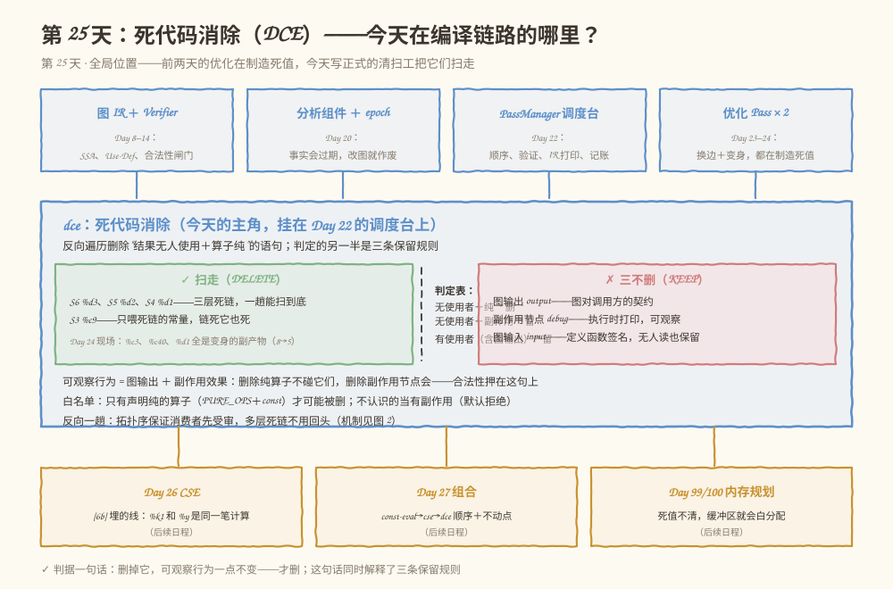
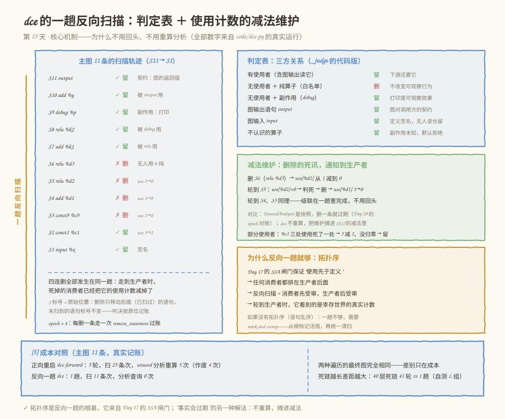
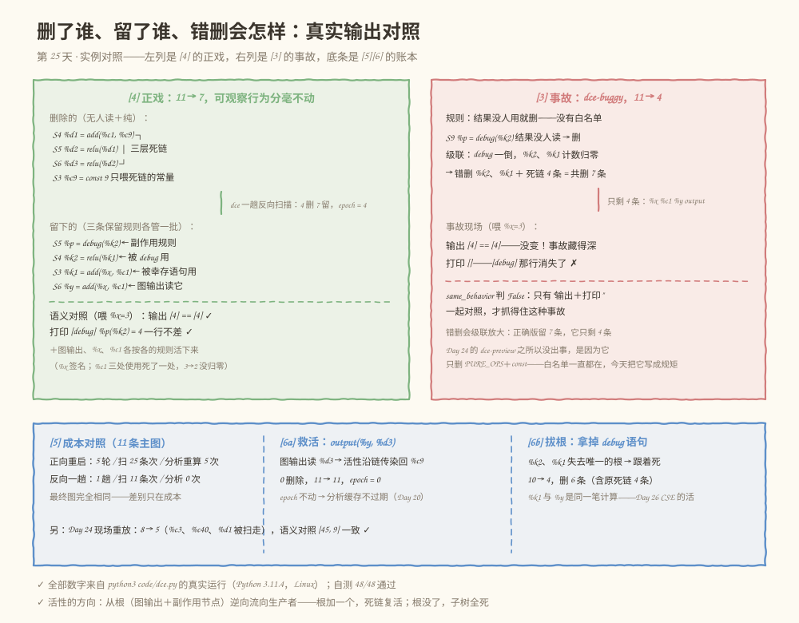

# 第 025 天：死代码消除——删掉它，可观察行为必须一点不变

> **今日目标**：完成本教程后，你能说出死代码消除（DCE）的完整判据——"结果无人使用＋算子纯"才可删，且必须同时守住三条保留规则（图输出是对外契约、副作用节点删了会改变可观察行为、图输入定义签名）；解释为什么"只看有没有人用"的清扫工会删掉 `debug` 并级联错删三条语句；说清反向遍历为什么一趟就能扫干净多层死链（拓扑序保证消费者先受审＋使用计数的减法维护）；并亲手运行一个带语义对照的 `dce` Pass——删前删后用解释器各跑一遍，输出和打印一行不差才算语义不变。
> **预计时间**：学习 35 分钟 + 实践 50 分钟
> **前置准备**：Python 3（本教程用 3.11.4 实测）；Day 22 的 PassManager、Day 20 的 epoch 对账（今天原样复用）；Day 23/24 两个优化 Pass 制造的死值现场（今天的第一幕就是它）。
> **今日产出**：`code/dce.py`（`dce` Pass ＋ 判定表 ＋ 减法维护 ＋ 正向对照 ＋ 事故重演 ＋ 最小解释器 ＋ 48 项自测）的真实运行记录，以及一组副作用反例和多层死代码用例。

## 1. 今天解决什么问题？

Day 24 的结尾留了一句话："今天的副作用是 `%c3`、`%c40`、`%d1` 折完全变成死值——把它们扫走需要的正是无副作用、无使用者和图输出之间的关系：死代码消除（DCE），Day 25 的主题。"今天兑现。

死值躺在图里有三重代价。**运行期白算**：如果有个解释器按语句顺序执行，`relu(relu(add(const 1, const 9)))` 这条没人要的链会被老老实实算一遍。**内存白分配**：Day 99/100 的内存规划按活跃区间给每个 Tensor 分缓冲区，死值不清，缓冲区就会白占。**优化白费力**：Day 26 的 CSE 要对着更多语句做匹配，图越脏越慢。

听起来清扫很简单：把"结果没人用"的语句删掉不就完了？先看一个会真实翻车的版本。假设你写了个三行版的 DCE：

```python
if use_count[res] == 0:          # 结果没人用
    graph.remove_statement(i)    # 删！
```

单测全绿——因为你喂的测试图里只有 `add`、`relu` 这种老实算子。上线之后遇到一张带 `debug` 的图：`%p = debug(%k2)` 的结果 `%p` 没人读，清扫工把它扫走了。**程序少打印了一行**。更糟的是级联：`debug` 一倒，`%k2`、`%k1` 的使用计数跟着归零，整条右链被错删——原本该留 7 条的图只剩 4 条。输出值竟然还没变（`%y` 照样算出来），只有打印行消失了——这种事故藏得极深，今天 [3] 节会完整重演。

今天的目标就是写一个**不出这种事故**的 `dce`。对应学习计划的三行：

- **学习**：无副作用、有使用者和图输出之间的关系；
- **实践**：实现反向遍历删除无使用者的纯算子，保留图输出和有副作用节点；
- **产出**：DCE Pass、多层死代码和副作用反例。

贯穿全文的是这张 11 条语句的图——三股势力同台：

```text
S1   %x    = input              : tensor<i32>   ← 图输入：定义签名
S2   %c1   = const 1            : tensor<i32>
S3   %c9   = const 9            : tensor<i32>   ← 只喂死链
S4   %d1   = add(%c1, %c9)      : tensor<i32>   ← 死链第一层（10）
S5   %d2   = relu(%d1)          : tensor<i32>   ← 死链第二层（10）
S6   %d3   = relu(%d2)          : tensor<i32>   ← 死链第三层（10），无人读
S7   %k1   = add(%x, %c1)       : tensor<i32>   ← 活链：被 debug 间接需要
S8   %k2   = relu(%k1)          : tensor<i32>   ← 活链：被 debug 直接需要
S9   %p    = debug(%k2)         : tensor<i32>   ← 副作用：执行时打印
S10  %y    = add(%x, %c1)       : tensor<i32>   ← 活：图输出读它
S11    →   output(%y)
```

同一个 `%c1` 喂着死链（`%d1`）、活链（`%k1`）和输出链（`%y`）——它到底死不死？`%c9` 只喂死链，它又是什么命运？`debug` 的结果 `%p` 无人读，它凭什么活？这些问题今天全部有判决。

**术语先对齐**：死代码消除（Dead Code Elimination，DCE）指删除"删掉也不改变程序可观察行为"的代码。副作用（side effect）指算子除了算出结果之外对外界产生的可观察影响——今天的 `debug` 执行时会打印一行，这就是副作用；写内存、发通信同样算。纯算子（pure operator）指没有副作用的算子——`add`、`relu`、`matmul` 只从输入算结果，删掉或重排不影响外界。可观察行为（observable behavior）指运行期外界能看到的一切，今天模型化为两样：**图输出 ＋ 副作用节点的效果**。活性（liveness）指"一个值还会影响可观察行为"——Day 19 在线性图上算过活跃区间，今天是它的图级版本。

**前置补给**：Use-Def（Day 10）——值与使用它的语句之间的关系，今天的"使用者"就是它；拓扑序（Day 16）——若每条边都从排在前面的语句指向排在后面的语句，这个顺序就是拓扑序，今天反向一趟的根基。

## 2. 先看全貌：今天的内容位于哪里？



**图 1**：看三个区域。顶部四张卡是前 24 天的家底（图 IR＋Verifier、分析＋epoch、Day 22 调度台、Day 23/24 两个优化 Pass——它们都在制造死值）；中间蓝框是今天的主角 `dce`——左绿格是扫走的东西（三层死链＋死常量＋昨天的变身副产物），中间虚线是判定表，右玫红格是三条保留规则；底部琥珀色一排是死值的下游账单和第 4 周剩余日程（Day 26 CSE 要合并今天 [6b] 留下的重复计算）。

全局流程五步，今天做第五步：

1. 前端把模型变成图 IR，配 Verifier（Day 8–14，已完成）；
2. 控制流、SSA、支配、活跃区间（Day 15–19，已完成）；
3. 分析做成组件，epoch 管失效（Day 20，已完成）；
4. Pass 接口＋PassManager 调度台（Day 22，已完成）；algebraic-simplify（Day 23）和 const-eval（Day 24）两个优化已进场；
5. **今天：第三个优化 Pass——`dce` 正式下场清扫；Day 26 CSE、Day 27 组合随后进场。**

## 3. 核心概念：先用直觉，再给准确定义

### 3.1 死代码：删掉它，可观察行为一点不变

判据一句话：**一条语句是死代码，当且仅当删除它之后，程序的可观察行为完全不变。**在我们的图里，可观察行为就两样：图输出（调用方拿到的返回值）＋ 副作用节点的效果（`debug` 打印的行）。

- **一个类比**：搬家收拾东西。规矩是"没人再用、且扔了没人发现"才扔。客人没点过的菜不做了；但你答应朋友"每天给窗台的绿植拍张照发过去"——绿植就算没人观赏也不能扔，因为扔了它，**朋友圈的照片就少了一张**，别人观察得到。**对应到技术上是**：`relu(%d1)` 的结果没人读、算子纯（只算数、不碰外界），删掉后没有任何人观察得到差别，这就是死代码；`debug(%k2)` 的结果 `%p` 虽然也没人读，但它执行时会打印——打印就是"朋友圈的照片"，删掉它可观察行为就变了，所以它必须活。类比的边界：人判断"扔了没人发现"靠记忆和默契，编译器判断靠**纯度**这个数学性质——必须事先在算子的属性里声明（我们的 `PURE_OPS` 白名单），不能靠猜；这也是为什么"不认识的算子"一律按有副作用处理。
- 判据的另一半是**谁说了算"没人用"**：使用者包括所有语句的输入，**特别是图输出语句**——`output(%y)` 读 `%y`，`%y` 就是活的。Day 19 的教训三（图输出的输入也算使用）今天正式成为规则的一部分。

### 3.2 三方关系：判定表与三条保留规则

把"结果有没有人用"和"算子纯不纯"放到一张表里，再加上两个特殊角色（图输出、图输入），就是今天判定的全部——学习计划说的"无副作用、有使用者和图输出之间的关系"：

| 语句 | 判决 | 理由 |
|---|---|---|
| 有使用者（含被 `output` 读） | **留** | 下游还要它 |
| 无使用者 ＋ 纯算子（`PURE_OPS` / `const`） | **删** | 删除不改变可观察行为 |
| 无使用者 ＋ 有副作用（`debug`） | **留** | 打印是可观察效果 |
| 图输出语句 `output` | **留** | 图对调用方的契约 |
| 图输入 `input` | **留** | 定义函数签名，无人读也保留 |
| 不认识的算子 | **留** | 副作用未知，默认拒绝 |

三条保留规则（图输出、副作用、图输入）背后是同一个词——可观察行为。图输出是图的返回值契约，删了它调用方拿不到结果；副作用节点的效果外界观察得到；图输入定义了"这个函数吃几个参数"，删了它签名就变了——运行期调用方按老签名喂数据，`%x` 就没了着落。

**白名单而不是黑名单**：安全策略有两种写法。黑名单写"只保护我认识的副作用算子（`debug`）"——哪天来了个 `store` 你没听过，它就被当纯算子删了，事故重演。白名单写"只删声明纯的算子（`PURE_OPS`＋`const`），其余一律不删"——不认识的算子天然安全。Day 24 的 `dce-preview` 之所以从没出过事，正是因为它的 `removable()` 只认 `PURE_OPS`＋`const`——白名单一直都在，今天把它写成正式的规矩。这是 Day 23/24"门卫不猜语义"的又一次重演：**副作用未知时，默认按有副作用处理。**

### 3.3 活性：从根逆向传染

判定表回答"这一条留不留"，还有一件事它没回答：`%c9` 只喂死链——它死不死，取决于它的使用者 `%d1` 死不死；`%d1` 死不死，又取决于 `%d2`……活性是**逆向传染**的：

```text
根（root）：图输出 ＋ 副作用节点        ← 活性的源头，它们天生是活的
传染：使用者的语句活着 → 它读的值活着 → 生产那个值的语句活着
```

对应到贯穿图：`output` 读 `%y` → `%y` 活 → `%x`、`%c1` 活；`debug` 是副作用节点 → `%k2` 活 → `%k1` 活 → `%x`、`%c1` 活。反过来，`%d3` 没有任何根撑着 → 死 → `%d2` 死 → `%d1` 死 → 只喂死链的 `%c9` 也死。**一个值活，当且仅当它能沿"使用者 → 生产者"的边逆着走，走到某个根。**Day 19 的活跃变量分析是同一件事的数值版：定义点、最后使用点、活跃区间。今天的图没有控制流，活性就简化成这张静态传染图——但方向一模一样：**从使用处往定义处倒着传播**。这个"倒着"正是下一节反向遍历的伏笔。

## 4. 图解核心机制

有了判定表和活性传染，剩下的问题是工程性的：**怎么扫才能把多层死链一趟清干净？**直觉的写法是从头往后扫——但 `%d1` 一开始并不死（`%d2` 还在用它），只有等 `%d3`、`%d2` 先被判死，`%d1` 才暴露出死。先看图，再解释为什么"反向"天然解决它。



**图 2**：看四个区域。左侧是贯穿图 11 条语句的扫描轨迹（S11 → S1），每条一个判决——注意 S5、S4、S3 的理由写着 `use 1→0`：那是减法维护在起作用；右上判定表是 `_judge` 的代码版；右中是减法维护的级联过程和它与分析缓存的对比；右下解释为什么反向一趟就够。按编号逐步讲：

**① 为什么反向**：我们的语句列表满足拓扑序——Day 17 的 SSA 闸门保证"使用先于定义"，所以**任何消费者都排在生产者后面**。从最后一条往前扫，消费者先受审；轮到生产者时，它那些死掉的消费者已经被判死并删除了。`%d1` 在 S4，它的使用者 `%d2` 在 S5——反向扫描先到 S5，`%d2` 判死删掉；再到 S4 时 `%d1` 已经没人用了，接着判死。**三层死链不需要回头，一趟能扫到底。**

**② 减法维护**：进 Pass 时建两张事实表——每个值的使用次数（`use_count`）和使用它的算子名单（`users`）。之后**不重算**：每删一条语句，就把它每个输入的使用计数减一（`use_count[u] -= 1`）。S6 的 `relu %d3` 删除 → `use_count[%d2]` 从 1 减到 0 → 轮到 S5 时 `%d2` 的计数正好是 0，判死 → 删 S5 → `use_count[%d1]` 归零 → S4 判死……级联就是这样沿着扫描方向自己滚下去的。第 6 节的常见错误三（死链只掉一层）就是忘了这一减。

**③ 为什么不重算分析**：Day 20 的 `UnusedAnalysis` 报告的是"当前图的快照"，每删一条语句 epoch 就 +1，快照作废。正向重启法（Day 24 `dce-preview` 的做法：删一条、从头再扫）每轮都得重算一次分析——11 条的主图要重算 5 次。反向减法法一次分析都不查：**"事实会过期"的另一种解法——不是过期了重算，而是把维护成本摊进每次删除的 O(1) 减法里。**部分使用者也靠它保平安：`%c1` 有三处使用（死链 `%d1`、活链 `%k1`、输出链 `%y`），死链那一处删掉后从 3 减到 2，没归零——`%c1` 活得明明白白。

**④ 如果没有拓扑序**：反向一趟的前提是"消费者排在生产者后面"。如果语句可以乱序写（Day 16 之前我们没这个保证），一趟反向就不够了——标准做法是 mark-and-sweep（标记－清除）：从根集合（图输出＋副作用节点）出发，沿"使用者 → 生产者"逆向标记所有活值，再统一清扫没标到的纯算子。我们的线性 IR 有 SSA 闸门保证拓扑序，所以能省掉标记阶段直接一趟——**Day 16 的拓扑排序和 Day 17 的 SSA 在这里变现。**

**⑤ S 标号为什么不用重算**：删除第 i 条语句只会移动它后面（下标更大）的语句——反向扫描里那些是**已经扫过**的，再也不会看；还没扫到的语句（下标更小）位置一个不动。所以判决日志里的 `S6`、`S5`、`S4`、`S3` 全是原始位置，人和日志能对上账。

## 5. 动手实践：完成一个最小可运行例子

### 5.1 准备文件

```text
tutorials/day-025/
├── README.md          ← 本教程
├── images/            ← 三张图
└── code/
    └── dce.py         ← 今天的演练场（自包含，无第三方依赖）
```

运行方式（在 `tutorials/day-025/` 目录下）：

```bash
python3 code/dce.py               # 演示主流程：[1]～[6]
python3 code/dce.py --self-test   # 48 项自测，全部通过退出码 0
```

### 5.2 编写代码

`dce.py` 自包含：图外壳（`Graph`）、分析组件（`UnusedAnalysis`＋epoch 对账）、`PassManager` 全部沿用 Day 22/24 的契约原样搬来，今天的增量是四块——`DcePass`（主角）、`ForwardDcePass`（成本对照）、`BuggyDcePass`（事故重演）、`interp`（语义对照用的最小解释器）。先看主角的核心：

```python
class DcePass(Pass):
    name = "dce"

    def run(self, graph, am):
        self.decisions = []
        use_count, users = self._use_tables(graph)      # 进场建一次事实表
        i = len(graph.statements) - 1                    # 从最后一条往前
        while i >= 0:
            op, res, inputs, info = graph.statements[i]
            kind, reason = self._judge(op, res, use_count, users)
            self.decisions.append({"verdict": kind, "op": op,
                                   "res": res or "(output)", "reason": reason})
            if kind == "delete":
                graph.remove_statement(i)                # 走方法：epoch +1 过账
                for u in inputs:                         # 减法维护：死讯通知生产者
                    use_count[u] -= 1
                    if op in users[u]:
                        users[u].remove(op)
            i -= 1
        return True
```

判定的全部规矩在 `_judge` 里，与判定表逐行对应：

```python
    @staticmethod
    def _judge(op, res, use_count, users):
        if op == "output":
            return ("keep", "图输出语句——删除会改变图的返回值（对外契约）")
        if op == "input":
            return ("keep", "图输入——定义函数签名，无人读也保留")
        n = use_count.get(res, 0)
        if n > 0:
            who = "、".join(sorted(set(users.get(res, []))))
            return ("keep", f"结果被 {n} 处幸存使用（{who}）——下游还要它")
        if op in SIDE_EFFECT_OPS:
            return ("keep", f"算子有副作用（{op} 执行时打印）——结果没人读也不能删")
        if is_pure(op):                                  # 白名单：PURE_OPS＋const
            return ("delete", "结果无人使用＋算子纯——删除不改变可观察行为")
        return ("keep", f"算子 {op} 不在纯算子白名单——副作用未知，按有副作用处理")
```

两个易错点值得指出来。其一，`n > 0` 判断的是**幸存使用**——`use_count` 被删除时的减法持续修正着，所以轮到生产者时这个数字是"幸存世界"的真实值，不是进 Pass 时的旧值。其二，"副作用"和"白名单外"分成两档：`debug` 是我们明确声明有副作用的（理由写"执行时打印"），`mystery` 这种没听过的算子是副作用未知（理由写"默认拒绝"）——处理结果一样都是留，但审计日志能分清"为什么留"。

**语义对照用的最小解释器**是今天验证体系的半壁江山——学习计划执行原则 3 说"每个优化都要回答：为什么语义不变、如何验证"，`interp` 就是那个"如何验证"：

```python
def interp(graph, feed):
    """按语句顺序执行图，返回（输出值列表， debug 打印行列表）。"""
    env, debug_lines, outputs = {}, [], None
    for op, res, uses, info in graph.statements:
        if op == "input":
            env[res] = feed[res]
        elif is_const(op):
            env[res] = const_value(op, info[1])
        elif op == "add":
            env[res] = env[uses[0]] + env[uses[1]]
        elif op == "relu":
            env[res] = max(0, env[uses[0]])
        elif op == "debug":
            v = env[uses[0]]
            debug_lines.append(f"[debug] {res}({uses[0]}) = {v}")   # 可观察效果
            env[res] = v
        elif op == "output":
            outputs = [env[u] for u in uses]
        ...
    return outputs, debug_lines
```

（`...` 省略的是 `mul` 分支和"不认识的算子直接抛 `GraphError`"的兜底，与今天的判定无关，完整实现见 `code/dce.py`。）

`same_behavior(g1, g2, feed)` 把两张图在同一份输入下各跑一遍，**输出和打印都一致**才算语义不变。为什么两样都要对？[3] 节的事故会给出答案。

### 5.3 运行与观察

以下全部是 `python3 code/dce.py` 的真实运行记录（Python 3.11.4，Linux）。

**[1] 先回昨天的现场**：把 Day 24 [3] 管线里 const-eval 变身之后的图直接搬来——`%d1` 已是 `const 5`、`%d2` 已是 `const 45`，`%c3`、`%c40`、`%d1` 三个值无人读：

```text
// DCE 之前（8 条，%c3、%c40、%d1 已无人读）：
  S1   %x    = input    : tensor<i32>
  S2   %c2   = const 2    : tensor<i32>
  S3   %c3   = const 3    : tensor<i32>
  S4   %c40  = const 40    : tensor<i32>
  S5   %d1   = const 5    : tensor<i32>
  S6   %d2   = const 45    : tensor<i32>
  S7   %d3   = add(%x, %c2)    : tensor<i32>
  S8     →   output(%d2, %d3)
run() 返回 True；8 条 → 5 条，epoch = 3（3 次删除）
被扫走：%c3、%c40、%d1——全是昨天的变身副产物；%c2 留下（%d3 还在用）
语义对照（喂 %x=7）：输出 [45, 9] == [45, 9]，打印 [] == [] → 一致 ✓
```

和 Day 24 [3] 的 `dce-preview` 结果完全一致（5 条、同样的三个人被扫走）——昨天的预览今天转正。注意语义对照：喂 `%x=7`，DCE 前后输出都是 `[45, 9]`。

**[2] 贯穿图登场**：11 条语句的三股势力，先跑解释器记下可观察行为基线：

```text
可观察行为基线（喂 %x=3）：输出 [4]，打印 ['[debug] %p(%k2) = 4']
```

`%x=3` 时：`%k1 = 3+1 = 4`，`%k2 = relu(4) = 4`，`debug` 打印一行，`%y = 4` 被输出。死链 `%d1→%d2→%d3` 算出 10、10、10，但没有任何人观察得到——它们就是今天要删的东西。

**[3] 事故重演**：让忘掉副作用的 `BuggyDcePass`（规则只有"结果没人用就删"）上同一张图：

```text
dce-buggy：run() 返回 True；11 条 → 4 条，删了 ['%p', '%k2', '%k1', '%d3', '%d2', '%d1', '%c9']
事故现场（喂 %x=3）：输出 [4]，打印 []
输出值还是 [4]——只对照输出根本发现不了；但打印行 ['[debug] %p(%k2) = 4'] 消失了
更糟的是级联：debug 一倒，%k2、%k1 的使用计数跟着归零——正确版留 7 条，它只剩 4 条
```

三个观察：输出值**没变**（`%y` 不在错删名单里，`[4]` 照样算出来）——所以只对照输出的验证会放行这个错误版本；打印行**消失了**——`same_behavior` 把输出和打印一起对照，判 False，当场抓住；错删**会级联放大**——`debug` 倒下牵连 `%k2`、`%k1`，7 条该活的只剩 4 条。这就是 3.1 节类比里"朋友圈照片少了一张"的工程版。

**[4] 正戏**：主角 `dce` 上场，判决日志按扫描顺序（从 S11 到 S1）逐条打印：

```text
判决日志（按扫描顺序，从最后一条往前）：检查 11 条——留 7 条，删 4 条
  ✓ 留  output  (output)  图输出语句——删除会改变图的返回值（对外契约）
  ✓ 留  add     %y        结果被 1 处幸存使用（output）——下游还要它
  ✓ 留  debug   %p        算子有副作用（debug 执行时打印）——结果没人读也不能删
  ✓ 留  relu    %k2       结果被 1 处幸存使用（debug）——下游还要它
  ✓ 留  add     %k1       结果被 1 处幸存使用（relu）——下游还要它
  ✗ 删  relu    %d3       结果无人使用＋算子纯——删除不改变可观察行为
  ✗ 删  relu    %d2       结果无人使用＋算子纯——删除不改变可观察行为
  ✗ 删  add     %d1       结果无人使用＋算子纯——删除不改变可观察行为
  ✗ 删  const 9 %c9       结果无人使用＋算子纯——删除不改变可观察行为
  ✓ 留  const 1 %c1       结果被 2 处幸存使用（add）——下游还要它
  ✓ 留  input   %x        图输入——定义函数签名，无人读也保留
run() 返回 True；11 条 → 7 条，epoch = 4（4 次删除）
```

对着判决日志读三件事。**S5/S4/S3 判死的原因链**：`%d2`、`%d1`、`%c9` 判死时，理由都写着"无人使用"——但进场时它们明明各有 1 处使用（`%d3` 用 `%d2`、`%d2` 用 `%d1`、`%d1` 用 `%c9`）；是减法维护在扫描途中把计数逐一清零的，[5] 节的成本对照证明这一趟没有重算任何分析。**`%c1` 的"2 处幸存使用"**：进场时它有 3 处使用（`%d1`、`%k1`、`%y` 各一次），`%d1` 死掉后从 3 减到 2——部分使用者被减法正确处理。**`%y` 和 `%k1` 都活着但理由不同**：`%y` 被图输出用（契约），`%k1` 被 `relu` 用（幸存使用）——留的原因可审计。

DCE 之后的图：

```text
  S1   %x    = input    : tensor<i32>
  S2   %c1   = const 1    : tensor<i32>
  S3   %k1   = add(%x, %c1)    : tensor<i32>
  S4   %k2   = relu(%k1)    : tensor<i32>
  S5   %p    = debug(%k2)    : tensor<i32>
  S6   %y    = add(%x, %c1)    : tensor<i32>
  S7     →   output(%y)
```

死链和 `%c9` 全没了，`debug` 和它喂着的链、`%y` 和它读的输入全在。语义对照收尾：

```text
语义对照（喂 %x=3）：输出 [4] == [4]，打印 ['[debug] %p(%k2) = 4'] == ['[debug] %p(%k2) = 4'] → 一致 ✓
```

**[5] 成本对照**：`ForwardDcePass` 是 Day 24 `dce-preview` 的记账版——同样的安全规则，正向扫描、每删一条从头再来，每轮重算一次 `unused` 分析：

```text
dce-forward：run() 返回 True；11 条 → 7 条
  扫描 25 条次，5 轮，删 4 条，unused 分析重算 5 次（作废 4 次）
dce（反向）：run() 返回 True；11 条 → 7 条
  扫描 11 条次，删 4 条，分析查询 0 次
  （PM 记账：queries=0，recomputed=0——一趟零分析）
两种遍历的最终图完全相同：True——差别只在成本：25 条次 vs 11 条次
```

自测 L 组还放了一条 40 层死链：正向要 41 轮、重算 41 次分析，反向仍然一趟（44 次访问、零分析）——**死链越长，差距越大**。



**图 3**：左列对应 [4]——删的四条（三层死链＋`%c9`）与留的六条各自贴着理由，底部的语义对照两行全打勾；右列对应 [3]——错删的级联和"输出没变、打印消失"的隐蔽事故；底条是 [5][6] 的账本。看图时问自己一个问题：如果只保留"输出对照"这一种验证，[3] 的事故能不能被发现？（不能——这正是两样都对照的理由。）

### 5.4 修改一个参数再观察

两个低成本实验，都是"先预测、再看结果"：

**实验一（救活）**：把 `output(%y)` 改成 `output(%y, %d3)`。预测：图输出多读了一个 `%d3`，活性沿 `%d3 → %d2 → %d1 → %c9` 逆向传染回生产者——死链整条复活，一条都删不掉。真实结果：

```text
[6a] 把 output(%y) 改成 output(%y, %d3)——预测：死链整条被救活，0 删除
结果：run() 返回 True；11 条 → 11 条，删 0 条，epoch = 0
```

顺带一个 Day 20 的回声：`epoch = 0` 说明图一个字都没改——分析零查询、零重算，缓存里连过期都谈不上。

**实验二（拔根）**：把 `debug` 语句从输入图里拿掉。预测：`%k2`、`%k1` 失去唯一的根，跟着死链一起被扫走。真实结果：

```text
[6b] 把 debug 语句拿掉——预测：右链 %k2、%k1 失去唯一的根，跟着死链一起被扫走
结果：run() 返回 True；10 条 → 4 条，删 6 条
只剩 %x、%c1、%y、output——%k1 和 %y 是同一笔计算（add(%x,%c1)），合并它们是 Day 26 CSE 的活
```

两个实验合起来读：**活性从根（图输出＋副作用节点）逆向流向生产者——根加一个，死链复活；根没了，子树全死。**另外注意 [6b] 的残留：`%k1` 和 `%y` 是同一笔计算 `add(%x, %c1)`，DCE 只能删没人要的，合并重复的是 Day 26 CSE 的活——[6b] 顺手给明天埋好了线。

## 6. 常见错误与排查

**错误一：忘了副作用，删掉 `debug`（[3] 的事故）。**
现象：DCE 跑完图变小了，单测（只对照输出值）全绿；上线后带 `debug` 的图运行时打印行消失。原因：判据只写了"结果无人使用"，漏了"算子纯"这半边——副作用节点的效果是可观察行为的一部分。定位：`same_behavior` 判 False 且差在打印行（`d1 == d2` 为 False、`o1 == o2` 为 True）；判决日志里 `%p` 的理由如果是"结果无人使用"而不是"副作用"，就是它。修复：判定表补上"无使用者＋副作用 → 留"；策略上用白名单——只有声明纯的算子才可能被删。

**错误二：不把图输出的输入当使用，删了 `output` 正在读的值。**
现象：删除之后 PassManager 的 verify 拉闸：`GraphError: %y 被使用但从未定义`——`output(%y)` 还在，生产 `%y` 的语句没了。原因：统计使用者时只遍历了普通算子语句，漏了 `output` 语句的输入列表（Day 19 的教训三在这里换成显式规则：**图输出的输入是使用**）。定位：报错信息直接给出值名，去 `used_at()`/`_use_tables()` 里查那个值是否把 `output` 的使用记进去了。修复：`_use_tables` 遍历**所有**语句的输入，`output` 不例外；本节的 `users[%y]` 里能看到 `"output"`。

**错误三：删除后不减使用计数，多层死链只掉一层。**
现象：`dce` 跑完，死链只剩最外层被删——`%d3` 没了，`%d2`、`%d1`、`%c9` 还躺着；跑第二遍 Pass 又删一层。原因：删掉 S6 之后 `use_count[%d2]` 还是进场时的旧值 1（那 1 处使用来自已删除的 S6）——事实过期了却没维护，轮到 S5 时误判"被使用"。定位：判决日志里 `%d2` 写着"被 1 处幸存使用（relu）"，但当前图里那条 `relu` 已经不存在——日志与图对不上账。修复：删除语句时给它的每个输入 `use_count[u] -= 1`（`DcePass.run` 里的减法维护）；这是 Day 20"事实会过期"的第三种解法——重算（正向重启）、缓存对账（AnalysisManager）之外，还有增量维护。

**错误四：绕过 `remove_statement` 直接 `del graph.statements[i]`。**
现象：IR 打印看起来正常，但 PassManager 的 bypass 检查拉闸：`dce 之后语句数 11→7，但 epoch 没动`；就算侥幸过了这关，同一管线里后续 Pass 拿着过期 epoch 的分析结果做决策。原因：直接 `del` 不走 `_commit`，epoch 停在原地——AnalysisManager 靠 epoch 对账，改动没过账就等于没发生。定位：`change_log` 里找不到"删除 S6"的条目。修复：改图必须走方法——`remove_statement` 内部调用 `_commit`，让 epoch +1、改动进日志（Day 24 错误四在"原地改写"上的镜像，今天是"删除"）。

## 7. 今日练习

### 必做练习：给副作用家族添一个 `checkpoint`

今天的图里只有一个副作用算子 `debug`。现在新增 `checkpoint(%v)`：语义是执行时打印一行 `[checkpoint] %c(%v) = ...`（想象成训练循环里偶尔落盘的检查点，打印是它最便宜的替身）。要求：

1. 把 `checkpoint` 加进 `SIDE_EFFECT_OPS`，并在 `interp` 里实现它（照抄 `debug` 的分支、换个前缀）；
2. 构造一张图：`checkpoint` 的结果没人用、它喂着的链至少两层、链的底部常量**同时**还喂一条通往 `output` 的活链（模仿贯穿图里 `%c1` 的一鱼两吃）；
3. 先预测再验证：`dce` 应该保留 `checkpoint`（判决理由含"副作用"）和它的整条链，只删真正无人问津的死链；`BuggyDcePass` 应该错删 `checkpoint` 并级联错删它的链；
4. 用 `same_behavior` 验证正确版语义不变、事故版被抓住；补至少三条自测（checkpoint 保留、链保留、事故版判 False），`--self-test` 全绿。

预期产出：改动后的 `dce.py` ＋ 新图 ＋ 预测记录。想深一层：如果把 `checkpoint` 从 `SIDE_EFFECT_OPS` 挪进 `PURE_OPS`，判决会怎么变？——`checkpoint` 会被删掉、打印消失。这说明**纯度不是开关，是算子的语义属性**：它描述"这个算子对外界做什么"，挪动它等于篡改语义，白名单只能如实登记。

### 选做挑战：40 层死链的成本曲线

自测 L 组已经放了 40 层死链（44 条语句：input、const、40 个 relu、add、output）。把它扩展成实验：

1. 写一个函数按层数 L 生成死链图，对 L = 5、10、20、40 分别跑 `dce` 和 `dce-forward`，记录四组数：正向轮数、正向扫描条次、正向分析重算次数、反向访问条次；
2. 先用公式预测再对照：正向轮数应约等于 L＋1（删 L 条＋最后一轮空扫），反向访问条次恒等于语句数；
3. 把真实数字填成一张表，回答：如果图有 10 万条语句、其中 1 万条死链，正向重启和反向一趟的扫描条次差多少个数量级？
4. 顺手想清楚：mark-and-sweep 的成本是 O(语句数＋使用边数)，和反向一趟同量级——那反向一趟省掉的到底是什么？（标记阶段的整张活值表和一趟写集；在内存受限的编译器里这不是小事。）

## 8. 今日验收

- [ ] 我能不看资料说出 DCE 的完整判据（"结果无人使用＋算子纯"才可删），并举出三条保留规则各自的反例（`output` 是契约、`debug` 删了打印消失、`input` 定义签名）；
- [ ] 我能解释 [3] 的事故为什么输出值没变却是语义错误，以及为什么语义对照必须"输出＋打印"两样一起做；
- [ ] 我能运行 `code/dce.py`，指着 [4] 的判决日志说出 S5/S4/S3 判死的原因链（减法维护让计数沿途归零）和 `%c1` 的"3 处使用死 1 处"；
- [ ] 我能解释反向一趟为什么够（拓扑序保证消费者先受审）、没有拓扑序时该怎么办（mark-and-sweep），以及它和 Day 16/17 的关系；
- [ ] 我能修改 `output` 或增删 `debug` 并**先预测结果再验证**（5.4 的两个实验至少做一个）；
- [ ] 我保存了 `dce.py` 和 48/48 的自测记录——Day 26 的 CSE 和 Day 27 的组合都要回来用这套图外壳、判定表和语义对照。

## 9. 一句话总结与明天预告

今天的问题是"死值怎么安全地扫走"；判据是三方关系表——结果无人使用＋算子纯才删，图输出（契约）、副作用节点（打印可观察）、图输入（签名）三条保留规则守住可观察行为，白名单让没见过的算子默认安全；机制是反向一趟——拓扑序保证消费者先受审，使用计数靠删除时的 O(1) 减法维护，多层死链不用回头、不用重算分析（正向重启：25 条次/5 轮/分析 5 次；反向一趟：11 条次/零分析）；验证是解释器语义对照——删前删后输出和打印一行不差，事故版（错删 `debug` 并级联）被当场抓住，48 项自测全绿。今天的 [6b] 留了一个尾巴：`%k1` 和 `%y` 是同一笔计算 `add(%x, %c1)`，DCE 只能删没人要的，合并重复的活属于公共子表达式消除（CSE）——结构等价、属性等价、输入顺序和副作用对它的影响，就是 Day 26 的主题。
