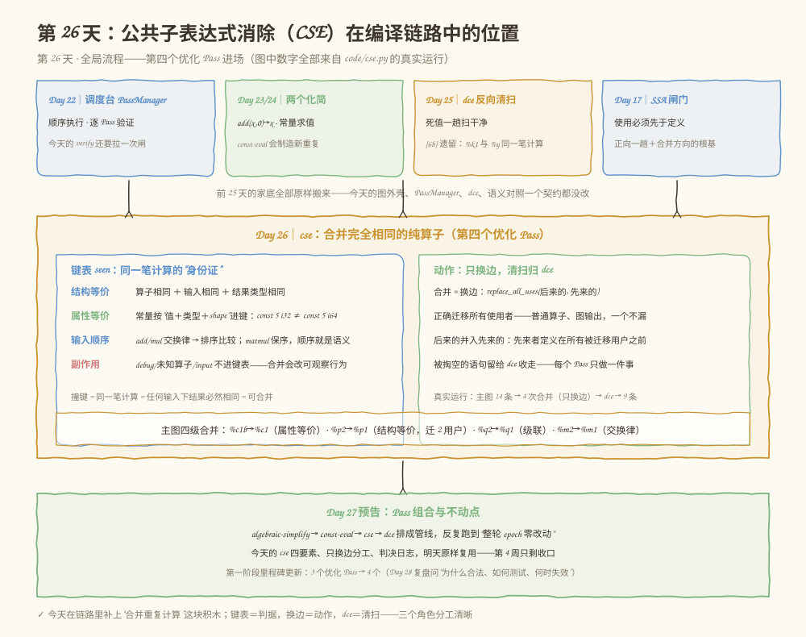
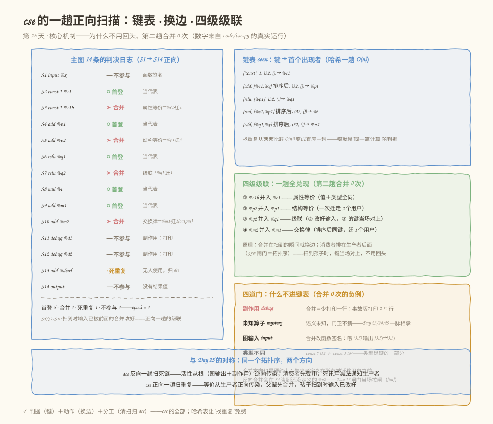
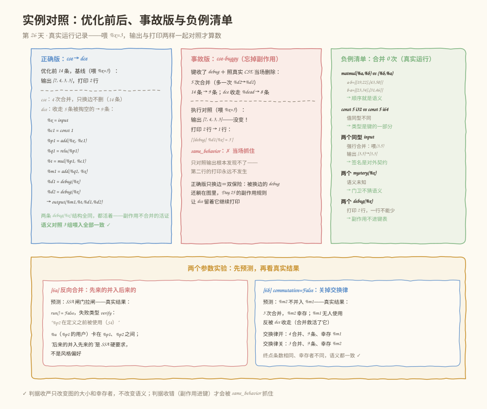

# 第 026 天：公共子表达式消除——同一笔计算，只算一次

> **今日目标**：完成本教程后，你能说出 CSE 合并判据的四个要素——结构等价（算子＋输入＋结果类型）、属性等价（常量按"值＋类型"比较，键比属性不比名字）、输入顺序（add/mul 交换律排序比较，matmul 保序）、副作用（debug/未知算子/图输入不进键表）——并能各举一个合并与不合并的例子；解释 Day 25 [6b] 留下的 `%k1`/`%y` 是怎么被"后来的并入先来的"合并掉的、为什么合并方向反过来会让 SSA 闸门当场拉闸；运行 `cse` 后对着判决日志讲清正向一趟如何把四级级联全部兑现（第二趟合并 0 次）；并理解合并动作为什么只换边、被掏空的语句为什么归 dce 收走。
> **预计时间**：学习 35 分钟 + 实践 50 分钟
> **前置准备**：Python 3（本教程用 3.11.4 实测，无第三方依赖）；Day 22 的 PassManager（今天的 verify 还要拉一次闸）、Day 23 的换边 `replace_all_uses`、Day 25 的 `dce`（清扫归它）和"输出＋打印"两样一起对照的 `same_behavior`。
> **今日产出**：`code/cse.py`（`cse` Pass ＋ 判决日志 ＋ 事故版 ＋ 反向合并版 ＋ 负例清单 ＋ 50 项自测）的真实运行记录，以及等价和不等价测试集。

## 1. 今天解决什么问题？

Day 25 的 [6b] 留了一句尾巴：拿掉 `debug` 之后，图里剩下 `%k1 = add(%x, %c1)` 和 `%y = add(%x, %c1)`——**同一笔计算，躺在图里算了两次**。DCE 只能删没人要的，谁也删不掉它俩：`%k1` 被 `%k2` 读着，`%y` 被图输出读着。把重复的计算合并成一次，就是今天的主角——公共子表达式消除（Common Subexpression Elimination，CSE）。

重复计算不是罕见现象，而是常态。前端把模型翻译成图时，不同路径常常各自写一遍同一笔计算；Day 24 的 const-eval 折叠之后，也会出现两个"值一样"的常量各占一条语句。重复的代价直接落在运行期：同一笔 `add` 白算两遍，同一个中间结果白分配两块内存——而它的判据、动作和边界，恰好把"结构等价、属性等价、输入顺序和副作用"四个概念一次讲全。

听起来合并很简单："看到两条一样的语句就并呗。"这句话里有三个坑，每一个都对应今天的一个学习点：

- **"一样"怎么定义**？`add(%x, %c1)` 和 `add(%c1, %x)` 算同一笔吗？`const 5` 的 i32 和 i64 算同一个常量吗？——需要一张精确的等价判据表（3.2 节）。
- **合并之后使用者怎么办**？`%y` 的使用者是图输出——合并后 `output` 必须改读 `%k1`，一个都不能漏；而且为什么是"后来的并入先来的"，反方向行不行？——使用者迁移的工程与 SSA 论证（3.3 节）。
- **什么永远不许合**？两个 `debug(%x)` 结构完全相同，合并它们少打印一行——副作用是"执行次数"的一部分（[3] 节的事故重演）。

贯穿全文的是这张 14 条语句的图——四类重复齐聚一堂，外加三处特殊场景：

```text
S1   %x    = input              : tensor<i32>
S2   %c1   = const 1            : tensor<i32>   ← 首个 const 1
S3   %c1b  = const 1            : tensor<i32>   ← 属性等价：值＋类型全同，名字不同
S4   %p1   = add(%x, %c1)       : tensor<i32>   ← 首笔 add(x, c1)
S5   %p2   = add(%x, %c1b)      : tensor<i32>   ← S3 并入 %c1 后与 S4 同键：级联
S6   %q1   = relu(%p1)          : tensor<i32>
S7   %q2   = relu(%p2)          : tensor<i32>   ← S5 并入 %p1 后与 S6 同键：级联
S8   %t    = mul(%p2, %c1)      : tensor<i32>   ← %p2 的第二个使用者
S9   %m1   = add(%q1, %x)       : tensor<i32>
S10  %m2   = add(%x, %q2)      : tensor<i32>   ← S7 并入 %q1 后，排序比较：交换律
S11  %d1   = debug(%x)          : tensor<i32>   ← 副作用：执行时打印
S12  %d2   = debug(%x)          : tensor<i32>   ← 结构全同，但不许合并
S13  %dead = add(%x, %c1)      : tensor<i32>   ← 重复但无人使用
S14    →   output(%m2, %t, %d1, %d2)
```

它一口气埋了四类可合并的重复——常量属性等价（`%c1b`）、结构等价（`%p2`）、级联产生的重复（`%q2`）、交换律等价（`%m2`）——以及三处特殊场景：副作用对（`%d1`/`%d2`，结构全同也不许合）、死重复（`%dead`，无人使用、归 dce）、图输出这个特殊使用者（读 `%m2`，合并时必须跟着换边）。今天结束时，这张图会被压缩到 9 条，语义一行不差。

**术语先对齐**：公共子表达式（common subexpression）指"在当前图里出现过不止一次、且每次算出来的结果都一样"的计算。等价（equivalence）指两条语句在任何输入下都产生相同结果——CSE 的一切安全性都押在它上面。键（key）指把一笔计算的全部特征打包成的一个可比较的值，今天用 Python 元组实现，撞键才算重复。换边（rewire）指把一条使用边从"读这个值"改成"读那个值"，Day 23 首次登场，今天是唯一的动作。代表（first occurrence）指等价类里最先出现的那条语句——所有后来者都并入它。

**前置补给**：`replace_all_uses`（Day 23/24/25）——把所有读 `old` 的语句改成读 `new`，改图走方法、epoch +1 过账；拓扑序（Day 16/17）——"使用先于定义"的 SSA 闸门保证任何消费者都排在生产者后面，今天正向一趟的根基；Day 25 的 DCE 判定表——"无人使用＋纯算子"才删，今天 cse 掏空的语句全靠它收走。

## 2. 先看全貌：今天的内容位于哪里？



**图 1**：看三个区域。顶部四张卡是家底——调度台（Day 22）、两个化简 Pass（Day 23/24）、反向清扫 dce（Day 25，还带着 [6b] 的遗留）、SSA 闸门（Day 17，合并方向的根基）；中间琥珀色大框是今天的主角 `cse`——左半是键表（等价判据的四要素），右半是动作（只换边、使用者全迁移、清扫归 dce），底条是主图四次合并的真实清单；底部绿框是 Day 27 预告：四个 Pass 排成管线跑到不动点。

全局流程五步，今天做第五步：

1. 前端把模型变成图 IR，配 Verifier（Day 8–14，已完成）；
2. 控制流、SSA、支配、活跃区间（Day 15–19，已完成）；
3. 分析做成组件，epoch 管失效（Day 20，已完成）；
4. Pass 接口＋PassManager 调度台（Day 22，已完成）；algebraic-simplify（Day 23）、const-eval（Day 24）、dce（Day 25）三个优化已进场；
5. **今天：第四个优化 Pass——`cse` 合并完全相同的纯算子；Day 27 把四个 Pass 组合成管线，第一阶段收官。**

## 3. 核心概念：先用直觉，再给准确定义

### 3.1 公共子表达式：同一笔计算，答案必然一样

判据一句话：**两条语句等价，当且仅当在任何输入下它们产生相同的结果。**对纯算子来说，"算子相同＋输入相同＋结果类型相同"就够了——计算是输入的确定函数，输入一样，输出没有理由不一样。

- **一个类比**：你问老师"3+5 等于几"，五分钟后又问一遍——老师不会重新掰手指，答案还是那个 8。问题一样、材料一样，答案必然一样，第二次直接用第一次的结果就行。**对应到技术上是**：`%p1 = add(%x, %c1)` 在 S4、`%p2 = add(%x, %c1)` 在 S5——输入完全一样、算子是纯的，两个结果必然相等，于是 S5 的所有使用者改读 S4 的 `%p1`，运行期少算一遍。类比的边界：老师凭记忆认出"这题我刚算过"，编译器没有记忆，只有**键**——把一笔计算的全部特征（算子、输入、结果类型）打包成一个可比较的身份证，撞键才算重复；判据漏掉任何一个属性，"认出"就会出错，所以 3.2 节要把要素一个个数清楚。
- 为什么 CSE 只对纯算子成立？因为"算一次顶两次"的前提是**两次的效果完全一样**。纯算子只从输入算结果，删掉或合并不影响外界；如果一个算子每次执行都对外界做点什么（打印、写内存），少执行一次就是少一次可观察效果——这是 3.2 节第四要素的伏笔。

### 3.2 四要素：等价判据的完整清单

学习计划说"结构等价、属性等价、输入顺序和副作用对 CSE 的影响"——四个要素正好组成键表的全部规则。逐个过一遍，每个都配一个今天的真实例子：

**要素一：结构等价**。算子相同、输入相同（按输入的名字逐个比）、结果类型（shape＋dtype）相同。`%p1 = add(%x, %c1)` 和（`%c1b` 并入后的）`%p2 = add(%x, %c1)`——算子都是 `add`，输入都是 `%x` 和 `%c1`，结果都是 `tensor<i32>`：结构等价，可合并。结果类型为什么要进键？类型不同的两条语句，即使在我们的简化 Verifier 里能共存，也绝不该被当成同一笔计算——下游代码生成对它们可能用完全不同的指令。

**要素二：属性等价**。常量比较的是**属性**（值＋dtype＋shape），不是名字：`%c1 = const 1` 和 `%c1b = const 1` 名字不同，值和类型全同——等价，可合并。反过来，`const 5` 的 i32 和 i64 值相同但类型不同——**不等价**，不可合并（[5] 节的负例）。名字只是 SSA 的编号，属性才是计算的内容；"键比属性不比名字"是常量合并的全部要点。值解析不了的常量（比如文本不合法）干脆不进键表——最安全。

**要素三：输入顺序**。`add` 和 `mul` 满足交换律——`add(%q1, %x)` 和 `add(%x, %q1)` 任何输入下结果都一样，排序后进键，等价可合并。但**交换律不是所有双目算子的公共性质**：`matmul(%a, %b)` 和 `matmul(%b, %a)` 是两笔不同的计算（[5] 节用 2×2 矩阵实测：`a·b` 和 `b·a` 结果不同）。所以交换律要靠白名单 `COMMUTATIVE_OPS = {"add", "mul"}`——名单外的算子一律保序比较。这和 Day 25 的 `PURE_OPS` 白名单是同一个思路：**性质必须显式声明，不能靠猜**。

**要素四：副作用**。`debug(%x)` 执行时打印一行——两个 `debug(%x)` 结构完全相同，但合并意味着第二行的打印永远不发生，可观察行为变了。所以副作用算子不进键表；同理，**不认识的算子**（`mystery`）语义未知，门卫不猜（Day 23/24/25 一脉相承）；**图输入** `input` 也不进——两个同型 `input` 合并等于改函数签名，调用方按老签名喂的第二个参数就没了着落（[5] 节有实测：强行合并后喂 `(3, 5)`，输出从 `[3, 5]` 变 `[3, 3]`）。图输出语句没有结果值，天然不参与。

四要素合成一张判定表：

| 两条语句的关系 | 判决 | 例子 |
|---|---|---|
| 算子＋输入＋结果类型全同（或排序后全同） | **合并** | `%p2 → %p1` |
| 常量的值＋类型全同 | **合并** | `%c1b → %c1` |
| 值同但类型不同 | **不合并** | `const 5` i32 vs i64 |
| matmul 换了输入顺序 | **不合并** | `matmul(a,b)` vs `matmul(b,a)` |
| 结构全同但算子有副作用 | **不合并** | 两个 `debug(%x)` |
| 结构全同但算子未知 | **不合并** | 两个 `mystery(%x)` |
| 两个同型图输入 | **不合并** | 签名是对外契约 |
| 键相同但结果无人使用 | **跳过**（归 dce） | `%dead` |

### 3.3 合并的动作：正确迁移所有使用者

判据说"可以合"，动作只有一步：**换边**。`replace_all_uses(后来的, 先来的)`——后来者的所有使用者改读先来者，这正是 Day 10 的 Use-Def 同步和 Day 23 的换边动作。三个细节值得单独说：

**其一，"所有使用者"真的包括所有**。普通算子语句、图输出语句，一个不漏。贯穿图里 `%m2` 的唯一使用者是 `output`——合并后 `output` 的输入从 `%m2` 变成 `%m1`；`%p2` 有两个使用者（`%q2` 和 `%t`），一次换边同时迁走。漏迁一个使用者会怎样？在我们的管线里（只换边、不删语句），那个消费者继续读旧值——重复没合干净，优化不完整但图还合法；可真实 CSE 合并后要删除重复语句，漏迁的使用者就读到了已被删除的定义，Day 22 的 verify 会以"`%p2` 被使用但从未定义"拉闸。所以 `replace_all_uses` 的语义就是"迁移所有使用者"，它找不到使用者时直接拒绝换边（"无事可换"）——这也是死重复 `%dead` 要跳过换边的原因：它没有使用者，无事可做，死值归 dce。

**其二，"后来的并入先来的"不是风格偏好，是 SSA 硬要求**。换边后每条被迁移的使用边都指向先来者——先来者定义在前面，所有使用者都排在后来者之后（SSA 闸门：使用先于定义），也就都排在先来者之后——"使用先于定义"依然成立。反方向呢？先来者的使用者可能卡在两条语句之间（[6a] 的演示图里，`%u` 卡在 `%p1` 和 `%p2` 中间），把 `%u` 改读 `%p2` 就是使用先于定义——SSA 闸门当场拉闸。今天的 `ReverseMergeCsePass` 会真实撞一次这个门。

**其三，只换边、不删语句，清扫归 dce**。合并把后来者掏空成死值，但删除不是 cse 的活——Day 25 的 `dce` 已经有完整的"无人使用＋纯算子才删"判定表，两个 Pass 各干一件事，管线才好编排（Day 27 的顺序实验就要靠这个分工）。这个分工还有一个意外的好处：**双保险**。万一哪天键错了、把一个副作用算子换边合并了，被掏空的那条语句还躺在图里——Day 25 的副作用规则会让 dce 留着它继续执行，事故被下一道防线拦住。[3] 节的事故版正是把"键收了 debug"和"照真实 CSE 的做法当场删除"两件事凑齐才穿帮的——对照之下能看到防御纵深的样子。

## 4. 图解核心机制

判据和动作都有了，剩下的工程问题是：**怎么扫才能把级联一次清干净？**`%p2` 一开始和 `%p1` 并不同键（输入是 `%c1b` 不是 `%c1`），`%q2` 一开始和 `%q1` 也不同键——它们要等前面的合并改好输入才变成重复。先看图，再按编号讲。



**图 2**：看四个区域。左列是主图 14 条语句的完整判决日志（S1 → S14 正向扫描），四种判决各标了颜色——首登（绿）、合并（玫红）、死重复（琥珀）、不参与（灰）；右上键表列出 5 个登记过的键和它们的代表；右中是四级级联的接力链；右下是四道门（不进键表的负例）；底条是今天与 Day 25 的对称关系。按编号讲：

**① 键表：同一笔计算的身份证**。扫描前建一张空表 `seen`，正向走过去：每条语句算出键——算子有副作用、或者不在纯算子白名单（图输入、未知算子）、或者常量的值解析不了，键是 `None`，不登记（"不参与"）；键合法且第一次出现，登记进表当**代表**（"首登"）；键已经在表里——撞键，**后来的并入先来的**（"合并"）。哈希表让"找重复"从两两比较的 O(n²) 变成查表一趟 O(n)——14 条的图看不出差别，14 万条的图就是数量级的差别。

**② 正向一趟：级联为什么不用回头**。判决日志里 `%p2` 的合并理由写着"结构等价"——但进场时 `%p2 = add(%x, %c1b)`，和 `%p1 = add(%x, %c1)` 输入不同、并不同键。真实的顺序是：S3 的 `%c1b` 并入 `%c1` 时，`replace_all_uses` 立刻把 `%p2` 的输入改成了 `%c1`；扫描继续走到 S5 时，`%p2` 读的已经是 `%c1`——键当场对上。同理 S7 的 `%q2`、S10 的 `%m2` 都是"父亲先合并、孩子还没扫到、扫到时输入已改好"。**级联朝下传染（从生产者到消费者），而消费者排在生产者后面（SSA 闸门保证拓扑序）——所以正向一趟扫到底，四级级联全部兑现。**验证：对优化后的图再跑一遍 cse，合并 0 次（[4] 节实测）。

**③ 四道门**。右下角的四行是"合并 0 次"的负例清单，也是键的边界：副作用（合并＝少打印一行）、未知算子（门卫不猜语义）、图输入（合并改签名）、类型不同（属性等价比类型）。每一行都能在 [5] 节找到对应的真实运行。

**④ 与 Day 25 的对称**。DCE 的级联朝上传染（消费者死了，生产者才暴露出死），所以反向一趟；CSE 的级联朝下传染（生产者合并了，消费者才暴露出重复），所以正向一趟。方向相反，根基是同一个拓扑序，遍历策略都是"让级联的方向迎着扫描方向走"——这是两种消除 Pass 的共同设计模式。另一个对称：dce 的减法维护把死讯通知生产者，cse 的立即换边把新键送到消费者面前——都不重算分析、都不回头。

## 5. 动手实践：完成一个最小可运行例子

### 5.1 准备文件

```text
tutorials/day-026/
├── README.md          ← 本教程
├── images/            ← 三张图
└── code/
    └── cse.py         ← 今天的演练场（自包含，无第三方依赖）
```

运行方式（在 `tutorials/day-026/` 目录下）：

```bash
python3 code/cse.py               # 演示主流程：[1]～[6]
python3 code/cse.py --self-test   # 50 项自测，全部通过退出码 0
```

### 5.2 编写代码

`cse.py` 自包含：图外壳（`Graph`，含 `replace_all_uses`）、`AnalysisManager`、`PassManager` 全部沿用 Day 22/25 的契约原样搬来（契约一字未改），Day 25 的 `DcePass` 原样搬来负责清扫，`interp`/`same_behavior` 原样搬来做语义对照（外加一个 matmul 分支给负例用）。今天的增量是三个 Pass——`CsePass`（主角）、`BuggyCsePass`（事故重演）、`ReverseMergeCsePass`（反向合并反例）。先看主角：

```python
class CsePass(Pass):
    name = "cse"

    def __init__(self, commutative=True):
        self.commutative = commutative      # 5.4 实验二：交换律关掉会怎样
        self.merges = []
        self.decisions = []

    def run(self, graph, am):
        self.merges = []
        self.decisions = []
        seen = {}                           # 键 → (首个出现者的结果名, 它的输入)
        used = graph.used_at()              # 进场快照：谁有使用者
        for i, stmt in enumerate(graph.statements):
            op, res, inputs, info = stmt
            if res is None:                 # output 语句：没有结果值，不参与
                continue
            key = self._key(stmt)
            if key is None:                 # 副作用/未知算子/图输入/坏常量
                continue
            if key in seen:
                first, first_inputs = seen[key]
                if res not in used:         # 死重复：换边无事可做，归 dce
                    continue
                n = graph.replace_all_uses(res, first)     # 迁移所有使用者
                self.merges.append({"later": res, "first": first, "op": op, "users": n})
            else:
                seen[key] = (res, tuple(inputs))           # 首登：登记当代表
        return True
```

（摘录省略了各分支往 `self.decisions` 写判决日志的几行 reason 拼装——控制流与摘录完全一致，文案见 `code/cse.py` 的完整实现。）

四要素全部落在 `_key` 里——这是判据的全部代码，值得逐行读：

```python
    def _key(self, stmt):
        op, res, inputs, info = stmt
        shape, dtype = info
        if is_const(op):
            val = const_value(op, dtype)
            if val is None:
                return None                 # 值解析不了的常量：不进键表，最安全
            return ("const", val, dtype, shape)          # 属性等价：值＋类型＋shape
        if op in SIDE_EFFECT_OPS or op not in PURE_OPS:
            return None                     # 副作用/未知算子/图输入：门卫不猜语义
        if self.commutative and op in COMMUTATIVE_OPS:
            ins = tuple(sorted(inputs))     # 交换律：顺序无关
        else:
            ins = tuple(inputs)             # matmul 等：顺序就是语义
        return (op, ins, dtype, shape)      # 结构等价：算子＋输入＋结果类型
```

四个设计决定值得指出来。**其一，键是元组**——Python 的元组按值比较、可哈希，`("const", 1, "i32", ())` 和 `("const", 1, "i32", ())` 相等，而 `("const", 5, "i32", ...)` 和 `("const", 5, "i64", ...)` 不等：判据表直接翻译成数据结构，没有第二套逻辑。**其二，`seen` 里除了代表名还存了代表的输入**——合并时先看是不是常量（标"属性等价"），再比较 `tuple(inputs) == tuple(first_inputs)` 区分"结构等价"（顺序本来一致）和"交换律等价"（排序后才一致），判决日志的理由因此可审计。**其三，`used` 进场快照够用的原因**：本 Pass 只换边不删语句，位置不动；换边的 `old` 永远是"当前正被访问的语句"的结果——此前换掉的只可能是已访问语句的使用边，不会改变当前和未来语句"有没有使用者"这一事实。**其四，图没有 `rewrite_statement`**——今天不需要：合并不改写任何语句，只改使用边；被掏空的语句原样躺着等 dce。

事故版 `BuggyCsePass` 与正确版有两处差别，凑齐才有事故：debug 也进键表（真正的 bug），且照真实 CSE 的做法（如 MLIR）合并后当场 `remove_statement` 删除重复语句。反向合并版 `ReverseMergeCsePass` 只改一个方向——撞键时执行 `replace_all_uses(seen[key], res)`（先来者并入后来者），留给 [6a] 撞 SSA 闸门。（两个反例 Pass 的完整实现见 `code/cse.py`，与上面的差异就这两三行。）

### 5.3 运行与观察

以下全部是 `python3 code/cse.py` 的真实运行记录（Python 3.11.4，Linux）。

**[1] 先回昨天的现场**：把 Day 25 [6b] 的 10 条图（拿掉 `debug` 的版本）直接搬来——`%k1` 和 `%y` 就是同一笔计算：

```text
cse：run() 返回 True；1 次合并：%y 并入 %k1（迁 1 个使用者）
output 是使用者之一：%y 被并入 %k1，图输出改读 %k1——使用者迁移一个不漏
dce：run() 返回 True；10 条 → 4 条（清扫 cse 掏空的 %y 和死链）
// cse → dce 之后：
  S1   %x    = input    : tensor<i32>
  S2   %c1   = const 1    : tensor<i32>
  S3   %k1   = add(%x, %c1)    : tensor<i32>
  S4     →   output(%k1)
语义对照（喂 %x=3）：输出 [4] == [4]，打印 [] == [] → 一致 ✓
```

对着结果读一个细节：Day 25 [6b] 是 dce 先跑——`%k2` 死了连累 `%k1` 被删，最后幸存的是 `%y`；今天 cse 先跑——`%y` 被并入 `%k1`，图输出改读 `%k1`，幸存的是 `%k1`。**两种顺序条数相同、幸存者名字不同**——谁当代表由"先出现者"决定，语义完全一样。这是"合并改变了谁活谁死"的第一个证据，[6b] 还会再见到一次。

**[2] 贯穿图登场**：14 条语句如第 1 节所列，先跑解释器记下可观察行为基线：

```text
可观察行为基线（喂 %x=3）：输出 [7, 4, 3, 3]，打印 ['[debug] %d1(%x) = 3', '[debug] %d2(%x) = 3']
```

`%x=3` 时：`%p1 = 3+1 = 4`，`%q1 = relu(4) = 4`，`%t = 4×1 = 4`，`%m1 = 4+3 = 7`，两个 debug 各打印一行——输出 `[7, 4, 3, 3]`、打印 2 行，这是所有优化必须保持的契约。

**[3] 事故重演**：让忘掉副作用的 `BuggyCsePass` 上同一张图（键收了 debug，且照真实 CSE 的做法当场删除重复语句）：

```text
cse-buggy：run() 返回 True；5 次合并（比正确版多一次：%d2 并入 %d1），
          且照真实 CSE 的做法当场删除重复语句：14 条 → 9 条
dce：run() 返回 True；收走无人使用的 %dead → 8 条（比正确版少一条）
事故现场（喂 %x=3）：输出 [7, 4, 3, 3]，打印 ['[debug] %d1(%x) = 3']
输出值还是 [7, 4, 3, 3]——只对照输出根本发现不了；打印从 2 行变成 1 行
same_behavior：不一致 ✗（当场抓住）——两个 debug(%x) 键相同被合并删除，第二行的打印永远不发生
```

三个观察。**输出值一点没变**——`%d2` 的值本来就是穿透的 `%x`，删掉它调用方照样拿到 `[7, 4, 3, 3]`；只对照输出的验证会放行这个错误版本。**打印少了一行**——合并把"执行两次"变成"执行一次"，副作用是执行次数的一部分，`same_behavior` 两样一起对照，判 False 当场抓住。**为什么事故需要两个条件凑齐**：如果只键错、不删语句（正确版的动作），被换边的 `%d2` 还躺在图里，Day 25 的副作用规则会让 dce 留着它继续打印——事故被第二道防线拦住。正确版"只换边＋清扫归 dce"的设计由此多了一层实战解释。

**[4] 正戏**：主角 `cse` 上场，判决日志按扫描顺序逐条打印——今天最重要的一张账单：

```text
判决日志（按扫描顺序，从第一条往后）：检查 14 条——首登 5，合并 4，死重复 1，不参与 4
  — 不参与  input    %x     图输入定义函数签名——两个 input 合并，调用方少喂一个参数
  ○ 首登  const 1  %c1    键首次出现——登记进键表当代表
  ➤ 合并  const 1  %c1b   属性等价：值＋类型＋shape 全同（键比属性不比名字）——1 个使用者全部改读 %c1（后来的并入先来的）
  ○ 首登  add      %p1    键首次出现——登记进键表当代表
  ➤ 合并  add      %p2    结构等价：算子＋输入顺序＋结果类型全同——2 个使用者全部改读 %p1（后来的并入先来的）
  ○ 首登  relu     %q1    键首次出现——登记进键表当代表
  ➤ 合并  relu     %q2    结构等价：算子＋输入顺序＋结果类型全同——1 个使用者全部改读 %q1（后来的并入先来的）
  ○ 首登  mul      %t     键首次出现——登记进键表当代表
  ○ 首登  add      %m1    键首次出现——登记进键表当代表
  ➤ 合并  add      %m2    交换律等价：add 满足交换律，输入排序后与 %m1 同键——1 个使用者全部改读 %m1（后来的并入先来的）
  — 不参与  debug    %d1    副作用算子（debug 执行时打印）——合并 = 少执行一次 = 可观察行为变了
  — 不参与  debug    %d2    副作用算子（debug 执行时打印）——合并 = 少执行一次 = 可观察行为变了
  · 死重复  add      %dead  与 %p1 同键但结果无人使用——换边无事可做，死值归 dce
  — 不参与  output   (output)图输出语句没有结果值——不参与合并
run() 返回 True；14 条 → 14 条（只换边不删语句），epoch = 4（4 次换边过账）
```

对着判决日志读四件事。**`%c1b` 的合并理由是"属性等价"**——常量的键比的是值＋类型＋shape，不比名字，`%c1b` 和 `%c1` 名字不同、键相同。**`%p2` 一次迁走 2 个使用者**（`%q2` 和 `%t`），理由是"结构等价"——算子、输入、结果类型逐项全同——使用者迁移不漏、不挑，图输出语句也一样迁。**`%m2` 的理由是"交换律"**——`add(%x, %q1)` 排序后与 `add(%q1, %x)` 同键，判决日志能分清三种等价的来源，理由可审计。**`%d1`/`%d2` 结构全同却"不参与"**——这行判决是 [3] 事故的反面证明。

cse 之后、dce 之前的图（14 条没变，但 5 条已被掏空成死值）：

```text
  S5   %p2   = add(%x, %c1)    : tensor<i32>   ← 输入被换成 %c1，无人再读 %p2
  S7   %q2   = relu(%p1)    : tensor<i32>      ← 输入被换成 %p1，无人再读 %q2
  S10  %m2   = add(%x, %q1)    : tensor<i32>    ← 无人再读 %m2
  ...（%c1b、%dead 同为死值）
  S14    →   output(%m1, %t, %d1, %d2)          ← 图输出已被迁移
```

dce 一趟收走 5 条，最终的图：

```text
dce：run() 返回 True；14 条 → 9 条——清扫合并掏空的 5 条
  S1   %x    = input    : tensor<i32>
  S2   %c1   = const 1    : tensor<i32>
  S3   %p1   = add(%x, %c1)    : tensor<i32>
  S4   %q1   = relu(%p1)    : tensor<i32>
  S5   %t    = mul(%p1, %c1)    : tensor<i32>
  S6   %m1   = add(%q1, %x)    : tensor<i32>
  S7   %d1   = debug(%x)    : tensor<i32>
  S8   %d2   = debug(%x)    : tensor<i32>
  S9     →   output(%m1, %t, %d1, %d2)
语义对照（喂 %x=-2）：输出 [-2, -1, -2, -2] == [-2, -1, -2, -2]，打印 ['[debug] %d1(%x) = -2', '[debug] %d2(%x) = -2'] == ['[debug] %d1(%x) = -2', '[debug] %d2(%x) = -2'] → 一致 ✓
语义对照（喂 %x=0）：输出 [1, 1, 0, 0] == [1, 1, 0, 0]，打印 ['[debug] %d1(%x) = 0', '[debug] %d2(%x) = 0'] == ['[debug] %d1(%x) = 0', '[debug] %d2(%x) = 0'] → 一致 ✓
语义对照（喂 %x=3）：输出 [7, 4, 3, 3] == [7, 4, 3, 3]，打印 ['[debug] %d1(%x) = 3', '[debug] %d2(%x) = 3'] == ['[debug] %d1(%x) = 3', '[debug] %d2(%x) = 3'] → 一致 ✓
级联验证：对清扫后的图再跑一遍 cse——合并 0 次（0 次＝四级级联第一趟就全兑现了）
```



**图 3**：看三列一底。左列是 [4] 的浓缩——14 条基线 → 4 次合并 → 9 条最终图，语义对照三组喂入全绿，注意最终图里两条 `debug(%x)` 结构全同、都活着，那是"副作用不合并"的活纪念碑；中列是 [3] 的事故——输出不变、打印 2→1 行，`same_behavior` 抓住，外加"双保险"的解释；右列是 [5] 的负例清单，五行全是"合并 0 次"的真实运行。看图时问自己：如果只保留"输出对照"这一种验证，中列的事故能不能被发现？（不能——这正是两样一起对照的理由。）

**[5] 等价与不等价清单**：五个小图各跑一遍 cse，负例全部"合并 0 次"，其中两个还带执行对照：

```text
matmul(%a,%b) 与 matmul(%b,%a)：合并 0 次——顺序就是语义；
  执行对照：a·b = [[19, 22], [43, 50]]，b·a = [[23, 34], [31, 46]]——结果不同，合并就是错
const 5 i32 与 const 5 i64：合并 0 次——值同型不同，类型是键的一部分
两个同型 input（%x、%w）：合并 0 次——合并会改函数签名
  模拟事故：强行把 %w 并入 %x → 喂 (3, 5) 时输出 [3, 5] 变 [3, 3]——第二个参数被吞了
两个 debug(%x)（结构全同）：合并 0 次——执行时打印 2 行，一行不能少
两个 mystery(%x)（未知算子）：合并 0 次——语义未知，门卫不猜（Day 23/24/25 同款原则）
```

### 5.4 修改一个参数再观察

两个低成本实验，都是"先预测、再看结果"：

**实验一（反向合并）**：`ReverseMergeCsePass` 把合并方向反过来——先来者并入后来者。预测：`%u`（`%p1` 的使用者）卡在 `%p1` 和 `%p2` 之间，换边后它读到还没定义的 `%p2`，SSA 闸门拉闸。真实结果：

```text
[6a] 反向合并：先来的并入后来的——预测：SSA 闸门拉闸
*** 管线停止：[1/1] cse-reverse 失败（verify）
    cse-reverse 之后图不合法：%p2 在定义之前被使用（S4）
结果：run() 返回 False；失败类型 = verify，原因：cse-reverse 之后图不合法：%p2 在定义之前被使用（S4）
```

注意失败不是 Pass 自己报的——它跑完返回 True，是 Day 22 的 PassManager 在 verify 步骤用 Day 17 的 SSA 闸门把非法图拦下的。基础设施的分层在此兑现：Pass 不需要自查合法性，调度台统一把关。这一撞也把 3.3 节的论证钉死了：**"后来的并入先来的"是拓扑序的硬要求，不是代码风格。**

**实验二（关掉交换律）**：`CsePass(commutative=False)`——键不再排序输入。预测：`%m2 = add(%x, %q1)` 与 `%m1 = add(%q1, %x)` 顺序不同、保序比较，键不同，不合并；其余三笔不受影响。真实结果：

```text
[6b] 关掉交换律（commutative=False）——预测：%m2 不再并入 %m1，少一次合并
结果：run() 返回 True；合并 3 次（%c1b→%c1；%p2→%p1；%q2→%q1），最终 9 条
  连带 %m1 的命运也变了：output 读的是 %m2，%m1 无人使用——交换律开着时它靠
  合并获得使用者；关掉后它成了死值，dce 顺手收走
  对比 [4]：交换律开着 4 次合并、终点 9 条（幸存 %m1）；关掉 3 次合并、终点也是 9 条（幸存 %m2）
  语义对照仍然一致 ✓——合并判据放宽/收紧改变图的大小，不改变语义
```

两个实验合起来读：**判据的宽严只改变"合谁不合谁"，语义的正确性另有守门人**（副作用规则、SSA 闸门、`same_behavior`）。交换律开，`%m2` 并入 `%m1`、`%m1` 靠合并活下来；交换律关，两笔各自计算、`%m1` 反而死于无人使用——合并救活一个值的场景和 [1] 的幸存者之争互为镜像。

## 6. 常见错误与排查

**错误一：交换律用错了对象，`matmul(a,b)` 和 `matmul(b,a)` 被合并。**
现象：优化后大 Shape 的 matmul 图运行结果错乱；解释器一跑，`a·b` 的位置吐出了 `b·a` 的值（[5] 节实测两者差得很远：`[[19,22],[43,50]]` vs `[[23,34],[31,46]]`）。原因：键的规范化对所有双目算子都排了序——把"顺序就是语义"的算子也当成了交换律算子。定位：对着 `--self-test` 的键组测试跑，"`matmul(a,b) ≠ matmul(b,a)`（保序）"那条会红；再看 `_key` 里走的是 `sorted(inputs)` 还是 `tuple(inputs)` 分支。修复：交换律靠白名单 `COMMUTATIVE_OPS = {"add", "mul"}`，名单外一律保序——性质必须显式声明（与 Day 25 的 `PURE_OPS` 同一个纪律）。

**错误二：常量的键漏了类型，`const 5` 的 i32 和 i64 被合并。**
现象：合并后的图类型不对劲——下游按 i64 生成的代码读到了 i32 的值，或者反过来；语义对照可能都发现不了（两个 5 数值相等），错误潜伏到代码生成才爆。原因：键只放了值（`("const", 5)`），忘了类型和 shape——"属性等价"只比了一半属性。定位：[5] 节的 `const 5 i32 vs const 5 i64` 负例——它合并次数不是 0 就是它；看 `_key` 里常量分支返回的元组有没有 dtype。修复：常量键补全为（值, dtype, shape）；顺带把"值解析不了的常量返回 `None`"也检查一遍——解析不了就别进键表，最安全。

**错误三：副作用算子进了键表，两个 `debug` 被合并（[3] 的事故）。**
现象：优化后运行期打印行数变少；输出值完全正常，IR 看起来更精简。原因：键只看了"算子＋输入＋类型"，忘了副作用是"执行次数"的一部分——合并两个 debug 意味着一次打印永远不发生。定位：`same_behavior` 判 False 且差在打印行（输出一致）——这就是语义对照必须两样一起做的又一手证据；对着判决日志看 `debug` 语句的判决——如果是"合并"而不是"不参与"，就是它。修复：`_key` 里 `if op in SIDE_EFFECT_OPS or op not in PURE_OPS: return None`——副作用和未知算子一律不进键表；如果 Pass 还当场删除重复语句（真实 CSE 的做法），这条规则就是生死线。

**错误四：合并方向反了，"先来者并入后来者"（[6a] 的反例）。**
现象：PassManager 拉闸：`cse-reverse 之后图不合法：%p2 在定义之前被使用（S4）`——管线停在 verify。原因：先来者的使用者可能卡在两条语句之间，反向换边后这些使用者读到了"还没定义"的值——"使用先于定义"被破坏。定位：失败类型是 `verify`、原因含"在定义之前被使用"；把图打印出来，看被换边的使用边指向的目标定义在谁后面。修复：合并方向固定为"后来的并入先来的"——先来者定义在所有被迁移使用者之前，SSA 天然成立；再想想为什么正向扫描让这个约定自动兑现（扫描到后来者时，先来者早已登记在 `seen` 里）。

## 7. 今日练习

### 必做练习：自己造一张图，先预测合并清单，再对照判决日志

学习计划的产出要求是"CSE Pass、等价和不等价测试"——最后一步留给你。构造一张 12～18 条的自选图，必须包含：一对严格重复、一对交换律重复、一对同值不同型的常量、两个 `debug`、一个无人使用的重复，且至少有一个重复值拥有**两个以上**使用者。然后三步走：

1. **预测**：手工写出每次合并——谁并入谁、判定的理由（结构等价还是交换律还是属性等价）、迁几个使用者、dce 之后谁活谁死，列成清单；
2. **运行**：`cse → dce` 跑一遍，对着判决日志和你的清单逐条核对；有出入就查——是判据理解错了，还是漏了某个要素；
3. **固化**：把你图里的等价/不等价关系写成至少 4 条自测（合并的次数、幸存者名单、负例合并 0 次、语义对照），加进 `--self-test`，全部跑绿。

预期产出：自选图 ＋ 预测清单 ＋ 核对记录 ＋ 新增自测。想深一层：如果给图里再放一条 `matmul(%a, %b)` 和一条 `matmul(%b, %a)`，你的预测清单要加哪两行、判决日志会怎么写？（两行"不参与"，理由各不相同——一个是顺序就是语义，一个是……想想还有什么理由会被打印出来。）

### 选做挑战：CSE 的收益边界——合并让值活得更久

合并不是免费的：`%k1` 在合并前只活到 `%k2`（Day 25 的图里），合并后要一直活到图输出——**合并把等价类里最晚的使用位置拉给了代表**。用 Day 19 的活跃区间方法算一算：

1. 对贯穿图（14 条）和最终图（9 条）分别列出每个值的 `[定义位置, 最后使用位置]` 区间；
2. 找出合并前后区间变长的值（`%p1`、`%q1`、`%c1`……），和被合并消灭的值（`%p2`、`%q2`、`%m2`）；
3. 回答：如果每个活跃值都要占一个寄存器（或 Day 99/100 的一块片上缓冲区），合并 4 次之后，"同一时刻最多几个值同时活跃"变大还是变小了？什么样的重复最划算（提示：两笔重复挨在一起 vs 隔得很远），什么情况下合并反而亏？

预期产出：两张活跃区间表 ＋ 一段结论。这个问题在 Day 99/100 的内存规划会回来——届时缓冲区分配是按活跃区间来的，CSE 的账要那时再算一遍。

## 8. 今日验收

- [ ] 我能不看资料说出 CSE 等价判据的四要素，并各举一个合并与不合并的例子（结构等价：`%p2→%p1`；属性等价：`%c1b→%c1`；输入顺序：`%m2→%m1`；负例：两个 `debug`、`matmul` 换序、同值不同型）；
- [ ] 我能运行 `code/cse.py`，指着 [4] 的判决日志讲清四次合并各自的理由、`%p2` 的两个使用者是怎么一次迁走的、以及 `%dead` 为什么跳过换边（死值归 dce）；
- [ ] 我能解释正向一趟能兑现四级级联的原理（消费者排在生产者后面＋合并瞬间换边），并说出它与 Day 25 反向一趟的对称关系；
- [ ] 我能解释 [6a] 为什么必须"后来的并入先来的"（SSA：使用先于定义；verify 拉闸的现场），以及 [6b] 里 `%m1` 的命运为什么跟着交换律开关翻转；
- [ ] 我完成了 5.4 至少一个参数实验，并且是先预测、后对照真实结果；我理解 [3] 的事故为什么输出值不变却是语义错误、"只换边＋清扫归 dce"为什么是双保险；
- [ ] 我保存了 `cse.py` 和 50/50 的自测记录——Day 27 要把今天的 `cse` 和前三个 Pass 排成管线跑到不动点，四要素、判决日志、只换边分工全部原样复用。

## 9. 一句话总结与明天预告

今天的问题是"同一笔计算算了两遍怎么办"；判据是四要素合成的键——结构等价（算子＋输入＋结果类型）、属性等价（常量比值＋类型、不比名字）、输入顺序（交换律白名单排序、matmul 保序）、副作用（debug/未知算子/图输入不进键表），撞键才算重复，哈希一趟 O(n)；动作只有一个换边——`replace_all_uses(后来的, 先来的)` 迁移所有使用者（含图输出），被掏空的语句留给 dce 收走，"先出现者当代表"是 SSA 的硬要求（反向合并被 verify 当场拉闸）；机制是正向一趟——合并瞬间换边、消费者排在生产者后面，四级级联不回头全部兑现（第二趟 0 次），与 Day 25 的反向一趟共用同一个拓扑序；验证是三组喂入的输出＋打印语义对照全绿、负例清单全部"合并 0 次"、事故版（键收 debug＋当场删除）被 `same_behavior` 抓住、50 项自测全过。今天补上了第四块优化积木，第 4 周只剩收口：Day 27 把 `algebraic-simplify → const-eval → cse → dce` 排成管线，重复跑到"整轮零改动"的不动点——顺序改变路径、判据决定终点，那也是第一阶段的集成验收。


