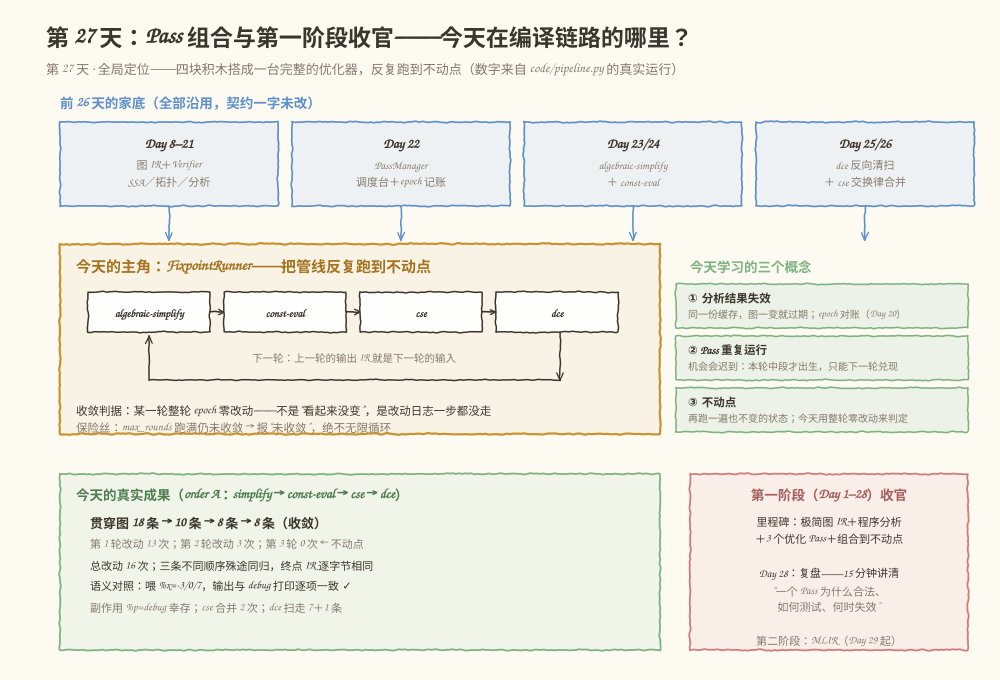
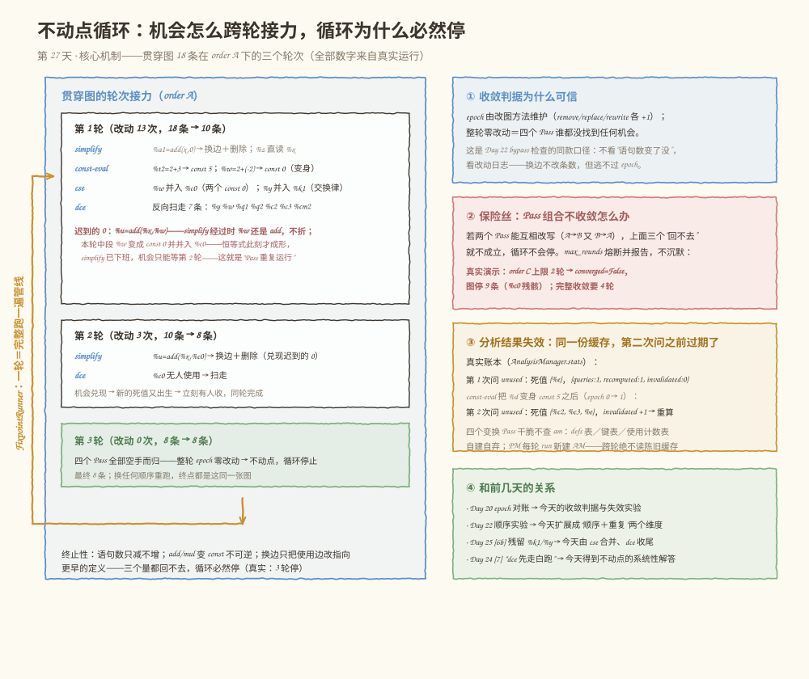
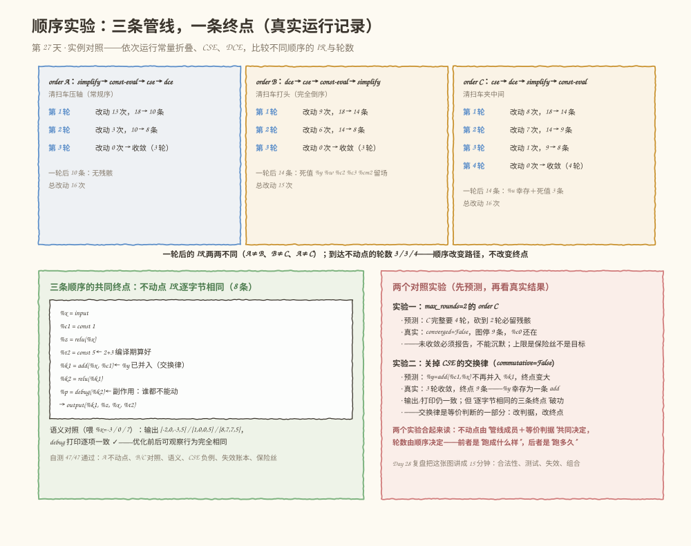

# 第 027 天：Pass 组合与阶段验收——把优化器跑到不动点

> **今日目标**：完成本教程后，你能说出今天三个概念的准确判据——分析结果失效（epoch 对账，账本记在 `queries`/`recomputed`/`invalidated` 三项里）、Pass 重复运行（机会会迟到：本轮中段才成形的机会，只能下一轮兑现）、不动点（整轮 epoch 零改动，而不是"看起来没变"）；解释为什么贯穿图 18 条语句在常规顺序下第一轮只到 10 条、`%u = add(%x, %c0)` 的恒等式要到第 2 轮才被兑现；用 `FixpointRunner` 把 `algebraic-simplify → const-eval → cse → dce` 跑到收敛（18 → 10 → 8 → 8，3 轮，总改动 16 次）；比较三种运行顺序的一轮结果（10 / 14 / 14 条，两两不同）、到达轮数（3 / 3 / 4）与共同终点（IR 逐字节相同的 8 条）；说清循环为什么必然停（三个"回不去"）以及 `max_rounds` 保险丝为什么必须存在；并跑通 47 项第一阶段集成测试。
> **预计时间**：学习 35 分钟 + 实践 55 分钟
> **前置准备**：Python 3（本教程用 3.11.4 实测，无第三方依赖）；Day 22 的 PassManager、Day 20 的 epoch 对账、Day 23/24/25 的三个优化 Pass——今天原样搬来；Day 26 的 CSE 四要素（见下方前置补给）。
> **今日产出**：`code/pipeline.py`（CSE 最小实现 ＋ FixpointRunner ＋ 贯穿图 ＋ 语义对照 ＋ 47 项集成测试）的真实运行记录，包含优化前后 IR、三条顺序的轮次表和语义对照结果。

## 1. 今天解决什么问题？

Day 24 顺序实验的最后一行留了一句话："顺序是管线语义的一部分，Day 27 的不动点来收尾。"今天兑现。

前面五天各交付了一块积木：调度台（Day 22）、代数化简（Day 23）、常量求值（Day 24）、死代码消除（Day 25）、公共子表达式消除（Day 26）。每块积木单测全绿。但把它们串起来只跑一遍，问题立刻浮出来——**一遍不够，而且换顺序结果不一样**：

- Day 24 [7] 已经预演过一次：`dce → const-eval` 的顺序会把常量求值制造出的死常量留在图里，因为清扫车已经开过去了；
- Day 25 的 [6b] 留下 `%k1` 和 `%y` 两个同一笔计算，等 CSE 合并后，被合并的那条又变成新的死值——谁在后面扫，谁才能收走；
- 更隐蔽的是"**迟到的机会**"：一条 `add(%x, %w)` 在第 1 轮开始时还不是恒等式（`%w` 还是个 add），轮到中段才被别的 Pass 变成 `add(%x, const 0)`——可恒等式化简的 Pass 已经走过去了。

于是有三个问题必须回答：**到底要跑几遍才算完？换个顺序会不会漏？怎么判断"完了"？** 这就是今天的三个学习目标：分析结果失效、Pass 重复运行和不动点。

贯穿全文的是这张 18 条语句的收官图——前几天的经典冗余齐聚一堂，外加一条"迟到的 0"：

```text
S1   %x    = input    : tensor<i32>
S2   %c0   = const 0    : tensor<i32>
S3   %c1   = const 1    : tensor<i32>
S4   %c2   = const 2    : tensor<i32>
S5   %c3   = const 3    : tensor<i32>
S6   %cm2  = const -2    : tensor<i32>
S7   %a1   = add(%x, %c0)    : tensor<i32>    ← 恒等冗余：add(x, 0)
S8   %z    = relu(%a1)    : tensor<i32>
S9   %t2   = add(%c2, %c3)    : tensor<i32>   ← 常量计算：2 + 3
S10  %w    = add(%c2, %cm2)    : tensor<i32>  ← 常量计算：2 + (-2) → 0
S11  %u    = add(%x, %w)    : tensor<i32>     ← 迟到的 0：恒等式本轮中段才成形
S12  %k1   = add(%x, %c1)    : tensor<i32>
S13  %k2   = relu(%k1)    : tensor<i32>
S14  %p    = debug(%k2)    : tensor<i32>      ← 副作用：谁都不能动
S15  %y    = add(%c1, %x)    : tensor<i32>    ← 交换律重复：与 %k1 同一笔计算
S16  %q1   = relu(%c3)    : tensor<i32>       ← 死链头
S17  %q2   = relu(%q1)    : tensor<i32>       ← 死链尾
S18    →   output(%y, %z, %u, %t2)
```

基线语义（喂 `%x=7`）：输出 `[8, 7, 7, 5]`，打印 `['[debug] %p(%k2) = 8']`——这是所有优化必须保持的可观察行为。

**术语先对齐**：Pass 管线（pipeline）指按固定顺序执行的一组 Pass；今天把执行一遍管线叫**一轮**（round）。不动点（fixpoint）指"再施加一次同样的变换也不变"的状态，数学上写作 `f(x) = x`；今天 `f` 是整条管线、`x` 是图。分析结果失效（analysis invalidation）指缓存的程序分析结果因图被修改而不再反映当前图。收敛（convergence）指循环逐步逼近不动点的过程。保险丝（fuse）指防止不收敛循环无限运行的上限机制。

**前置补给**：Day 26 的 CSE 四要素——**结构等价**（算子相同＋输入相同＋结果类型相同才算同一笔计算）、**属性等价**（常量按"值＋类型"比较：`const 5` 的 i32 和 i64 不是一回事）、**输入顺序**（add/mul 满足交换律可以排序比较，matmul 不行）、**副作用**（`debug` 这类算子执行时有可观察效果，合并会改变行为，一律不合并）。今天的 `code/pipeline.py` 自带这四要素的最小实现。Day 20 的 epoch——图的版本号，每次改图 +1，分析缓存靠它对账。

## 2. 先看全貌：今天的内容位于哪里？



**图 1**：看三个区域。顶部四张卡是前 26 天的家底（图 IR＋分析、PassManager、两个常量折叠 Pass、dce＋cse），全部原样搬来；中间琥珀色大框是今天的主角 `FixpointRunner`——四个 Pass 排成管线、带着回环箭头反复跑，右侧绿框是今天的三个学习概念；底部左边是真实成果（18 条 → 8 条，3 轮，语义对照全绿），右边是第一阶段里程碑和 Day 28 复盘的衔接。

全局流程五步，今天做第五步：

1. 前端把模型变成图 IR，配 Verifier（Day 8–14，已完成）；
2. 控制流、SSA、支配、活跃区间（Day 15–19，已完成）；
3. 分析做成组件，epoch 管失效（Day 20，已完成）；
4. Pass 接口＋PassManager 调度台＋四个优化 Pass（Day 22–26，已完成）；
5. **今天：把四个 Pass 组合成管线，重复运行到不动点，完成第一阶段集成验收。**

## 3. 核心概念：先用直觉，再给准确定义

### 3.1 分析结果失效：缓存的是快照，不是事实

一句通俗解释：程序分析的答案只对"提问那一刻的图"有效；图一变，答案就过期了。

- **一个类比**：食堂后厨打印了一张库存清单（"土豆还剩 3 箱"），厨师照着备菜。半小时后进货又卸了 5 箱——清单没变，但它已经不代表现状了。**对应到技术上是**：`UnusedAnalysis` 报告"哪些值无人使用"，这是对当时那张图的快照；`const-eval` 把 `%d = add(%c2, %c3)` 变身成 `const 5` 之后，`%c2`、`%c3` 的使用者凭空消失——死值名单从 1 个长成 3 个。类比的边界：人会记得"清单是几点打的、之后发生过什么"，编译器的缓存只记一个版本号——epoch 告诉你"过期了"，但不告诉你"哪里变了"；要新答案只能重算，不能增量修补（增量维护是 Day 25 减法维护的做法，那是变换 Pass 自己的事）。

今天的 [6] 节会把这笔账实打实打出来：`AnalysisManager.stats` 从 `{queries: 1, recomputed: 1, invalidated: 0}` 变成 `{queries: 2, recomputed: 2, invalidated: 1}`——问两次、真算两次、旧答案作废一次。

一个常见误解：失效不是"分析算错了"，而是"世界变了"。分析永远只对快照负责；负责发现"快照老了"的，是 Day 20 的 epoch 对账。还有一个工程推论：**今天的四个变换 Pass 干脆不查 AnalysisManager**——simplify/const-eval 进场自建 defs 表（改一次图重建一次）、cse 自建键表、dce 自建使用计数表（删除时 O(1) 减法维护）。变换中途改图太频繁，缓存进去只会反复作废；缓存分析的正确位置，是"多个只读使用者共享同一张快照"的场合。

### 3.2 Pass 重复运行：机会会迟到

一句通俗解释：把四个 Pass 按顺序跑一遍，可能制造出"只有本轮后面的 Pass 才能兑现、但它们已经下班了"的新机会——只能下一轮再来。

- **一个类比**：接力打扫。保洁员 A 负责收桌上的杯子，保洁员 B 负责擦桌子。A 从第 1 桌走到第 10 桌，期间有个客人刚放下杯子（第 3 桌）——A 已经走过去了，B 擦完第 3 桌只能绕过杯子擦。要干净，得再跑一圈。**对应到技术上是**：第 1 轮里 `algebraic-simplify` 排第 1 位，它走过 `S11 %u = add(%x, %w)` 时，`%w` 还是 `add(%c2, %cm2)`、不是常量，"值为单位元"这道门过不去（Day 23 门②）；排在第 2 位的 `const-eval` 这才把 `%w` 变成 `const 0`，排在第 3 位的 `cse` 又把它并入 `%c0`——等 `%u` 真正变成 `add(%x, const 0)`，恒等式才成形，而 simplify 早走过去了。这个机会只能由**第 2 轮**的 simplify 兑现。类比的边界：人可以回头补一下，Pass 的轮内执行是严格串行的一次遍历（遍历本身不回头，回头靠重复运行整轮）；也不是所有机会都迟到——`%a1 = add(%x, %c0)` 一开场就是恒等式，第 1 轮就被兑现了。

这就是"Pass 重复运行"的必要性：**一个 Pass 创造的机会，可能只有下一个轮次的另一个 Pass 才能兑现**。Day 24 [7] 的顺序实验只展示了"顺序影响一轮的结果"；今天加上重复运行，才把话说完整：顺序决定机会在哪一轮被谁兑现，重复运行保证迟到的机会不被遗漏。

### 3.3 不动点：再跑一遍也不变的状态

准确定义：把整条管线看作函数 `f`，图看作 `x`，不动点是满足 `f(x) = x` 的图。我们的判据：**某一轮从头到尾 epoch 零改动**。这不是"看起来没变"——epoch 由改图方法维护（`remove_statement` / `replace_all_uses` / `rewrite_statement` 各 +1，Day 22 的 bypass 检查靠它兜底），零改动意味着四个 Pass 谁都没找到任何机会。

- **一个类比**：摇晃一瓶浑水，然后静置。前几秒悬浮物还在沉降（每轮都有改动），某一刻起液体完全不变了（零改动）——你多看一分钟也不会再澄清。**对应到技术上是**：贯穿图在第 1 轮从 18 条变 10 条（改动 13 次）、第 2 轮变 8 条（改动 3 次）、第 3 轮零改动——不动点到达，循环停止。类比的边界：物理系统"天然"会停，编译器的循环需要论证会停。

**终止性（为什么敢循环）**：我们的四个 Pass 只做三类动作，每一类都在消耗一个"回不去"的量——

| 动作 | 谁在做 | 消耗什么 |
|---|---|---|
| 删语句 | dce | 语句数只减不增 |
| add/mul 变身 const | const-eval | add/mul 语句数只减不增（const 不会变回 add） |
| 换边（改读别的值） | simplify / cse | 使用边指向的定义位置只会前移（simplify 换成语句自己的另一个输入，cse 换成同键的更早出现者） |

三个量都单调、都非负、都有限，所以循环必然停——今天的真实运行是 3 轮停。反过来，如果两个 Pass 能互相改写（A→B 又 B→A），"回不去"就不成立，循环不会停——这正是 `max_rounds` 保险丝存在的理由：**宁可报"未收敛"，绝不无限循环**。[5] 节有真实演示：上限 2 轮的 order C 熔断，图停在 9 条。

三个概念的关系：3.1 是**轮内**的事实问题（事实会过期，靠 epoch 对账或自建事实）；3.2 是**轮间**的顺序问题（机会迟到，靠重复运行兜住）；3.3 是**整个循环**的停止问题（判据与终止性）。同一个 epoch 机制撑起三个答案。

## 4. 图解核心机制

有了三个概念，剩下的工程问题是：**轮与轮之间到底怎么接力？循环凭什么停？**先看图，再按编号讲。



**图 2**：看两个区域。左栏是贯穿图在常规顺序（order A：simplify → const-eval → cse → dce）下的三个轮次，玫红色那段是"迟到的 0"的完整接力链；琥珀色大回环是 FixpointRunner 本身。右栏四张卡：收敛判据为什么可信、保险丝什么时候熔断、分析失效的真实账本、今天与前几天的四处对接。按编号讲：

**① 第 1 轮的接力（改动 13 次，18 → 10 条）**。simplify 兑现开场的恒等式 `%a1`（换边＋删除，`%z` 直读 `%x`）；const-eval 把 `%t2 = 2+3` 和 `%w = 2+(-2)` 变身成 `const 5`、`const 0`（原地改写，语句数不变）；cse 做两次合并——`%w` 与 `%c0` 是两个 `const 0`（属性等价），`%y = add(%c1,%x)` 与 `%k1 = add(%x,%c1)` 交换律等价（结构等价＋输入顺序）；dce 反向扫走 7 条（`%y`、`%w`、`%q1`、`%q2`、`%c2`、`%c3`、`%cm2`——合并掏空的、变身失去输入的、天死的，一车全拉走）。

**② 迟到的 0（玫红部分）**。`%u = add(%x, %w)` 在第 1 轮 simplify 经过时不是恒等式；轮到中段，const-eval 变身 `%w`、cse 把它并入 `%c0`，`%u` 这才变成 `add(%x, %c0)`——机会本轮成形、本轮无人兑现。第 2 轮的 simplify 一进门就看到它：换边＋删除（兑现），顺带把 `%c0` 饿死（新的死值出生），紧跟其后的 dce 当轮收走——**机会兑现和新死值清理在同一个轮次里闭环**，这解释了为什么第 2 轮之后图就静了。

**③ 收敛判据为什么可信**。判据是"整轮 epoch 零改动"，不是"语句数没变"。换边（cse、simplify 的 `replace_all_uses`）不改变语句数——只数条数会漏掉这类改动；epoch 由改图方法统一维护，换边也逃不过。这是 Day 22 bypass 检查的同款口径。

**④ 保险丝**。终止性依赖三个"回不去"；若新加的 pattern 破坏单调性（比如两个规则互相改写），循环不会停。`max_rounds` 熔断并报告 `converged=False`——未收敛不等于错误，但必须报告，不能沉默。

**⑤ 分析失效的账本**。右栏③里那行 `{queries: 2, recomputed: 2, invalidated: 1}` 是真实运行：const-eval 改图之后，缓存的死值名单作废重算。变换 Pass 自建事实、PassManager 每轮 run 新建 AnalysisManager——上一轮的缓存绝无可能漏进下一轮（最朴素的失效策略：跨轮全作废；真实编译器做更细粒度的失效跟踪，比如 MLIR 的 AnalysisManager 会按 Pass 的"分析保留情况"逐个失效）。

## 5. 动手实践：完成一个最小可运行例子

### 5.1 准备文件

```text
tutorials/day-027/
├── README.md          ← 本教程
├── images/            ← 三张图
└── code/
    └── pipeline.py    ← 今天的演练场（自包含，无第三方依赖）
```

运行方式（在 `tutorials/day-027/` 目录下）：

```bash
python3 code/pipeline.py               # 演示主流程：[1]～[7]
python3 code/pipeline.py --self-test   # 47 项第一阶段集成测试，全部通过退出码 0
```

### 5.2 编写代码

`pipeline.py` 自包含：图外壳、`UnusedAnalysis`＋epoch 对账、`PassManager` 全部沿用 Day 22～25 的契约原样搬来（契约一字未改），Day 23/24/25 的三个 Pass 原样搬来，今天的增量是三块——`CsePass`（Day 26 规则的最小实现）、`FixpointRunner`（今天的主角）和贯穿图。先看主角：

```python
class FixpointRunner:
    """把一条 Pass 管线反复跑到不动点。"""

    def __init__(self, passes, max_rounds=10, title="fixpoint"):
        self.passes = list(passes)
        self.max_rounds = max_rounds
        ...

    def run(self, graph):
        self.rounds, self.converged = [], False
        pm = PassManager(print_ir="none", verbose=False, title=self.title)
        pm.add(*self.passes)                # 每轮 run 都新建 AnalysisManager
        for r in range(1, self.max_rounds + 1):
            epoch_before = graph.epoch
            stmts_before = len(graph.statements)
            ok = pm.run(graph)
            if ok is not True:              # 管线失败：原样上抛
                return False
            changes = graph.epoch - epoch_before
            self.rounds.append({"round": r, "changes": changes,
                                "before": stmts_before, "after": len(graph.statements),
                                "per_pass": [(e["name"], e["changes"]) for e in pm.log],
                                "ir": ir_dump(graph)})
            if changes == 0:
                self.converged = True       # 整轮零改动：不动点
                return True
        return True                         # 跑满上限——调用方看 self.converged
```

四个细节值得指出来。其一，**收敛判据是 `changes`（epoch 差值），不是语句数差值**——3.3 节的错误一会解释为什么这条底线不能让。其二，**每轮调用 `pm.run`**，而 Day 22 的 `PassManager.run` 每次都新建 `AnalysisManager`——跨轮的缓存作废由这个设计兜底。其三，轮与轮之间**唯一的通信介质是图本身**：上一轮的输出 IR 就是下一轮的输入 IR，没有别的隐藏状态。其四，`max_rounds` 跑满时 `run` 仍返回 True（管线本身没失败），但 `self.converged` 是 False——"未收敛"是报告事项，不是异常。

再看 CSE 的核心——四要素全部落在 `_key` 和排除规则里：

```python
class CsePass(Pass):
    name = "cse"

    def __init__(self, commutative=True):
        self.commutative = commutative      # 5.4 实验二：交换律关掉会怎样
        self.merges = []

    def run(self, graph, am):
        self.merges = []
        seen = {}                           # 键 → 首个出现者的结果名
        used = graph.used_at()              # 进场快照：谁还有使用者
        for stmt in graph.statements:
            op, res, inputs, info = stmt
            if res is None:                 # output 语句：没有结果，不参与
                continue
            key = self._key(stmt)
            if key is None:                 # 副作用/未知算子/解析不了的常量
                continue
            if key in seen:
                first = seen[key]
                if res in used:             # 有使用者才需要换边；死值归 dce
                    graph.replace_all_uses(res, first)
                    self.merges.append({"later": res, "first": first, "op": op})
            else:
                seen[key] = res
        return True

    def _key(self, stmt):
        op, res, inputs, info = stmt
        shape, dtype = info
        if is_const(op):
            val = const_value(op, dtype)
            if val is None:
                return None                 # 值解析不了的常量：不合并，最安全
            return ("const", val, dtype, shape)          # 属性等价：值＋类型
        if op in SIDE_EFFECT_OPS or op not in PURE_OPS:
            return None                     # 副作用/未知算子：门卫不猜语义
        if self.commutative and op in COMMUTATIVE_OPS:
            ins = tuple(sorted(inputs))     # 交换律：顺序无关
        else:
            ins = tuple(inputs)             # matmul 等：顺序就是语义
        return (op, ins, dtype, shape)      # 结构等价：算子＋输入＋结果类型
```

两个设计决定。其一，**合并只换边、不删语句**：被合并的重复语句变成死值，留给 dce 收走——每个 Pass 只做一件事，清扫统一归 dce（分工与 Day 25 [6b] 的约定一致）。工程后果：cse 之后图里留着"刚被掏空"的语句，dce 在管线里的位置决定了它们躺多久（5.3 的顺序实验会放大这一点）。其二，**后来的并入先来的**（first occurrence wins）：先出现者是所有等价计算的代表，`replace_all_uses` 把后来者的使用者全部迁移过去；如果后来者没有使用者，无事可换，跳过（死值归 dce）。（上面的 `FixpointRunner` 摘录省略了 `__init__` 和轮次表打印等辅助方法；simplify/const-eval/dce 三个 Pass 的完整实现见 `code/pipeline.py`，与 Day 23/24/25 逐行同源。）

### 5.3 运行与观察

以下全部是 `python3 code/pipeline.py` 的真实运行记录（Python 3.11.4，Linux）。

**[1] 贯穿图与基线**：18 条语句如 [1] 节所列，喂 `%x=7` 得到输出 `[8, 7, 7, 5]`、打印 `['[debug] %p(%k2) = 8']`——这是语义对照的基准。

**[2] 一轮为什么不够**：用 order A 跑一轮（`print_ir="change"`，每个 Pass 跑完打印 IR——IR 全文太长，这里只摘每个 Pass 的记账行和动作摘要）：

```text
--- [1/4] algebraic-simplify    // 修改 2 次，语句 18→17：%a1 换边＋删除，%z 直读 %x
--- [2/4] const-eval            // 修改 2 次，语句 17→17：%t2 变身 const 5、%w 变身 const 0
--- [3/4] cse                   // 修改 2 次，语句 17→17：%w 并入 %c0、output 改读 %k1
--- [4/4] dce                   // 修改 7 次，语句 17→10
== 管线完成：4 个 Pass 全部成功，图停在 epoch 13 ==
```

第 1 轮结束的 IR（10 条）：

```text
  S1   %x    = input    : tensor<i32>
  S2   %c0   = const 0    : tensor<i32>
  S3   %c1   = const 1    : tensor<i32>
  S4   %z    = relu(%x)    : tensor<i32>
  S5   %t2   = const 5    : tensor<i32>
  S6   %u    = add(%x, %c0)    : tensor<i32>      ← 迟到的 0，还在
  S7   %k1   = add(%x, %c1)    : tensor<i32>
  S8   %k2   = relu(%k1)    : tensor<i32>
  S9   %p    = debug(%k2)    : tensor<i32>
  S10    →   output(%k1, %z, %u, %t2)
```

对着 S6 读一遍 3.2 节的接力链：simplify 第 1 轮经过 `%u` 时它还是 `add(%x, %w)`；const-eval 中段把 `%w` 变成 `const 0`；cse 把 `%u` 的输入从 `%w` 换成 `%c0`——现在它是不折不扣的 `add(%x, const 0)`，但 simplify 已经下班。**单轮到此为止，这就是"Pass 重复运行"的现场证据。**

**[3] 正戏：跑到不动点**。`FixpointRunner` 接管，轮次表是今天最重要的一张账单：

```text
  order A：algebraic-simplify → const-eval → cse → dce
  第 1 轮：改动 13，语句 18 → 10（algebraic-simplify×2  const-eval×2  cse×2  dce×7）
  第 2 轮：改动  3，语句 10 → 8（algebraic-simplify×2  dce×1）
  第 3 轮：改动  0，语句 8 → 8（四个 Pass 全部空手而归）  ← 收敛：整轮 epoch 零改动
run() 返回 True；converged = True，共 3 轮（前 2 轮有改动），总改动 16 次
```

第 2 轮的三次改动正是 [2] 的兑现：simplify 两次（`%u` 换边＋删除）、dce 一次（`%c0` 饿死被扫走）。最终 8 条：

```text
  S1   %x    = input    : tensor<i32>
  S2   %c1   = const 1    : tensor<i32>
  S3   %z    = relu(%x)    : tensor<i32>
  S4   %t2   = const 5    : tensor<i32>
  S5   %k1   = add(%x, %c1)    : tensor<i32>
  S6   %k2   = relu(%k1)    : tensor<i32>
  S7   %p    = debug(%k2)    : tensor<i32>
  S8     →   output(%k1, %z, %x, %t2)
```

语义对照收尾（三组喂入，输出和打印两样都对照）：

```text
语义对照（喂 %x=-3）：输出 [-2, 0, -3, 5] == [-2, 0, -3, 5]，打印 ['[debug] %p(%k2) = 0'] == ['[debug] %p(%k2) = 0'] → 一致 ✓
语义对照（喂 %x=0）：输出 [1, 0, 0, 5] == [1, 0, 0, 5]，打印 ['[debug] %p(%k2) = 1'] == ['[debug] %p(%k2) = 1'] → 一致 ✓
语义对照（喂 %x=7）：输出 [8, 7, 7, 5] == [8, 7, 7, 5]，打印 ['[debug] %p(%k2) = 8'] == ['[debug] %p(%k2) = 8'] → 一致 ✓
```

**[4] 顺序实验：三条管线，一条终点**。学习计划要求"依次运行常量折叠、CSE、DCE，比较不同顺序的 IR"。三条顺序：A（常规：清扫车压轴）、B（完全倒序：清扫车打头）、C（清扫车夹中间）。真实轮次表：

```text
  order B：dce → cse → const-eval → algebraic-simplify
  第 1 轮：改动  9，语句 18 → 14（dce×2  cse×1  const-eval×2  algebraic-simplify×4）
  第 2 轮：改动  6，语句 14 → 8（dce×6）
  第 3 轮：改动  0，语句 8 → 8（四个 Pass 全部空手而归）  ← 收敛：整轮 epoch 零改动

  order C：cse → dce → algebraic-simplify → const-eval
  第 1 轮：改动  8，语句 18 → 14（cse×1  dce×3  algebraic-simplify×2  const-eval×2）
  第 2 轮：改动  7，语句 14 → 9（cse×1  dce×4  algebraic-simplify×2）
  第 3 轮：改动  1，语句 9 → 8（dce×1）
  第 4 轮：改动  0，语句 8 → 8（四个 Pass 全部空手而归）  ← 收敛：整轮 epoch 零改动

一轮后的条数：A=10，B=14，C=14
一轮后的 IR 两两不同：A≠B True，A≠C True，B≠C True
不动点的 IR 逐字节相同：True——顺序改变的是路径（哪一轮谁干活），不改变终点（同一张 8 条的最简图）
```

对着 order B 第 1 轮结束的 IR（14 条）看"残骸现场"：

```text
  S7   %z    = relu(%x)    : tensor<i32>
  S8   %t2   = const 5    : tensor<i32>
  S9   %w    = const 0    : tensor<i32>       ← 死值：使用者 %u 已被 simplify 删除
  S13  %y    = add(%c1, %x)    : tensor<i32>  ← 死值：使用者已被 cse 换走
  S14    →   output(%k1, %z, %x, %t2)
死值 %y、%w、%c2、%c3、%cm2 躺在图里——dce 在本轮第一位，此后再没人扫
```

三个观察。**B 的一轮残骸最多**：dce 打头只扫掉天死的 `%q1`、`%q2`，本轮后半段 cse/simplify 制造的死值没人收，全趴到第 2 轮开头（dce×6）。**B 的"迟到的 0"却在第 1 轮就兑现了**：simplify 压轴，轮到它时 const-eval 已经把 `%w` 变成 `const 0`——同一张图，order A 里 `%u` 活到第 2 轮，order B 里第 1 轮就蒸发，机会在哪一轮被兑现由顺序决定。**C 要 4 轮**：dce 夹在中间，第 2 轮 simplify 删除 `%u` 之后 `%c0` 才饿死，只能等第 3 轮的 dce（`dce×1`）。但三条路径殊途同归——**终点 IR 逐字节相同**。



**图 3**：看三块。上排三列是 A/B/C 的轮次表和一轮残骸清单——注意 B/C 一轮后都是 14 条但内容不同（B 里 `%u` 已删、`%y` 还躺着；C 里恰好相反）。左下是三条顺序的共同终点（8 条，逐字节相同）加语义对照；右下是 5.4 的两个参数实验。看图时问自己：如果只跑一轮、只对照 A 的结果，你会得出"B 和 C 是坏顺序"的结论吗？（会——而 FixpointRunner 把"坏顺序"的代价从"结果错误"降级成"多跑一轮"。）

**[5] 保险丝**：把 order C 的上限砍到 2 轮：

```text
  order C（上限 2 轮）：cse → dce → algebraic-simplify → const-eval
  第 1 轮：改动  8，语句 18 → 14
  第 2 轮：改动  7，语句 14 → 9
  *** 跑满 2 轮仍未收敛——保险丝熔断，图停在 9 条
run() 返回 True；converged = False——图停在 9 条，
残骸：%c0（完整收敛要 4 轮）——未收敛不等于错误，但必须报告，不能沉默
```

**[6] 分析结果失效的账本**：3.1 节的类比，真实数字如下：

```text
第 1 次询问 unused：死值 ['%e']，stats = {'queries': 1, 'recomputed': 1, 'invalidated': 0}，epoch = 0
const-eval 之后第 2 次询问：死值 ['%c2', '%c3', '%e']，stats = {'queries': 2, 'recomputed': 2, 'invalidated': 1}，epoch = 1
```

`%d = add(%c2, %c3)` 变身 `const 5` 之后，`%c2`、`%c3` 的使用者没了——死值从 1 个长成 3 个。缓存里的旧答案还在，epoch 对账发现过期（`invalidated +1`），只能重算。

**[7] 负例回归**：合并与删除都不越界——两个 `debug(%k2)` 合并 0 次（合并会少打印一行）、`matmul(%a,%b)` 与 `matmul(%b,%a)` 合并 0 次（顺序就是语义）、`const 5` i32 与 `const 5` i64 合并 0 次（类型是键的一部分）。加上 47 项集成测试（`--self-test`）全绿，第一阶段收口。

### 5.4 修改一个参数再观察

两个低成本实验，都是"先预测、再看结果"：

**实验一（掐断循环）**：把 `max_rounds` 从 10 改成 2，跑 order C。预测：C 完整要 4 轮，砍到 2 轮必然留残骸。真实结果就是 [5] 的输出：`converged = False`，图停 9 条，`%c0` 还在。再补一刀：上限 3 轮时图已经到 8 条、内容上完全优化，但第 3 轮还有 1 次改动（`dce×1`），所以仍不算收敛、还要第 4 轮确认——**收敛判据是"整轮零改动"，不是"看起来最优"**。

**实验二（动等价判据）**：把 `CsePass(commutative=False)` 接进 order A。预测：`%y = add(%c1, %x)` 不再并入 `%k1`，两条 add 都活着，终点变大。真实结果：

```text
  order A（无交换律）：algebraic-simplify → const-eval → cse → dce
  第 1 轮：改动 11，语句 18 → 11（algebraic-simplify×2  const-eval×2  cse×1  dce×6）
  第 2 轮：改动  3，语句 11 → 9（algebraic-simplify×2  dce×1）
  第 3 轮：改动  0，语句 9 → 9（四个 Pass 全部空手而归）  ← 收敛：整轮 epoch 零改动
```

终点 9 条——`%y` 幸存为一条 `add(%c1, %x)`，与 `%k1` 隔排相望；语义对照仍然一致（输出 `[8, 7, 7, 5]`，打印不变），但"三条顺序逐字节相同的终点"破功了（A 自己也变了）。两个实验合起来读：**轮数由顺序决定，不动点由"管线成员＋等价判据"共同决定**——前者是"跑多久"，后者是"跑成什么样"。

## 6. 常见错误与排查

**错误一：拿"语句数没变"当收敛判据。**
现象：自己写循环时用 `len(statements)` 前后相等来判停；某轮 cse 做了 2 次换边（图实质变了），循环却停了，优化后的 IR 里留着没合并完的重复。原因：换边不改变语句数——`replace_all_uses` 只改使用者的输入列表，epoch +1 但条数不动；Day 22 的 bypass 检查查的就是这个方向的漏洞（条数变了 epoch 没动），反方向（epoch 动了条数没动）同样会骗过条数判据。定位：`change_log` 里有"换边：N 条语句改读 …"的条目，但你的判停条件已经提前退出。修复：判据换成 `graph.epoch` 的差值——`FixpointRunner.run` 里的 `changes = graph.epoch - epoch_before`。

**错误二：跑了一遍管线就交付。**
现象：`pm.run(graph)` 一次之后图里还有 `%u = add(%x, %c0)` 和死值（5.3 [2] 的 10 条现场），下游拿到带冗余的 IR；或者对着 order B 一轮后的 14 条残骸以为 CSE 没生效。原因：单轮 ≠ 不动点——机会会迟到（3.2 节），残骸要等下一轮的 dce（[4] 的 B/C 现场）。这是 Day 24 [7] 顺序实验暴露的问题的系统性版本：不重复运行，任何顺序都会漏。定位：跑第二遍看图还变不变，或直接看 epoch——还在动就是没到不动点。修复：`FixpointRunner`＋确认 `converged`；交付前跑 `same_behavior`。

**错误三：CSE 的键忘了排除副作用算子，两个 `debug` 被合并。**
现象：优化后运行期打印从 2 行变成 1 行，输出值完全正常；IR 看起来"更优"了（少了一条语句）。原因：键只看了"算子相同＋输入相同"，没查副作用——合并 `debug(%k2)` 和 `debug(%k2)` 意味着第二行的打印永远不发生，可观察行为变了（Day 25 事故的 CSE 版）。定位：`same_behavior` 判 False 且差在打印行（输出一致、`d1 != d2`）——这就是为什么语义对照必须两样一起做；对着 `--self-test` 的 D 组跑，"两个 debug 不合并"那条会红。修复：`_key` 里 `if op in SIDE_EFFECT_OPS or op not in PURE_OPS: return None`——副作用和未知算子一律不参与合并（5.3 [7] 的真实演示：合并 0 次）。

**错误四：互相改写的 Pass 组合，没有保险丝。**
现象（构造性反例）：新加两个 Pattern——`Relu(Relu(x)) → Relu(x)` 和一个假想的"Relu 展开" `Relu(x) → Relu(Relu(x))`（假设某天为了触发向量化加了它）——循环永远不停，编译器卡死。原因：终止性依赖三个"回不去"（3.3 节的表），互相改写让"add/mul 数只减不增"类的单调量失效。定位：轮次表里每一轮的 `changes` 恒不为零、且不随轮数下降。修复：`max_rounds` 保险丝＋收敛报告；根治靠审查 Pattern 的方向性——每条规则必须消耗某个单调量（MLIR 的 Canonicalizer 同样把规范化 Pattern 贪心地跑到不动点，靠的也是 Pattern 集合的单调性）。

## 7. 今日练习

### 必做练习：第四条顺序 order D，先预测再验证

把 cse 挪到 const-eval 之前，构造 order D：`algebraic-simplify → cse → const-eval → dce`。在贯穿图上先写下三个预测，再用 `FixpointRunner` 验证：

1. `%y` 还能在第 1 轮并入 `%k1` 吗？（提示：交换律合并需要常量吗？）
2. `%w → %c0` 的常量合并（5.3 [2] 里 cse 的第 1 次合并）还会发生吗？`%c0` 的命运在 D 和 A 里有何不同？（提示：D 里谁在第 1 轮用 `%c0`？const-eval 折走 `%w` 的输入之后呢？）
3. 到达不动点要几轮？终点和 order A 逐字节相同吗？

然后补至少两条自测（D 的到达轮数、D 的终点与 A 相同），`--self-test` 全绿。预期产出：预测记录＋真实轮次表＋新增自测。想深一层：对比 D 和 A 第 1 轮结束时的 IR——条数可能相同、内容未必相同（哪些值活着、哪些值已经没了？），再想想这印证了"顺序改变路径、不改变终点"的哪一半。

### 选做挑战：随机图 × 三条顺序的收敛性扫描

把今天的结论从一张图推广开：写一个随机图生成器（固定随机种子），每张图随机撒四类冗余——恒等 `add(x, 0)`、常量计算链 `add(const, const)`、交换律重复对、无人使用的死链，外加一个 `debug`，规模 15～30 条。对每张图跑三条顺序，记录三件事：

1. 是否全部收敛（`converged` 为 True）；统计到达轮数的分布；
2. 三条顺序的终点 IR 是否逐字节相同；
3. 每张图的 `same_behavior` 是否通过（输出＋打印）。

如果 100 张图全部通过，你的结论就从"一张图上成立"升级成"这套 Pass 组合的一贯性质"；如果找到反例（某张图上两条顺序终点不同），恭喜——保存它，那是 Day 28 复盘和后续 MLIR Canonicalization 学习的好材料，也是"顺序不只是效率问题"的最硬证据。

## 8. 今日验收

- [ ] 我能不看资料说出三个概念的判据：分析结果失效（epoch 对账，账本三项 `queries`/`recomputed`/`invalidated`）、Pass 重复运行（机会会迟到，本轮中段成形的机会下一轮兑现）、不动点（整轮 epoch 零改动，不是"看起来没变"）；
- [ ] 我能运行 `code/pipeline.py`，指着 [3] 的轮次表讲清"迟到的 0"的完整接力链（simplify 走过 → const-eval 变身 → cse 并入 → 第 2 轮 simplify 兑现 → 同轮 dce 收尾）；
- [ ] 我能解释循环为什么必然停（删语句、变 const、换边指早——三个"回不去"），以及 `max_rounds` 保险丝防的是什么；
- [ ] 我能说清顺序实验改变了什么（一轮后的条数 10/14/14、到达轮数 3/3/4、每轮谁干活）、没改变什么（终点 IR 逐字节相同、语义对照全绿）；
- [ ] 我完成了 5.4 至少一个参数实验，并且是先预测、后对照真实结果（`max_rounds=2` 或 `commutative=False`）；
- [ ] 我保存了 `pipeline.py` 和 47/47 的集成测试记录——Day 28 复盘要拿它回答"一个优化 Pass 为什么合法、如何测试、何时失效"。

## 9. 一句话总结与明天预告

今天的问题是"四个各自正确的 Pass 串起来怎么保证跑得完、跑得对"；概念是三件套——分析结果失效靠 epoch 对账（账本 2/2/1）、Pass 重复运行兜住迟到的机会（`%u` 的恒等式第 2 轮兑现）、不动点用整轮零改动判定（终止性靠三个"回不去"，保险丝防互相改写）；实践是 `FixpointRunner` 把 `algebraic-simplify → const-eval → cse → dce` 跑到收敛（18 → 10 → 8 → 8，3 轮，总改动 16 次），三条顺序殊途同归（终点逐字节相同，轮数 3/3/4），两个参数实验划清了"顺序决定轮数、判据决定终点"的边界；验证是三组喂入的输出＋打印语义对照和 47 项集成测试全绿。明天 Day 28 是第一阶段复盘：用 15 分钟脱稿讲清这台最小编译器——从 Tensor 到图 IR、从分析到四个 Pass、从单轮到不动点——并把讲不清楚的地方记下来，那就是第二阶段（Day 29 起，MLIR）要带走的行李。
