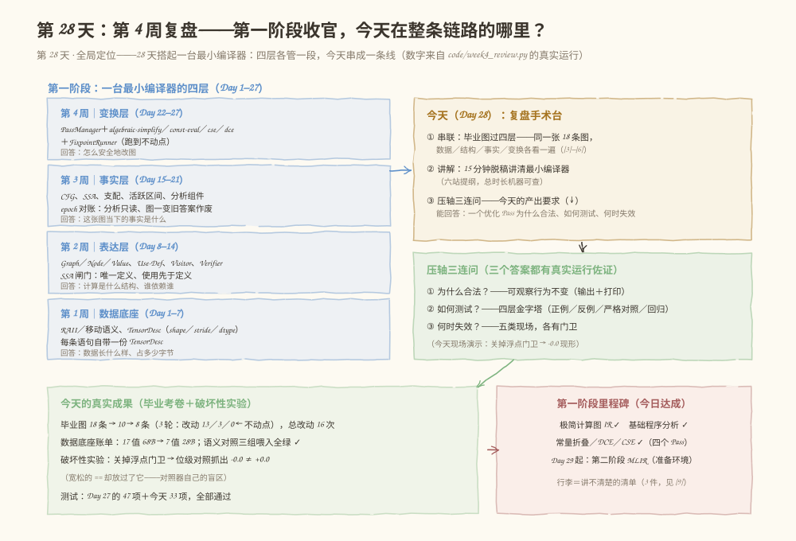
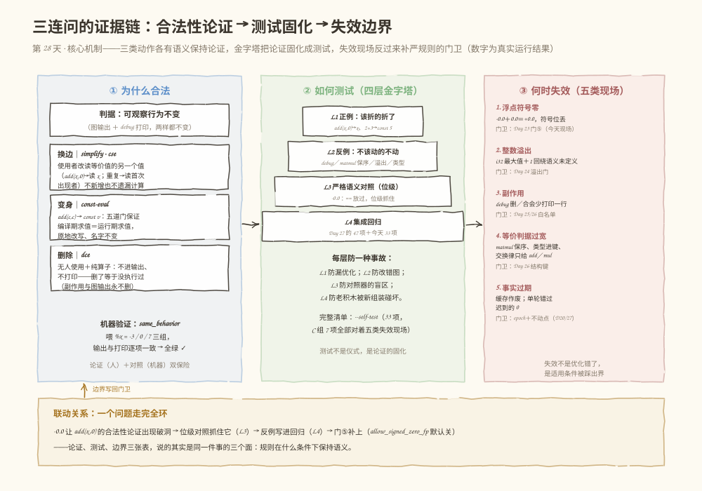
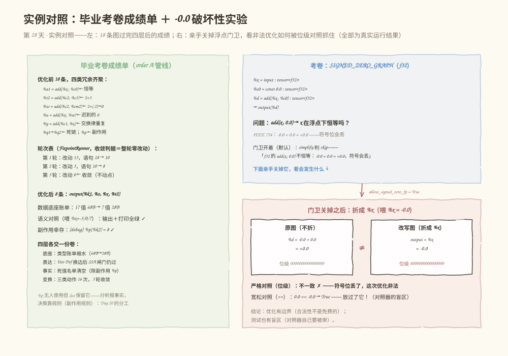

# 第 028 天：第 4 周复盘——15 分钟讲清最小编译器，答好"合法·测试·失效"三连问

> **今日目标**：完成本教程后，你能不看笔记说出第一阶段的四层关系——数据底座（每条语句自带一份 TensorDesc：毕业图 17 个值、朴素分配 68B）、表达层（SSA＋Use-Def＋Verifier：`%x` 被 4 处使用、`%q1` 的死要等两刀）、事实层（分析只读＋epoch 对账：死值名单 `{%p, %q2}`，但 `%p` 不能删）、变换层（四个 Pass＝换边／变身／删除三类动作，18 → 8 条、3 轮收敛）；按六站提纲用 15 分钟脱稿讲清这台最小编译器，并把讲不清楚的地方记成行李清单；用真实运行回答压轴三连问——为什么合法（三类动作各有一条语义保持论证，三组喂入的语义对照全绿）、如何测试（正例／反例／严格语义对照／集成回归四层金字塔，47＋33 项）、何时失效（五类现场：浮点符号零、整数溢出、副作用、等价判据过宽、事实过期）；并亲手做一次破坏性实验：关掉 Day 23 的浮点门卫，看 `-0.0` 如何让"恒等式"破洞、位级对照如何抓住它、而宽松的 `==` 为什么放过它。
> **预计时间**：学习 35 分钟 ＋ 实践 55 分钟（含 15 分钟口头讲解）
> **前置准备**：Python 3（本教程用 3.11.4 实测，无第三方依赖）；Day 22–27 的 PassManager、四个优化 Pass、FixpointRunner——今天原样搬来，契约一字未改；纸笔或手机录音（15 分钟讲解用）。
> **今日产出**：一次真实完成的 15 分钟讲解（录音或提纲笔记）和一份"讲不清楚清单"；`code/week4_review.py`（四层串联＋三连问证据＋破坏性实验＋33 项自测）的真实运行记录；一页复盘和压轴题的标准回答。

## 1. 今天解决什么问题？

Day 27 收官时留了一句预告："明天 Day 28 是第一阶段复盘：用 15 分钟脱稿讲清这台最小编译器——从 Tensor 到图 IR、从分析到四个 Pass、从单轮到不动点——并把讲不清楚的地方记下来，那就是第二阶段（Day 29 起，MLIR）要带走的行李。"今天兑现。

第一阶段的 27 天攒了一台完整的最小编译器，但零件散在四个演练场里：Week 1 的 Tensor 在 C++ 工程，Week 2 的图 IR 各自为政，Week 3 的分析是一堆 Python 脚本，Week 4 的四个 Pass 挤在 Day 27 的 `pipeline.py` 里。**零件齐全不等于讲得清楚**——学习计划今天只考三件事：

- **学习**：回顾从 Tensor 到图 IR、程序分析和优化 Pass 的完整关系——四层怎么咬合；
- **实践**：用 15 分钟口头讲解自己的最小编译器，记录讲不清楚的地方；
- **产出**：阶段总结；能回答"一个优化 Pass 为什么合法、如何测试、何时失效"。

第三条就是今天的**压轴三连问**。它不是背诵题——三个问题各有一份真实运行做证据，其中"何时失效"还要你亲手搞一次破坏。

贯穿全文的例子还是那张 18 条的收官图（Day 27 的 `INTEGRATION_GRAPH`，今天改叫**毕业考卷**）：四类冗余（恒等 `add(%x,%c0)`、常量计算 `2+3` 和 `2+(-2)`、交换律重复 `add(%x,%c1)/add(%c1,%x)`、死链 `%q1→%q2`）＋ 副作用 `%p` ＋ 一条"迟到的 0"。喂 `%x=7` 的基线语义：输出 `[8, 7, 7, 5]`、打印 `['[debug] %p(%k2) = 8']`——所有优化必须保持这两样。

**术语先对齐**：复盘（retrospective）指把散落的知识在同一张图上重新过一遍，而不是把目录再念一遍；**可观察行为**（observable behavior）指图输出＋副作用打印这两样从外面看得见的东西，它是"语义不变"的判据；**语义保持**（semantics preservation）指变换前后可观察行为不变的性质；**位级对照**（bit-exact comparison）指浮点输出按位模式（bit pattern）比较而不是用 `==`——今天你会看到这两者的差别值一个符号位；**回归**（regression）指改动之后老功能是否仍然通过的那类测试。

**前置补给**（三句话，细节回看原天）：Day 23 的**五道门**——simplify 折 `add(x,0)` 前要过纯算子／值恰为单位元／类型对齐／shape 对齐／浮点特判五关，第五关挡的就是 `-0.0`；Day 25 的**判定表**——dce 对每条语句按"图输出／图输入／有使用者／副作用／纯算子"给保留或删除的判定；Day 26 的**结构键**——CSE 用（算子， 输入， 结果类型）当等价判据，常量按"值＋类型"进键、add/mul 按交换律排序输入、matmul 保序。

## 2. 先看全貌：今天的内容位于哪里？



**图 1**：看三个区域。左边是第一阶段的四层大楼——从下往上：数据底座（Day 1–7，回答"数据长什么样"）、表达层（Day 8–14，回答"计算是什么结构"）、事实层（Day 15–21，回答"图当下的事实是什么"）、变换层（Day 22–27，回答"怎么安全地改图"）；右上琥珀色是今天的复盘手术台（串联＋讲解＋三连问），右下绿色是三连问的三个答案方向；底部左边是今天的真实成果（毕业考卷 18 → 8 条、68B → 28B、破坏性实验、80 项测试），右边是第一阶段里程碑和第二阶段（MLIR）的衔接。

全局路线五步，今天走完第五步：

1. **Week 1**：C++、RAII、移动语义、最小 Tensor——数据的底座（已完成）；
2. **Week 2**：Graph／Node／Value、Use-Def、Verifier——计算的表达（已完成）；
3. **Week 3**：CFG、SSA、支配、活跃区间、分析组件——图的事实（已完成）；
4. **Week 4**：PassManager、四个优化 Pass、FixpointRunner——安全的变换（Day 22–27 已完成）；
5. **今天（Day 28）**：四层串成一条线＋15 分钟讲解＋压轴三连问——第一阶段收官；明天起进入第二阶段（MLIR）。

## 3. 核心概念：四层关系与压轴三连问

复盘日的规矩（同第 7、14、21 天）：只收拢、不扩张——四层和三问全部在**同一张毕业考卷**上营业。

### 3.1 四层关系：一张图，四次注视

一句通俗解释：最小编译器的四个星期，分别回答关于同一张图的四个问题——数据长什么样、计算是什么结构、图的事实是什么、怎么安全地改。

- **一个类比**：四层像一栋楼——数据底座是地基（每块材料多长多宽）、表达层是框架图（谁承重谁悬空）、事实层是每次巡检的报告（今天哪盏灯没亮）、变换层是照着报告施工的施工队。**对应到技术上是**：`TensorDesc` 的 (shape, dtype) 活在每条语句的 `info` 字段里（毕业图 17 个值、每个 4B、朴素分配 68B）；结构由 SSA＋Use-Def 表达（`%x` 被 S7/S11/S12/S15 四处使用）；事实由只读分析报告（死值名单 `{%p, %q2}`）；变换是四个 Pass 的三类动作（换边／变身／删除）。**类比的边界**：楼盖好就不动了，图每被改一次，巡检报告就过期——所以事实层和变换层之间需要 epoch 对账（Day 20），变换层内部需要不动点循环（Day 27）。这是楼没有的性质。

四层在毕业考卷上的落点，一张表收拢：

| 层 | 回答的问题 | 毕业考卷上的落点 | 翻车点（哪天踩过） |
|---|---|---|---|
| 数据底座 | 数据长什么样、占多少字节 | 17 个值全部 `tensor<i32>` 标量，朴素分配 68B | Shape／Stride／Dtype 分不清（Day 4） |
| 表达层 | 计算是什么结构、谁依赖谁 | Use-Def 账本：`%x` 4 处使用、`%q1` 只有 S17 一个使用者 | 删节点不动 Use-Def（Day 10） |
| 事实层 | 图**当下**的事实是什么 | 死值名单 `{%p, %q2}`——注意 `%p` 无人使用但**不能**删 | 分析改图／缓存过期（Day 20） |
| 变换层 | 怎么安全地改 | 三类动作 16 次、3 轮收敛 18 → 8 条 | 单轮不够、顺序敏感（Day 27） |

表里最值得盯的一行是事实层的落点：**`%p` 在死值名单里，但 dce 的判定表保留它**。分析只报事实（"没人读它"），删不删由变换层的规则决定（"它有副作用"）——这就是 Day 20 定下的"分析与变换分离"在一张具体图上的样子。5.3 的 [4]–[5] 会把这笔账真实打出来。

### 3.2 三连问之一：一个优化 Pass 为什么合法？

一句通俗解释：合法不是"图变简单了"，是"从外面看，程序的行为一点没变"。

- **判据**：**可观察行为不变**——图输出和副作用打印，两样都不变。少一条语句、图更"干净"，都不算数：把两个 `debug(%k2)` 合并图会更小，但打印从两行变一行——不合法。
- **论证**：四个 Pass 只做三类动作，每类各有一条语义保持论证——**换边**（simplify／cse：使用者改读等价的另一个值，Use-Def 重定向，不新增也不遗漏计算）、**变身**（const-eval：`add(c,c)→const v`，五道门保证编译期求值＝运行期求值）、**删除**（dce：无人使用＋纯算子＝不产生任何可观察效果）。
- **机器验证**：论证是人写的，会错——所以每个论证配一份 `same_behavior`（同输入跑优化前后两张图，对照输出＋打印）。5.3 的 [7] 里三组喂入全绿，是人证加机证的双保险。

### 3.3 三连问之二：如何测试？

一句通俗解释：测试是论证的固化——每条"为什么合法"的论证，都该有一条测试守着；每类"会踩的坑"，都该有一个反例把坑盖上。

四层金字塔（自下而上）：**L1 正例**（该折的折了：`add(x,0)→x`、`2+3→const 5`）、**L2 反例**（不该动的坚决不动：debug／matmul 保序／溢出／类型不匹配，动作次数必须是 0）、**L3 严格语义对照**（输出＋打印，浮点看位级）、**L4 集成回归**（老积木没被新组装碰坏：Day 27 的 47 项＋今天 33 项）。

一个容易忽略的事实：**测试器自己也有盲区**。Python（IEEE 754）里 `0.0 == -0.0` 是 `True`——如果语义对照只用 `==`，符号位的差异会被放过。今天的 `strict_same_behavior` 把浮点输出按位模式比较，就是这个教训的修复（5.4 现场演示）。

### 3.4 三连问之三：何时失效？

一句通俗解释：失效不是"优化错了"，是"规则的适用条件被踩出界"——每条重写规则都带着看不见的括号，括号里写着适用范围。

五类现场（每类都有门卫，详见 5.3 [8] 的真实清单）：**浮点符号零**（`add(x,0)→x` 在浮点下因为 `-0.0` 不恒等，门卫是 Day 23 的第五道门）、**整数溢出**（i32 下 `2147483647+1` 回绕语义未定义，门卫是 Day 24 的溢出门）、**副作用**（debug 删了合了都少打印，门卫是 Day 25/26 的白名单）、**等价判据过宽**（matmul 保序、常量类型进键、交换律只给 add/mul，门卫是 Day 26 的结构键）、**事实过期**（缓存的分析答案随图改动作废、单轮管线错过迟到的机会，门卫是 Day 20 的 epoch 对账＋Day 27 的不动点）。

三个问题的关系：**论证**（为什么合法）划出规则成立的世界，**测试**（如何测试）把论证固化成防线，**边界**（何时失效）标记世界的围墙——围墙外的事故反哺回来，就成了新的一扇门。今天 [8] 的 `-0.0` 会把这三句话走成一个完整的环。

## 4. 图解核心机制

有了概念，剩下的工程问题是：**三连问的证据链到底怎么咬合？**先看图，再按编号讲。



**图 2**：三个面板各管一问。左（蓝）是"为什么合法"——判据是可观察行为不变，三类动作各有论证，底部是三组喂入的机器验证；中（绿）是"如何测试"——四层金字塔，每层防一种事故，注意 L3 的注释正是 `-0.0` 教训；右（红）是"何时失效"——五类现场和各自的门卫；底部琥珀色是联动关系。按编号讲：

**① 三类动作 × 论证**。换边是 Use-Def 重定向：`add(x,0)` 的使用者改读 `x`，计算一笔不多一笔不少；变身是原地改写：名字不变、使用者一行不用改，五道门保证编译期和运行期算出同一个值；删除有最硬的前提：无人使用＋纯算子——不进输出、不打印，删了等于从没执行过。**论证的落点是判据不是观感**：图看起来更简单从来不构成合法性证据。

**② 金字塔的层次分工**。L1 防漏优化（该折的没折，优化器白写）；L2 防改错图（不该动的动了，语义当场破）；L3 防对照器盲区（`==` 放过 `-0.0`，位级不放）；L4 防组装事故（每个 Pass 单测全绿，串起来照样可能坏——Day 27 的顺序实验就是证据）。**四层的共同点**：都从"论证"里来——每条测试背后都该能指着 ① 里的一条论证说"我守的是它"。

**③ 五类现场 × 门卫**。每一类失效都对应一扇已经装好的门：门⑤、溢出门、副作用白名单、结构键、epoch＋不动点。**门卫的存在方式各不相同**——有的是 skip（simplify 对 f32 的 `add(x,0)` 敬而远之）、有的是拒折（const-eval 对溢出）、有的是不参与（cse 的键直接排除 debug）、有的是机制（epoch 对账、重复运行）。

**④ 联动闭环**。底部琥珀色的那行字是今天的灵魂：`-0.0` 让 `add(x,0)` 的合法性论证出现破洞 → 位级对照抓住它（L3）→ 反例写进回归（L4）→ 门⑤补上 → "浮点符号零"从此成为规则的适用条件之一。**论证、测试、边界三张表，说的是同一件事的三个面：规则在什么条件下保持语义。**

## 5. 动手实践：讲一遍，再跑一遍

### 5.1 准备文件

```text
tutorials/day-028/
├── README.md          ← 本教程
├── images/            ← 三张图
└── code/
    └── week4_review.py   ← 今天的演练场（自包含，无第三方依赖）
```

运行方式（在 `tutorials/day-028/` 目录下）：

```bash
python3 code/week4_review.py               # 演示主流程：[1]～[9]
python3 code/week4_review.py --self-test   # 33 项复盘测试，全部通过退出码 0
```

`week4_review.py` 自包含：图外壳、AnalysisManager、PassManager、四个 Pass、FixpointRunner、解释器全部原样搬自 Day 22–27（契约一字未改）；今天的增量是六块——`tensor_bill`／`use_def_rows`（前两层的账本）、`strict_same_behavior`（位级严格对照）、`TALK_OUTLINE`（六站提纲，数据结构化）、`FAILURE_MODES`／`PYRAMID`（五类现场与测试金字塔）、`SIGNED_ZERO_GRAPH`（`-0.0` 实验的考卷）。

### 5.2 先讲再对答案：15 分钟口头讲解

**先别运行脚本**——答案马上就要印出来。拿上纸笔或打开录音，照着六站提纲脱稿讲一遍（对着墙讲也行，讲给完全没听过的人最好）。每一站给你"必讲点"和"卡壳回看"：

| 站点 | 时长 | 必讲点（脱稿要能说出的话） | 卡壳回看 |
|---|---|---|---|
| ① 数据底座 | 2 分钟 | 每条语句自带一份 TensorDesc（shape／dtype／字节）；毕业图 17 个值、朴素分配 68B | Day 4–6 |
| ② 表达层 | 3 分钟 | SSA 唯一定义＋Use-Def 双向账本＋Verifier 闸门；`%x` 被 4 处使用、`%q1` 的死要等两刀 | Day 8–14、17 |
| ③ 事实层 | 2 分钟 | 分析只读、epoch 对账；死值名单 `{%p, %q2}`——但 `%p` 是 debug，删不删由 dce 的判定表决定 | Day 19–20 |
| ④ 变换层 | 4 分钟 | 四个 Pass＝三类动作（换边／变身／删除）；五道门；FixpointRunner 3 轮收敛 18 → 8 | Day 22–27 |
| ⑤ 三连问 | 3 分钟 | 为什么合法（可观察行为不变）／如何测试（四层金字塔）／何时失效（五类现场） | 今天 [7]–[9] |
| ⑥ 行李清单 | 1 分钟 | 讲不清楚的地方＝第二阶段的输入（DOM 边界、bf16 舍入、顺序实验……） | Day 29 起 |

三条讲解规则：**脱稿**（看笔记等于没讲）；**卡壳当场记**（哪一站打结、哪个概念说不出例子——那就是行李）；**讲数字**（"17 个值 68B"比"很多值不少字节"诚实一百倍）。讲完填写这张表，它是今天的第一份产出：

```text
讲解复盘（讲完填写）：
实际用时：____ 分钟（超时不要紧，先记下超在哪一站）
卡壳的站点：____
讲不出来例子的概念：____（→ 写进行李清单）
被自己问倒的问题：____
```

讲完再往下读——5.3 就是机器阅卷的标准答案。

### 5.3 机器阅卷：跑脚本对答案

以下全部是 `python3 code/week4_review.py` 的**真实运行记录**（Python 3.11.4，Linux），不是预期输出。`[1]` 是提纲（和你刚才讲的对照），`[3]`–`[6]` 是前四站的佐证，`[7]`–`[9]` 是三连问的证据。

**[1] 提纲与 [2] 毕业考卷**：

```text
== [1] 15 分钟讲解提纲：六站路线（今天实践的主线） ==
  第①站 数据底座（2 分钟）：Tensor 元信息：shape／dtype／字节——每条语句自带一份 TensorDesc
      卡壳回看：Day 4–6
  第②站 表达层（3 分钟）：图 IR：SSA 唯一定义、Use-Def 双向账本、Verifier 闸门
      卡壳回看：Day 8–14、17
  第③站 事实层（2 分钟）：分析只读＋epoch 对账：死值名单、使用位置——分析报事实，决策靠规则
      卡壳回看：Day 19–20
  第④站 变换层（4 分钟）：四个 Pass＝三类动作（换边／变身／删除）；五道门；跑到不动点
      卡壳回看：Day 22–27
  第⑤站 三连问（3 分钟）：为什么合法（可观察行为不变）／如何测试（四层金字塔）／何时失效（五类现场）
      卡壳回看：今天 [7]–[9]
  第⑥站 行李清单（1 分钟）：讲不清楚的地方＝第二阶段（MLIR）要带走的行李
      卡壳回看：Day 29 起
  合计 15 分钟。

== [2] 毕业考卷：18 条图 ＋ 基线语义 ==
  S1   %x    = input    : tensor<i32>
  S2   %c0   = const 0    : tensor<i32>
  S3   %c1   = const 1    : tensor<i32>
  S4   %c2   = const 2    : tensor<i32>
  S5   %c3   = const 3    : tensor<i32>
  S6   %cm2  = const -2    : tensor<i32>
  S7   %a1   = add(%x, %c0)    : tensor<i32>
  S8   %z    = relu(%a1)    : tensor<i32>
  S9   %t2   = add(%c2, %c3)    : tensor<i32>
  S10  %w    = add(%c2, %cm2)    : tensor<i32>
  S11  %u    = add(%x, %w)    : tensor<i32>
  S12  %k1   = add(%x, %c1)    : tensor<i32>
  S13  %k2   = relu(%k1)    : tensor<i32>
  S14  %p    = debug(%k2)    : tensor<i32>
  S15  %y    = add(%c1, %x)    : tensor<i32>
  S16  %q1   = relu(%c3)    : tensor<i32>
  S17  %q2   = relu(%q1)    : tensor<i32>
  S18    →   output(%y, %z, %u, %t2)
语义基线（喂 %x=7）：输出 [8, 7, 7, 5]，打印 ['[debug] %p(%k2) = 8']
```

**[3] 第①站 数据底座**（17 行账单每行同款，摘前两行和合计——完整输出见你的终端）：

```text
== [3] 第①站 数据底座：每条语句自带一份 TensorDesc ==
    %x    tensor<i32>   1 元素 × 4B = 4B
    %c0   tensor<i32>   1 元素 × 4B = 4B
    ……（其余 15 行同款：全部 tensor<i32> 标量、每个 4B）
  朴素分配（每值一块）：17 个值，合计 68B
```

**[4] 第②站 表达层**——这张 Use-Def 账本是讲解第②站的满分卷面：

```text
== [4] 第②站 表达层：SSA ＋ Use-Def ＋ Verifier ==
  SSA 闸门：validate() = True
    值     定义     使用位置                          次数   状态
    %x    S1     S7、S11、S12、S15                4    活
    %c0   S2     S7                            1    活
    %c1   S3     S12、S15                       2    活
    %c2   S4     S9、S10                        2    活
    %c3   S5     S9、S16                        2    活
    %cm2  S6     S10                           1    活
    %a1   S7     S8                            1    活
    %z    S8     S18                           1    活
    %t2   S9     S18                           1    活
    %w    S10    S11                           1    活
    %u    S11    S18                           1    活
    %k1   S12    S13                           1    活
    %k2   S13    S14                           1    活
    %p    S14    （无）                           0    死（无人使用）
    %y    S15    S18                           1    活
    %q1   S16    S17                           1    活
    %q2   S17    （无）                           0    死（无人使用）
```

对着表讲三个点（每点都在验收一个概念）：`%x` 被 4 处使用——全图最忙的值，也是换边收益最大的目标；`%q1` 只有 S17 一个使用者——死链要两刀才清完（`%q2` 死了 `%q1` 才死，这就是 dce 要反向遍历的原因）；`%p` 零使用——但它是 debug，往下看第③站怎么处理它。

**[5] 第③站 事实层**——分析只报事实，决策靠规则：

```text
== [5] 第③站 事实层：分析只读 ＋ epoch 对账 ==
  unused 分析的死值名单：['%p', '%q2']
  stats = {'queries': 1, 'recomputed': 1, 'invalidated': 0}（问 1 次、真算 1 次、作废 0 次——图还没被改过）
  注意 %p 在名单里（无人读它），但 dce 的判定表会保留它——分析只报事实，
  删不删由变换层的规则决定（副作用规则）。这就是 Day 20 定下的分工：
  分析不改图（epoch 不动），变换不自建缓存就自建事实。
```

**[6] 第④站 变换层**——四层账单在这里合龙：

```text
== [6] 第④站 变换层：四个 Pass 跑到不动点 ==
  order A：algebraic-simplify → const-eval → cse → dce
  第 1 轮：改动 13，语句 18 → 10（algebraic-simplify×2  const-eval×2  cse×2  dce×7）
  第 2 轮：改动  3，语句 10 → 8（algebraic-simplify×2  dce×1）
  第 3 轮：改动  0，语句 8 → 8（四个 Pass 全部空手而归）  ← 收敛：整轮 epoch 零改动
run() 返回 True；converged = True，总改动 16 次
  S1   %x    = input    : tensor<i32>
  S2   %c1   = const 1    : tensor<i32>
  S3   %z    = relu(%x)    : tensor<i32>
  S4   %t2   = const 5    : tensor<i32>
  S5   %k1   = add(%x, %c1)    : tensor<i32>
  S6   %k2   = relu(%k1)    : tensor<i32>
  S7   %p    = debug(%k2)    : tensor<i32>
  S8     →   output(%k1, %z, %x, %t2)
  优化后账单：7 个值，合计 28B（68B → 28B）
```

四层各交一份卷：底座的账单从 68B 缩到 28B；表达的 Use-Def 换边后 SSA 闸门仍过（`output` 改读 `[%k1, %z, %x, %t2]`）；事实层的死值名单清空（只剩副作用 `%p`）；变换层三类动作共 16 次、3 轮收敛。**一张图、四次注视、一份成绩单**——这就是"完整关系"的意思。

**[7] 三连问① 为什么合法**：

```text
== [7] 三连问① 为什么合法：三类动作各有一条论证 ==
  判据：可观察行为不变——图输出 ＋ debug 打印，两样都不变才叫合法。
    换边（algebraic-simplify / cse）：使用者改读等价的另一个值……Use-Def 重定向，不新增也不遗漏任何计算
    变身（const-eval）：add(const,const)→const 结果：五道门保证编译期求值＝运行期求值……
    删除（dce）：结果无人使用＋算子纯：不进输出、不打印——删了等于从没执行过……
  机器验证（same_behavior，喂 %x=-3/0/7 三组）：
    喂 %x=-3：输出 [-2, 0, -3, 5] == [-2, 0, -3, 5]，打印 ['[debug] %p(%k2) = 0'] == ['[debug] %p(%k2) = 0'] → 一致 ✓
    喂 %x=0：输出 [1, 0, 0, 5] == [1, 0, 0, 5]，打印 ['[debug] %p(%k2) = 1'] == ['[debug] %p(%k2) = 1'] → 一致 ✓
    喂 %x=7：输出 [8, 7, 7, 5] == [8, 7, 7, 5]，打印 ['[debug] %p(%k2) = 8'] == ['[debug] %p(%k2) = 8'] → 一致 ✓
  三组全绿：True——论证（人）＋对照（机器）双保险。
```

**[8] 三连问② 何时失效**——今天的高潮，破坏性实验的完整现场见 5.4，五类失效名单如下：

```text
  失效不是“优化错了”，是“规则的适用条件被踩出界”。五类现场：
    1. 浮点符号零：add(x, 0)→x 在浮点下不恒等：-0.0 + 0.0 = +0.0，符号位会丢
       门卫：Day 23 门⑤（allow_signed_zero_fp 默认关）（今天 [8] 现场演示）
    2. 整数溢出：i32 下 2147483647+1 结果不可表示，回绕语义未定义
       门卫：Day 24 溢出门（结果可表示才折）（self-test C 组）
    3. 副作用：debug 删了／合了都会少打印一行，可观察行为变了
       门卫：Day 25 判定表＋Day 26 结构键排除（self-test C 组）
    4. 等价判据过宽：matmul 保序、常量类型进键、交换律只给 add/mul——判据宽一点就改错图
       门卫：Day 26 结构键（值＋类型＋顺序）（self-test D 组）
    5. 事实过期：缓存的分析答案随图改动作废；单轮管线会错过本轮中段才成形的机会
       门卫：Day 20 epoch 对账＋Day 27 FixpointRunner（self-test E 组）
```

**[9] 三连问③ 如何测试**（摘录）＋行李清单：

```text
  金字塔（自下而上，每层防一种事故）：
    L1 正例：该折的折了、结果精确
    L2 反例：不该动的坚决不动
    L3 严格语义对照：输出＋打印，浮点看位级
    L4 集成回归：老积木没被新组装碰坏（Day 27 的 47 项＋今天新增 33 项）
  三个活样本的真实运行：
    L2 反例：两个 debug(%k2) → cse 合并 0 次（副作用不动）
    L2 反例：i32 2147483647+1 → const-eval 拒折（溢出门）
    L1 正例：i32 add(x,0) → output 改读 %x：True（该折的折了）

  讲解第⑥站 行李清单（讲不清楚的地方，第二阶段带走）：
    · 支配边界（dominance frontier）怎么系统性地决定 φ 插入位置（Day 21 复盘遗留，Day 31 讲 Region／Block 时补）
    · bf16 的常量求值（struct 没有对应舍入码）（Day 24 选做挑战，第二阶段做数值实验时补）
    · order D 顺序实验与随机图收敛性扫描还没跑（Day 27 练习，学 MLIR Canonicalization 前补）
```

行李清单是脚本里 `UNCLEAR_LIST` 的初始值——**你的版本应该以 5.2 讲解时的卡壳记录为准**，比这三条多才是好事：说明你诚实地讲了一遍。

最后跑自测（`python3 code/week4_review.py --self-test`），真实结果 33/33 通过、退出码 0——完整清单见你的终端，分组一目了然：A 组 10 项验收四层串联，B 组 5 项验收三类动作，C 组 7 项全部对着五类失效现场，D 组 4 项是金字塔活样本，E 组 2 项是事实过期的账本（stats 1/1/0 → 2/2/1），F 组 3 项盯讲解提纲本身（六站、总时长恰 15 分钟、行李清单非空），G 组 2 项收尾（严格对照在整数图上不误报、五类名单完整）。

### 5.4 对照实验：关掉浮点门卫，先预测再验证

这是今天的破坏性实验——**参数就藏在 Day 23 的那扇门上**：`AlgebraicSimplifyPass(allow_signed_zero_fp=True)`。考卷是一张 4 条的 f32 小图（`SIGNED_ZERO_GRAPH`）：`%d = add(%x, %c0)`，其中 `%c0` 是 `const 0.0`。

**先预测再往下看**：(a) 门卫关掉后 `add(%x, %c0)` 会被折成什么？(b) 喂 `%x = -0.0`，原图和改写图的输出各是什么？(c) 用 `==` 对照和用位级对照，结论一样吗？

以下全部是真实运行记录：

```text
== [8] 三连问② 何时失效：亲手关掉浮点门卫 ==
  考卷 SIGNED_ZERO_GRAPH（f32）：add(x, 0.0) 在浮点下恒等吗？
  S1   %x    = input    : tensor<f32>
  S2   %c0   = const 0.0    : tensor<f32>
  S3   %d    = add(%x, %c0)    : tensor<f32>
  S4     →   output(%d)
  门卫开着（默认，Day 23 的第五道门）：
    判定 skip：f32 的 add(x, 0.0) 不恒等：-0.0 + 0.0 = +0.0，符号会丢（未开 allow_signed_zero_fp）
  门卫关掉（allow_signed_zero_fp=True）：
    判定 fold：add(%x, %c0) → %x（f32 splat ()，值 0.0 是 add 的单位元，五道门全过）
  S1   %x    = input    : tensor<f32>
  S2   %c0   = const 0.0    : tensor<f32>
  S3     →   output(%x)
  喂 %x = -0.0（IEEE 754：-0.0 + 0.0 = +0.0，符号位丢失）：
    原图（不折）：      %d = -0.0 + 0.0 = +0.0，位级 0000000000000000
    改写图（折成 %x）：output = -0.0，位级 8000000000000000
    严格对照（位级）：不一致 ✗——符号位丢了，这次优化非法
    宽松对照（==）：0.0 == -0.0 → True——放过了它！（对照器自己的盲区）
  再补两组对照（失败恰好只发生在 -0.0 这个点上）：
    喂 %x=+0.0：原图 +0.0 vs 改写 +0.0，严格对照一致 ✓
    喂 %x=+5.0：原图 +5.0 vs 改写 +5.0，严格对照一致 ✓
```



**图 3**：左边是毕业考卷的成绩单（轮次表 13/3/0、68B → 28B、语义对照全绿、四层各交一份卷）；右边是 `-0.0` 实验的全过程——考卷、门卫开关的两种判定、喂 `-0.0` 后原图 `+0.0` 与改写图 `-0.0` 的位级对比。对着图读四个观察：

1. **合法性破洞的形状**：IEEE 754 规定 `-0.0 + 0.0 = +0.0`（向最近的偶数舍入），所以"加上零等于没加"在符号位上不成立——原图输出 `+0.0`（位级全 0），改写图输出 `-0.0`（位级最高位是 1）。规则本身没错、实现也没 bug，是**适用条件**没守住。
2. **失效的精确边界**：补做的两组对照（`+0.0`、`+5.0`）都一致——破洞恰好只在 `-0.0` 一个点上。失效不是随机故障，是有精确坐标的边界。
3. **测试器的盲区**：宽松对照（`==`）报告"一致"——Python 认为 `0.0 == -0.0`。**如果不做位级对照，这个非法优化会带着全绿的测试报告溜进主干**。这就是 L3（严格语义对照）存在的理由，也是"如何测试"这问里最贵的一课：对照器自己也要被审。
4. **门卫的价值**：门卫开着时，simplify 对这条语句的判定是 skip，理由白纸黑字写着 `-0.0`——**正确的保守**和"什么都不敢做"的区别，就在于每一步拒绝都有理由、可检查。

## 6. 常见错误与排查

**错误一：把"IR 更简单"当"合法"。**
现象：优化后图从 18 条变 8 条、看起来干净利落，于是交付；或者自己实现 CSE 时把两个 `debug(%k2)` 合并了——图确实更小。原因：合法性的判据是**可观察行为不变**（输出＋打印），不是语句数或观感；合并 debug 让打印从两行变一行，行为变了。定位：`same_behavior` 两样一起对照——输出一致、打印不一致（`d1 != d2`），一眼锁定；5.3 [9] 的活样本"cse 合并 0 次"就是这条防线。修复：合法性靠三类动作的论证＋机器对照双保险；任何"让图变小"的新规则，先问"它动的是哪类动作、论证是什么"。

**错误二：语义对照用 `==` 比浮点。**
现象：优化前后输出 `0.0` 和 `-0.0`，对照报告一致，放心合入——符号位已经丢了。原因：IEEE 754 里 `0.0 == -0.0` 为 `True`，但两者位级不同（`0000000000000000` vs `8000000000000000`）；`==` 对符号零（signed zero）天然失明。定位：对可疑值用 `math.copysign(1, v)` 查符号，或直接看位级；5.4 的真实现场就是完整的定位过程。修复：浮点输出用 `strict_key`（位模式）比较——`week4_review.py` 里 `strict_same_behavior` 的做法；同时明白它的适用范围（今天只对 f64 位级较真，f16/f32 精度对齐是练习的事）。

**错误三：讲解时把"分析"和"变换"混为一谈。**
现象：15 分钟讲解里说"unused 分析把死链删掉了"——听的人以为分析会改图。原因：分析只报事实（毕业图的死值名单里有 `%p`），删不删由变换层的判定表决定（`%p` 有副作用，dce 保留它）；分析和变换是 Day 20 定下的两套契约（只读 vs 改图走方法）。定位：两个动作两个证据——分析跑完 `epoch` 不动、`stats` 记账；变换跑完 `change_log` 有条目；混了就查这两个账本。修复：讲解第③站和第④站之间加一句"分析给事实、决策靠规则"，并指着 `%p` 这个同时出现在两边名单里的值讲一遍。

**错误四：复盘变成目录重念。**
现象：把 27 天的标题从头念到尾，感觉"都学过"；合上笔记却说不出 `%x` 被几处使用、68B 缩到多少、`-0.0` 破的是什么。原因：串联靠"看"是看不出来的——四层的咬合（TensorDesc 活在 info 里、`%p` 跨事实与决策两边、三类动作对齐三层账单）只在**动手讲、动手算同一个例子**时才显形。定位：六站提纲哪一站卡壳、哪个概念举不出例子，就是没串起来的地方。修复：今天的结构就是药方——先讲（强制输出预测）→ 机器阅卷（对账）→ 破坏性实验（看清边界）→ 行李清单（诚实记录弱项）。第 7、14、21 天的复盘方法论，第一阶段最后一天轮到整台机器受审。

## 7. 今日练习

### 必做练习：给 `mul(x, 1) → x` 做一次三连问

Day 23 的 `FLOAT_UNSAFE` 名单里只有 `add` 没有 `mul`——`mul(x,1)→x` 在浮点下默认放行。请对这条规则做你自己的三连问分析：

1. **为什么可能合法**：`-0.0 × 1.0` 等于多少？符号守恒吗？和 `add` 的 `-0.0` 问题对比，说明 mul 为什么可以不设门；
2. **如何测试**：写一张 `SIGNED_ZERO_MUL_GRAPH`（f32：`%c1 = const 1.0`、`%d = mul(%x, %c1)`、`output(%d)`），用 `week4_review.py` 里的组件（`from week4_review import ...`）构造、跑 simplify、喂 `%x = -0.0 / +0.0 / 5.0`，用 `strict_same_behavior` 对照——**先写下三个预测再运行**；
3. **何时失效**：加喂一个 `math.nan`——预测 `nan × 1.0` 的位级和 `nan` 本身是否一致？运行后记录本机的真实结论，并注明：IEEE 754 对 NaN 的 payload 传播**未作规定**，你的结论只对当前机器当前精度成立——这正是"测试结论要带适用条件"的活例子。

预期产出：一份"预测 ＋ 真实输出 ＋ 三五句论证"的笔记，并能回答"为什么 `FLOAT_UNSAFE` 名单是 `{'add'}`"。

### 选做挑战：今天的严格对照，照出昨天 CSE 的一个真实坑

构造一张 f32 小图：`%c0 = const 0.0`、`%cm0 = const -0.0`、`output(%c0, %cm0)`。两个问题：**(a)** 这两个常量"等价"吗——按 `==`、按位级，答案一样吗？**(b)** `CsePass` 的键是 `("const", val, dtype, shape)`，而 Python 里 `-0.0 == 0.0` 且哈希相同——这两个常量会被合并吗？先预测，再运行验证。

如果验证结果和你的直觉冲突（提示：认真想 (b) 里那个 tuple 相等性），你就找到了一个和 5.4 同款的真实缺陷——`==` 的盲区不止会骗对照器，还会骗等价判据本身。修复方向：键里的浮点值换成位级表示。完成后：给出修复、补一条自测（两个符号零常量不合并）、并想一步更深的边界——`const nan` 和 `const nan`（payload 可能不同）又该怎么判？

## 8. 一页复盘（第 4 周 ＆ 第一阶段）

按学习计划的每周模板填写（第一阶段最后一份，两行合一）：

```text
本周目标：把四个优化 Pass 组合成跑到不动点的优化器，完成第一阶段集成（Day 22–27）
本周可运行产出：PassManager（Day 22）、algebraic-simplify／const-eval／dce／cse
  四个 Pass（Day 23–26）、pipeline.py＝FixpointRunner＋47 项集成测试（Day 27）、
  week4_review.py＝四层串联＋三连问证据＋33 项自测（今天）
新增测试数量：Day 27 的 47 项＋今天的 33 项（累计：第一阶段 80 项 Python 集成测试＋
  各周 C++ 断言与演练场自测）
最重要的一个技术问题：一个优化 Pass 为什么合法、如何测试、何时失效
问题根因：合法性不是“图更简单”而是“可观察行为不变”；每条规则都带适用条件
  （符号零／溢出／副作用／等价判据／事实新鲜度），踩出界就是事故
如何验证修复：三类动作各有一条语义保持论证＋same_behavior 三组喂入全绿＋
  位级严格对照（== 放过 -0.0，位级抓住）＋80 项集成回归
一个优化前后 IR／性能对照：毕业图 18 条 → 8 条（3 轮 13/3/0，总改动 16 次）；
  数据底座账单 17 值 68B → 7 值 28B；output(%y,%z,%u,%t2) → output(%k1,%z,%x,%t2)
能脱稿回答的问题：四层各回答什么问题；三类动作的语义保持论证；五类失效现场
  与门卫；-0.0 为什么让 add(x,0) 破洞、位级对照为什么必要；分析与变换的分工
仍然讲不清楚的问题：支配边界与 φ 插入（Day 21 遗留）；bf16 舍入（Day 24 遗留）；
  order D 与随机图收敛性扫描（Day 27 遗留）——以上即第二阶段的行李
下周唯一核心目标：跑通 MLIR 环境（Day 29）——确认 mlir-opt 与测试工具可用
```

**压轴题标准回答**（"一个优化 Pass 为什么合法、如何测试、何时失效"，五句话，面试可用）：

1. **合法的判据是可观察行为不变**——图输出＋副作用两样都不变；我的项目里三类动作各有论证：换边是 Use-Def 重定向到等价值（`add(x,0)→读 x`）、变身靠五道门保证编译期求值＝运行期求值（`2+3→const 5`）、删除只动"无人使用的纯算子"（副作用与图输出永不删）。
2. **合法性有边界**：每条规则都带适用条件——`add(x,0)` 在浮点下因 `-0.0` 不恒等（我关掉门卫实测：输出位级从 `0x0000000000000000` 变 `0x8000000000000000`）、i32 溢出回绕语义未定义、副作用节点永远不动。
3. **测试是论证的固化**，四层金字塔：正例（该折的折了）、反例（不该动的动作次数为 0）、严格语义对照（输出＋打印，浮点看位级——`==` 会放过符号零，位级不会）、集成回归（80 项，防新组装碰坏老积木）。
4. **失效的形态是适用条件被踩出界**，五类现场各有门卫：符号零（Day 23 门⑤）、溢出（Day 24 溢出门）、副作用（Day 25/26 白名单与结构键）、等价判据过宽（Day 26 结构键）、事实过期（Day 20 epoch 对账＋Day 27 不动点）。
5. **一句话收尾**：优化 Pass 的工程学 ＝ 论证（为什么合法）× 防线（如何测试）× 边界（何时失效）——三者是同一件事的三个面：**规则在什么条件下保持语义**；这个提问框架比任何一条具体规则都值钱，第二阶段 MLIR 的每个 Pattern 我都会拿它过一遍。

## 9. 今日验收

- [ ] 我按六站提纲真实完成了 15 分钟脱稿讲解（录音或对着墙），填写了讲解复盘表，并把卡壳的概念写进了自己的行李清单；
- [ ] 我能不看笔记说出四层各回答的问题和毕业考卷上的落点（17 值 68B、`%x` 4 处使用、死值名单 `{%p, %q2}` 但 `%p` 不能删、18 → 8 条 3 轮收敛）；
- [ ] 我能对任一 Pass 说出它用哪几类动作（simplify＝换边＋删除、const-eval＝变身、cse＝换边、dce＝删除）和对应的语义保持论证；
- [ ] 我能复述五类失效现场和各自的门卫，并解释 `-0.0` 为什么让 `add(x,0)` 破洞、位级对照为什么抓住它、宽松的 `==` 为什么放过它；
- [ ] 我运行了 `python3 code/week4_review.py` 和 `--self-test`（33/33 通过），并知道 C 组 7 项全部对着五类失效现场；
- [ ] 我把压轴三连问的答案写成了自己的话（每个 3～5 句），并保存了讲解记录、行李清单和一页复盘——它们是第二阶段的输入。

## 10. 一句话总结与明天预告

今天的问题是"零件齐了但讲不清、答不好三连问"；机制是四层一张图——数据底座（TensorDesc 活在每条语句的 info 里，68B）、表达层（SSA＋Use-Def 账本）、事实层（分析只报事实、决策靠规则）、变换层（三类动作跑到不动点，18 → 8 条）；实践是先讲再对答案——六站提纲 15 分钟脱稿讲解、卡壳记成行李，再用 `week4_review.py` 机器阅卷；验证是三连问的完整证据链——合法（三类论证＋三组喂入全绿）、测试（四层金字塔，47＋33 项）、失效（关掉浮点门卫的破坏性实验：位级对照抓出 `-0.0 ≠ +0.0`，而 `==` 放过了它）。第一阶段到此收官：极简计算图 IR、基础程序分析和优化 Pass 全部就位。明天（Day 29）进入第二阶段第一课：准备 MLIR 环境——确认 `mlir-opt` 和测试工具可用，行李清单上的三件事（支配边界、bf16 舍入、顺序实验）将分别在 Day 31、数值实验和 Canonicalization 的学习中兑现。
