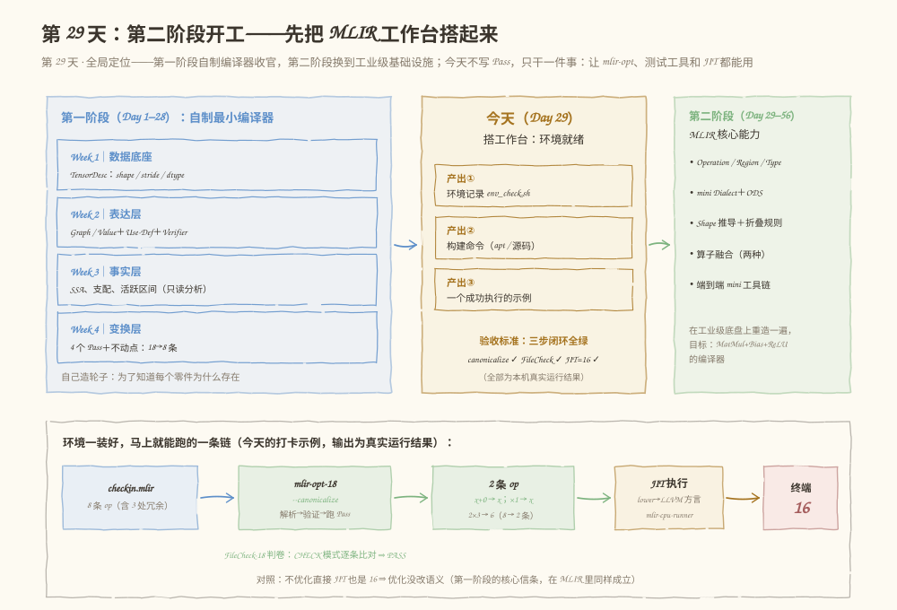

# 第 029 天：搭好 MLIR 工作台——让 mlir-opt、FileCheck 和 JIT 都听你指挥

> **今日目标**：完成本教程后，你能说清 MLIR 和 LLVM 的关系以及"版本匹配"到底在匹配什么；能在自己的机器上装好一套同版本的 MLIR 工具（mlir-opt、FileCheck、mlir-cpu-runner）；跑通一条最小闭环——`checkin.mlir`（8 条 op）经 `mlir-opt --canonicalize` 变成 2 条 op，FileCheck 判卷通过，最后 JIT 真的在终端打印出 `16`；并且看到 `Dialect 'func' not found`、`expected ','` 这类报错时，知道它是环境问题、语法问题还是结构问题。
> **预计时间**：学习 25 分钟 ＋ 实践 45 分钟
> **前置准备**：一台能用 apt（或其他包管理器）装 LLVM 18 的 Linux 机器、约 200 MB 磁盘、基本命令行操作；建议快速回忆 Day 23（代数化简）和 Day 24（常量计算）做过什么——今天会在真正的 MLIR 里再见到它们。
> **今日产出**：`code/` 下四份文件（`env_check.sh` 环境记录、`checkin.mlir`、`run.mlir`、`run_all.sh` 一键闭环）和它们在本机的真实运行记录；一份能回答"装什么、验什么、错在哪"的环境清单。

## 1. 今天解决什么问题？

Day 28 收官时预告：第二阶段（Day 29～56）从 MLIR 开始。但真上手第一分钟就会撞上一堆很"工程"的问题：`mlir-opt` 从哪来？为什么有 `mlir-opt-18` 这种带后缀的名字？`FileCheck` 是什么、跟 `mlir-opt` 什么关系？为什么把 `.mlir` 文件直接喂给 `mlir-cpu-runner` 会报 `Dialect 'func' not found`？这些问题的答案没有一个属于"编译原理"，但任何一个没解决，后面 28 天的每一步都会打折。**环境是第二阶段的地基，今天只干这一件事。**

贯穿全文的例子是 `checkin(x) = (x + 0) × 1 + (2 × 3)`。三处冗余你都不陌生：`x + 0` 和 `× 1` 是 Day 23 手写的代数化简，`2 × 3` 是 Day 24 手写的常量计算。今天我们把这条函数写成 MLIR，让真正的 MLIR 优化器（而不是你上周的 Python 脚本）把它从 8 条 op 化简成 2 条，再用 JIT 把 `checkin(10) = 16` 真实地算出来。**同一道题，两个世界的做法**——这就是换工作台的意义。

**术语先对齐**：MLIR（Multi-Level Intermediate Representation，多层中间表示）是 LLVM 社区开发的编译基础设施，允许在一个程序里同时存在多层"方言"级的中间表示；**canonicalize（规范化）**指把 IR 改写成更标准、更简形式的一组内置重写规则；**JIT（just-in-time，即时编译）**指不生成磁盘上的可执行文件、直接在内存里编译并运行；**dialect（方言）**是 MLIR 里一组相关操作和类型的命名空间，比如 `arith`（算术）、`func`（函数）；**FileCheck** 是 LLVM 的逐行模式匹配工具，编译器测试的"阅卷老师"。

## 2. 先看全貌：今天的内容位于哪里？



**图 1**：看三个区域。左边蓝色是第一阶段搭好的四层自制编译器（数据底座、表达层、事实层、变换层——零件全是自己造的）；右边绿色是第二阶段的路线（Operation/Region/Type → mini Dialect → Shape 推导与折叠 → 算子融合）；中间琥珀色是今天的"搭工作台"任务和三个产出；底部是环境一装好就能跑通的那条链——`checkin.mlir` 经 `mlir-opt-18 --canonicalize` 变成 2 条 op，FileCheck 判卷通过，JIT 在终端打印 `16`（均为本机真实结果）。

全局四步，今天走完前三步：

1. **装**：用一条 apt 命令装齐同一版本的工具（5.1 节）；
2. **认工具**：知道 `mlir-opt` 内部的四站流水线、FileCheck 怎么判卷、JIT 为什么要先 lower（3、4 节）；
3. **跑通三步闭环**：canonicalize → FileCheck → JIT，全绿（5.2～5.3 节）；
4. **留档**：`env_check.sh` 把环境记录固化成脚本，Day 30 起随时复查（5.3 节第 ④ 步）。

## 3. 核心概念：装的是什么、工具有哪些

### 3.1 MLIR 和 LLVM 是什么关系？版本匹配在匹配什么？

一句通俗解释：MLIR 不是独立软件，它是 LLVM 项目里的一个子项目，住在同一个仓库里、跟 LLVM 一起发版——所以"装 MLIR"实际上是"装某个版本的 LLVM 工具链"。

- **一个类比**：一套同一批出厂的电动工具——电池、钻头、扳手来自同一套设计图纸，接口严丝合缝。**对应到技术上是**：本机装的 `mlir-opt-18`、`mlir-cpu-runner-18` 和 `FileCheck-18` 全部来自 LLVM 18.1.8 这一个发行版，二进制都放在 `/usr/lib/llvm-18/bin/` 下（`/usr/bin/` 里只是软链接）。MLIR 在 2020 年并入 LLVM 的 monorepo（单一仓库）之后，就一直跟随 LLVM 的版本节奏发布。**类比的边界**：工具箱是"买回来就能用"的成品，而编译器工具链之间的依赖是双向的——你的 IR 由 18.1.8 的 `mlir-opt` 打印，判卷的 `FileCheck` 最好也用 18.1.8；混用新旧版本可能出现"输出格式微变导致老 CHECK 规则失配"这类怪问题。
- **一个最小事实**（本机实测）：`mlir-opt-18 --version` 输出 `Ubuntu LLVM version 18.1.8`；`dpkg -L mlir-18-tools` 列出的二进制全部指向 `/usr/lib/llvm-18/bin/`。版本后缀 `-18` 就是 Ubuntu 打包时加上去的"出厂批次号"。
- **一个常见误解**："我要装最新版才好"。学习计划的主线是稳定地打通端到端链路，选一个发行版（本教程用 18）并全程保持一致，比追新重要得多；只有当你需要改 MLIR 源码或用最新特性时才需要从源码构建（见 5.1 节路线 B）。

### 3.2 工具地图：一个 .mlir 文件的一生会碰到谁

一句通俗解释：`.mlir` 文件是一份文本，围绕它有一组各司其职的工具——读它改它的是 `mlir-opt`，给它判卷的是 `FileCheck`，把它跑起来的是 `mlir-cpu-runner`，边写边检查的是 `mlir-lsp-server`。

- **`mlir-opt`（今天的主角）**：读入 IR 文本 → 解析 → 验证 → 按你给的开关跑 Pass → 打印。它是"变换器"，本身不执行程序。本机实测它的帮助里有 **388 个 Pass 开关**（`mlir-opt-18 --help-list` 数出来的），第二阶段我们既会用现成的，也会自己写新的挂进去。
- **`FileCheck`（阅卷老师）**：从测试文件里读 `CHECK:` 系列注释当"标准答案"，拿 `mlir-opt` 的输出当"学生答卷"，逐条匹配。它不关心语义，只关心文本模式——所以考卷要写得精确。
- **`mlir-cpu-runner`（真跑）**：把已经是 LLVM 方言的 IR 即时编译并执行，适合小规模验证。**注意**：它只认自己注册过的方言——本机的这个构建不注册 `func` 方言，所以必须先用 `mlir-opt` 把 `func/arith` 转成 LLVM 方言再喂给它（5.3 节第 ③ 步就是这么做的）。
- **`mlir-lsp-server`（实时检查）**：语言服务器，配合编辑器插件（如 VS Code 的 MLIR 插件）可以实现边写边标红。
- **`mlir-tblgen`**：从 TableGen 描述生成 C++ 代码的工具，Day 36 起定义我们自己的 `mini` Dialect 时才正式登场，今天认个脸即可。
- **一个类比**：这套工具像一支翻译团队——`mlir-opt` 是改稿编辑，`FileCheck` 是校对，`mlir-cpu-runner` 是试讲的演讲者。**对应到技术上是**：每个工具只在**自己注册过的方言集合**上工作——这叫**方言注册表**（dialect registry）。编辑认识所有方言（`mlir-opt` 注册了全部上游方言），但本机构建的 `mlir-cat` 和 `mlir-cpu-runner` 只认识很小的子集。**类比的边界**：不是"翻译官水平不行"，而是"这个岗位的翻译官本来就不被允许读这种方言"——遇到 `Dialect 'func' not found` 时，正确动作是换工具或先 lower，而不是修改你的 IR。

## 4. 图解核心机制

有了概念，剩下的关键问题是：**`mlir-opt` 内部到底分几步？报错时怎么知道卡在哪一步？**


**图 2**：从上往下四层。上层蓝色/绿色/琥珀色是 `mlir-opt` 的**四站流水线**；中层红色和绿色两个面板分别是"报错归属"和"观测手段"；中部琥珀色横条是版本匹配；下层四张卡片是工具地图；最底部红条是今天最容易踩的方言注册表陷阱。按编号讲：

**① 四站流水线**。`Parser` 把文本变成内存里的 Operation 树（语法错了在这站报）；`Verifier` 检查结构约束，比如操作数个数、索引数量（结构不合法在这站报）；`Pass 管线`按命令行开关逐个跑（`--canonicalize`、`--cse` 都在这站）；`Printer` 把结果打印成规范文本。**为什么需要分清站**：报错信息的第一行都是 `文件名:行:列: error: ...`，知道站号你才能判断"是我 IR 写错了"还是"我的 Pass 用法错了"。

**② 报错归属（三条都是本机真实触发）**。`expected ','`——`addi` 少写一个操作数，第①站；`use of value '%x' expects different type: 'i64' vs 'i32'`——SSA 值类型对不上，第①站（还带 `note:` 指出第一次使用的位置）；`'memref.load' op incorrect number of indices, expected 2 but got 3`——给二维 memref 三个索引，第②站。**共同点**：都不用你猜，行号列号直接指到出错字符。

**③ 观测手段**。`--mlir-print-ir-after-all` 让每个 Pass 跑完都 dump 一次 IR——5.4 节会看到 canonicalize 之后接 cse，第二次 dump 一行没变（没有公共子表达式了）。这相当于第一阶段给 PassManager 加的"每步打印"，只是这次是现成的。

**④ 版本匹配**。琥珀条写的是今天环境的核心约束：所有工具来自同一 LLVM 发行版（本机 18.1.8），`FileCheck-18` 在 `llvm-18-tools` 包里、和 `mlir-opt-18` 同版本。判卷的和出卷的必须同一批出厂。

## 5. 动手实践：装好、跑通、留档

### 5.1 准备环境：两条安装路线

**路线 A：系统包管理器（本教程实际执行的路线，约 1 分钟）**。Ubuntu 20.04 的 `focal-updates/universe` 源里有现成的 LLVM 18 工具包。以下命令在本机真实执行过：

```bash
sudo apt-get install -y mlir-18-tools    # 提供 mlir-opt-18、mlir-cpu-runner-18、mlir-lsp-server-18、mlir-tblgen-18、mlir-cat-18
sudo apt-get install -y llvm-18-tools    # 提供 FileCheck-18（判卷工具在这里，别漏装）
```

装完用 `mlir-opt-18 --version` 核对：本机输出 `Ubuntu LLVM version 18.1.8`（arm64）。其他发行版同理：让包管理器装同一版本的 LLVM/MLIR 工具集即可；macOS／Windows 用户可用各自的包管理器安装 LLVM，装完同样用 `--version` 和 `which` 核对，或直接走路线 B／容器路线——核心要求不变：**工具齐全、版本一致**。另外提醒一句：PyPI 上没有官方维护的 `mlir-opt` 现成包（本机 `pip` 实测搜不到可用的），别装到同名占位包。

**路线 B：源码构建（学习计划要求"了解"的路线；以下为官方文档命令，本机未执行——完整构建通常需要几十分钟到数小时）**。当你需要改 MLIR 源码、调试 Pass 框架或使用系统包还没有的新特性时走这条路。命令来自 [MLIR 官方 Getting Started](https://mlir.llvm.org/getting_started/)：

```bash
git clone https://github.com/llvm/llvm-project.git
mkdir llvm-project/build && cd llvm-project/build
cmake -G Ninja ../llvm \
   -DLLVM_ENABLE_PROJECTS=mlir \
   -DLLVM_BUILD_EXAMPLES=ON \
   -DLLVM_TARGETS_TO_BUILD="Native" \
   -DCMAKE_BUILD_TYPE=Release \
   -DLLVM_ENABLE_ASSERTIONS=ON
cmake --build . --target check-mlir     # 跑 MLIR 全量测试（可选，耗时）
cmake --build . --target mlir-opt mlir-cpu-runner FileCheck   # 只编需要的工具
```

对比：路线 A 快、版本固定、够用 28 天；路线 B 慢、可控、能改源码。今天用 A，知道 B 的存在和适用时机即可。

### 5.2 准备文件

```text
tutorials/day-029/
├── README.md            ← 本教程
├── images/              ← 三张图
└── code/
    ├── env_check.sh     ← ④ 环境记录：逐项检查工具与版本＋冒烟测试
    ├── checkin.mlir     ← ① 主示例（含 FileCheck 考卷注释）
    ├── run.mlir         ← ③ JIT 版本（加了个 main 调 checkin）
    └── run_all.sh       ← 一键跑通 ①②③ 三步闭环
```

`checkin.mlir` 全文如下（顶部的 `CHECK` 注释就是给 FileCheck 的考卷）：

```mlir
// CHECK-LABEL: func.func @checkin(
// CHECK-SAME: %[[ARG:.*]]: i32
// CHECK-NOT: arith.muli
// CHECK: %[[C6:.*]] = arith.constant 6 : i32
// CHECK: %[[R:.*]] = arith.addi %[[ARG]], %[[C6]] : i32
// CHECK: return %[[R]] : i32

module {
  func.func @checkin(%x: i32) -> i32 {
    %c0 = arith.constant 0 : i32
    %c1 = arith.constant 1 : i32
    %c2 = arith.constant 2 : i32
    %c3 = arith.constant 3 : i32
    %a = arith.addi %x, %c0 : i32     // x + 0  → Day 23 的代数化简
    %b = arith.muli %a, %c1 : i32     // a * 1  → Day 23 的代数化简
    %d = arith.muli %c2, %c3 : i32    // 2 * 3  → Day 24 的常量计算
    %r = arith.addi %b, %d : i32
    return %r : i32
  }
}
```

三个阅读要点：**(a)** `%c0`、`%a` 这些 `%` 开头的名字是 SSA 值，每个名字只定义一次（第一阶段的铁律在这里原样生效）；**(b)** `arith.constant 0 : i32` 读作"类型为 i32 的常量 0"，`: i32` 标注类型；**(c)** 考卷里 `CHECK-LABEL` 锚定函数头，`CHECK-SAME` 要求同一条线，`CHECK-NOT: arith.muli` 断言化简后一条乘法都不剩——这正是 8 条 op 变 2 条的可执行版本。

`run.mlir` 与之相同，只是多了一个 `main`（mlir-cpu-runner 约定的入口函数），内容见 `code/run.mlir`：`%x = arith.constant 10 : i32` 后 `func.call @checkin(%x)` 再返回，即 `main = checkin(10)`。

### 5.3 运行与观察：三步闭环＋环境留档

以下全部为本机真实运行输出（Ubuntu 20.04，arm64，LLVM 18.1.8，2026-11-12；也可用 `bash code/run_all.sh` 一键重放）。

**① canonicalize：8 条 op → 2 条**

```bash
$ mlir-opt-18 code/checkin.mlir --canonicalize
module {
  func.func @checkin(%arg0: i32) -> i32 {
    %c6_i32 = arith.constant 6 : i32
    %0 = arith.addi %arg0, %c6_i32 : i32
    return %0 : i32
  }
}
```

观察三件事：`x+0`、`×1` 消失了（使用者直接改读 `%arg0`——换边）；`2×3` 变成了常量 `6`（变身）；函数体从 8 条 op 缩到 2 条。**这正是你在 Day 23/24 手写的规则，由 MLIR 的 canonicalizer 一条命令完成。**

**② FileCheck：给输出判卷**

```bash
$ mlir-opt-18 code/checkin.mlir --canonicalize | FileCheck-18 code/checkin.mlir
$ echo $?
0
```

`run_all.sh` 里会显式打出一行 `FileCheck PASS`（命令以 `&&` 连接 echo）。管道左边的 `mlir-opt` 是"答卷"，右边的 `FileCheck-18` 拿 `checkin.mlir` 顶部的 CHECK 注释当"标准答案"。**说明**：上游 MLIR 测试用 `lit`＋`RUN:` 行自动做这件事；本机没有打包 lit，所以手动执行它底层的那条管道——效果相同，Day 45 写第一个 RewritePattern 测试时你会更熟练地用它。

**③ JIT：真的算出 16（两步）**

```bash
$ mlir-opt-18 code/run.mlir --convert-func-to-llvm --convert-arith-to-llvm -o run.llvm.mlir
$ mlir-cpu-runner-18 run.llvm.mlir --entry-point-result=i32
16
```

为什么两步？因为本机的 `mlir-cpu-runner-18` 不注册 `func` 方言（直接喂原始 IR 会报第 6 节的错误 1），所以先用 `mlir-opt` 把 `func/arith` 转到 LLVM 方言（这一步叫 **lowering**，降低抽象层级），再交给 runner 即时编译执行。`--entry-point-result=i32` 表示"运行 `@main` 并把返回值打印出来"——`checkin(10) = (10+0)×1+2×3 = 16`。

**④ 环境留档：env_check.sh**

```bash
$ bash code/env_check.sh
==== 系统信息 ====
日期       : 2026-11-12 04:51:57 +0800
内核/架构  : Linux 5.10.0-182.0.0.95.r3450_282.hce2.aarch64 aarch64
发行版     : Ubuntu 20.04

==== MLIR 工具链 ====
  [PASS] mlir-opt-18          Ubuntu LLVM version 18.1.8
  [PASS] mlir-cpu-runner-18   Ubuntu LLVM version 18.1.8
  [PASS] FileCheck-18         Ubuntu LLVM version 18.1.8
  [PASS] mlir-lsp-server-18   Ubuntu LLVM version 18.1.8
  [PASS] mlir-tblgen-18       Ubuntu LLVM version 18.1.8
  [PASS] mlir-cat-18          (无 --version 输出)

==== 冒烟测试：解析 + 验证一个最小 IR ====
  [PASS] mlir-opt-18 成功解析并验证最小 IR

结论：MLIR 环境就绪，可以开始第 30 天。
```


**图 3**：左 panel 是输入的 8 条 op，三个琥珀圈标出冗余（注意圈旁边标注的"Day 23 代数化简""Day 24 常量计算"——这两个名字来自你的第一阶段）；中间是 canonicalize 后的 2 条 op 和 FileCheck 判卷要点；右边是 JIT 的两条命令、终端的 `16`，以及 5.4 节的两个对照实验结果。一张图收拢今天全部真实输出。

### 5.4 修改一个参数再观察

**实验 1：换输入，验证它真的在"算"**。把 `run.mlir` 里 `%x = arith.constant 10 : i32` 的 `10` 改成 `42`，重跑 ③ 的两条命令（本机真实执行）：

```text
$ mlir-cpu-runner-18 run.llvm.mlir --entry-point-result=i32
48
```

`48 = 42 + 6`，符合化简后的 `x+6`。改一个数就能确认：优化后的程序仍然是"活的函数"，不是死文本。

**实验 2：看每个 Pass 各做了什么**（本机真实执行，节选）：

```bash
$ mlir-opt-18 code/checkin.mlir --canonicalize --cse --mlir-print-ir-after-all
// -----// IR Dump After Canonicalizer (canonicalize) //----- //
module {
  func.func @checkin(%arg0: i32) -> i32 {
    %c6_i32 = arith.constant 6 : i32
    %0 = arith.addi %arg0, %c6_i32 : i32
    return %0 : i32
  }
}

// -----// IR Dump After CSE (cse) //----- //
（与上面完全相同——CSE 找不到可合并的公共子表达式）
```

canonicalize 一步到位后，`--cse` 无事可做。对比第一阶段：同样的"分步可观测"，那时你要自己给 PassManager 加打印，这次是现成开关。

**实验 3：不优化直接跑，输出一样**（`run_all.sh` 末尾自动做）：对 `run.mlir` 不加 `--canonicalize`、直接 lower＋JIT，输出仍是 `16`。**优化改变了结构（8 条 op → 2 条），没有改变可观察行为**——第一阶段用位级对照守住的信条，今天用一个终端数字再次确认。顺带一个诚实的小观察：`--convert-arith-to-llvm` 在转换时也会顺带折叠一部分常量运算（lower 后的 IR 里已经能看到 `constant 6`），这说明"哪一层做折叠"在真实编译器里是分层的——不影响结论，但值得知道。

## 6. 常见错误与排查

**错误 1：`Dialect 'func' not found for custom op 'func.func'`**
现象：把未 lower 的 IR 喂给 `mlir-cpu-runner-18`，或用 `mlir-cat-18` 拼接含 `func` 的文件，直接报此错并退出。
原因：不是 IR 写错了，是这个工具的方言注册表里没有 `func` 方言——不同工具注册的方言集合不同（本机构建如此；上游某些构建的 runner 会注册更多方言，所以"网上能跑我这不能跑"多半是构建差异）。
定位：换 `mlir-opt-18` 跑同一个文件——如果能正常解析，就说明 IR 没问题，是工具不认识。
修复：给 runner 之前先用 `mlir-opt --convert-func-to-llvm --convert-arith-to-llvm` lower（5.3 节第 ③ 步）；需要拼接文件就换支持该方言的工具。

**错误 2：`error: expected ','`**
现象：`%r = arith.addi %x : i32`（二元加法只写了一个操作数），Parser 阶段报错，箭头 `^` 指向缺逗号的位置，并给出 `文件名:行:列`。
原因：`addi` 需要两个操作数，通用解析器读到 `: i32` 时发现语法不完整。
定位：看报错的行:列，直接跳到出错字符。
修复：补上第二个操作数 `%r = arith.addi %x, %y : i32`。**这类"语法错"卡在四站流水线的第①站，和 Verifier 无关。**

**错误 3：`use of value '%x' expects different type than prior uses: 'i64' vs 'i32'`**
现象：`%r = arith.addi %x, %x : i64` 而 `%x` 声明为 `i32`；报错之外还有一行 `note: prior use here` 指向函数参数表里 `%x` 第一次出现的位置。
原因：同一个 SSA 值在两处被要求了不同类型——SSA 的"名字唯一、类型一致"在解析阶段就被强制执行。
定位：顺着 `note:` 找到该值第一次使用的行号，对比两处类型。
修复：统一类型，或先插入显式转换（第二阶段后续会讲 `arith.extsi` 这类操作）。

**错误 4：`'memref.load' op incorrect number of indices for load, expected 2 but got 3`**
现象：给 `memref<2x3xf32>` 的 load 提供三个索引；这次报错发生在**第②站 Verifier**——语法本身是通的（load 的语法允许任意个索引），但"索引个数必须等于 memref 的秩"这条结构约束不满足，报错里还会用 `note: see current operation:` 打印出通用格式（generic form）的完整操作帮你确认。
定位：数一下 memref 类型的维度数和方括号里的索引数。
修复：二维 memref 配两个索引。

**错误 5（一句话预防）：版本混搭**。用旧版本 FileCheck 判新版本 `mlir-opt` 的输出，可能出现莫名其妙的匹配失败。环境留档（`env_check.sh`）里所有工具版本应完全一致——本机全部是 `18.1.8`。

## 7. 今日练习

### 必做练习：×0 实验——先预测，再验证

在 `checkin.mlir` 的 `return %r : i32` 之前加一行 `%z = arith.muli %r, %c0 : i32`，并把 return 改成 `return %z : i32`（即 `checkin(x) = ((x+0)×1 + 2×3) × 0`）。**先在纸上写下两个预测**：(1) `--canonicalize` 之后函数体还剩几条 op、长什么样？(2) 把 `run.mlir` 相应改好后 JIT 会打印什么数字？然后跑 5.3 节的 ① 和 ③ 命令验证。**加分问题**：把 `i32` 全部换成 `f32`（常量 `0` 换成 `0.0`，`addi/muli` 换成 `addf/mulf`）再做一次——整数版和浮点版的化简结果**不一样**，想想为什么（提示：回忆 Day 28 破坏性实验里让 `add(x,0)` 破洞的那个浮点值）。预期产出：你手写的预测＋两版真实输出＋一段"为什么浮点不 fold"的解释。

### 选做挑战：把编辑器接上实时检查

安装 VS Code 的 MLIR 插件，把它的 server 路径指到 `mlir-lsp-server-18`，然后故意在 `checkin.mlir` 里写一个类型错误，观察它不等你保存就标红、悬停显示诊断——体会"第①②站的检查搬进了编辑器"。或者做数字版：用 `mlir-opt-18 --help-list | grep -cE '^      --'` 自己数一遍 Pass 开关数量，挑三个名字猜猜它们做什么，明天起我们逐个认识。

## 8. 今日验收

- [ ] 我能说出 `mlir-opt` 的四站流水线（解析→验证→Pass→打印），并指出 `expected ','`、`expects different type`、`incorrect number of indices` 分别卡在第几站；
- [ ] 我在自己机器上跑通了三步闭环（canonicalize、FileCheck、JIT），并把真实输出保存或记录了下来；
- [ ] 我能修改 `checkin.mlir`（×0 实验或换常量 42）并**先准确预测**化简后的 IR 和 JIT 输出，再用命令验证；
- [ ] 我保存了 `env_check.sh` 的输出作为环境记录，且所有工具版本一致（本机 18.1.8）；
- [ ] 我再看到 `Dialect 'func' not found` 时，第一反应是"工具不认识这个方言"，知道换工具或先 lower，而不是怀疑 IR。

## 9. 一句话总结与明天预告

今天的问题是"第二阶段开工前，工作台必须先能用"；机制上要记住的是 `mlir-opt` 的四站流水线、工具各认各的方言注册表、以及"所有工具同一 LLVM 版本"这条环境铁律；实践上装好了 18.1.8 全家桶，用 `checkin.mlir` 跑通了 canonicalize（8 条 op → 2 条 op）、FileCheck 判卷和 JIT（终端打印 `16`）的完整闭环，并用 `env_check.sh` 把环境固化成可复查的记录；验证方式就是那三个真实的绿色结果和 42→48 的对照——**你第一天写下的规则，今天在工业级基础设施上原样复现了**。明天（Day 30）我们把这 2 条 op 拆开看：Operation、Operand、Result、SSA Value 和类型系统——`%arg0`、`%c6_i32` 这些名字背后的精确含义。
