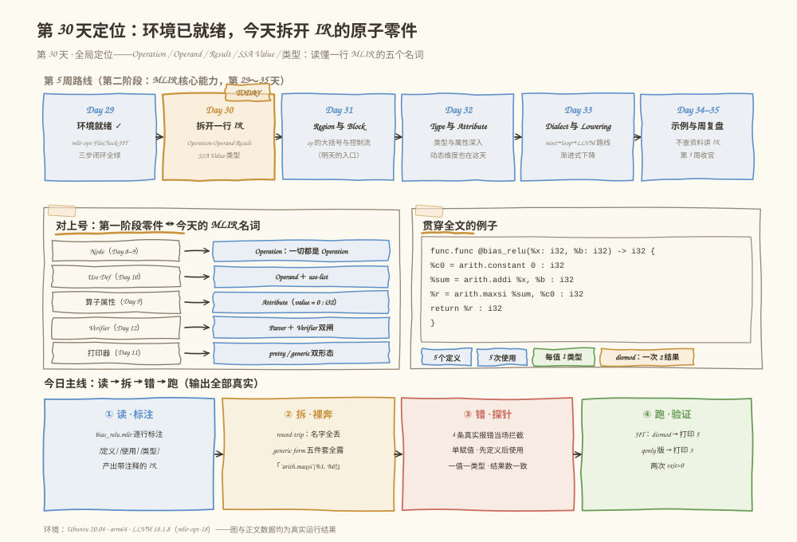
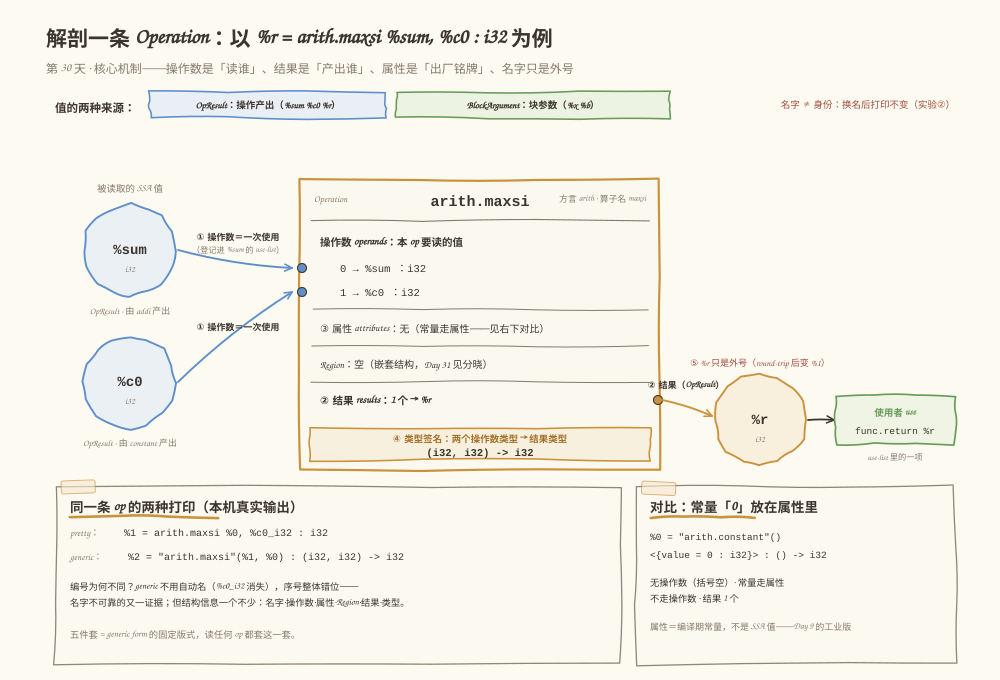
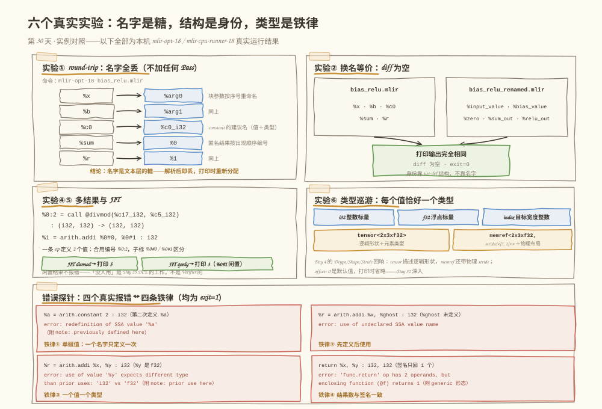

# 第 030 天：拆开一行 IR——Operation、Operand、Result 与 SSA Value 解剖课

> **今日目标**：完成本教程后，你能对任意一行简单 MLIR（比如 `%sum = arith.addi %x, %b : i32`）一口气说出它的操作名、操作数、结果、每个值的类型和定义位置；能用 `--mlir-print-op-generic` 把语法糖剥光、看到 Operation 的"五件套"结构；能用换名实验证明 **SSA 值的身份在结构不在名字**；能说出 `redefinition of SSA value`、`use of undeclared SSA value name`、`expects different type`、`'func.return' op has 2 operands` 四类真实报错各违反了哪条铁律；并亲手用一次多结果调用（`%0:2` 与 `%0#0`/`%0#1`）验证"一条 op 可以定义 N 个值"。
> **预计时间**：学习 25 分钟 ＋ 实践 40 分钟
> **前置准备**：Day 29 的 MLIR 环境（不放心可重跑 `tutorials/day-029/code/env_check.sh`）；Day 17 的 SSA 单赋值概念；Day 10 手写过的 Use-Def——今天全部对上号。
> **今日产出**：`code/` 下 6 个文件：`bias_relu.mlir`（逐行标注的主示例）、`bias_relu_renamed.mlir`（换名对照）、`divmod.mlir` 与 `divmod_qonly.mlir`（多结果＋JIT 与对照实验）、`probe.sh`（一键重放全部实验，含 4 个错误探针）、`concept-map.md`（第一阶段 ↔ MLIR 概念对照表），以及它们在本机的真实运行记录。

## 1. 今天解决什么问题？

Day 29 结尾留了个尾巴：`mlir-opt --canonicalize` 前后，同一条加法的结果一会儿叫 `%r`、一会儿叫 `%0`，函数参数一会儿叫 `%x`、一会儿叫 `%arg0`。**名字变了，IR 还是"同一个"吗？变的是什么、不变的是什么？** 这是今天要解决的第一件事。

第二件事更功利：Day 45 要写第一个 RewritePattern，文档里那句"确保使用者被正确替换"里的"使用者"，在 MLIR 数据结构上精确指什么？不知道这个，后面 27 天每一条 Pass 都写不明白。所以今天把 MLIR 的最小零件——**Operation、Operand、Result、SSA Value、Type**——逐个拆开认清楚，为整个第二阶段打底。

贯穿全文的主例子是 `bias_relu(x, b) = max(x + b, 0)`——最终项目 MatMul + Bias + ReLU 的"单元素微缩版"：函数体 3 条算术 op、5 个值、5 次使用，麻雀虽小五脏俱全。副例子 `divmod`（除法求商取余）负责演示"一条 op 定义两个值"。

**术语先对齐**：**Operation（操作）**是 MLIR 一切东西的统称——一行 op 是它，`module` 和 `func.func` 也是它；**Operand（操作数）**是本条操作要读取的 SSA 值；**Result（结果）**是本条操作产出的 SSA 值；**SSA Value（SSA 值）**是"只被定义一次的值"的统称（Day 17 讲过单赋值，今天看 MLIR 怎么强制执行它）；**Type（类型）**是每个值携带的类型标签，如 `i32`、`tensor<2x3xf32>`。

## 2. 先看全貌：今天的内容位于哪里？



**图 1**：看四个区域。顶部是第 5 周路线——昨天装好环境，今天（琥珀色 TODAY 框）拆开一行 IR，后面依次是 Region/Block、Type/Attribute、Dialect 与 Lowering；左下是"对上号"面板——你第一阶段的五大零件（Node、Use-Def、属性、Verifier、打印器）在 MLIR 里的正式名字；右下是贯穿例子 `bias_relu` 的完整代码；底部是今天的四步主线：读（标注）→ 拆（generic form）→ 错（4 个探针）→ 跑（JIT 打印 5 和 3）。

全局四步，今天走完一个完整闭环：

1. **读**：给 `bias_relu.mlir` 的每一行标注 [定义]/[使用]/[类型]（5.2 节）；
2. **拆**：round-trip 观察名字消失，generic form 剥掉全部语法糖（5.3 实验①③）；
3. **错**：4 个故意触发的报错，认出四条铁律（第 6 节）；
4. **跑**：JIT 执行 `divmod`，终端打印真实数字（5.3 实验⑤）。

## 3. 核心概念：先用直觉，再给准确定义

### 3.1 Operation：IR 的原子，连 module 都是一条操作

一句通俗解释：MLIR 里没有"节点""语句""容器"的区别，**一切皆 Operation**——`arith.addi` 是一条，`func.func` 是一条，整个文件的 `module` 也是一条（只是它恰好能装下别的操作）。

- **一个类比**：流水线上的一个工位——原料从左边进，成品从右边出，工位上还贴着出厂铭牌。**对应到技术上是**：一条 Operation 的完整身份证是五件套：**名字**（`arith.maxsi` = 方言名 `arith` ＋ 算子名 `maxsi`，这是身份的一部分，不能随便改）、**操作数**（要读谁）、**属性**（编译期常量，如 `arith.constant` 的 `value = 0 : i32`）、**Region**（嵌套的子结构，`module` 装函数靠它，Day 31 展开）、**结果**（产出谁）。（还有个冷门成员 successors——终结符跳转用的块列表，Day 31 见。）**类比的边界**：工位是平铺的，Operation 可以嵌套——`module` 里套 `func.func` 里套算术 op，generic form 能把这层嵌套完整打出来（5.3 实验③）。
- **一个最小例子**：`%sum = arith.addi %x, %b : i32`——名字 `arith.addi`，操作数 `%x`、`%b`，结果 `%sum`，属性和 Region 为空。
- **一个常见误解**："`module` 和 `func.func` 是容器不是操作。"实验③的 generic form 第一行就是证据：`"builtin.module"() (...) : () -> ()`——它就是一条零操作数、零结果、带一个 Region 的 Operation。

### 3.2 Operand 与 Result：值的使用与定义

一句通俗解释：操作数回答"这一步**读谁**"，结果回答"这一步**产出谁**"——两者合起来就是一条边（use-def）的两端。

- **一个类比**：快递单——"取件货架"和"放回货架"。**对应到技术上是**：Operand 在数据结构上是对某个 SSA 值的一次**使用**（use），登记在被用值的 **use-list** 里——你 Day 10 手写的 `addUse`/`removeUse` 的工业版；Result 不是"值"这个名字，而是值的一种具体形态（**OpResult**），挂在这一端成为**定义**。Day 45 的"把使用者替换到新值"，做的就是把 use-list 里那些登记项成批改指到新结果上。**类比的边界**：快递单引用货架，但操作数引用的是"值本身"——替换操作改的是引用的指向，不会把值复制一份过来。
- **沿用同一个例子**：`bias_relu` 全函数的 5 个值、5 次使用（这就是今天最重要的那张表）：

| 值 | 定义方式 | 定义者 | 使用者 | 类型 |
|---|---|---|---|---|
| %x | BlockArgument | 函数入口块 | arith.addi | i32 |
| %b | BlockArgument | 函数入口块 | arith.addi | i32 |
| %c0 | OpResult | arith.constant | arith.maxsi | i32 |
| %sum | OpResult | arith.addi | arith.maxsi | i32 |
| %r | OpResult | arith.maxsi | func.return | i32 |

- **一个常见误解**："操作都有 1 个结果。"不是：`arith.constant` 有 1 个，`func.return` 有 **0** 个（只读不写），`func.call @divmod` 有 **2** 个（`%q, %r = ...`，一次定义两个值）。

### 3.3 SSA Value：身份在结构，名字是糖

一句通俗解释：`%sum`、`%c0` 这些 `%` 开头的名字只是**外号**；一个 SSA 值的真正身份是"use-def 图上的位置"——被谁定义、被谁使用。

- **一个类比**：身份证号 vs 外号——外号随便起，身份证号不变。**对应到技术上是**：名字只存在于文本里，解析完成后没有进入 IR 的身份；打印时按三条规则**重新分配**：函数参数按序号叫 `%arg0、%arg1…`，匿名结果按出现顺序叫 `%0、%1…`，部分算子提供"建议名"（如 `arith.constant` 的结果叫 `%c0_i32`：值＋类型）。5.3 实验①②会亲眼看到这三条规则，以及"换一整套名字、打印输出一个字都不变"的铁证。**类比的边界**：身份证号是永久的，而 MLIR 的"结构身份"在 IR 被 Pass 改写后自然变化——这也是为什么调试时要看结构而不是盯名字。
- **值的两种来源**（第二张重要的小表）：**OpResult**（操作产出，如 %c0、%sum、%r）和 **BlockArgument**（块参数——%x、%b 不是任何 op 的结果，由所在块直接定义；Day 31 讲 Block 时补全细节）。
- **一个常见误解**："两个函数里都叫 %a 会撞名。"不会——名字作用域是块级的。`probe.sh` 里的命名作用域探针实测：两个函数各自用 `%x` 和 `%a`，相安无事。

### 3.4 类型系统：每个值恰好一个类型

一句通俗解释：每个 SSA 值都随身带一个类型标签，且只有一个——`%x: i32` 里 `: i32` 标的就是它。操作数、结果、函数参数全要标注。

- **一个类比**：行李箱上的托运标签——同一件行李不会同时是"易碎"和"重型机械"。**对应到技术上是**：类型写在值的定义处，使用处再声明一次时必须完全一致，否则解析器直接报错（第 6 节错误 3 实测）。**类比的边界**：托运标签是贴上去可换的，类型在 MLIR 里是值身份的一部分，换类型必须经过显式转换操作（Day 32 讲 Cast 时展开）。
- **沿用一个例子看类型家族**（`probe.sh` 实验⑥真实解析）：`i32`（整数）、`f32`（浮点）、`index`（宽度与目标相关的整数，循环下标专用）、`tensor<2x3xf32>`（逻辑形状＋元素类型）、`memref<2x3xf32, strided<[3, 1]>>`（还带物理布局）。**Day 4 的 TensorDesc（Shape/Dtype/Stride 三件套）在这里对上号**：tensor 描述逻辑形状，memref 连物理 stride 一起管。深挖留给 Day 32。
- **一个常见误解**："类型可以像 Python 那样隐式转换。"`arith.addi %x, %y : i32` 里 `%y` 若是 `f32`，当场报错，没有任何"帮你转一下"。

## 4. 图解核心机制

有了概念，剩下的关键问题是：**一条 Operation 在图上到底长什么样？操作数和结果的箭头怎么画？**



**图 2**：从左往右看。左列两个蓝圈是**被读取的 SSA 值**（`%sum`、`%c0`，都是 OpResult）；①两条箭头就是**两个操作数**——每次使用都会登记进被用值的 use-list；中间琥珀色大框是 Operation 本体，内部从上到下是操作数区、③属性区（本 op 为空——常量才走属性）、Region（空，Day 31 见）、②结果区（1 个 → `%r`）、④类型签名 `(i32, i32) -> i32`；右边 `%r` 继续流向它的使用者 `func.return`——⑤注意它头上的红字：`%r` 只是外号，round-trip 后就变 `%1` 了。底部两张卡是同一 op 的两种打印和 constant 的属性对比。

按编号讲四步：

**① 操作数 = 一次使用**。`arith.maxsi` 有两个操作数，箭头方向是"从值流向操作"——语义是"这条 op 要读这个值"。数据结构上，这条箭头对应 use-list 里的一条登记项。

**② 结果 = 一次定义**。`%r` 由 `arith.maxsi` 定义（OpResult），然后成为 `func.return` 的操作数——同一个值，定义一次，使用多次。图里 `%r → func.return` 那段就是"use-def 链"的最后一环。

**③ 属性 = 出厂铭牌**。`arith.maxsi` 没有属性；对比右下角的 `arith.constant`：常量 0 存在属性 `value = 0 : i32` 里，**不是**操作数——属性是编译期常量，不参与 SSA 流动。这就是 Day 9"算子属性"的工业版。

**④ 类型签名把五件套收口**。`(i32, i32) -> i32` 一行写清：两个操作数都要求 i32，产出一个 i32。generic form 里这条签名永远跟在冒号后面——下一节用命令把它打出来。

## 5. 动手实践：标注、拆解、验证

### 5.1 准备文件

```text
tutorials/day-030/
├── README.md                 ← 本教程
├── images/                   ← 三张图
└── code/
    ├── bias_relu.mlir        ← ① 主示例：逐行标注的 MLIR（今天交付物之一）
    ├── bias_relu_renamed.mlir← ② 换名对照文件
    ├── divmod.mlir           ← ③ 多结果 ＋ JIT 示例
    ├── divmod_qonly.mlir     ← ④ 5.4 节对照实验（只用第一个结果）
    ├── probe.sh              ← ⑤ 一键重放全部实验（含 4 个错误探针）
    └── concept-map.md        ← ⑥ 概念对照表（今天交付物之二）
```

命令统一在 `tutorials/day-030/` 目录下执行；本机环境为 Ubuntu 20.04（arm64）、LLVM 18.1.8（`mlir-opt-18`），与 Day 29 记录一致。

### 5.2 编写代码：主例子的完整标注

`bias_relu.mlir` 全文如下（这就是"带注释的 MLIR 文件"交付物，注释里标了每一行的定义、使用、类型）：

```mlir
// 整个文件最外层本身就是一条 Operation：builtin.module。
// 它没有操作数、没有结果，只有一个装函数用的 Region（Day 31 展开）。
module {

  // func.func 也是一条 Operation：
  //   函数名 @bias_relu 与签名 (i32, i32) -> i32 存在「属性」里。
  //   %x、%b 是 BlockArgument：由函数体的入口块定义，不是任何 op 的结果。
  //   [定义] %x %b  [类型] i32
  func.func @bias_relu(%x: i32, %b: i32) -> i32 {

    // [定义] %c0  [使用] 无  [属性] value = 0 : i32
    // 常量 0 不走操作数，走属性——Day 9「算子属性」的工业版。
    %c0 = arith.constant 0 : i32

    // [定义] %sum  [使用] %x, %b（两个操作数）  [类型] (i32, i32) -> i32
    %sum = arith.addi %x, %b : i32

    // [定义] %r  [使用] %sum, %c0  [类型] (i32, i32) -> i32
    // ReLU 的标量版：max(x, 0)——上一行的和与零比较，负数归零。
    %r = arith.maxsi %sum, %c0 : i32

    // [使用] %r；本行定义 0 个值——操作可以没有结果。
    return %r : i32
  }
}
```

三个阅读要点：**(a)** 注释在 round-trip 后会消失——注释是文本层的，不属于 IR，所以这份标注要靠文件本身保存；**(b)** `arith.maxsi` 是"取两者较大值"（signed max），标量 ReLU 恰好是 `max(x, 0)`；**(c)** `return` 是 `func.return` 的简写（方言名在无歧义时可以省略），读 IR 时两种写法都会遇到。

副例子 `divmod.mlir` 的关键部分（完整文件见 `code/divmod.mlir`）：

```mlir
func.func @divmod(%a: i32, %b: i32) -> (i32, i32) {
  %q = arith.divsi %a, %b : i32
  %r = arith.remsi %a, %b : i32
  return %q, %r : i32, i32
}
func.func @main() -> i32 {
  %seventeen = arith.constant 17 : i32
  %five = arith.constant 5 : i32
  %q, %r = func.call @divmod(%seventeen, %five) : (i32, i32) -> (i32, i32)
  %sum = arith.addi %q, %r : i32
  return %sum : i32
}
```

看 `%q, %r = func.call ...` 这一行：**等号左边写两个名字，就是"一条 op 定义两个值"**。`17 = 5 × 3 + 2`，所以 `q + r = 3 + 2 = 5`——一会儿 JIT 应该打印 5。完整的"第一阶段 ↔ MLIR"概念对照表在 `code/concept-map.md`，和 3.2 的表同源，可直接当复习卡用。

### 5.3 运行与观察：六个实验（全部本机真实输出）

以下输出均为 2026-11-12 在本机的真实运行结果（可用 `bash code/probe.sh` 一键重放）。

**实验① round-trip：名字全丢（不加任何 Pass）**

```bash
$ mlir-opt-18 code/bias_relu.mlir
module {
  func.func @bias_relu(%arg0: i32, %arg1: i32) -> i32 {
    %c0_i32 = arith.constant 0 : i32
    %0 = arith.addi %arg0, %arg1 : i32
    %1 = arith.maxsi %0, %c0_i32 : i32
    return %1 : i32
  }
}
```

注意：**一条 Pass 都没跑**，只是解析再打印，五个名字就全换了——`%x`→`%arg0`、`%b`→`%arg1`（块参数按序号重命名）、`%c0`→`%c0_i32`（constant 的建议名：值＋类型）、`%sum`→`%0`、`%r`→`%1`（匿名结果按出现顺序编号）。昨天你以为是 `--canonicalize` 改了名字，今天证明：**名字在解析后就没有进入 IR 身份，打印时按规则重新分配**。Day 29 的"8 条 op 变 2 条"才是 Pass 的功劳，改名不是。

**实验② 换名等价：diff 为空**

`bias_relu_renamed.mlir` 与主例结构完全相同，只是名字全换（`%input_value`、`%bias_value`、`%zero`、`%sum_out`、`%relu_out`）。跑 probe.sh 的实验②：

```text
$ bash code/probe.sh
（节选）
──────── 实验② 换名对照：结构相同、名字不同 → 打印输出完全相同 ────────
diff 为空：两份文件解析后打印完全相同（名字是糖，结构才是身份）
```

两份文本不同的文件，打印输出**一个字都不差**。这是"身份在结构不在名字"的直接证据。

**实验③ generic form：剥掉全部语法糖**

```bash
$ mlir-opt-18 code/bias_relu.mlir --mlir-print-op-generic
"builtin.module"() ({
  "func.func"() <{function_type = (i32, i32) -> i32, sym_name = "bias_relu"}> ({
  ^bb0(%arg0: i32, %arg1: i32):
    %0 = "arith.constant"() <{value = 0 : i32}> : () -> i32
    %1 = "arith.addi"(%arg0, %arg1) <{overflowFlags = #arith.overflow<none>}> : (i32, i32) -> i32
    %2 = "arith.maxsi"(%1, %0) : (i32, i32) -> i32
    "func.return"(%2) : (i32) -> ()
  }) : () -> ()
}) : () -> ()
```

这就是图 2 的文字版，五件套版式对每条 op 都成立：**圆括号里是操作数，尖括号 `{}` 里是属性，冒号后是类型签名，`(...)` 大括号包着的是 Region**。四个一眼可见的事实：`"builtin.module"` 和 `"func.func"` 都是 Operation（嵌套关系打出来了）；`arith.constant` 的 0 在属性 `value = 0 : i32` 里、圆括号是空的（无操作数）；`func.return` 的签名是 `(i32) -> ()`（只读不写）；`^bb0(%arg0: i32, %arg1: i32):` 是块头——`%x`、`%b` 的真正定义者，Day 31 的主角提前露脸。

**实验④ 多结果：一条 op 定义两个值**

```bash
$ mlir-opt-18 code/divmod.mlir
module {
  func.func @divmod(%arg0: i32, %arg1: i32) -> (i32, i32) {
    %0 = arith.divsi %arg0, %arg1 : i32
    %1 = arith.remsi %arg0, %arg1 : i32
    return %0, %1 : i32, i32
  }
  func.func @main() -> i32 {
    %c17_i32 = arith.constant 17 : i32
    %c5_i32 = arith.constant 5 : i32
    %0:2 = call @divmod(%c17_i32, %c5_i32) : (i32, i32) -> (i32, i32)
    %1 = arith.addi %0#0, %0#1 : i32
    return %1 : i32
  }
}
```

看 main 的后三行：`%0:2` 表示"这条 op 的两个结果合用编号 0，共 2 个"；使用时用**子标**区分——`%0#0` 是商、`%0#1` 是余数。打印时 `func.call` 简写成 `call`，同一个 op。一行同时给出三个知识点：多结果的打印法、子标访问、简写形态。

**实验⑤ JIT：终端打印 5**

```bash
$ mlir-opt-18 code/divmod.mlir --convert-func-to-llvm --convert-arith-to-llvm -o /tmp/divmod.llvm.mlir
$ mlir-cpu-runner-18 /tmp/divmod.llvm.mlir --entry-point-result=i32
5
```

和 Day 29 一样的两步走（本机 runner 不认 `func` 方言，先 lower）。`3 + 2 = 5`——你能读懂的 IR 真的算了数。

**实验⑥ 类型巡游（probe.sh 内嵌文件，真实解析结果）**

```text
func.func @type_tour(%arg0: i32, %arg1: f32, %arg2: index, %arg3: tensor<2x3xf32>, %arg4: memref<2x3xf32, strided<[3, 1]>>) {
  return
}
```

五个类型全部解析通过。两个细节：源文件里写的是 `strided<[3, 1], offset: 0>`，`offset: 0` 是默认值，打印时被省略——又一个"打印形态 ≠ 全部信息"的小例子；`tensor` 与 `memref` 的分工对应 Day 4 的"逻辑 Shape"与"物理 Stride"，Day 32 展开。



**图 3**：五个面板收拢全部真实结果——A 是实验①的换名映射（注意 `%c0`→`%c0_i32` 那条：constant 的建议名规则）；B 是实验②的"两份文件、一份输出"；C 是实验④⑤的多结果与 JIT（右侧那行小字是 5.4 的伏笔：闲置结果不报错）；D 是四个错误探针对应的四条铁律（第 6 节逐个拆）；右中的类型巡游面板是实验⑥。（实验③的 generic form 在图 2 底部那张卡里。）

### 5.4 修改一个参数再观察

**实验：只用第一个结果**。把 `divmod.mlir` 的 main 改成 `return %q : i32`（完整版是 `code/divmod_qonly.mlir`），**先在纸上预测两个问题**：(1) 第二个结果 `%r` 没人用了，会报错吗？(2) JIT 打印几？然后验证（本机真实输出）：

```bash
$ mlir-opt-18 code/divmod_qonly.mlir
module {
  func.func @divmod(%arg0: i32, %arg1: i32) -> (i32, i32) {
    %0 = arith.divsi %arg0, %arg1 : i32
    %1 = arith.remsi %arg0, %arg1 : i32
    return %0, %1 : i32, i32
  }
  func.func @main() -> i32 {
    %c17_i32 = arith.constant 17 : i32
    %c5_i32 = arith.constant 5 : i32
    %0:2 = call @divmod(%c17_i32, %c5_i32) : (i32, i32) -> (i32, i32)
    return %0#0 : i32
  }
}
$ mlir-opt-18 code/divmod_qonly.mlir --convert-func-to-llvm --convert-arith-to-llvm -o /tmp/qonly.llvm.mlir
$ mlir-cpu-runner-18 /tmp/qonly.llvm.mlir --entry-point-result=i32
3
```

答案：**(1) 不报错**——"没人用"不是非法，只是死代码；消除它是 Day 25 DCE 那类 Pass 的工作，不是 Verifier 的工作。**(2) 打印 3**——`return %0#0` 精确地只取了商。改一个字符，就看清了"多结果的子标访问"和"Verifier 与优化 Pass 的职责边界"两件事。

## 6. 常见错误与排查

四个探针都在 `probe.sh` 里，可一键重放；报错均为本机真实输出（exit 码都是 1）。

**错误 1：`error: redefinition of SSA value '%a'`**
现象：同一作用域里给 `%a` 赋值两次（`%a = arith.constant 1 : i32` 之后再 `%a = arith.constant 2 : i32`）。
原因：违反 SSA 单赋值铁律——一个名字只能定义一次；报错还附带 `note: previously defined here` 指向第一次定义。
定位：顺着 note 的行号看第一次定义，二选一：改名，或想清楚你要的其实是新值。
修复：第二个改成新名字（如 `%a2`）。**这正是 Day 17 手工改写 SSA 时守的规则，今天由解析器强制执行。**

**错误 2：`error: use of undeclared SSA value name`**
现象：`%r = arith.addi %x, %ghost : i32`，`%ghost` 从未定义。
原因：使用先于定义（或根本没有定义）；MLIR 的普通块内不允许前向引用。
定位：报错的 `^` 直接指在 `%ghost` 上；搜索它的定义处会一无所获。
修复：先定义再用；若确实是函数入参，补进参数表（BlockArgument）。

**错误 3：`error: use of value '%y' expects different type than prior uses: 'i32' vs 'f32'`**
现象：`%y` 声明为 `f32`，却在 `arith.addi %x, %y : i32` 里当 `i32` 用；附带 `note: prior use here` 指向参数表。
原因：一个值一个类型，两处声明不一致；解析阶段就拦截，轮不到 Verifier。
定位：对比 note 指向的首次声明与报错行的 `: i32`。
修复：统一类型，或显式插入转换操作（Day 32 之后会认识 `arith` 里的类型转换 op）。

**错误 4：`error: 'func.return' op has 2 operands, but enclosing function (@f) returns 1`**
现象：函数签名 `-> i32`，函数体里 `return %x, %y : i32, i32`；这次是**验证层**报的，还附 `note: see current operation:` 打出该 op 的 generic 形态。
原因：return 的操作数个数必须与函数签名的结果数一致——操作数列表与类型签名是"契约"。
定位：数一下 return 的操作数和签名箭头右边的类型个数。
修复：改签名或改 return，两边对齐。

**错误 5（一句话预防）：把打印出来的自动名字当用户名**。看到 `%arg0`、`%0` 就去源文件里搜——搜不到的，它们是打印机分配的。调试时认结构（generic form），不认名字。

## 7. 今日练习

### 必做练习：给 divmod.mlir 做一次完整标注＋两个预测

(1) 仿照 `bias_relu.mlir`，给 `divmod.mlir` 的每一行写上 [定义]/[使用]/[类型] 注释（注意 `%q, %r = func.call ...` 这行是"一条 op 两个定义"）；(2) **先预测**：把 main 里 `%seventeen` 改名成 `%magic` 后，round-trip 输出会变吗？(3) **先预测**：把 `17` 改成 `23`，JIT 会打印几？两项都跑命令验证。预期产出：你手写的标注文件＋两份"预测 vs 实测"记录。

### 选做挑战：三个小探针

任选其一：(a) 给 `type_tour` 探针加上 `offset: 2` 的 memref，对比 `offset: 0` 被省略、非默认值会被打印的行为；(b) 写一个零操作数、零结果的函数（`func.func @noop() { return }`），用 generic form 看它的五件套长什么样；(c) 把 `divmod` 扩成三个返回值（比如再乘个 -1 当第三个结果），验证 `%0:3` 与子标 `%0#2` 的写法。

## 8. 今日验收

- [ ] 我能对 `%r = arith.maxsi %sum, %c0 : i32` 一口气说出：操作名、两个操作数、一个结果、每个值的类型和定义位置；
- [ ] 我能解释 round-trip 后 `%x`→`%arg0`、`%c0`→`%c0_i32`、`%sum`→`%0` 分别依据哪条命名规则，并用换名实验（diff 为空）证明"名字是糖，结构是身份"；
- [ ] 我能用 `--mlir-print-op-generic` 把任意一行 IR 剥成五件套（名字·操作数·属性·Region·结果），并指出 `arith.constant` 的 0 存在属性里而不是操作数里；
- [ ] 我能说出四个真实报错各违反哪条铁律（单赋值／先定义后使用／一值一类型／结果数与签名一致），并知道它们发生在解析/验证层、还轮不到 Pass；
- [ ] 我保存了带标注的 `bias_relu.mlir`、`concept-map.md`，以及 `probe.sh` 的真实运行记录（JIT 打印 5 和 3）。

## 9. 一句话总结与明天预告

今天的问题是"Day 29 结尾那串变来变去的名字到底是什么"；机制上要记住的是：**一切皆 Operation（五件套：名字·操作数·属性·Region·结果），Operand 是一次使用、Result 是一次定义，SSA 值的身份在 use-def 结构而不在名字，类型是每个值唯一的标签**；实践上给 `bias_relu.mlir` 做了逐行标注，用六个实验（round-trip 换名、generic form、多结果、JIT、类型巡游）和四个错误探针把这些概念全部落到真实输出上；验证方式就是 diff 的空输出、终端的 `5` 和 `3`，以及四条被当场拦截的铁律。明天（Day 31）把图 2 中间那个空着的 Region 格子填上：Region、Block 与控制流——今天已经打过照面的 `module` 大括号和 `^bb0(%arg0, %arg1)` 就是主角。
