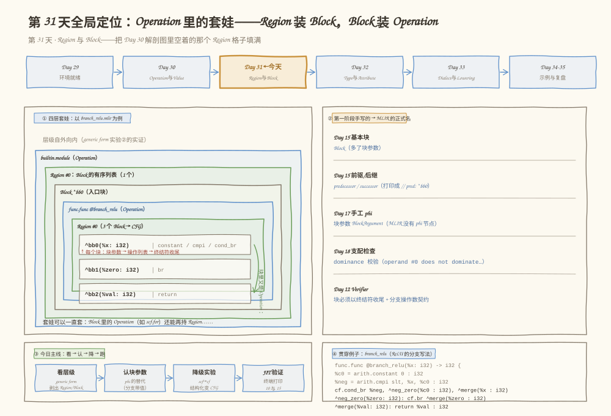
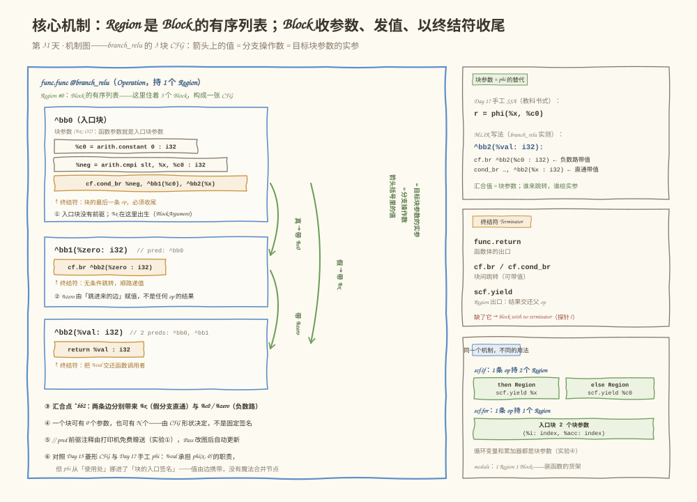
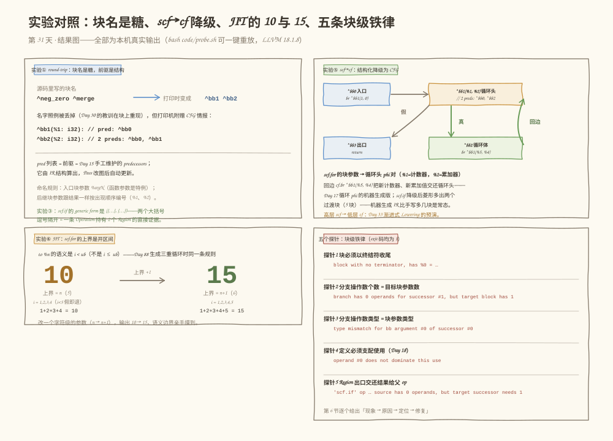

# 第 031 天：Region 与 Block——Operation 里的套娃，和 CFG 的重逢

> **今日目标**：完成本教程后，你能对着 `--mlir-print-op-generic` 的输出画出任意 MLIR 的 Region／Block 嵌套层级；能解释**函数参数就是入口块参数**、**块参数取代 phi** 这两条 MLIR 铁律；能读懂 `cf.cond_br`、`cf.br`、`scf.if`、`scf.for` 四种控制流写法并说出各自持有几个 Region；能用 `--convert-scf-to-cf` 亲眼看到结构化控制流被拆成块和跳转、看到循环变量变成循环头块参数；能说出 `block with no terminator`、`branch has 0 operands for successor #1`、`operand #0 does not dominate this use` 等五类真实报错各违反了哪条块级契约。
> **预计时间**：学习 25 分钟 ＋ 实践 45 分钟
> **前置准备**：Day 29 的 MLIR 环境（`mlir-opt-18`、`mlir-cpu-runner-18` 可用）；Day 30 的 Operation 五件套（名字·操作数·属性·Region·结果）——今天补的就是其中空着的 Region；Day 15 的基本块／前驱后继；Day 17 的 SSA 与 phi。
> **今日产出**：`code/` 下 5 个文件：`branch_relu.mlir`（3 块 CFG 主示例）、`if_relu.mlir`（一条 op 持 2 个 Region）、`loop_sum.mlir` 与 `loop_sum_closed.mlir`（scf.for 循环＋开区间对照）、`probe.sh`（一键重放 6 组实验和 5 个错误探针），以及它们在本机的真实运行记录；外加三张 Region／Block 结构与机制图。

## 1. 今天解决什么问题？

Day 30 结尾埋了两处伏笔：解剖图里 Operation 的 **Region 格子是空的**；generic form 里 `func.func` 的大括号和 `^bb0(%arg0: i32):` 这行块头只是"提前露脸"。今天回答三个具体问题：

1. **函数体、if 分支体、for 循环体，在 IR 数据结构里放在哪？** Day 30 说过"一切皆 Operation"——那 `module` 装函数、`scf.if` 装两个分支体、`scf.for` 装循环体，靠的是同一个机制：**Operation 可以持有 Region**。
2. **MLIR 没有 phi 节点，汇合点的值怎么表达？** Day 17 手工改写 SSA 时写过 `phi(x, 0)`；今天看 MLIR 把它变成了**块参数（BlockArgument）**——由"跳进来的边"负责带值。
3. **Day 15 手写的 CFG，在 MLIR 里的正式形态是什么？** 答案：**Block 就是基本块**（多了块参数），前驱后继关系就藏在 IR 结构里，连打印机都会替你标注出来。

贯穿全文的主例子是 `branch_relu(x) = x < 0 ? 0 : x`——Day 30 的 bias_relu 用一条 `arith.maxsi` 就写完的 ReLU，今天故意**拆成 3 个 Block 的菱形 CFG**，让 Region／Block／块参数／终结符全部现形。副例子两个：`if_relu`（同一个 ReLU 的 `scf.if` 写法，演示一条 op 持 2 个 Region）和 `loop_sum`（`scf.for` 循环求和，演示循环变量也是块参数，最后 JIT 跑出真实数字）。

**术语先对齐**：**Region（区域）**是 Operation 持有的嵌套子结构；**Block（块）**是 Region 里顺序排列的基本单位，对应 Day 15 的基本块；**BlockArgument（块参数）**是 Block 入口处定义的值；**Terminator（终结符）**是块最后一条操作，负责"离场方式"；**predecessor／successor（前驱／后继）**是块之间的跳转关系。

## 2. 先看全貌：今天的内容位于哪里？



**图 1**：看四个区域。顶部是第 5 周路线——昨天拆开了一行 IR，今天（琥珀色 TODAY 框）填上 Day 30 留空的 Region 格子，明天才是 Type／Attribute；左中的**套娃图**是今天最重要的一张图：`module`（Operation）持 Region，Region 装 Block，Block 里又有 `func.func`（Operation）……层级可以一直套下去；右中是"对上号"面板——你第一阶段手写的基本块、前驱后继、phi、支配检查、Verifier，今天全部在 MLIR 里对上正式名字；底部是今日四步主线和贯穿例子代码卡。

全局四步，今天走完一个闭环：

1. **看层级**：用 generic form 把 Region／Block 嵌套裸奔出来（实验②③）；
2. **认块参数**：理解"函数参数＝入口块参数""块参数＝phi 的替代"（实验①④）；
3. **降级实验**：`--convert-scf-to-cf` 把结构化控制流拆成块和跳转（实验⑤）；
4. **跑**：JIT 执行循环，终端打印 10 和 15（实验⑥）。

## 3. 核心概念：先用直觉，再给准确定义

### 3.1 Region：Operation 的"收纳空间"

一句通俗解释：Operation 自己只是一行"铭牌＋插槽"，**Region 才是它随身携带的收纳空间**——函数体、分支体、循环体都装在这里。

- **一个类比**：俄罗斯套娃。**对应到技术上是**：数据结构上 Region 极其简单——**它就是 Block 的有序列表**，没有别的字段；所以"持有一个 Region"="拥有一串 Block"。直线顺序的函数体是**单块 Region**，`scf.if` 的分支体也是单块 Region，而 `cf.cond_br` 造出来的控制流是**多块 Region**（`branch_relu` 的函数体 Region 里就有 3 个 Block）——Region 里长几个 Block，由 op 的语义决定。**类比的边界**：套娃每层只有一个内层，而一条 Operation 可以持有**多个** Region（`scf.if` 持 2 个：then 和 else），每个 Region 又可装多个 Block。
- **一个最小例子**：实验③的 generic form 里，`"scf.if"(%1) ({…}, {…}) : (i1) -> i32`——两个大括号逗号隔开，就是 2 个 Region 的直接证据；而 `"builtin.module"() ({…})` 是持 1 个 Region 的 Operation。
- **一个常见误解**："大括号只是语法糖。"不是——Region 在数据结构里真实存在，Pass 就靠它遍历嵌套结构。Day 33 的"渐进式 Lowering"，本质就是**把一个 Region 里的高层 op 换成低层 op，Region 这个壳反复复用**。

### 3.2 Block：Day 15 基本块的重逢

一句通俗解释：Block 是**顺序执行、只从第一条进、只从最后一条出**的一串操作——和 Day 15 手写的基本块完全同构，只多了一样东西：块参数。

- **一个类比**：流水线上的一段直线轨道——进门先领行李（块参数），走到头必须刷卡出站（终结符），中途不许跳进跳出。**对应到技术上是**：Block = **块参数列表 ＋ 操作列表 ＋ 最后一条必须是终结符**。块与块之间由终结符的**后继（successor）**连成 CFG；反过来每个块记着自己的**前驱（predecessor）**——实验①里打印机白送的 `// pred: ^bb0` 注释就是它。**类比的边界**："必须刷卡出站"有个例外：像 `builtin.module` 这类声明了无终结符 Region 的 op，它的块可以没有终结符直接收尾（实验②的 module 块里就没有 terminator，这是 op 自己声明的特权）。
- **沿用同一个例子**：`branch_relu` 的函数体 Region 里住着 3 个 Block——`^bb0`（入口）、`^bb1`（负数路）、`^bb2`（汇合）——正好是 Day 15 画过的菱形 CFG。
- **一个常见误解**："Block 和函数体是一回事。"函数体是**单块 Region** 的特例；Region 可以装任意多个 Block，多块时就有了控制流。反过来，一个模块里放两个函数，是 module 的 Region 里有两个"函数体"，不是一个 Region 里塞两个块。

### 3.3 BlockArgument：phi 的替代，函数参数的真相

一句通俗解释：块参数是**写在块的入口签名里的值**——它不由任何 op 产出，而由**跳进这个块的边**负责提供实参。

- **一个类比**：会议室门口的签到台——不管你从哪个门进来，都要把要交接的材料放到台上，会后大家都从台上取。**对应到技术上是**：Day 17 教科书式 SSA 里汇合点要写 `r = phi(%x, %c0)`（"根据来路取不同值"）；MLIR 把这变成了**块参数**：`^merge(%val: i32)` 声明在块头，每条跳转边用 `cf.br ^merge(%x : i32)` 这样的**分支操作数**交实参。phi 从"使用处的魔法节点"变成了"块入口的显式签名"——这正是 MLIR 比 LLVM IR 更适合多层编译的地方之一。**类比的边界**：签到台谁都能放材料，但**分支操作数的个数和类型必须与目标块参数严格一致**（第 6 节探针 2、3 就是违反它的报错）。
- **沿用同一个例子**，`branch_relu` 的 5 个值现在的定义方式分成了三类（对照 Day 30 的表，多了"后继块参数"这一类）：

| 值 | 定义方式 | 定义者 |
|---|---|---|
| %x | 入口块参数 | ^bb0（**函数参数就是入口块参数**——Day 30 的 %arg0 之谜今日结案） |
| %c0 / %neg | OpResult | ^bb0 里的 constant / cmpi |
| %zero | 后继块参数 | ^bb1（由 `cf.cond_br` 的真分支带 %c0 进来） |
| %val | 后继块参数 | ^bb2（两条边分别带 %x 和 %zero 进来——它就是 phi） |

- **一个常见误解**："循环变量是普通变量。"看实验④：`scf.for %i = … iter_args(%acc = …)` 里的 `%i` 和 `%acc` 都是 scf.for 那个 Region **入口块的块参数**——循环每转一圈，就相当于"带着新值重新进入这个块"，回边交值、块头收值，和 `^merge` 的原理一模一样。

### 3.4 Terminator：块的离场契约

一句通俗解释：终结符是块最后一条 op，负责回答"控制流从这里出去后去哪、顺路带什么值"。

- **一个类比**：酒店房门的门禁卡——退房时必须刷卡（告诉系统你走了），卡上还能捎带信息。**对应到技术上是**：三类常客：`func.return`（函数体出口，值交还调用者）、`cf.br`／`cf.cond_br`（跳到后继块，可携带分支操作数）、`scf.yield`（**Region 的出口**——把结果交还**父 Operation**，所以 `scf.if` 能"返回"一个值）。探针 5 的报错本质就是：`scf.if` 声明了要产出 i32，但 then Region 的 yield 空着手出门。**类比的边界**：终结符首先是**一条普通的 Operation**——它也有名字、操作数、属性，只是被赋予了"必须垫底"的义务。
- **一个最小例子**：`branch_relu` 三个块的终结符分别是 `cf.cond_br`、`cf.br`、`func.return`；缺了它就是探针 1 的 `error: block with no terminator`。

## 4. 图解核心机制

概念齐了，剩下的关键问题是：**func.func 的 Region、3 个 Block、带值的跳转边，在一张图上怎么画？**



**图 2**：从左往右看。主面板是 `func.func`（蓝框 Operation）持有的 Region（住着 3 个 Block）：`^bb0` 的三行 op 以琥珀色 `cf.cond_br` 收尾——**终结符必须垫底**；右侧走廊三条绿边是 CFG：**真分支带 %c0 进 ^bb1，假分支带 %x 直通 ^bb2，^bb1 再带 %zero 进 ^bb2**——箭头括号里的值就是分支操作数，就是目标块参数的实参；`^bb2` 头上的 `// 2 preds` 是前驱注释。右上卡片是 phi 对照：`%val` 承担 `phi(%x, %c0)` 的职责；右中是三类终结符；右下是"同一个机制不同的用法"——`scf.if` 持 2 个 Region、`scf.for` 持 1 个 Region（入口块 2 个块参数）、`module` 持 1 Region 1 Block。

按编号讲四步：

**① 入口块与它的参数**。`^bb0` 没有前驱，`%x` 在块头出生——这就是"函数参数＝入口块参数"。块的通用形态：块参数 → 操作列表 → 终结符收尾。

**② 后继块参数由边赋值**。`^bb1(%zero: i32)` 的 `%zero` 不是任何 op 的结果，是 `cf.cond_br` 真分支带进来的 `%c0` 的别名——同一趟执行里两者是同一个值。

**③ 汇合点就是 phi**。`^bb2(%val: i32)` 有两个前驱：直通边带 `%x`、负数路带 `%zero`。`return %val` 用的"是哪一个"，取决于运行时从哪条边进来——Day 17 的 phi 在这里落地。

**④ 边上的括号值是硬契约**。`cf.cond_br %neg, ^bb1(%c0 : i32), ^bb2(%x : i32)`——每个后继后面括号里的操作数，个数和类型必须严格匹配目标块的参数表，第 6 节探针 2、3 专门验证这条。

## 5. 动手实践：构造、拆解、降级、执行

### 5.1 准备文件

```text
tutorials/day-031/
├── README.md                 ← 本教程
├── images/                   ← 三张图
└── code/
    ├── branch_relu.mlir      ← ① 主示例：cf.cond_br 版 ReLU（3 块 CFG ＋ 块参数）
    ├── if_relu.mlir          ← ② scf.if：一条 op 持 2 个 Region
    ├── loop_sum.mlir         ← ③ scf.for：循环变量与 iter_args 都是块参数
    ├── loop_sum_closed.mlir  ← ④ 5.4 节对照实验（上界 n → n+1）
    └── probe.sh              ← ⑤ 一键重放全部实验（含 5 个错误探针）
```

命令统一在 `tutorials/day-031/` 目录下执行；本机环境为 Ubuntu 20.04（aarch64）、LLVM 18.1.8（`mlir-opt-18`），与 Day 29／30 记录一致。

### 5.2 编写代码：主例子的完整标注

`branch_relu.mlir` 全文如下（`code/branch_relu.mlir`，注释即交付物）：

```mlir
// 层级自外向内：module（Operation，持 1 个 Region）
//   └─ Region ─ Block ^bb0 ─ func.func（Operation，持 1 个 Region）
//       └─ Region：3 个 Block 的菱形 CFG
module {
  func.func @branch_relu(%x: i32) -> i32 {
    // [定义] %c0、%neg —— 都定义在入口块 ^bb0
    %c0 = arith.constant 0 : i32
    %neg = arith.cmpi slt, %x, %c0 : i32

    // [终结符] 条件分支：真 → ^neg_zero 带 %c0；假 → ^merge 带 %x
    // 括号里的 (%c0 : i32) / (%x : i32) 是分支操作数——目标块参数的实参
    cf.cond_br %neg, ^neg_zero(%c0 : i32), ^merge(%x : i32)

  // ^neg_zero：负数路。(%zero: i32) 是后继块参数，由跳进来的边赋值
  ^neg_zero(%zero: i32):
    cf.br ^merge(%zero : i32)

  // ^merge：汇合块。%val 承担 Day 17 教科书里 phi(x, 0) 的职责
  ^merge(%val: i32):
    return %val : i32
  }
}
```

两个阅读要点：**(a)** 源码里的块名 `^neg_zero`、`^merge` 是自定义标签，round-trip 后会被换成 `^bb1`、`^bb2`——Day 30"名字是糖"的教训在块名上重现；**(b)** 同一个 ReLU 的 `scf.if` 写法在 `code/if_relu.mlir`（then／else 各一个 Region，各以 `scf.yield` 收尾），三种写法语义等价：`maxsi`（Day 30）／`cf.cond_br`（本文件）／`scf.if`。

`loop_sum.mlir` 的关键部分（完整文件见 `code/loop_sum.mlir`）：

```mlir
func.func @sum_to_n(%n: i32) -> i32 {
  %zero = arith.constant 0 : index
  %one = arith.constant 1 : index
  %n_idx = arith.index_cast %n : i32 to index
  // %i（循环变量）和 %acc（iter_args 初值 %zero）都是 scf.for
  // 那个 Region 入口块的块参数；scf.yield 把新累加值交还循环头
  %sum_idx = scf.for %i = %one to %n_idx step %one
                 iter_args(%acc = %zero) -> (index) {
    %new_acc = arith.addi %acc, %i : index
    scf.yield %new_acc : index
  }
  %sum = arith.index_cast %sum_idx : index to i32
  return %sum : i32
}
```

这里有一段真实翻车记录：我最初直接拿 `i32` 常量当 `scf.for` 的边界，当场被拦——`error: use of value '%c1' expects different type than prior uses: 'index' vs 'i32'`。**`scf.for` 的下界、上界、步长必须是 `index` 类型**（Day 30 类型巡游预告过的"循环下标专用类型"），所以入口用 `arith.index_cast` 把 `i32` 转成 `index`，出口再转回来——这个 op 只负责 index 与整数之间的互转，Day 32 讲 Type 时会再见到它。

### 5.3 运行与观察：六个实验（全部本机真实输出）

以下输出均为 2026-11-12 在本机的真实运行结果（可用 `bash code/probe.sh` 一键重放）。

**实验① round-trip：块名被换，前驱注释白送**

```bash
$ mlir-opt-18 code/branch_relu.mlir
module {
  func.func @branch_relu(%arg0: i32) -> i32 {
    %c0_i32 = arith.constant 0 : i32
    %0 = arith.cmpi slt, %arg0, %c0_i32 : i32
    cf.cond_br %0, ^bb1(%c0_i32 : i32), ^bb2(%arg0 : i32)
  ^bb1(%1: i32):  // pred: ^bb0
    cf.br ^bb2(%1 : i32)
  ^bb2(%2: i32):  // 2 preds: ^bb0, ^bb1
    return %2 : i32
  }
}
```

三个观察：**(a)** 我起的块名 `^neg_zero`／`^merge` 变成了 `^bb1`／`^bb2`（按出现顺序编号，入口块天然是 `^bb0`）；**(b)** 打印机**免费赠送前驱注释**——`// pred: ^bb0`、`// 2 preds: ^bb0, ^bb1`，这就是 Day 15 手工维护的 predecessors 列表，由 IR 结构算出，Pass 改图后自动更新；**(c)** 注意命名规则：入口块参数打印成 `%arg0`（arg 前缀），后继块参数却打印成 `%1`、`%2`（跟结果一样按出现顺序编号）。

**实验② generic form：Region／Block 层级裸奔**

```bash
$ mlir-opt-18 code/branch_relu.mlir --mlir-print-op-generic
"builtin.module"() ({
  "func.func"() <{function_type = (i32) -> i32, sym_name = "branch_relu"}> ({
  ^bb0(%arg0: i32):
    %0 = "arith.constant"() <{value = 0 : i32}> : () -> i32
    %1 = "arith.cmpi"(%arg0, %0) <{predicate = 2 : i64}> : (i32, i32) -> i1
    "cf.cond_br"(%1, %0, %arg0)[^bb1, ^bb2] <{operandSegmentSizes = array<i32: 1, 1, 1>}> : (i1, i32, i32) -> ()
  ^bb1(%2: i32):  // pred: ^bb0
    "cf.br"(%2)[^bb2] : (i32) -> ()
  ^bb2(%3: i32):  // 2 preds: ^bb0, ^bb1
    "func.return"(%3) : (i32) -> ()
  }) : () -> ()
}) : () -> ()
```

对照 Day 30 的五件套版式，今天多了两样新东西：**方括号 `[^bb1, ^bb2]` 是后继块列表**（successors，Day 30 提过的"冷门成员"今日到岗）；`operandSegmentSizes = array<i32: 1, 1, 1>` 说明 3 个操作数被切成三段——条件 1 个、真分支实参 1 个、假分支实参 1 个。另外注意：`module` 的块里**没有终结符**，直接靠大括号收尾——这是 op 声明的无终结符 Region 特权（3.2 节说的例外）。

**实验③ scf.if：一条 Operation 持有两个 Region**

```bash
$ mlir-opt-18 code/if_relu.mlir --mlir-print-op-generic
"builtin.module"() ({
  "func.func"() <{function_type = (i32) -> i32, sym_name = "if_relu"}> ({
  ^bb0(%arg0: i32):
    %0 = "arith.constant"() <{value = 0 : i32}> : () -> i32
    %1 = "arith.cmpi"(%arg0, %0) <{predicate = 4 : i64}> : (i32, i32) -> i1
    %2 = "scf.if"(%1) ({
      "scf.yield"(%arg0) : (i32) -> ()
    }, {
      "scf.yield"(%0) : (i32) -> ()
    }) : (i1) -> i32
    "func.return"(%2) : (i32) -> ()
  }) : () -> ()
}) : () -> ()
```

看 `"scf.if"(%1) ({…}, {…})`：**圆括号里是操作数（条件），两个大括号用逗号隔开——就是 2 个 Region**。then Region 里 `scf.yield(%arg0)`、else Region 里 `scf.yield(%0)`，两个出口各交还一个 i32，父操作把它收成结果 `%2`。"结构化控制流"的神秘感到此为止：它就是"把 Region 的形状约束得好记好优化"。

**实验④ scf.for：循环变量就是块参数**

```bash
$ mlir-opt-18 code/loop_sum.mlir
module {
  func.func @sum_to_n(%arg0: i32) -> i32 {
    %c0 = arith.constant 0 : index
    %c1 = arith.constant 1 : index
    %0 = arith.index_cast %arg0 : i32 to index
    %1 = scf.for %arg1 = %c1 to %0 step %c1 iter_args(%arg2 = %c0) -> (index) {
      %3 = arith.addi %arg2, %arg1 : index
      scf.yield %3 : index
    }
    %2 = arith.index_cast %1 : index to i32
    return %2 : i32
  }
  ...
```

round-trip 后 `%i`、`%acc` 打印成了 `%arg1`、`%arg2`——**arg 前缀再次暴露"我是块参数"**。为什么从 `%arg1` 而不是 `%arg0` 开始编号？因为外层函数的 `%arg0` 在嵌套 Region 里仍然可见（Region 能看见外层定义的值），打印机接着排号。对照实验①的后继块参数 `%1`、`%2`：**入口块参数用 arg 前缀，后继块参数按结果式编号**——两条命名规则今天全部凑齐。

**实验⑤ --convert-scf-to-cf：结构化降级为 CFG（今天的高潮）**

```bash
$ mlir-opt-18 code/loop_sum.mlir --convert-scf-to-cf
module {
  func.func @sum_to_n(%arg0: i32) -> i32 {
    %c0 = arith.constant 0 : index
    %c1 = arith.constant 1 : index
    %0 = arith.index_cast %arg0 : i32 to index
    cf.br ^bb1(%c1, %c0 : index, index)
  ^bb1(%1: index, %2: index):  // 2 preds: ^bb0, ^bb2
    %3 = arith.cmpi slt, %1, %0 : index
    cf.cond_br %3, ^bb2, ^bb3
  ^bb2:  // pred: ^bb1
    %4 = arith.addi %2, %1 : index
    %5 = arith.addi %1, %c1 : index
    cf.br ^bb1(%5, %4 : index, index)
  ^bb3:  // pred: ^bb1
    %6 = arith.index_cast %2 : index to i32
    return %6 : i32
  }
  ...
```

一条 `scf.for` 被拆成了 4 个块的循环：入口 `cf.br ^bb1(%c1, %c0)` 带着**初始计数器和初始累加值**进循环头；`^bb1(%1, %2)` 是**循环头，2 个前驱（入口＋回边）**——`%1`、`%2` 正是 Day 17 里循环头那对 phi（新计数器、新累加值）的机器生成版；回边 `cf.br ^bb1(%5, %4)` 把"加过 1 的计数器、加过 i 的累加值"交还循环头。`if_relu` 的降级（probe.sh 同段）同样精彩：`scf.if` 变成 5 块菱形，结果值变成汇合块参数 `%1`。**高层 scf → 低层 cf，Region 反复复用、Block 拆开重组——这就是 Day 33"渐进式 Lowering"的预演。**另外注意：机器生成的菱形比手写的多两个过渡块，机器生成 IR 比手写多几块是常态。

**实验⑥ JIT：终端打印 10**

```bash
$ mlir-opt-18 code/loop_sum.mlir --convert-scf-to-cf --convert-cf-to-llvm \
    --convert-func-to-llvm --convert-arith-to-llvm -o /tmp/day031_open.llvm.mlir
$ mlir-cpu-runner-18 /tmp/day031_open.llvm.mlir --entry-point-result=i32
10
```

和 Day 30 一样的两步走。`sum_to_n(5)` 打印 **10** 而不是 15——为什么？看 5.4 节。



**图 3**：四个面板收拢全部真实结果——A 是实验①的"块名是糖、前驱是结构"；B 是实验⑤的循环小图：回边把 `(新计数器, 新累加值)` 交还循环头，**scf.for 的块参数就这样变成了循环头 phi 对**；C 是实验⑥的 10 与 15：`to %n` 的语义是 `i < ub`（开区间），上界加一后 1+2+3+4+5=15；D 是五个错误探针对应的五条块级铁律（第 6 节逐个拆）。

### 5.4 修改一个参数再观察

**实验：把上界从 n 换成 n+1**。`loop_sum_closed.mlir` 与 `loop_sum.mlir` 只差一行——多算一个 `%n_plus = arith.addi %n_idx, %one : index`，把 `scf.for` 的上界从 `%n_idx` 换成 `%n_plus`，循环体一个字都不改。**先预测再验证**（本机真实输出）：

```bash
$ mlir-cpu-runner-18 /tmp/day031_closed.llvm.mlir --entry-point-result=i32
15
```

答案解释了实验⑥的 10：**`scf.for` 的上界是开区间**——`for %i = %one to %n` 的语义是"只要 `%i < %n` 就继续"。`n = 5` 时 `%i` 取 1、2、3、4（`5 < 5` 为假即退出），和是 10；上界换成 6 后 `%i` 取到 5，和是 15。**Day 88 生成三重循环时用的同一条规则**，今天先用 JIT 亲手摸到了边界。改一个字符级的参数，输出 10 → 15——这就是"读 IR 要读出语义边界"的直观版。

## 6. 常见错误与排查

五个探针都在 `probe.sh` 里，可一键重放（探针文件由脚本在临时目录生成，下述路径略作缩写）；报错均为本机真实输出，exit 码均为 1。

**错误 1：`error: block with no terminator, has %0 = "arith.constant"…`**
现象：函数体里只写了一条 `arith.constant`，没有 return，也没有分支。
原因：块的最后一条操作必须是终结符——"顺序执行到底然后呢？"没有答案，IR 不合法。
定位：报错位置直接指向块里**最后一条**（也是唯一一条）op，并附 `note: see current operation` 打出它的 generic 形态。
修复：补上 `return` 或分支。这也解释了为什么写 MLIR 时"忘写 return"从不是运行时错误——它在验证层就被拦下。

**错误 2：`error: branch has 0 operands for successor #1, but target block has 1`**
现象：`cf.cond_br %neg, ^a, ^merge` 跳向带 1 个参数的 `^merge`，却没提供实参。
原因：分支操作数个数必须等于目标块参数个数——签名与实参的契约。
定位：报错指向 cond_br 那一行；note 里的 `operandSegmentSizes = array<i32: 1, 0, 0>` 显示"条件 1 个、两个后继各 0 个实参"。
修复：补上 `^merge(%c0 : i32)`。**图 2 右侧走廊那三条带值箭头，违反契约就是这条报错。**

**错误 3：`error: type mismatch for bb argument #0 of successor #0`**
现象：`cf.br ^merge(%c0 : i32)` 跳向块参数为 `f32` 的 `^merge`。
原因：分支操作数的**类型**也必须与目标块参数一致——个数对了还不够。
定位：报错指向 cf.br 行，`bb argument #0` 说的就是目标块 0 号参数。
修复：统一类型，或先插类型转换 op（Day 32 的主题之一）。

**错误 4：`error: operand #0 does not dominate this use`**
现象：`%va` 定义在 `^a` 块里，却在两条路都可能的 `^merge` 块里使用。
原因：违反支配关系——从 `^b` 进 `^merge` 时 `%va` 根本不存在。**Day 18 手工算过的支配树，在 MLIR 里由 Verifier 强制执行**；note 里那句 `operand defined here (op in the same region)` 还提示了另一个要点：**支配检查以 Region 为范围**。
定位：报错指向使用处，note 指回定义处，两行对起来看。
修复：把值改成块参数（由边携带进来），或把定义挪到支配使用处的地方——前者正是 MLIR 的惯用解法。

**错误 5：`error: 'scf.if' op region control flow edge from Region #0 to parent results: source has 0 operands, but target successor needs 1`**
现象：`%r = scf.if %pos -> (i32) { }`——then Region 里忘了写 `scf.yield`。
原因：`scf.if` 声明了产出 1 个 i32，但 Region 出口空手离场——**yield 是 Region 与父操作之间的交割单**。
定位：报错位置指向 scf.if；note 直接打出它的 generic 形态，两个 Region 里的 yield 一空一有，一眼可见。
修复：then Region 里补 `scf.yield %x : i32`。这条报错把"Region 出口契约"暴露得最彻底。

**错误 6（一句话预防）：把打印出来的 `^bb1` 当源码里的块名**。源码里搜 `^bb1` 搜不到——那是打印机按顺序分配的标签，你的 `^neg_zero` 早就被丢了（实验①）。调试时认结构和前驱注释，不认块名——Day 30 的教训在块上同样成立。

## 7. 今日练习

### 必做练习：给降级后的循环做一次完整标注＋一个预测

(1) 仿照 5.2 的格式，给实验⑤ `--convert-scf-to-cf` 输出的 `sum_to_n` 做块级标注：每个块的**块参数**、**终结符**、**前驱**，以及两条 `cf.br ^bb1(…)` 各自带了什么值、对应哪对块参数；(2) **先预测**：把 main 里的 5 改成 1（即 `sum_to_n(1)`），JIT 会打印几？(3) 跑命令验证，并用一句话解释。预期产出：你手写的标注＋一份"预测 vs 实测"记录。（提示：循环一次都不执行时，返回的是 iter_args 的初值——但请先写下预测再验证。）

### 选做挑战：三个小扩展

任选其一：(a) 给 `branch_relu.mlir` 加第三路分支 `^big`（`|x| > 100` 时返回 100，需要两个 `cmpi` 和一条三路 `cf.cond_br`——它有两个条件操作数、三个后继），跑 round-trip 看前驱注释怎么变；(b) 给 `loop_sum.mlir` 的 `iter_args` 加第二个块参数（比如同时累乘 `%prod`，初值 1），验证多 iter_args 的写法和 `scf.yield` 交还多个值的写法；(c) 查 MLIR 文档写一个 `scf.while` 版本的 `sum_to_n`（before／after 两个 Region），用 generic form 数一数它持几个 Region、各带什么块参数。

## 8. 今日验收

- [ ] 我能对着 `--mlir-print-op-generic` 的输出说出任意 op 的 Region 数量和每个 Region 里的 Block 数（`scf.if` 是 2 个 Region、`scf.for` 是 1 个 Region、`module` 是 1 Region 1 Block）；
- [ ] 我能用自己的话解释"函数参数就是入口块参数"和"块参数取代 phi"，并指着 `branch_relu` 的 `^merge(%val)` 说出两条入边各带什么值；
- [ ] 我能独立运行 `bash code/probe.sh`，指出实验⑤里哪个块是循环头、哪条是回边、`(%1, %2)` 对应 scf.for 的哪两个块参数；
- [ ] 我能说出 `scf.for` 上界的开区间语义，并解释为什么 `sum_to_n(5)` 是 10 而 `sum_to_n(1)` 是练习里那个答案；
- [ ] 我能说出五个真实报错各违反哪条块级契约（终结符垫底／分支操作数个数／类型一致／支配关系／Region 出口交割），并保存了 `probe.sh` 的运行记录和三张结构图。

## 9. 一句话总结与明天预告

今天的问题是"Day 30 解剖图里空着的 Region 格子到底是什么"；机制上要记住的是：**Operation 持有 Region，Region 是 Block 的有序列表，Block＝块参数＋操作列表＋终结符；块参数取代 phi、函数参数就是入口块参数，前驱后继关系藏在 IR 结构里**；实践上用 `branch_relu`／`if_relu`／`loop_sum` 三个例子走了"看层级→认块参数→降级→执行"的完整闭环；验证方式是打印机白送的 `// pred` 注释、`--convert-scf-to-cf` 拆出来的循环头 phi 对，以及终端里真实的 10 和 15。明天（Day 32）给今天反复出场的 `i32`、`index`、`tensor<2x3xf32>` 上户口：Type 与 Attribute——为什么常量 0 是属性 `value = 0 : i32` 而不是类型，答案就藏在"类型是值的标签、属性是 op 的铭牌"这条分工里。
