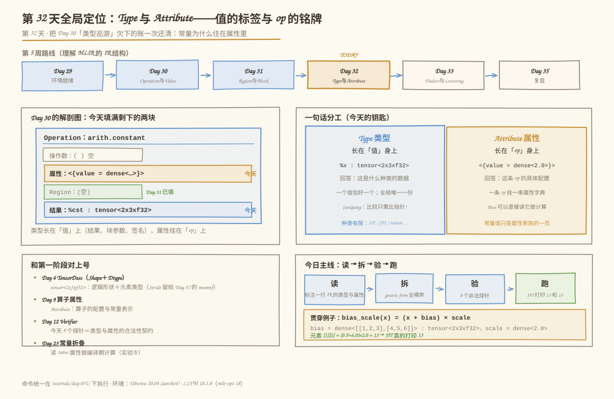
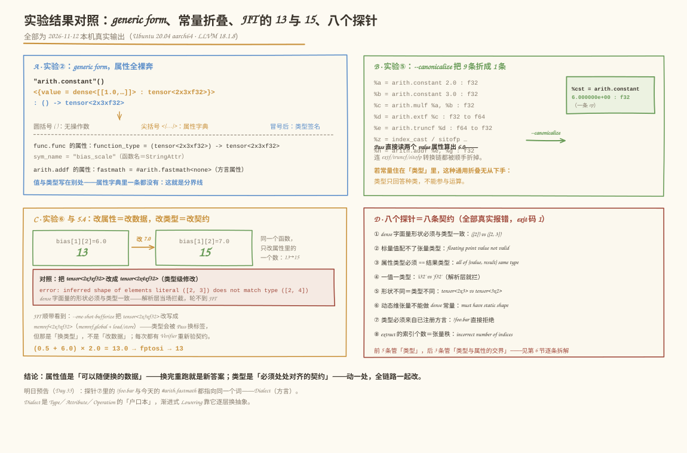

# 第 032 天：Type 与 Attribute——值的标签与 op 的铭牌

> **今日目标**：完成本教程后，你能对任意一行 IR（比如 `%bias = arith.constant dense<[[1.0, 2.0, 3.0], [4.0, 5.0, 6.0]]> : tensor<2x3xf32>`）一口气指出哪些词是 **Type**、哪些词是 **Attribute**、各自长在谁身上；能逐字符拆解 `tensor<2x3xf32>`，说清静态维、动态维 `?`、混合维和 0 维张量各自意味着什么、`?` 的数值靠什么在运行期拿到；能回答本日灵魂问题——**为什么常量值住在 Attribute 里而不是 Type 里**，并用 `--canonicalize` 折叠实验给出证据；能说出 `inferred shape of elements literal ([2]) does not match type ([2, 3])` 等 8 类真实报错各违反了哪条契约；并用 JIT 跑出真实的 13 和 15。
> **预计时间**：学习 25 分钟 ＋ 实践 45 分钟
> **前置准备**：Day 29 的 MLIR 环境（`mlir-opt-18`、`mlir-cpu-runner-18` 可用）；Day 30 的 Operation 五件套（名字·操作数·属性·Region·结果——今天填满其中"属性"和"类型"两块）；Day 31 的块参数与 `scf.for`（可执行示例里会再次用到）；Day 4 的 TensorDesc（Shape／Dtype 三件套）。
> **今日产出**：`code/` 下 7 个文件：`bias_scale.mlir`（张量版主示例）、`bias_scale_run.mlir`／`bias_scale_run7.mlir`（可执行版与 5.4 对照版）、`type_gallery.mlir`（10 个合法类型的画廊）、`dyn_dims.mlir`（动态维）、`fold_demo.mlir`（折叠实验）、`probe.sh`（一键重放 6 组实验＋8 个错误探针），以及它们在本机的真实运行记录；外加三张 Type／Attribute 机制图。

## 1. 今天解决什么问题？

Day 30 和 Day 31 各埋了一处伏笔。Day 30 的解剖图里，Operation 的**属性格子**只在 `arith.constant` 身上露过一次脸（`value = 0 : i32`），"类型巡游"五个类型走马观花，文末写着"深挖留给 Day 32"；Day 31 的 `loop_sum` 里，`scf.for` 的边界被迫用 `arith.index_cast` 在 `i32` 和 `index` 之间倒腾，文末预告"Day 32 讲 Type 时会再见到它"。今天还账，回答三个具体问题：

1. **`func.func @bias_scale(%x: tensor<2x3xf32>) -> tensor<2x3xf32>` 这一行里，`tensor<2x3xf32>` 和 `<{sym_name = "bias_scale"}>` 各是什么？** 前者是 **Type（类型）**——长在值身上的标签；后者是 **Attribute（属性）**——挂在 op 身上的铭牌。它们一个出现在冒号后、一个出现在尖括号里，不是排版习惯，是两种不同的东西。
2. **常量 6.0 是数据，为什么它不是类型的一部分？** 比如为什么不写成 `tensor<2x3 x const6>`？今天用折叠实验给出证据：**类型只回答"这是什么种类"，属性才承载"具体是什么数"，而且 Pass 能把属性读出来参与编译期计算**。
3. **`tensor<2x3xf32>` 和 `tensor<?x?xf32>` 差在哪？** `?` 不是"任意"，是"编译期不知道、运行期才知道"——那运行期靠什么拿到？`tensor.dim`。

贯穿全文的主例子是 `bias_scale(x) = (x + bias) × scale`，作用在 `tensor<2x3xf32>` 上：`bias` 是逐元素给出的 **DenseElementsAttr**，`scale` 是一个数铺满全形的 **splat** 属性。因为 `arith` 的张量级算术 op 在 bufferization 里没有转换规则（第 5.3 节实验⑥会解释），可执行版本 `bias_scale_run.mlir` 把它**亲手展开成标量循环**——这恰好是 Day 88"生成三重循环"的预告，也让我们把 `tensor.extract`／`tensor.insert`／cast 家族一次看全。

**术语先对齐**：**Type（类型）**是每个 SSA 值携带的种类标签，如 `i32`、`tensor<2x3xf32>`；**Attribute（属性）**是挂在 Operation 上的编译期常量数据，如 `value`、`sym_name`；**Tensor 类型**由形状（每维一个整数或 `?`）加元素类型组成；**静态维／动态维**指编译期已知／未知的维度；**DenseElementsAttr** 是逐元素存放张量数据的属性，**splat** 是"一个值铺满整个形状"的紧凑写法；**cast** 泛指 `arith.index_cast`、`arith.extf` 这类显式类型转换 op。

## 2. 先看全貌：今天的内容位于哪里？



**图 1**：看四个区域。顶部是第 5 周路线——昨天填满了 Region 格子，今天（琥珀色 TODAY 框）给反复出场的 `i32`、`index`、`tensor<2x3xf32>` 上户口；左中是 Day 30 解剖图的回访：**属性格子和结果上的类型签名正是今天要填满的两块**；右中是今天的钥匙——一句话分工：**Type 长在"值"身上，Attribute 长在"op"身上**；左下把你第一阶段的东西对上号（Day 4 的 Shape／Dtype、Day 9 的算子属性、Day 12 的 Verifier、Day 23 的常量折叠）；底部是今日四步主线和贯穿例子代码卡。

全局四步，今天走完一个闭环：

1. **读**：给一行常量 IR 标注值、类型、属性（5.2 节）；
2. **拆**：generic form 把属性字典裸奔出来（实验②）；
3. **验**：10 个合法类型入画廊，8 个非法探针看契约（实验③＋第 6 节）；
4. **跑**：标量循环版 JIT 打印 13，改一个属性数字打印 15（实验⑥＋5.4 节）。

## 3. 核心概念：先用直觉，再给准确定义

### 3.1 Type：每个值唯一的标签

一句通俗解释：Type 是**贴在值身上的种类标签**——`%x: tensor<2x3xf32>` 里冒号后面的就是它，回答"这个值是什么种类的数据"。

- **一个类比**：行李箱上的托运标签（Day 30 用过，今天往深看一层）。**对应到技术上是**：标签只写"易碎·20kg"这类**分类信息**，不写箱子里装了什么；MLIR 里类型出现在且只出现在三个位置——**块参数头**（`^bb0(%arg0: tensor<2x3xf32>):`，Day 31 讲过函数参数就是入口块参数）、**op 的结果签名**（`… : tensor<2x3xf32>`）、**函数签名**（`function_type`）。三个位置引用的是**同一份类型对象**：类型在 `MLIRContext` 里全局唯一化（uniquing），全工程 `tensor<2x3xf32>` 只有一份，比较两个类型是否相等只需比指针。**类比的边界**：托运标签可以撕了重贴，类型不行——它和值一起出生一起销毁，想"换标签"必须经过显式的 cast op（3.4 节），这是 MLIR 拒绝隐式转换的根源。
- **一个最小例子**：`%cst = arith.constant dense<2.0> : tensor<2x3xf32>`——`%cst` 这个值从出生起就带着 `tensor<2x3xf32>` 标签，后面每次使用都要再声明一次且必须一字不差（Day 30 的"一值一类型"铁律）。
- **一个常见误解**："类型里有形状，所以形状信息归值管。"形状确实写在类型里（`2x3`），但它是**分类信息**：`tensor<2x3xf32>` 描述的是"所有 2 行 3 列 f32 张量"这个种类，不是某一张具体张量的数据。

### 3.2 Attribute：挂在 op 上的铭牌

一句通俗解释：Attribute 是**挂在 Operation 身上的铭牌**——写着这条 op 的具体配置：常量的数值、函数的名字、浮点运算的宽松标志。

- **一个类比**：设备的出厂铭牌。**对应到技术上是**：铭牌属于设备（op），不属于流水线上被加工的物料（值）；一条 op 可以挂一整面铭牌墙（属性字典 `<{…}>`），每块铭牌是"键＝值"对。今天的例子会见到六块铭牌：`value = 0 : i32`（标量常量）、`value = dense<[[…]]>`（张量数据）、`value = dense<2.0>`（splat）、`sym_name = "bias_scale"`（函数名）、`fastmath = #arith.fastmath<none>`（浮点标志）、`function_type = (…) -> …`（函数签名——类型本身也能当属性存，叫 TypeAttr）。属性和类型一样**不可变**：修改属性＝构造一个新属性重新挂上。**类比的边界**：铭牌是"死"的牌子，属性却是 Pass 眼里的**活数据**——`--canonicalize` 能把 `value` 属性里的 2.0 和 3.0 读出来乘成 6.0（实验⑤），这是铭牌做不到的。
- **一个最小例子**：generic form 里 `%0 = "arith.constant"() <{value = dense<…> : tensor<2x3xf32>}> : () -> tensor<2x3xf32>`——圆括号空（无操作数），尖括号里是属性字典，冒号后是类型签名，三个区域各管各的。
- **一个常见误解**："`#` 开头的东西是注释。"恰恰相反——`#arith.fastmath<none>` 是**方言属性**（dialect attribute），`#` 前缀专门用来区分它和内建属性。`!` 前缀则标记方言类型（探针⑦的 `!foo.bar`）。注释是 `//`。

### 3.3 灵魂问题：为什么常量值通常不是 Type？

计划里今天的学习目标原话是"Type 和 Attribute 的区别，**为什么常量值通常不是 Type**"。分三层回答：

**第一层：分工不同。** 类型回答"**是什么种类**"，面向无限多个值——`tensor<2x3xf32>` 被所有 2×3 的 f32 张量共享；常量回答"**具体是哪个**"，属于一条 op 私有——`bias` 的 6.0 只属于那条 `arith.constant`。种类是有限的、可枚举的；具体的数是无限的。

**第二层：工程上撑不住。** 假如把常量塞进类型，写成 `tensor<2x3 x val6>`：那 `val6.1`、`val6.01`……每个数都得是一个新类型，类型集合无限爆炸，uniquing 缓存和"比指针判等"全部失效；Verifier、Pass 的模式匹配也要跟着对无穷类型做匹配。而现实里 `value = dense<…>` 作为属性挂在 op 上，类型系统保持小而稳定。

**第三层（今天的实验证据）：属性能被读出来参与计算，类型不能。** 打开 `code/fold_demo.mlir`：9 条 op 里有两个常量、一次乘法、还有一条 cast 链（`extf`→`truncf`、`index_cast`→`sitofp`）。跑 `--canonicalize`（5.3 节实验⑤），9 条折成 1 条 `arith.constant 6.0`。折叠的原理正是：Pass 读出两条 op 的 `value` 属性，在编译期算出 2.0 × 3.0 = 6.0，再把结果**物化成新的 `value` 属性**。若常量住在类型里，"读出数值做算术"这个动作无从谈起——类型不承载运算。这也直接回答了 Day 23（第一阶段的常量折叠）在 MLIR 里的对应物：**读属性、算新值、挂新铭牌**。

一句话总结分工：**改数据是属性的事（换块铭牌），改种类是类型的事（换标签，全链路一起动）**——5.4 节用"改一个数"和"改一个维"的对照实验把这句话跑给你看。

### 3.4 Tensor 类型解剖与 cast 家族

**`tensor<2x3xf32>` 逐字符拆**：`tensor` 是关键字；`<2x3>` 是形状——每维一个非负整数；`f32` 是元素类型。对应 Day 4 的 TensorDesc：**逻辑 Shape＋Dtype 在这里合体成一个 Type**（物理 Stride 不在 tensor 里，在 memref 里，Day 57 展开）。

- **静态维**（数字）：编译期已写死，Verifier 可以直接用它做检查（Day 39 的 MatMul 维度匹配就靠它）。
- **动态维**（`?`）：编译期不知道，**运行期**才知道。注意 `?` ≠"任意"：它只是"推迟到运行期"，约束照样存在（Day 61 深挖）。想知道数值，用 `tensor.dim` 在运行期问，结果类型是 `index`（实验④）。
- **混合维**：`tensor<2x?xf32>`——行数静态、列数动态，两个世界可以共存。
- **0 维张量**：`tensor<f32>`——形状是 `[]`，恰好装 1 个数。它和标量 `f32` 是**不同类型**，不能直接混用。

**cast 家族**（Day 30 预告、Day 31 被 `index` 咬过一口的正式补课）：类型没有隐式转换，跨类型必须走显式 op——`arith.index_cast`（`index` ↔ 整数，Day 31 的 `loop_sum` 靠它进出自如）、`arith.extf`／`arith.truncf`（浮点精度扩展／缩减）、`arith.sitofp`（有符号整数 → 浮点）、`arith.fptosi`（浮点 → 有符号整数，向零截断）。今天在 `fold_demo.mlir` 和 `bias_scale_run.mlir` 里各见一半。

## 4. 图解核心机制

概念齐了，剩下的关键问题是：**一行常量 IR 里，值、类型、属性各占哪个位置、怎么互相咬合？**


**图 2**：从上往下看。顶部横幅就是主例子的第一行代码，三种颜色切开三个区域：灰色的 `%cst`（值）、琥珀色的 `dense<[[…]]>`（属性数据）、蓝色的 `tensor<2x3xf32>`（类型）。左列是**值的解剖**：`%cst` 圆圈用一根线牵着 Type 标签卡——**标签挂在值上**，卡里逐字符拆解 `tensor`／`2×3`／`f32`，下面三枚小图钉对比静态、全动态（`?x?`）、混合（`2x?`）三种维。中列是 **op 的解剖**：琥珀色 Operation 框里，属性区高亮写着 `value = dense<[[…]]>`——**常量数据住在这里**；框下的便签写出今天的硬契约：**属性自带类型（TypedAttr），且必须 == op 结果类型**。右列三张卡：Type vs Attribute 分工表（含"可变性"一行——两者都不可变，换都是换新对象）、"为什么常量不是 Type"三条理由、类型的三个出现位置（同一份对象）。底部横幅是**属性家族**：六块铭牌一字排开——常量值只是其中一员，铭牌上还有名字、标志、签名。

按编号讲四步：

**① 标签挂在值上**。`%cst` 一出生就带着 `tensor<2x3xf32>`，这个标签跟着它流经每一条使用它的 op；定义处和使用处的两次声明必须一字不差，否则解析器直接报错（探针④⑤）。

**② 常量数据住在 op 的属性区**。`dense<[[1.0,…]]>` 整块数据是 `arith.constant` 的 `value` 属性，不占任何"值"的名额——`%bias` 这个值本身只是"一个 `tensor<2x3xf32>`"，具体数值在铭牌上。

**③ TypedAttr：属性和类型的咬合点**。`value = dense<…> : tensor<2x3xf32>`——属性冒号后也带一个类型！它必须与 op 的结果类型严格相等（探针③专门验证这条）。这就是"常量值不是类型、但常量属性自带类型"的完整图景。

**④ 类型三处出现、全局一份**。块参数头、结果签名、函数签名写的是同一个 `tensor<2x3xf32>` 对象——uniquing 保证。改类型（比如 2x3 改 2x4）意味着三处一起改、dense 数据一起重摆，5.4 节实验 (b) 会看到这条契约被违反时的报错。

## 5. 动手实践：读、拆、验、跑

### 5.1 准备文件

```text
tutorials/day-032/
├── README.md                 ← 本教程
├── images/                   ← 三张图
└── code/
    ├── bias_scale.mlir       ← ① 主示例：张量版（读／拆用）
    ├── bias_scale_run.mlir   ← ② 可执行版：标量循环展开（JIT 出 13）
    ├── bias_scale_run7.mlir  ← ③ 5.4 对照：bias 的 6.0 改 7.0（JIT 出 15）
    ├── type_gallery.mlir     ← ④ 类型画廊：10 个合法类型
    ├── dyn_dims.mlir         ← ⑤ 动态维：tensor.dim 与混合维
    ├── fold_demo.mlir        ← ⑥ 折叠实验：为什么常量住属性里
    └── probe.sh              ← ⑦ 一键重放（含 8 个错误探针）
```

命令统一在 `tutorials/day-032/` 目录下执行；本机环境为 Ubuntu 20.04（aarch64）、LLVM 18.1.8（`mlir-opt-18`），与 Day 29～31 记录一致。以下输出均为 2026-11-12 在本机的真实运行结果，可用 `bash code/probe.sh` 一键重放。

### 5.2 编写代码：主例子的完整标注

`bias_scale.mlir` 全文如下（`code/bias_scale.mlir`，注释即交付物）：

```mlir
func.func @bias_scale(%x: tensor<2x3xf32>) -> tensor<2x3xf32> {
  // [值] %bias  [类型] tensor<2x3xf32>  [属性] value = dense<[[…]]>
  %bias = arith.constant dense<[[1.0, 2.0, 3.0], [4.0, 5.0, 6.0]]> : tensor<2x3xf32>
  // [值] %scale [类型] tensor<2x3xf32>  [属性] value = dense<2.0>（splat）
  %scale = arith.constant dense<2.0> : tensor<2x3xf32>
  // [使用] %x, %bias → [定义] %b：两个操作数类型必须与签名一致
  %b = arith.addf %x, %bias : tensor<2x3xf32>
  %s = arith.mulf %b, %scale : tensor<2x3xf32>
  return %s : tensor<2x3xf32>
}
```

三个阅读要点：**(a)** 两个常量的差别只在属性形态——`dense<[[…]]>` 逐元素给数据，`dense<2.0>` 是 splat（一个数铺满 2×3）；**(b)** 四行里类型出现了五次，全是同一个 `tensor<2x3xf32>`；**(c)** 这个文件**不能**直接 JIT——`arith.addf`／`arith.mulf` 的张量形态在 one-shot-bufferize 里没有转换规则（MLIR 生态里逐元素张量计算通常由 linalg 承接，那是第 10 周之后的路；今天亲手验证过：直接跑会得到 `error: op was not bufferized`）。所以可执行版 `bias_scale_run.mlir` 把同样的语义展开成标量循环，关键部分如下（完整文件见 `code/bias_scale_run.mlir`）：

```mlir
func.func @main() -> i32 {
  %x = arith.constant dense<0.5> : tensor<2x3xf32>
  %bias = arith.constant dense<[[1.0, 2.0, 3.0], [4.0, 5.0, 6.0]]> : tensor<2x3xf32>
  %scale = arith.constant 2.0 : f32          // 标量常量：FloatAttr，不用 dense
  %c0 = arith.constant 0 : index             // 循环边界必须是 index（Day 31 的教训）
  // …… %c1 %c2 %c3 %r1 %r2 同理，都是 index 常量 ……
  %out_i = scf.for %i = %c0 to %c2 step %c1 iter_args(%acc_i = %x) -> (tensor<2x3xf32>) {
    %out_j = scf.for %j = %c0 to %c3 step %c1 iter_args(%acc = %acc_i) -> (tensor<2x3xf32>) {
      %xe = tensor.extract %x[%i, %j] : tensor<2x3xf32>   // 张量 → f32 标量
      %be = tensor.extract %bias[%i, %j] : tensor<2x3xf32>
      %add = arith.addf %xe, %be : f32                    // 标量运算
      %mul = arith.mulf %add, %scale : f32
      %ins = tensor.insert %mul into %acc[%i, %j] : tensor<2x3xf32>  // 标量 → 张量
      scf.yield %ins : tensor<2x3xf32>
    }
    scf.yield %out_j : tensor<2x3xf32>
  }
  %elem = tensor.extract %out_i[%r1, %r2] : tensor<2x3xf32>  // 取 [1][2]
  %r = arith.fptosi %elem : f32 to i32                    // 显式 cast：向零截断
  return %r : i32
}
```

这个文件是前两天概念的总装配：`scf.for` 的 `iter_args` 是块参数（Day 31）；循环边界是 `index`（Day 31 的翻车点）；`tensor.extract` 吃张量吐标量、`tensor.insert` 反过来——**张量 op 的语义＝对每个元素做标量运算**，这正是 Day 88 要让编译器自动生成的循环的样子。

### 5.3 运行与观察：六个实验（全部本机真实输出）

**实验① round-trip：建议名与科学计数法**

```bash
$ mlir-opt-18 bias_scale.mlir
module {
  func.func @bias_scale(%arg0: tensor<2x3xf32>) -> tensor<2x3xf32> {
    %cst = arith.constant dense<[[1.000000e+00, 2.000000e+00, 3.000000e+00], [4.000000e+00, 5.000000e+00, 6.000000e+00]]> : tensor<2x3xf32>
    %cst_0 = arith.constant dense<2.000000e+00> : tensor<2x3xf32>
    %0 = arith.addf %arg0, %cst : tensor<2x3xf32>
    %1 = arith.mulf %0, %cst_0 : tensor<2x3xf32>
    return %1 : tensor<2x3xf32>
  }
}
```

三个观察：**(a)** 两个常量的结果都被起了建议名 `%cst`／`%cst_0`（Day 30 见过 `%c0_i32`，张量常量的建议名统一是 cst 系列）；**(b)** 浮点数打印成科学计数法 `1.000000e+00`——属性数据是按位精确存储的，打印格式只是格式；**(c)** splat 往返后仍是 `dense<2.000000e+00>`，一个数，没有膨胀成六个。

**实验② generic form：属性字典全裸奔**

```bash
$ mlir-opt-18 bias_scale.mlir --mlir-print-op-generic
"builtin.module"() ({
  "func.func"() <{function_type = (tensor<2x3xf32>) -> tensor<2x3xf32>, sym_name = "bias_scale"}> ({
  ^bb0(%arg0: tensor<2x3xf32>):
    %0 = "arith.constant"() <{value = dense<[[1.000000e+00, 2.000000e+00, 3.000000e+00], [4.000000e+00, 5.000000e+00, 6.000000e+00]]> : tensor<2x3xf32>}> : () -> tensor<2x3xf32>
    %1 = "arith.constant"() <{value = dense<2.000000e+00> : tensor<2x3xf32>}> : () -> tensor<2x3xf32>
    %2 = "arith.addf"(%arg0, %0) <{fastmath = #arith.fastmath<none>}> : (tensor<2x3xf32>, tensor<2x3xf32>) -> tensor<2x3xf32>
    %3 = "arith.mulf"(%2, %1) <{fastmath = #arith.fastmath<none>}> : (tensor<2x3xf32>, tensor<2x3xf32>) -> tensor<2x3xf32>
    "func.return"(%3) : (tensor<2x3xf32>) -> ()
  }) : () -> ()
}) : () -> ()
```

对照图 2 逐个认领：**尖括号 `<{…}>` 里全是属性**——`value`（常量数据）、`sym_name`（函数名）、`function_type`（函数签名，TypeAttr：类型当属性存）、`fastmath = #arith.fastmath<none>`（方言属性，`#` 前缀）；**圆括号里全是操作数**——`arith.constant` 的圆括号是空的（常量不读值）；**冒号后全是类型**。pretty 格式里散落各处的词，在 generic form 里各归各位——这就是"值／类型／属性"三个概念的物理证据。

**实验③ 类型画廊：10 个合法类型（当日交付物之一）**

```bash
$ mlir-opt-18 type_gallery.mlir
module {
  func.func @type_gallery(%arg0: i32, %arg1: f32, %arg2: i1, %arg3: index, %arg4: tensor<2x3xf32>, %arg5: tensor<?x?xf32>, %arg6: tensor<2x?xf32>, %arg7: tensor<f32>, %arg8: memref<2x3xf32, strided<[3, 1]>>, %arg9: vector<4xf32>) {
    return
  }
}
```

十个类型全部通过。挑四个新面孔说清：`i1`——1 位整数，`cmpi`／`cmpf` 的结果类型（Day 31 的 `%neg` 就是它）；`tensor<f32>`——0 维张量，装恰好 1 个数，和标量 `f32` 是不同类型；`memref<2x3xf32, strided<[3, 1]>>`——比 tensor 多管物理布局（`[3, 1]` 是行主序的跨度，Day 4 的 Stride 在这里归位，Day 57 深挖）；`vector<4xf32>`——长度写死、面向 SIMD 的向量，和 tensor 的"逻辑形状"是两个世界。

**实验④ 动态维：`?` 的运行期真相**

```bash
$ mlir-opt-18 dyn_dims.mlir
module {
  func.func @numel(%arg0: tensor<?x?xf32>) -> index {
    %c0 = arith.constant 0 : index
    %c1 = arith.constant 1 : index
    %dim = tensor.dim %arg0, %c0 : tensor<?x?xf32>
    %dim_0 = tensor.dim %arg0, %c1 : tensor<?x?xf32>
    %0 = arith.muli %dim, %dim_0 : index
    return %0 : index
  }
  func.func @mixed(%arg0: tensor<2x?xf32>) -> index {
    %c0 = arith.constant 0 : index
    %dim = tensor.dim %arg0, %c0 : tensor<2x?xf32>
    return %dim : index
  }
}
```

两个观察：**(a)** `tensor.dim` 的第二个操作数是**维度编号**（`index` 类型），结果是**该维的大小**（也是 `index`）——动态维的数值是一条运行期指令算出来的，不是类型里的常量；**(b)** `mixed` 里第 0 维明明是静态的 2，照样可以用 `tensor.dim` 问——静态维问出来的答案是编译期常量，动态维问出来的是运行期值，接口统一。再跑 `--mlir-print-op-generic`（probe.sh 内有完整输出），`func.func` 的铭牌上写着 `function_type = (tensor<?x?xf32>) -> index`——`?` 原样进属性，没有魔法展开。

**实验⑤ --canonicalize：9 条折成 1 条（3.3 节的证据）**

```bash
$ mlir-opt-18 fold_demo.mlir --canonicalize
module {
  func.func @main() -> f32 {
    %cst = arith.constant 6.000000e+00 : f32
    return %cst : f32
  }
}
```

9 条 op（两个常量、一次乘法、`extf`→`truncf`、`index_cast`→`sitofp` 两条 cast 链、一次加法、return）折成 1 条。折叠链条值得走一遍：两个 `value` 属性被读出来算出 2.0 × 3.0 = 6.0；`extf` 扩上去的精度又被 `truncf` 缩回来，恒等变换直接消掉；`index_cast`／`sitofp` 两级转换作用在常量 0 上，结果还是常量 0；最后 `6.0 + 0.0 = 6.0`。**每一步"读数—算数—挂新铭牌"都发生在属性层面**——这就是常量住在属性里的直接收益（Day 23 的常量折叠，在 MLIR 里的正式形态）。

**实验⑥ JIT：标量循环版打印 13**

```bash
$ mlir-opt-18 bias_scale_run.mlir --one-shot-bufferize --convert-scf-to-cf \
    --convert-cf-to-llvm --convert-func-to-llvm --convert-arith-to-llvm \
    --convert-index-to-llvm --finalize-memref-to-llvm --canonicalize \
    -o /tmp/day032_run.llvm.mlir
$ mlir-cpu-runner-18 /tmp/day032_run.llvm.mlir --entry-point-result=i32
13
```

和 Day 31 一样的两步走，但多了 `--one-shot-bufferize`。中间产物值得单独看（`mlir-opt-18 bias_scale_run.mlir --one-shot-bufferize`，完整输出在 probe.sh 里）：

```mlir
module {
  memref.global "private" constant @__constant_2x3xf32_0 : memref<2x3xf32> = dense<[[1.000000e+00, …]]> {alignment = 64 : i64}
  func.func @main() -> i32 {
    %0 = memref.get_global @__constant_2x3xf32 : memref<2x3xf32>
    ……
    %6 = memref.load %0[%arg0, %arg2] : memref<2x3xf32>
    %7 = memref.load %1[%arg0, %arg2] : memref<2x3xf32>
    %8 = arith.addf %6, %7 : f32
    %9 = arith.mulf %8, %cst : f32
    memref.store %9, %arg3[%arg0, %arg2] : memref<2x3xf32>
    ……
  }
}
```

三个观察：**(a)** **类型被 Pass 改写了**——`tensor<2x3xf32>` 全部变成 `memref<2x3xf32>`，常量属性升级成 `memref.global` 全局量；这是"换类型"而非"改数据"，每一步都有 Verifier 重新验契约；**(b)** `tensor.extract` → `memref.load`、`tensor.insert` → `memref.store`，张量世界退役，缓冲区世界上场（Day 57 的预告）；**(c)** 标量 `arith.addf : f32` 原样通过——**one-shot-bufferize 只改写与 tensor 有关的 op**，这也是张量版 `bias_scale.mlir` 卡住的原因：`arith.addf` 的张量形态没有转换规则。最后 JIT 打印 **13**：x[1][2]=0.5，bias[1][2]=6.0，(0.5+6.0)×2.0=13.0，`fptosi` 向零截断得 13。



**图 3**：四个面板收拢全部真实结果——A 是实验②的三区域标注：属性字典里没有任何"值"的影子，值与类型写在别处，**分界线肉眼可见**；B 是实验⑤的折叠：9 条进、1 条出，右边绿框里那条 `6.000000e+00` 就是属性读出来算出来的；C 是实验⑥和 5.4 的 JIT 对照：改属性里一个数 13→15，改类型当场被解析层拦截；D 是八个探针对应的八条契约（第 6 节逐个拆）。

### 5.4 修改一个参数再观察：改数据 vs 改类型

**实验 (a)：改属性里的一个数。** `bias_scale_run7.mlir` 与 `bias_scale_run.mlir` 只差一处——`dense<…6.0]]>` 的 6.0 改成 7.0。改的是**属性里的数据**，`tensor<2x3xf32>` 纹丝不动。编译命令与实验⑥完全相同，只是输入换成 `bias_scale_run7.mlir`（probe.sh 的 5.4 段有完整命令）。**先预测再验证**（本机真实输出）：

```bash
$ mlir-cpu-runner-18 /tmp/day032_run7.llvm.mlir --entry-point-result=i32
15
```

(0.5+7.0)×2.0 = 15.0 → 15。**实验 (b)：改类型里的一个维。** 把 `bias_scale_run.mlir` 另存一份，只把 `%bias` 那一行的类型从 `tensor<2x3xf32>` 改成 `tensor<2x4xf32>`（dense 字面量不动，其余行不动），再跑 `mlir-opt-18`（本机真实输出）：

```bash
$ mlir-opt-18 run_badshape.mlir
run_badshape.mlir:10:68: error: inferred shape of elements literal ([2, 3]) does not match type ([2, 4])
  %bias = arith.constant dense<[[1.0, 2.0, 3.0], [4.0, 5.0, 6.0]]> : tensor<2x4xf32>
                                                                   ^
```

dense 字面量的形状必须与类型一致——解析层当场拦截，连后面 `tensor.extract` 的类型不一致都轮不到报。**两个实验合起来读**：属性值是"可以随便换的数据"，换完重跑就是新答案；类型是"必须处处对齐的契约"，动一处，签名、块参数头、dense 数据全部要跟着动——**这就是 3.3 节那句"改数据是属性的事，改种类是类型的事"的实验版**。

## 6. 常见错误与排查

八个探针都在 `probe.sh` 里，可一键重放（探针文件由脚本在临时目录生成）；报错均为本机真实输出，exit 码均为 1。

**错误 1：`error: inferred shape of elements literal ([2]) does not match type ([2, 3])`**
现象：`dense<[1.0, 2.0]>`（形状 1×2）配 `tensor<2x3xf32>`。
原因：dense 字面量的实际形状必须与类型里的形状完全一致——字面量摆数据，类型定格子，格子数对不上就是非法。
定位：报错直接指向 dense 字面量，两边形状打印得明明白白（`([2])` vs `([2, 3])`）。
修复：改字面量（补成 2×3）或改类型。5.4 实验 (b) 是同一类错误的变体。

**错误 2：`error: floating point value not valid for specified type`**
现象：`arith.constant 1.0 : tensor<2x3xf32>`——拿标量浮点值配张量结果类型。
原因：`1.0` 物化成的是 `f32` 的 FloatAttr，而结果类型是张量——TypedAttr 契约（属性类型 == 结果类型）被违反在"标量 vs 张量"这一层。
定位：注意这个探针里报错指向的是**使用该常量的下一行**而非常量定义行——真实调试时别只盯着箭头那一行，往上找常量定义。
修复：张量常量用 `dense<…>`；标量常量配标量类型。

**错误 3：`error: 'arith.constant' op failed to verify that all of {value, result} have same type`**
现象：generic form 手写 `"arith.constant"() <{value = 0 : i64}> : () -> i32`——属性说 i64，签名说 i32。
原因：**TypedAttr 的直接违约**——属性自带的类型必须与 op 结果类型相等，这是图 2 便签上那条硬契约。
定位：报错信息直接点名 `{value, result}` 两个要对照的东西；note 打出 generic 形态，两处类型一眼可辨。
修复：统一两处类型。手写 IR 或构造 Pattern 时最容易踩。

**错误 4：`error: use of value '%y' expects different type than prior uses: 'i32' vs 'f32'`**
现象：`arith.addf %x, %y : i32`，其中 `%y` 是 `f32`。
原因：一个值一个类型，使用处的声明与定义处不一致——Day 30 的铁律在浮点混合运算里重现。
定位：报错指向使用处，note 指回定义处（函数签名那行）。
修复：插入显式 cast（如 `arith.sitofp`），或统一类型。没有"帮你转一下"。

**错误 5：`error: use of value '%y' expects different type than prior uses: 'tensor<2x3xf32>' vs 'tensor<3x2xf32>'`**
现象：`arith.addf` 的两个操作数一个是 `2x3`、一个是 `3x2`。
原因：**形状是类型的一部分**——元素数相同、形状不同，就是两个不同的类型，谈不上"差不多能对上"。
定位：同错误 4，两行对起来看。
修复：先 `tensor.transpose` 一侧（Day 64）或改输入形状。这也预告了 Day 40 的 elementwise 形状一致性检查。

**错误 6：`error: elements literal type must have static shape`**
现象：`dense<1.0> : tensor<?x?xf32>`——想给全动态维张量做 dense 常量。
原因：dense 字面量必须在编译期把数据摆平，`?` 维的"每行几个"都不知道，没法摆。splat 也逃不掉这条。
定位：报错同样指向使用处那一行；检查常量定义行的类型里有没有 `?`。
修复：动态维的常量走 `tensor.empty`＋填充（后面的路），或把该维特化成静态值（Day 62 的 Shape 特化入口）。

**错误 7：`error: '!"foo"<"bar">' type created with unregistered dialect`**
现象：函数参数写成 `!foo.bar`。
原因：`!` 前缀的方言类型必须来自**已注册的 Dialect**——`foo` 这个方言不存在，类型无户口。
定位：报错把解析出的类型原样打回来；信息里也给了逃生门（`-allow-unregistered-dialect`），但那是调试用后门，不是正路。
修复：用已注册方言的类型，或先注册你自己的 Dialect——**这正是明天（Day 33）的主题**。

**错误 8：`error: 'tensor.extract' op incorrect number of indices for extract_element`**
现象：`tensor.extract %x[%i] : tensor<2x3xf32>`——秩为 2 的张量只给了 1 个下标。
原因：**索引个数必须等于张量的秩**——extract 的签名由类型决定：2 个 `index` 进、1 个 `f32` 出。
定位：报错指向 extract 行；note 打出的 generic 形态里，操作数 `(tensor<2x3xf32>, index)` 与结果 `f32` 的对应关系一目了然。
修复：补齐下标 `[%i, %j]`。

## 7. 今日练习

### 必做练习：标注＋预测＋自己的合法／非法示例表

(1) 仿照 5.2 的格式，给 `bias_scale_run.mlir` 的每一行标注 [值]／[类型]／[属性]——特别注意 `tensor.extract` 和 `tensor.insert` 前后类型是怎么从张量变标量、又从标量变回张量的；(2) **先预测**：把最后的 `%r1`／`%r2` 从 `[1, 2]` 改成 `[0, 1]`（即取 bias=2.0 那个位置），JIT 会打印几？(3) 跑命令验证（改法参考 5.4 的两个文件只差一处）；(4) 造 5 个属于你自己的类型示例（至少 1 个动态、1 个非法），仿照实验③和第 6 节的格式写下"示例＋一句为什么合法／非法"，跑 `mlir-opt-18` 验证你的判断——这张表加上 probe.sh 里的 8 个探针，就是今天"至少 5 个合法／非法类型示例及说明"的完整交付物。预期产出：你手写的标注＋一份"预测 vs 实测"记录＋一张自制示例表。（提示：0.5+2.0=2.5，×2.0=5.0——但请先写下预测再验证。）

### 选做挑战：三个小扩展

任选其一：(a) 给 `type_gallery.mlir` 增加三个新成员：`complex<f32>`、`tuple<i32, f32>` 和 `memref<?x?xf32>`（全动态 memref），跑 round-trip 看它们怎么打印；再试着写一个 `tensor<2x3x2x1xf32>`（四维），验证"维数不限、逐维静态／动态自由组合"；(b) 把 `fold_demo.mlir` 里 `%c` 后面加上一对 cast 往返（`%ci = arith.fptosi %c : f32 to i32` 再 `%cf = arith.sitofp %ci : i32 to f32`，后续用 `%cf`），同时把 `%b` 从 3.0 改成 3.25——**先预测** `--canonicalize` 会折成 6.5 还是 6.0（提示：fptosi 向零截断，而折叠必须保持语义），再跑命令验证；(c) 查 `--mlir-print-op-generic` 输出里 `arith.muli` 身上的 `overflowFlags = #arith.overflow<none>`（实验④的 generic 输出里有），对比 `addf`／`mulf` 的 `fastmath`：为什么整数运算挂的是溢出标志、浮点运算挂的是 fastmath 标志？各举一个它们将来会参与优化的场景。

## 8. 今日验收

- [ ] 我能对 `%bias = arith.constant dense<[[…]]> : tensor<2x3xf32>` 一口气说出：哪个词是值、哪个是 Type、哪个是 Attribute、它们分别长在谁身上；
- [ ] 我能用自己的话解释"为什么常量值不是 Type"，并指着实验⑤的输出说出折叠发生在哪一层（读 value 属性—编译期计算—物化新属性）；
- [ ] 我能独立运行 `bash code/probe.sh`，指出实验⑥中间产物里哪些类型被 `--one-shot-bufferize` 从 tensor 改写成了 memref、`tensor.extract`／`tensor.insert` 变成了什么；
- [ ] 我能逐字符拆解 `tensor<2x3xf32>`，说出 `tensor<2x?xf32>` 与 `tensor<?x?xf32>` 的差别，以及动态维的数值在运行期靠什么拿到；
- [ ] 我能说出 8 个真实报错各违反哪条契约（dense 形状一致／标量配标量／属性类型==结果类型／一值一类型／形状即类型／动态维不能 dense／类型要有方言户口／索引个数=秩），并保存了 probe.sh 的运行记录、自制示例表和三张图。

## 9. 一句话总结与明天预告

今天的问题是"Day 30 类型巡游欠下的账：`tensor<2x3xf32>` 和 `<{value = …}>` 到底是什么"；机制上要记住的是：**Type 是长在值身上的种类标签（三处出现、全局一份、不可变），Attribute 是挂在 op 身上的铭牌（一串字典、可被 Pass 读出来计算、自带类型且必须与结果类型相等）；常量值住在属性里，因为种类有限而数值无限，且只有属性能参与"读数—算数—挂新铭牌"的编译期计算**；实践上用 `bias_scale` 走了"读→拆→验→跑"的完整闭环：generic form 里三区域各归各位、10 个合法类型入画廊、8 个探针守住契约、JIT 打印 13、改一个属性数字打印 15、改一个类型维度当场被拦。明天（Day 33）Dialect 与渐进式 Lowering：探针⑦里没户口的 `!foo.bar`、今天反复出场的 `#arith.fastmath<none>`、还有 `arith.`／`tensor.` 这些名字前缀，都指向同一个词——**Dialect，Type／Attribute／Operation 的户口本**；为什么从 `mini` 到 `loop` 再到 `LLVM` 要一层层换抽象而不一步到位，答案就藏在今天的 uniquing 和属性家族里。
