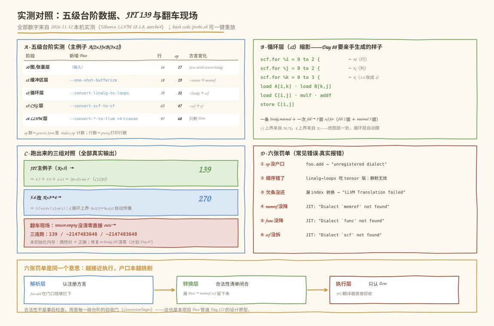

# 第 033 天：Dialect 与渐进式 Lowering——方言的户口本，一级级下台阶

> **今日目标**：完成本教程后，你能对任意一行 IR 指出它的方言名（`arith.constant` 的 `arith`、`!llvm.ptr` 的 `!llvm`、`#arith.fastmath<none>` 的 `#arith`），说清 **Dialect（方言）** 作为 op／Type／Attribute 户口本的三件事；能用 generic form 数出"一个模块里住了几个方言"；能独立跑通 `linalg.matmul` 的**五级台阶**（图/张量层 → 缓冲区层 → 循环层 → CFG 层 → LLVM 层），边跑边说出**谁退场、谁进场、类型怎么搬**；能回答本日灵魂问题——**为什么从 mini 到 LLVM 要一层层降，而不是一步降到机器码**；能画（并解释）本项目 `mini → loop → LLVM` 的分层塔和每层职责；能认出 7 类真实报错各违反了哪一级的"合法性门"。
> **预计时间**：学习 25 分钟 ＋ 实践 45 分钟
> **前置准备**：Day 29 的 MLIR 环境（`mlir-opt-18`、`mlir-cpu-runner-18` 可用）；Day 30 的 Operation 五件套（今天给"名字"补上方言姓）；Day 31 的 Region／Block（`linalg.matmul` 的 generic form 里藏着今天最漂亮的回访）；Day 32 的 Type／Attribute（`!`／`#` 两个前缀今天认祖归宗）。
> **今日产出**：`code/` 下 4 个文件：`matmul_run.mlir`（主例子：一条 op 走完五级台阶）、`matmul_run_k4.mlir`（5.4 对照：K=3→4）、`matmul_nofill.mlir`（翻车探针：未初始化 outs）、`probe.sh`（一键重放 3 组实验＋7 个探针），以及它们在本机的真实运行记录；外加三张图，其中图 2 底部的**项目 Dialect 分层塔**就是今天计划要求的交付物。

## 1. 今天解决什么问题？

Day 32 结尾埋了一串伏笔：探针⑦里没户口的 `!foo.bar`、反复出场的 `#arith.fastmath<none>`、还有 `arith.`／`tensor.` 这些名字前缀——它们都指向同一个词：**Dialect**。今天还三个债：

1. **`arith.constant` 的 `arith` 到底是什么？** 一个"命名空间前缀"？一个插件？一段代码？Day 32 说类型要有方言户口，那户口登记处到底登记了什么？
2. **"未注册的方言"凭什么拒收我的 IR？** `-allow-unregistered-dialect` 又是什么后门？
3. **计划从第 85 天起反复写 `mini → loop → LLVM`，为什么不从 mini 一步降到机器码？** 多一层不多一层不省，每层不是白付一次转换成本吗？——这是今天的灵魂问题，答案要用真实 IR 摆出来。

贯穿全文的主例子：**`linalg.matmul` 替身出演 `mini.matmul`**。我们自己的 `mini` Dialect 第 36 天才出生，但 `linalg` 就是 MLIR 生态里"图算子层"的正式住户——拿 `A(2×3) × B(3×2) → C(2×2)`、取 `C[1][0]` 这条链路，今天从一条 op 一路降到 LLVM 方言，JIT 打印 **139**，中途每级台阶都停下来看一眼 IR。你以后给 `mini.matmul` 铺的路（第 85～89 天），就是今天这条路的翻版。

**术语先对齐**：**Dialect（方言）**是 MLIR 里 op、Type、Attribute 的命名空间和注册表；**混合 IR（mixed dialect IR）**指一个模块里多个方言的 op 共存；**渐进式 Lowering（progressive lowering）**指抽象逐级下降、每级只拆一层；**ConversionTarget（转换目标）**是一次下降的合法性清单，声明哪些 op 走完这步必须消失；**TypeConverter（类型转换器）**负责在 op 搬家的同时把类型也搬走；**unrealized_conversion_cast** 是转换框架在类型暂时对不上时插入的"欠条"op；**outs（输出即输入）**是 linalg 的目标传递风格——输出缓冲既当结果又当累加的初值。

## 2. 先看全貌：今天的内容位于哪里？


**图 1**：看四个区域。顶部是第 5 周路线——昨天给 Type／Attribute 上了户口，今天（琥珀色 TODAY 框）把户口本本身摊开看：op 名、Type 前缀、Attribute 前缀三兄弟都挂在方言名下；中部左边是"前缀三兄弟"卡，右边是今天的路线预览——一条 op 下五级台阶，每级台阶配一个 Pass 名；底部左边把你第一阶段的东西和今天对上号，右边是今日四步主线和主例子代码卡，最下面一横条是今天的交付物。

全局四步，今天走完一个闭环：

1. **认**：Dialect 是什么、注册了什么、没户口会怎样（3.1＋探针①）；
2. **数**：一个模块里五个方言共住——混合 IR 是特性不是缺陷（3.2＋实验①）；
3. **降**：五级台阶逐级 dump，谁退场、谁进场、类型怎么搬（3.3＋实验②）；
4. **跑**：JIT 打印 139，改 K=3→4 再打印 270（实验③＋5.4）。

## 3. 核心概念：先用直觉，再给准确定义

### 3.1 Dialect：op、Type、Attribute 的户口本

一句通俗解释：Dialect 是 MLIR 的**命名空间＋注册表**——`arith.constant` 的 `arith` 就是"这名字在 arith 家族登记过"。

- **一个类比**：姓名里的姓。`arith.constant` ＝ 姓 `arith`、名 `constant`；满城叫 `constant` 的 op 很多（`arith.constant`、`llvm.mlir.constant` 各是一家），报上姓就不混。**对应到技术上是**：MLIR 里一切带名字的东西都按"方言.名字"登记——**op** 写在名字最前面（`arith.constant`）；**Type** 用 `!` 前缀（`!llvm.ptr`，Day 32 探针⑦的 `!foo.bar` 就是想报一个不存在的姓）；**Attribute** 用 `#` 前缀（`#arith.fastmath<none>`）。登记处在 `MLIRContext`：工具启动时把各方言装进去（`mlir-opt-18` 预装了 func／arith／tensor／linalg／scf／cf／memref／llvm 等一批），解析和验证都查这本册子——**没户口的名字在解析层就被拒收**（探针①的真实报错）。**类比的边界**：户口本不止管名字——一个 Dialect 还可以定义自己的合法 Type 集合、挂自己的 Verifier、注册自己的 Pass 和工具（明天 Day 34 的 Toy 工程会看到一个方言的全套家当）。
- **一个最小例子**：探针①的 `"foo.add"(...)`——三行小文件，报错直指第 2 行：`error: operation being parsed with an unregistered dialect`。加上 `-allow-unregistered-dialect` 就能裸奔通过（IR 原样吐回），但那是**调试后门**：Pass 不认识的 op 没法被优化，这条路走不远。
- **一个常见误解**："方言是 MLIR 的事，我的项目用不到。"恰恰相反——**`mini` 就是你将来要注册的第一个方言**：`mini.matmul` 这个名字、`!mini.<...>` 这类类型、Verifier 的接入点，全都从今天的户口本概念长出来。

### 3.2 混合 IR：一个模块住五个方言

一句通俗解释：MLIR 的一个 module 里可以同时住着任意多个方言的 op，**它们不需要"同意彼此存在"**。

- **为什么这是特性不是缺陷**：每个 Pass 只认识一部分方言——`--convert-linalg-to-loops` 只重写 `linalg.*`，其余 op **原样穿过**。这意味着你可以逐个方言地加工 IR，不用一步看懂全部。对应到技术上是：**混合 IR 是渐进式 Lowering 的前提**——如果整个 IR 必须属于同一个"版本"，逐级下降根本无从谈起。今天的五级台阶就是靠它：每一级只动一个方言，别的方言住户原地不动。
- **沿用主例子**：`matmul_run.mlir`（见 5.2）里住着五个方言：`builtin`（module）、`func`、`arith`、`tensor`、`linalg`。实验①会用 generic form 把户口数出来——而且会数出两个**藏在暗处的住户**：`linalg.matmul` 的 Region 里还有 `linalg.yield`，属性里还引用了 `affine` 方言的 affine_map。将来 `mini` 出生后也一样：`mini.matmul` 和 `func`／`tensor`／`arith` 混住，`mini` 只管自己那几个 op。
- **一个常见误解**："op 名字里的点只是写法。"不是——generic form（`--mlir-print-op-generic`）里每个 op 都以完整字符串 `"dialect.opname"` 出现，名字本身就是数据结构的钥匙，Pattern 注册、Pass 分发全靠它。

### 3.3 灵魂问题：为什么不必一步降到机器码？

计划原话："理解为什么不必一步降到机器码"。用今天能亲手跑的东西，分三层回答：

**第一层：图优化的原料是结构，结构只在高层。** 融合、Shape 推导、CSE（第 6～8 周要做的事）都在匹配"一条 op ＝ 一次 matmul"这种**图结构**。今天实验②的台阶⑤会给你看：降到 LLVM 方言后，IR 里只剩 `llvm.icmp`、`llvm.fmul`、`llvm.getelementptr`——`matmul` 这个结构**已经不存在了**，谁也认不出"这里原来是一次矩阵乘"。想一步到位，等于放弃在高层做优化的可能性。

**第二层：每层有每层的变换，变换只对那层的形态有意义。** Tiling（Day 94）切的是**循环**，必须在 `scf.for` 面前才谈得上；寄存器分配只对机器码有意义；融合收益判断（Day 71～76）要的是图的算子边界。一层 IR 想同时伺候所有变换，最后每个变换都在"不是为它准备的形状"上硬做——这正是 MLIR 用多级 Dialect 替代单一 IR 的理由。

**第三层：可验证、可调试、可中途检查。** 今天每级台阶 dump 一份 IR，`Verifier` 在每级之后都验一次契约；哪个 Pass 引入错误，dump 序列立刻暴露（第 20 周的 Pass 二分定位、Day 122 的失败诊断，都建立在这上面）。一步到位的编译器只有一个观测点：全对或全错。

**一个类比**：搬家不是把家当直接扔上卡车，而是先打包（每类东西一个箱）、再装车、再卸货。**对应到技术上是**：每一级 Lowering 都自带两张单据——**ConversionTarget** 写明"走完这步，哪些 op 必须消失"（合法的收下，不合法的报错，漏了 Pass 单据就闭合不上——今天 4 张"not found"罚单都是单据没闭合）；**TypeConverter** 写明类型怎么搬（`tensor<2x3xf32>` → `memref<2x3xf32>` → `!llvm.array<2 x array<3 x f32>>`），类型实在对不上时打一张 **unrealized_conversion_cast** 欠条垫着，最后一级必须还清。**类比的边界**：搬家扔的是"你多出来的东西"，Lowering 丢的是"高层抽象"——每降一级，**信息单调减少、细节单调增多**，这条路是单程的，想回高层得从头编译。

### 3.4 `mini → loop → LLVM`：项目分层图与每层职责（今日交付物）

计划要求"画出目标 Lowering 路线"并给出"每层职责说明"。对照今天的五级台阶（用 `linalg` 演示）和你未来 84 天的路线，每层职责如下：

| 层 | 主要方言 | 住在这里的活 | 消失了什么 | 对应计划 | 今天演示 |
|---|---|---|---|---|---|
| **mini 层（图算子层）** | `mini.*` ＋ `func`/`tensor` 混住 | Shape 推导、代数化简、融合、Cost Model | ——（源头层） | Day 36～56（定义与图优化） | 台阶①（`linalg` 替身） |
| **loop 层（循环层）** | `scf` ＋ `memref` ＋ `arith` | Tiling、循环顺序、展开、内存规划、性能实验 | 图算子结构：一条 op 炸开成循环与访存 | Day 85～98（Lowering 与 Tiling）、Day 99～105（内存规划） | 台阶③ |
| **LLVM 层（可执行层）** | `llvm.*` | 目标无关优化、JIT／AOT 执行 | 循环与张量语义：只剩块、标量和指针运算 | Day 113～124（最终 Lowering 与执行） | 台阶⑤ |

两点补充：**cf（显式控制流）是 loop → LLVM 的中转站**——`scf.for` 先拆成块和跳转（台阶④，Day 31 的 CFG 正式形态）再进 LLVM，这是社区管道的惯例，你的项目也可以直接 scf → LLVM；**memref 的引入点**由 bufferization 决定——今天它发生在台阶②，你的项目在 Day 85～89 可以选择先留在 tensor 世界、最后统一 bufferize（Day 57 起再细究）。图 2 底部的三层塔就是这张表的图形版——**它就是今天要交的"Dialect 分层图"**。

## 4. 图解核心机制

概念齐了，把三件事拧成一张图：**户口本怎么管名字、台阶怎么一级级下、每级拿什么保证不漏**。


**图 2**：从上往下看。顶部的**混合 IR 面板**：主例子输入被按方言着色——`func.`、`arith.`、`tensor.`、`linalg.` 各穿各的颜色，右边的三行解释"为什么混住是特性"：Pass 只看认识的 op，其余原样穿过。中部的**五级台阶**：每级一个框，写着层名、方言的退场／进场、一行真实 IR 缩影和 op 数（17 → 19 → 32 → 47 → 68），台阶之间的琥珀色箭头标着产生这一级的 Pass 名——**IR 越走越大（行数 16 → 97），结构越走越碎**。右侧三张机制卡就是 3.3 节的两张单据和一张欠条。底部的**三层塔**是 3.4 节的表画成图：mini 层住图优化、loop 层住 Tiling、LLVM 层住执行，箭头上标着项目走到那一级的计划天数。

按编号讲四步：

**① 户口本先管名字**。`--mlir-print-op-generic` 里每个 op 的名字都是完整的 `"dialect.opname"` 字符串——解析、验证、Pass 分发都拿它当钥匙。这也是探针①能在解析层就拦下 `foo.add` 的原因。

**② 混住让"逐级"成为可能**。台阶②（`--convert-linalg-to-loops`）只重写 `linalg.*`，`memref.get_global`、`arith.constant` 原地不动——正因为 Pass 不必看懂全世界，五级台阶才能一级一级铺。

**③ 每级一张合法性清单**。ConversionTarget 声明"这级走完，`linalg`/`scf`/`memref` 必须消失"；漏掉某个转换 Pass，清单不闭合，产物里就有方言住户没搬走——JIT 到门口直接拒收（第 6 节 4 张"not found"罚单）。

**④ 类型和 op 一起搬家，搬不动打欠条**。`tensor<2x3xf32>` 的退场不靠删除，靠 TypeConverter 给出下一层的对应类型；`index` 和 `i64` 一时对不上时，框架插一张 `unrealized_conversion_cast` 欠条，最后翻译 LLVM IR 时必须还清（探针③）。

## 5. 动手实践：认、数、降、跑

### 5.1 准备文件

```text
tutorials/day-033/
├── README.md                 ← 本教程
├── images/                   ← 三张图
└── code/
    ├── matmul_run.mlir       ← ① 主例子：linalg.matmul 替身 mini.matmul（K=3）
    ├── matmul_run_k4.mlir    ← ② 5.4 对照：K=3→4
    ├── matmul_nofill.mlir    ← ③ 探针⑦：未清零 outs（翻车现场）
    └── probe.sh              ← ④ 一键重放：3 组实验＋7 个探针
```

命令统一在 `tutorials/day-033/` 目录下执行；本机环境为 Ubuntu 20.04（aarch64）、LLVM 18.1.8（`mlir-opt-18`／`mlir-cpu-runner-18`），与 Day 29～32 记录一致。**以下输出均为 2026-11-12 在本机的真实运行结果**，可用 `bash code/probe.sh` 一键重放（探针文件由脚本在 `/tmp/day033/` 生成）。

### 5.2 编写代码：主例子全文

`matmul_run.mlir` 全文如下（`code/matmul_run.mlir`，注释即交付物）：

```mlir
module {
  func.func @main() -> i32 {
    // arith 方言：常量（值住在 value 属性里，Day 32）
    %A = arith.constant dense<[[1.0, 2.0, 3.0], [4.0, 5.0, 6.0]]> : tensor<2x3xf32>
    %B = arith.constant dense<[[7.0, 8.0], [9.0, 10.0], [11.0, 12.0]]> : tensor<3x2xf32>
    %zero = arith.constant 0.0 : f32
    // tensor 方言：未初始化的输出"格子"
    %C = tensor.empty() : tensor<2x2xf32>
    // linalg 方言：先把格子清零——matmul 是累加语义（outs 既当输入又当输出），
    // tensor.empty 的内容未定义，不清零就是读垃圾（见 6.1 的翻车现场）
    %Cf = linalg.fill ins(%zero : f32) outs(%C : tensor<2x2xf32>) -> tensor<2x2xf32>
    // 一条 op ＝ 一次完整矩阵乘：mini.matmul 将来的样子
    %R = linalg.matmul ins(%A, %B : tensor<2x3xf32>, tensor<3x2xf32>) outs(%Cf : tensor<2x2xf32>) -> tensor<2x2xf32>
    %c1 = arith.constant 1 : index
    %c0 = arith.constant 0 : index
    %e = tensor.extract %R[%c1, %c0] : tensor<2x2xf32>
    %r = arith.fptosi %e : f32 to i32
    return %r : i32
  }
}
```

两个阅读要点：**(a)** 三个方言的 op 混住一个函数——`func.`／`arith.`／`tensor.`／`linalg.` 各司其职，这就是 3.2 的混合 IR；**(b)** `linalg.matmul` 采用 **outs（输出即输入）**风格：`outs(%Cf)` 里的内容**参与计算**（C_new ＝ C_old ＋ A×B），而 `tensor.empty()` 的内容是**未定义**的——所以中间必须夹一条 `linalg.fill` 清零。这不是小事，6.1 会给你看不清零的下场；**第 87 天"生成输出初始化"的存在理由，今天提前领教**。

### 5.3 运行与观察：三组实验（全部本机真实输出）

**实验① 数方言：混合 IR 的户口清点**

pretty 打印（`mlir-opt-18 matmul_run.mlir`）里只有 5 个"方言姓"露脸：`builtin`／`func`／`arith`／`tensor`／`linalg`。用 generic form 数得更细（probe.sh 的统计命令：把 `"dialect.op"` 名字去重计数）：

```bash
$ mlir-opt-18 matmul_run.mlir --mlir-print-op-generic | grep -o '"[a-z][a-z0-9_]*\.[a-z][a-z0-9_]*"' | sed 's/"//g;s/\..*//' | sort | uniq -c
      8 arith
      1 builtin
      2 func
      4 linalg
      2 tensor
```

17 条 op，五个方言。两个暗处的住户值得点名。generic form 里 `linalg.matmul` 长这样（节选，常数行省略）：

```mlir
%5 = "linalg.matmul"(%0, %1, %4) <{operandSegmentSizes = array<i32: 2, 1>}> ({
^bb0(%arg0: f32, %arg1: f32, %arg2: f32):
  %10 = "arith.mulf"(%arg0, %arg1) <{fastmath = #arith.fastmath<none>}> : (f32, f32) -> f32
  %11 = "arith.addf"(%arg2, %10) <{fastmath = #arith.fastmath<none>}> : (f32, f32) -> f32
  "linalg.yield"(%11) : (f32) -> ()
}) {linalg.memoized_indexing_maps = [#map, #map1, #map2]} : (tensor<2x3xf32>, tensor<3x2xf32>, tensor<2x2xf32>) -> tensor<2x2xf32>
```

**(a)** Day 31 的 Region 回来了：`linalg.matmul` 持有一个 Region，里面是**标量体**——块参数 `%arg0, %arg1, %arg2`（两个乘数一个累加值）、`arith.mulf`＋`arith.addf`、`linalg.yield` 带回结果。"一条 op ＝ 一次矩阵乘"不是口号，是**一个 Region ＋ 访存映射**：文件最上面的 `#map = affine_map<(d0, d1, d2) -> (d0, d2)>` 三张映射就是 A[i,k]、B[k,j]、C[i,j] 的下标公式——`affine` 方言藏在属性里，数 op 数不出它。**(b)** 8 条 `arith` op 里有两条（mulf／addf）住在 linalg 的 Region 里——**op 数按 generic form 清点才作数**，pretty 打印会骗你。

**实验② 五级台阶：逐级 dump，谁退场谁进场**

按 3.4 的路线，把主例子一级一级往下送（probe.sh 会重建全部文件到 `/tmp/day033/`）：

```bash
$ mlir-opt-18 matmul_run.mlir -o s0.mlir
$ mlir-opt-18 matmul_run.mlir --one-shot-bufferize -o s1.mlir
$ mlir-opt-18 s1.mlir --convert-linalg-to-loops -o s2.mlir
$ mlir-opt-18 s2.mlir --convert-scf-to-cf -o s3.mlir
$ mlir-opt-18 s3.mlir --convert-cf-to-llvm --convert-func-to-llvm --convert-arith-to-llvm \
    --convert-index-to-llvm --finalize-memref-to-llvm --canonicalize -o s4.mlir
```

每级的体量统计（真实数据，probe.sh 可复算）：

| 阶段 | 新增 Pass | 行数 | op 数 | 方言清单 |
|---|---|---|---|---|
| s0 图/张量层 | （输入） | 16 | 17 | arith·builtin·func·linalg·tensor |
| s1 缓冲区层 | `--one-shot-bufferize` | 18 | 19 | arith·builtin·func·linalg·**memref**（tensor 退场） |
| s2 循环层 | `--convert-linalg-to-loops` | 35 | 32 | arith·builtin·func·memref·**scf**（linalg 退场） |
| s3 CFG 层 | `--convert-scf-to-cf` | 65 | 47 | arith·builtin·**cf**·func·memref（scf 退场） |
| s4 LLVM 层 | 4 个 LLVM 转换＋canonicalize | 97 | 68 | 只剩 **llvm**（其余全退场） |

**先看 s1（数据抽象降级，算子抽象还在）**：`tensor<2x3xf32>` 全部变成 `memref<2x3xf32>`，常量升级成 `memref.global` 全局量；但注意——

```mlir
%alloc = memref.alloc() {alignment = 64 : i64} : memref<2x2xf32>
linalg.fill ins(%cst : f32) outs(%alloc : memref<2x2xf32>)
linalg.matmul ins(%0, %1 : memref<2x3xf32>, memref<3x2xf32>) outs(%alloc : memref<2x2xf32>)
```

`linalg.matmul` **还是一条 op**，只是搬进了缓冲区世界。这印证了渐进式 Lowering 的粒度：**一次只降一个抽象**（这步降"值 vs 内存"），别的抽象按兵不动。

**再看 s2（一整条 op 炸开成循环——Day 88 的预告）**：

```mlir
scf.for %arg0 = %c0 to %c2 step %c1 {
  scf.for %arg1 = %c0 to %c2 step %c1 {
    scf.for %arg2 = %c0 to %c3 step %c1 {
      %4 = memref.load %0[%arg0, %arg2] : memref<2x3xf32>      // A[i,k]
      %5 = memref.load %1[%arg2, %arg1] : memref<3x2xf32>     // B[k,j]
      %6 = memref.load %alloc[%arg0, %arg1] : memref<2x2xf32> // C[i,j]（累加读）
      %7 = arith.mulf %4, %5 : f32
      %8 = arith.addf %6, %7 : f32
      memref.store %8, %alloc[%arg0, %arg1] : memref<2x2xf32> // C[i,j] 写回
    }
  }
}
```

三处值得对照图 2：**(a)** `linalg.matmul` 的**三重循环**从访存映射 `#map` 系列生成——i、j 上界 2 来自 M/N，k 上界 3 来自 K；**(b)** Region 里的标量体（mulf＋addf）被**搬进了最内层循环体**，`linalg.yield` 消失，换成 `memref.store`；**(c)** fill 也炸开成两层 `scf.for`＋store——s2 里一共 5 条 `scf.for`（fill 2＋matmul 3），表里的 32 条 op 就是这么来的。**第 88 天你从 `mini.matmul` 亲手生成的循环，就长这个模样**；第 94 天的 Tiling 也将切这三层循环。

**s3（结构化控制流拆成显式 CFG，Day 31 的重逢）**：5 条 `scf.for` 全部消失，函数体变成 16 个 Block（入口块＋`^bb1`～`^bb15`）和 15 条 `cf.br`／`cf.cond_br`，循环变量变成循环头块的块参数，块头上的 `// 2 preds: ^bb0, ^bb8` 注释又回来了。**s4（只认 llvm）**：`memref.load` 变成 `llvm.getelementptr`＋`llvm.load`，分配器变成对 `malloc` 的 `llvm.call`，比较是 `llvm.icmp "slt"`……五户方言只剩 `builtin.module` 一个壳＋满屏 `llvm.*`。**行数 16 → 97、op 数 17 → 68：细节逐级涌现、抽象逐级蒸发**——这就是"不必一步到位"的定量写照。

**实验③ JIT：走完五级台阶，打印 139**

```bash
$ mlir-cpu-runner-18 /tmp/day033/s4.mlir --entry-point-result=i32
139
```

C ＝ A×B ＝ [[58, 64], [139, 154]]，取 C[1][0] ＝ 4·7＋5·9＋6·11 ＝ 28＋45＋66 ＝ 139。**和 Day 32 一样是两步走，但这次降级链路有五级**——每一级都可以单独 dump、单独检查，这正是 3.3 第三层的收益。



**图 3**：四个面板收拢全部真实结果——A 是实验②的统计表：每级一行，谁退场谁进场一目了然；B 是 s2 的代码缩影，标注了 i/j/k 上界分别来自 M/N/K；C 是三组 JIT 对照：主例子 139、5.4 改 K 得 270、未清零 outs 的三连跑翻车现场；D 是六张罚单，对应第 6 节的错误 2～7。底部一句话收束：越接近执行，户口本越挑剔——解析层认注册方言、转换层要清单闭合、执行层只认 llvm。

### 5.4 修改一个参数再观察：改 K=3→4

`matmul_run_k4.mlir` 与主例子只差两行：A 变 `tensor<2x4xf32>`（补一行 [1,2,3,4]／[5,6,7,8]），B 变 `tensor<4x2xf32>`（补一行 [13,14]）。**先预测**：C[1][0] ＝ 5·7＋6·9＋7·11＋8·13 ＝ 35＋54＋77＋104 ＝ 270。跑两级看看（本机真实输出）：

```bash
$ mlir-opt-18 matmul_run_k4.mlir --one-shot-bufferize --convert-linalg-to-loops | grep -E "to %c[0-9]+" | sort -u
    scf.for %arg0 = %c0 to %c2 step %c1 {
    scf.for %arg1 = %c0 to %c2 step %c1 {
    scf.for %arg2 = %c0 to %c4 step %c1 {
```

三行循环头对照着读：i、j 的上界还是 `%c2`（M、N 没变），**k 的上界自动从 `%c3` 变成了 `%c4`**。继续走完台阶（本机真实输出）：

```bash
$ mlir-opt-18 matmul_run_k4.mlir --one-shot-bufferize --convert-linalg-to-loops --convert-scf-to-cf \
    --convert-cf-to-llvm --convert-func-to-llvm --convert-arith-to-llvm --convert-index-to-llvm \
    --finalize-memref-to-llvm --canonicalize -o /tmp/day033/k4.llvm.mlir
$ mlir-cpu-runner-18 /tmp/day033/k4.llvm.mlir --entry-point-result=i32
270
```

两个观察：**(a)** 高层改两行字面量，循环层的 k 上界自动从 `%c3` 变成 `%c4`——**下标公式（affine 映射）和循环生成是自动推导的，不需要手工同步**；这就是"高层信息密度大、低层细节由转换生成"的直接好处。**(b)** 预测的 270 与实测一致。如果这是你自己的 mini → loop 管道，这一节就是第 90 天"非方形与边界 Shape"的雏形：**M、N、K 独立变化时，各级 IR 自己保持一致**。

## 6. 常见错误与排查

七个探针都在 `probe.sh` 里，可一键重放；报错除探针①②外均来自 JIT 或编译产物，为本机真实输出。

**错误 1：JIT 结果是 −2147483648，而且每次跑还不一样**
现象：去掉 `linalg.fill`（`matmul_nofill.mlir`），走完五级台阶，三次运行打印 `-2147483648`／`139`／`139`（另一次手工重放为 `139`／`-2147483648`／`-2147483648`——**每次都可能不同**）。
原因：`tensor.empty()` 的内容未定义，bufferize 后是一块**没清零的 malloc 内存**；`linalg.matmul` 的 outs 是累加语义，`C[i][j] = 垃圾 + A·B`。垃圾里若有大数或 NaN，`fptosi` 转不出来就饱和成 INT_MIN。
定位：结果"有时对"是最典型的未初始化症状——**偶然对 ≠ 正确**；对照实验（加回 fill）立刻二分出问题在 outs 未清零。
修复：out 前先 `linalg.fill` 清零。更深的教训：**第 87 天"生成输出初始化"不是可选项**——你给 mini.matmul 写循环 Lowering 时，必须先生成清零循环。

**错误 2：`error: operation being parsed with an unregistered dialect. If this is intended, please use -allow-unregistered-dialect...`**
现象：文件里出现 `"foo.add"(...)`。
原因：`foo` 方言没在任何工具里注册过——解析层查户口本查无此人，当场拒收（Day 32 探针⑦的正式结案）。
定位：报错精确到行列，直接指向那条 op。
修复：用已注册方言，或者注册你自己的 Dialect（第 36 天的正题）；`-allow-unregistered-dialect` 只是调试后门，Pass 无法优化不认识的 op。

**错误 3：编译成功，JIT 却报 `LLVM Translation failed for operation: builtin.unrealized_conversion_cast`**
现象：管道里漏了 `--convert-index-to-llvm`，`mlir-opt-18` 正常退出（exit 0），JIT 阶段才爆。
原因：`index` 类型的转换没做完，框架插了 `builtin.unrealized_conversion_cast`（i64 ↔ index）欠条垫着；翻译到 LLVM IR 时欠条还不上，报错退出。
定位：`grep unrealized_conversion_cast p3.mlir` 能看到残留的欠条。
修复：补上 `--convert-index-to-llvm`（或避免残留 index 值）。教训：**exit 0 ≠ 转换闭合**，欠条要到最后一级才清算。

**错误 4：`error: Dialect \`memref' not found for custom op 'memref.global'`**
现象：漏了 `--finalize-memref-to-llvm`，JIT 拒收。
原因：memref 的住户（global／load／store／alloc）没搬进 llvm 方言，而 `mlir-cpu-runner` 只注册了 llvm 方言——门口验户口，直接不认识。
定位：报错指到产物第 2 行的 `memref.global`。
修复：补齐 memref 的最终转换 Pass。

**错误 5：`error: Dialect \`func' not found for custom op 'func.func'`**
现象：漏了 `--convert-func-to-llvm`（或直接把**未降级**的 s0 喂给 JIT，报错一模一样）。
原因：同错误 4，这次是 `func.func` 还留在产物里。
定位：报错行号指向 `func.func` 所在行。
修复：补 `--convert-func-to-llvm`。**这个探针反过来用**：拿原始 MLIR 直接喂 JIT，看它只认 llvm——"一步到位"和"漏一步"在执行层看来没有区别。

**错误 6：`error: Dialect \`scf' not found for custom op 'scf.for'`**
现象：漏了 `--convert-scf-to-cf`，`scf.for` 留在产物里。
原因：`scf.for` 没有到 LLVM 的直接转换规则，必须先经 cf 拆成显式块。
定位：报错行号指向残留的 `scf.for`。
修复：补 `--convert-scf-to-cf`。cf 是 loop → LLVM 的**中转站**——结构化控制流不能直接进 LLVM 方言。

**错误 7：Pass 顺序错了，却没有任何报错（最阴险）**
现象：把 `--convert-linalg-to-loops` 直接喂给 tensor 版输入（不做 bufferize），**exit 0，IR 基本原样吐回**——linalg op 一个都没动、一条 scf.for 都没生成（仅把两个 index 常量挪到了函数开头）。
原因：这个 Pass 的 Pattern 只匹配**memref 上的** linalg op；tensor 版没匹配到，它就什么都不做——Pass 不是"尽力而为"，是"按形态匹配"。
定位：跑完 Pass 后 `grep scf.for` 没有结果、linalg op 还在——**看产物，别看退出码**。
修复：按依赖顺序排列管道（先 bufferize 再 linalg→loops）。这也解释了 Day 27 的老问题：Pass 顺序不是风格问题，是**能不能匹配**的问题。

## 7. 今日练习

### 必做练习：标注＋预测＋画出你的分层图

(1) **标注**：仿照 5.3 实验①，给 s2（循环层）的每条 op 写出方言姓——数一数 `scf`／`memref`／`arith` 各几条，和表里"32 条 op"对账；(2) **先预测**：把主例子最后的 `tensor.extract %R[%c1, %c0]` 改成取 `[0, 1]`（即 C[0][1]），JIT 会打印几？（提示：C ＝ [[58, 64], [139, 154]]）跑命令验证；(3) **画图**：合上教程，在白纸上凭记忆画出 `mini → loop → LLVM` 三层塔——每层写上：主要方言、住什么 Pass、消失什么信息、对应计划哪几周——画完翻开 3.4 的表和图 2 对答案。**第 (3) 项就是计划"画出目标 Lowering 路线"的正式交付**。

### 选做挑战：三个小实验

任选其一：(a) 把 A 改成 3×3（A ＝ [[1,2,3],[4,5,6],[7,8,9]]，其余不动），**先预测** C[2][0] 和 i 循环上界各是多少（笔算：7·7＋8·9＋9·11），再跑验证——M 的变化应该只传播到 i 上界，k 仍是 3；(b) 复现错误 7：自己构造一个"顺序错→静默无效"的例子（比如把 `--convert-scf-to-cf` 放到 `--convert-linalg-to-loops` 之前），验证它同样 exit 0 且什么都没发生；(c) **先预测**：漏掉 `--convert-cf-to-llvm` 会怎样——是像漏 scf 一样报 `Dialect cf not found`，还是像漏 index 一样爆欠条？写下猜测再跑（本机实测的答案有点意外：产物里一条 `cf.` 都不剩——别的 Pass 把 cf 顺手处理掉了——最后挂在 `unrealized_conversion_cast` 的欠条上；查查产物里还剩什么 op，想想谁替 cf 干了活）。

## 8. 今日验收

- [ ] 我能对 `arith.constant`／`!llvm.ptr`／`#arith.fastmath<none>` 说出三样东西各自的方言姓、分别长在谁身上（op 名／Type／Attribute），并解释"没户口"在解析层意味着什么；
- [ ] 我能独立运行 `bash code/probe.sh`，指着实验②的产物说出每级台阶"谁退场、谁进场"，以及 s2 里的 `scf.for` 上界各自来自 M/N/K 的哪一层信息；
- [ ] 我能解释"为什么不必一步降到机器码"的三层理由（结构只在高层、每层有每层的变换、每级可验证），并引用 op 17→68、行数 16→97 这组真实数据；
- [ ] 我能不看资料画出 mini → loop → LLVM 分层塔并说出每层职责、cf 的中转站角色、以及 outs 未清零为什么危险（错误 1）；
- [ ] 我保存了 4 个代码文件、probe.sh 的完整运行记录、第 7 节必做练习的"预测 vs 实测"记录，以及自己手画的那张分层图。

## 9. 一句话总结与明天预告

今天的问题是"Day 32 那串前缀背后的户口本是什么、以及为什么从 mini 到机器码要一层层下台阶"；机制上要记住的是：**Dialect 是 op／Type／Attribute 的命名空间和注册表，一个模块可以混住任意多个方言；渐进式 Lowering 每级只拆一个抽象——ConversionTarget 是每级的验收单，TypeConverter 把类型一起搬走，搬不动就打 unrealized cast 欠条**；实践上用一条 `linalg.matmul` 走了五级台阶：17 条 op 的图降到 68 条 op 的 LLVM 方言，JIT 打印 139、改 K 得 270、忘清零 outs 现场翻车，七类报错全是"合法性门"在不同层的执法记录。明天（Day 34）跑通 Toy 或 Standalone 示例：今天替身出演的 `linalg` 旁边，站着一个**真实 Dialect 的完整工程**——Operation 定义、TableGen 生成代码、Pass 注册、配套 `toy-opt` 工具一应俱全，正好把今天"户口本"里的每一页翻给你看。
