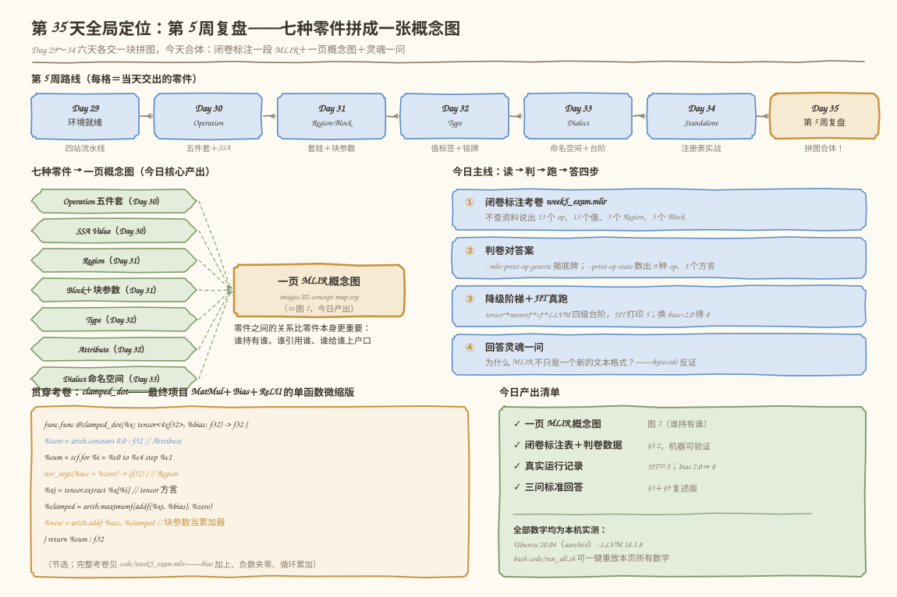
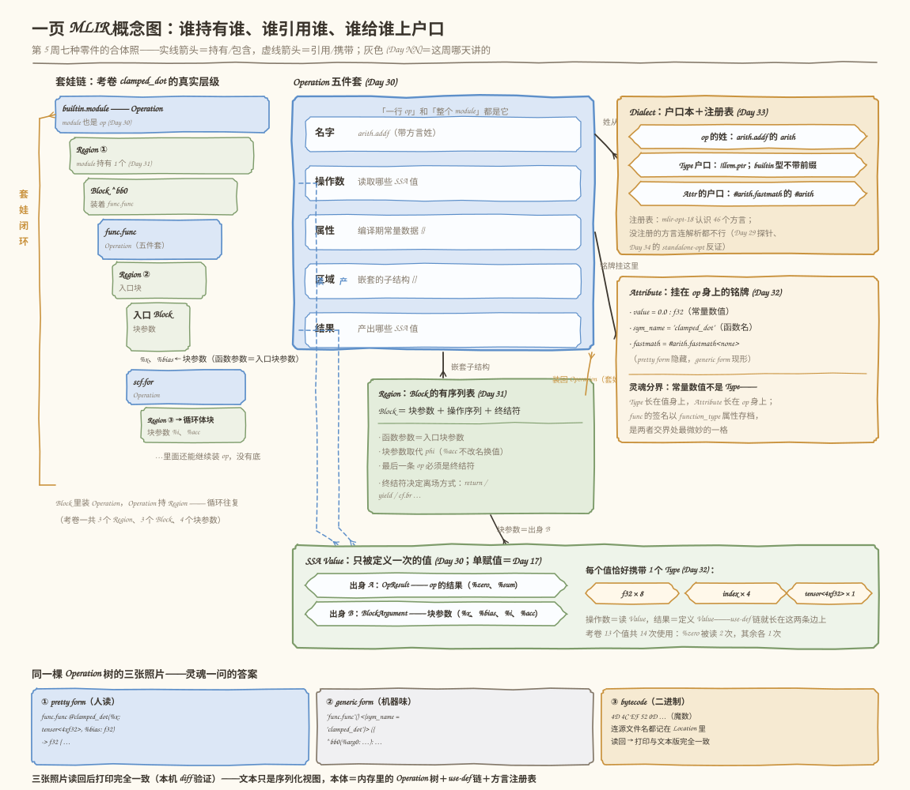
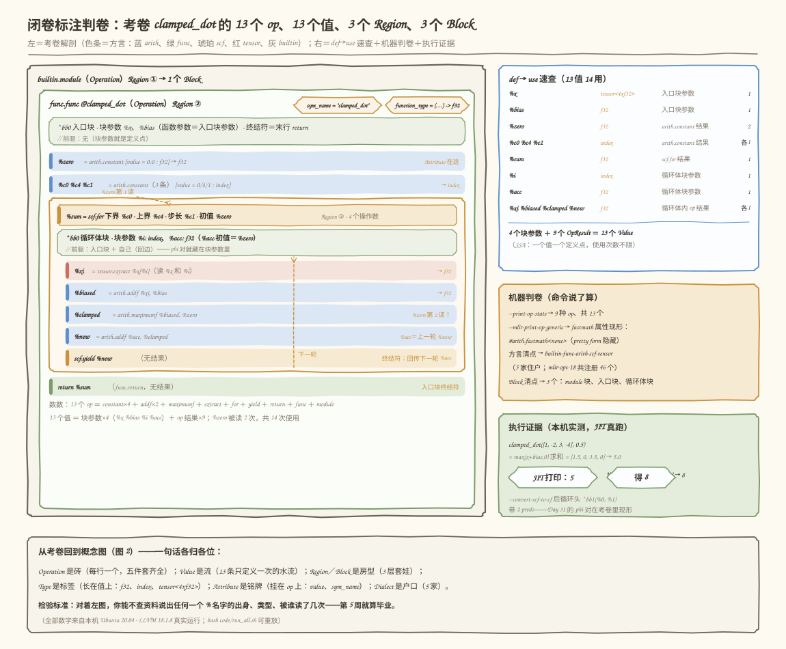

# 第 035 天：第 5 周复盘——七种零件拼成一张概念图，闭卷读懂一段 MLIR

> **今日目标**：完成本教程后，你能合上所有资料，对着一段从没见过的 MLIR 说出每个词的身份——几个 Operation、几个 Value、几层 Region／Block、哪些 Type 和 Attribute、几家 Dialect；能画出（或指认）一页 MLIR 概念图，说清"谁持有谁、谁引用谁、谁给谁上户口"；能拿三条证据回答灵魂一问——**为什么 MLIR 不只是一个新的文本格式**；并且用 `--mlir-print-op-generic`、`--print-op-stats`、`--emit-bytecode` 和 JIT 真跑，把"闭卷答案"逐项判卷。
> **预计时间**：学习 30 分钟 ＋ 实践 45 分钟
> **前置准备**：Day 29 装好的 MLIR 环境（`mlir-opt-18`、`mlir-cpu-runner-18`，本机为 Ubuntu 20.04 aarch64、LLVM 18.1.8）；Day 30～34 的记忆不用完美——本教程前半段就是把它们串起来的复盘。
> **今日产出**：一张可复用的一页概念图（图 2）、一份闭卷标注记录（含 13 个值、13 个 op 的 def→use 表）、`bash code/run_all.sh` 的完整真实运行日志（JIT 打印 `5`；换参数得 `8`）。

## 1. 今天解决什么问题？

复盘日要解决的是一个非常具体、也很丢人的问题：**六天下来认识了 30 多个名词——Operation、Operand、Result、SSA、Region、Block、BlockArgument、Terminator、Type、Attribute、Dialect、ConversionTarget……但如果现在合上所有资料，扔给你一段从没见过的 MLIR，你能不能不卡壳地说出每个词是什么、谁定义它、谁使用它？**说不出来，这六天就只是"见过"；说得出来，第 6 周动手定义 `mini` Dialect 时才有地基。

贯穿全文的是一份**期末考卷** `code/week5_exam.mlir`——一个函数 `clamped_dot`，干的事是"把张量每个元素加上 bias、负数夹成 0（ReLU 核心）、循环累加求和"。这正是最终项目 MatMul＋Bias＋ReLU 的**单函数微缩版**，而且恰好把第 5 周七种零件全部装进 13 行 IR 里：

```mlir
module {
  func.func @clamped_dot(%x: tensor<4xf32>, %bias: f32) -> f32 {
    %zero = arith.constant 0.0 : f32
    %c0 = arith.constant 0 : index
    %c4 = arith.constant 4 : index
    %c1 = arith.constant 1 : index
    %sum = scf.for %i = %c0 to %c4 step %c1 iter_args(%acc = %zero) -> (f32) {
      %xi = tensor.extract %x[%i] : tensor<4xf32>
      %biased = arith.addf %xi, %bias : f32
      %clamped = arith.maximumf %biased, %zero : f32
      %new = arith.addf %acc, %clamped : f32
      scf.yield %new : f32
    }
    return %sum : f32
  }
}
```

今天的第二个任务是计划里点名要回答的**灵魂一问：为什么 MLIR 不只是一个新的文本格式**。这一问面试常考、也最容易答浅——"新格式"论者看到的是 `.mlir` 文本文件；我们会用本机可复现的三个实验证明：文本只是 MLIR 的**序列化视图之一**，本体是内存里那棵可无限扩展的 Operation 树加上围绕它的整套基础设施。

**术语先对齐**（每条一句人话，详细展开在第 3、4 节）：**Operation（操作）**是 MLIR 里"一切东西"的统称，一行算子、整个 `module`、一个函数都是它；**Value（SSA 值）**是只被定义一次的数据流名字（`%zero` 这种百分号名字）；**Region（区域）**是 Operation 持有的嵌套子结构；**Block（基本块）**是 Region 里顺序执行的段落＝块参数＋操作序列＋终结符；**Type（类型）**是长在值身上的标签（`f32`、`index`、`tensor<4xf32>`）；**Attribute（属性）**是挂在 op 身上的编译期常量铭牌；**Dialect（方言）**是给 op／Type／Attribute 上户口的命名空间＋注册表。

## 2. 先看全貌：今天的内容位于哪里？



**图 1**：看四个区域。顶部是第 5 周路线——六天各交一块零件，今天（琥珀色）拼图合体；左中是七种零件（标注各自的出生日）汇聚成"一页 MLIR 概念图"（即图 2，今日核心产出）；右中是今日四步主线：**标（闭卷标注）→ 判（机器判卷）→ 跑（降级＋JIT）→ 答（灵魂一问）**；底部左边是考卷代码卡，右边是产出清单——全部数字均为本机实测。

复盘怎么复才不是"再看一遍"？四步：

1. **标**：闭卷标注考卷——不查资料，数出并指认 13 个 op、13 个值、3 个 Region、3 个 Block（5.2 节）；
2. **判**：用 `--mlir-print-op-generic`（揭底牌）和 `--print-op-stats`（机器数数）给闭卷答案判卷（5.2 节）；
3. **跑**：把考卷沿 Day 33 的台阶降到 LLVM 方言，JIT 真跑出 `5`，再换参数跑出 `8`（5.3～5.4 节）；
4. **答**：用三个实验回答"为什么 MLIR 不只是一个新的文本格式"（3.2 节，bytecode 彩蛋在 5.3 节末尾）。

## 3. 核心概念：七种零件一张表，和一问灵魂拷问

### 3.1 七个概念，七句人话

复盘不是抄定义，而是每个概念压缩成"一句人话＋本周出处＋在考卷里的样子"。这张表就是你要能脱稿复述的东西：

| 概念 | 一句人话 | 本周出处 | 在考卷 clamped_dot 里的样子 |
|---|---|---|---|
| **Operation** | 一切东西的统称，身上永远带五件套：名字、操作数、属性、区域、结果 | Day 30 | 13 个（9 种），从 `module` 到 `scf.yield` |
| **Value** | 只被定义一次的数据流名字，重复读不限次 | Day 30（单赋值是 Day 17） | 13 个，共 14 次使用（`%zero` 被读 2 次） |
| **Region** | Operation 持有的嵌套子结构，是 Block 的有序列表 | Day 31 | 3 个：module、func、for 各持一个 |
| **Block** | 顺序执行段＝块参数＋操作序列＋终结符；函数参数就是入口块参数 | Day 31（基本块是 Day 15） | 3 个块、4 个块参数（`%x %bias %i %acc`） |
| **Type** | 长在**值**身上的标签，每个值恰好一个 | Day 32 | 3 种：`f32`×8、`index`×4、`tensor<4xf32>`×1 |
| **Attribute** | 挂在 **op** 身上的编译期常量铭牌 | Day 32 | pretty 可见 6 处＋隐藏 3 处（fastmath） |
| **Dialect** | op／Type／Attribute 的命名空间＋注册表 | Day 33（Day 34 实战） | 5 家：builtin、func、arith、scf、tensor |

一个类比把七个零件串起来：**Operation 是砖，Value 是流经砖之间的水流，Region／Block 是房型（客厅里还能砌套间，套间里再砌——套娃无底），Type 是贴在水管上的标签，Attribute 是砖出厂时烧在侧面的铭牌，Dialect 是每块砖的户口——户籍科（注册表）没登记的砖，工地门都不让进。**对应到技术上是：Operation 通过操作数引用 Value、通过结果定义 Value（use-def 链就长在这两条边上）；Operation 持有 Region，Region 装 Block，Block 里装的还是 Operation——`module`→`func.func`→`scf.for` 三层套娃在考卷里真实存在；`tensor<4xf32>` 长在 `%x` 身上而 `value = 0.0` 挂在 `arith.constant` 身上；`arith.addf` 的姓 `arith` 由 Dialect 命名空间提供，`mlir-cpu-runner` 这种只注册了 llvm 方言的工具遇到别的姓连解析都不行。**类比的边界**：户口（Dialect）不是"永久居留权"——Day 33 的五级台阶证明住户会搬家（linalg 退场、memref 进场），每次 Lowering 都是一次整体户口迁移，这是普通"户籍"类比覆盖不了的。

### 3.2 灵魂一问：为什么 MLIR 不只是一个新的文本格式？

先说结论：**文本只是 MLIR 的序列化视图之一。本体是内存里的 Operation 树＋use-def 链＋方言注册表，外加围绕它们的一整套基础设施（解析器、验证器、Pass 框架、渐进式 Lowering、TableGen 代码生成）。**三条证据，每条都能在本机复现：

**证据一：同一棵树，多张照片**。`mlir-opt-18 --mlir-print-op-generic` 把考卷打印成"机器味"的 generic form——`%sum = scf.for …` 变成 `"scf.for"(%1, %2, %3, %0) ({…})`，所有括号结构、块参数、属性全部现形（5.2 节有完整真实输出）。同一段程序、两种打印，说明 pretty form 那种"好看"的写法不是本体，只是打印机的一种排版选择。如果 MLIR 是文本格式，"换个打印开关程序就变了"就说不通了。

**证据二：语法是活的，能注册生长**。Day 34 的 `standalone-opt` 原本不认识 `standalone.foo`——注册 Standalone Dialect 之后，同样的工具立刻认识新"词汇"、能 round-trip、能跑 `standalone-switch-bar-foo` 这种新 Pass。本机 `mlir-opt-18 --show-dialects` 实测注册了 **46 个方言**，而 Day 29 的探针（`Dialect 'func' not found`）和 5.3 节的两个探针都证明：**注册表决定谁能被解析**。一个固定的文本格式（比如 JSON 的语法）不可能自己长出新单词；MLIR 可以，因为"语法"只是每个方言自带的一套打印／解析回调，挂在数据结构上。

**证据三：还有第二种序列化——bytecode**。`mlir-opt-18 --emit-bytecode` 把同一棵树写成二进制（文件头 4 个字节 `4D 4C EF 52`，即 `MLïR` 魔数），`mlir-opt-18` 读回来打印，与文本版 **diff 逐行一致**（本机实测，见 5.3 节彩蛋）。如果 MLIR"是"一种文本格式，第二种序列化从何谈起？

再用一个类比收尾：**文本之于 MLIR，像记谱法之于音乐**——五线谱和简谱都能记录同一首曲子，曲子本身既不是五线谱也不是简谱。对应到技术上是：pretty form（给人读）、generic form（给机器/调试读）、bytecode（给工具链高速传输读）是同一棵 Operation 树的三种"记谱"。**类比边界**：乐谱抄错一个音曲子就错了，而 MLIR 的三种序列化都由同一套 printer/parser 生成，不存在"记走样"——它们的差别只在可读性和读写速度，不在语义。

## 4. 图解核心机制：一页概念图

概念盘点之后，缺的是一张把"谁持有谁"画清楚的合体照——这也是计划要求的**一页 MLIR 概念图**（今日产出之一）。



**图 2**：这是第 5 周七种零件的合体照，看五个要点：

**① 五件套是中心**。任何 Operation 都带五格：名字（带方言姓）、操作数（读哪些值）、属性（编译期常量）、区域（嵌套子结构）、结果（产出哪些值）。从五件套出发的两把虚线箭头——"读"和"产"——都指向同一个 Value 带：**操作数＝引用，结果＝定义**，use-def 链就长在这两条边上。

**② 套娃闭环（左列）**。考卷的真实层级：`builtin.module` 持 Region ① → 1 个 Block → 里面装着 `func.func` → 持 Region ② → 入口 Block（块参数 `%x`、`%bias`）→ 里面装着 `scf.for` → 持 Region ③ → 循环体 Block（块参数 `%i`、`%acc`）→ ……没有底。**Block 里装 Operation，Operation 持 Region，Region 装 Block**——这三句话首尾相接，就是 MLIR 结构自相似的全部秘密。

**③ Value 的两种出身（底部绿带）**。`%zero`、`%sum` 是 **OpResult**（op 的结果）；`%x`、`%bias`、`%i`、`%acc` 是 **BlockArgument**（块的入口参数）。考卷 13 个值＝4 个块参数＋9 个 op 结果，每个恰好携带 1 个 Type。

**④ Type 与 Attribute 的分界（右下）**。Type 长在值身上，Attribute 挂在 op 身上；最微妙的一格是 `func.func` 的签名——它既是类型信息，又以 `function_type` 属性的形式存档（generic form 里看得见），Day 32 的灵魂问题在这里有了结构层面的答案。

**⑤ Dialect 是户口本＋注册表（右上）**。op 的姓（`arith.addf`）、Type 的户口（`!llvm.ptr`，注意 builtin 类型如 `tensor<…>` 不带前缀）、Attribute 的户口（`#arith.fastmath`）都归方言管；注册表决定工具认识谁——没注册的方言，连解析这关都过不去。

## 5. 动手实践：闭卷标注，然后让机器判卷

### 5.1 准备文件

```text
tutorials/day-035/
├── README.md                      ← 本教程
├── images/                        ← 三张图
└── code/
    ├── week5_exam.mlir            ← ① 期末考卷（闭卷标注对象）
    ├── week5_run.mlir             ← ② JIT 版（加了个 @main 调 clamped_dot）
    ├── week5_exam_broken_type.mlir← ③ 报错探针①的坏考卷
    └── run_all.sh                 ← 一键重放：标注判卷＋降级＋JIT＋三个探针＋bytecode 彩蛋
```

命令统一在 `tutorials/day-035/` 目录下执行；本机环境 Ubuntu 20.04（aarch64）、LLVM 18.1.8（`mlir-opt-18`／`mlir-cpu-runner-18`），与 Day 29 记录一致。**以下输出均为 2026-11-12 在本机的真实运行结果**，可用 `bash code/run_all.sh` 一键重放。

### 5.2 闭卷标注：先自己答，再用 generic form 判卷

**第一步（10 分钟，合上资料）**：对着 5.1 的考卷，在纸上回答六个问题——(a) 一共几个 op、几种？(b) 几个值、各自什么类型、被读几次？(c) 几层 Region、几个 Block、几个块参数？(d) 哪些词是 Attribute？(e) 住着几家 Dialect？(f) `%zero` 被读了几次、在哪两处？

**第二步：判卷**。第一个判卷钥匙是 generic form——它把 pretty form 藏起来的结构全部摊开（真实输出，对照你的闭卷答案看）：

```bash
$ mlir-opt-18 code/week5_exam.mlir --mlir-print-op-generic
```

```text
"builtin.module"() ({
  "func.func"() <{function_type = (tensor<4xf32>, f32) -> f32, sym_name = "clamped_dot"}> ({
  ^bb0(%arg0: tensor<4xf32>, %arg1: f32):
    %0 = "arith.constant"() <{value = 0.000000e+00 : f32}> : () -> f32
    %1 = "arith.constant"() <{value = 0 : index}> : () -> index
    %2 = "arith.constant"() <{value = 4 : index}> : () -> index
    %3 = "arith.constant"() <{value = 1 : index}> : () -> index
    %4 = "scf.for"(%1, %2, %3, %0) ({
    ^bb0(%arg2: index, %arg3: f32):
      %5 = "tensor.extract"(%arg0, %arg2) : (tensor<4xf32>, index) -> f32
      %6 = "arith.addf"(%5, %arg1) <{fastmath = #arith.fastmath<none>}> : (f32, f32) -> f32
      %7 = "arith.maximumf"(%6, %0) <{fastmath = #arith.fastmath<none>}> : (f32, f32) -> f32
      %8 = "arith.addf"(%arg3, %7) <{fastmath = #arith.fastmath<none>}> : (f32, f32) -> f32
      "scf.yield"(%8) : (f32) -> ()
    }) : (index, index, index, f32) -> f32
    "func.return"(%4) : (f32) -> ()
  }) : () -> ()
}) : () -> ()
```

generic form 摊开的三件事，正好是闭卷最容易错的三个地方：**`^bb0(%arg0: …)` 现形**——函数参数就是入口块参数；**`"scf.for"(%1, %2, %3, %0)` 现形**——`%i`、`%acc` 其实是循环体块的块参数（`^bb0(%arg2: index, %arg3: f32)`），`iter_args` 初值 `%zero` 是 for 的第 4 个操作数；**`fastmath = #arith.fastmath<none>` 现形**——pretty form 里这条 Attribute 被藏起来了，闭卷漏标它不算你的错，但判卷后要知道它存在。

**第三步：机器数数**。第二个判卷钥匙是 `--print-op-stats`（真实输出）：

```bash
$ mlir-opt-18 code/week5_exam.mlir --print-op-stats 2>&1 | grep -E "^\s+\S+\s+,"
```

```text
    arith.addf     , 2
    arith.constant , 4
    arith.maximumf , 1
  builtin.module   , 1
     func.func     , 1
     func.return   , 1
      scf.for      , 1
      scf.yield    , 1
   tensor.extract  , 1
```

9 种、共 13 个 op——和闭卷答案对上了。**完整的参考答案**（也就是下面图 3 左半的浓缩版）：

**值表（13 个值、14 次使用）**：

| 值 | 类型 | 出身（定义点） | 被读几次、在哪 |
|---|---|---|---|
| `%x` | `tensor<4xf32>` | 入口块参数 | 1：`tensor.extract` |
| `%bias` | `f32` | 入口块参数 | 1：`addf` |
| `%zero` | `f32` | `arith.constant` 结果 | **2：`iter_args` 初值＋`maximumf`** |
| `%c0`／`%c4`／`%c1` | `index` | `arith.constant` 结果 | 各 1：for 的下界／上界／步长 |
| `%i` | `index` | 循环体块参数 | 1：`extract` 的索引 |
| `%acc` | `f32` | 循环体块参数 | 1：`addf` 累加 |
| `%xi`／`%biased`／`%clamped`／`%new` | `f32` | 循环体内 op 结果 | 各 1：链式传给下一行 |
| `%sum` | `f32` | `scf.for` 的结果 | 1：`return` |

**其余清点**：Region 3 个（module、func、for 各持一个）；Block 3 个、块参数 4 个（`%x %bias %i %acc`）；Attribute：pretty 可见 6 处（`sym_name`、`function_type`、`value`×4）＋generic 才可见的 `fastmath`×3；Dialect 5 家（builtin、func、arith、scf、tensor）。**一句检验标准：对着答案，任何一个 `%` 名字你都能立刻说出出身、类型、被谁读了几次——第 5 周就算毕业。**

### 5.3 降级阶梯与 JIT 真跑：标注过的考卷真的能算

标注只是"读"，复盘还要验证"这棵树真的能沿 Day 33 的台阶一路降到 LLVM 并算出数"。JIT 版 `week5_run.mlir` 在考卷外加了一个 `@main`（造常量、调用、`fptosi` 转整数返回），共 19 个 op（考卷 13 ＋ main 的 6）。四级台阶命令与每级实测数据：

```bash
$ mlir-opt-18 code/week5_run.mlir --one-shot-bufferize="bufferize-function-boundaries" -o /tmp/day035/s1.mlir
$ mlir-opt-18 /tmp/day035/s1.mlir --convert-scf-to-cf -o /tmp/day035/s2.mlir
$ mlir-opt-18 /tmp/day035/s2.mlir --convert-cf-to-llvm --convert-func-to-llvm --convert-arith-to-llvm \
    --convert-index-to-llvm --finalize-memref-to-llvm --canonicalize -o /tmp/day035/s3.mlir
$ mlir-cpu-runner-18 /tmp/day035/s3.mlir --entry-point-result=i32
```

| 台阶 | 做了什么 | op 数（实测） | 住户（实测） |
|---|---|---|---|
| s0 张量层 | 原始考卷＋main | 19 | arith、builtin、func、scf、tensor |
| s1 缓冲区层 | one-shot-bufferize | 21 | arith、builtin、func、**memref**、scf（tensor 退场） |
| s2 CFG 层 | convert-scf-to-cf | 24 | arith、builtin、**cf**、func、memref（scf 退场） |
| s3 LLVM 层 | 其余五个 convert＋canonicalize | 32 | **builtin、llvm**（其余全退场） |

两级台阶上值得停一眼的真实片段。s1 里张量世界变成缓冲区世界——常量张量升格成全局内存，`tensor.extract` 变成 `memref.load`：

```text
  memref.global "private" constant @__constant_4xf32 : memref<4xf32> =
    dense<[1.000000e+00, -2.000000e+00, 3.000000e+00, -4.000000e+00]> {alignment = 64 : i64}
  func.func @clamped_dot(%arg0: memref<4xf32, strided<[?], offset: ?>>, %arg1: f32) -> f32 {
    ...
    %1 = memref.load %arg0[%arg2] : memref<4xf32, strided<[?], offset: ?>>
```

s2 里 Day 31 的 phi 对现形——`scf.for` 被拆成块和跳转，循环头块带着 2 个前驱、块参数 `(%0: index, %1: f32)` 正是曾经的 `%i` 和 `%acc`：

```text
  ^bb1(%0: index, %1: f32):  // 2 preds: ^bb0, ^bb2
    %2 = arith.cmpi slt, %0, %c4 : index
    cf.cond_br %2, ^bb2, ^bb3
```

最后 JIT 在终端打印（真实结果）：

```text
$ mlir-cpu-runner-18 /tmp/day035/s3.mlir --entry-point-result=i32
5
```

手动核算印证：`[1.0, -2.0, 3.0, -4.0] + 0.5 = [1.5, -1.5, 3.5, -3.5]`，夹零后 `[1.5, 0, 3.5, 0]`，求和 `5.0`，转整数 `5`。✓



**图 3**：左半是考卷的解剖图——色条即方言（蓝 arith、绿 func、琥珀 scf、红 tensor、灰 builtin），`%zero 第 1 读`（`iter_args` 初值）与`第 2 读`（`maximumf`）、`%acc` 的"上一轮 `%new`"回传箭头都画在结构里；右半是三张卡：def→use 速查（注意 `%zero` 是唯一被读 2 次的值）、机器判卷数据、执行证据。**这张图就是"闭卷标注＋判卷＋执行"的完整成果对照**。

**彩蛋（也是证据三的现场）**：bytecode 序列化。`run_all.sh` 末尾执行 `mlir-opt-18 code/week5_exam.mlir --emit-bytecode`，本机真实输出：

```text
文本 548 字节 vs bytecode 562 字节；两种序列化读回后打印完全一致
```

（bytecode 比 548 字节的文本还大一点，因为它把源文件路径记进了 Location——大小不是重点，重点是**同一棵树确实有两种序列化**。）

### 5.4 修改一个参数再观察：换 bias

把 `week5_run.mlir` 里 `%bias = arith.constant 0.5 : f32` 改成 `2.0`，**先预测再跑**：`[1.0, -2.0, 3.0, -4.0] + 2.0 = [3.0, 0.0, 5.0, -2.0]`，夹零后 `[3.0, 0, 5.0, 0]`，求和应为 `8`。实测（真实结果）：

```text
$ mlir-cpu-runner-18 /tmp/day035/bias2.llvm.mlir --entry-point-result=i32
8
```

这个 30 秒的对照实验说明：改的是**数据（Attribute 里的常量）**，IR 结构一个字没动——同样的 13 个 op 照样算对。结构不变、语义由数据驱动，这正是"考卷"作为回归测试的价值：第 6 周起你每次改动 `mini` Dialect，都应该有这样一张能秒级验证的考卷。

## 6. 常见错误与排查

**错误一：`iter_args` 初值类型不匹配**（`code/week5_exam_broken_type.mlir`，真实触发）。

- **现象**：`mlir-opt-18 code/week5_exam_broken_type.mlir` 报 `error: use of value '%zero' expects different type than prior uses: 'f32' vs 'index'`，还附一条 `note: prior use here` 指向第 3 行。
- **原因**：把 `%zero` 从 `0.0 : f32` 改成了 `0 : index`，而 `scf.for ... iter_args(%acc = %zero) -> (f32)` 要求初值类型与循环结果类型一致。
- **定位**：报错发生在解析阶段（Day 29 的第①站）——SSA 值的类型在第一次出现时就定死了，第二次使用类型对不上，解析器直接拦下。
- **修复**：初值改回 `0.0 : f32`。**复盘视角**：这是 Type（长在值上）与 SSA（一处定义、处处同型）两条规则联合执法的现场。

**错误二：降级管道漏了 `--finalize-memref-to-llvm`**（真实触发）。

- **现象**：`mlir-opt` 正常退出（exit 0），JIT 阶段报 `error: Dialect 'memref' not found for custom op 'memref.global'`，后面跟一句 `could not parse the input IR`。
- **原因**：memref 的住户（global／load／store）没搬进 llvm 方言，而 `mlir-cpu-runner` 只注册了 llvm 方言——门口验户口，直接不认识。
- **定位**：错误发生在 JIT 的**解析阶段**，不是执行阶段；"exit 0"只说明上一级工具跑完了，不代表转换闭合（Day 33 踩过同款坑）。
- **修复**：补上 `--finalize-memref-to-llvm`。**复盘视角**：这是注册表规则（图 2 右上格）在执行器门口的再现。

**错误三：漏了 `--convert-scf-to-cf`**（真实触发）。

- **现象**：JIT 报 `error: Dialect 'scf' not found for custom op 'scf.for'`。
- **原因**：`scf.for` 留在产物里。cf 是 loop → LLVM 的**中转站**——结构化控制流不能直接进 LLVM 方言。
- **定位**：在 s2 产物里 `grep scf.for` 能提前发现；报错位置（第 11 行附近）就是残留的 for。
- **修复**：补 `--convert-scf-to-cf`。**复盘视角**：五级台阶的"顺序"本身是依赖关系，漏一级不是慢一点，是根本到不了。

**附带一个"读"的错误（不用触发）**：闭卷标注时几乎人人会漏掉 `fastmath = #arith.fastmath<none>`——pretty form 把它藏起来了。这不怪眼神，怪排版：判卷一律以 `--mlir-print-op-generic` 为准。

## 7. 今日练习

### 必做练习

(1) **块级闭卷**：对 5.3 节 s2 的输出（`mlir-opt-18 code/week5_exam.mlir --convert-scf-to-cf`）做块级标注——每个 Block 的块参数、终结符、前驱集合，以及 `^bb2` 末尾那条 `cf.br ^bb1(%6, %5 : index, f32)` 带的值各自对应循环头块的哪个块参数；(2) **预测再验证**：把 bias 改成 `-0.5`，**先写下你预测的 JIT 输出**（用一行算式说明），再跑降级管道验证。预期产出：一份手写块级标注＋一份"预测 vs 实测"记录。

### 选做挑战

(1) **考卷扩容**：把考卷改成 `tensor<8xf32>`（`%c4` 改 8、`@main` 的数据补到 8 个），先预测输出再验证——体会"改 Shape 是结构改动、改 bias 是数据改动"的差别；(2) **注册表点名**：跑 `mlir-opt-18 --show-dialects`（本机 46 家），数数你已经亲手用过几家（提示：本周至少用过 arith、builtin、cf、func、llvm、memref、scf、tensor 这 8 家）；(3) 用 `--emit-bytecode` 做 round-trip，并向别人解释为什么这个实验恰好证明"文本只是视图"。

## 8. 今日验收

- [ ] 我能不查资料，对着 `code/week5_exam.mlir` 说出：13 个 op（9 种）、13 个值（4 个块参数＋9 个 op 结果）、3 个 Region、3 个 Block
- [ ] 对考卷里任何一个 `%` 名字，我能立刻说出它的出身（OpResult 还是 BlockArgument）、类型、被谁读了几次
- [ ] 我能指着图 2 说清"谁持有谁"：Operation 持 Region、Region 装 Block、Block 装 Operation，并说清 Type 长在值上、Attribute 挂在 op 上
- [ ] 我能复述灵魂一问的三条证据（generic form、可注册生长的语法、bytecode），并独立跑出"两种序列化读回一致"的实验
- [ ] 我能独立执行 `bash code/run_all.sh`，并解释 `5` 和 `8` 这两个数字分别是怎么算出来的
- [ ] 我保存了：一页概念图（图 2）、闭卷标注记录（含值表）、`run_all.sh` 的真实输出日志

## 9. 一句话总结与明天预告

今天的问题是"六天学的零件能不能脱稿拼成整机"；机制上要记住的是一页概念图的三句话——**五件套是中心（操作数读值、结果定义值），Region→Block→Operation 首尾相接构成套娃，Dialect 是让一切可扩展的户口本＋注册表**；实践上用考卷 `clamped_dot` 走了"闭卷标注→generic form 判卷→四级台阶降级→JIT 真跑"的完整闭环；验证方式是机器数数（9 种 13 个 op）、终端里真实的 `5` 和 `8`，以及 bytecode 读回与文本版 diff 一致。明天（Day 36）开第 6 周：创建独立的 `mini` Dialect 工程——概念图里 Dialect 那一格，从"认得 46 家户口"变成"自己开一家"：Standalone 工程结构、TableGen 生成代码、构建依赖，都是为你自己的 `arith.addf` 递交出生申请。
