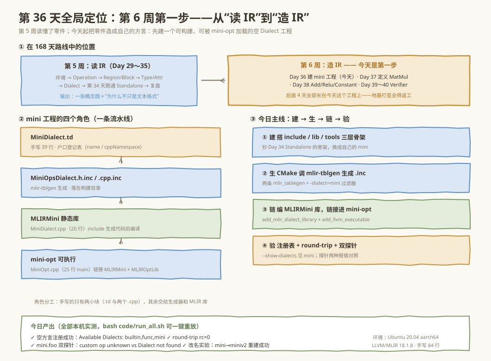
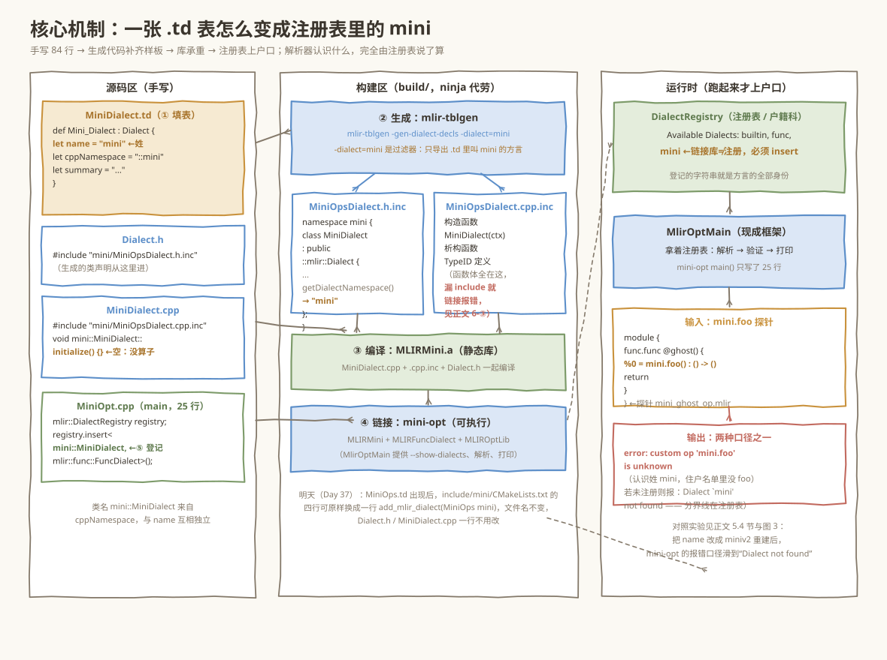
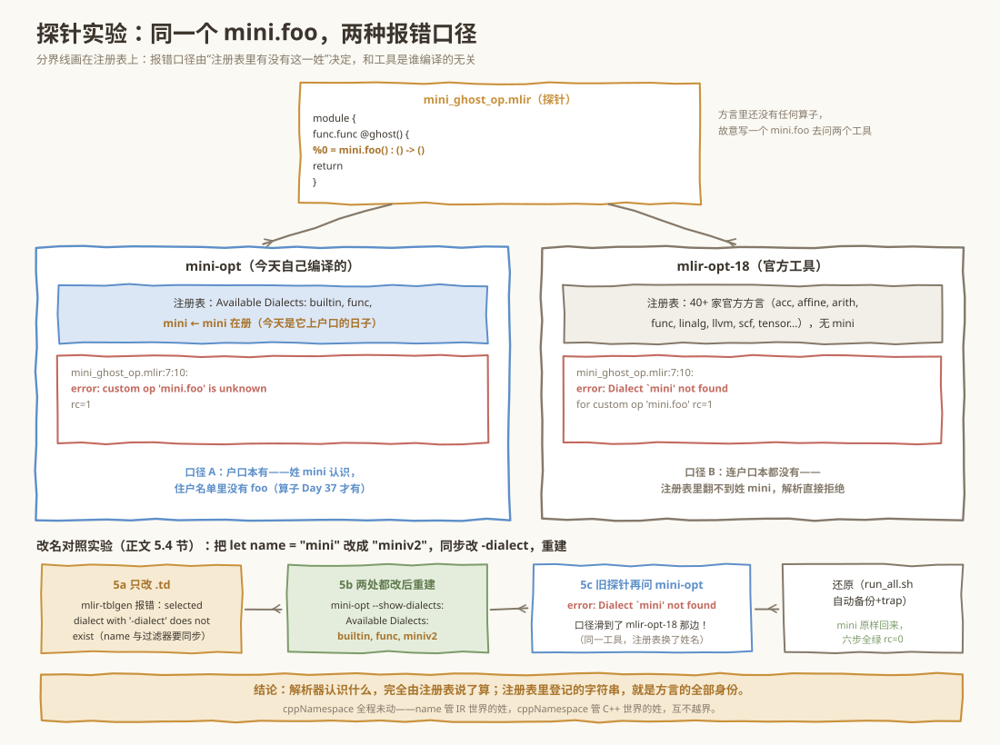

# 第 036 天：创建独立 Dialect 工程——给 mini 办一张方言“户口本”

> **今日目标**：完成本教程后，你能在不修改 LLVM／MLIR 一行源码的前提下，从零搭一个**独立（out-of-tree）的 `mini` Dialect 工程**：说清 Standalone 模板的目录为什么分成 `include／lib／tools` 三层；能手写出让 `mlir-tblgen` 生成方言声明的 `.td` 文件，并解释 `-gen-dialect-decls`、`-dialect=mini` 和 `.inc` 文件各在哪一环；最后构建出一个能被 `mini-opt` 加载的**空方言**——`--show-dialects` 里出现 `mini`，一份冒烟 IR 原样 round-trip，一个 `mini.foo` 探针在两个工具上得到**两种不同的报错**。
> **预计时间**：学习 30 分钟 ＋ 实践 45 分钟
> **前置准备**：Day 29 装好的 MLIR 环境（本机为 Ubuntu 20.04 aarch64、LLVM／MLIR **18.1.8**，`mlir-opt-18`、`mlir-tblgen-18`、`cmake 3.20.5`、`ninja 1.10.0`、`g++ 9.4.0`）；Day 33～34 的 Dialect 概念（命名空间＋注册表）和 Day 34 跑通过的 Standalone 工程——忘了也不怕，第 1 节会用一个探针把概念勾回来，3.1 节会再借一次 Day 34 的骨架。
> **今日产出**：一个 10 个文件的可构建工程（`code/mini/`，其中手写的 C++／TableGen 代码合计仅 **84 行**）；`bash code/run_all.sh` 的完整真实运行日志（含注册表验收、round-trip、双探针对照和改名对照实验）；明天（Day 37）定义 `mini.matmul` 时**一行都不用改**的生成代码骨架。

## 1. 今天解决什么问题？

第 5 周我们一直在**读**别人定义好的方言——`arith`、`scf`、`tensor`、`func`。第 6 周要**造**自己的方言：最终项目 MatMul＋Bias＋ReLU 需要一个叫 `mini` 的命名空间来装 `mini.matmul`、`mini.add`、`mini.relu` 这些自定义算子。但今天就会撞上一个非常具体的问题：

```console
$ mlir-opt-18 mini_ghost_op.mlir
mini_ghost_op.mlir:7:10: error: Dialect `mini' not found for custom op 'mini.foo'
```

`mlir-opt-18` 不认识 `mini`——这不是 bug，而是 Day 33 讲过的**注册表**在把关：MLIR 的工具只认自己注册过的方言，你想让世界认识 `mini`，就得自己编译一个认识它的工具。今天不定义任何算子，只解决**前置问题**：把 `mini` 这家“户籍”登记进注册表，让它成为一个**可构建、可被 `mini-opt` 加载的空方言**。

贯穿全文的是一个**探针文件** `code/mini_ghost_op.mlir`——方言里还没有算子，却故意写一个 `mini.foo`：

```mlir
module {
  func.func @ghost() {
    %0 = mini.foo() : () -> ()
    return
  }
}
```

拿它去问两个工具，能得到**两种不同口径的报错**：认识 `mini` 的 `mini-opt` 说“**op 未知**”（户口本有，住户名单里没有 `foo`）；不认识 `mini` 的 `mlir-opt-18` 说“**方言不存在**”（连户口本都没有）。今天结束时，你要能解释这两种报错的分界线**恰好**画在注册表上——并且能靠一个改名实验亲手把分界线挪来挪去。

**术语先对齐**（每条一句人话，详细展开在第 3 节）：**Standalone／out-of-tree（独立工程）**是不修改 LLVM／MLIR 源码树、用预编译的 MLIR 库搭建的扩展工程；**TableGen（.td）**是一门“描述结构、生成代码”的小语言，MLIR 用它描述方言和算子；**mlir-tblgen**是读 `.td`、吐 C++ 的生成器；**`.inc` 文件**是生成的 C++ 片段，`#include` 进你的源码再编译；**DialectRegistry（方言注册表）**是“户籍科”，登记过的方言才能被解析器认出来。

## 2. 先看全貌：今天的内容位于哪里？



**图 1**：看三个区域。顶部把今天放进 168 天路线：第 5 周读完概念，第 6 周从今天起动手造方言，Day 37～40 会往这个工程里加算子和 Verifier——**今天的地基打歪，后面四天全得返工**。中部是 mini 工程的四个角色：`MiniDialect.td`（手写的户口登记表）→ `.inc` 生成代码（户籍科盖章）→ `MLIRMini` 静态库 → `mini-opt` 可执行文件。右侧是今日四步主线：**建（搭工程）→ 生（跑 mlir-tblgen）→ 链（编译进 mini-opt）→ 验（注册表＋探针）**。

全流程压缩成四步（第 4 节配图逐步拆解）：

1. **建**：搭一个 Standalone 目录骨架，`include`（对外的头文件与 `.td`）＋`lib`（方言实现）＋`tools`（`mini-opt` 驱动）；
2. **生**：CMake 调 `mlir-tblgen` 读 `MiniDialect.td`，生成 `MiniOpsDialect.h.inc`／`MiniOpsDialect.cpp.inc`；
3. **链**：手写的 `MiniDialect.cpp` `#include` 生成代码，编成静态库 `MLIRMini`，再链接进 `mini-opt`；
4. **验**：`mini-opt --show-dialects` 看注册表，round-trip 看解析打印，`mini.foo` 探针看两种报错。

## 3. 核心概念：先用直觉，再给准确定义

### 3.1 Standalone 工程：在 LLVM 城外自建小区

为什么需要“独立”工程？因为把代码塞进 LLVM 源码树里编译（in-tree）要拉整个 llvm-project、编译几小时，而 MLIR 官方早就把**库和头文件**做成了可安装的包（本机来自 `libmlir-18-dev`，CMake 配置在 `/usr/lib/llvm-18/lib/cmake/mlir`）。类比：不去改造市政系统，而是在城外自建小区，接上市政的水电（链接预编译的 `MLIRIR` 等库）就行。**对应到技术上是**：工程通过 `find_package(MLIR REQUIRED CONFIG)` 找到 MLIR 的 CMake 配置，拿到的不是源码，而是“头文件路径＋预编译静态库＋CMake 宏”（`mlir_tablegen`、`add_mlir_dialect_library` 都定义在 `AddMLIR.cmake` 里）；我们写的每个 `.cpp` 都 `#include` MLIR 的**头**，链接的是 MLIR 的**库**，全程不碰 LLVM 仓库。**类比的边界**：水电不是免费的——库的 ABI 和宏对版本敏感（本机是 18.1.8），换版本要重新编译，这是“自建小区”比“住城里”多出来的维护成本。

MLIR 官方仓库里有个现成参考 `mlir/examples/standalone/`——Day 34 你已经把它跑通过一次；今天不再“跑别人的”，而是“抄骨架、换主人”：它的目录分层就是今天 `mini` 工程的骨架：

```text
mini/
├── CMakeLists.txt          # 顶层：find_package(MLIR)、include(AddMLIR) 等五个模块
├── include/mini/           # 对外的“接口层”
│   ├── MiniDialect.td      # 手写的 TableGen 源（户口登记表）
│   ├── Dialect.h           # 手写头文件（拉进生成的 .inc）
│   └── CMakeLists.txt       # 指挥 mlir_tablegen 生成 .inc
├── lib/MiniDialect.cpp     # 方言实现（拉进生成的 .cpp.inc，再实现 initialize）
└── tools/mini-opt/         # 驱动程序 mini-opt
    ├── MiniOpt.cpp         # main()：往注册表放 mini 和 func 两家方言
    └── CMakeLists.txt      # add_llvm_executable + 链接 MLIRMini 等库
```

**为什么要分三层？**`include` 放“别人要 `#include` 的东西”——`.td` 放在这里，生成头则由构建系统生成到**构建目录**的镜像路径下（`build/include/mini/`）；`lib` 放“编成库的实现”；`tools` 放“有 `main()` 的可执行文件”。分层让 Day 41 以后写 Pass、写 Conversion 时可以只加库不动工具，也能让别的工程只链接 `MLIRMini` 库而不带上 `mini-opt`。

### 3.2 TableGen：方言的“户口登记表”怎么填

MLIR 里每个方言都是 `::mlir::Dialect` 的一个 C++ 子类。手写这个类要正确实现构造函数、TypeID、命名空间——样板代码多且容易错，所以 MLIR 用 **TableGen**（LLVM 家族的“描述→生成”语言）来填表：你只描述**事实**（叫什么名、放哪个命名空间、干什么用），样板交给生成器。类比：填户口登记表不需要自己刻公章——填完交给户籍科（mlir-tblgen）盖章出证。**对应到技术上是**：`MiniDialect.td` 里的 `def Mini_Dialect : Dialect { ... }` 只是**数据**，`mlir-tblgen -gen-dialect-decls -dialect=mini` 把它翻译成 `namespace mini { class MiniDialect : public ::mlir::Dialect {...} }` 的**声明**，`-gen-dialect-defs` 生成**实现**。**类比的边界**：户籍科只认表上填的字段，表上没填的（比如算子——Day 37 的 `MiniOps.td`）它一个字都不会写；所以“空方言”生成的类是真的空，不是藏着什么默认行为。

今天手写的整张“登记表”只有这几行是数据（`code/mini/include/mini/MiniDialect.td`）：

```tablegen
def Mini_Dialect : Dialect {
    let name = "mini";                // IR 文本里的前缀：mini.xxx 的 mini
    let summary = "mini 编译器的张量算子方言";
    let description = [{
        mini 是本学习计划自定义的 MLIR 方言：先承载 MatMul、Add、Relu 等
        张量算子，再逐步长出 Shape 推导、融合与 Lowering 所需的能力。
    }];
    let cppNamespace = "::mini";      // 生成的 C++ 类放进 ::mini 命名空间
}

class Mini_Op<string mnemonic, list<Trait> traits = []> :
        Op<Mini_Dialect, mnemonic, traits>;   // 算子公共基类，Day 37 起使用
```

两个**关键字段**必须记住：`name` 决定 IR 文本里的姓（`mini.foo` 报错信息里那个 `mini` 就是它）；`cppNamespace` 决定生成类的 C++ 全名（今天就是 `mini::MiniDialect`）。**这两个字段互相独立**——5.4 节的改名实验会证明 `name` 改了注册表就跟着改，而 `cppNamespace` 一动不动。

生成出来的头文件（`build/include/mini/MiniOpsDialect.h.inc`，真实生成内容节选）长这样——注意 `namespace` 正是 `cppNamespace` 的值：

```cpp
namespace mini {
class MiniDialect : public ::mlir::Dialect {
  explicit MiniDialect(::mlir::MLIRContext *context);
  ~MiniDialect() override;
  ...
  static ::llvm::StringRef getDialectNamespace() {
    return ::llvm::StringLiteral("mini");   // ← 来自 .td 的 let name
  }
};
} // namespace mini
MLIR_DECLARE_EXPLICIT_TYPE_ID(::mini::MiniDialect)
```

### 3.3 构建依赖链：CMake 里四行各管什么

把“表”变成“能加载的方言”，中间是一条**生成→编译→链接**的依赖链，CMake 的四个宏各管一环：

| 环节 | CMake 写法 | 干的事 |
|---|---|---|
| ① 生成 | `mlir_tablegen(MiniOpsDialect.h.inc -gen-dialect-decls -dialect=mini)` | 造规则“跑 mlir-tblgen 生成 .inc”，`-dialect=mini` 表示只导出 `.td` 里名字叫 `mini` 的方言 |
| ② 目标 | `add_public_tablegen_target(MLIRMiniDialectIncGen)` | 把①包装成“目标”，别人可以用 `DEPENDS` 等它——不写这行，②③之间就没有先后保证 |
| ③ 库 | `add_mlir_dialect_library(MLIRMini MiniDialect.cpp DEPENDS MLIRMiniDialectIncGen LINK_LIBS PUBLIC MLIRIR)` | 把 `MiniDialect.cpp` 编成静态库，声明“依赖②、链接 MLIR 基础库” |
| ④ 可执行 | `add_llvm_executable(mini-opt MiniOpt.cpp)` ＋ `target_link_libraries(mini-opt PRIVATE ... MLIRMini ...)` | 编 `mini-opt`，链接③和 MLIR 自带工具库 `MLIROptLib`（`MlirOptMain` 在这里） |

这里有个**为什么**值得多说一句：`add_mlir_dialect_library` 是 MLIR 提供的“方言库专用宏”，它比普通 `add_library` 多做两件事——把库登记进全局属性 `MLIR_DIALECT_LIBS`（`tools/mini-opt/CMakeLists.txt` 第一行用 `get_property(... GLOBAL PROPERTY MLIR_DIALECT_LIBS)` 取出来自动链接），以及自动把 include 路径配好。**而今天的一个小机关**是：`include/mini/CMakeLists.txt` 没有用官方的 `add_mlir_dialect(MiniOps mini)`——那个宏以 `MiniOps.td` 为入口，而今天还没有算子文件，只有方言本体的 `MiniDialect.td`，所以我们直接写了等价的两条 `mlir_tablegen`。**生成文件名刻意沿用 `MiniOpsDialect.*.inc` 的官方命名**，这样明天 `MiniOps.td` 出现后，把这四行换成一行 `add_mlir_dialect(MiniOps mini)`，文件名不变、下游 `Dialect.h`／`MiniDialect.cpp` 一行不用改。

## 4. 图解核心机制：一张表怎么变成注册表里的一行



**图 2**：一条从左到右的流水线，输入是手写的 `.td`（只有 39 行），输出是注册表里多出来的 `mini`。关注三处“接力”：**第一棒**是生成——`mlir-tblgen` 产出声明（`.h.inc`，给 `Dialect.h` 去 include）和定义（`.cpp.inc`，给 `MiniDialect.cpp` 去 include），两个 `.inc` 都落在**构建目录**里，不污染源码；**第二棒**是编译——`MiniDialect.cpp` 里手写的其实只有“include 生成代码＋空的 `initialize()`”，编成 `MLIRMini.a`；**第三棒**是登记——`MiniOpt.cpp` 的 `registry.insert<mini::MiniDialect, mlir::func::FuncDialect>()` 往 `DialectRegistry` 放两个住户，再把注册表连同命令行交给 `MlirOptMain`——解析、验证、打印全由这个现成框架完成，我们的 `main()` 总共 25 行。

按图中编号逐步过一遍“发生了什么、为什么需要”：

1. **填表**（源码区）：`.td` 里写 4 个字段，`name` 和 `cppNamespace` 是机器要用的，`summary`／`description` 是给人看的（`mlir-opt --help` 的方言文档、报错信息里都会引用）；
2. **生成**（构建目录区）：`mlir-tblgen` 只“抄写”不“发明”——类名固定叫 `MiniDialect`，放进哪个命名空间由 `cppNamespace` 说了算，`getDialectNamespace()` 返回的字符串就是 `.td` 里的 `name`。为什么需要这一步？因为手写 TypeID、构造函数这类样板十有八九抄错，让机器生成才能保证**声明和定义、字段和字符串**永远一致；
3. **编译**：`Dialect.h` 只 include `.h.inc`，对外暴露一个干净头文件；`MiniDialect.cpp` include `.cpp.inc` 拿到函数体，再补一行 `void mini::MiniDialect::initialize() {}`——**将来所有算子都在这个函数里注册**（Day 37 会看到 `addOperations<...>()`），今天它为空正说明“方言还没有住户”；
4. **链接**：`MLIRMini` 只是个库，没有 `main()` 干不了活；`mini-opt` 把它和 MLIR 的 `MLIROptLib`（`MlirOptMain`）、`MLIRFuncDialect` 链在一起，成为能独立分发的工具；
5. **登记**：注意 `registry.insert` 是**在工具里做的**，不是方言自己长出来的——同一个 `MLIRMini` 库，被别的工具链接时**可以不注册** `mini`（5.4 节的改名实验反着证明了这点：注册表说什么，解析器就认什么）。

## 5. 动手实践：搭出空方言并用三种方式验证

### 5.1 准备文件

工程本体 10 个文件，加上 2 份测试 IR 和 1 个一键重放脚本，全部在 `code/` 下（一棵不落）：

```text
code/
├── mini/                          # 工程本体
│   ├── CMakeLists.txt
│   ├── include/CMakeLists.txt     # add_subdirectory(mini)
│   ├── include/mini/
│   │   ├── MiniDialect.td         # 39 行（含注释）
│   │   ├── Dialect.h              # 15 行
│   │   └── CMakeLists.txt         # 12 行：两条 mlir_tablegen + 目标
│   ├── lib/
│   │   ├── MiniDialect.cpp        # 20 行
│   │   └── CMakeLists.txt         # add_mlir_dialect_library(MLIRMini ...)
│   └── tools/
│       ├── CMakeLists.txt         # add_subdirectory(mini-opt)
│       └── mini-opt/
│           ├── MiniOpt.cpp        # 25 行
│           └── CMakeLists.txt     # add_llvm_executable + 链接
├── mini_smoke.mlir                # 冒烟 IR（round-trip 用）
├── mini_ghost_op.mlir             # 探针 IR（两种报错对照用）
└── run_all.sh                     # 一键重放今天全部结果
```

环境核对（本机实测值；缺哪个包见 Day 29）：

| 工具 | 本机版本 | 角色 |
|---|---|---|
| `mlir-opt-18` | Ubuntu LLVM 18.1.8 | 对照组：不认识 mini 的官方工具 |
| `mlir-tblgen-18` | 18.1.8 | 生成器：读 `.td` 吐 `.inc` |
| `MLIR_DIR` | `/usr/lib/llvm-18/lib/cmake/mlir` | CMake 找 MLIR 的入口 |
| `cmake`／`ninja`／`g++` | 3.20.5／1.10.0／9.4.0 | 构建三件套 |

### 5.2 编写代码

**① 顶层 `CMakeLists.txt`——把 MLIR 的“水电”接进小区**：

```cmake
cmake_minimum_required(VERSION 3.20.0)
project(mini-dialect LANGUAGES CXX C)

set(CMAKE_CXX_STANDARD 17 CACHE STRING "C++ standard to conform to")

find_package(MLIR REQUIRED CONFIG)          # 找到预编译 MLIR 的 CMake 配置
message(STATUS "Using MLIRConfig.cmake in: ${MLIR_DIR}")

set(LLVM_RUNTIME_OUTPUT_INTDIR ${CMAKE_BINARY_DIR}/bin)
set(LLVM_LIBRARY_OUTPUT_INTDIR ${CMAKE_BINARY_DIR}/lib)
set(MLIR_BINARY_DIR ${CMAKE_BINARY_DIR})    # AddMLIR 的宏要看这三个变量

list(APPEND CMAKE_MODULE_PATH "${MLIR_CMAKE_DIR}")
list(APPEND CMAKE_MODULE_PATH "${LLVM_CMAKE_DIR}")
include(TableGen)     # 提供 mlir_tablegen
include(AddLLVM)      # 提供 add_llvm_executable
include(AddMLIR)      # 提供 add_mlir_dialect_library
include(HandleLLVMOptions)                  # MLIR 头要求一致的编译选项

set(MINI_SOURCE_DIR ${PROJECT_SOURCE_DIR})
set(MINI_BINARY_DIR ${PROJECT_BINARY_DIR})
include_directories(${LLVM_INCLUDE_DIRS} ${MLIR_INCLUDE_DIRS}
                    ${MINI_SOURCE_DIR}/include ${MINI_BINARY_DIR}/include)
link_directories(${LLVM_BUILD_LIBRARY_DIR})
add_definitions(${LLVM_DEFINITIONS})

add_subdirectory(include)   # ① 生成 .inc 的规则
add_subdirectory(lib)       # ② 静态库 MLIRMini
add_subdirectory(tools)     # ③ 可执行文件 mini-opt
```

**② `include/mini/CMakeLists.txt`——今天唯一“绕开”官方宏的地方**（原因见 3.3 节末尾）：

```cmake
set(LLVM_TARGET_DEFINITIONS MiniDialect.td)
mlir_tablegen(MiniOpsDialect.h.inc -gen-dialect-decls -dialect=mini)
mlir_tablegen(MiniOpsDialect.cpp.inc -gen-dialect-defs -dialect=mini)
add_public_tablegen_target(MLIRMiniDialectIncGen)
```

**③ `Dialect.h`——薄薄的门面**（`MiniOpsDialect.h.inc` 在构建目录里，靠顶层 `include_directories(${MINI_BINARY_DIR}/include)` 找到）：

```cpp
#ifndef MINI_DIALECT_H
#define MINI_DIALECT_H

#include "mlir/IR/Dialect.h"
#include "mini/MiniOpsDialect.h.inc"   // 生成的 class MiniDialect 声明

#endif // MINI_DIALECT_H
```

**④ `MiniDialect.cpp`——手写 C++ 的全部**（注意两处 namespace 都写了 `mini::`，为什么见第 6 节错误 ①）：

```cpp
#include "mini/Dialect.h"

using namespace mlir;

// 生成的构造/析构/TypeID 定义。漏掉会在链接期报 undefined reference。
#include "mini/MiniOpsDialect.cpp.inc"

void mini::MiniDialect::initialize() {}   // 还没有算子；Day 37 起这里不再为空
```

**⑤ `MiniOpt.cpp`——25 行的 `main()`**：

```cpp
#include "mlir/Dialect/Func/IR/FuncOps.h"
#include "mlir/IR/Dialect.h"
#include "mlir/IR/MLIRContext.h"
#include "mlir/Tools/mlir-opt/MlirOptMain.h"

#include "mini/Dialect.h"

int main(int argc, char **argv) {
  mlir::DialectRegistry registry;
  // cppNamespace = "::mini" ⇒ 类名是 mini::MiniDialect（不是 mlir::mini::）
  registry.insert<mini::MiniDialect,
                  mlir::func::FuncDialect>();   // func 做函数容器，测试要用
  return mlir::asMainReturnCode(
      mlir::MlirOptMain(argc, argv, "mini dialect optimizer driver\n", registry));
}
```

**⑥ `lib/CMakeLists.txt` 与 `tools/mini-opt/CMakeLists.txt`**——对应 3.3 节表格的③④两行：

```cmake
# lib/CMakeLists.txt
add_mlir_dialect_library(MLIRMini
  MiniDialect.cpp
  ADDITIONAL_HEADER_DIRS ${PROJECT_SOURCE_DIR}/include/mini
  DEPENDS MLIRMiniDialectIncGen          # 先生成 .inc 再编译
  LINK_LIBS PUBLIC MLIRIR
  )
```

```cmake
# tools/mini-opt/CMakeLists.txt
get_property(dialect_libs GLOBAL PROPERTY MLIR_DIALECT_LIBS)
set(LIBS ${dialect_libs} MLIRFuncDialect MLIROptLib MLIRMini)
add_llvm_executable(mini-opt MiniOpt.cpp)
llvm_update_compile_flags(mini-opt)      # 统一 -fno-rtti 等选项，MLIR 库要求
target_link_libraries(mini-opt PRIVATE ${LIBS})
```

`.td` 全文见 3.2 节；`MiniDialect.td` 里还有一段 `class Mini_Op` 公共基类——今天没人用，是给 Day 37 的 `mini.matmul` 预留的“姓前缀”，先建工程不写一行废代码。

### 5.3 运行与观察

以下全部为本机**真实执行**（Ubuntu 20.04 aarch64，LLVM／MLIR 18.1.8，构建目录在 `/tmp/opencode/day036/build`；你可以用 `cd code && bash run_all.sh` 一键重放，构建目录默认 `/tmp/day036/build`，可用环境变量 `DAY036_BUILD` 改）：

**构建**（首次约 1～3 分钟，输出节选）：

```console
$ cmake -G Ninja -B build -S mini -DCMAKE_BUILD_TYPE=Release \
      -DMLIR_DIR=/usr/lib/llvm-18/lib/cmake/mlir
-- Using MLIRConfig.cmake in: /usr/lib/llvm-18/lib/cmake/mlir
-- Configuring done
-- Generating done
$ cmake --build build
[1/6] Building MiniOpsDialect.cpp.inc...
[2/6] Building MiniOpsDialect.h.inc...
[3/6] Building CXX object lib/CMakeFiles/obj.MLIRMini.dir/MiniDialect.cpp.o
[4/6] Linking CXX static library lib/libMLIRMini.a
[5/6] Building CXX object tools/mini-opt/CMakeFiles/mini-opt.dir/MiniOpt.cpp.o
[6/6] Linking CXX executable bin/mini-opt
```

顺带看一眼构建顺序：前两步是 `.inc`（生成）、中间两步是 `MLIRMini`（编译＋打包库）、最后两步是 `mini-opt`（编译＋链接）——**ninja 的执行顺序本身就是 3.3 节依赖链的证据**：先生成、再库、后可执行，一步都不许乱。

**验收一：注册表里有没有 `mini`**——`--show-dialects` 是 `MlirOptMain` 自带的开关：

```console
$ ./build/bin/mini-opt --show-dialects
Available Dialects: builtin,func,mini
module {
}
```

`mini` 出现了——**空方言成立**。后面那个空 `module {}` 不是错误：没给输入文件时 `MlirOptMain` 会构造一个空 IR 照常走“解析→打印”流程。

**验收二：round-trip**——`mini_smoke.mlir` 应被“解析→验证→打印”原样吐回：

```console
$ ./build/bin/mini-opt mini_smoke.mlir
module {
  func.func @smoke(%arg0: tensor<2x3xf32>) -> tensor<2x3xf32> {
    return %arg0 : tensor<2x3xf32>
  }
}
$ echo $?
0
```

注意一个细节：源文件里写的是 `%x`，吐回来变成了 `%arg0`。这不是 bug——SSA 值的**名字只是给人看的注记**，解析器不保存它，打印器按“入口块参数按 `argN` 重命名”的规则重新起名。第一次见到自己的 IR 被“改名还回来”，正好体会 Day 30 说的“名字不是语义”。

**验收三：探针问两个工具**——同一份 `mini_ghost_op.mlir`，两种口径（均为 `rc=1`）：

```console
$ ./build/bin/mini-opt mini_ghost_op.mlir
mini_ghost_op.mlir:7:10: error: custom op 'mini.foo' is unknown
    %0 = mini.foo() : () -> ()
         ^

$ mlir-opt-18 mini_ghost_op.mlir
mini_ghost_op.mlir:7:10: error: Dialect `mini' not found for custom op 'mini.foo'
    %0 = mini.foo() : () -> ()
         ^
mini_ghost_op.mlir:7:10: note: Registered dialects: acc, affine, amdgpu, ...
         (40 余家官方方言)， for more info see .../Faq/#registered-loaded...
```



**图 3**：上半部分是三步对照——**注册表口径**（`Available Dialects: builtin,func,mini`）→ **解析器口径**（`custom op 'mini.foo' is unknown`：解析器认识姓 `mini`，去 `MiniDialect` 里找 `foo` 没找到）vs **门外汉口径**（`Dialect 'mini' not found`：注册表里翻不到这一姓）。下半部分预告 5.4 节的改名实验：把 `name` 改成 `miniv2` 重建后，`mini-opt` 的报错口径**滑到了 mlir-opt-18 那边**——同一个二进制、同一份 IR，报错只随注册表变，这就是“解析器认识什么由注册表决定”的实验证据。

### 5.4 修改一个参数再观察：给方言改个名

**实验设计**：`.td` 里的 `let name = "mini"` 是方言身份的唯一来源吗？改它一个词，重建，看注册表和报错怎么动。实验分两半——先**只改 `.td`**（预期失败），再**连 CMake 里的 `-dialect=mini` 一起改**（预期成功）。真实输出如下（`run_all.sh` 第 5 步可重放）：

**5a. 只改 `.td`，不改 `-dialect`**——`mlir-tblgen` 当场翻脸：

```console
$ sed -i 's/let name = "mini";/let name = "miniv2";/' mini/include/mini/MiniDialect.td
$ cmake --build build
[2/6] Building MiniOpsDialect.h.inc... FAILED
/usr/lib/llvm-18/bin/mlir-tblgen -gen-dialect-decls -dialect=mini ... MiniDialect.td
selected dialect with '-dialect' does not exist
```

失败原因：`-dialect=mini` 是一个**过滤器**——“在 `.td` 里找名字叫 `mini` 的方言并导出它”。`.td` 改叫 `miniv2` 后过滤器找不到目标，生成步骤直接失败。这说明 `name` 和 `-dialect` 是**同一事实的两份记录**，必须同步。

**5b. `-dialect=mini` 也改成 `-dialect=miniv2`**——构建成功，注册表换了姓名：

```console
$ sed -i 's/-dialect=mini/-dialect=miniv2/g' mini/include/mini/CMakeLists.txt
$ cmake --build build          # 成功
$ ./build/bin/mini-opt --show-dialects | head -1
Available Dialects: builtin,func,miniv2
```

**5c. 拿旧探针再问一次 `mini-opt`**——报错口径变成了 mlir-opt-18 的那一种：

```console
$ ./build/bin/mini-opt mini_ghost_op.mlir
mini_ghost_op.mlir:7:10: error: Dialect `mini' not found for custom op 'mini.foo'
```

同一个自己编译的工具，`miniv2` 认识了、`mini` 就不认识了——**注册表里登记的字符串就是方言的全部身份**，没有任何“血缘”兜底。随后把两个文件还原（`run_all.sh` 里做了备份和 trap 自动还原），重建，`Available Dialects: builtin,func,mini` 原样回来。顺带一提：整个实验里 `cppNamespace = "::mini"` 从头到尾没改，C++ 侧的 `mini::MiniDialect` 类名纹丝不动——`name`（IR 世界的姓）和 `cppNamespace`（C++ 世界的姓）各管一边，互不越界。

## 6. 常见错误与排查

下面四个错误都在本机**真实触发过**，按“现象 → 原因 → 定位 → 修复”展开。

**① 编译错误：`error: 'MiniDialect' has not been declared`**

```console
MiniDialect.cpp:20:6: error: 'MiniDialect' has not been declared
   20 | void MiniDialect::initialize() {}
```

**现象**：编译 `MiniDialect.cpp` 直接失败。**原因**：`.td` 里 `cppNamespace = "::mini"`，生成的类是 `mini::MiniDialect`，不写命名空间的全局作用域里**没有** `MiniDialect` 这个名字；`using namespace mlir;` 帮不上忙（那是另一个命名空间）。**定位**：报错行在 `MiniDialect.cpp` 的函数定义处，对比生成头 `.h.inc` 里的 `namespace mini { class MiniDialect ... }` 一眼可见。**修复**：写成 `void mini::MiniDialect::initialize() {}`（或者在文件头 `using namespace mini;`）。**教训**：`cppNamespace` 填什么，决定你到处要写多少 `mini::` 前缀。

**② 生成错误：`selected dialect with '-dialect' does not exist`**

**现象**：改了 `.td` 的 `let name`（或删错了字母），重建时 `Building MiniOpsDialect.h.inc... FAILED`。**原因**：`mlir_tablegen(... -dialect=mini)` 的 `-dialect` 是**过滤器**，在 `.td` 里找不到叫 `mini` 的方言就报错退出——`name` 与 `-dialect` 必须同步。**定位**：完整报错行是 `mlir-tblgen -gen-dialect-decls -dialect=mini ... selected dialect with '-dialect' does not exist`，看引号里的名字和 `.td` 对不对照即可。**修复**：5.4 节的实验就是标准答案——要么都改，要么都改回去；用官方宏 `add_mlir_dialect(MiniOps mini)` 时它自动传参，就不容易踩。

**③ 链接错误：`undefined reference to mini::MiniDialect::MiniDialect(mlir::MLIRContext*)`**

```console
MiniOpt.cpp:(.text...): undefined reference to `mini::MiniDialect::MiniDialect(mlir::MLIRContext*)'
MiniOpt.cpp:(.text.startup.main+0x40): undefined reference to `mlir::detail::TypeIDResolver<mini::MiniDialect, void>::id'
```

**现象**：两个 `.o` 都编过了，最后链接 `mini-opt` 时炸。**原因**：`MiniDialect.cpp` 里漏了 `#include "mini/MiniOpsDialect.cpp.inc"`——构造函数、析构函数、TypeID 的**函数体**全在 `.cpp.inc` 里，不 include 它就没有任何定义。**定位**：`undefined reference` 指 `mini::MiniDialect` 的构造和 TypeID，说明声明（`.h.inc`）被找到了、定义（`.cpp.inc`）没人编。**修复**：把那行 include 加回去即可（本机实测加回后一次链接成功）。这是 Standalone 工程最经典的坑，LLVM 官方模板里特意留了注释提醒。

**④ 解析错误：`Dialect 'mini' not found`——但明明链接了 MLIRMini**

**现象**：库链接好了、二进制能跑，喂进 `mini.foo` 探针却报 `Dialect 'mini' not found for custom op 'mini.foo'`，口径和 `mlir-opt-18` 一模一样。**原因**：`MLIRMini` 只是个静态库，**方言必须显式 `registry.insert<mini::MiniDialect>()` 才会被登记**——链接≠注册。**定位**：先 `--show-dialects` 看注册表有没有 `mini`；没有就去 `main()` 里查 `insert`。**修复**：把方言加进 `registry.insert` 的模板参数列表。**反过来也成立**：5.4 节证明注册表里没有的姓，链接了库也照样“不认识”。

## 7. 今日练习

### 必做练习

**给 mini-opt 再接一家官方方言。**参考 `MiniOpt.cpp` 里 `mlir::func::FuncDialect` 的三处出现（头文件 include、`registry.insert`、`tools/mini-opt/CMakeLists.txt` 的 `MLIRFuncDialect`），把 `arith` 方言也接进来：头文件是 `mlir/Dialect/Arith/IR/ArithOps.h`，类名 `mlir::arith::ArithDialect`，库是 `MLIRArithDialect`。验收标准：`mini-opt --show-dialects` 第一行出现 `arith`；再写一份 4 行的 IR（一个 `arith.constant`），用 `mini-opt` round-trip 成功（`rc=0`）。这个练习让你独立走一遍“库→注册表→解析器”的完整链条，明天接 `mini.matmul` 时你会碰到一模一样的动作。

### 选做挑战

**把 `cppNamespace` 从 `"::mini"` 改成 `"::mlir::mini"`**，重建。观察三件事：① `--show-dialects` 的输出变不变？（预期：不变——`name` 才管 IR 文本）② `MiniOpt.cpp`／`MiniDialect.cpp` 里哪些代码必须跟着改？（预期：所有 `mini::MiniDialect` 变成 `mlir::mini::MiniDialect`）③ 生成头里的 namespace 变成什么？做完把答案和 5.4 节对照：`cppNamespace` 改了 C++ 侧、`name` 改了 IR 侧——两个实验合起来，把“一个方言有两个名字”这件事焊死在你记忆里。

## 8. 今日验收

- [ ] 我能用自己的话说清 out-of-tree 工程和 in-tree 的区别，以及 `find_package(MLIR)` 找到的是“源码”还是“头＋库＋CMake 宏”。
- [ ] 我能独立从零重建今天的工程：10 个文件我手写过至少一遍，`mini-opt --show-dialects` 打印出 `Available Dialects: builtin,func,mini`。
- [ ] 我能解释 `.td`／`mlir-tblgen`／`.inc`／`registry.insert` 各自在流水线里的位置，并说出 `-dialect=mini` 是过滤器的含义。
- [ ] 我能预测：把 `let name` 改成 `"miniv2"`（同步改 `-dialect`）重建后，`mini.foo` 探针会从哪种报错变成哪种报错（5.4 节实测过，能不看书记住分界线即可）。
- [ ] 我保存了 `code/mini/` 全部源码、两份 `.mlir` 测试和 `run_all.sh`，且 `bash run_all.sh` 六步全绿、退出码 0。
- [ ] 我排查了至少一个第 6 节的错误（或独立踩中并修复合出一个新错误）。

## 9. 一句话总结与明天预告

今天把第 5 周的“读 IR”翻面成“造 IR”：用 84 行手写代码搭起一个 out-of-tree 的 `mini` 方言工程——`.td` 填表、`mlir-tblgen` 盖章、`MLIRMini` 库承重、`registry.insert` 上户口，最后用注册表、round-trip、双探针和改名实验四种方式证明了“空方言”真实存在。分界线实验是今天最值钱的收获：**解析器认识什么，完全由注册表说了算；注册表里登记的字符串，就是方言的全部身份。**

明天（Day 37）定义第一个算子 `mini.matmul`：`MiniOps.td` 里写 ODS（名字、两个输入、一个结果、Tensor 类型约束），`initialize()` 里的 `addOperations<...>()` 让方言第一次“住进住户”——今天刻意保留下来的 `MiniOpsDialect.*.inc` 命名和 `class Mini_Op` 基类，会在那时一处不改地接上。
