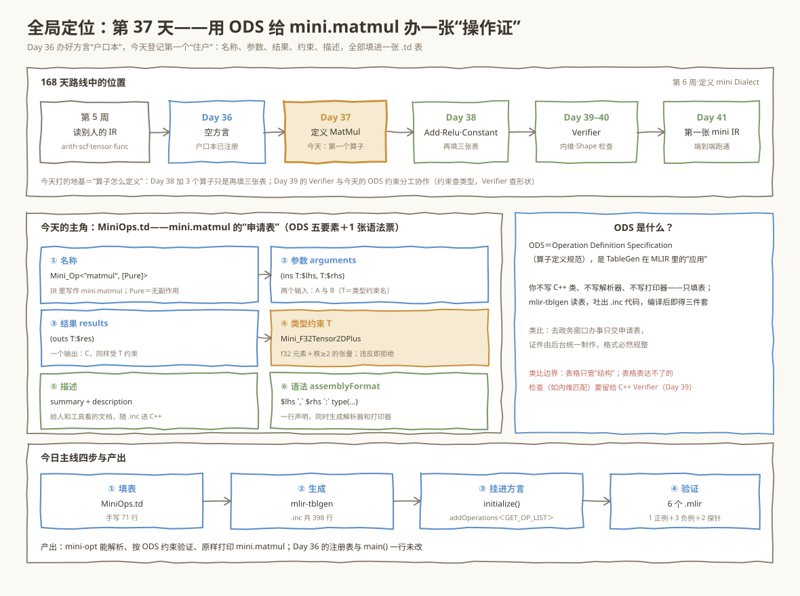
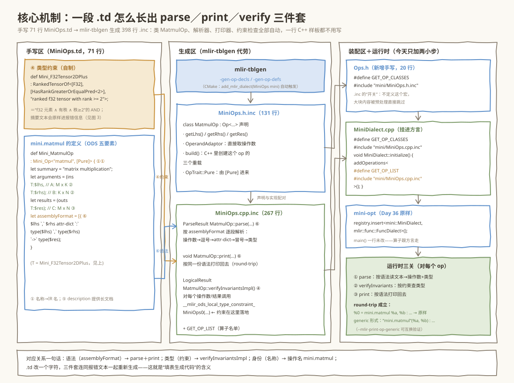
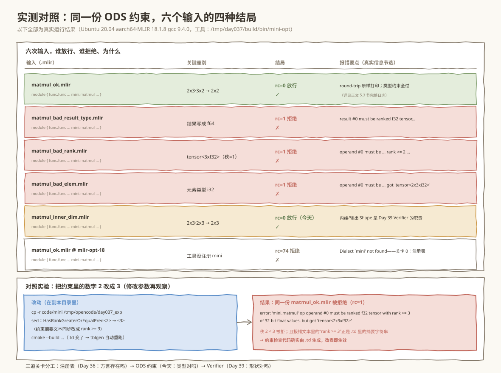

# 第 037 天：定义 MatMul——往 mini 的户口本里登记第一个算子

> **今日目标**：完成本教程后，你能在昨天搭好的 mini 独立工程上定义第一个算子 `mini.matmul`：说清 ODS 五要素（名称、参数、结果、类型约束、描述）各自写在 `.td` 的哪一行、分别生成什么代码；能手写 `MiniOps.td` 与两个装配文件，让 `mlir-tblgen` 自动生成 `MatmulOp` 类和它的解析器、打印器、约束检查；最后用 **1 个正例、3 个负例、2 个探针**验证两件事——类型约束真的在把关，内维匹配检查确实还没做（那是 Day 39 Verifier 的工作）。
> **预计时间**：学习 30 分钟＋实践 45 分钟
> **前置准备**：Day 29 的 MLIR 环境（本机为 Ubuntu 20.04 aarch64、LLVM／MLIR **18.1.8**，`mlir-opt-18`、`cmake 3.20.5`、`ninja 1.10.0`、`gcc 9.4.0`）；Day 36 的 mini 空方言工程（`tutorials/day-036/code/mini/`）。忘了也不怕：今天只需要它已能构建出 `mini-opt` 这一点，第 1 节会用一个探针把上下文勾回来。
> **今日产出**：在 Day 36 的 10 个文件上**新增 2 个文件、实质修改 3 处**得到能定义算子的工程（`code/mini/`）；`bash code/run_all.sh` 的完整真实运行日志（构建 10 步、round-trip、三条负例、两个探针）；一个把约束 `rank >= 2` 改成 `rank >= 3` 后正例被拒的对照实验。

## 1. 今天解决什么问题？

昨天（Day 36）我们把 `mini` 方言登记进了 `mini-opt` 的注册表，但那是一本**空户口本**：方言存在，里面一个算子都没有。拿昨天构建的 `mini-opt` 跑今天的标准例子 `A(2×3) · B(3×2) = C(2×2)`，会得到这样的报错（下面是**真实运行结果**，用 Day 36 的工程构建后执行）：

```console
$ day-36/mini-opt matmul_ok.mlir
matmul_ok.mlir:5:10: error: custom op 'mini.matmul' is unknown
    %c = mini.matmul %a, %b : tensor<2x3xf32>, tensor<3x2xf32> -> tensor<2x2xf32>
         ^
```

方言找到了，但“住户名单”里没有 `matmul`。要把它登记进去，本质上是回答五个问题：**这个算子叫什么名字？吃几个参数、什么类型？吐几个结果、什么类型？哪些类型是合法的？文本长什么样、给人看的说明写在哪？** 如果用手写 C++ 回答，你要实现 `Op` 的派生类、builder、解析器、打印器、约束检查……几百行样板代码。MLIR 的答案是 **ODS**：把答案填进一张 `.td` 表，剩下的交给生成器。

贯穿全文的还是那个例子（与本周后续各天保持一致）：

```mlir
%c = mini.matmul %a, %b : tensor<2x3xf32>, tensor<3x2xf32> -> tensor<2x2xf32>
```

今天结束时，这份 IR 能在 `mini-opt` 里**原样 round-trip**（解析→验证→打印，一个字符都不差），而三个故意写错类型的负例会被 ODS 生成的约束检查拒绝。

**术语先对齐**（每条一句人话，详细展开在第 3 节）：**ODS（Operation Definition Specification，算子定义规范）**是 MLIR 用 TableGen 描述算子的那套“表格格式”；**TableGen（.td）**是“描述结构、生成代码”的小语言；**mlir-tblgen**是读 `.td`、吐 C++ 的生成器；**`.inc`**是生成的 C++ 片段，`#include` 进源码再编译；**类型约束（type constraint）**是“操作数／结果必须是什么类型”的机器可检查声明；**assemblyFormat（声明式汇编格式）**是一行描述算子文本语法的声明，能同时生成解析器和打印器。

## 2. 先看全貌：今天的内容位于哪里？



**图 1**：看三个区域。顶部时间线：昨天办户口本（空方言），今天登记第一个住户 `mini.matmul`，Day 38 再加 `add`／`relu`／`constant` 只需再填三张表，Day 39–40 的 Verifier 与今天的 ODS 约束**分工协作**。中部是今天的主角——`MiniOps.td` 这张“申请表”：① 名称、② 参数、③ 结果、④ 类型约束、⑤ 描述，外加一张“语法票”⑥ `assemblyFormat`。底部是四步主线：**填表 → 生成 → 挂进方言 → 验证**。

全流程压缩成四步（第 4 节配图逐步拆解）：

1. **填表**：手写 `MiniOps.td`（71 行，含注释），用 ODS 五要素＋`assemblyFormat` 描述 `mini.matmul`；
2. **生成**：CMake 调 `mlir-tblgen` 生成 `MiniOps.h.inc`（131 行，类声明）和 `MiniOps.cpp.inc`（267 行，`parse`／`print`／`verifyInvariantsImpl`）；
3. **挂进方言**：`MiniDialect::initialize()` 里 `addOperations` 把生成的算子类登记进方言，`mini-opt` 的 `main()` **一行不改**；
4. **验证**：1 个正例 round-trip、3 个负例被约束拒绝、2 个探针探边界（内维不匹配今天放行、未注册方言的 `mlir-opt-18` 拒收）。

## 3. 核心概念：先用直觉，再给准确定义

### 3.1 ODS 五要素：一张“算子申请表”

类比：去政务窗口办事，你不亲自制作证件，只填一张申请表——窗口后台按表统一制证，格式必然规整。**对应到技术上是**：`MiniOps.td` 里每 `def` 一个算子，就是填一张表；`mlir-tblgen` 是后台，按表吐出 C++ 类、解析器、打印器和约束检查；你手写的 C++ 只负责把这些生成物**装配**起来。**类比的边界**：表格只能表达“结构性”的声明（名字、个数、类型门槛、文本语法），表达不了的检查——比如“两个操作数的内维必须相等”——表格无能为力，要留给 Day 39 的 C++ Verifier；今天第 5.3 节的探针 5 会亲眼看到这条边界。

以 `mini.matmul` 为例，五要素在 `.td` 里的样子（真实文件是 `code/mini/include/mini/MiniOps.td`，这里逐行对应）：

| 要素 | 写法 | 生成什么 |
|---|---|---|
| ① 名称 | `def Mini_MatmulOp : Mini_Op<"matmul", [Pure]>` | 操作名 `mini.matmul`（方言前缀＋mnemonic）；C++ 类 `mini::MatmulOp` |
| ② 参数 | `let arguments = (ins Mini_F32Tensor2DPlus:$lhs, Mini_F32Tensor2DPlus:$rhs)` | 操作数访问器 `getLhs()`／`getRhs()`、`build()` 重载 |
| ③ 结果 | `let results = (outs Mini_F32Tensor2DPlus:$res)` | 结果访问器 `getRes()`、结果类型检查 |
| ④ 类型约束 | `Mini_F32Tensor2DPlus`（3.2 节单独讲） | `verifyInvariantsImpl()` 里的逐操作数／结果检查 |
| ⑤ 描述 | `let summary = "…"`＋`let description = [{…}]` | 生成代码里的文档注释，也供人阅读 |
| ⑥ 语法票 | `let assemblyFormat = [{…}]`（3.3 节单独讲） | `parse()` 与 `print()` 一对 |

注意 ① 里 `Mini_Op` 是 Day 36 就备好的公共基类（`MiniDialect.td` 里 `Op<…>` 的封装，负责把“姓”`mini` 绑到每个算子上），`[Pure]` 是 **trait**（特征标记）：声明这个算子没有副作用、可以随意移动或重排——这是给第 7 周优化 Pass 的“承诺书”，今天只要知道它会被展开成 `OpTrait::Pure` 等一组 C++ trait 即可。

### 3.2 类型约束：`RankedTensorOf` 怎么读

今天唯一的“自制零件”是类型约束 `Mini_F32Tensor2DPlus`：

```tablegen
def Mini_F32Tensor2DPlus
  : RankedTensorOf<[F32], [HasRankGreaterOrEqualPred<2>],
      "ranked f32 tensor with rank >= 2">;
```

读法：`RankedTensorOf<[元素类型列表], [形状谓词列表], "摘要文本">`——**是“有秩张量”∧“元素是 f32”∧“秩 ≥ 2”** 三条判断的 AND（前两条由 `RankedTensorOf` 与 `[F32]` 展开，第三条由 `HasRankGreaterOrEqualPred<2>` 展开，都来自 MLIR 自带的 `mlir/IR/CommonTypeConstraints.td`）。第三个参数是**摘要字符串**——它不是注释，而是**报错文案**：谁违反约束，Verifier 就用这句话告诉他“你给的东西不达标”。第 5.3 节的三条负例报错和 5.4 节的对照实验会反复验证这一点。

一个常见误解：**约束 ≠ 形状检查**。`rank >= 2` 只查“有几个维度”，不查“维度的数值是否匹配”。`2x3 · 2x3 -> 2x3` 的内维并不相等（3 ≠ 2），但三个张量都满足“f32 ∧ 有秩 ∧ 秩≥2”，所以今天能通过——这正是 5.3 节探针 5 的内容，也是 Day 39 Verifier 要补的洞。

### 3.3 `assemblyFormat`：一行声明，解析打印双生成

```tablegen
let assemblyFormat = [{
  $lhs `,` $rhs attr-dict `:` type($lhs) `,` type($rhs) `->` type($res)
}];
```

把这行声明与目标文本对照着读，每个“零件”一一对应：

| IR 文本片段 | 来自声明的哪个零件 |
|---|---|
| `%c =` | 结果值名（打印器自动带出，不在格式声明里） |
| `mini.matmul` | 名称：方言前缀＋mnemonic |
| `%a `,` %b` | `$lhs `,` $rhs`（操作数占位） |
| （紧跟其后的空位） | `attr-dict`：可省的属性字典，今天没有属性，解析时自动为空 |
| `: tensor<2x3xf32>, tensor<3x2xf32> -> tensor<2x2xf32>` | `type($lhs) `,` type($rhs) `->` type($res)` |

其中 `` `,` ``／`` `:` ``／`` `->` `` 是**字面量**（带反引号的文本原样出现），`type($lhs)` 等引用操作数的类型。`mlir-tblgen` 读这一行，**同时**生成 `MatmulOp::parse()` 和 `MatmulOp::print()`——所以 pretty 文本和 generic 文本（`"mini.matmul"(%arg0, %arg1) : …`）可以无损互换，5.3 节第 3 步会看到两种形态。

## 4. 图解核心机制



**图 2**：从左到右三个区。**手写区**：上面是类型约束（橙色标注 ④），下面是 `mini.matmul` 的五要素（①～⑥ 标注与图 1 对应）。**生成区**：`mlir-tblgen` 的两个生成动作——`-gen-op-decls` 吐 `MiniOps.h.inc`（131 行类声明），`-gen-op-defs` 吐 `MiniOps.cpp.inc`（267 行实现）；两根箭头是今天最重要的对应关系：**语法票 ⑥ → `parse()`＋`print()`，类型约束 ④ → `verifyInvariantsImpl()`**。**装配区＋运行时**：`Ops.h` 和 `MiniDialect.cpp` 把生成物接进方言，`mini-opt` 的 `main()` 一行不改，运行时每个 op 过三关：解析→验证→打印。

按图中编号逐步讲：

1. **④类型约束**（橙色）从 `.td` 进入生成的 `verifyInvariantsImpl()`：真实生成代码对**每个操作数、每个结果**调用同一个检查函数 `__mlir_ods_local_type_constraint_MiniOps0(...)`（名字由 tblgen 编号而来），它就是 3.2 节三条 AND 的 C++ 落地。下面是 `MiniOps.cpp.inc` 里的真实片段（节选）：

```cpp
::mlir::LogicalResult MatmulOp::verifyInvariantsImpl() {
  {
    unsigned index = 0; (void)index;
    auto valueGroup0 = getODSOperands(0);
    for (auto v : valueGroup0) {
      if (::mlir::failed(__mlir_ods_local_type_constraint_MiniOps0(*this, v.getType(), "operand", index++)))
        return ::mlir::failure();
    }
    // ……对第 2 个操作数、对结果同样的循环……
```

2. **⑥语法票**（蓝色）同时生成 `parse()` 和 `print()`：`parse()` 按声明顺序逐段解析（操作数→逗号→操作数→属性字典→冒号→三个类型），`print()` 按同一份语法打印回去。**round-trip 成立**意味着 `parse ∘ print = id`——文本进、文本出，一个字符不差。
3. **装配**：`Ops.h` 用 `#define GET_OP_CLASSES` 打开 `.inc` 的“开关”（不定义这个宏，`MiniOps.h.inc`／`MiniOps.cpp.inc` 的大块内容会被预处理直接跳过——第 6 节错误 1 就是漏了它的真实链接报错）；`MiniDialect.cpp` 再用 `GET_OP_LIST` 把算子名单喂给 `addOperations`，住户正式挂进户口本。

## 5. 动手实践：完成一个最小可运行例子

### 5.1 准备文件

在 Day 36 的工程上，今天只做三件事：新增 2 个文件、实质修改 3 处。目录结构如下（`code/` 相对教程根目录；`▲` 是今天新增，`△` 是今天实质修改，其余与 Day 36 相同）：

```text
code/
├── mini/
│   ├── CMakeLists.txt                    # 顶层（不变）
│   ├── include/mini/
│   │   ├── MiniDialect.td                # 方言户口本（仅改注释）
│   │   ├── MiniOps.td                ▲  # 今天的主角：ODS 定义 mini.matmul
│   │   ├── Dialect.h                     # 方言类声明头（仅改注释）
│   │   ├── Ops.h                     ▲  # 算子类声明头：GET_OP_CLASSES 开关
│   │   └── CMakeLists.txt           △  # 11 行 → 1 行 add_mlir_dialect(MiniOps mini)
│   ├── lib/
│   │   ├── MiniDialect.cpp          △  # initialize() 里挂算子 + include 生成代码
│   │   └── CMakeLists.txt           △  # 依赖 MLIRMiniDialectIncGen → MLIRMiniOpsIncGen
│   └── tools/mini-opt/MiniOpt.cpp        # main()：只加一行 #include "mini/Ops.h"
├── matmul_ok.mlir                        # 正例：2x3 · 3x2 -> 2x2
├── matmul_bad_result_type.mlir           # 负例 A：结果写成 f64
├── matmul_bad_rank.mlir                  # 负例 B：秩为 1 的向量
├── matmul_bad_elem.mlir                  # 负例 D：元素类型 i32
├── matmul_inner_dim.mlir                 # 探针 C：内维不匹配（今天故意放行）
└── run_all.sh                            # 一键重放全部 6 步
```

Day 36 结尾留过一个钩子：“`MiniOps.td` 出现后，`include/mini/CMakeLists.txt` 的四行可以原样换成一行 `add_mlir_dialect(MiniOps mini)`”——今天兑现：换完后生成的 `.inc` 文件名不变（仍是 `MiniOps*.inc`），`Dialect.h` 一行不用改。

### 5.2 编写代码

**核心文件 `MiniOps.td`**（71 行，含注释；今天真正的新知识全在这里，完整文件见 `code/mini/include/mini/MiniOps.td`）：

```tablegen
include "mini/MiniDialect.td"
include "mlir/IR/CommonTypeConstraints.td"
include "mlir/Interfaces/SideEffectInterfaces.td"

// 类型约束：f32 元素、秩 >= 2 的 RankedTensor（3.2 节逐条拆过）
def Mini_F32Tensor2DPlus
  : RankedTensorOf<[F32], [HasRankGreaterOrEqualPred<2>],
      "ranked f32 tensor with rank >= 2">;

def Mini_MatmulOp : Mini_Op<"matmul", [Pure]> {
    let summary = "matrix multiplication";
    let description = [{
        The `mini.matmul` operation computes the matrix product of two
        tensors of rank >= 2. ... Full shape checking lives in the C++
        Verifier (Day 39).
    }];
    let arguments = (ins
      Mini_F32Tensor2DPlus:$lhs,      // A: M x K
      Mini_F32Tensor2DPlus:$rhs);     // B: K x N
    let results = (outs
      Mini_F32Tensor2DPlus:$res);     // C: M x N
    let assemblyFormat = [{
      $lhs `,` $rhs attr-dict `:` type($lhs) `,` type($rhs) `->` type($res)
    }];
}
```

**装配点一 `Ops.h`**（20 行，新增）：两行实质内容——先定义宏再拉进生成的类声明：

```cpp
#define GET_OP_CLASSES
#include "mini/MiniOps.h.inc"
```

**装配点二 `MiniDialect.cpp` 的 `initialize()`**（Day 36 时空函数，今天填上）：

```cpp
#define GET_OP_CLASSES
#include "mini/MiniOps.cpp.inc"      // MatmulOp 的 parse/print/verify 实现

void MiniDialect::initialize() {
  addOperations<
#define GET_OP_LIST
#include "mini/MiniOps.cpp.inc"      // 算子名单
      >();
}
```

为什么两处都要 `#define`？`.inc` 文件是“一鱼三吃”的：同一份 `MiniOps.cpp.inc`，用 `GET_OP_CLASSES` 打开“类实现”段落，用 `GET_OP_LIST` 打开“算子名单”段落——宏就是选段的开关。`MiniOpt.cpp` 只新增 `#include "mini/Ops.h"` 一行，注册表与 `main()` 完全不动：**算子跟着方言走**，这是 Day 36 架构的直接红利。

### 5.3 运行与观察

一键重放（构建目录在 `/tmp/day037/build`，首次约 1～3 分钟）：

```console
$ bash code/run_all.sh
```

以下输出为**真实运行结果**（本机 Ubuntu 20.04 aarch64、MLIR 18.1.8、gcc 9.4.0；日志有删节，rc 为退出码）。

**第 1 步——构建**：ninja 共 10 步，前 6 步全是 `mlir-tblgen` 生成 `.inc`，后 4 步编译链接：

```console
== 1/6 构建：mlir-tblgen 生成代码 + 编译 mini-opt ==
[1/10] Building MiniOps.h.inc...
[6/10] Building MiniOpsDialect.h.inc...
[9/10] Linking CXX static library lib/libMLIRMini.a
[10/10] Linking CXX executable bin/mini-opt
```

（编译期会刷出几十条 MLIR 头文件的 `-Wunused-but-set-parameter` 警告，来自上游 18.1.8 自身的实例化，与我们的代码无关，可忽略。）

**第 2 步——正例 round-trip**：注意 `%a` 变成了 `%arg0`（与 `mlir-opt` 一致的重命名习惯），其余逐字符一致，`rc=0`：

```console
== 2/6 正例：matmul_ok.mlir round-trip（解析→验证→打印） ==
module {
  func.func @matmul(%arg0: tensor<2x3xf32>, %arg1: tensor<3x2xf32>) -> tensor<2x2xf32> {
    %0 = mini.matmul %arg0, %arg1 : tensor<2x3xf32>, tensor<3x2xf32> -> tensor<2x2xf32>
    return %0 : tensor<2x2xf32>
  }
}
rc=0
```

**第 3 步——揭底牌**：加 `--mlir-print-op-generic` 看同一 IR 的 generic 形态，pretty↔generic 可无损互换，证明 ⑥ 语法票同时驱动两种打印：

```console
%0 = "mini.matmul"(%arg0, %arg1) : (tensor<2x3xf32>, tensor<3x2xf32>) -> tensor<2x2xf32>
```

**第 4 步——三条负例**：各自 `rc=1`，报错文案恰好是 3.2 节的**摘要字符串**＋“但实际收到什么”：

```console
--- matmul_bad_result_type.mlir ---
error: 'mini.matmul' op result #0 must be ranked f32 tensor with rank >= 2
       of 32-bit float values, but got 'tensor<2x2xf64>'          ← 负例 A：结果 f64
--- matmul_bad_rank.mlir ---
error: 'mini.matmul' op operand #0 must be ranked f32 tensor with rank >= 2
       of 32-bit float values, but got 'tensor<3xf32>'            ← 负例 B：秩 1 向量
--- matmul_bad_elem.mlir ---
error: 'mini.matmul' op operand #0 must be ranked f32 tensor with rank >= 2
       of 32-bit float values, but got 'tensor<2x3xi32>'          ← 负例 D：元素 i32
rc=1（三条各一次）
```

注意报错**精确到部位**：`operand #0`／`result #0`——`verifyInvariantsImpl()` 按操作数、结果的编号逐个查（第 4 节生成代码里的 `index++` 就是在数这个）。

**第 5 步——内维探针**：`2x3 · 2x3 -> 2x3` 的三个张量都满足“f32 ∧ 有秩 ∧ 秩≥2”，**今天放行，`rc=0`**。这不是 bug，是分工：内维匹配、输出 Shape 是 Day 39 Verifier 的职责，ODS 只管类型门槛。

**第 6 步——未注册方言探针**：同一份正例交给不认识 `mini` 的 `mlir-opt-18`，`rc=74`：

```console
error: Dialect `mini' not found for custom op 'mini.matmul'
```



**图 3**：上面六行是六次真实运行：四种结局——正例放行、类型不符被拒（ODS 约束把关）、内维不匹配放行（留给 Day 39）、方言不存在被拒（关卡 0 是注册表）。下面两张卡是 5.4 节的对照实验：只把约束里的数字 2 改成 3，同一份正例就被拒绝——约束检查代码确实由 `.td` 生成，改表即生效。

### 5.4 修改一个参数再观察：把“2”改成“3”

回到正题：约束真的在把关吗？做个最小对照实验——把秩门槛从 `>= 2` 抬到 `>= 3`，看正例命运是否改变。在副本目录里改（不动原工程）：

```console
$ cp -r code/mini /tmp/opencode/day037_exp
$ sed -i 's/HasRankGreaterOrEqualPred<2>/HasRankGreaterOrEqualPred<3>/; s/rank >= 2/rank >= 3/g' \
      /tmp/opencode/day037_exp/include/mini/MiniOps.td
$ cmake -G Ninja -B /tmp/opencode/day037_exp/build -S /tmp/opencode/day037_exp \
      -DCMAKE_BUILD_TYPE=Release -DMLIR_DIR=/usr/lib/llvm-18/lib/cmake/mlir
$ cmake --build /tmp/opencode/day037_exp/build
```

两点值得注意：`.td` 变了，ninja 的依赖会**自动重跑 tblgen** 再重新编译（日志里能看到 `[1/10] Building MiniOps.h.inc...` 重来一遍）；改 `HasRankGreaterOrEqualPred<2>` 的同时把摘要字符串同步改成 `rank >= 3`。然后拿**同一份** `matmul_ok.mlir`（秩恰好为 2）去试，以下为真实结果：

```console
$ /tmp/opencode/day037_exp/build/bin/mini-opt matmul_ok.mlir
matmul_ok.mlir:5:10: error: 'mini.matmul' op operand #0 must be ranked f32 tensor with rank >= 3
       of 32-bit float values, but got 'tensor<2x3xf32>'
rc=1
```

同一份输入，昨天 rc=0、改表后 rc=1——**约束检查代码确实由 `.td` 生成，改表即生效**；而且报错文案里的 `rank >= 3` 正是我们在 `.td` 里改的那句摘要字符串。再补一个反向对照（同样真实复现过）：把 `lib/MiniDialect.cpp` 里 `#define GET_OP_CLASSES` 注释掉再构建，链接器立刻点名三件套：

```console
undefined reference to `mini::MatmulOp::parse(mlir::OpAsmParser&, mlir::OperationState&)'
undefined reference to `mini::MatmulOp::print(mlir::OpAsmPrinter&)'
undefined reference to `mini::MatmulOp::verifyInvariantsImpl()'
```

`parse`／`print`／`verifyInvariantsImpl` 恰好是图 2 说的三件套——漏了宏，生成代码整块被跳过，链接期才发现。

## 6. 常见错误与排查

**错误 1：链接期 `undefined reference to mini::MatmulOp::parse/print/verifyInvariantsImpl`**
- 现象：`cmake --build` 到链接 `mini-opt` 时报上节那三条 undefined reference（5.4 节末尾是真实报错）。
- 原因：`MiniDialect.cpp` 里漏了 `#define GET_OP_CLASSES`（或写在了 `#include` 之后）。`.inc` 的大块内容被 `#ifdef` 包着，宏没定义就整块跳过，编译期不报错、链接期才暴露。
- 定位：报错函数名全在 `MiniOps.cpp.inc` 里 → 打开 `build/include/mini/MiniOps.cpp.inc` 搜 `#ifdef GET_OP_CLASSES`。
- 修复：把 `#define GET_OP_CLASSES` 放在 `#include "mini/MiniOps.cpp.inc"` **之前**。

**错误 2：`error: Dialect 'mini' not found for custom op 'mini.matmul'`，rc=74**
- 现象：`mlir-opt-18 matmul_ok.mlir` 直接拒收。
- 原因：调错了工具。`mlir-opt-18` 的注册表里没有 `mini`——注册表决定谁能被解析（Day 35 的结论，Day 36 的探针又验过一次）。
- 定位：报错说 **Dialect not found**（连方言都不认识），而不是 **op unknown**（认识方言、不认识算子）——两种口径的分界线画在注册表上。
- 修复：用 `mini-opt`（构建产物在 `build/bin/mini-opt`）。

**错误 3：`error: custom op 'mini.matmul' is unknown`**
- 现象：算子定义文件没被装配时，`mini-opt` 解析到 `mini.matmul` 报“未知算子”（本文第 1 节开头的真实报错就是它——用 Day 36 的空方言工程跑今天正例的输出）。
- 原因：`MiniOps.td` 存在但没走完装配链：常见于 `MiniDialect.cpp` 忘了 `addOperations`、或 `initialize()` 还是空函数体。
- 定位：`mini-opt --show-dialects` 里能看到 `mini`（方言在），但解析 op 失败（算子不在）。
- 修复：对照 5.2 节检查两处装配点——`#include "mini/Ops.h"` 与 `initialize()` 的 `addOperations<GET_OP_LIST>`。

**错误 4（容易误判成 bug）：内维不匹配的 IR 居然通过**
- 现象：`2x3 · 2x3 -> 2x3` 的 `matmul_inner_dim.mlir` 得到 `rc=0`，被原样 round-trip。
- 原因：不是 bug。ODS 约束只查**类型**（f32 ∧ 有秩 ∧ 秩≥2），不查**形状**（内维相等、输出 Shape 正确）。数学正确性检查属于 Day 39 的 C++ Verifier。
- 定位：读 3.2 节约束展开的三条 AND，确认其中没有一条涉及维度的**数值**。
- 修复：今天不修——这是刻意的课程设计；Day 39 会补上内维与输出 Shape 检查。

## 7. 今日练习

### 必做练习：第四条负例

写 `code/matmul_bad_lhs.mlir`：只把 `matmul_ok.mlir` 中**左操作数**换成 `tensor<2x3xf64>`（结果仍是 f32）。写之前先预测两件事：① 会不会被拒绝？② 报错说 `operand #0` 还是 `operand #1`？然后跑 `mini-opt code/matmul_bad_lhs.mlir` 验证。提示：约束展开的检查顺序就是 `(ins …, …)` 里操作数的书写顺序——想通这一点，`#0`／`#1` 的编号规则就通了。

### 选做挑战：改写“报错文案”

把 `MiniOps.td` 里 `Mini_F32Tensor2DPlus` 的摘要字符串 `"ranked f32 tensor with rank >= 2"` 改成 `"f32 张量（秩至少 2）"`，重新构建后跑任意一条负例，观察报错信息里的文案变化；再想一个问题：如果把摘要字符串**整个删掉**，`mlir-tblgen` 还能生成吗？报错会变成什么样？（动手试——这是理解“摘要字符串＝报错文案”最直接的方式。）

## 8. 今日验收

- [ ] 我能用自己的话说清 ODS 五要素各自写在 `.td` 的哪里、分别生成什么（名称→操作名、参数→访问器、结果→结果检查、约束→`verifyInvariantsImpl`、描述→文档注释），以及“语法票”`assemblyFormat` 为什么能同时生成 `parse` 和 `print`；
- [ ] 我能独立运行 `bash code/run_all.sh`，指出 6 步各自的退出码（0、0、0、三个 1、0、74）并解释每个数字为什么是它；
- [ ] 我能修改 `.td` 的秩约束（2→3）并**预测**哪个文件会从放行变成拒绝、报错文案会怎么变（5.4 节对照实验）；
- [ ] 我能根据报错口径定位错误层级：`Dialect not found`→注册表问题（用错工具）、`op unknown`→装配链问题、`must be … but got`→类型约束问题、链接期 `undefined reference`→`.inc` 宏开关问题；
- [ ] 我保存了 mini 工程（12 个文件）、5 个 `.mlir` 测试、`run_all.sh` 和 3 张图，并能解释内维探针今天为什么放行、Day 39 要补什么。

## 9. 一句话总结与明天预告

今天从“户口本里没有住户”出发，用一张 71 行的 `MiniOps.td` 申请表定义了 `mini.matmul`：五要素声明它的名字、两个输入、一个输出、f32 秩≥2 的类型门槛和给人看的文档，一张语法票让 `mlir-tblgen` 生成了解析器、打印器和约束检查三件套（131＋267 行 `.inc`，零手写样板）。六次真实运行验证了分工：类型不符被 ODS 拒绝（三条负例 `rc=1`，报错文案就来自约束的摘要字符串），正例无损 round-trip（`rc=0`），内维不匹配今天放行——那是 Day 39 Verifier 的活。对照实验（2→3）证明改一行 `.td` 就能改变把关规则，链接错误实验则暴露了 `GET_OP_CLASSES` 这个 `.inc` 宏开关的存在。

明天（Day 38）在同一张工程上再填三张表：`mini.add`、`mini.relu`（逐元素算子，约束比 matmul 更宽松）和 `mini.constant`（第一个带**属性**的算子）——方法与今天完全相同，这正是 ODS“填表”范式的红利。


