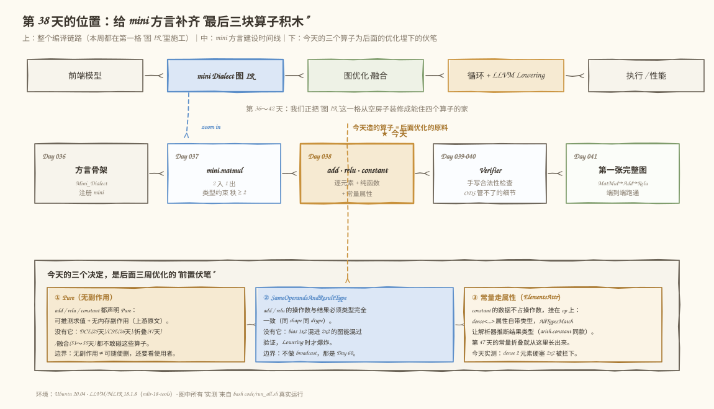
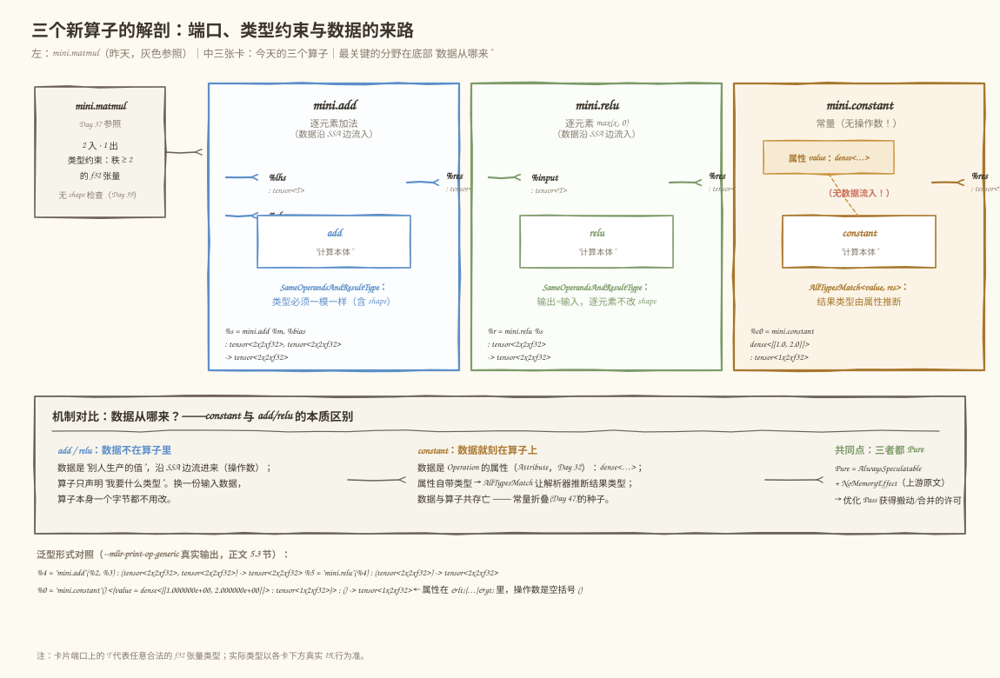
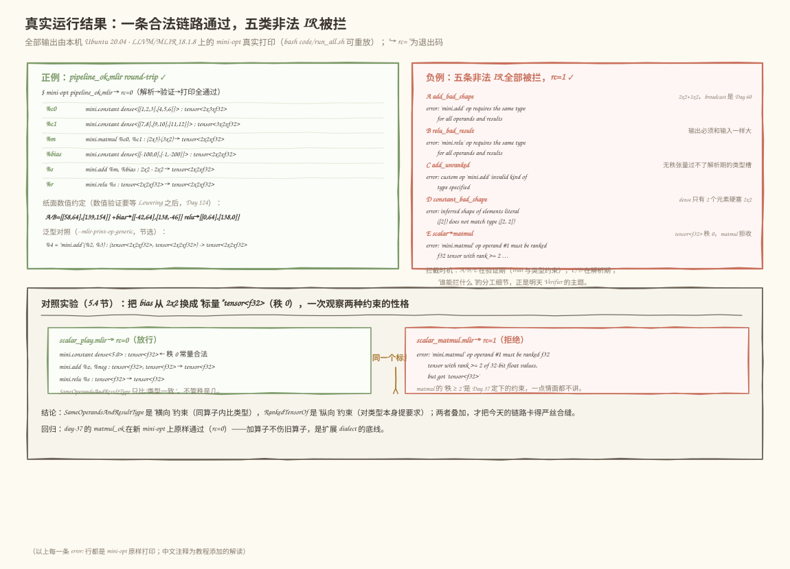

# 第 38 天：定义 Add、Relu 与 Constant——逐元素、无副作用与常量属性

> **今日目标**：完成本教程后，你能在 mini 方言中独立定义 `mini.add`、`mini.relu`、`mini.constant` 三个 Operation，解释它们各自的类型约束为什么这样设计，并让 `MatMul → Add → Relu` 整条目标图第一次通过 mini-opt 的"解析 → 验证 → 打印"。
> **预计时间**：学习 35 分钟＋实践 45 分钟
> **前置准备**：Day 37 的 mini 方言工程（`tutorials/day-037/code/mini`，含 `mini.matmul`）、LLVM/MLIR 18.1.8 工具链（本教程环境为 Ubuntu 20.04 + `mlir-18-tools`）、Ninja 与 CMake
> **今日产出**：新增三个 Operation 的 `MiniOps.td`、一条 `MatMul → Add → Relu` 完整 IR 与 8 个正反例/回归测试文件，以及本机真实运行的通过/拒绝记录

## 1. 今天解决什么问题？

昨天的 mini 方言只有 `mini.matmul` 一个算子，而整个学习计划的最终目标图是 `MatMul + Bias + ReLU`——算子表还缺三块积木。今天补齐它们，顺便回答三个"定义算子"绕不开的问题：

1. **逐元素算子（elementwise）的类型怎么约束？** Add 和 Relu 都要求"输入什么形状，输出就是什么形状"。这句话在 ODS 里怎么写成机器可检查的规则？
2. **无副作用算子怎么声明？** 以后 DCE、CSE、常量折叠、融合都要搬动这些算子。编译器凭什么"敢动"它们？
3. **常量的数据放在哪？** Bias 是编译期就知道的数据，它和其他算子的"运行期才有的数据"在 IR 里是不是同一种东西？

贯穿全文的例子（沿用 Day 37 的矩阵）：A(2x3) 乘 B(3x2) 得 M(2x2)，加上 bias，再过 ReLU。数值全部手算好，留到 Lowering 之后对答案：

```text
A = [[1, 2, 3],      B = [[7,  8 ],
     [4, 5, 6]]           [9,  10],
                          [11, 12]]

M = A·B = [[58,  64],        bias = [[-100,    0],
           [139, 154]]               [  -1, -200]]

M + bias = [[-42,  64],      relu(M + bias) = [[  0, 64],
              [138, -46]]                       [138,  0]]
```

今天**不能**执行它算出 `[[0,64],[138,0]]`——Lowering 是第二阶段之后的事。今天能做的验证是：让这条链路的 IR 通过 mini-opt 的解析、类型验证，并原样打印回来（round-trip）。别小看这一步：它证明每个算子的"户口、长相、约束"都合法。

## 2. 先看全貌：今天的内容位于哪里？



**图 1**：注意中间时间线上高亮的"Day 038"一格——它前面是昨天的 matmul，后面是明后两天的 Verifier；而底部三张卡片说明今天的每个决定都对应后面某一周的优化能力。看图时问自己：如果 add 不声明 Pure，第 51 天的融合 Pass 会遇到什么？

整个 mini 方言的建设节奏是：Day 36 注册方言骨架 → Day 37 定义 `mini.matmul` → **今天补 add/relu/constant** → Day 39/40 写手写 Verifier → Day 41 拼出第一张端到端 mini IR。今天之后，`MatMul → Add → Relu` 所需的算子全部到齐。

## 3. 核心概念：先用直觉，再给准确定义

### 3.1 逐元素算子：SameOperandsAndResultType

- 一句通俗解释：逐元素（elementwise）就是"两个同形状的网格对齐后，对应位置各算各的"，输出网格形状不变。
- 工程类比：两支人数相同的队伍按序号配对干活——前提是**两支队伍人数一样多**，否则必然有人配不上对。
- 对应到技术上是……MLIR 的 trait `SameOperandsAndResultType`：它要求该算子的**所有操作数和所有结果的类型完全一致**（shape 和 dtype 都要一样）。mini.add 用它，等于在 ODS 里写下"两支队伍人数必须相同"。这个 trait 定义在上游 `mlir/Interfaces/InferTypeOpInterface.td`（math 方言用的也是它），不是 mini 发明的。
- 最小例子：`mini.add %m, %bias : (tensor<2x2xf32>, tensor<2x2xf32>) -> tensor<2x2xf32>` 合法；把 bias 换成 `tensor<1x2xf32>` 就会被拒（本教程 5.3 节有真实报错）。
- 类比边界：队伍类比解释不了"为什么输出类型也被约束"——技术上输出类型与操作数绑定是同一 trait 的一部分，它保证逐元素算子永远不改变 shape，也就永远不需要 Shape 推导（那是 Day 43 的事）。

### 3.2 无副作用算子：Pure

- 一句通俗解释：一个算子只负责"算出结果"，不偷着改内存、不做 I/O、不依赖"现在几点"——这就是无副作用（side-effect free）。
- 工程类比：计算器按键只返回数值；打印机按键会消耗纸张。菜单上注明"本菜不含酒精"，套餐设计师才敢把它放进任何组合里。
- 对应到技术上是……MLIR ODS 的 `Pure` trait。上游源码（`mlir/Interfaces/SideEffectInterfaces.td`）原文是 `def Pure : TraitList<[AlwaysSpeculatable, NoMemoryEffect]>;`，即两件事：无内存副作用（NoMemoryEffect），且可提前到编译期推测求值（AlwaysSpeculatable）。声明了 Pure，优化 Pass 在 CSE（Day 26 做过）、常量折叠（Day 47）、融合（Day 51）里才"敢动"这个算子。
- 最小例子：`mini.relu` 标了 Pure，于是"两条一模一样的 relu 链只算一条"这类优化在语义上站得住。
- 类比边界："无副作用"不等于"可以随便删"——第 25 天做 DCE 时的结论仍然成立：还要看它有没有使用者、是不是图输出。Pure 只是发放了"可优化"的许可，不替 Pass 做决定。

### 3.3 常量的表示：属性（Attribute），不是操作数

- 一句通俗解释：常量的数据在编译期就固定死了，干脆直接**刻在算子上**，而不是等运行期从边上"流"进来。
- 工程类比：add/relu 像从传送带接原料的工位，原料是谁送来的它不管；constant 像一块出厂就焊死数据的 ROM 芯片。
- 对应到技术上是……MLIR 把这种"编译期数据"表达为 Operation 的**属性**（Attribute，Day 32 的概念）：`mini.constant` 没有任何操作数，只有一个 `value` 属性，类型是装 f32 数据的 `ElementsAttr`，文本上写作 `dense<[[1.0, 2.0]]> : tensor<1x2xf32>`。属性自带类型，于是 mini 借用 `arith.constant` 的同款技巧——trait `AllTypesMatch<["value", "res"]>` 让解析器**从属性类型推断结果类型**，写 IR 时只需要写一遍类型。常量的数值是属性而**不是 Type**（Type 描述"是什么类型"，属性描述"具体是什么值"）。
- 最小例子：`%c0 = mini.constant dense<[[1.0, 2.0]]> : tensor<1x2xf32>`——冒号后面的类型既属于属性，也同时成了结果 `%c0` 的类型。
- 类比边界：ROM 类比解释不了"太大的常量会拖慢编译"——属性会让 IR 变大、编译期逐元素访问变贵，这正是 Day 47 常量折叠要限制"过大 Tensor 编译期展开"的原因。

## 4. 图解核心机制：三个算子的解剖



**图 2**：先看中间三张卡片左侧的"进线"——add 有两条、relu 一条，而 **constant 一条都没有**，数据改由图上那张黄色便签（value 属性）钉在算子身上。再看卡片中间的类型约束徽章：add/relu 佩戴 `SameOperandsAndResultType`，constant 佩戴 `AllTypesMatch`。底部横条把"数据从哪来"讲透。

按图索骥读三张卡：

1. **mini.add**：两个操作数各是一条 SSA 边，类型必须与结果完全一致。它不知道也不关心数据的值是多少。
2. **mini.relu**：只有一条进线，进什么类型、出什么类型。逐元素 `max(x, 0)` 不改变 shape。
3. **mini.constant**：无进线。数据是属性，属性自带类型，`AllTypesMatch` 让解析器据此推断结果类型——所以它的 pretty 语法里类型只写一遍，`arith.constant dense<42> : i32` 同款道理。

三张卡共同佩戴一枚隐形徽章：**Pure**。这就是图 1 底部说的"后面三周优化的前置伏笔"。

## 5. 动手实践：把三个算子真正造出来

### 5.1 准备文件

把 Day 37 的工程原样拷贝成今天的起点（昨天它已经能构建出认识 `mini.matmul` 的 `mini-opt`）：

```bash
cd tutorials/day-038/code
cp -r ../day-037/code/mini ./mini
```

今天只需要改**两个文件**：`mini/include/mini/MiniOps.td`（核心）和 `mini/include/mini/Ops.h`（补两个头文件）。CMake、`MiniDialect.cpp`、`MiniOpt.cpp` 一行都不用动——第 37 天搭好的生成机制会自动把新的 .td 变成 C++ 类并注册进方言。这正是 ODS 中心化的好处：**加算子只动声明，不动骨架**。

### 5.2 编写代码

`MiniOps.td` 今天新增两样"词汇"和三个算子（matmul 部分原样保留）。关键片段如下，完整文件见 `code/mini/include/mini/MiniOps.td`：

```tablegen
include "mini/MiniDialect.td"
include "mlir/IR/CommonTypeConstraints.td"
include "mlir/IR/CommonAttrConstraints.td"
include "mlir/Interfaces/SideEffectInterfaces.td"
// SameOperandsAndResultType 定义在上游 InferTypeOpInterface.td 里，
// 不 include 这行，tblgen 会报 "SameOperandsAndResultType was not declared"。
include "mlir/Interfaces/InferTypeOpInterface.td"

// 有秩 f32 张量：逐元素算子不限秩，标量 tensor<f32> 也算合法
def Mini_F32Tensor
  : RankedTensorOf<[F32], [], "ranked f32 tensor">;

// 装 f32 常量的属性：写法照抄上游的 F64ElementsAttr，只是换成 32 位
def Mini_F32ElementsAttr : FloatElementsAttr<32>;

def Mini_AddOp : Mini_Op<"add", [Pure, SameOperandsAndResultType]> {
    let summary = "elementwise addition";
    let arguments = (ins Mini_F32Tensor:$lhs, Mini_F32Tensor:$rhs);
    let results = (outs Mini_F32Tensor:$res);
    let assemblyFormat = [{
      $lhs `,` $rhs attr-dict `:` type($lhs) `,` type($rhs) `->` type($res)
    }];
}

def Mini_ReluOp : Mini_Op<"relu", [Pure, SameOperandsAndResultType]> {
    let summary = "elementwise ReLU activation";
    let arguments = (ins Mini_F32Tensor:$input);
    let results = (outs Mini_F32Tensor:$res);
    let assemblyFormat = [{
      $input attr-dict `:` type($input) `->` type($res)
    }];
}

def Mini_ConstantOp : Mini_Op<"constant",
    [Pure, ConstantLike, AllTypesMatch<["value", "res"]>]> {
    let summary = "constant";
    let arguments = (ins Mini_F32ElementsAttr:$value);
    let results = (outs Mini_F32Tensor:$res);
    let assemblyFormat = "$value attr-dict";
}
```

几个关键决定的上游依据（都已对照 LLVM 源码核实，不是凭记忆杜撰）：

- **`Pure`**：上游 `SideEffectInterfaces.td` 定义为 `TraitList<[AlwaysSpeculatable, NoMemoryEffect]>`；toy 教程的 `ConstantOp` 也用 `[Pure]`。
- **`SameOperandsAndResultType`**：定义在 `mlir/Interfaces/InferTypeOpInterface.td`，math 方言大量使用。
- **`Mini_F32ElementsAttr`**：上游 `CommonAttrConstraints.td` 里 `F64ElementsAttr` 的定义是 `def F64ElementsAttr : FloatElementsAttr<64>;`，mini 照抄写法、换成 32 位浮点。
- **`AllTypesMatch<["value", "res"]>`**：来自 `arith.constant` 的定义（`AllTypesMatch<["value", "result"]>`）。constant 的 pretty 语法里类型只写一遍，靠的就是这个 trait 让解析器从属性类型推断结果类型。
- **`assemblyFormat`**：add 沿用 matmul（Day 37）已验证的格式；constant 最初的格式在 `$value attr-dict` 后面多写了一段"冒号 + type($res)"，构建通过但解析失败（详见第 6 节错误 2），最后改成 arith 同款的 `"$value attr-dict"`。

`Ops.h` 只需要补两个 include（完整文件见 `code/mini/include/mini/Ops.h`）：

```cpp
#include "mlir/Bytecode/BytecodeOpInterface.h"   // constant 带属性存储后生成代码引用它
#include "mlir/Interfaces/InferTypeOpInterface.h" // SameOperandsAndResultType 的 C++ 侧
```

### 5.3 构建与运行：记录真实结果

以下**全部为本机真实执行**（Ubuntu 20.04 · LLVM/MLIR 18.1.8 · cmake 3.20.5 · Ninja；构建首次约 1～3 分钟，此时间为经验估计）。`code/run_all.sh` 可一键重放。

```bash
cmake -G Ninja -B /tmp/day038/build -S mini -DCMAKE_BUILD_TYPE=Release \
      -DMLIR_DIR=/usr/lib/llvm-18/lib/cmake/mlir
cmake --build /tmp/day038/build
/tmp/day038/build/bin/mini-opt pipeline_ok.mlir
```

正例 `pipeline_ok.mlir`（MatMul → Add → Relu 第一次完整跑通，`rc=0`）真实输出：

```text
$ /tmp/day038/build/bin/mini-opt pipeline_ok.mlir
module {
  func.func @matmul_bias_relu() -> tensor<2x2xf32> {
    %0 = mini.constant dense<[[1.000000e+00, 2.000000e+00, 3.000000e+00], [4.000000e+00, 5.000000e+00, 6.000000e+00]]> : tensor<2x3xf32>
    %1 = mini.constant dense<[[7.000000e+00, 8.000000e+00], [9.000000e+00, 1.000000e+01], [1.100000e+01, 1.200000e+01]]> : tensor<3x2xf32>
    %2 = mini.matmul %0, %1 : tensor<2x3xf32>, tensor<3x2xf32> -> tensor<2x2xf32>
    %3 = mini.constant dense<[[-1.000000e+02, 0.000000e+00], [-1.000000e+00, -2.000000e+02]]> : tensor<2x2xf32>
    %4 = mini.add %2, %3 : tensor<2x2xf32>, tensor<2x2xf32> -> tensor<2x2xf32>
    %5 = mini.relu %4 : tensor<2x2xf32> -> tensor<2x2xf32>
    return %5 : tensor<2x2xf32>
  }
}
rc=0
```

再用 `--mlir-print-op-generic` 揭开 pretty 之外的泛型形式（真实输出，节选）——注意 constant 的数据全在 `<{value = …}>` 属性里，操作数列表是**空的** `()`；而 add 的数据才真正走操作数：

```text
%0 = "mini.constant"() <{value = dense<[[1.000000e+00, 2.000000e+00, 3.000000e+00], [4.000000e+00, 5.000000e+00, 6.000000e+00]]> : tensor<2x3xf32>}> : () -> tensor<2x3xf32>
%2 = "mini.matmul"(%0, %1) : (tensor<2x3xf32>, tensor<3x2xf32>) -> tensor<2x2xf32>
%4 = "mini.add"(%2, %3) : (tensor<2x2xf32>, tensor<2x2xf32>) -> tensor<2x2xf32>
%5 = "mini.relu"(%4) : (tensor<2x2xf32>) -> tensor<2x2xf32>
```

四条负例全部被拒（`rc=1`），真实报错如下（完整命令与输出见 `code/run_all.sh`）：

```text
--- add_bad_shape.mlir（bias 写成 1x2，期待 broadcast）
error: 'mini.add' op requires the same type for all operands and results
rc=1

--- relu_bad_result.mlir（relu 结果类型写成 1x2）
error: 'mini.relu' op requires the same type for all operands and results
rc=1

--- add_unranked.mlir（用无秩张量 tensor<*xf32> 做加法）
error: custom op 'mini.add' invalid kind of type specified
rc=1

--- constant_bad_shape.mlir（dense 只有 2 个元素，硬塞 tensor<2x2xf32>）
error: inferred shape of elements literal ([2]) does not match type ([2, 2])
rc=1
```

四个报错**拦截时机不同**，值得放在一起看：前两个发生在**验证期**（操作数与结果的跨值比较，必须等整个 op 组装完才能做）；后两个发生在**解析期**——无秩张量连 assemblyFormat 的类型槽都进不去（详见第 6 节错误 4 的机制剖析），dense 属性则在解析时就会核对元素数与 shape。"谁能拦什么"正是明天 Verifier 主题的引子。

另一个"今天故意放行"的探针：Day 37 那个内维不匹配的 `matmul_inner_dim.mlir`（2x3 · 2x3 -> 2x3），今天的 ODS 依旧放它过去（`rc=0`）。内维匹配检查是明天手写 Verifier 的第一个任务——今天的负例反而说明了 ODS 约束的边界。



**图 3**：左绿框是正例的 round-trip 全记录（六个算子、约定数值写在注释里）；右红框是五条负例的**原样报错**（一条 error: 都没改）；底部是 5.4 节的对照实验。图中 `→ rc=` 是真实退出码。

### 5.4 修改一个参数再观察：把 bias 换成"标量"

把 bias 从 `tensor<2x2xf32>` 换成秩 0 的 `tensor<f32>`（`scalar_play.mlir`），一次实验观察两种约束的"性格"：

```text
$ /tmp/day038/build/bin/mini-opt scalar_play.mlir
module {
  func.func @scalar_play() -> tensor<f32> {
    %0 = mini.constant dense<5.000000e+00> : tensor<f32>
    %1 = mini.constant dense<-3.000000e+00> : tensor<f32>
    %2 = mini.add %0, %1 : tensor<f32>, tensor<f32> -> tensor<f32>
    %3 = mini.relu %2 : tensor<f32> -> tensor<f32>
    return %3 : tensor<f32>
  }
}
rc=0
```

`mini.add` 对秩 0 张量**放行**——因为 `SameOperandsAndResultType` 只比较"类型是否完全一致"，不关心秩是几。但同一个标量接进 matmul（`scalar_matmul.mlir`）立刻被拒（真实输出）：

```text
error: 'mini.matmul' op operand #1 must be ranked f32 tensor with rank >= 2 of 32-bit float values, but got 'tensor<f32>'
rc=1
```

顺带看清一件事：报错里的"ranked f32 tensor with rank >= 2"正是 Day 37 定义 `Mini_F32Tensor2DPlus` 时写的 summary 字符串——**你写在类型约束里的说明文本，会成为 Verifier 的报错用语**。给约束起好名字，就是给未来的自己留好报错。

## 6. 常见错误与排查

**错误 1：构建报 `'InferTypeOpInterface' is not a member of 'mlir'`**
- 现象：`MiniOps.td` 加上 `SameOperandsAndResultType` 后构建失败，错误指向生成的 `MiniOps.h.inc`。
- 原因：生成代码引用了该 trait 的 C++ 接口，而 `Ops.h` 没有 include 对应头文件。
- 定位：看报错的 `.inc` 行号，反查它引用的名字属于哪个上游接口（本例是 `mlir/Interfaces/InferTypeOpInterface.h`）。
- 修复：在 `Ops.h` 补 `#include "mlir/Interfaces/InferTypeOpInterface.h"`。本教程开发时真实踩过，随后又补了 `mlir/Bytecode/BytecodeOpInterface.h`（constant 带属性存储后生成代码引用它）。

**错误 2：constant 的 IR 解析报 `expected ':'`**
- 现象：assemblyFormat 写成"$value attr-dict 后跟冒号和 type($res)"，构建通过，但解析 `%c0 = mini.constant dense<…> : tensor<2x3xf32>` 时报 `expected ':'` 指向行尾。
- 原因：`$value` 这个 ElementsAttr 在解析时**自带类型**——它已经把 `dense<…> : tensor<2x3xf32>` 整段吃掉；格式里的第二个 `:` 成了画蛇添足，解析器还想再读一遍结果类型，行却结束了。
- 定位：用 `--mlir-print-op-generic` 看 constant 的泛型形式：数据在 `<{value = …}>`，说明类型确实归属性管。
- 修复：改成 `arith.constant` 的同款方案——trait 加 `AllTypesMatch<["value", "res"]>`，格式简化为 `"$value attr-dict"`，让结果类型从属性推断。

**错误 3：bias 想当然写成 1x2，期待自动 broadcast**
- 现象：`mini.add %m, %bias : (tensor<2x2xf32>, tensor<1x2xf32>) -> tensor<2x2xf32>` 被拒：`'mini.add' op requires the same type for all operands and results`。
- 原因：`SameOperandsAndResultType` 只认"类型完全一致"；broadcast 是另一套语义，mini 到 Day 60 才引入。
- 定位：报错还附带 `note: see current operation: …`，把三个类型列出来，一眼看出 rhs 与其他两个不一致。
- 修复：当前把 bias 写成与被加数同 shape 的稠密张量（本教程的 2x2 bias 就是这么写的），或等第 60 天的 broadcast 支持。

**错误 4：报错 `custom op 'mini.add' invalid kind of type specified` 看不懂**
- 现象：用无秩张量 `tensor<*xf32>` 做加法，报错信息很短、不带我们写的 summary、位置指在类型上，且**没有**验证期错误那条 `note: see current operation` 附注。
- 原因：这是**解析期**的报错，不是验证期的。看生成的解析代码（构建目录里的 `MiniOps.cpp.inc`）：assemblyFormat 里每个 `type(...)` 槽位的存储类型都是 `RankedTensorType`，解析器先把读到的类型做 `dyn_cast<RankedTensorType>`——无秩张量（UnrankedTensorType）连这一步都过不去，于是用 MLIR 的通用模板报"invalid kind of type specified"。对比实验（本机实测）：`tensor<2x2xf64>` **能**通过解析槽位（它是有秩张量，只是 dtype 不对），留到验证期才被 `Mini_F32Tensor` 拒绝，报错带我们的 summary 文本——两种报错长相完全不同，根源就在这一层。
- 定位：把 `*` 换成具体形状重跑；或改用 `tensor<?xf32>`（动态维度但仍**有秩**，Day 61 专门讨论）。想亲眼看"拦截时机"的差别，可以把无秩错误和 shape 错误写进同一个 `.mlir`：解析期错误一出现，后面的 shape 错误根本不会被报告（本机已实测）。
- 修复：给 mini 的算子一律使用有秩张量（`Mini_F32Tensor` 已经表达了这条规矩）。

## 7. 今日练习

### 必做练习

把贯穿例子整体换成 3x3：A(3x3)、B(3x3)、bias(3x3，至少含一个负数)。要求：(1) 手算 A·B、A·B+bias、relu 的数值并写成 IR 注释；(2) 写出对应 `.mlir` 并用 mini-opt 完成 round-trip；(3) 把 bias 改成 3x1 再跑一次，**先预测**报错内容再对照真实输出（提示：想想 `SameOperandsAndResultType` 会说什么）。产出：两个 `.mlir` 文件与一次预测记录。

### 选做挑战

用 `--mlir-print-op-generic` 打印你的 3x3 正例，然后像 Day 30 那样逐行标注：每个 op 的操作数、结果、属性各是什么类型、从哪来。特别标注：三个 constant 的操作数列表为什么是空的 `()`？如果给 constant 换成 3 维常量 `dense<…> : tensor<2x2x2xf32>`，它能否接进 `mini.add`？（先用 `SameOperandsAndResultType` 的语义推理，再用 mini-opt 验证。）

## 8. 今日验收

- [ ] 我能不查资料说出 `SameOperandsAndResultType`、`Pure`、`AllTypesMatch` 各自保证什么、分别对应今天哪个算子
- [ ] 我能独立构建 mini-opt，并让 `pipeline_ok.mlir` 通过 round-trip（`rc=0`）
- [ ] 我能预测三类非法 IR 的真实报错：bias 形状不一致、dense 元素数与结果 shape 不符、秩 0 张量接 matmul
- [ ] 我能定位并修复"Ops.h 缺接口头文件"这类构建期错误
- [ ] 我保存了三个 Operation 的 ODS 定义、8 个测试文件（7 个新用例 + 1 个 Day 37 回归）和一键重放脚本（`code/` 目录已就位）

## 9. 一句话总结与明天预告

今天用三个 ODS 定义回答了三个问题：逐元素算子用 `SameOperandsAndResultType` 把"类型完全一致"变成机器可检查的规则；`Pure` 为后面所有优化发放"可搬动"许可；常量数据走属性而非操作数，`AllTypesMatch` 让类型只写一遍。全程在本机 MLIR 18.1.8 上构建并运行，一条正例 round-trip 通过、五类非法 IR 被拦、Day 37 的 matmul 回归无恙。同时今天的探针也暴露了 ODS 的边界：内维不匹配的 matmul 依旧放行，bias 想要 broadcast 也只能等第 60 天。明天（Day 39）实现 MatMul Verifier：把"ODS 管不了的检查"接过来，写出带好诊断信息的手写 `verify()`——今天所有"报错时机"的观察，都会在明天变成分工依据。
