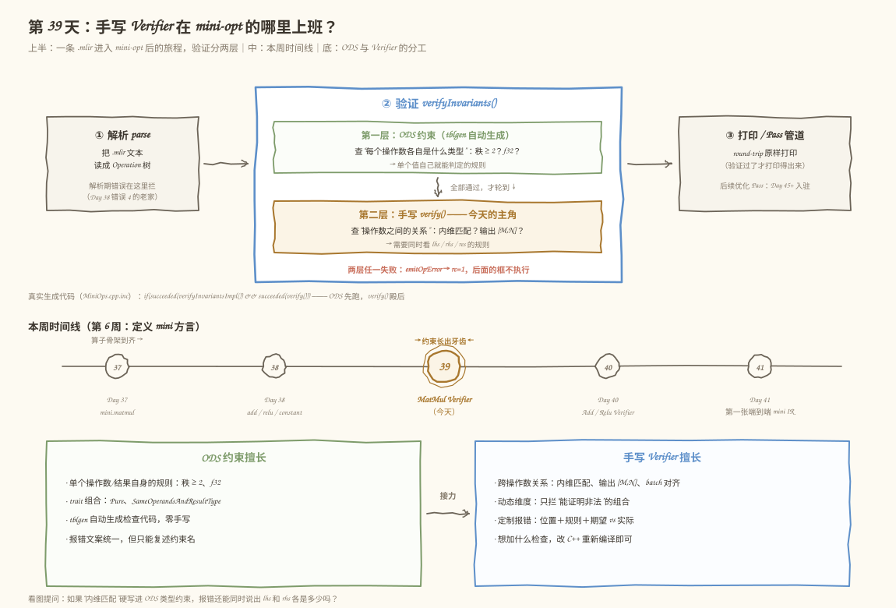
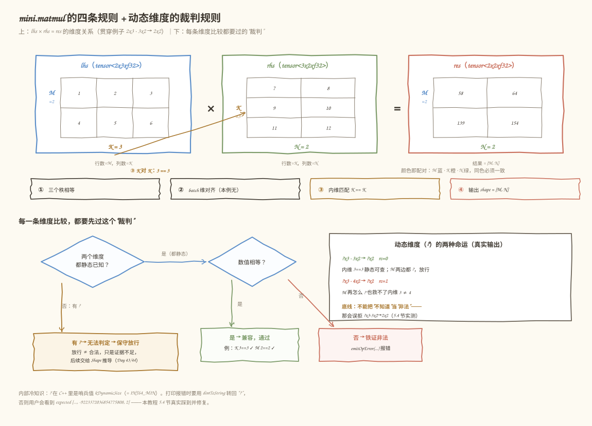
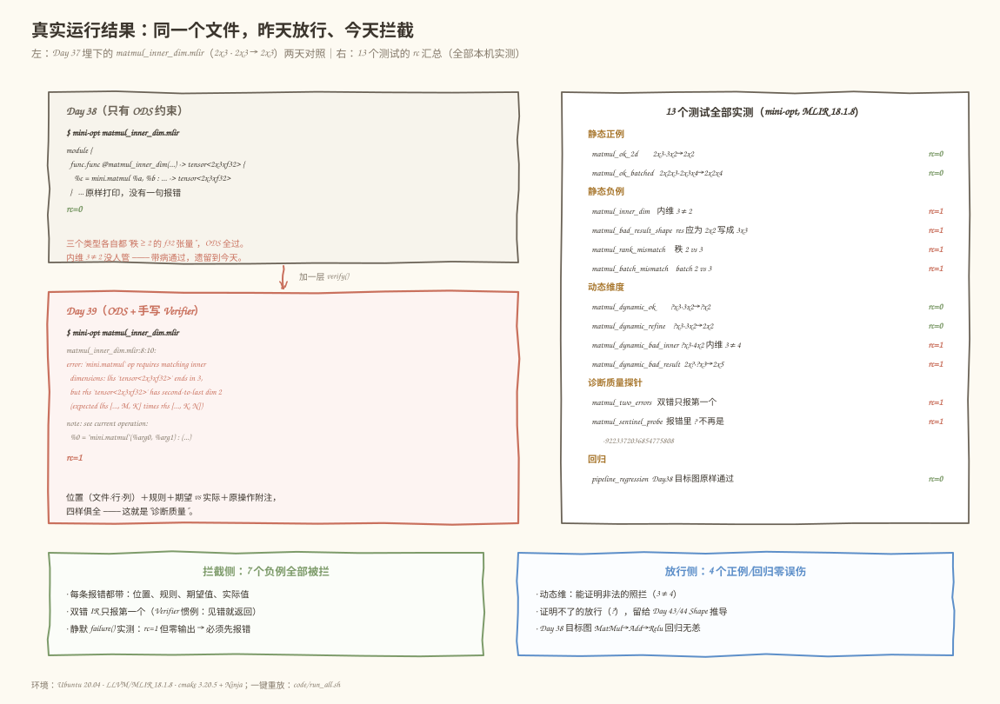

# 第 39 天：实现 MatMul Verifier——把 ODS 管不了的检查接过来

> **今日目标**：完成本教程后，你能为 `mini.matmul` 写出带高质量诊断信息的手写 Verifier，说清"哪些约束放 ODS、哪些放 Verifier"，并解释动态维度为什么必须保守处理。
> **预计时间**：学习 35 分钟＋实践 45 分钟
> **前置准备**：Day 38 的 mini 方言工程（`tutorials/day-038/code/mini`，含 matmul/add/relu/constant 四个算子）、LLVM/MLIR 18.1.8 工具链（本教程环境为 Ubuntu 20.04 + `mlir-18-tools`）、Ninja 与 CMake
> **今日产出**：`mini.matmul` 的手写 `verify()`（`code/mini/lib/MatmulVerifier.cpp`）、13 个合法性测试文件和一键重放脚本 `code/run_all.sh`，以及本机真实运行的通过/拒绝记录

## 1. 今天解决什么问题？

昨天结尾埋了一根刺：`matmul_inner_dim.mlir`（`2x3 · 2x3 -> 2x3`，内维 3 ≠ 2）在只有 ODS 约束的 mini-opt 里**原样通过**（rc=0）。三个类型各自都是"秩 ≥ 2 的 f32 张量"，ODS 一条都挑不出毛病——但这个 IR 在数学上根本算不成矩阵乘法。带着病通过验证的 IR，到了 Lowering 阶段（Day 88 生成三重循环）就会变成越界访问或错误结果，而且那时离出错源头已经很远。

今天的任务：写一个手写的 `verify()`（Verifier，验证器），把"操作数**之间**的关系"检查接过来。贯穿全文还是那个例子：

```text
lhs = 2x3（M=2, K=3）  ·  rhs = 3x2（K=3, N=2）  ->  res = 2x2（M=2, N=2）
```

要回答三个问题：

1. **分工**：哪些检查 ODS 已经做了、哪些必须手写？两者谁先执行？
2. **诊断质量**：一条好的报错应该长什么样？为什么"报错"本身也是 Verifier 的核心职责？
3. **动态维度**：`tensor<?x3xf32>` 里的 `?` 怎么处理？"保守"到底保守在哪一边？

## 2. 先看全貌：今天的内容位于哪里？



**图 1**：先看上方流水线中高亮的"验证"大框——它内部有两层，ODS 约束在上、今天的手写 `verify()` 在下，中间那行小字"全部通过，才轮到 ↓"就是两层的关系。再看底部两张分工卡，带着一个问题读：如果"内维匹配"硬塞进 ODS，报错还能同时说出 lhs 和 rhs 各是多少吗？

一条 `.mlir` 进入 mini-opt 后的完整旅程：

1. **解析**：把文本读成 Operation 树（解析期错误在这里拦，Day 38 错误 4 见识过）；
2. **验证**：先跑 tblgen 生成的 ODS 约束（每个操作数/结果各自的类型检查），全部通过后再调用手写 `verify()`（跨操作数的关系检查）；
3. **打印 / Pass**：round-trip 原样打印，后续的优化 Pass（Day 45 起）也住在这里。

第 2 步的两层顺序不是我猜的，是生成代码里白纸黑字写的（`/tmp/day039/build/include/mini/MiniOps.cpp.inc`，构建后可自行查看）：

```cpp
::mlir::LogicalResult MatmulOp::verifyInvariants() {
  if(::mlir::succeeded(verifyInvariantsImpl()) && ::mlir::succeeded(verify()))
    return ::mlir::success();
  return ::mlir::failure();
}
```

`verifyInvariantsImpl()` 是 ODS 约束的检查循环（逐个操作数、逐个结果套用 `Mini_F32Tensor2DPlus`），我们的 `verify()` 排在 `&&` 右边——**ODS 先跑，手写验证殿后**。这个顺序直接决定了写法：进入 `verify()` 时，"是秩 ≥ 2 的 f32 张量"已经成立，我们只需要查增量部分。

## 3. 核心概念：先用直觉，再给准确定义

### 3.1 Verifier 与 ODS 约束的分工

- 一句通俗解释：ODS 像**进门安检**，每个人单独查证件（你的类型对不对）；Verifier 像**入场配对**，查人和人之间的关系（你们俩的证件能不能凑成一对）。
- 工程类比：婚礼签到台先核对每张请柬（ODS），司仪再确认"新郎的名单和新娘的名单能对上桌次"（Verifier）。
- 对应到技术上是……ODS 类型约束（`RankedTensorOf`、trait 如 `SameOperandsAndResultType`）只能描述**单个值自身**的规则，由 tblgen 自动生成检查代码，零手写、零遗漏，但报错只能复述约束名（Day 38 见过的 `operand #1 must be ranked f32 tensor with rank >= 2...`）。手写 Verifier（`let hasVerifier = 1;` 生成的 `LogicalResult verify()`）负责**需要同时看多个操作数和结果**的规则——内维匹配、输出 shape、batch 对齐——并且可以定制报错文案。对 `mini.matmul` 而言：秩 ≥ 2、f32 属于 ODS；"三个秩相等、K 对 K、res = [M, N]"属于 Verifier。
- 最小例子：`2x3 · 2x3 -> 2x3` 里每个类型都过 ODS（秩 2、f32），但内维 3 ≠ 2 只能由 Verifier 拦下（5.3 节真实报错）。
- 类比边界：婚礼类比解释不了"顺序"——技术上两层不是平行分工，而是串联接力，ODS 不过连 `verify()` 都不会被调用；这既是效率考虑，也让 `verify()` 里可以放心使用"已验证过"的事实（比如直接 `cast<RankedTensorType>`）。

### 3.2 错误诊断的位置和质量

- 一句通俗解释：报错的价值由三样东西决定——**指到哪**（位置）、**说了什么规则**（语义）、**给了什么数字**（证据）。
- 工程类比：体检报告只写"指标异常"没人能行动；写"肝功能第 3 项，期望 ≤ 40，实测 87，复查建议…"才有用。
- 对应到技术上是……MLIR 的 `emitOpError("...")` 把错误挂在**这个 Operation 的位置**（文件名:行:列，精确到 `mini.matmul` 那一行第 10 列），框架还会自动附一条 `note: see current operation: ...` 把整个 op 用泛型形式回显，不用我们写。`<<` 可以继续拼证据：期望什么、实际是什么。今天每条报错都按"规则 + 期望 vs 实际 + 原始类型"组织。
- 一个反例实验（本机真实执行）：把 `verify()` 改成直接 `return failure();`（不报任何错）再构建，跑正例 `matmul_ok_2d.mlir`——结果是 `rc=1` 且**一个字都不输出**。用户只知道"失败了"，不知道为什么、在哪里。所以"**返回 failure 之前必须先 emit 一条 error**"是 Verifier 的硬规矩，不是风格建议。
- 类比边界：诊断质量再好也只是"拦下来"，它不负责"修"——修复靠人，或者靠后面的 Shape 推导（Day 43/44）自动补全。

### 3.3 动态维度的保守处理

- 一句通俗解释：`?`（动态维度）的意思是"**编译期不知道**"，不是"随便什么都行"，也不是"肯定不行"。
- 工程类比：两个都说不出自己体重的人，你不能判定他们体重不符，也不能判定相符——只能说"证据不足，先放行，赛后称重"。
- 对应到技术上是……`tensor<?x3xf32>` 里 `?` 在 C++ 侧是常量 `ShapedType::kDynamicSize`（= INT64_MIN，一个巨大的负数）。维度比较分三种情况：**双方都静态**——相等则通过，不等则铁证非法、必须报错；**任一方动态**——编译期无法判定，保守放行，把检查留给 Shape 推导（Day 43/44）或运行期。注意"保守"的方向：Verifier 的底线是**绝不误拒合法 IR**（soundness），宁可放过一千个可疑的，不能错杀一个清白的——放过的问题还有后续环节兜底，错杀则直接堵死合法输入。今天实测的两个对照：`?x3 · 3x2 -> ?x2` 放行（M 无法判定），`?x3 · 4x2` 照拦（内维 3 ≠ 4 双方静态，铁证）。
- 最小例子：`?x3 · 3x2 -> 2x2` 合法吗？合法——结果类型比操作数**更具体**是允许的（这正是 Shape 推导要利用的方向），所以"M 一边 ? 一边 2"必须放行（`matmul_dynamic_refine.mlir`，rc=0）。
- 类比边界：体重类比解释不了"部分可知"——技术上同一条规则里可能一半维度静态、一半动态（如 `2x? · ?x3 -> 2x5`：内维 ? 对 ? 放行，输出 N 2 ≠ 5 照拦），所以检查必须**逐维进行**，不能整个规则一刀切。

## 4. 图解核心机制



**图 2**：上半部分把 2x3、3x2、2x2 画成三块网格，颜色就是配对关系——蓝 M（lhs 的行 → res 的行）、橙 K（lhs 的列 = rhs 的行）、绿 N（rhs 的列 → res 的列）；下半部分是每一条维度比较都要过的"裁判"，跟着两个问题看图：K 为什么只能橙色连橙色？M 两边都是 ? 时裁判往哪个分支走？

按图索骥，`verify()` 的四条规则：

1. **规则 ①（秩相等）**：lhs、rhs、res 三个秩必须一致。ODS 只保证"各自 ≥ 2"，没保证"互相相等"——`2x3 · 2x2x3` 这种就是漏网之鱼，规则 1 拦。
2. **规则 ②（batch 对齐）**：秩大于 2 时，前 `rank-2` 维是 batch 维，三方逐维对齐（`2x2x3 · 3x3x4` 的 batch 维 2 ≠ 3 在这里拦）。本教程主例子是 2 维，没有 batch 维，循环体一次都不进。
3. **规则 ③（内维匹配）**：lhs 的最后一维（K）必须等于 rhs 的倒数第二维（K）。图中橙色虚线连接的两个 3。
4. **规则 ④（输出 shape）**：res 的最后两维必须是 [M, N]。图中蓝色 M 对 M、绿色 N 对 N。

而下半的"裁判"作用于**每一条**维度比较：先问"两个维度都静态已知？"——是，再问"数值相等？"，相等过（绿）、不等报错（红）；只要有 `?`，走橙色分支"无法判定 → 保守放行"。图右的卡片是两个真实运行结果，底部小字是 `?` 的内部表示（哨兵值）——5.4 节会真实踩到这个坑。

## 5. 动手实践：写出真正的 MatMul Verifier

### 5.1 准备文件

把 Day 38 的工程原样拷贝成今天的起点：

```bash
cd tutorials/day-039/code
cp -r ../day-038/code/mini ./mini
```

今天改**两个文件**、新增**一个文件**：`MiniOps.td`（加一行开关）、`lib/CMakeLists.txt`（登记新源文件）、`lib/MatmulVerifier.cpp`（主角，新增）。`MiniOpt.cpp`、`MiniDialect.cpp` 一行不动——Verifier 是方言内部的事，工具入口根本感知不到。

### 5.2 编写代码

第一处改动，`MiniOps.td` 里给 `Mini_MatmulOp` 加开关：

```tablegen
def Mini_MatmulOp : Mini_Op<"matmul", [Pure]> {
    // ...（summary / description / arguments / results 原样保留）...

    // 第 39 天：打开手写 Verifier 开关。tblgen 会在生成的类里声明
    //   ::mlir::LogicalResult verify();
    // 并让 verifyInvariants 在跑完 ODS 约束之后调用它；
    // 函数本体由我们在 lib/MatmulVerifier.cpp 里手写。
    let hasVerifier = 1;
}
```

就这一行。`MiniOps.h.inc` 里从此多出一个声明（构建后可在 `/tmp/day039/build/include/mini/MiniOps.h.inc` 里看到 `::mlir::LogicalResult verify();`），函数本体由我们提供。

第二处，新增 `mini/lib/MatmulVerifier.cpp`。核心逻辑（完整文件见 `code/mini/lib/MatmulVerifier.cpp`）：

```cpp
// 只比较"双方都静态已知"的维度：任一方是动态维（?）就保守放行。
bool staticallyCompatible(int64_t a, int64_t b) {
  if (ShapedType::isDynamic(a) || ShapedType::isDynamic(b))
    return true;
  return a == b;
}

LogicalResult mini::MatmulOp::verify() {
  // ODS 约束已在 verifyInvariants 的前半段跑完，这里可以放心 cast。
  auto lhs = llvm::cast<RankedTensorType>(getLhs().getType());
  auto rhs = llvm::cast<RankedTensorType>(getRhs().getType());
  auto res = llvm::cast<RankedTensorType>(getRes().getType());

  // 规则 1：秩一致。ODS 只保证"各自 >= 2"，没保证"互相相等"。
  if (lhs.getRank() != rhs.getRank() || lhs.getRank() != res.getRank())
    return emitOpError("requires the same rank for both operands and the "
                       "result")
           << ", but got ranks " << lhs.getRank() << ", " << rhs.getRank()
           << " and " << res.getRank() << " for " << lhs << ", " << rhs
           << " and " << res;

  // 规则 2：batch 维逐维对齐（lhs==rhs 且 lhs==res，传递覆盖 rhs==res）。
  const int64_t rank = lhs.getRank();
  for (int64_t i = 0; i < rank - 2; ++i) { /* 同款逐维检查，见完整文件 */ }

  const int64_t m = lhs.getDimSize(rank - 2);
  const int64_t kL = lhs.getDimSize(rank - 1);
  const int64_t kR = rhs.getDimSize(rank - 2);
  const int64_t n = rhs.getDimSize(rank - 1);

  // 规则 3：内维匹配。lhs 是 [..., M, K]，rhs 必须是 [..., K, N]。
  if (!staticallyCompatible(kL, kR))
    return emitOpError("requires matching inner dimensions")
           << ": lhs " << lhs << " ends in " << kL << ", but rhs " << rhs
           << " has second-to-last dim " << kR
           << " (expected lhs [..., M, K] times rhs [..., K, N])";

  // 规则 4：输出 shape。res 必须是 [..., M, N]。
  if (!staticallyCompatible(m, res.getDimSize(rank - 2)) ||
      !staticallyCompatible(n, res.getDimSize(rank - 1)))
    return emitOpError("result shape must be [M, N] derived from the operands")
           << ": expected [..., " << dimToString(m) << ", " << dimToString(n)
           << "] from lhs " << lhs << " and rhs " << rhs << ", but got " << res;

  return success();
}
```

五个值得停一停的决定：

- **`llvm::cast` 敢直接用**：因为生成代码里 `verify()` 排在 ODS 约束**之后**，进到这里类型必然是秩 ≥ 2 的 `RankedTensorType`，不需要再防御。
- **报错用 `emitOpError` 不用裸 `emitError`**：前者自动带上 `'mini.matmul' op` 前缀和 op 的位置，框架还会追加 `note: see current operation` 附注。
- **每条报错都拼上"期望 vs 实际 + 原始类型"**：`expected [..., 2, 2] ... but got 'tensor<3x3xf32>'`——证据给足，用户不用回头翻 IR。
- **规则 2 用传递检查**（lhs==rhs 且 lhs==res）覆盖三方一致，少写一列比较。
- **`dimToString`**：把动态维打印成 `?` 而不是内部哨兵值——这个 helper 是 5.4 节真实踩坑之后才加上去的。

第三处，`lib/CMakeLists.txt` 的源文件列表加上 `MatmulVerifier.cpp`（完整文件见 `code/mini/lib/CMakeLists.txt`）。忘了这步会发生什么，见第 6 节错误 1——本教程开发时真实踩过。

### 5.3 构建与运行：记录真实结果

以下**全部为本机真实执行**（Ubuntu 20.04 · LLVM/MLIR 18.1.8 · cmake 3.20.5 + Ninja；首次构建约 1～3 分钟，此时间为经验估计）。`code/run_all.sh` 一键重放全部实验。

```bash
cmake -G Ninja -B /tmp/day039/build -S mini -DCMAKE_BUILD_TYPE=Release \
      -DMLIR_DIR=/usr/lib/llvm-18/lib/cmake/mlir
cmake --build /tmp/day039/build
```

头条实验——昨天放行的探针，今天被拦（真实输出）：

```text
$ /tmp/day039/build/bin/mini-opt matmul_inner_dim.mlir
matmul_inner_dim.mlir:8:10: error: 'mini.matmul' op requires matching inner
dimensions: lhs 'tensor<2x3xf32>' ends in 3, but rhs 'tensor<2x3xf32>' has
second-to-last dim 2 (expected lhs [..., M, K] times rhs [..., K, N])
    %c = mini.matmul %a, %b : tensor<2x3xf32>, tensor<2x3xf32> -> tensor<2x3xf32>
         ^
matmul_inner_dim.mlir:8:10: note: see current operation: %0 = "mini.matmul"(%arg0, %arg1) : (tensor<2x3xf32>, tensor<2x3xf32>) -> tensor<2x3xf32>
rc=1
```

对照 3.2 节的"诊断三要素"逐项验收：位置（`matmul_inner_dim.mlir:8:10`，正是 `mini.matmul` 那行）✓；规则（内维必须匹配，还画出了 `[..., M, K]` 和 `[..., K, N]` 的形状约定）✓；证据（lhs 结尾 3、rhs 倒数第二维 2，两个完整类型原样奉上）✓，外加框架免费赠送的 note 附注。同一文件昨天 rc=0、今天 rc=1——这就是 Verifier 的全部意义。

13 个测试文件全部实测，结果汇总（真实退出码）：

| 测试文件 | 检查点 | rc |
|---|---|---|
| `matmul_ok_2d.mlir` | 2x3·3x2→2x2，四条规则全过 | 0 |
| `matmul_ok_batched.mlir` | 2x2x3·2x3x4→2x2x4，batch 路径 | 0 |
| `matmul_inner_dim.mlir` | Day 37 探针：内维 3≠2 | 1 |
| `matmul_bad_result_shape.mlir` | 输出应为 2x2 写成 3x3 | 1 |
| `matmul_rank_mismatch.mlir` | 秩 2 vs 3 | 1 |
| `matmul_batch_mismatch.mlir` | batch 维 2 vs 3 | 1 |
| `matmul_dynamic_ok.mlir` | ?x3·3x2→?x2，M 放行 | 0 |
| `matmul_dynamic_refine.mlir` | ?x3·3x2→2x2，结果更具体 | 0 |
| `matmul_dynamic_bad_inner.mlir` | ?x3·4x2，内维 3≠4 照拦 | 1 |
| `matmul_dynamic_bad_result.mlir` | 2x?·?x3→2x5，输出 N 错 | 1 |
| `matmul_two_errors.mlir` | 一条 IR 埋两个错 | 1 |
| `matmul_sentinel_probe.mlir` | 5.4 节的哨兵值探针 | 1 |
| `pipeline_regression.mlir` | Day 38 目标图回归 | 0 |

计划要求"至少 6 个合法性测试"，这里交付 13 个（2 正 + 4 静态负 + 4 动态 + 2 探针 + 1 回归）。挑两个动态负例的真实报错看看"动态 ≠ 没有约束"：

```text
--- matmul_dynamic_bad_inner.mlir（M 未知救不了内维错误）
error: 'mini.matmul' op requires matching inner dimensions: lhs 'tensor<?x3xf32>'
ends in 3, but rhs 'tensor<4x2xf32>' has second-to-last dim 4 ...
rc=1

--- matmul_dynamic_bad_result.mlir（内维 ? 对 ? 放行，输出 N 却是静态的 2 vs 5）
error: 'mini.matmul' op result shape must be [M, N] derived from the operands:
expected [..., 2, 3] from lhs 'tensor<2x?xf32>' and rhs 'tensor<?x3xf32>',
but got 'tensor<2x5xf32>'
rc=1
```

后者特别值得看：同一条规则 ④ 里，K 是 `?` 对 `?`（放行），N 是 2 对 5（拦截）——**逐维裁判**在真实报错里的样子。



**图 3**：左边两块卡片是同一个 `matmul_inner_dim.mlir` 的两天对照——上卡昨天原样打印 rc=0，下卡今天带完整报错 rc=1；右边是 13 个测试的 rc 汇总表；底部两块是"拦截侧"和"放行侧"各自的战绩。看图回答：为什么 4 个 rc=0 里有两个带着 `?`？

### 5.4 修改一个参数再观察：一次真实的诊断质量调试

写完第一版 Verifier 后，我构造了一个探针：`?x3 · 3x2 -> ?x5`（N 写错成 5，M 两边都是 ?）。拒绝本身没问题，但真实报错是这样的：

```text
$ /tmp/day039/build/bin/mini-opt matmul_sentinel_probe.mlir
error: 'mini.matmul' op result shape must be [M, N] derived from the operands:
expected [..., -9223372036854775808, 2] from lhs 'tensor<?x3xf32>' and rhs
'tensor<3x2xf32>', but got 'tensor<?x5xf32>'
rc=1
```

`-9223372036854775808` 是什么？——`?` 的内部哨兵值 `kDynamicSize`（INT64_MIN）。规则 ④ 的报错分支是被 N（2 ≠ 5）触发的，但文案里的 M 恰好是动态维，第一版直接 `<< m` 把哨兵值漏给了用户。**拦截是对的，诊断是坏的**——这正是 3.2 节说的"诊断质量"问题，而且是真实发生而非编造的。

修复：加一个 `dimToString` helper，打印维度前先过一遍：

```cpp
// 把维度打印成用户看得懂的样子：动态维显示为 "?"，
// 而不是内部哨兵值 kDynamicSize（一个巨大的负数，只会吓到人）。
std::string dimToString(int64_t d) {
  return ShapedType::isDynamic(d) ? "?" : std::to_string(d);
}
```

规则 ④ 的文案改用 `dimToString(m)` / `dimToString(n)`，重新构建，同一探针的真实输出变为：

```text
error: 'mini.matmul' op result shape must be [M, N] derived from the operands:
expected [..., ?, 2] from lhs 'tensor<?x3xf32>' and rhs 'tensor<3x2xf32>',
but got 'tensor<?x5xf32>'
rc=1
```

`expected [..., ?, 2]`——人话了。这个探针保存为 `matmul_sentinel_probe.mlir`，回归在列。顺带一提：为什么规则 ③ 的文案不用改？因为进入规则 ③ 报错分支的前提是 kL、kR **双方都静态**（动态早就被 `staticallyCompatible` 放行了），哨兵值根本走不到打印那一步。想清楚"哪个分支可能见到动态维"，比到处套 `dimToString` 更重要。

## 6. 常见错误与排查

**错误 1：`hasVerifier = 1` 写了，`MatmulVerifier.cpp` 忘了进 CMake**
- 现象：编译一切正常，链接 mini-opt 时爆出长串错误，核心一句是 `undefined reference to 'mini::MatmulOp::verify()'`（本教程开发时真实复现）。
- 原因：tblgen 只**声明** `verify()`，定义靠我们的 .cpp；新文件没登记进 `add_mlir_dialect_library` 的源文件列表，静态库里就没有这个符号。
- 定位：在链接错误里搜 `verify()`，看到是 `mini::MatmulOp` 的成员函数即可确认。
- 修复：`lib/CMakeLists.txt` 的 `MLIRMini` 目标里加上 `MatmulVerifier.cpp`。

**错误 2：`verify()` 里直接 `return failure();`（忘了报错）**
- 现象：任何 IR 一律失败，`rc=1`，但**终端一个字都没有**（本机真实实验：改掉 verify 本体后跑正例，stdout/stderr 全空）。
- 原因：`failure()` 只告诉框架"验证没过"，不携带任何信息；框架不会替你编一条报错。
- 定位：故意跑一个必定合法的 IR（如 `matmul_ok_2d.mlir`），rc=1 且无输出，基本就是这个模式。
- 修复：每个失败路径都先 `emitOpError("...") << 证据;` 再返回——返回值和诊断**成对出现**。

**错误 3：维度比较写成严格 `a == b`，忘了动态维度**
- 现象：合法 IR `?x3 · 3x2 -> 2x2`（结果比输入更具体）被误拒，报错赫然写着 `expected [..., -9223372036854775808, 2]`（本机真实实验）。
- 原因：`?` 的内部值是哨兵 `kDynamicSize`，静态 2 与之比较必然不等；同时报错文案还把哨兵漏给了用户（5.4 节同款问题）。注意 `? == ?` 反而**恰好通过**（同一个哨兵值相等），所以这个 bug 平时用 `?x3·3x2→?x2` 测不出来，必须用"一边静态一边动态"的用例才能暴露。
- 定位：跑 `matmul_dynamic_refine.mlir`，rc=1 即中招。
- 修复：比较用 `staticallyCompatible`（动态即放行），打印用 `dimToString`。

**错误 4：一条 IR 埋两个错，只报了一个，以为是漏检**
- 现象：`matmul_two_errors.mlir`（内维 3≠2 且输出写成 3x3）只报内维错误，rc=1。
- 原因：`verify()` 的惯例是**遇到第一个错误立刻返回 failure**，框架对整个 IR 的验证也随之终止。这不是漏检，是设计——一次修一个错，比一次倒一屏错误好排。
- 定位：把第一个错修掉再跑，第二个错（输出 shape）自然浮出来。
- 修复：无需修复；若想确认"另一个错也能被查出"，改完 IR 重跑即可。

## 7. 今日练习

### 必做练习

batch 维还没有被你亲手测过：写一个 3 维负例 `matmul_bad_batch_res.mlir`——lhs `4x2x3`、rhs `4x3x5` 都没问题，但把结果的 batch 维写成 2（`2x4x5`）。要求：(1) 先在纸上写出你预测的报错（哪个词开头？dim # 是几？两个数字各是多少？）；(2) 跑 mini-opt 对照真实输出；(3) 再把结果改对，确认 rc=0。产出：两个 `.mlir` 文件和一份预测记录。

### 选做挑战

给规则 ③ 的报错升级诊断：用 `op.emitOpError("...")` 之后再 `.attachNote()` 追加一条附注，建议写"consider transposing rhs or checking the producer of lhs"。重新构建后观察报错结构和 `note:` 行数的变化。思考：什么样的信息值得放 note 而不是主报错？（提示：主报错回答"什么错了"，note 回答"下一步看哪"。）

## 8. 今日验收

- [ ] 我能不查资料说出 ODS 约束和手写 Verifier 各自查什么、谁先执行、为什么这个顺序让 `verify()` 里可以放心 `cast<RankedTensorType>`
- [ ] 我能独立构建 mini-opt，复现"Day 38 放行、Day 39 拦截"的头条实验（`matmul_inner_dim.mlir` 从 rc=0 变 rc=1）
- [ ] 我能对任意给定的 matmul IR 预测四条规则中哪条先报错、报错文案里的期望值和实际值各是什么
- [ ] 我能解释动态维度的三种比较结果，并说出"保守放行"为什么不能反过来（误拒 `?x3·3x2→2x2` 的后果）
- [ ] 我保存了 Verifier 源码、13 个测试文件和一键重放脚本（`code/` 目录已就位）

## 9. 一句话总结与明天预告

今天用几十行核心 C++（一个 `verify()` 加两个 helper，完整文件 101 行含注释）回答了三个问题：分工——ODS 管单个值的类型（先跑），`verify()` 管跨操作数的关系（殿后），顺序写在生成代码里；诊断——`emitOpError` 挂位置、说规则、给证据，返回 failure 前必须先报错（静默失败实测零输出）；动态维度——逐维裁判，只拦铁证非法，`?` 交给 Day 43/44 的 Shape 推导。全程本机实测：7 个负例全拦、4 个正例零误伤、Day 38 目标图回归无恙，还顺手修掉一个真实踩到的哨兵值泄漏。明天（Day 40）给 `mini.add` 和 `mini.relu` 写 Verifier：它们的规则比 matmul 简单（Shape 完全一致），但要想清楚"ODS 的 trait 已经查过了，手写 Verifier 还剩下什么要查"——答案是几乎没有，那为什么计划还要安排这一天？明天见分晓。
