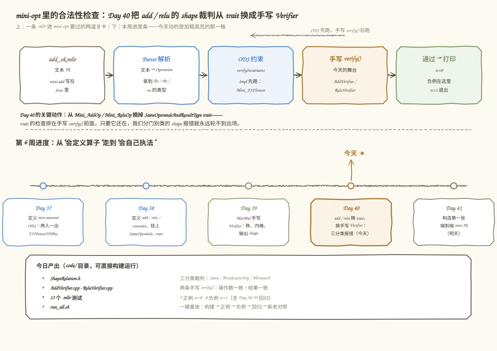
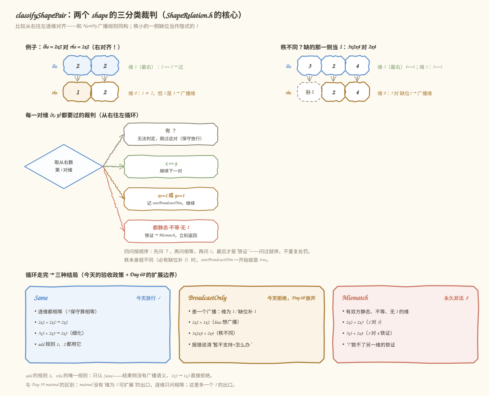
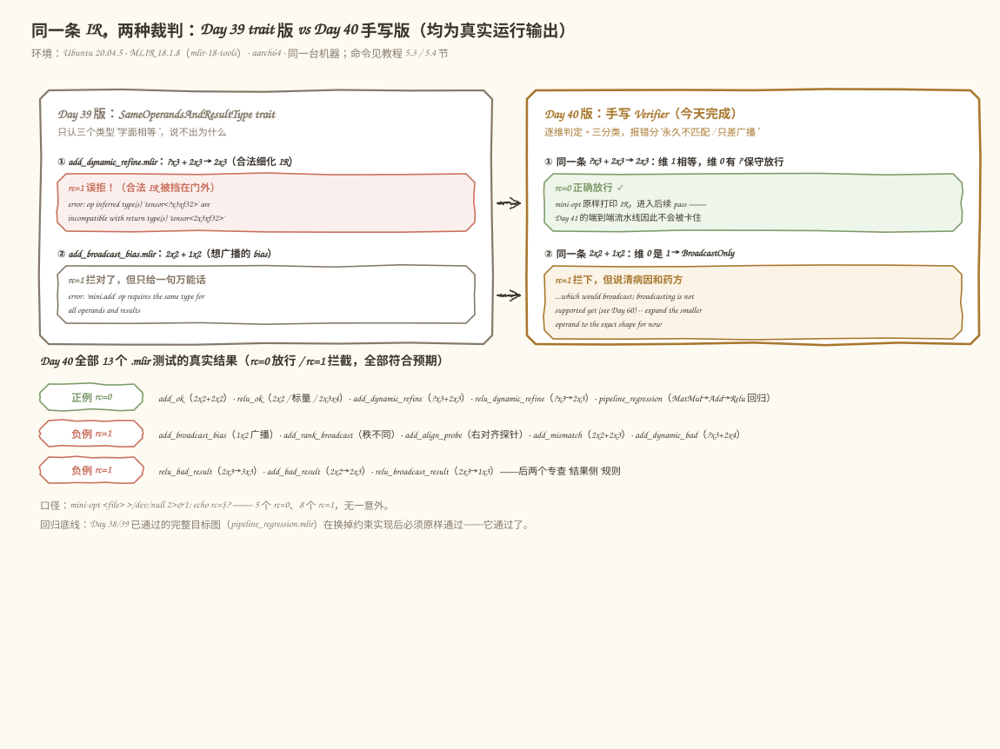

# 第 40 天：给 mini.add / mini.relu 换上手写 Verifier——让 shape 报错学会"说人话"

> **今日目标**：完成本教程后，你能把 `mini.add` / `mini.relu` 的合法性检查从 `SameOperandsAndResultType` trait 迁移到手写 `verify()`，用自己的话解释 Same / BroadcastOnly / Mismatch 三分类，并让 13 个正反例测试全部给出预期结果。
> **预计时间**：学习 40 分钟＋实践 40 分钟
> **前置准备**：完成 Day 37～39（mini dialect、matmul 定义与手写 Verifier）；机器上有 LLVM/MLIR 18（`mlir-opt-18` 可执行）。本教程所有命令在 Ubuntu 20.04.5 + MLIR 18.1.8 + aarch64 上实测。
> **今日产出**：`code/mini/lib/ShapeRelation.h`（三分类裁判）＋ `AddVerifier.cpp` / `ReluVerifier.cpp`（两条手写 verify()）＋ 13 个 `.mlir` 正反例＋ `run_all.sh` 一键重放——全部真实构建、真实运行。

## 1. 今天解决什么问题？

Day 38 给 `mini.add` / `mini.relu` 挂的 `SameOperandsAndResultType` trait（"三个类型必须字面相等"的通用约束）留下了两个实测痛点：

**痛点一：误拒合法 IR。** 动态维度写成 `?x3 + 2x3 -> 2x3` 是合法的"细化"（refinement）IR——`?` 的意思是"这个维运行期才知道"，而 `2x3` 的结果声明比 `?x3` 更具体，这在语义上完全成立。但 trait 只认字面相等。拿 Day 39 构建的 mini-opt 实测（5.3 节有完整命令），这条 IR 被拒：

```text
error: 'mini.add' op inferred type(s) 'tensor<?x3xf32>' are incompatible with
return type(s) of operation 'tensor<2x3xf32>'
error: 'mini.add' op failed to infer returned types
```

**痛点二：报错不说人话。** 目标图 `MatMul -> Add -> Relu` 里那个加 bias 的 `mini.add`，如果图省事把 `2x2` 的 bias 写成 `1x2`（每行加同一组数），trait 只会回一句万能话：

```text
error: 'mini.add' op requires the same type for all operands and results
```

它说不出"这其实能广播，我们 Day 60 才支持，先把 bias 扩成 2x2"，更说不出"这俩根本对不上，改吧"。用户拿到这句报错，只能自己去猜方向。

今天我们给 add / relu 换上一套手写 Verifier：**该放行的放行（包括动态细化），该拒绝的分两口气报错（"永久不匹配"和"只差广播"）**。贯穿全文的例子就是目标图里那个加 bias 的 `mini.add`：

```mlir
// 正例：2x2 + 2x2 -> 2x2，今天放行
%s = mini.add %m, %bias : tensor<2x2xf32>, tensor<2x2xf32> -> tensor<2x2xf32>
```

以及它的三个"错误亲戚"：`2x2 + 1x2`（想广播）、`2x2 + 2x3`（永久不匹配）、`2x2 + 2x2 -> 2x3`（结果写错）。四个文件今天都会真实跑到。

## 2. 先看全貌：今天的内容位于哪里？

在动代码之前，先想清楚一个问题：**mini-opt 里合法性检查到底在什么时候、由谁执行？** 下图是今天改动前后的全景。



**图 1**：上半部分是一条 `.mlir` 进 mini-opt 要过的流水线——注意两道关卡有先后；下半部分是第 6 周的进度条，今天动的是橙色高亮的那一格。

用三个步骤概括今天在链路中的位置：

1. **Parser 把文本变成 Operation 对象**，每个操作数和结果的类型都挂在 op 上（Day 37/38 的成果）。
2. **第一道关卡：ODS 生成的约束**（`verifyInvariantsImpl`）。`Mini_F32Tensor` 管"词汇表"：必须是 RankedTensorType、元素必须是 f32。这道关卡我们今天**不动**。
3. **第二道关卡：手写 `verify()`**（Day 39 给 matmul 开了这个先例）。它管"语义"：shape 之间的关系。今天把 add / relu 也搬进这道关卡——**同时必须把 trait 摘掉**，因为 trait 的检查排在手写 verify() 前面，只要它还在，我们的分诊报错就永远轮不到出场（今天错误 1 的主角）。

## 3. 核心概念：先把直觉立起来

### 3.1 Elementwise 算子的 shape 语义

**一句通俗解释**：逐元素（elementwise）算子就是"把两个表格相同位置的两个数拿来算，结果放回同一个位置"。add 是对位相加，relu 是每个数单独过一次 `max(x, 0)`。

生活类比：两张同尺寸的 excel 表逐格相加，产出第三张同尺寸的表。**对应到技术上是**：`mini.add` 要求 lhs、rhs、res 三者的 shape 完全一致；`mini.relu` 要求 input 和 res 一致——这叫**恒等 shape**（identity shape）。类比的边界在于：excel 的"对位"其实允许广播（一行 bias 也能逐行加），而我们今天刻意不放宽——原因见 3.2。

最小例子（今天新增的 `relu_ok.mlir`，三个函数全部通过）：

```mlir
func.func @relu_scalar(%s: tensor<f32>) -> tensor<f32> {      // 秩 0 也合法
  %r = mini.relu %s : tensor<f32> -> tensor<f32>
  func.return %r : tensor<f32>
}
```

注意 relu **不限秩**：标量 `tensor<f32>`（秩 0）、`2x2`、`2x3x4` 都行。这正是 `Mini_F32Tensor`（不限秩）与 matmul 用的 `Mini_F32Tensor2DPlus`（秩 ≥ 2）的区别——relu 没有"内维"可言，任何形状进来、同样形状出去。一个常见误解是"逐元素算子只支持矩阵"，其实它对秩毫无偏好。

### 3.2 三分类：Same / BroadcastOnly / Mismatch

**Broadcast（广播）一句话**：NumPy 风格的规则——两个 shape 从右往左对齐，某个维一边是 1 时，把那一份数据"复制"到另一边的长度；秩小的一侧缺位当作隐式的 1。

今天引入的裁判 `classifyShapePair` 把两个 shape 的关系分成三类：

| 分类 | 判定 | 今天的政策 |
|---|---|---|
| **Same** | 逐维相等（`?` 视为"无法反驳"，保守算相等） | 放行 |
| **BroadcastOnly** | 逐维不完全相等，但广播规则能救（某维是 1 / 缺位补 1） | **明确拒绝**，报错给出路 |
| **Mismatch** | 存在双方都静态、不相等、又都不是 1 的维 | 永久非法，报"shape 不匹配" |

为什么现在就分三类，而不是笼统地"必须相等"？因为**报错质量就是生产力**：`2x2 + 1x2` 的作者需要听到"这是广播，Day 60 才支持，先扩成 2x2"，而 `2x2 + 2x3` 的作者需要听到"改吧，怎么改都没戏"。混为一句"类型不同"会把前者引向死路。这个三分类同时就是 **Broadcast 扩展边界**的接缝：Day 60 支持广播时，只需把验收政策从"只收 Same"放宽为"收 Same 和 BroadcastOnly"，报错骨架和右对齐比较逻辑原样复用。

### 3.3 Verifier 与 ODS 约束的分工

ODS 约束（TableGen 里的 `Mini_F32Tensor`）和手写 `verify()` 是两道不同的关卡：

- **ODS 约束管"词汇表"**：进门的类型必须是 RankedTensorType、元素必须是 f32。不合法连门都进不来。
- **手写 verify() 管"语法之外的语义"**：shape 之间的关系。
- **执行顺序**：TableGen 生成的 `verifyInvariantsImpl` 先跑完 ODS 约束，**然后**才调用我们的 `verify()`。所以在 AddVerifier.cpp 里可以放心地 `llvm::cast<RankedTensorType>`——能走到这里，类型必然过关。

这也是为什么 trait 必须摘干净：trait 的检查同样在 `verifyInvariantsImpl` 里、排在 `verify()` 之前。trait 不摘，我们写的报错就是死代码。

## 4. 图解核心机制：classifyShapePair 怎么判

现在把裁判的判决过程画出来。看图时带着一个问题：**`?`（动态维）到底怎么处理？**



**图 2**：上方是两个右对齐的真实例子；中间是每一对维要过的"四问"裁判；下方是走完全部维之后的三种结局。

按图中的结构逐步讲：

1. **右对齐取维对**（图上方）。比较从最右一维开始往左：`2x2` 对 `1x2`，先比维 1（`2 == 2`），再比维 0（`1` 对 `2`）。秩不同时（`3x2x4` 对 `2x4`），左侧缺位当作隐式的 `1`——这就是"右对齐"，和 NumPy 广播的对齐方式同构。
2. **第一问：有 `?` 吗？** 有就跳过这一对。静态信息无法判定，我们保守放行——和 Day 39 matmul 对 `?` 的态度一致：宁可漏报，不可误拒。注意"漏报"的兜底在运行期（将来 Lowering / 执行时 shape 是确定的）。
3. **第二问：相等吗？** 相等就继续下一对。
4. **第三问：有 1 吗？** 相等之外只要有一方是 1，记下 `sawBroadcastDim = true`，继续。秩本身就不同时，这个标记从一开始就是 true（缺位就是隐式 1）。
5. **第四问：铁证。** 双方都静态、不相等、又都不是 1——比如 `2x2` 对 `2x3` 的维 1——立刻返回 Mismatch，后面的维不用看了。
6. **三分类出口**（图下方）。循环走完没遇到铁证：见过广播维 → BroadcastOnly；否则 → Same。**add 的规则 2 和 relu 的唯一规则只认 Same**——操作数已经一致的前提下，结果单独"想广播"（`2x3 -> 1x3`）没有任何合法语义，直接拒绝，不需要 broadcast 口味的报错。

与 Day 39 matmul 的 `staticallyCompatible` 对比一下：matmul 没有"维为 1 可扩展"的概念，逐维只问"相等吗"；今天的裁判多了一个"是不是 1"的出口——这就是逐元素算子和矩阵乘在 shape 语义上的本质差异。

## 5. 动手实践：把裁判换上去，13 个测试全过

### 5.1 准备文件

完整工程在 `code/` 目录（相对本教程），结构如下：

```text
code/
├── mini/                      # 可构建的 dialect 工程（在 Day 39 基础上改）
│   ├── include/mini/
│   │   ├── MiniOps.td         # 今天：add/relu 摘 trait、开 hasVerifier
│   │   ├── Ops.h / Dialect.h / MiniDialect.td
│   ├── lib/
│   │   ├── ShapeRelation.h    # 今天新增：三分类裁判（头文件库）
│   │   ├── AddVerifier.cpp    # 今天新增：mini.add 的 verify()
│   │   ├── ReluVerifier.cpp   # 今天新增：mini.relu 的 verify()
│   │   ├── MatmulVerifier.cpp / MiniDialect.cpp   # Day 39/36 原样
│   └── tools/mini-opt/MiniOpt.cpp
├── add_ok.mlir … relu_broadcast_result.mlir   # 13 个测试（5 正 8 负）
├── pipeline_regression.mlir                   # Day 38/39 回归
└── run_all.sh                 # 一键重放全部实验
```

实测环境（本文所有输出都来自它）：Ubuntu 20.04.5 LTS、aarch64、GCC 9.4.0、CMake 3.20.5、Ninja 1.10.0、MLIR 18.1.8（`mlir-18-tools` 包，`mlir-opt-18` 可执行）。构建目录写在 `/tmp/day040/build`，不污染源码树。

### 5.2 编写代码

**第一步：MiniOps.td——摘 trait、开开关。** 关键改动只有两处（完整文件见 `code/mini/include/mini/MiniOps.td`）：

```tablegen
def Mini_AddOp : Mini_Op<"add", [Pure]> {
    // 第 38 天这里是 [Pure, SameOperandsAndResultType]
    // —— trait 的检查在 verifyInvariantsImpl 里先于 verify() 执行，
    //    只要 trait 还在，我们自己的 shape 报错就永远轮不到出场。
    let hasVerifier = 1;

    let arguments = (ins Mini_F32Tensor:$lhs, Mini_F32Tensor:$rhs);
    let results = (outs Mini_F32Tensor:$res);
    // assemblyFormat 不变
}
```

`Mini_ReluOp` 同样处理。另有一个容易忽略的收尾：第 38 天为 `SameOperandsAndResultType` include 过 `mlir/Interfaces/InferTypeOpInterface.td`，摘掉 trait 后这个 include 没有别的用户了，一并移除——留着也能编过，只是骗人。

**第二步：ShapeRelation.h——三分类裁判。** 这是今天的核心，完整给出（约 70 行，去掉了文件头注释，注释版见 `code/mini/lib/ShapeRelation.h`）：

```cpp
namespace mini {

enum class ShapeRelation {
  Same,          // 静态逐维相等（含动态维保守放行）
  BroadcastOnly, // 只有广播规则能救（维为 1 / 秩不同缺位补 1）
  Mismatch,      // 广播规则也救不了
};

inline ShapeRelation classifyShapePair(mlir::RankedTensorType a,
                                       mlir::RankedTensorType b) {
  llvm::ArrayRef<int64_t> da = a.getShape();
  llvm::ArrayRef<int64_t> db = b.getShape();
  const int64_t rank = std::max<int64_t>(da.size(), db.size());

  bool sawBroadcastDim = da.size() != db.size(); // 缺位 = 隐式 1
  for (int64_t i = 0; i < rank; ++i) {
    // 从右往左数第 i 对维；缺位的那一侧当作 1。
    int64_t x = i < (int64_t)da.size() ? da[da.size() - 1 - i] : 1;
    int64_t y = i < (int64_t)db.size() ? db[db.size() - 1 - i] : 1;
    if (mlir::ShapedType::isDynamic(x) || mlir::ShapedType::isDynamic(y))
      continue; // 有 ? 就无法判定这一对，保守跳过
    if (x == y)
      continue;
    if (x == 1 || y == 1) {
      sawBroadcastDim = true;
      continue;
    }
    return ShapeRelation::Mismatch;
  }
  return sawBroadcastDim ? ShapeRelation::BroadcastOnly : ShapeRelation::Same;
}

// mini.add 的操作数检查：Same 放行；另外两类各给一条"说人话"的报错。
inline mlir::LogicalResult verifyElementwiseOperands(
    mlir::Operation *op, mlir::RankedTensorType lhs,
    mlir::RankedTensorType rhs) {
  switch (classifyShapePair(lhs, rhs)) {
  case ShapeRelation::Same:
    return mlir::success();
  case ShapeRelation::BroadcastOnly:
    return op->emitOpError("requires identical operand shapes, but got ")
           << lhs << " and " << rhs
           << ", which would broadcast; broadcasting is not supported yet"
              " (see Day 60) -- expand the smaller operand to the exact"
              " shape for now";
  case ShapeRelation::Mismatch:
    return op->emitOpError("requires identical operand shapes, but got ")
           << lhs << " and " << rhs
           << ", which do not match dimension by dimension and are not"
              " broadcast-compatible either";
  }
  llvm_unreachable("covered all shape relations");
}

} // namespace mini
```

三个值得停留的细节：`emitOpError` 自动带上位置和 `'mini.add' op` 前缀；`isDynamic(x)` 就是判 `x < 0`（`?` 在 MLIR 里编码为负数，通常是 -1，用官方 API 不硬编码）；`llvm_unreachable` 兜住 switch 全覆盖，编译器和我们都不留侥幸。

**第三步：AddVerifier.cpp——两条规则。** 完整文件（注释版见 `code/mini/lib/AddVerifier.cpp`）：

```cpp
LogicalResult mini::AddOp::verify() {
  // ODS 约束已跑完（verifyInvariantsImpl 先于 verify()），放心 cast。
  auto lhs = llvm::cast<RankedTensorType>(getLhs().getType());
  auto rhs = llvm::cast<RankedTensorType>(getRhs().getType());
  auto res = llvm::cast<RankedTensorType>(getRes().getType());

  // 规则 1：两个操作数 shape 一致，拒绝时分两种口味报错。
  if (failed(verifyElementwiseOperands(getOperation(), lhs, rhs)))
    return failure();

  // 规则 2：结果 shape 必须与操作数一致——不用 broadcast 口味。
  if (classifyShapePair(lhs, res) != ShapeRelation::Same)
    return emitOpError("result shape must equal the operand shape")
           << ": operands are " << lhs << " and " << rhs << ", but result is "
           << res;

  return success();
}
```

**第四步：ReluVerifier.cpp——最小样本。** relu 只有一对类型要查，是恒等 shape 检查的最短实现（完整文件见 `code/mini/lib/ReluVerifier.cpp`）：

```cpp
LogicalResult mini::ReluOp::verify() {
  auto input = llvm::cast<RankedTensorType>(getInput().getType());
  auto res = llvm::cast<RankedTensorType>(getRes().getType());

  if (classifyShapePair(input, res) != ShapeRelation::Same)
    return emitOpError("result shape must equal the input shape")
           << ": input is " << input << ", but result is " << res;

  return success();
}
```

**第五步：登记进构建。** `code/mini/lib/CMakeLists.txt` 里把两个新文件加进 `add_mlir_dialect_library(MLIRMini ...)` 的源文件列表——忘了登记会发生什么，见 5.4 实验 C（提前剧透：轮不到链接器出场）。

### 5.3 运行与观察：13 个测试的真实结果

构建（首次约 1～3 分钟）：

```bash
cd code
cmake -G Ninja -B /tmp/day040/build -S mini \
      -DCMAKE_BUILD_TYPE=Release -DMLIR_DIR=/usr/lib/llvm-18/lib/cmake/mlir
cmake --build /tmp/day040/build
```

实测输出（节选，构建成功）：

```text
-- Configuring done
-- Generating done
-- Build files have been written to: /tmp/day040/build
[1/13] Building MiniOpsDialect.h.inc...
[6/13] Building MiniOps.h.inc...
[10/10] Linking CXX executable bin/mini-opt
```

然后用 `mini-opt <file>` 逐个跑测试（`run_all.sh` 可一键重放全部）。**以下 rc 全部来自本机真实执行**，口径：`mini-opt <file> >/dev/null 2>&1; echo rc=$?`。

| 测试文件 | 检查内容 | 期望 | 实测 rc |
|---|---|---|---|
| `add_ok.mlir` | `2x2 + 2x2 -> 2x2` | 放行 | **0** |
| `relu_ok.mlir` | relu 恒等：`2x2`／秩 0／`2x3x4` | 放行 | **0** |
| `add_dynamic_refine.mlir` | `?x3 + 2x3 -> 2x3` 细化 | 放行 | **0** |
| `relu_dynamic_refine.mlir` | relu `?x3 -> 2x3` 细化 | 放行 | **0** |
| `pipeline_regression.mlir` | Day 38/39 完整目标图回归 | 放行 | **0** |
| `add_broadcast_bias.mlir` | `2x2 + 1x2` bias 想广播 | 拒绝 | **1** |
| `add_rank_broadcast.mlir` | `1x2x3 + 2x3` 秩不同 | 拒绝 | **1** |
| `add_align_probe.mlir` | `3x2x4 + 2x4` 右对齐探针 | 拒绝 | **1** |
| `add_mismatch.mlir` | `2x2 + 2x3` | 拒绝 | **1** |
| `add_dynamic_bad.mlir` | `?x3 + 2x4`（3 对 4 铁证） | 拒绝 | **1** |
| `relu_bad_result.mlir` | relu `2x3 -> 3x3` | 拒绝 | **1** |
| `add_bad_result.mlir` | add `2x2 -> 2x3` 结果侧 | 拒绝 | **1** |
| `relu_broadcast_result.mlir` | relu `2x3 -> 1x3` 结果侧 | 拒绝 | **1** |

5 个 rc=0、8 个 rc=1，无一意外。三条代表性报错的原文（真实输出，只截 error 行）：

```text
$ mini-opt add_broadcast_bias.mlir          # BroadcastOnly：给出路
add_broadcast_bias.mlir:7:10: error: 'mini.add' op requires identical operand
shapes, but got 'tensor<2x2xf32>' and 'tensor<1x2xf32>', which would broadcast;
broadcasting is not supported yet (see Day 60) -- expand the smaller operand
to the exact shape for now

$ mini-opt add_mismatch.mlir                # Mismatch：直说没救
add_mismatch.mlir:7:10: error: 'mini.add' op requires identical operand
shapes, but got 'tensor<2x2xf32>' and 'tensor<2x3xf32>', which do not match
dimension by dimension and are not broadcast-compatible either

$ mini-opt relu_bad_result.mlir             # 结果侧：只认 Same
relu_bad_result.mlir:4:10: error: 'mini.relu' op result shape must equal the
input shape: input is 'tensor<2x3xf32>', but result is 'tensor<3x3xf32>'
```

特别注意 `add_dynamic_refine.mlir` 的 rc=0——它就是第 1 节里被 Day 39 trait 版误拒的那条 IR。同一个文件、两种裁判的真实对照：



**图 3**：左列是 Day 39 的 trait 版，右列是今天的手写版，中间两个箭头是"同一份文件"。上箭头：合法细化 IR 从"误拒"变成"正确放行"；下箭头：同样拦下广播 bias，但报错从一句万能话变成"病因＋药方"。图下方汇总了 13 个测试的真实 rc。

回归方面，`pipeline_regression.mlir`（`MatMul -> Add(bias) -> Relu` 完整目标图）在换掉约束实现后原样通过——换裁判不能误伤合法 IR，这是今天的底线，也提前替 Day 41（端到端 mini IR）站好岗。文件里还约定了数值答案：`M = [[58, 64], [139, 154]]`，`relu(M + bias) = [[0, 64], [138, 0]]`，等 Day 45+ Lowering 之后拿执行结果对答案。

### 5.4 改一个参数再观察：三个真实对照实验

想知道每行代码为什么这么写，最好的办法是故意改坏它。以下三个实验都在本机真实执行过：**先改源码 → 重新构建 → 观察 → 恢复**（`run_all.sh` 之外，实验脚本不单独入库，改坏的那几行在文中给全）。

**实验 A：`sawBroadcastDim` 忘了用秩差初始化。** 把 `ShapeRelation.h` 里的

```cpp
bool sawBroadcastDim = da.size() != db.size(); // 正确：缺位 = 隐式 1
```

改成 `bool sawBroadcastDim = false;` 再构建，然后跑 `add_rank_broadcast.mlir`（`1x2x3 + 2x3`，维全对得上但秩不同）。实测结果——**rc=0，静默放行**：

```text
$ mini-opt add_rank_broadcast.mlir
module {
  func.func @add_rank_broadcast(%arg0: tensor<1x2x3xf32>, %arg1: tensor<2x3xf32>) -> tensor<1x2x3xf32> {
    %0 = mini.add %arg0, %arg1 : tensor<1x2x3xf32>, tensor<2x3xf32> -> tensor<1x2x3xf32>
    return %0 : tensor<1x2x3xf32>
```

明明必须广播才能算的 IR 被无声收下。原因：`1x2x3` 对 `2x3` 右对齐后逐维全相等（`3==3`、`2==2`、`1` 对缺位 `1`），循环里没有任何一对触发"x==1 或 y==1"的第三问，`sawBroadcastDim` 全程是 false。秩差这个初始化就是为这种情况准备的：**缺位本身就是隐式的 1**。而 `add_align_probe.mlir`（`3x2x4 + 2x4`，维 0 是显式的 3 对 1）不受影响、照常 rc=1——这正是它作为探针的价值。

**实验 B：把右对齐改成左对齐。** 把取维的两行

```cpp
int64_t x = i < (int64_t)da.size() ? da[da.size() - 1 - i] : 1;  // 正确：右对齐
int64_t y = i < (int64_t)db.size() ? db[db.size() - 1 - i] : 1;
```

改成 `da[i]` / `db[i]`（从左往左比）再构建，跑 `add_align_probe.mlir`（`3x2x4 + 2x4`）。实测 rc=1，但报错口径完全跑偏：

```text
error: 'mini.add' op requires identical operand shapes, but got 'tensor<3x2x4xf32>'
and 'tensor<2x4xf32>', which do not match dimension by dimension and are not
broadcast-compatible either
```

正确版本应报 "would broadcast"（能广播、暂不支持），左对齐版本却报"永久不匹配"——开局就拿维 0 的 `3` 对 `2` 撞车。**广播规则从右往左比，不是从左往左**——这个文件就是钉死它的探针。

**实验 C：新 .cpp 忘了登记进 CMake。** 从 `lib/CMakeLists.txt` 里删掉 `AddVerifier.cpp` 那行，重新 configure。实测在 **CMake 配置阶段**就被抓住：

```text
CMake Error at /usr/lib/llvm-18/lib/cmake/llvm/LLVMProcessSources.cmake:116 (message):
  Found erroneous configuration for source file AddVerifier.cpp

  LLVM's build system enforces that all source files are added to a build
  target, that exactly one build target exists in each directory, and that
  this target lists all files in that directory. ...

  Please update .../mini/lib/CMakeLists.txt
-- Configuring incomplete, errors occurred!
```

MLIR 的 `add_mlir_dialect_library` 沿用 LLVM 构建系统的规矩：目录里的每个源文件必须挂到某个目标上。错误在 configure 就被拦下，根本轮不到链接器报 undefined reference——构建系统比我们想象得更负责（但前提是文件放在被检查的目录里）。

## 6. 常见错误与排查

**错误 1：trait 没摘干净，手写报错从来不出场。**
现象：`mini-opt add_broadcast_bias.mlir` 报的还是 trait 那句 `requires the same type for all operands and results`，自己写的 "would broadcast" 一字不见。原因：trait 的检查在 `verifyInvariantsImpl` 里先于 `verify()` 执行，它先失败就先返回。定位：看 `MiniOps.td` 里 `Mini_AddOp` / `Mini_ReluOp` 的 trait 列表。修复：把 `SameOperandsAndResultType` 从列表里删掉，顺手清掉只为它 include 的 `InferTypeOpInterface.td`。

**错误 2：只查了操作数，忘了查结果。**
现象：`add_bad_result.mlir`（操作数 `2x2 + 2x2`、结果写成 `2x3`）意外 rc=0 放行。原因：`verifyElementwiseOperands` 只覆盖规则 1，规则 2（结果与操作数一致）没写。定位：在 AddVerifier.cpp 里找 `classifyShapePair(lhs, res)`——没有就是漏了。修复：补上规则 2 的检查（本文 5.2 第三步的第二个 if）。`relu_broadcast_result.mlir`（`2x3 -> 1x3`）同理照妖 relu 版。

**错误 3：`sawBroadcastDim` 忘了用秩差初始化。**
现象：`1x2x3 + 2x3` 静默 rc=0（实验 A 真实复现）。原因：秩不同时逐维全对（缺位补 1），循环里永远撞不到"有 1"的第三问。定位：看 `classifyShapePair` 开头的初始化。修复：`bool sawBroadcastDim = da.size() != db.size();`——缺位本身就是隐式的 1。

**错误 4：比较方向从右对齐错成左对齐。**
现象：`3x2x4 + 2x4` 报"永久不匹配"而不是"能广播"（实验 B 真实复现）。原因：从左往左比，开局拿 `3` 撞 `2`。定位：看取维下标是 `da[da.size() - 1 - i]` 还是 `da[i]`。修复：广播规则从右往左对齐，缺位当 1——下标必须带 `- 1 - i`。

**错误 5：新 .cpp 忘了登记进 CMake。**
现象：configure 阶段报 `Found erroneous configuration for source file AddVerifier.cpp`（实验 C 真实复现）。原因：LLVM/MLIR 构建系统强制目录内每个源文件都挂到目标上。定位：报错信息直接给出文件和行号（`lib/CMakeLists.txt:1`）。修复：把 `AddVerifier.cpp` 加回 `add_mlir_dialect_library(MLIRMini ...)` 的源列表。

## 7. 今日练习

### 必做练习：先笔算，再验证

对下面四组 shape，**先在纸上**写出 `classifyShapePair` 的分类和今天的 rc，再各写一个 `.mlir`（照抄 `add_ok.mlir` 的骨架改类型）用 `mini-opt` 验证：

1. `mini.add`：`tensor<2x3xf32>` 对 `tensor<3xf32>`
2. `mini.add`：`tensor<?x4xf32>` 对 `tensor<2x4xf32>`
3. `mini.relu`：`tensor<?x5xf32>` → `tensor<5x5xf32>`
4. 把 `add_ok.mlir` 的结果类型改成 `tensor<2x2xi32>`——先判断这道错误会被**哪道关卡**拦下（ODS 约束还是手写 verify()），再运行核对报错前缀。

提示：第 1 题注意秩不同；第 2、3 题都涉及 `?`，想想"无法反驳"的保守哲学；第 4 题回忆 3.3 节两道关卡的先后。预期产出：四份预测＋四条真实 rc，全部对上才算过。

### 选做挑战：提前排雷 Day 60

在 `ShapeRelation.h` 的 `verifyElementwiseOperands` 里把 `BroadcastOnly` 分支临时改成 `return mlir::success();`（一行改动），重新构建并重放 13 个测试。数一数几个负例翻绿了、它们有什么共同点；再想想为什么 `relu_broadcast_result.mlir` 不在其中。做完把这一行改回去——这个实验能让你亲眼看到 Day 60 要翻的开关有多小。

## 8. 今日验收

- [ ] 我能用自己的话解释 Same / BroadcastOnly / Mismatch 的判定条件，以及"为什么今天就要分三类"。
- [ ] 我能独立构建 mini-opt、重放 13 个测试，并说出 5 个 rc=0 / 8 个 rc=1 的分布和理由。
- [ ] 我能构造一条新的 BroadcastOnly IR，先预测报错原文的口径（"would broadcast"还是"not compatible"），再用 mini-opt 验证。
- [ ] 我能复现实验 A / B / C 中的任意一个，并解释现象背后的机制。
- [ ] 我保存了 `ShapeRelation.h`、两个 Verifier、13 个测试和 `run_all.sh`（都在 `code/` 目录），随时可重放。

## 9. 一句话总结与明天预告

今天的问题：trait 只会"字面相等"，误拒合法的动态细化 IR，报错也说不清病因。机制：`classifyShapePair` 用右对齐、缺位补 1、`?` 保守跳过的四问流程，把两个 shape 的关系分成 Same（放行）、BroadcastOnly（拒绝但给出路）、Mismatch（永久拒绝）三类。实践：摘 trait、开 `hasVerifier`、写两条 `verify()`，13 个测试全部真实通过，回归无伤。验证：三个"故意改坏"实验（秩初始化、对齐方向、CMake 登记）都真实复现并归位。

明天（Day 41）：构造第一张端到端 mini IR——今天的 `pipeline_regression.mlir` 已经把 `MatMul -> Add -> Relu` 的骨架完整跑通，明天我们让它成为正式示例，并打通 pass 注册与命令行加载自定义 dialect 的最后一环。
