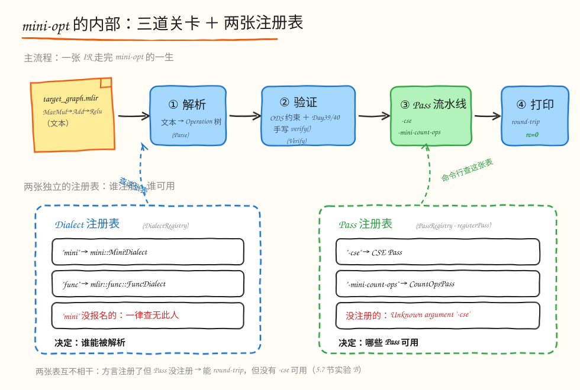
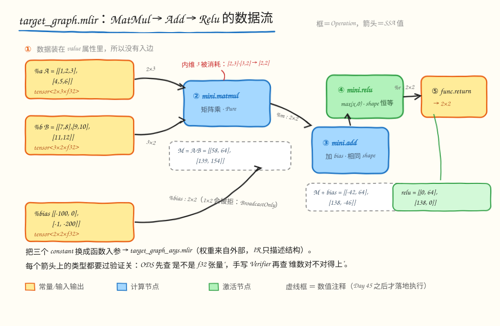
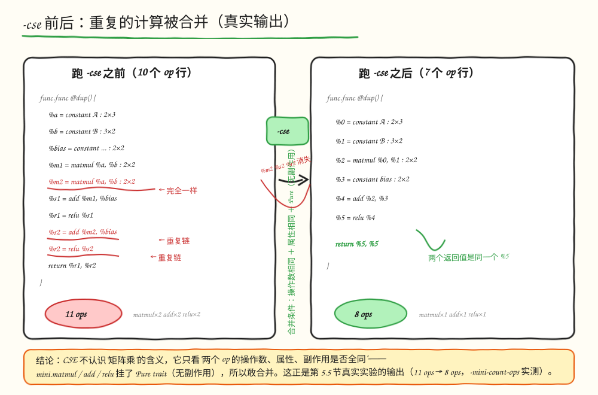

# 第 41 天：构造第一张 mini IR——让你的 mini-opt 真正认识这张图

> **今日目标**：完成本教程后，你能做到——用自己编译的 `mini-opt` 完成一张 `MatMul → Add → Relu` 端到端 IR 的解析、验证、打印（round-trip）；解释 Dialect 注册表和 Pass 注册表为什么是两张不同的表；亲手验证"不注册 Pass，命令行就不认识 `-cse`"。
>
> **预计时间**：学习 40 分钟＋实践 40 分钟（首次构建约 1～3 分钟）。
>
> **前置准备**：Ubuntu 20.04、LLVM/MLIR 18.1.8（`mlir-18-tools`）、CMake ≥ 3.20、Ninja、C++17 编译器；Day 36～40 的 mini 方言源码（本文直接使用 `tutorials/day-041/code/mini/`，已包含 Day 37～40 的全部成果）。
>
> **今日产出**：一份可一键重放的 `run_all.sh` 及其 9 组真实实验记录；一个注册了通用变换 Pass 与自定义 `mini-count-ops` Pass 的 `mini-opt` 工具。

## 1. 今天解决什么问题？

先看一个真实的失败。我们把 Day 38～40 写好的这张图存进 `target_graph.mlir`，交给**官方**的 `mlir-opt-18`：

```text
$ mlir-opt-18 target_graph.mlir
target_graph.mlir:12:10: error: Dialect `mini' not found for custom op 'mini.constant'
    %a = mini.constant dense<[[1.0, 2.0, 3.0], [4.0, 5.0, 6.0]]> : tensor<2x3xf32>
         ^
note: Registered dialects: acc, affine, amdgpu, amx, arith, arm_neon, arm_neon,
arm_sme, arm_sve, async, bufferization, builtin, cf, complex, dlti, emitc,
func, gpu, index, irdl, linalg, llvm, math, memref, mesh, ml_program, nvgpu,
nvvm, omp, pdl, pdl_interp, quant, rocdl, scf, shape, sparse_tensor, spirv,
tensor, test, test_dyn, tosa, transform, ub, vector, x86vector ...
```

官方工具列出了一长串它认识的方言——`arith`、`linalg`、`tosa`……唯独没有我们自己造的 `mini`。这个报错就是今天要回答的问题：**一个工具凭什么"认识"某个 Dialect、又凭什么"认识"某个 Pass？**

到昨天（Day 40）为止，我们的 mini 方言有了骨架（Day 36）、四个算子（Day 37/38）和三个手写 Verifier（Day 39/40），但它们一直是"散装的零件"：每一关都分别验证过，却从来没有**首尾相连**地跑过一次。今天要做的，就是把 Day 35 的结论（"注册表决定谁能被解析"）变成一个能用的工具，让下面这条链路一次走通：

```text
MatMul → Add → Relu 的 MLIR 文本
        → mini-opt 解析（文本变成内存里的 Operation 树）
        → mini-opt 验证（ODS 约束 + Day 39/40 的手写 Verifier）
        → mini-opt 打印（吐回等价的 MLIR 文本，即 round-trip）
```

贯穿全文的例子就是 `target_graph.mlir` 里的这张图，数值沿用 Day 38/40 的约定：

```text
A = [[1, 2, 3], [4, 5, 6]]        B = [[7, 8], [9, 10], [11, 12]]     bias = [[-100, 0], [-1, -200]]
M = A·B = [[58, 64], [139, 154]]  M + bias = [[-42, 64], [138, -46]]
relu(M + bias) = [[0, 64], [138, 0]]        ← 期望的最终结果（Day 45 之后再谈数值落地）
```

为什么值得专门花一天？因为"注册"是所有编译器工具的入口机制：`torch-mlir`、`IREE`、`ONNX-MLIR` 的命令行工具长得都和 `mlir-opt` 一样，差别只在于各自往注册表里塞了哪些方言和 Pass。搞懂今天这两张注册表，你就知道任何一个 MLIR 工具的"可扩展边界"在哪里划定的。

## 2. 先看全貌：今天的内容位于哪里？



**图 1**：看图时关注两条泳道——上半部分是 `mini-opt` 从读入 MLIR 文本到打印输出的主干（三道关卡），下半部分是两张**独立的**注册表：Dialect 注册表决定"谁能被解析"，Pass 注册表决定"哪些 Pass 可用"。命令行上的 `-cse`、`-mini-count-ops` 只查 Pass 注册表，和 Dialect 注册表没有任何关系。

把今天的全貌压缩成 5 步：

1. **构造注册表**：`mini-opt` 的 `main` 里创建 `DialectRegistry`，插入 `mini::MiniDialect` 和 `mlir::func::FuncDialect`（Day 35 的结论在这里生效）。
2. **解析**：`MlirOptMain` 读入 `.mlir` 文本，逐个 op 查 Dialect 注册表；`mini.constant` 找到了 `mini` 方言，文本变成内存里的 Operation 树。
3. **验证**：对每个 op 先跑 tblgen 生成的 ODS 约束（类型、形状谓词），再调用 Day 39/40 手写的 `verify()`；非法 IR 在这里被拦截，进程返回 `rc=1`。
4. **跑 Pass 流水线**：命令行上列出的 `-cse`、`-mini-count-ops` 依次查 Pass 注册表、构造 Pass 实例、在 Operation 树上运行。
5. **打印**：合法（且被 Pass 改写后仍合法）的树被重新打印成 MLIR 文本，即 round-trip 完成，`rc=0`。

今天新增的代码只有两行注册调用和一个自定义 Pass（`CountOpsPass.cpp`），其余全部是 Day 36～40 的存量成果——这正是"工具"这一层薄薄的含义：**注册表 + 已有方言 + 已有 Pass，拼成一个可执行文件**。

## 3. 核心概念：先用直觉，再给准确定义

### 3.1 注册表：DialectRegistry 与 PassRegistry 是两张表

**一句普通话**：注册表就是一张"报名册"——工具启动时登记谁，运行时才认识谁；没报名的一律"查无此人"。

**一个类比**：剧院的演员名单和节目单是两张纸。演员名单（Dialect 注册表）决定谁能上台，节目单（Pass 注册表）决定今晚演哪些节目。一个演员上了名单但今晚没有他的节目，完全正常——`mini` 方言被注册、但一次 Pass 都不跑，工具照样能 round-trip。

**对应到技术上是**：`mlir::DialectRegistry` 维护"方言命名空间（如 `mini`）→ 方言构造函数"的映射，`MlirOptMain` 解析文本遇到 `mini.matmul` 时，用 op 名字前缀查这张表，找到才创建方言、解析算子；Pass 注册表（`mlir::registerPass` 写入的 `PassRegistry`）维护"命令行名字 → Pass 构造函数"的映射，命令行解析器 `PassPipelineCLParser` 拿到 `-cse` 时查的是这张表，解析到才真正构造 Pass 实例。`MiniOpt.cpp` 里两行注册各管一张表：

```cpp
registry.insert<mini::MiniDialect, mlir::func::FuncDialect>();  // ← Dialect 注册表
mlir::registerTransformsPasses();                              // ← Pass 注册表：-cse 等
mlir::mini::registerCountOpsPass();                            // ← Pass 注册表：-mini-count-ops
```

**最小例子**：把 `mlir::registerTransformsPasses()` 注释掉再编译，方言注册表没动、round-trip 照常 `rc=0`，但 `-cse` 直接变成未知参数（第 5.7 节实验 B 亲自验证这一点）。

**常见误解**：注册 ≠ 加载 ≠ 使用。方言"注册"是往名单里登记；第一次解析到 `mini.xxx` 时才真正"加载"（构造 `MiniDialect` 实例、填充它的算子）；"使用"则是具体的 op 被创建。官方 `mlir-opt-18` 的报错里那一长串 "Registered dialects" 就是它自己的报名册——`mini` 从未报名，所以第一个 `mini.constant` 就过不了解析关。

### 3.2 round-trip：解析、验证、打印三关

**一句普通话**：round-trip（往返）就是把 MLIR 文本读进来、检查合法、再原样打印出去——进来什么样，出去语义等价，一行不少一行不多。

**一个类比**：边检的三道关卡：护照核验（解析：文本语法对不对、名字在不在名单上）、安检（验证：类型和 shape 约束过不过）、盖章放行（打印：把内存里的 Operation 树重新写成文本）。

**对应到技术上是**：解析器把文本构造成 Operation 树（每个 `mini.matmul` 变成内存里的 `MatmulOp` 对象，SSA 值变成边）；验证调用 `verifyInvariants()`，内部先执行 tblgen 从 ODS 生成的约束（`Mini_F32Tensor2DPlus` 等），再调用我们手写的 `verify()`（`verifyInvariants` 的后半段）；打印器按每个 op 的 `assemblyFormat` 重新生成文本。三关全过返回码是 0，任何一关失败都是 1。

**最小例子**：第 5.3 节会看到 round-trip 的真实输出。三个细节值得预先指出，免得你以为工具"改坏了"你的文件：

- `%a` 变成 `%0`：打印器给 SSA 值重新编号，从 0 顺序分配，名字只是显示，语义没变；
- `1.0` 变成 `1.000000e+00`：MLIR 浮点打印统一用科学计数法，数值完全相等；
- `func.return` 变成 `return`：`func` 方言的 return 打印成通用形式，语义没变。

**类比边界**：边检的"安检"检查的是入境者本身，而 MLIR 的验证只检查**结构合法性**（类型、shape、支配关系），不检查数值语义——`relu` 的权重是不是训练出来的合理值，验证关管不着；数值要到 Lowering 之后的运行期才能核对（Day 45 之后）。

### 3.3 通用 Pass 与自定义 Pass 走同一条通道

**一句普通话**：`-cse`（Common Subexpression Elimination，公共子表达式消除）是上游 MLIR 送的"成品 Pass"，`-mini-count-ops` 是我们自己写的 Pass，但对工具来说它们没有身份差别——都在 Pass 注册表里，都被命令行解析器一视同仁地查找、构造、调度。

**对应到技术上是**：`mlir::registerTransformsPasses()` 在 `MLIRTransforms` 库里，把 CSE、Canonicalize 等一批变换 Pass 登记进全局 `PassRegistry`；我们在 `CountOpsPass.cpp` 里调用 `mlir::mini::registerCountOpsPass()`，内部同样走 `mlir::registerPass([] { return Pass 实例; })`。命令行解析到 `-cse` 或 `-mini-count-ops` 时，查的是同一张表、走同一条 `PassPipelineCLParser` 通道——注册的是"名字到构造函数的映射"，不跑就不构造实例。

**为什么上游 CSE 能合并我们自定义的 `mini.matmul`？** 因为 `Mini_MatmulOp` 挂了 `Pure` trait（无副作用，见 `MiniOps.td`），CSE 的去重条件（相同操作数＋相同属性＋无副作用）对任何方言的 op 都成立。第 5.5 节会看到它把重复的 matmul/add/relu 全部合并。

**最小例子**：`mini-count-ops` 的本体不到 50 行（`lib/CountOpsPass.cpp`）：`walk` 遍历函数里所有 Operation、按名字计数、用 `emitRemark` 把清单挂在函数上。它是"只读分析 Pass"的最小样本——不改任何 IR，却走和 CSE 完全相同的注册、调度通道；后面 Day 43 的 Shape 推导先按这个骨架写只读版本，Day 45 才引入真正改图的 RewritePattern。

## 4. 图解核心机制

先把 `target_graph.mlir` 摆上白板：这张图里每个方框是一个 Operation，箭头是 SSA 值的"生产→消费"关系，箭头上标的 `tensor<...>` 就是流的类型。



**图 2**：输入是三个 `mini.constant`（A、B、bias 都把数据装在**属性**里，所以它们没有入边）；输出是 `func.return`。最关键的变化发生在类型上：`2x3` 和 `3x2` 相乘"损失"了内维 3，得到 `2x2`——这条类型流就是 Day 39 Verifier 规则 3/4 检查的对象。

按图里的编号逐步看：

1. **① 三个常量节点**：`mini.constant` 是唯一"数据不在操作数上、而在 `value` 属性里"的算子（Day 38）。它们是整张图的源头，没有入边。
2. **② `mini.matmul`**：吃进 `tensor<2x3xf32>` 和 `tensor<3x2xf32>`，吐出 `tensor<2x2xf32>`。为什么是 `2x2`？内维 3（lhs 的最后一维）必须等于 rhs 的倒数第二维，结果取 `[M, N] = [2, 2]`——这正是 MatmulVerifier 规则 3 和规则 4 的内容，第 7 节的选做挑战会从反方向验证它。
3. **③ `mini.add`**：bias 也是 `2x2`，两个操作数 shape 完全一致（`ShapeRelation::Same`），Day 40 的 Verifier 放行。如果 bias 写成 `1x2`，同样的加法会落进 `BroadcastOnly` 分支被拒绝——第 5.4 节专门做这个实验。
4. **④ `mini.relu`**：一进一出，shape 恒等（`2x2 → 2x2`），逐元素 `max(x, 0)`。
5. **⑤ `func.return`**：把结果交还给函数签名声明的返回类型 `tensor<2x2xf32>`。

这张图就是"第一张端到端 mini IR"的全部内容：7 个 Operation、5 种类型、1 条从常量到返回的主链路。它已经是一个真实模型一层（one layer）的抽象骨架——权重来自外部时，把三个 constant 换成函数入参，就得到 `target_graph_args.mlir`（第 5.3 节一起跑）。

## 5. 动手实践：让 mini-opt 走通第一张图

### 5.1 准备文件

全部材料已经在 `tutorials/day-041/code/` 里就位，结构如下：

```text
code/
├── mini/                      # Day 36～40 的方言项目，今天只动两处
│   ├── include/mini/           #   Dialect.h / Ops.h / Passes.h / *.td
│   ├── lib/                    #   Verifier 们 + MiniDialect.cpp + CountOpsPass.cpp（新增）
│   └── tools/mini-opt/         #   MiniOpt.cpp（新增两行注册）
├── target_graph.mlir          # 主角：MatMul → Add → Relu（常量版）
├── target_graph_args.mlir     # 同一张图（函数入参版）
├── bad_bias_shape.mlir        # 负例 1：bias 2x3 撞结果 2x2
├── broadcast_bias.mlir        # 负例 2：bias 1x2 只差广播
├── cse_dup_matmul.mlir        # CSE 探针：重复的 matmul/add/relu
└── run_all.sh                 # 一键重放全部 9 组实验
```

环境检查（本次教程的真实执行环境）：

```text
$ mlir-opt-18 --version | head -1
Ubuntu LLVM version 18.1.8
$ cmake --version | head -1
cmake version 3.20.5
$ ninja --version && g++ --version | head -1
1.10.0
g++ (Ubuntu 9.4.0-1ubuntu1~20.04.2) 9.4.0
```

### 5.2 构建 mini-opt：两行注册决定工具的边界

进入 `code/` 目录执行构建（构建目录放在 `/tmp`，不污染教程目录）：

```bash
cd tutorials/day-041/code
cmake -G Ninja -B /tmp/day041/build -S mini -DCMAKE_BUILD_TYPE=Release \
      -DMLIR_DIR=/usr/lib/llvm-18/lib/cmake/mlir
cmake --build /tmp/day041/build
```

本次真实构建的输出（省略 tblgen 生成的 6 个中间文件和编译警告，完整记录见 `run_all.sh` 重放）：

```text
-- Using MLIRConfig.cmake in: /usr/lib/llvm-18/lib/cmake/mlir
[6/14] Building MiniOps.h.inc...          ← ODS (Day 37) 生成的算子类
[7/9] Building CXX object lib/CMakeFiles/obj.MLIRMini.dir/CountOpsPass.cpp.o
[8/9] Linking CXX static library lib/libMLIRMini.a
[9/9] Linking CXX executable bin/mini-opt
```

工具的"本体"只有 `tools/mini-opt/MiniOpt.cpp` 里短短几行，今天真正的增量是**两行 Pass 注册**：

```cpp
mlir::DialectRegistry registry;
registry.insert<mini::MiniDialect, mlir::func::FuncDialect>();  // Day 35 就有
mlir::registerTransformsPasses();        // ← 新增 1：登记 -cse、-canonicalize 等
mlir::mini::registerCountOpsPass();      // ← 新增 2：登记 -mini-count-ops
return mlir::asMainReturnCode(
    mlir::MlirOptMain(argc, argv, "mini dialect optimizer driver\n", registry));
```

第 3.1 节的两张表现在能对上号了：`registry.insert` 只管 Dialect 表，`registerTransformsPasses()` 和 `registerCountOpsPass()` 只管 Pass 表。后者最终落在 `lib/CountOpsPass.cpp` 的 `registerPass([]() -> std::unique_ptr<Pass> { ... })`——注册的是"名字 → 构造函数"的映射，命令行解析到 `-mini-count-ops` 才会真正构造 Pass 实例。

### 5.3 运行与观察：round-trip 三关一次走通

不带任何 Pass 参数，让 `mini-opt` 只做"解析 → 验证 → 打印"：

```text
$ /tmp/day041/build/bin/mini-opt target_graph.mlir
module {
  func.func @matmul_bias_relu() -> tensor<2x2xf32> {
    %0 = mini.constant dense<[[1.000000e+00, 2.000000e+00, 3.000000e+00], [4.000000e+00, 5.000000e+00, 6.000000e+00]]> : tensor<2x3xf32>
    %1 = mini.constant dense<[[7.000000e+00, 8.000000e+00], [9.000000e+00, 1.000000e+01], [1.100000e+01, 1.200000e+01]]> : tensor<3x2xf32>
    %2 = mini.matmul %0, %1 : tensor<2x3xf32>, tensor<3x2xf32> -> tensor<2x2xf32>
    %3 = mini.constant dense<[[-1.000000e+02, 0.000000e+00], [-1.000000e+00, -2.000000e+02]]> : tensor<2x2xf32>
    %4 = mini.add %2, %3 : tensor<2x2xf32>, tensor<2x2xf32> -> tensor<2x2xf32>
    %5 = mini.relu %4 : tensor<2x2xf32> -> tensor<2x2xf32>
    return %5 : tensor<2x2xf32>
  }
}
rc=0
```

三关都过了，但打印结果和输入文本**不完全一样**——第 3.2 节预告的三个细节全部出现：`%a`→`%0`（SSA 重新编号）、`1.0`→`1.000000e+00`（科学计数法）、`func.return`→`return`（通用打印形式）。语义完全等价，说明解析和打印这对"逆操作"是忠实的。

权重外置的版本 `target_graph_args.mlir`（把三个 constant 换成函数入参）同样 `rc=0`：

```text
$ /tmp/day041/build/bin/mini-opt target_graph_args.mlir
module {
  func.func @matmul_bias_relu(%arg0: tensor<2x3xf32>, %arg1: tensor<3x2xf32>, %arg2: tensor<2x2xf32>) -> tensor<2x2xf32> {
    %0 = mini.matmul %arg0, %arg1 : tensor<2x3xf32>, tensor<3x2xf32> -> tensor<2x2xf32>
    %1 = mini.add %0, %arg2 : tensor<2x2xf32>, tensor<2x2xf32> -> tensor<2x2xf32>
    %2 = mini.relu %1 : tensor<2x2xf32> -> tensor<2x2xf32>
    return %2 : tensor<2x2xf32>
  }
}
rc=0
```

这一版只剩 5 个操作（3 个常量消失），正是真实模型里"一层"的典型形态：权重来自外部，图里只保留计算。

### 5.4 修改一个参数再观察：同一个 add，两种拒绝理由

round-trip 只证明了"合法的图能过"，验证关的真正价值在**拒绝非法的图**。做一组只改一个参数的对照实验：两张 IR 与 `target_graph.mlir` 只差 bias 的 shape，其余完全相同。

**实验 1**（`bad_bias_shape.mlir`）：bias 写成 `2x3`，撞上 matmul 结果 `2x2`：

```text
$ /tmp/day041/build/bin/mini-opt bad_bias_shape.mlir
bad_bias_shape.mlir:11:10: error: 'mini.add' op requires identical operand shapes, but got
'tensor<2x2xf32>' and 'tensor<2x3xf32>', which do not match dimension by dimension and are
not broadcast-compatible either
    %s = mini.add %m, %bias : tensor<2x2xf32>, tensor<2x3xf32> -> tensor<2x2xf32>
         ^
rc=1
```

**实验 2**（`broadcast_bias.mlir`）：bias 改成 `1x2`（每行加同一组数）：

```text
$ /tmp/day041/build/bin/mini-opt broadcast_bias.mlir
broadcast_bias.mlir:11:10: error: 'mini.add' op requires identical operand shapes, but got
'tensor<2x2xf32>' and 'tensor<1x2xf32>', which would broadcast; broadcasting is not
supported yet (see Day 60) -- expand the smaller operand to the exact shape for now
    %s = mini.add %m, %bias : tensor<2x2xf32>, tensor<1x2xf32> -> tensor<2x2xf32>
         ^
rc=1
```

两次都是 `rc=1`，但拒绝理由**不同**——这正是 Day 40 `ShapeRelation` 三分支的出口：`2x3` 对 `2x2` 是永久 `Mismatch`（怎么对齐都对不上），`1x2` 对 `2x2` 是 `BroadcastOnly`（语义上可行、工具暂不支持，留到 Day 60）。报错精确到行列（`11:10`），并且把"现在怎么办"也告诉了用户（把小操作数扩成完全相同的 shape）。区分这两种失败是诊断质量的分水岭：把"永远不可能"和"暂时做不到"混成一句话，用户就会在死路上浪费时间。

### 5.5 通用变换 Pass：-cse 合并重复计算

现在给工具接上 Pass 流水线。`cse_dup_matmul.mlir` 是专门为 CSE（Common Subexpression Elimination，公共子表达式消除）准备的探针：同一对 `(a, b)` 乘两遍、加两遍、relu 两遍：

```text
$ /tmp/day041/build/bin/mini-opt -cse cse_dup_matmul.mlir
module {
  func.func @dup() -> (tensor<2x2xf32>, tensor<2x2xf32>) {
    %0 = mini.constant dense<[[1.000000e+00, 2.000000e+00, 3.000000e+00], [4.000000e+00, 5.000000e+00, 6.000000e+00]]> : tensor<2x3xf32>
    %1 = mini.constant dense<[[7.000000e+00, 8.000000e+00], [9.000000e+00, 1.000000e+01], [1.100000e+01, 1.200000e+01]]> : tensor<3x2xf32>
    %2 = mini.matmul %0, %1 : tensor<2x3xf32>, tensor<3x2xf32> -> tensor<2x2xf32>
    %3 = mini.constant dense<[[-1.000000e+02, 0.000000e+00], [-1.000000e+00, -2.000000e+02]]> : tensor<2x2xf32>
    %4 = mini.add %2, %3 : tensor<2x2xf32>, tensor<2x2xf32> -> tensor<2x2xf32>
    %5 = mini.relu %4 : tensor<2x2xf32> -> tensor<2x2xf32>
    return %5, %5 : tensor<2x2xf32>, tensor<2x2xf32>
  }
}
rc=0
```

输入里的 `%m2`、`%s2`、`%r2` 三行（第二次 matmul/add/relu）从输出里消失了：10 行操作变 7 行，两个返回值都指向同一个 `%5`。上游 MLIR 的 CSE 对**任何方言**的 op 都生效，条件只有三个：操作数相同、属性相同、无副作用——`mini.matmul/add/relu` 都挂了 `Pure` trait（Day 37 的 ODS），所以天然满足。



**图 3**：左右两个面板是同一张探针图跑 `-cse` 之前和之后的样子。看点有三处：右图里第二个 matmul/add/relu 方框被划掉，说明"查无此人"；两条 return 边都改指向幸存的那条 relu；合并能成立的三要素写在中间——**操作数相同、属性相同、Pure（无副作用）**。CSE 完全不知道 `mini` 方言的存在，它只看这三条通用性质——这就是"Pass 与 Dialect 正交"的含义。

### 5.6 自定义 Pass：-mini-count-ops 用 remark 报清单

自己写的 Pass 和上游的走同一条通道，验证方法也最直接——跑起来看：

```text
$ /tmp/day041/build/bin/mini-opt -mini-count-ops target_graph.mlir
target_graph.mlir:11:3: remark: 8 ops in @matmul_bias_relu (func.func=1,
func.return=1, mini.add=1, mini.constant=3, mini.matmul=1, mini.relu=1)

$ /tmp/day041/build/bin/mini-opt -mini-count-ops target_graph_args.mlir
target_graph_args.mlir:5:3: remark: 5 ops in @matmul_bias_relu (func.func=1,
func.return=1, mini.add=1, mini.matmul=1, mini.relu=1)
```

两张图数出来的操作数（8 和 5）与 5.3 节的打印结果一一对应。`CountOpsPass.cpp` 的核心只有 `runOnOperation` 里的一段：`func->walk` 按定义序访问函数内所有 Operation，按名字累计进 `StringMap`，排序后用 `emitRemark` 挂回函数——不改任何 IR，是"只读分析 Pass"的最小样本。

一个诚实记录的坑：`CountOpsPass` 里也声明了 `Pass::Statistic totalOps`，按文档 `-mlir-pass-statistics` 应该打印汇总表，但在本次 **Release（NDEBUG）构建**里它是空表：

```text
$ /tmp/day041/build/bin/mini-opt -mlir-pass-statistics -mini-count-ops target_graph.mlir
===-------------------------------------------------------------------------===
                         ... Pass statistics report ...
===-------------------------------------------------------------------------===
（以下为空——统计代码被 NDEBUG 编译掉了）
rc=0
```

这不是 bug，是 Release 构建的已知行为：统计相关的 debug 代码在 `NDEBUG` 下被裁掉，而 remark 通道不受影响。想要真实统计表，把 `-DCMAKE_BUILD_TYPE=RelWithDebInfo` 或 `Debug` 重新配置即可（今天的实验不依赖它）。

### 5.7 对照实验：到底是谁认识 mini？

最后做两组对照，把第 3.1 节"两张注册表"的说法钉死在证据上。

**对照 A：官方 `mlir-opt-18`**。它的 Dialect 注册表里有 40+ 个官方方言，但没有我们的 `mini`：

```text
$ mlir-opt-18 target_graph.mlir
target_graph.mlir:12:10: error: Dialect `mini' not found for custom op 'mini.constant'
    %a = mini.constant dense<[[1.0, 2.0, 3.0], [4.0, 5.0, 6.0]]> : tensor<2x3xf32>
         ^
note: Registered dialects: acc, affine, amdgpu, amx, arith, arm_neon, arm_sme,
arm_sve, async, bufferization, builtin, cf, complex, dlti, emitc, func, gpu,
index, irdl, linalg, llvm, math, memref, mesh, ml_program, nvgpu, nvvm, omp,
pdl, pdl_interp, quant, rocdl, scf, shape, sparse_tensor, spirv, tensor, test,
test_dyn, tosa, transform, ub, vector, x86vector
rc=1
```

报错附带的这张名单就是它的"报名册"——`func`、`linalg`、`tosa` 都在，`mini` 不在，于是第一个 `mini.constant` 就过不了解析关。

**对照 B：不注册 Pass 的 mini-opt**。复制一份 mini 源码，把 `MiniOpt.cpp` 里的两行 Pass 注册注释掉，其余一字不改，重新编译（`run_all.sh` 第 9 步自动完成）：

```text
--- B1: round-trip 仍 rc=0（方言注册与 Pass 注册是两回事） ---
rc=0
--- B2: -cse 变成未知参数 ---
mini-opt: Unknown command line argument '-cse'.  Try: '/tmp/day041/noreg-build/bin/mini-opt --help'
mini-opt: Did you mean '-o'?
--- B3: -mini-count-ops 也一样 ---
mini-opt: Unknown command line argument '-mini-count-ops'.  Try: '... --help'
mini-opt: Did you mean '--mno-sort-sda'?
--- B4: --help 里干脆没有 Passes: 小节 ---
0（没有这一节）
```

B1 证明 Dialect 表（`registry.insert`）独立工作：Pass 没注册，解析、验证、打印照常走通。B2/B3 证明 Pass 表决定命令行选项的存在性：没注册就变成"未知参数"，错误信息由 `PassPipelineCLParser` 发出。B4 则显示连 `--help` 里的 `Passes:` 小节都整个消失——工具的可用能力完全由注册表撑起。

以上 9 组实验（round-trip ×2、负例 ×2、CSE、count ×2、statistics、对照 ×2）可以用一条命令全部重放：

```bash
cd tutorials/day-041/code && bash run_all.sh
```

## 6. 常见错误与排查

### 错误 1：`Dialect 'mini' not found for custom op 'mini.constant'`

- **现象**：把 `.mlir` 文件交给官方 `mlir-opt-18`（或任何一个没注册 mini 的工具），第一行 `mini.constant` 就报错，`rc=1`。
- **原因**：该工具的 Dialect 注册表里没有 `mini`。注册表是**每个工具各自持有**的，源码里定义了方言不等于任何工具都认识它。
- **定位**：看报错附带的 `note: Registered dialects: ...` 名单——里面有 `func`、`linalg` 等 40 多个官方方言，唯独没有 `mini`，说明问题出在"这份名单"，而不是 `.mlir` 文件本身。
- **修复**：要么改用注册过 mini 的工具（我们构建的 `mini-opt`），要么在该工具的 `main` 里加 `registry.insert<mini::MiniDialect>()`。这正是第 1 节那个失败——今天的整篇文章都在回答它。

### 错误 2：`Unknown command line argument '-cse'`

- **现象**：命令行敲 `-cse` 或 `-mini-count-ops`，工具不认识，还"贴心"地建议 `Did you mean '-o'?`。
- **原因**：Pass 注册表里没有这一项。`MlirOptMain` 的 `PassPipelineCLParser` 只认注册过的名字——没注册的 Pass 在命令行上**根本不存在**，不是"注册了但跑不动"。
- **定位**：先跑 `--help`，看有没有 `Passes:` 小节；对照 B 的 B4 实验里它整个消失了。再检查 `MiniOpt.cpp` 是否调用了 `mlir::registerTransformsPasses()`，以及 `CMakeLists.txt` 的 `LINK_LIBS` 里有没有 `MLIRTransforms`（只注册不链接，链接期就报 undefined reference）。
- **修复**：补上注册调用并重新编译。第 5.7 节对照 B 用 `sed` 注释掉这两行复现了完整现场。

### 错误 3：bias 写成 `1x2`，`mini.add` 拒绝并说 "would broadcast"

- **现象**：`rc=1`，报错信息是 `... would broadcast; broadcasting is not supported yet (see Day 60)`。
- **原因**：Day 40 的 `ShapeRelation` 把 `1x2` 对 `2x2` 判成 `BroadcastOnly`——语义上可行，但当前 Verifier 明确只放行完全一致的 shape。这是**故意设计的边界**，不是 bug。
- **定位**：报错已经写明出路：`expand the smaller operand to the exact shape for now`。区分它和 `not broadcast-compatible either`（永久 Mismatch）两种措辞，就知道是"暂时不支持"还是"永远不可能"。
- **修复**：现阶段把 bias 显式扩成 `2x2`（两个相同的行）；真正的广播支持留到 Day 60。

### 错误 4：`-mlir-pass-statistics` 打印空表

- **现象**：命令成功（`rc=0`）、remark 也正常出现，但统计报告只有表头没有数据。
- **原因**：本教程用 `-DCMAKE_BUILD_TYPE=Release` 构建，`NDEBUG` 把 Pass 统计的计数代码编译掉了；`emitRemark` 走的是诊断通道，不受影响。
- **定位**：对照同一命令的 remark 输出——remark 在、统计不在，基本可以断定是构建类型问题而不是 Pass 写错。
- **修复**：需要统计表时用 `RelWithDebInfo` 或 `Debug` 重新配置构建目录。第 5.6 节保留了这次空表的真实记录，重放时可对照。

## 7. 今日练习

### 必做练习：数一数 CSE 吃掉了几个操作

不跑 `-cse`，先在纸上数：`cse_dup_matmul.mlir` 里 `@dup` 这个函数一共有多少个 Operation（别忘了 `func.return` 和 `mini.constant`×3）？然后依次运行：

```bash
/tmp/day041/build/bin/mini-opt -mini-count-ops cse_dup_matmul.mlir
/tmp/day041/build/bin/mini-opt -cse -mini-count-ops cse_dup_matmul.mlir
```

**预期产出**：两条 remark（都挂在 `@dup` 上），第二条的总数比第一条**少**。少的那几个操作属于哪些名字？和你数出来的"重复计算"对得上吗？（两个命令都在本教程环境里实际验证过可以运行；把你的两个数字和第 5.5 节打印出的图对照，就能自查答案。）

### 选做挑战：给 matmul 制造一个"内维对不上"

`target_graph.mlir` 里 lhs 是 `2x3`、rhs 是 `3x2`，内维 3 恰好相等。现在把 rhs 换成 `2x2` 的常量 `[[1.0, 2.0], [3.0, 4.0]]`，写一个新文件 `bad_inner.mlir`。**先不要运行**，按照 Day 39 MatmulVerifier 的规则 3，写下你预测的报错关键词，再运行：

```bash
/tmp/day041/build/bin/mini-opt bad_inner.mlir
```

**预期产出**：`rc=1`，报错应指向 `mini.matmul` 而不是 `mini.add`，并且明确说出 lhs 的内维和 rhs 的第二维各是多少。这条错误信息今天一句也没改过——它是 Day 39 的存量成果第一次在端到端链路里亮相。

## 8. 今日验收

- [ ] 我能用自己的话解释 Dialect 注册表和 Pass 注册表是**两张独立的表**，并各举一个"只注册一张、另一张缺席"的真实后果（第 5.7 节对照 B：round-trip 照常 vs `-cse` 变未知参数）。
- [ ] 我能独立运行 `run_all.sh`（或手动逐条执行），让 `target_graph.mlir` 完成 round-trip 并得到 `rc=0`，指出输出与输入的三处**显示差异**（SSA 编号、科学计数法、return 形式）且语义不变。
- [ ] 我能修改 bias 的 shape（`2x2` → `2x3` 或 `1x2`）并**预测**两种报错的措辞差异，再运行 `mini-opt` 核对我的预测。
- [ ] 我能解释为什么上游的 `-cse` 能合并自定义方言的 `mini.matmul`（三要素：操作数相同、属性相同、`Pure` trait）。
- [ ] 我保存了 `mini/` 项目（含两行 Pass 注册和 `CountOpsPass.cpp`）、5 个 `.mlir` 输入、`run_all.sh` 和 9 组真实实验记录。

## 9. 一句话总结与明天预告

今天从"官方工具不认识 `mini`"这个真实失败出发，把 Day 36～40 的散装零件拼成了一个能用的工具：`mini-opt` 用 **Dialect 注册表**决定谁能被解析，用 **Pass 注册表**决定哪些变换可用，两张表各管各的——对照实验证明抽掉 Pass 注册后 round-trip 照常、`-cse` 却变成未知参数。第一张端到端 mini IR（MatMul → Add → Relu）完整走了解析、验证、打印三关，负例区分了"永久不匹配"和"只差广播"，CSE 则证明上游 Pass 对自定义方言同样生效。至此，"定义方言 → 写 Verifier → 拼工具 → 跑 Pass"的最小闭环已经打通。

明天是第 6 周复盘（Day 42）：不再新增机制，而是独立定义一个 `mini.mul` 算子——从 ODS、构建到合法性测试全流程自己走一遍，并回答复盘的核心问题："哪些约束放 ODS，哪些放 Verifier"。
