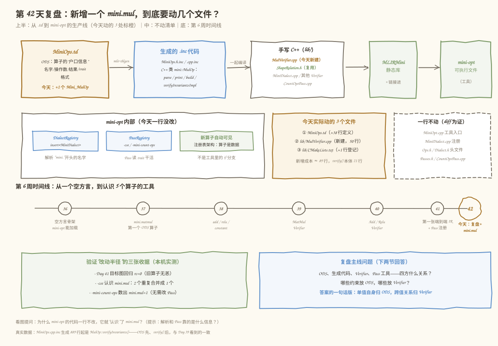
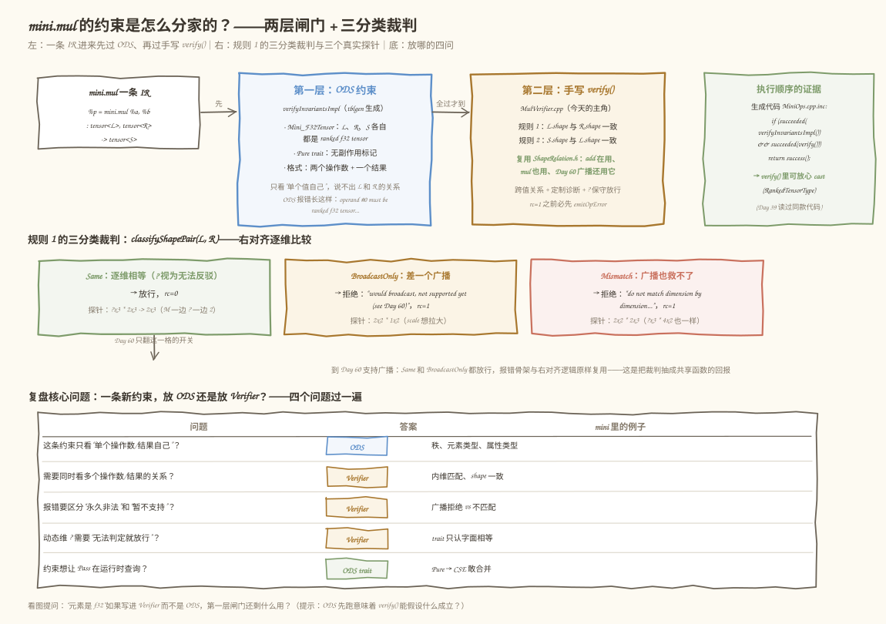
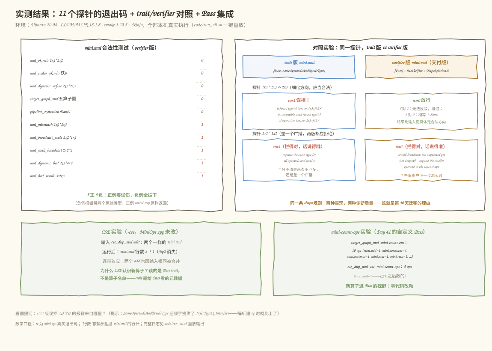

# 第 42 天：第 6 周复盘——独立新增一个 `mini.mul`，说清"约束放 ODS 还是 Verifier"

> **今日目标**：完成本教程后，你能不翻前几天的教程，独立为一个新算子完成 ODS 定义、手写 Verifier、CMake 登记和正反例测试；能用四个问题判断一条约束该放 ODS 还是 Verifier，并用真实对照实验解释两种选择的诊断差异。
> **预计时间**：学习 30 分钟＋实践 50 分钟
> **前置准备**：Day 41 的 mini 方言工程（`tutorials/day-041/code/mini`，含 matmul/add/relu/constant 四算子和 mini-opt）、LLVM/MLIR 18.1.8 工具链（本教程环境为 Ubuntu 20.04 + `mlir-18-tools`）、Ninja 与 CMake
> **今日产出**：第五个算子 `mini.mul`（`code/mini`，3 个文件改动共约 89 行）、11 个正反例测试、一键重放脚本 `code/run_all.sh`，以及一份 trait 版 vs Verifier 版的真实对照记录

## 1. 今天解决什么问题？

第 6 周干了六件事：Day 36 建起空的 `mini` 方言，Day 37～38 用 ODS 定义了四个算子，Day 39～40 给它们装上带诊断的手写 Verifier，Day 41 让 `mini-opt` 跑通了 `MatMul → Add → Relu` 的端到端 IR 和 Pass 注册。概念都见过，但**复盘的检验标准不是"还记得吗"，而是"能独立再来一遍吗"**。

所以今天的考题是：现在给你一个新算子——逐元素乘法 `mini.mul`——你能不能不查资料，独立完成定义、构建和合法性测试？更重要的是，过程中必须回答计划留下的复盘题：

1. **四方关系**：ODS（`.td` 里的声明）、生成代码（`mlir-tblgen` 产出的 `.inc`）、手写 C++（Verifier、Pass）、工具（`mini-opt`）——它们是怎么接起来的？新增一个算子，改动半径到底有多大？
2. **约束分家**：哪些约束放 ODS，哪些放 Verifier？这个判断有没有可复用的规则，而不是"感觉"？

贯穿全文的例子沿用本周的老朋友，只是目标图长出一个新节点：

```text
A = [[1,2,3],[4,5,6]] · B = [[7,8],[9,10],[11,12]] → M = [[58,64],[139,154]]
bias = [[-100,0],[-1,-200]]           → M + bias  = [[-42,64],[138,-46]]
gate = [[1.0,0.5],[2.0,1.0]]（今天新增） → 上式 * gate = [[-42,32],[276,-46]]
                                     → relu(...) = [[0,32],[276,0]]
```

即 `MatMul → Add(bias) → Mul(gate) → ReLU`，五种算子全体报到。手算结果写在这里，是给 Day 124 接上执行框架后对答案用的。

> **前置补给**（本周一句话版）：ODS 是用 TableGen 语言写的算子声明，`mlir-tblgen` 把它编译成 C++ 类（含解析器、打印器、约束检查）；`let hasVerifier = 1` 会让生成代码在 ODS 约束**之后**调用你手写的 `verify()`；`mini-opt` 是壳，它只注册方言和 Pass，不认识任何具体算子。

## 2. 先看全貌：新增一个算子，到底要动几个地方？



**图 1**：先看上半的生产线——`MiniOps.td` 经 `mlir-tblgen` 变成 `.inc` 生成代码，和手写 C++ 一起编译成 `MLIRMini` 静态库，最后链进 `mini-opt`；橙色就是今天的 3 个改动点。再看中部两张卡：左卡是 mini-opt 内部的注册表结构，右卡是"一行不动"清单——带着问题看：为什么工具的代码一行不改，它就"认识"了 `mini.mul`？

一条 `.mlir` 文本进入 `mini-opt` 后，背后这条生产线的分工是：

1. **解析**：文本里的 `mini.mul` 这个名字能被认出来，靠的是 `MiniDialect.cpp` 注册进方言的算子表（由生成代码展开，`addOperations<...>` 那张表里自动多了 `MulOp`）；
2. **验证**：先跑 tblgen 生成的 ODS 约束（操作数/结果各自的类型），全过之后再调手写 `verify()`（跨操作数的关系）；
3. **Pass**：`-cse`、`-mini-count-ops` 看到的也是一个普通 Operation，该合并合并、该计数计数。

今天交付后的真实改动半径（`diff -rq` 实测，见 5.3 节）：**改 2 个文件 + 新建 1 个文件**——`MiniOps.td`（+38 行）、`lib/MulVerifier.cpp`（新建 50 行）、`lib/CMakeLists.txt`（+1 行）。`MiniOpt.cpp`、`MiniDialect.cpp`、`Ops.h`、`Dialect.h`、`Passes.h`、`CountOpsPass.cpp` 全部原样。Day 41 在 `MiniOpt.cpp` 里留的那句注释——"第 42 天复盘新增 mini.mul 时也不会再碰这个文件"——今天兑现了。

## 3. 核心概念：先用直觉，再给准确定义

### 3.1 ODS、生成代码、手写 C++ 和工具的四方关系

- 一句通俗解释：**ODS 是菜品档案，tblgen 是中央厨房，手写 C++ 是门店的口味微调，mini-opt 是门店本身**——菜单上新品只需要总部更新档案，门店不用动一砖一瓦。
- 工程类比：连锁餐厅上新菜：研发部填一张标准化的菜品卡（ODS），中央厨房按卡片自动产出标准做法（生成代码：解析、打印、基础检查），个别门店按本地口味加一步（手写 Verifier），而门店的收银系统、后厨动线（mini-opt 的解析器和 Pass 调度）对新品无感知。
- 对应到技术上是……`MiniOps.td` 里的一条 `def Mini_MulOp : Mini_Op<"mul", ...>` 声明了算子名、操作数、结果、trait 和汇编格式；`mlir-tblgen` 据此生成 `mini::MulOp` 类的完整骨架（`MiniOps.h.inc` 里是声明，`MiniOps.cpp.inc` 里是 `parse`/`print`/`verifyInvariants` 的定义）；需要定制的部分（shape 关系检查）由我们用 `let hasVerifier = 1` 预约一个 `verify()` 钩子，本体写在 `MulVerifier.cpp`；`mini-opt` 的 `main` 只持有注册表（DialectRegistry + PassRegistry），它通过表间接认识所有算子。**算子是注册表里的数据，不是工具代码里的分支**——这就是"新增不算子不用改工具"的机制。
- 最小例子：本周五个算子里，`mini.add` 和 `mini.mul` 的 ODS 声明只差名字和描述文本，其余（操作数类型、trait、格式）逐字相同——同族算子的"新增成本"趋近于复制粘贴加改名。
- 类比边界：餐厅类比解释不了**Pass 为什么也不用作改动**——技术上 Pass（如 CSE）判断"能不能合并"靠的是 op 的 `Pure` trait（无副作用标记），而不是维护一张算子白名单；trait 是挂在 Operation 上、随时可查询的**元数据**，这是 3.2 节的关键角色。

### 3.2 哪些约束放 ODS，哪些放 Verifier——四个问题定分晓

- 一句通俗解释：**只描述"一个值自己长什么样"的约束放 ODS；需要"把几个值放在一起比"的约束放 Verifier**。
- 工程类比：机场安检分两道——第一道每人单独过仪器（ODS：你的证件和随身物品合规吗），第二道登机口核对团队名单（Verifier：你们仨的登机牌能凑成同一个联程吗）。
- 对应到技术上是……四个问题依次过：①这条约束只看单个操作数/结果自身？（秩、元素类型、属性类型 → ODS）②需要同时看多个操作数/结果的关系？（内维匹配、shape 一致 → Verifier）③报错要区分"永久非法"和"暂不支持"？（广播拒绝 vs 不匹配 → Verifier 定制诊断）④动态维 `?` 需要"无法判定就放行"？（trait 只认字面相等 → Verifier 逐维保守判定）。还有一个反向问题：⑤这条约束想让 Pass **运行时查询**？（`Pure` → CSE 敢合并 → ODS trait）。trait 的双重角色值得单独记住：它既是一条**检查**（生成代码会查），又是一份**可供 Pass 查询的声明**——手写 Verifier 只能做到前者。
- 最小例子（今天的主角）：`mini.mul` 的约束分家——"是 ranked f32 tensor"（每个值自己）＋"无副作用"（给 Pass 看）放 ODS；"两个操作数 shape 一致、结果 shape 一致"（跨值关系，还要给 `?` 和广播留口子）放 Verifier。
- 类比边界：安检类比解释不了**执行顺序的含义**——技术上两层不是平行关卡而是串联接力（生成代码里 `verifyInvariantsImpl() && verify()`），ODS 全过才轮到 `verify()`；这让 `verify()` 里可以放心 `cast<RankedTensorType>`，也意味着"该放 ODS 的约束写成 Verifier"只是浪费一层检查，反过来"该放 Verifier 的写成 ODS"则根本表达不出来。

## 4. 图解核心机制



**图 2**：左上是一条 IR 依次过两层闸门——蓝框（ODS）查"每个值自己"，橙框（手写 `verify()`）查"值和值之间的关系"，绿框是执行顺序的生成代码证据。中部是规则 1 背后的三分类裁判，跟着三个真实探针看裁判怎么判；底部是 3.2 节四个问题的速查表。看图时留意：从 Same 卡片引出的那支箭头——Day 60 支持广播时只有这一格的政策要翻。

按图索骥，`mini.mul` 一条 IR 的完整过关流程：

1. **第一层（ODS，`verifyInvariantsImpl`）**：`Mini_F32Tensor` 逐个查 lhs、rhs、res——都是 ranked f32 tensor 吗？`Pure` trait 登记无副作用。这层全过，才轮到下一层。
2. **顺序的证据**：生成代码 `/tmp/day042/build/include/mini/MiniOps.cpp.inc` 第 889 行起（本机构建后真实可见）：

   ```cpp
   ::mlir::LogicalResult MulOp::verifyInvariants() {
     if(::mlir::succeeded(verifyInvariantsImpl()) && ::mlir::succeeded(verify()))
       return ::mlir::success();
     return ::mlir::failure();
   }
   ```

   和 Day 39 在 `MatmulOp` 上看到的逐字相同——生成代码不知道"谁"在用它，它只是把 `.td` 的声明翻译成 C++。
3. **第二层（手写 `verify()`）**：规则 1 查 lhs 与 rhs 的 shape 关系，规则 2 查 res 与 lhs。两条规则都通过 `ShapeRelation.h` 的三分类裁判（`classifyShapePair`），这是 Day 40 为 add/relu 抽出来的共享函数——今天 `mini.mul` 第三个复用它，一次新逻辑都没写。
4. **三分类裁判**：右对齐逐维比较——`Same` 放行（`?` 视为"无法反驳"）；`BroadcastOnly` 拒绝但说"广播暂不支持，Day 60 见"；`Mismatch` 拒绝并说"逐维不匹配，广播也救不了"。探针 `?x3 * 2x3 → 2x3` 走 Same（M 一边 `?` 一边 2，跳过），`2x2 * 1x2` 走 BroadcastOnly（左维 2 对 1），`2x2 * 2x3` 走 Mismatch（右维 2 对 3 且无 1）。

## 5. 动手实践：独立新增 mini.mul

### 5.1 准备文件

```bash
cd tutorials/day-042/code
cp -r ../day-041/code/mini ./mini
```

今天的改动清单（也是自测题——动手前先默写一遍，再对照）：改 `include/mini/MiniOps.td`（新增算子定义），新建 `lib/MulVerifier.cpp`（手写 `verify()`），改 `lib/CMakeLists.txt`（登记源文件）。就这三处，多一处都算改错了地方。

### 5.2 编写代码

第一处，`MiniOps.td` 里紧跟 `Mini_AddOp` 之后加同族定义（关键行完整，描述文本见 `code/mini/include/mini/MiniOps.td`）：

```tablegen
def Mini_MulOp : Mini_Op<"mul", [Pure]> {
    let summary = "elementwise multiplication";
    let description = [{
        The `mini.mul` operation performs element-wise multiplication
        (the Hadamard product) between two ranked f32 tensors. Shape
        rules are identical to `mini.add` ...
    }];

    // 与 mini.add 同款开关：ODS 约束（Mini_F32Tensor）跑完之后，
    // verifyInvariants 继续调用 lib/MulVerifier.cpp 里手写的 verify()。
    let hasVerifier = 1;

    let arguments = (ins
      Mini_F32Tensor:$lhs,
      Mini_F32Tensor:$rhs
    );

    let results = (outs
      Mini_F32Tensor:$res
    );

    let assemblyFormat = [{
      $lhs `,` $rhs attr-dict `:` type($lhs) `,` type($rhs) `->` type($res)
    }];
}
```

四个值得停一停的决定：

- **`Mini_F32Tensor` 而不是 `Mini_F32Tensor2DPlus`**：逐元素乘不限秩，标量 `tensor<f32>`、向量、矩阵都合法——和 `mini.add` 同款，与 `mini.matmul` 的"秩 ≥ 2"形成对照。
- **trait 列表只有 `[Pure]`**：不带 `SameOperandsAndResultType`，因为 shape 一致性交给手写 Verifier——理由见 5.4 节的对照实验；`Pure` 必须留，它是 CSE 敢合并重复 `mini.mul` 的依据。
- **`hasVerifier = 1`**：让 tblgen 在生成的类里声明 `::mlir::LogicalResult verify();` 并在 ODS 约束之后调用（图 2 绿框的生成代码）。
- **`assemblyFormat` 与 add 逐字相同**：两个操作数、一个结果、类型注解格式——所以打印出来和 `mini.add` 长一个样。

第二处，新建 `lib/MulVerifier.cpp`（完整文件 50 行，`verify()` 本体 21 行、其中代码 12 行）：

```cpp
#include "mini/Ops.h"
#include "ShapeRelation.h"

#include "mlir/IR/BuiltinTypes.h"

using namespace mlir;

LogicalResult mini::MulOp::verify() {
  // ODS 约束已跑完（verifyInvariantsImpl 先于 verify()），放心 cast。
  auto lhs = llvm::cast<RankedTensorType>(getLhs().getType());
  auto rhs = llvm::cast<RankedTensorType>(getRhs().getType());
  auto res = llvm::cast<RankedTensorType>(getRes().getType());

  // 规则 1：两个操作数 shape 一致（Same 放行；BroadcastOnly/Mismatch 各报各的错）。
  if (failed(verifyElementwiseOperands(getOperation(), lhs, rhs)))
    return failure();

  // 规则 2：结果 shape 必须与操作数一致。
  if (classifyShapePair(lhs, res) != ShapeRelation::Same)
    return emitOpError("result shape must equal the operand shape")
           << ": operands are " << lhs << " and " << rhs << ", but result is "
           << res;

  return success();
}
```

注意这里**没有一处新算法逻辑**：`verifyElementwiseOperands` 和 `classifyShapePair` 都是 `ShapeRelation.h` 里 Day 40 写好的——`emitOpError` 挂在 op 自己身上，报错前缀自动是 `'mini.mul' op`（名字随 op 走，不用改一个字）。同族算子共享裁判，就是 Day 40 埋下的接缝今天兑现的样子。

第三处，`lib/CMakeLists.txt` 的源文件列表加一行 `MulVerifier.cpp`（完整文件见 `code/mini/lib/CMakeLists.txt`）。忘了这步会怎样？第 6 节错误 1 有本机真实复现。

### 5.3 构建与运行：记录真实结果

以下**全部为本机真实执行**（Ubuntu 20.04 · LLVM/MLIR 18.1.8 · cmake 3.20.5 + Ninja；首次构建约 1～3 分钟，为经验估计）。`code/run_all.sh` 一键重放全部实验。

```bash
cmake -G Ninja -B /tmp/day042/build -S mini -DCMAKE_BUILD_TYPE=Release \
      -DMLIR_DIR=/usr/lib/llvm-18/lib/cmake/mlir
cmake --build /tmp/day042/build
```

先验证改动半径（在仓库根目录执行，真实输出）：

```text
$ diff -rq tutorials/day-041/code/mini tutorials/day-042/code/mini
Files tutorials/day-041/code/mini/include/mini/MiniOps.td and tutorials/day-042/code/mini/include/mini/MiniOps.td differ
Files tutorials/day-041/code/mini/lib/CMakeLists.txt and tutorials/day-042/code/mini/lib/CMakeLists.txt differ
Only in tutorials/day-042/code/mini/lib: MulVerifier.cpp
```

头条实验——目标图 `MatMul → Add → Mul → ReLU` 端到端 round-trip（真实输出节选）：

```text
$ /tmp/day042/build/bin/mini-opt target_graph_mul.mlir
module {
  func.func @matmul_bias_mul_relu() -> tensor<2x2xf32> {
    ...
    %4 = mini.add %2, %3 : tensor<2x2xf32>, tensor<2x2xf32> -> tensor<2x2xf32>
    %5 = mini.constant dense<[[1.000000e+00, 5.000000e-01], [2.000000e+00, 1.000000e+00]]> : tensor<2x2xf32>
    %6 = mini.mul %4, %5 : tensor<2x2xf32>, tensor<2x2xf32> -> tensor<2x2xf32>
    %7 = mini.relu %6 : tensor<2x2xf32> -> tensor<2x2xf32>
    return %7 : tensor<2x2xf32>
  }
}
rc=0
```

`%6 = mini.mul ...` 原样打印出来——新算子过了解析、验证、打印三关。

11 个测试文件全部实测，结果汇总（真实退出码）：

| 测试文件 | 检查点 | rc |
|---|---|---|
| `mul_ok.mlir` | 2x2 * 2x2 → 2x2 | 0 |
| `mul_scalar_ok.mlir` | 秩 0：`tensor<f32>` * `tensor<f32>` | 0 |
| `mul_dynamic_refine.mlir` | ?x3 * 2x3 → 2x3，细化放行 | 0 |
| `target_graph_mul.mlir` | 五算子目标图 round-trip | 0 |
| `pipeline_regression.mlir` | Day 41 目标图回归 | 0 |
| `mul_mismatch.mlir` | 2x2 * 2x3，永久不匹配 | 1 |
| `mul_broadcast_scale.mlir` | 2x2 * 1x2，差一个广播 | 1 |
| `mul_rank_broadcast.mlir` | 2x2 * 2，秩不同缺位补 1 | 1 |
| `mul_dynamic_bad.mlir` | ?x3 * 4x2，动态救不了 | 1 |
| `mul_bad_result.mlir` | 结果侧写成 2x3 | 1 |
| `cse_dup_mul.mlir` | Pass 集成探针（见 5.5） | 0 |

挑两条负例的真实报错，看"说人话"的诊断长什么样：

```text
--- mul_broadcast_scale.mlir（2x2 * 1x2：BroadcastOnly）
error: 'mini.mul' op requires identical operand shapes, but got 'tensor<2x2xf32>'
and 'tensor<1x2xf32>', which would broadcast; broadcasting is not supported yet
(see Day 60) -- expand the smaller operand to the exact shape for now
rc=1

--- mul_bad_result.mlir（操作数没问题，结果写成 2x3：规则 2）
error: 'mini.mul' op result shape must equal the operand shape: operands are
'tensor<2x2xf32>' and 'tensor<2x2xf32>', but result is 'tensor<2x3xf32>'
rc=1
```

第一条同时给出两个原始类型、失败原因（广播）和修改建议（把小的操作数扩到 exact shape）——5.4 节会看到 trait 版给不出这些。

### 5.4 修改一个参数再观察：把 mini.mul 换回 trait 版

复盘题最有说服力的答法是做实验。把 `Mini_MulOp` 的 trait 列表从 `[Pure]` 改成 `[Pure, SameOperandsAndResultType]`、删掉 `let hasVerifier = 1;` 和 `MulVerifier.cpp`（trait 需要 `MiniOps.td` 重新 include `InferTypeOpInterface.td`、`Ops.h` 补回对应头——Day 38 踩过的坑）。`run_all.sh` 第 6/7 步用脚本现场生成这个变体并构建，同一批探针喂两个版本（真实输出）：

```text
=== mul_dynamic_refine.mlir（?x3 * 2x3 -> 2x3，细化方向，应当合法）===
--- trait 版（SameOperandsAndResultType）---
error: 'mini.mul' op inferred type(s) 'tensor<?x3xf32>' are incompatible with
return type(s) of operation 'tensor<2x3xf32>'
rc=1
--- verifier 版（手写 verify()）---
rc=0 (通过)

=== mul_broadcast_scale.mlir（2x2 * 1x2，两版都应拒绝）===
--- trait 版 ---
error: 'mini.mul' op requires the same type for all operands and results
rc=1
--- verifier 版 ---
error: 'mini.mul' op requires identical operand shapes, but got 'tensor<2x2xf32>'
and 'tensor<1x2xf32>', which would broadcast; broadcasting is not supported yet
(see Day 60) -- expand the smaller operand to the exact shape for now
rc=1
```

三个观察，对应 3.2 节的四个问题：

- **误拒**：trait 只认三个类型**字面**相等，合法的细化 IR（`?x3 * 2x3 → 2x3`）被拒；verifier 版逐维保守判定，M 一边 `?` 一边 2 视为"无法反驳"，放行。
- **诊断质量**：同样是拦截 `2x2 * 1x2`，trait 版只有一句"必须同类型"，分不清"永久不匹配"和"差一个广播"；verifier 版把两个类型、原因和下一步都给全。
- **报错来源的细节**：trait 版误拒的报错不是来自 `verifyInvariants`，而是"建 op 时"的类型推断检查——`SameOperandsAndResultType` 还顺手提供了 `InferTypeOpInterface`（这就是需要补 include 的原因），解析器建 op 时先做了一轮推断比对。这印证了 3.2 节说的 trait 双重角色：它不只是检查，还是机器可读的接口声明。

结论：对逐元素算子族，verifier 版在"不误拒"和"说人话"上完胜，代价是 ~50 行 C++ 和一次构建；trait 版的不可替代之处在于给 Pass 暴露元数据（`Pure`）。所以最终交付版各取所长：**`[Pure]` 留在 ODS（给 CSE 看），shape 规则放 Verifier（给人看）**。

### 5.5 Pass 集成：不给 Pass 写一行代码，它们也认识新算子

最后验证"改动半径"的另一半——工具和 Pass 无需任何改动就接纳了新算子（真实输出）：

```text
$ mini-opt cse_dup_mul.mlir | grep -c mini.mul
2
$ mini-opt -cse cse_dup_mul.mlir | grep -c mini.mul
1
$ mini-opt -cse cse_dup_mul.mlir     # 完整输出节选：%p2 消失，return 两处用同一个值
%0 = mini.constant dense<[[1.000000e+00, 5.000000e-01], [2.000000e+00, 1.000000e+00]]> : tensor<2x2xf32>
%1 = mini.mul %arg0, %0 : tensor<2x2xf32>, tensor<2x2xf32> -> tensor<2x2xf32>
return %2, %2 : tensor<2x2xf32>, tensor<2x2xf32>

$ mini-opt -mini-count-ops target_graph_mul.mlir
remark: 10 ops in @matmul_bias_mul_relu (func.func=1, func.return=1, mini.add=1,
mini.constant=4, mini.matmul=1, mini.mul=1, mini.relu=1)
```

三个细节：CSE 把重复的 `mini.mul` 合并后，两个 `mini.add` 因为输入变得相同也被顺带合并了（输出只剩一个 return 值被用了两遍）；`-mini-count-ops`（Day 41 写的 Pass）不重编译就数出了 `mini.mul=1`；两个 Pass 判断的依据分别是 **操作数/属性相同** 和 **遍历 Operation**——没有任何一方维护算子名单。`mini.mul=1` 里那个"1"，就是 `Pure` trait 和注册表架构合作的结果。



**图 3**：左表是 10 个合法性探针的真实 rc（5 正 5 负）；右侧上下两块是 5.4 节对照实验的浓缩——同一个探针、两种实现、两种诊断；底部两卡是第 11 个探针 `cse_dup_mul` 的 Pass 集成收据（CSE 合并、count-ops 计数）。看图回答：trait 版误拒的报错为什么出现在"建 op 时"而不是验证阶段？

## 6. 常见错误与排查

**错误 1：新建了 `MulVerifier.cpp`，忘了在 `lib/CMakeLists.txt` 登记**
- 现象：`cmake` 配置阶段直接失败，报 `Found erroneous configuration for source file MulVerifier.cpp`（本教程开发时真实复现）。
- 原因：LLVM 的构建系统会枚举源目录里的所有文件，强制每个文件都归属某个构建目标——"文件存在但没入列"在配置期就被拦下，轮不到链接期。
- 定位：报错信息直接点名文件和原因，CMake 错误栈指向 `lib/CMakeLists.txt`。
- 修复：`MLIRMini` 目标的源文件列表加上 `MulVerifier.cpp`。（Day 39 记录过的链接期 `undefined reference` 是它的另一副面孔——文件在别处、符号没进库时才轮到链接器抱怨。）

**错误 2：拷贝 `AddVerifier.cpp` 改名，忘了把函数里的 `AddOp` 改成 `MulOp`**
- 现象：编译通过，链接 mini-opt 时报 `undefined reference to 'mini::MulOp::verify()'`（本机真实复现）。
- 原因：`.inc` 声明了 `MulOp::verify()` 但没人定义；而 `AddOp::verify()` 被定义了两次——各编译单元互不可见，静态库归档也不查重，链接器只对缺失的符号报警，重复的那个被静默容忍。
- 定位：在链接错误里搜 `verify()`，看归属的类名是 `MulOp` 还是别的。
- 修复：把 `MulVerifier.cpp` 里的类名全部改成 `MulOp`。

**错误 3：IR 里算子名和注册名不一致（如写成 `mini.multiply`）**
- 现象：运行 mini-opt 报 `custom op 'mini.multiply' is unknown`，rc=1（本机真实复现）。
- 原因：解析器查注册表找不到这个名字——算子名由 `.td` 里的 `Mini_Op<"mul", ...>` 决定，`mini.multiply` 从未注册。
- 定位：报错位置精确到行列，对照 `MiniOps.td` 里的 mnemonic。
- 修复：改 IR 为 `mini.mul`，或（真要改名时）改 `.td` 里的 mnemonic 再重新构建。

**错误 4：把 `.td` 里的 `let hasVerifier = 1;` 删了，`MulVerifier.cpp` 却还在编译**
- 现象：编译 `MulVerifier.cpp` 时报 `no declaration matches 'mlir::LogicalResult mini::MulOp::verify()'`（本机真实复现，trait 对照实验的镜像错误）。
- 原因：`hasVerifier` 关掉后生成代码不再声明 `verify()`，你却提供了定义——C++ 不允许定义类里没有声明的成员函数。
- 定位：报错指向 `MulVerifier.cpp` 的函数签名行，错误类型是"no declaration matches"而非"undefined"。
- 修复：二选一——恢复 `hasVerifier = 1`，或删掉 `MulVerifier.cpp`（同时从 CMake 移除）。

## 7. 今日练习

### 必做练习

给 `mini.mul` 补两个三维用例（本周的 matmul 测过 batch 维，逐元素族还没测过秩 > 2 的路径）：(1) 正例 `mul_batch_ok.mlir`——`2x2x3 * 2x2x3 → 2x2x3`；(2) 负例 `mul_batch_broadcast.mlir`——`2x2x3 * 2x1x3 → 2x2x3`。要求：先在纸上写出每个用例的预测（rc 是几？报错属于 Same/BroadcastOnly/Mismatch 哪类？文案里会出现哪两个类型？），再跑 mini-opt 对照，最后把预测和实测的出入记录下来。提示：负例右对齐逐维比时中间那对维是 2 对 1。

### 选做挑战

预演 Day 60：把 `ShapeRelation.h` 里 `verifyElementwiseOperands` 的验收政策从"只收 Same"放宽为"收 Same 和 BroadcastOnly"（BroadcastOnly 分支从报错改成 `return mlir::success()`），重新构建后重跑本日全部负例。记录三件事：哪些文件从 rc=1 翻成 rc=0？哪些仍然拦截？`mini.add` 的行为为什么也跟着变了？最后回答：共享裁判让 Day 60 的升级变简单了，但代价是什么？（提示：改一个函数，一族算子的语义同时变。）

## 8. 今日验收

- [ ] 我能不查资料画出"`.td` → tblgen → `.inc` + 手写 C++ → MLIRMini → mini-opt"的生产线，并说出新增一个算子要动的 3 个文件和不必动的文件各是哪些
- [ ] 我能独立完成一个新算子的定义、构建和正反例测试（今天对 `mini.mul` 做过一遍，练习里对三维用例再做一遍）
- [ ] 我能用四个问题判断一条约束放 ODS 还是 Verifier，并举出 trait 的"双重角色"（检查 + 供 Pass 查询的元数据）的例子
- [ ] 我能用对照实验解释 trait 版和 verifier 版在"误拒细化 IR"与"诊断质量"上的差异，并说出我们各取所长的最终方案
- [ ] 我保存了 `mini.mul` 的代码、11 个测试文件、一键重放脚本和本机真实运行记录（`code/` 目录已就位）

## 9. 一句话总结与明天预告

复盘周用一道实操题把第 6 周串了起来：新增 `mini.mul` 只动了 3 个文件约 89 行（`verify()` 本体 21 行），`mini-opt` 和两个 Pass 一行未改——因为算子是注册表里的数据，Pass 靠 `Pure` trait 这样的元数据工作；约束分家的答案是四个问题：单值自身归 ODS，跨值关系、诊断分级、`?` 保守放行归 Verifier，想让 Pass 查询的声明归 trait——全程本机实测 11 个探针（5 正 5 负 + 回归全对），trait 对照实验还抓到一次真实误拒。第 6 周到此收工，mini 方言有了五个算子、三层验证和一个小工具。明天（Day 43）进入第 7 周：给算子接上 Shape 推导接口——今天 `mini.mul` 的结果类型还得在 IR 里手写，明天开始让编译器自己算出来；你会看到"结果类型手写 + Verifier 检查"和"编译器推导"两条路线如何衔接。
