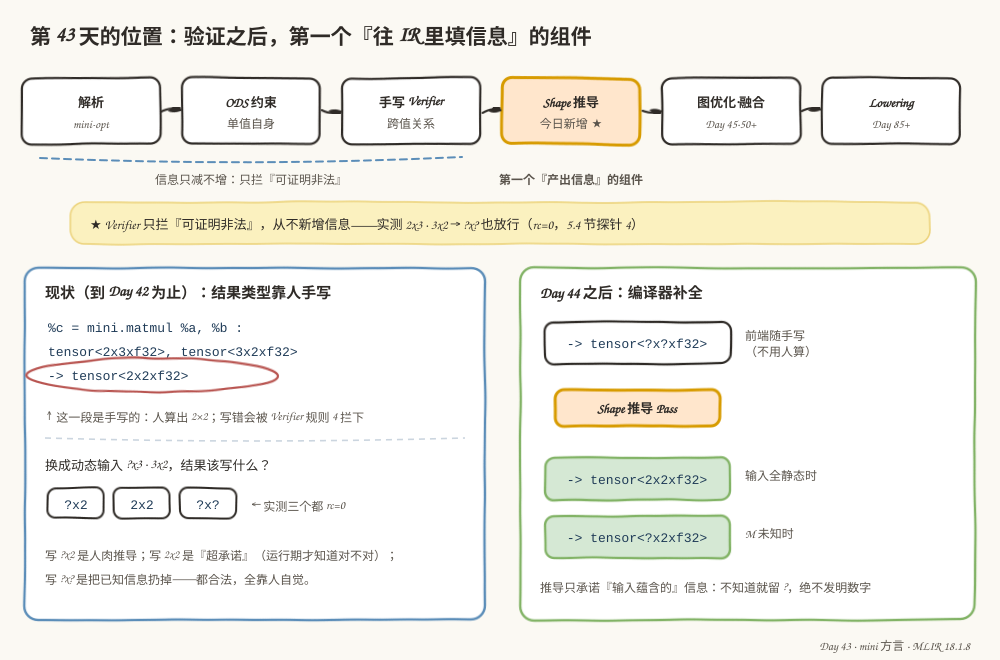
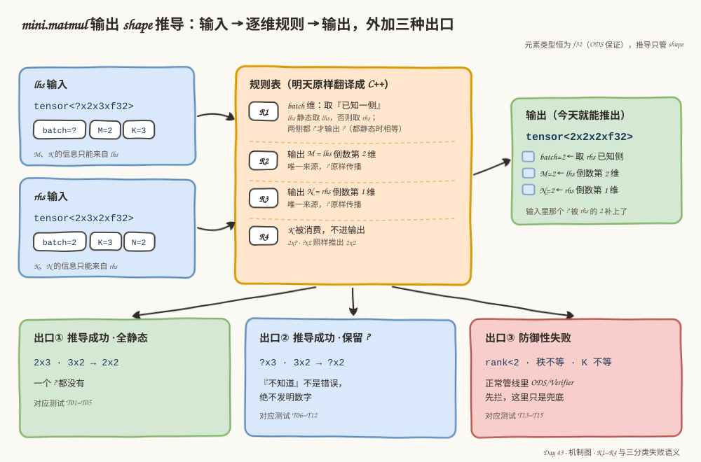
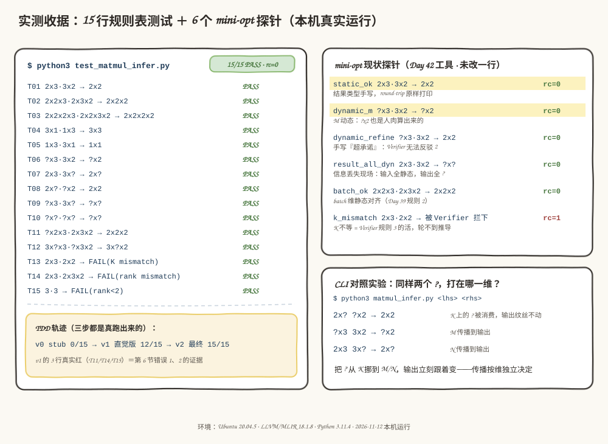

# 第 43 天：Shape Inference 接口——把"人肉算结果类型"变成一张规则表

> **今日目标**：完成本教程后，你能不翻 Day 39 的代码，说出 Shape 推导接口的输入、输出和三种出口语义；能按"先写测试、再写实现"的 TDD 流程为 `mini.matmul` 产出一张可执行的输出 shape 推导规则表，并用 15 行测试证明它全绿。
> **预计时间**：学习 30 分钟＋实践 45 分钟
> **前置准备**：Day 41～42 的 mini 方言工程（`tutorials/day-042/code/mini`，五个算子 + mini-opt）、Python 3（本教程实测 3.11.4）、LLVM/MLIR 18.1.8 工具链（跑 mini-opt 探针用，Ubuntu 20.04）
> **今日产出**：`mini.matmul` 输出 shape 推导规则表（R0～R4，`code/matmul_infer.py`）、15 行测试清单（`code/test_matmul_infer.py`）、TDD 轨迹三步重放脚本（`code/tdd_replay.sh`）、6 个 mini-opt 现状探针（`code/probe_*.mlir`）和一键重放脚本（`code/run_all.sh`）

## 1. 今天解决什么问题？

到 Day 42 为止，`mini.matmul` 的结果类型是**人手写**的：

```mlir
%c = mini.matmul %a, %b : tensor<2x3xf32>, tensor<3x2xf32> -> tensor<2x2xf32>
```

末尾那个 `tensor<2x2xf32>`，是"人"心算 2×3 矩阵乘 3×2 矩阵得到的。全静态时这只是麻烦；一旦输入带动态维（写成 `?` 的维度），麻烦就变成**三个答案都对**。今天用 6 个探针实测（5.4 节，全部真实运行）：`?x3 · 3x2` 的结果类型写 `?x2`、写 `2x2`、甚至写 `?x?`，mini-opt 的退出码**全是 0**——Day 42 的结论"Verifier 只拦可证明非法"的背面就是：`?` 无法反驳，写多保守都放行。写 `?x2` 靠人肉推导；写 `2x2` 是超承诺（运行期才知道对不对）；写 `?x?` 是把已知信息扔掉——哪个都不违规，全靠人自觉。

这在真实编译器里活不下去：前端导入器（importer）一次生成几千个算子，每个结果类型都手算？所以真实编译器都有 **Shape 推导（Shape Inference）**：操作数类型进，结果类型出，编译器自己算。今天不写 C++——先把接口的**合同**谈清楚：输入是什么、输出是什么、什么时候算失败；然后为 `mini.matmul` 设计一张规则表，用"先写测试再写实现"的方式逼它把每个角落说清楚。

贯穿全文的例子还是老朋友，只是今天让它带上 `?`：

```text
2x3 · 3x2 → 2x2     全静态：输出每一维都算得出
?x3 · 3x2 → ?x2     M 动态：? 原样传播
2x? · ?x2 → 2x2     K 动态：K 被消费，输出反而全静态
```

> **前置补给**（本周一句话版）：ODS（Operation Definition Source，写在 `.td` 里的算子声明，由 tblgen 编译成约束代码）的约束 `Mini_F32Tensor2DPlus` 保证每个操作数是秩 ≥ 2 的 f32 tensor；Day 39 手写的 Verifier 四条规则——秩一致（规则 1）、batch 维对齐（规则 2）、内维匹配（规则 3）、输出 shape 为 `[M, N]`（规则 4）——都在"两侧都静态"时才可能报错，遇到 `?` 一律保守放行。

## 2. 先看全貌：验证之后，第一个"产出信息"的组件



**图 1**：先看顶部的流水线——解析、ODS 约束、手写 Verifier，然后是橙色的 Shape 推导（今天的新位置），再往后是图优化和 Lowering。看图时留意蓝橙两条标注的分野：蓝色虚线说"前三个组件信息只减不增、只拦可证明非法"；橙色说 Shape 推导是**第一个产出信息的组件**。再看左右两卡：左卡是现状（结果类型手写、三个答案都 rc=0），右卡是 Day 44 之后的愿景（前端随手写 `?x?`，推导 Pass 补全成 `2x2` 或保留 `?x2`）。

把流水线想成一条生产线，三句话讲完分工：

1. **前面两层是质检**：ODS 查"每个值自己"（是不是 ranked f32 tensor），Verifier 查"值和值之间的关系"（秩、内维、输出 shape）——它们只能把坏的挑出来，不能把信息补上；图 1 的黄色便签就是证据：`2x3 · 3x2 → ?x?` 这样明晃晃的信息丢失，实测 rc=0 照样放行。
2. **Shape 推导是补全**：读操作数类型，算结果类型，把 `?` 里能确定的维度填成数字——注意它也只能"把输入里蕴含的信息显式化"，不能发明数字。
3. **后面的 Pass 是消费**：图优化（Day 45 起）拿到更准的 shape，才能做融合、布局这类决策——这就是为什么推导要排在图优化之前。

今天全程不改 mini 工程一行代码：规则表用 Python 写成**可执行的规格说明**（executable spec），15 行测试当验收；明天（Day 44）才把它翻译成 C++ 接进 mini-opt。这种"先用轻语言把合同谈清、再翻译成正式实现"的做法，在真实编译器项目里也是标准姿势。

## 3. 核心概念：先用直觉，再给准确定义

### 3.1 静态维与动态维：IR 里那个 `?` 到底是什么

- 一句通俗解释：**shape 的每个维度要么是写死的数字（静态维），要么是问号 `?`（动态维，编译期未知）**。
- 工程类比：快递单上的收件信息——填了"3 号楼 502"的是静态维；只填了"幸福小区"的是动态维。你知道小区不知道门牌，**不能替客户发明一个门牌号**；但若寄件人和收件人都写着"3 号楼 502"，两份信息就能合并成确定的门牌。
- 对应到技术上是……`tensor<?x3xf32>` 的 shape 是 `(kDynamicSize, 3)`——`kDynamicSize` 是 MLIR 的内部哨兵值（一个巨大的负数，所以 Day 42 打印错误信息时要先过 `dimToString` 把它翻回 `?`）；`3` 就是普通的 64 位整数。今天的 Python 规则表用 `None` 扮演哨兵（代码里写作 `DYN = None`），语义完全对齐。
- 最小例子：`?x3` 里 M 是"未知"、K 是"已知 3"；推导要做的就是把这个事实表原原本本映射到输出。
- 类比边界：快递类比解释不了**消费**——MatMul 的 K 维两边一对消就消失了，技术上"内积维不出现在输出里"（见 3.3）；也解释不了**哨兵的实现细节**——`?` 不是字符串，是个负数哨兵，比较时 `ShapedType::isDynamic()` 判的就是它。

### 3.2 推导接口的合同：输入、输出和三种出口

- 一句通俗解释：**Shape 推导接口是一份合同——"给我 lhs、rhs 的类型，我还你结果类型；推不了就明说"**。
- 工程类比：老药店抓药。柜面上有的药材直接配（成功）；方子里写着"依据体重酌减"，体重单还没送到，就照方抓药、剂量栏空着（**保留 `?` 的成功**——"不知道"不是配药失败）；方子本身要的药材店里根本不卖，柜台明确回一句"抓不了"（失败）——绝不能拿长得像的药材顶上。
- 对应到技术上是……接口签名 `infer(lhs_type, rhs_type) -> LogicalResult` + 结果类型写入 op。`LogicalResult` 只有 success/failure 两态，但**失败语义是三分类**，这正是今天要谈清楚的合同核心：

| 出口 | 返回值 | 含义 | 例子 |
|---|---|---|---|
| ① 成功 · 全静态 | success + 无 `?` | 每一维都算得出 | `2x3 · 3x2 → 2x2` |
| ② 成功 · 保留 `?` | success + 带 `?` | "不知道"不是错误，绝不发明数字 | `?x3 · 3x2 → ?x2` |
| ③ 防御性失败 | failure | 结构性非法：unranked / rank<2 / 秩不等 / K 不等 | `2x3 · 2x2 → FAIL` |

- 为什么出口③叫**防御性**：正常管线里 ODS（rank<2）和 Verifier（秩不等、K 不等）先跑，推导根本见不到这类输入；failure 只在接口被直接调用（比如明天写单元测试时）才兜底，防止崩溃。
- 最小例子：出口②和③的分界就是今天最重要的一句话——**推导只能把输入蕴含的信息显式化**。`?x3 · 3x2` 里没有任何一行来源说 M 是几，输出 M 只能是 `?`；这不是"推导失败了"，是推导**诚实地成功**。
- 类比边界：药店类比解释不了**消费**和**多来源合并**——技术上输出的每一维由输入的哪一维决定，是逐维独立的规则（见 3.3 和第 4 节），不是一句"酌减"能概括的。

### 3.3 维度角色：输出的每一维，信息从哪来

把 `mini.matmul` 的三个 tensor 按角色拆开（`...` 是 batch 维，即矩阵维前面的批量维，一次算多份矩阵乘时用）：

```text
lhs = [..., M, K]      rhs = [..., K, N]      res = [..., M, N]
```

四类维度的"信息来源"完全不同，这就是静态/动态维度传播的全部素材：

- **M**：唯一来源是 lhs 倒数第 2 维。lhs 写 `?`，输出 M 就只能 `?`——`?x3 · 3x2 → ?x2`。
- **N**：唯一来源是 rhs 倒数第 1 维。rhs 写 `?`，输出 N 就 `?`——`2x3 · 3x? → 2x?`。
- **K**：被乘法**消费**，不进输出。哪怕 lhs、rhs 的 K 都是 `?`（`2x? · ?x2`），输出照样全静态 `2x2`。
- **batch 维**：lhs、rhs **双侧都有来源**。一侧静态就取静态那侧（`?x2x3 · 2x3x2 → 2x2x2`），两侧都 `?` 才输出 `?`。

M、N、K 三个角色说清了，规则表其实已经呼之欲出——但要证明它没有死角，光"想清楚"不够，得让测试来拷问。

## 4. 图解核心机制：R0～R4 规则表



**图 2**：左上是 lhs、rhs 两个输入（今天的主角是 `?x2x3 · 2x3x2`，batch 维一个 `?` 一个 2）；中间橙色卡片是规则表 R1～R4——逐条读，每条都在回答"输出的一类维度从哪来"；右上绿色卡片是推导结果 `2x2x2`，注意 batch 的 `?` 被 rhs 的静态值 2 **补上了**——这正是"双侧来源"的威力。底部三张卡对应 3.2 节的三个出口，以及各自对应的测试编号。

图中规则表正式写成五条（R0 是前提，不是推导规则）：

| 规则 | 内容 | 回答的问题 |
|---|---|---|
| **R0** | 前提：输入是 ranked、秩 ≥ 2、两侧秩相等。由 ODS 与 Verifier 规则 1 先行保证；被直接调用时做防御性检查，返回 failure 而不是崩溃。 | 合同的免责条款 |
| **R1** | batch 维（前 rank−2 维）逐维**取已知一侧**：lhs 静态取 lhs，否则取 rhs；两侧都 `?` 才输出 `?`。两侧都静态时 Verifier 规则 2 已保证相等，取谁都一样。 | 双侧来源怎么合并 |
| **R2** | 输出 M = lhs 倒数第 2 维。唯一来源，`?` 原样传播。 | M 从哪来 |
| **R3** | 输出 N = rhs 倒数第 1 维。唯一来源，`?` 原样传播。 | N 从哪来 |
| **R4** | K 被消费、不进输出：`2x? · ?x2` 照样推出 `2x2`。只在"两侧都静态且不等"时算结构性非法（Verifier 规则 3 的活）。 | K 去哪了 |

三个细节值得停下：R1 的"取已知一侧"看似可以简化成"都抄 lhs"，**不行**——5.3 节会让测试当场抓住这条直觉 bug；R4 只在"双侧静态且不等"时失败，单侧 `?` 时无法证明非法，照常推导（K 根本不进输出）；R0 排在一切之前，因为对 `(3,)` 这种 rank<2 的输入直接取倒数第二维会越界崩溃。五条规则加上三分类出口，就是今天要交付的全部"合同条款"。

## 5. 动手实践：先写测试，再写规则表

### 5.1 准备文件

今天的交付都在 `tutorials/day-043/code/` 下，不碰 mini 工程：

```text
tutorials/day-043/code/
├── test_matmul_infer.py     # 15 行测试清单（先写，TDD 的"红"）
├── matmul_infer.py          # v2 最终规则表（后写，TDD 的"绿"）
├── matmul_infer_v0.py       # TDD 第 0 步：stub（只会举手）
├── matmul_infer_v1.py       # TDD 第 1 步：直觉版（带两条 bug）
├── tdd_replay.sh            # 一键重放三步轨迹
├── run_all.sh               # 测试 + 构建 mini-opt + 6 个探针
└── probe_*.mlir             # 6 个现状探针（5.4 节）
```

一键重放全部实验：`bash run_all.sh`（mini-opt 用 Day 42 的源码现场构建，首次约 1～3 分钟；构建日志在 `/tmp/day043/build.log`）。只重放 TDD 轨迹：`bash tdd_replay.sh`。

为什么用 Python 而不是直接写 C++：规则表是**纯函数**——输入 shape、输出 shape，没有 IR 上下文；Python 版核心逻辑 30 行就能跑，改一条规则一秒钟重测。明天翻译成 C++ 时，这份测试清单就是现成的对答案底稿（C++ 版每行结果必须和它一致）。

### 5.2 编写代码：15 行测试清单拷问一张规则表

今天的实践严格按 TDD（Test-Driven Development，测试驱动开发）走：**测试先行**。规则表是纯函数、输入输出明确，最适合这种写法——先写 15 行样例把合同钉死，再让实现交卷。

第一步，写 `test_matmul_infer.py` 的 15 行样例表（完整文件见 `code/test_matmul_infer.py`，核心是这张表）：

```python
CASES = [
    # ---- 全静态：输出每一维都算得出 ----
    ("T01", (2, 3), (3, 2), (2, 2), "全静态教科书案例（贯穿全文的 2x3 · 3x2）"),
    ("T05", (1, 3), (3, 1), (1, 1), "M=1、N=1：退化成向量内积"),
    # ---- 单侧动态：? 沿 M / N 传播 ----
    ("T06", (D, 3), (3, 2), (D, 2), "M 动态：lhs 的 ? 原样传到输出 M"),
    ("T08", (2, D), (D, 2), (2, 2), "K 双侧动态：K 被消费，输出反而全静态"),
    ("T10", (D, D), (D, D), (D, D), "全动态：一个数字都不发明"),
    # ---- batch 维：取“已知一侧” ----
    ("T11", (D, 2, 3), (2, 3, 2), (2, 2, 2), "lhs batch 是 ?：取 rhs 的静态值 2"),
    # ---- 防御性失败：正常管线里 Verifier 先拦，推导只是兜底 ----
    ("T13", (2, 3), (2, 2), "FAIL", "K 双侧静态不等：Verifier 规则 3 的职责"),
    ("T14", (2, 3), (2, 3, 2), "FAIL", "秩不一致：Verifier 规则 1 的职责"),
    ("T15", (3,), (3,), "FAIL", "rank<2：ODS 的 Mini_F32Tensor2DPlus 已挡"),
]
```

（上面是节选，完整的 15 行按四组展开：全静态 T01–T05、单侧动态 T06–T10、batch 维 T11–T12、防御性失败 T13–T15。）表的每一行是 `(编号, lhs, rhs, 期望, 检查点)`；shape 用元组、`None`（表里的 `D`）扮演 `?`；期望值为字符串 `"FAIL"` 时表示"必须防御性失败"。注意期望值全是**动手前手写死**的——先想清楚每行该是什么，再让代码来对答案。

第二步，放一个只会举手的 stub（桩实现，`matmul_infer_v0.py`，完整文件就这么多）：

```python
def infer_matmul_result(lhs_shape, rhs_shape):
    raise NotImplementedError("Day 43: 规则表还没写")
```

第三步，写直觉版（`matmul_infer_v1.py` 的核心三行）：

```python
out = [d for d in lhs_shape[:-2]]      # batch 一律抄 lhs
out.append(lhs_shape[-2])              # M 只看 lhs
out.append(rhs_shape[-1])              # N 只看 rhs
```

第四步，交最终版。`matmul_infer.py` 的推导本体（完整 87 行见 `code/matmul_infer.py`，明天原样翻译成 C++）：

```python
def infer_matmul_result(lhs_shape, rhs_shape):
    # R0：防御性前提。正常管线里 Verifier 先跑，这里只是被直接调用时的兜底。
    if lhs_shape is None or rhs_shape is None:
        return None, "unranked: ODS 已挡在门外"
    if len(lhs_shape) < 2 or len(rhs_shape) < 2:
        return None, "rank<2: ODS 已挡在门外"
    if len(lhs_shape) != len(rhs_shape):
        return None, "rank mismatch: Verifier 规则 1 已拦"

    rank = len(lhs_shape)

    # R4：K 只在“两侧都静态且不等”时才算结构性非法（Verifier 规则 3 的活）。
    k_lhs, k_rhs = lhs_shape[-1], rhs_shape[-2]
    if k_lhs is not DYN and k_rhs is not DYN and k_lhs != k_rhs:
        return None, "K mismatch: Verifier 规则 3 已拦"

    out = []
    for i in range(rank - 2):  # R1：batch 维取已知一侧
        if lhs_shape[i] is not DYN:
            out.append(lhs_shape[i])
        else:
            out.append(rhs_shape[i])
    out.append(lhs_shape[-2])  # R2：M 只看 lhs
    out.append(rhs_shape[-1])  # R3：N 只看 rhs
    return tuple(out), None
```

返回值是 `(shape, None)` 表示 success（shape 里可以带 `DYN`），`(None, reason)` 表示防御性失败——3.2 节的三分类出口在代码里就是这一行约定。四条检查的顺序也有讲究：R0 的三次前提检查排在最前，因为对 rank<2 的输入取 `lhs_shape[-2]` 会直接 `IndexError`；R4 排在 R1～R3 之前，因为"结构性非法"应该在算输出前就明说，而不是算出一个没人敢用的 shape。

### 5.3 运行与观察：TDD 三步的真实轨迹

以下全部为本机真实执行（`bash tdd_replay.sh` 一键重放；环境：Ubuntu 20.04.5 · Python 3.11.4 · 2026-11-12）。

第 0 步，stub 把整张表跑红——**15 行全部 `EXC:NotImplementedError`，0/15，rc=1**（节选）：

```text
== [1/3] v0 stub（测试先行，实现缺席）==
编号   lhs · rhs         期望        实测                          判定    检查点
T01  2x3 · 3x2         2x2       EXC:NotImplementedError     FAIL  全静态教科书案例（贯穿全文的 2x3 · 3x2）
T11  ?x2x3 · 2x3x2     2x2x2     EXC:NotImplementedError     FAIL  lhs batch 是 ?：取 rhs 的静态值 2
...
== 15 行: 0 PASS / 15 FAIL (含异常行) ==
rc=1
```

这一步的价值：确认**测试真的在测东西**。15 行全红说明没有任何一行能被"空实现"糊弄过去。

第 1 步，直觉版交卷，**12/15——三行真红**（节选，绿行看 T01/T12 的反差）：

```text
== [2/3] v1 直觉版（batch 抄 lhs、不查前提）==
T01  2x3 · 3x2         2x2       2x2                         PASS  全静态教科书案例（贯穿全文的 2x3 · 3x2）
T11  ?x2x3 · 2x3x2     2x2x2     ?x2x2                       FAIL  lhs batch 是 ?：取 rhs 的静态值 2
T14  2x3 · 2x3x2       FAIL      2x2                         FAIL  秩不一致：Verifier 规则 1 的职责
T15  3 · 3             FAIL      EXC:IndexError              FAIL  rank<2：ODS 的 Mini_F32Tensor2DPlus 已挡
...
== 15 行: 12 PASS / 3 FAIL (含异常行) ==
rc=1
```

三行红各有分量：T11 输出了 `?x2x2`——rhs 明明告诉了 batch=2，直觉版却把 lhs 的 `?` 原样抄过去（**信息明明在手却扔掉**）；T14 更隐蔽，`2x3 · 2x3x2` 秩都不等，却因为内维"恰好"都是 3 而**静默推出了 2x2**（合法 IR 上演了不合法的结果）；T15 直接 `IndexError` 崩溃。三条红合起来说明：M/N/K 三个角色的直觉是对的（12 行绿），栽跟头全在"前提"和"双侧来源"这两个没想透的角落——正是 R0 和 R1 的存在理由。

第 2 步，最终版补上 R0 和 R1，**15/15 全绿，rc=0**（完整真实输出）：

```text
== [3/3] v2 最终版（R0~R4 规则表）==
编号   lhs · rhs         期望        实测                          判定    检查点
T01  2x3 · 3x2         2x2       2x2                         PASS  全静态教科书案例（贯穿全文的 2x3 · 3x2）
T02  2x2x3 · 2x3x2     2x2x2     2x2x2                       PASS  rank 3：batch 维静态对齐
T03  2x2x2x3 · 2x2x3x2 2x2x2x2   2x2x2x2                     PASS  rank 4：规则不随秩变多
T04  3x1 · 1x3         3x3       3x3                         PASS  K=1：内维收缩到 1 也是合法 MatMul
T05  1x3 · 3x1         1x1       1x1                         PASS  M=1、N=1：退化成向量内积
T06  ?x3 · 3x2         ?x2       ?x2                         PASS  M 动态：lhs 的 ? 原样传到输出 M
T07  2x3 · 3x?         2x?       2x?                         PASS  N 动态：rhs 的 ? 原样传到输出 N
T08  2x? · ?x2         2x2       2x2                         PASS  K 双侧动态：K 被消费，输出反而全静态
T09  ?x3 · 3x?         ?x?       ?x?                         PASS  M、N 都未知：输出 ?x?，推导成功而非失败
T10  ?x? · ?x?         ?x?       ?x?                         PASS  全动态：一个数字都不发明
T11  ?x2x3 · 2x3x2     2x2x2     2x2x2                       PASS  lhs batch 是 ?：取 rhs 的静态值 2
T12  3x?x3 · ?x3x2     3x?x2     3x?x2                       PASS  rhs batch 是 ?：取 lhs 的 3；M 仍 ?
T13  2x3 · 2x2         FAIL      FAIL(K mismatch)            PASS  K 双侧静态不等：Verifier 规则 3 的职责
T14  2x3 · 2x3x2       FAIL      FAIL(rank mismatch)         PASS  秩不一致：Verifier 规则 1 的职责
T15  3 · 3             FAIL      FAIL(rank<2)                PASS  rank<2：ODS 的 Mini_F32Tensor2DPlus 已挡

== 15 行: 15 PASS / 0 FAIL (含异常行) ==
rc=0
```

值得对照 3.2 节的出口表数一数：T01–T05 走出口①（成功全静态），T06–T12 走出口②（成功保留 `?`，其中 T08 两个 `?` 消费后输出反而全静态），T13–T15 走出口③（防御性失败，reason 里都注明了真正的拦截者）。15 行测试就是三分类出口的完整覆盖。

### 5.4 mini-opt 现状探针：结果类型全靠人手写

规则表全绿了，回到图 1 左卡的"现状"拿证据——6 个探针喂给 Day 42 的 mini-opt（未改一行代码），看真实管线对结果类型的态度。`bash run_all.sh` 的第 [1/3] 步先重跑上面的 15 行表（15/15，rc=0），第 [3/3] 步输出如下（真实输出；round-trip＝解析成 IR 再打印出来，原样往返）：

```text
--- probe_static_ok.mlir
%0 = mini.matmul %arg0, %arg1 : tensor<2x3xf32>, tensor<3x2xf32> -> tensor<2x2xf32>
rc=0
--- probe_dynamic_m.mlir
%0 = mini.matmul %arg0, %arg1 : tensor<?x3xf32>, tensor<3x2xf32> -> tensor<?x2xf32>
rc=0
--- probe_dynamic_refine.mlir
%0 = mini.matmul %arg0, %arg1 : tensor<?x3xf32>, tensor<3x2xf32> -> tensor<2x2xf32>
rc=0
--- probe_result_all_dynamic.mlir
%0 = mini.matmul %arg0, %arg1 : tensor<2x3xf32>, tensor<3x2xf32> -> tensor<?x?xf32>
rc=0
--- probe_batch_ok.mlir
%0 = mini.matmul %arg0, %arg1 : tensor<2x2x3xf32>, tensor<2x3x2xf32> -> tensor<2x2x2xf32>
rc=0
--- probe_k_mismatch.mlir
probe_k_mismatch.mlir:4:8: error: 'mini.matmul' op requires matching inner dimensions:
  lhs 'tensor<2x3xf32>' ends in 3, but rhs 'tensor<2x2xf32>' has second-to-last dim 2
  (expected lhs [..., M, K] times rhs [..., K, N])
rc=1
```

六个探针按今天的视角各说一件事：

- **static_ok / batch_ok**：结果类型手写正确，round-trip 原样通过——今天没有它不行，但也不是问题所在。
- **dynamic_m**：`?x2` 是人肉推导的结果，写对了，但"写对"全靠人。
- **dynamic_refine**：输入只有 `?x3 · 3x2`，结果却写了 `2x2`——手写**超承诺**。Verifier 规则 4 对 M 一侧是 `?` 无法反驳，放行。对不对要等运行期。
- **result_all_dynamic**：输入 `2x3 · 3x2` 全静态，输出却写 `?x?`——**信息丢失现场**。这是今天最重的一个探针：合法（rc=0），但下游永远拿不回那个明明蕴含在输入里的 `2x2`。图 1 黄色便签引的就是它。
- **k_mismatch**：`2x3 · 2x2`，内维 3 ≠ 2。报错文案来自 Day 39 手写 Verifier 的规则 3——注意**这不是推导接口的输出**：正常管线里非法 IR 在验证阶段就被拦下，推导接口永远看不到这种输入。5.2 节规则表里的 `FAIL(K mismatch)` 只是接口被直接调用时的防御性兜底。

五个 rc=0 和一个 rc=1 合起来就是图 1 左卡的那句结论：**到 Day 42 为止，结果类型的正确性靠人自觉，合法性靠 Verifier 兜底**——前者正是今天和明天要替换掉的东西。

### 5.5 CLI 对照实验：同样两个 `?`，打在哪一维？

最后做今天的主对照实验：`matmul_infer.py` 自带 CLI，把 `?` 在 lhs/rhs 的不同维度之间挪动，观察输出的变化（真实输出）：

```text
$ python3 matmul_infer.py 2x? ?x2
tensor<2x2xf32>
$ python3 matmul_infer.py ?x3 3x2
tensor<?x2xf32>
$ python3 matmul_infer.py 2x3 3x?
tensor<2x?xf32>
$ python3 matmul_infer.py 2x3 3x2
tensor<2x2xf32>
$ python3 matmul_infer.py 2x3 2x2
FAIL (K mismatch: Verifier 规则 3 已拦)
rc=1
```

三条观察，正好落在 3.3 节的前三类维度角色上——K 被消费（R4）、M/N 唯一来源传播（R2/R3）；batch 维的双侧合并则在 5.3 节的 T11/T12 验过：

- **`?` 打在 K 上，输出纹丝不动**：`2x? · ?x2 → 2x2`——K 被消费，双侧 `?` 也不影响输出任何一维（R4）。
- **`?` 打在 M 或 N 上，输出跟着 `?`**：`?x3 · 3x2 → ?x2`、`2x3 · 3x? → 2x?`——唯一来源断了，输出诚实地留 `?`（R2/R3）。
- **传播是逐维独立决定的**：同样是"输入里有两个 `?`"，因为打的位置不同，输出一个全静态、一个带 `?`。不存在"整体动态/整体静态"这样的粗粒度状态。

加上最后一条失败对照（`2x3 · 2x2`）：同样的参数形式，一个 success 一个 failure——三分类出口在 CLI 上伸手就能摸到。



**图 3**：左卡是 15 行测试的全绿收据，注意底部黄色便签——TDD 三步轨迹（v0 0/15 → v1 12/15 → v2 15/15）都是真跑出来的，v1 的三行红就是第 6 节错误 1、2 的证据；右上卡是 5.4 节六个探针的退出码，两行橙色标注是"超承诺"和"信息丢失"两个反例；右下卡是 5.5 节 CLI 对照实验的浓缩。看图时自问：`result_all_dyn` 和 `k_mismatch` 同为"问题 IR"（前者 rc=0 合法放行，后者 rc=1 被拦），拦下后者的是谁？为什么不是推导？

## 6. 常见错误与排查

**错误 1：batch 维一律抄 lhs——"信息在手却扔掉"**
- 现象：v1 直觉版实测 T11 红：`?x2x3 · 2x3x2` 推出 `?x2x2`，而 rhs 的 batch 维明明是静态的 2（`bash tdd_replay.sh` 第 [2/3] 步可复现）。
- 原因：把"batch 维两侧相等"理解成了"输出抄随便一侧都行"。双侧相等只对**都静态**的情形成立（Verifier 规则 2 保证）；一侧 `?` 时，静态那侧是唯一的信息来源，抄 `?` 那侧等于把已知信息丢掉——输出反而比输入更无知。
- 定位：测试表 T11/T12 就是冲着这个角落设计的：T11 让 lhs 侧 `?`、T12 让 rhs 侧 `?`，只抄一侧必然挂其中一行。
- 修复：R1"取已知一侧"——lhs 静态取 lhs，否则取 rhs，两侧都 `?` 才输出 `?`。

**错误 2：不查前提直接算——从"静默错误"到"当场崩溃"**
- 现象：v1 实测两副面孔：T14 静默错——`2x3 · 2x3x2` 秩都不等，因内维"恰好"都是 3 而推出 `2x2`；T15 直接 `EXC:IndexError` 崩溃——`3 · 3` 取 `rhs_shape[-2]` 越界。
- 原因：把 R0 前提（ranked、秩 ≥ 2、秩相等）当成"正常管线里反正有人查"而省略。正常管线确实有人查（ODS 查 rank<2，Verifier 规则 1 查秩相等）——但接口一旦被直接调用（单元测试、明天 C++ 版的冒烟测试），没人兜底；更糟的是 T14 那种"不崩溃但结果错"的静默错误，比崩溃难抓得多。
- 定位：T14 的关键是期望值写成 `"FAIL"` 而实现给了 shape——判定列翻红；T15 崩溃行首直接是 `EXC:IndexError`。
- 修复：R0 的三次前提检查排在函数最前，**失败要早于一切计算**，且返回 failure 而不是让异常飞出去。

**错误 3：期望推导接口去拦 K 不匹配——职责张冠李戴**
- 现象：5.4 节 `probe_k_mismatch` 实测 rc=1，报错文案是 Verifier 规则 3 的"requires matching inner dimensions"，有读者会问：这不是明天推导接口该报的错吗？
- 原因：混淆了"验证"和"推导"的职责顺序。正常管线里 ODS 和 Verifier 先行，结构性非法的 IR 根本活不到推导那一步；规则表里的 `FAIL(K mismatch)`（5.5 节 CLI 实测 `rc=1`）只是接口被直接调用时的防御性兜底——所以失败 reason 的文案都写着"Verifier 规则 3 已拦"，提示真正的拦截者是谁。
- 定位：看报错前缀就能分家——`'mini.matmul' op requires ...` 是挂在 op 身上的 `emitOpError`（Verifier 语境）；`FAIL (K mismatch: ...)` 是规则表 CLI 的输出。
- 修复：设计接口时把"防御性失败"的 reason 标注清楚归谁管，别让兜底误当成主业——推导的主业是出口①和②（补全信息），不是出口③。

## 7. 今日练习

### 必做练习

下面 5 行空表，先在纸上手推（每行先标出 lhs/rhs 的 batch/M/K/N 四类维度归属，再写期望输出），然后用 `python3 matmul_infer.py <lhs> <rhs>` 逐行对照，把出入记录下来：

| lhs | rhs | 你手推的期望 |
|---|---|---|
| `4x?x5` | `?x5x6` | ？ |
| `?x?x3` | `3x4` | ？ |
| `2x2x2x?` | `?x2x2x2` | ？ |
| `?x7` | `7x?` | ？ |
| `3x2` | `3x4` | ？ |

提示：第二行和第五行各埋了一个不同类别的陷阱；第三行要逐维过 R1——batch 有两维，别只看第一维。

### 选做挑战

为 `mini.add`（逐元素加法，Day 38 用 ODS 定义、Day 40 装的 Verifier）设计同款规则表：新建 `add_infer.py` 和 3～5 行测试（至少含一行 `?` 传播、一行防御性失败）。写之前先回答两个问题：逐元素算子的输出里存在"被消费的维度"吗（对应今天的 R4 还存在吗）？它的"取已知一侧"规则和今天的 R1 是什么关系？写完后用 `python3` 跑通全绿——这份规则表 Day 44 之后可以直接对答案。

## 8. 今日验收

- [ ] 我能用自己的话说出 Shape 推导接口的输入（操作数类型）、输出（结果类型）和三种出口（成功全静态 / 成功保留 `?` / 防御性失败），并解释"推导绝不发明数字"
- [ ] 我能独立运行 `bash tdd_replay.sh`，指出 v1 直觉版的两条 bug 分别被哪几行测试抓住（T11/T14/T15），并说出对应的修复规则（R1/R0）
- [ ] 我能对任意 lhs/rhs shape 手推输出（含必做练习的 5 行），并用 `python3 matmul_infer.py` 对照验证我的预测
- [ ] 我能解释 `probe_result_all_dynamic`（rc=0）和 `probe_k_mismatch`（rc=1）的区别——拦 K 不匹配是谁的职责，为什么推导接口"看不到"非法 IR
- [ ] 我保存了规则表、15 行测试清单、TDD 三步脚本、6 个探针和一键重放脚本（`code/` 目录已就位），并能在明天翻译成 C++ 时拿测试清单当对答案底稿

## 9. 一句话总结与明天预告

今天把"结果类型靠人肉"这个债正式立了案：6 个探针实测显示 `?x2`、`2x2`、`?x?` 三个答案全 rc=0，正确性全靠人自觉。合同的核心是三分类出口——成功全静态、成功保留 `?`（"不知道"不是错误）、防御性失败（Verifier 先拦，推导兜底）——以及"绝不发明数字"。规则表 R0～R4 把 `mini.matmul` 的输出逐维拆给四个角色：batch 取已知一侧、M/N 唯一来源传播、K 被消费。TDD 三步轨迹（stub 0/15 → 直觉版 12/15 → 最终 15/15）让两条"想当然"（batch 抄 lhs、不查前提）当场现形，15 行测试全绿收工。明天（Day 44）把这张 Python 规则表原样翻译成 C++ 的 Shape 推导接口接进 mini-opt，让前端随手写的 `-> tensor<?x?xf32>` 被自动补全——图 1 右卡的愿景落地，`probe_result_all_dynamic` 那个信息丢失现场将成为第一个被修复的对象。
