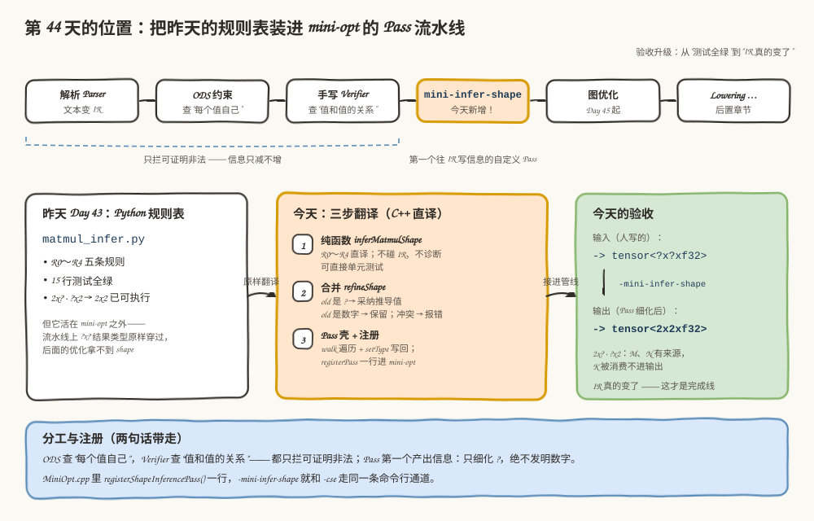
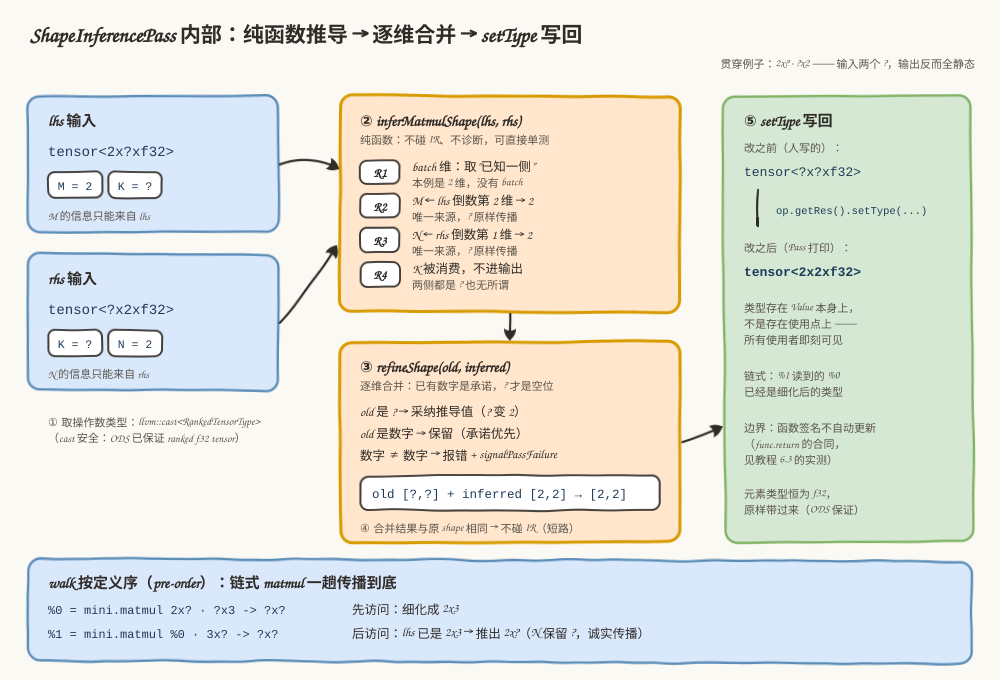
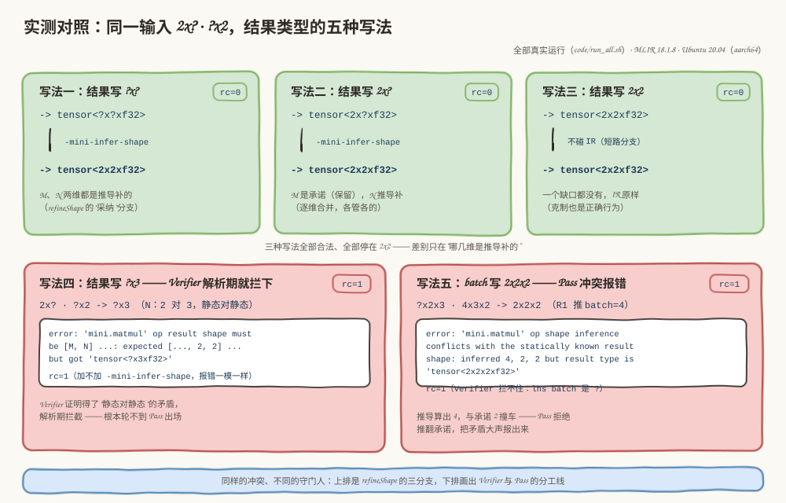

# 第 44 天：实现 MatMul Shape 推导——把规则表编译进 mini-opt

> **今日目标**：完成本教程后，你能把 Day 43 的 R0～R4 规则表翻译成 C++（`lib/ShapeInferencePass.cpp`），构建出带 `-mini-infer-shape` 的 mini-opt；能用 8 个探针区分"推导补 `?`"、"推导保留 `?`"和"冲突报错"三种行为；能解释结果类型更新为什么只细化 `?`、绝不改写已有数字。
> **预计时间**：学习 30 分钟＋实践 45 分钟
> **前置准备**：Day 41～43 的 mini 方言工程与 Python 规则表（`tutorials/day-043/code/`）、LLVM/MLIR 18.1.8（含 `MLIRConfig.cmake`）、CMake 与 Ninja。实测环境：Ubuntu 20.04.5 LTS（aarch64）、gcc 9.4.0、cmake 3.20.5、ninja 1.10.0。
> **今日产出**：`code/mini/lib/ShapeInferencePass.cpp`（约 160 行的推导 Pass）、mini 工程的 4 处接缝改动、8 个探针（`code/probe_*.mlir`）和一键重放脚本（`code/run_all.sh`）——以下全部命令与输出都是真实运行记录。

## 1. 今天解决什么问题？

Day 43 交付了一张 Python 规则表 `matmul_infer.py`：15 行测试全绿，`2x? · ?x2 → 2x2` 的推导在 Python 里已经可执行。但它活在一个平行宇宙里——mini-opt 并不认识它，真实流水线上 `?x?` 结果类型还是原样穿过去。今天做的是搬运加缝合：**把 R0～R4 原样翻译成 C++，挂进 mini-opt 的 Pass 流水线，命令行名字叫 `-mini-infer-shape`**。

验收标准也随之升级：昨天"测试全绿"就算完成，今天必须是**mini-opt 打印出来的 IR 真的变了**。贯穿全文的例子还是那两组：

```text
2x? · ?x2 → ?x?    今天之后 mini-opt 打印 tensor<2x2xf32>（K 被消费，M、N 有来源）
?x3 · 3x2 → ?x2    M 无来源，保留 ?（诚实传播，绝不发明数字）
```

把规则表"翻译成 C++、接进管线"还会冒出三个昨天不用回答的新问题，它们就是今天的正文：

1. 推导值算出来之后，怎么和结果类型里**已有的信息**合并？用户已经写了 `2x?` 的那一维怎么办？
2. "更新结果类型"到底更新的是什么？为什么所有使用者能"自动"看到新类型？
3. 推导值和已有静态维**打架**了（一边 4 一边 2），谁说了算？

## 2. 先看全貌：昨天是规格，今天是产品



**图 1**：先看顶部流水线——解析、ODS 约束、手写 Verifier 之后，橙色的 `mini-infer-shape`（今天新增）排在图优化之前，是 mini 工程里**第一个往 IR 里写信息的自定义 Pass**。再看左中右三张卡：左卡是昨天的 Python 规则表（可执行的规格说明）；中间橙卡是今天的三步翻译；右卡是验收——mini-opt 打印出 `tensor<2x2xf32>` 而不是 `?x?`。

三步翻译，每步只做一件事：

1. **纯函数** `inferMatmulShape(lhs, rhs)`：R0～R4 的 C++ 直译。只看两个操作数类型，算出"输出 shape 应该是什么"——不碰 IR、不诊断，可以直接单元测试。
2. **合并规则** `refineShape(old, inferred)`：推导值与结果类型里已有信息逐维合并——`?` 补、数字留、冲突报错（3.3 节）。
3. **Pass 壳**：遍历函数里的 `mini.matmul`，把前两步串起来，用 `setType` 写回，再注册进 mini-opt。

分工没有变，只是今天多了一层：ODS 查"每个值自己"，Verifier 查"值和值之间的关系"，它们都只能**把可证明非法的拦下来**；今天的 Pass 是第一个**产出信息**的组件——但也只能把输入里蕴含的信息显式化，把 `?` 细化成数字，绝不发明、绝不改写。后面的图优化（Day 45 起）拿到更准的 shape，才能做融合、布局这些决策——这就是推导要排在它们前面的原因。

## 3. 核心概念：先用直觉，再给准确定义

### 3.1 部分静态 Shape：一个类型里，数字和 `?` 混住

- 一句通俗解释：**shape 是一排格子，每格要么写死数字（静态维），要么是问号（动态维）；两种混在一个类型里，就叫部分静态 shape（partial static shape）**——`tensor<2x?xf32>` 的 M 是 2、K 是 `?`。
- 工程类比：快递柜的一列格口，有的贴了门牌（静态维），有的空着（动态维）。今天的 Pass 是补货员：**只能往空格里放东西，不能撕掉已贴的门牌**。
- 对应到技术上是……shape 在 C++ 里就是 `SmallVector<int64_t>`，`?` 是哨兵值 `kDynamicSize`（一个巨大的负数，Day 43 见过），判定一个维度是不是 `?` 用 `ShapedType::isDynamic(d)`。推导逐维独立：M 只看 lhs 倒数第 2 维（R2），N 只看 rhs 倒数第 1 维（R3），batch 逐维取已知一侧（R1），K 被乘法消费、根本不进输出（R4）。所以 `2x? · ?x2` 输出全静态、`?x3 · 3x2` 输出 `?x2`，都是这四条逐维规则的自然结果。
- 最小例子：`tensor<2x?xf32>` 乘 `tensor<?x2xf32>`，推导时逐维查来源——M：lhs 说 2；N：rhs 说 2；K：两边都是 `?`，但 K 不进输出，无所谓。
- 类比边界：格口类比暗示"空格总能填上"——技术上不行。M 的来源（lhs 那一维）写着 `?`，就没有数字可填，输出 M 只能保留 `?`。推导只能**把输入蕴含的信息显式化**，这是"诚实传播"的准确含义。

### 3.2 结果类型更新：`setType` 一次，全体可见

- 一句通俗解释：**更新结果类型不是给每个读者发通知，而是直接改那张贴在值上的便签**——所有读者下次来读，看到的就是新的。
- 工程类比：办公室白板上贴着一张便签"`%0 : tensor<?x?xf32>`"。谁引用 `%0`，看的就是这张便签。你把便签改成 `2x2`，后面所有引用者（下一个 matmul、func.return）不需要任何操作，自动看到新类型。
- 对应到技术上是……`op.getRes()` 返回的是 `Value`（准确说是 `OpResult`），类型存在 **Value 本身**上，而不是存在每个使用点。调用 `Value::setType(RankedTensorType::get(shape, elemType))` 换掉值本身的类型，IR 里所有使用者即刻生效。这也是链式 matmul 能**一趟遍历传播到底**的根基：`walk` 按定义序先访问 `%0 = matmul(...)` 并细化它，等访问 `%1 = matmul(%0, ...)` 时，读到的 lhs 类型已经是细化后的（5.3 节探针 4 实测）。
- 类比边界（重要，探针 7 实测）：**函数签名不是"使用者"**。`func.return` 的操作数类型要求与函数签名一致，而签名是函数的 `function_type` **属性**，不随 `setType` 自动更新。Pass 把 `%0` 细化成 `2x2` 之后，`return %0` 与签名里的 `?x?` 对不上，Pass 之后的重新验证（mlir-opt 默认 `--verify-each`）当场报错。今天的探针因此都让细化结果"就地观察、不外传"。

### 3.3 合并规则：已有数字是承诺，`?` 才是空位

- 一句通俗解释：**推导值和结果类型里已有的 shape 逐维合并：`?` 是空位，采纳推导值；数字是承诺，原样保留；两个数字对不上，当场报错**。
- 工程类比：合同上甲方（写 IR 的人）已经填了"2"，乙方（推导）算出来是"4"——乙方的正确动作不是替甲方改合同，而是把矛盾摆上桌面。
- 对应到技术上是……`refineShape(oldShape, inferred)` 对每一维做三分支：

| old（结果类型里已有） | inferred（推导算出） | 合并结果 | 语义 |
|---|---|---|---|
| `?` | 数字 | 采纳数字 | 空位补上，信息增量 |
| `?` | `?` | 保持 `?` | 双方都不知道，诚实 |
| 数字 | 数字（相等）或 `?` | 保留 old | 承诺优先 |
| 数字 | 数字（不等） | **报错**（`signalPassFailure`） | 拒绝推翻承诺 |

- 为什么"只细化、绝不改写"是安全边界：`? → 数字` 是**信息增量**——原来 `?x?` 本来就包含 `2x2` 这个实例，细化后语义必然保持；`数字 → 数字` 是**推翻承诺**——那个数字可能正被别的静态约束依赖着，改写它可能制造新的、更隐蔽的非法。
- 分工（探针 6、8 实测的界线）：**静态对静态**的矛盾，Verifier 规则 4 在解析期就拦下（它证明得了）；**有 `?` 参与**的矛盾（batch 一侧未知），Verifier "无法反驳"只能放行，推导算出数字后冲突才暴露——这时 Pass 负责把矛盾**大声报出来**，而不是悄悄改掉。

## 4. 图解核心机制：三层结构的推导 Pass



**图 2**：左上是两个输入（`tensor<2x?xf32>` 和 `tensor<?x2xf32>`，主角还是 `2x? · ?x2`）；中间橙色卡片是纯函数 `inferMatmulShape`——R1～R4 每条都在回答"输出的一类维度从哪来"，产物是 inferred shape `[2, 2]`；往下是 `refineShape` 合并表，`old` 是 `?` 的维采纳推导值、是数字的维保留；右侧绿色卡片是 `setType` 写回后的结果 `tensor<2x2xf32>`，以及"所有使用者一起看到"的注记。底部蓝条是 `walk` 的定义序保证：链式 matmul 一趟传播到底。

按图中编号逐步过一遍 `runOnOperation` 里发生的事：

1. **取操作数类型**：`op.getLhs().getType()` 等，`llvm::cast<RankedTensorType>` 是安全的——ODS 的 `Mini_F32Tensor2DPlus` 已保证每个操作数都是 ranked f32 tensor。
2. **纯函数推导**：`inferMatmulShape(lhs, rhs)` 跑 R0～R4，返回 `[2, 2]`。它**不碰 IR、不诊断**，失败只返回 `failure()`（R0 兜底：正常管线里 Verifier 已拦过结构性非法）。
3. **合并**：`refineShape(res.getShape(), *inferred)` 逐维三分支（3.3 节的表）。冲突时 `emitOpError` 打印"inferred X but result type is Y"，再 `signalPassFailure()`——把矛盾摆上桌面。
4. **短路**：合并结果与原 shape 完全相同（全静态输入、或一个 `?` 都推不出来）就 `return`，**不碰 IR**——避免"Pass 动过 IR"的假象，也让增量编译、Pass 失效管理少背锅。
5. **写回**：`op.getRes().setType(RankedTensorType::get(*refined, res.getElementType()))`——shape 用新的，元素类型恒为 f32 原样带过来。

第 5 步之后控制权回到 `walk`，继续访问下一个操作——因为类型存在 Value 上，下一个 matmul 读 `%0` 时拿到的已经是 `2x3`。这就是底部蓝条说的"一趟到底"，不需要迭代到不动点。

## 5. 动手实践：从规则表到 `-mini-infer-shape`

### 5.1 准备文件

今天的 mini 工程相对 Day 42 基线只动 4 个文件，加上 8 个探针和一个重放脚本：

```text
tutorials/day-044/code/
├── mini/                                # mini 工程（Day 42 基线 + 今天 4 处接缝）
│   ├── include/mini/Passes.h            # ① 声明 registerShapeInferencePass()
│   ├── lib/ShapeInferencePass.cpp       # ② 今天的主角（新增，约 160 行）
│   ├── lib/CMakeLists.txt               # ③ 登记源文件（加 1 行）
│   └── tools/mini-opt/MiniOpt.cpp       # ④ 注册调用（加 1 行）
├── probe_static.mlir                    # 全静态：无信息可补，Pass 不碰 IR
├── probe_refine_k.mlir                  # 2x? · ?x2 → ?x? ：细化成 2x2（R4）
├── probe_batch.mlir                     # batch 取已知一侧：?x?x? → 4x2x2（R1）
├── probe_chain.mlir                     # 链式 matmul：一趟传播 + 部分细化
├── probe_res_spellings.mlir             # 同一输入、结果三种写法（5.4 节）
├── probe_conflict.mlir                  # 推导与静态承诺冲突（预期 rc=1）
├── probe_return_mismatch.mlir           # 细化结果外传的坑（预期 rc=1）
├── probe_verifier_first.mlir            # Verifier 先拦的对照（预期 rc=1）
└── run_all.sh                           # 一键构建 + 重放全部探针
```

### 5.2 编写代码

**第一层：纯函数，R0～R4 的 C++ 直译**（`lib/ShapeInferencePass.cpp`，与 Day 43 的 Python 逐条对应）：

```cpp
FailureOr<SmallVector<int64_t, 4>> inferMatmulShape(RankedTensorType lhs,
                                                    RankedTensorType rhs) {
  if (lhs.getRank() != rhs.getRank())       // R0：兜底前提（Verifier 先拦）
    return failure();

  const int64_t rank = lhs.getRank();
  SmallVector<int64_t, 4> shape;

  // R1：batch 维（前 rank-2 维）取“已知一侧”。
  for (int64_t i = 0; i < rank - 2; ++i) {
    int64_t l = lhs.getDimSize(i);
    shape.push_back(ShapedType::isDynamic(l) ? rhs.getDimSize(i) : l);
  }
  shape.push_back(lhs.getDimSize(rank - 2)); // R2：M 只看 lhs
  shape.push_back(rhs.getDimSize(rank - 1)); // R3：N 只看 rhs
  return shape;                              // R4：K 被消费，不进输出
}
```

**第二层：合并规则**——3.3 节那张表的原样落地：

```cpp
std::optional<SmallVector<int64_t, 4>>
refineShape(ArrayRef<int64_t> oldShape, ArrayRef<int64_t> inferred) {
  if (oldShape.size() != inferred.size())
    return std::nullopt;

  SmallVector<int64_t, 4> refined;
  for (auto [oldDim, newDim] : llvm::zip_equal(oldShape, inferred)) {
    if (ShapedType::isDynamic(oldDim)) {
      refined.push_back(newDim);        // ? -> 数字，或 ? -> ?（保持不知道）
    } else if (!ShapedType::isDynamic(newDim) && oldDim != newDim) {
      return std::nullopt;              // 数字对不上数字：结构性非法，交回诊断
    } else {
      refined.push_back(oldDim);        // old 静态：用户的承诺优先，原样保留
    }
  }
  return refined;
}
```

**第三层：Pass 本体**（关键动作加了注释）：

```cpp
struct ShapeInferencePass
    : public PassWrapper<ShapeInferencePass, OperationPass<func::FuncOp>> {
  MLIR_DEFINE_EXPLICIT_INTERNAL_INLINE_TYPE_ID(ShapeInferencePass)

  Pass::Statistic refinedResults{this, "refined-results",
                                 "Number of mini.matmul results refined"};

  void runOnOperation() override {
    func::FuncOp func = getOperation();

    // walk 默认 pre-order：SSA 直线代码里定义先于使用被访问，
    // 链式 matmul 一趟就能传播到底。
    func->walk([&](::mini::MatmulOp op) {
      auto lhs = llvm::cast<RankedTensorType>(op.getLhs().getType());
      auto rhs = llvm::cast<RankedTensorType>(op.getRhs().getType());
      auto res = llvm::cast<RankedTensorType>(op.getRes().getType());

      FailureOr<SmallVector<int64_t, 4>> inferred = inferMatmulShape(lhs, rhs);
      if (failed(inferred))
        return; // R0 兜底：Verifier 已拦过的地方，Pass 不重复报错

      std::optional<SmallVector<int64_t, 4>> refined =
          refineShape(res.getShape(), *inferred);
      if (!refined) {
        op->emitOpError("shape inference conflicts with the statically known "
                        "result shape")
            << ": inferred " << *inferred << " but result type is " << res;
        return signalPassFailure();
      }

      // 一个 ? 都没细化：不碰 IR，避免“Pass 改了 IR”的假象。
      if (llvm::ArrayRef<int64_t>(*refined) == res.getShape())
        return;

      // 结果类型只改 shape，元素类型恒为 f32（ODS 保证，原样带过来）。
      op.getRes().setType(
          RankedTensorType::get(*refined, res.getElementType()));
      ++refinedResults;
    });
  }

  StringRef getArgument() const override { return "mini-infer-shape"; }
  StringRef getDescription() const override {
    return "Infer mini.matmul result shapes from operands; only refine "
           "dynamic dims, never overwrite static ones";
  }
};
```

三处接缝各一行级改动：`include/mini/Passes.h` 里声明 `registerShapeInferencePass()`；`lib/CMakeLists.txt` 的源文件列表加上 `ShapeInferencePass.cpp`；`tools/mini-opt/MiniOpt.cpp` 的 `main` 里加上：

```cpp
mlir::mini::registerShapeInferencePass();  // 注册之后 -mini-infer-shape 才存在
```

两个容易忽略的细节：

- `::mini::MatmulOp` 的前导 `::` 不是装饰：本文件同时包含 `Ops.h`（算子类在全局命名空间 `::mini`，因为 `MiniDialect.td` 里 `cppNamespace = "::mini"`）和 `Passes.h`（注册函数在 `mlir::mini`），加上 `using namespace mlir;` 之后裸写 `mini::MatmulOp` 会对两个命名空间二义——这正是 6.1 节错误 1 的现场。
- `getArgument()` 返回的字符串就是命令行旗标 `-mini-infer-shape` 的来源；注册之后，它和 `-cse`、`-canonicalize` 走同一张 PassRegistry 表、同一条命令行通道（Day 41 的结论在自定义 Pass 上同样成立）。

构建（真实执行，工作目录 `tutorials/day-044/code`）：

```bash
cmake -G Ninja -B /tmp/day044/build -S mini -DCMAKE_BUILD_TYPE=Release \
      -DMLIR_DIR=/usr/lib/llvm-18/lib/cmake/mlir
cmake --build /tmp/day044/build
```

本环境实测输出 `BUILD_OK`，产物 `/tmp/day044/build/bin/mini-opt`。（`run_all.sh` 会自动完成这一步，构建目录可用 `BUILD_DIR` 环境变量覆盖。）

### 5.3 运行与观察：五个成功探针

全部真实运行（`bash run_all.sh`，或逐个 `mini-opt probe_xx.mlir -mini-infer-shape`）：

```text
--- probe_static.mlir
%0 = mini.matmul %arg0, %arg1 : tensor<2x3xf32>, tensor<3x2xf32> -> tensor<2x2xf32>
rc=0
--- probe_refine_k.mlir
%0 = mini.matmul %arg0, %arg1 : tensor<2x?xf32>, tensor<?x2xf32> -> tensor<2x2xf32>
rc=0
--- probe_batch.mlir
%0 = mini.matmul %arg0, %arg1 : tensor<?x2x3xf32>, tensor<4x3x2xf32> -> tensor<4x2x2xf32>
rc=0
--- probe_chain.mlir
%0 = mini.matmul %arg0, %arg1 : tensor<2x?xf32>, tensor<?x3xf32> -> tensor<2x3xf32>
%1 = mini.matmul %0, %arg2 : tensor<2x3xf32>, tensor<3x?xf32> -> tensor<2x?xf32>
rc=0
--- probe_res_spellings.mlir
%0 = mini.matmul %arg0, %arg1 : tensor<2x?xf32>, tensor<?x2xf32> -> tensor<2x2xf32>
%0 = mini.matmul %arg0, %arg1 : tensor<2x?xf32>, tensor<?x2xf32> -> tensor<2x2xf32>
%0 = mini.matmul %arg0, %arg1 : tensor<2x?xf32>, tensor<?x2xf32> -> tensor<2x2xf32>
rc=0
```

（`probe_res_spellings.mlir` 里三个函数的输入完全相同，三行输出依次来自 `@res_dyn`、`@res_m_known`、`@res_full`——哪个是哪个，5.4 节拆开看。）

逐条对照第 4 节的机制：

- **static**：全静态、无信息可补，命中"短路"分支——IR 原样，但依然 rc=0。Pass 的克制也是正确行为。
- **refine_k**：输入文件写的是 `-> tensor<?x?xf32>`，输出行变成 `2x2`——R4 的威力：K 两侧都是 `?`，但 K 被消费，M、N 各有静态来源。
- **batch**：输入 `-> tensor<?x?x?xf32>`，输出 `4x2x2`——R1 取 rhs 的已知 batch（4），M=2、N=2 各归其位。
- **chain**：`%0` 从 `?x?` 细化成 `2x3`；`%1` 的 lhs 显示的正是细化后的 `2x3`（一趟 `walk` 传播到底），而它的结果只细化为 `2x?`——N 的来源（`%c` 的最后一维）是 `?`，诚实保留。**一趟、部分细化、绝不发明**，三个性质在两行输出里全齐了。
- **res_spellings**：三种写法都合法、都停在 `2x2`——区别在"哪几维是推导补的"，5.4 节专门看它。

一个如实的注记：Pass 里挂着 `refined-results` 的 `Pass::Statistic` 计数器，但在本环境（MLIR 18.1.8 的 mini-opt）实测 `--mlir-pass-statistics` 打印的是空报告——所以今天的验收**不依赖统计表**，以打印出来的 IR 为准。



**图 3**：上排三张绿卡是成功组——同一输入，`?` 补两维、`2x?` 补一维、`2x2` 无缺口不动，最终都是 `tensor<2x2xf32>`（rc=0）；下排两张红卡是失败组——`?x3` 在解析期就被 Verifier 拦下（加不加 Pass 报错一模一样），batch 冲突则是 Pass 算出 `4, 2, 2` 后与静态承诺 `2x2x2` 对不上当场报错（rc=1）。两排合起来正好是 3.3 节那条分工线。

### 5.4 修改一个参数再观察：结果类型的三种写法

对照实验的原料是 `probe_res_spellings.mlir`：三个函数**输入完全相同**（`2x? · ?x2`），只有结果类型写法不同。先预测再对答案：

| 函数 | 结果类型写成 | 哪几维是推导补的 | 输出 |
|---|---|---|---|
| `@res_dyn` | `?x?` | M 和 N 两维 | `2x2` |
| `@res_m_known` | `2x?` | 只有 N（M 是承诺，保留） | `2x2` |
| `@res_full` | `2x2` | 一维都没有——命中短路分支 | `2x2`（IR 原样） |

三种写法**全部合法**（Verifier 对 `?` 保守放行，Day 43 探针实测过），最终也都停在 `2x2`。差异只在过程：`refineShape` 的逐维合并里，`old=?` 的格子被推导值填上，`old=数字` 的格子原样保留——这正是 3.3 节"空位与承诺"的直接观察。

再改坏一处观察分工：把 `@res_full` 的结果改成 `?x3`（即 `probe_verifier_first.mlir` 的场景）。这次**轮不到 Pass 出场**：

```text
probe_verifier_first.mlir:13:8: error: 'mini.matmul' op result shape must be
[M, N] derived from the operands: expected [..., 2, 2] from lhs
'tensor<2x?xf32>' and rhs 'tensor<?x2xf32>', but got 'tensor<?x3xf32>'
rc=1
```

而且**不加 `-mini-infer-shape` 跑，报错一模一样**（`run_all.sh` 最后一组就是这条对照）——这是"静态对静态"的矛盾，Verifier 规则 4 证明得了，解析期就拦。对照 `probe_conflict.mlir`（batch 一侧是 `?`，Verifier"无法反驳"，推导算出 4 才与承诺 2 撞车）：**同样的冲突，不同的守门人**——这条界线画清楚了，今天的三个组件（ODS、Verifier、Pass）就谁也不越界。

## 6. 常见错误与排查

### 6.1 `mini::MatmulOp` 二义：一个前导 `::` 的差距

- **现象**：构建失败，`lib/ShapeInferencePass.cpp` 报 `error: reference to 'mini' is ambiguous`，后面跟着一长串莫名其妙的连锁错误（`op` 变成 `int`、`getLhs` 不是成员……）。
- **原因**：`Ops.h`（tblgen 生成）把算子类放进**全局命名空间** `::mini`（`MiniDialect.td` 的 `cppNamespace = "::mini"`）；`Passes.h` 的注册函数声明在 `mlir::mini`。本文件两者都包含，又有 `using namespace mlir;`，于是裸写 `mini::MatmulOp` 在全局作用域同时命中两个命名空间。有意思的是 Day 39 的 `MatmulVerifier.cpp`（只包含 `Ops.h`）和 Day 41 的 `CountOpsPass.cpp`（只包含 `Passes.h`）都不会触发——**只有同时引入两者的文件才踩坑**，本教程构建时真实撞上。
- **定位**：看错误下方的 `note: candidates are: 'namespace mlir::mini { }'` 和 `'namespace mini { }'`——编译器已经把两个候选列出来了。
- **修复**：写 `::mini::MatmulOp`，前导全局限定符直接指到全局命名空间。连锁错误全部消失。

### 6.2 忘记注册（或拼错旗标）：`-mini-infer-shape` 不存在

- **现象**：`mini-opt probe_static.mlir -mini-infer-shap`（手滑少个 e），输出 `mini-opt: Unknown command line argument '-mini-infer-shap'. Try: '... --help'. Did you mean '--mini-infer-shape'?`，退出码 1（实测）。
- **原因**：命令行旗标来自 PassRegistry 注册表——`MiniOpt.cpp` 里少了 `mlir::mini::registerShapeInferencePass();` 那一行，表里就没有这个名字。和 Day 35"Dialect 谁注册谁能被解析"是同一套机制：**注册表决定谁能被使用**。
- **定位**：`mini-opt --help | grep mini-infer` 没有输出；检查 `MiniOpt.cpp` 的 `main`。
- **修复**：补上注册调用，重新构建。顺带一提，LLVM 的命令行解析还会贴心地建议 `Did you mean '--mini-infer-shape'?`——但别指望它替你发现"注册了却没构建"。

### 6.3 细化结果 return 出函数：签名不会自动更新

- **现象**：对 `probe_return_mismatch.mlir` 跑 Pass，报 `error: type of return operand 0 ('tensor<2x2xf32>') doesn't match function result type ('tensor<?x?xf32>') in function @returns_refined`，rc=1。解析阶段它是完全合法的（`?x?` 对 `?x?`）。
- **原因**：`setType` 改的是 **Value 本身**，所有使用者自动可见；但函数签名是函数的 `function_type` **属性**，不在"使用者"之列，不会自动更新。mlir-opt 默认 `--verify-each` 在 Pass 之后重新验证，`func.return` 的操作数类型（2x2）与签名（`?x?`）对不上，当场抓住。
- **定位**：错误精确挂在 `func.return` 那一行，且消息把两个类型都打出来了。
- **修复**：今天范围内最简单的做法是**让细化结果就地观察、不外传**（8 个探针里 7 个都这么写）；正解是让 Pass 同步更新函数签名——留给选做挑战。

### 6.4 期待 Pass 改写已有数字：冲突不是"自动纠正"

- **现象**：对 `probe_conflict.mlir` 跑 Pass，报 `error: 'mini.matmul' op shape inference conflicts with the statically known result shape: inferred 4, 2, 2 but result type is 'tensor<2x2x2xf32>'`，rc=1。
- **原因**：lhs batch 是 `?`、rhs batch 是 4，R1 推出 batch=4；结果类型却承诺 batch=2。Verifier 拦不住（lhs 一侧是 `?`，两两比较都"无法反驳"），推导一算数字就撞车。
- **定位**：错误消息自带对照——`inferred 4, 2, 2` vs `result type tensor<2x2x2xf32>`，逐维一眼看出是第 0 维（batch）冲突。
- **修复**：**改 IR，不改 Pass**。结果类型要么写 `?x2x2`（如实说"batch 未知"），要么 `4x2x2`（接受推导），要么 `?x?x?`（全交给推导）。Pass 报错是设计行为：已有静态维是写 IR 的人的承诺，推翻承诺的活儿它不干。

## 7. 今日练习

### 必做练习：先预测，再运行

写一个 `probe_all_dynamic.mlir` 和一个 `probe_batch_both_unknown.mlir`：

```mlir
func.func @all_dynamic(%a: tensor<?x?xf32>, %b: tensor<?x?xf32>) {
  // mini.matmul %a, %b : 结果类型你说了算（写出你的预测）
  ...
}

func.func @batch_both_unknown(%a: tensor<?x?x3xf32>, %b: tensor<?x3x2xf32>) {
  // 同上
  ...
}
```

先把两个函数的结果类型**按你的预测**写好（各写一个你认为 Pass 处理后最终打印的 shape），再跑 `mini-opt probe_xxx.mlir -mini-infer-shape` 对答案。验收标准：①两个探针都 rc=0；②你的预测与打印出的 matmul 行完全一致；③你能对着输出说出每一维是"推导补的"还是"本来就有/保留 ?"。提示：第一个探针里 M、N、batch 全都无来源；第二个探针里 batch 两侧都是 `?`，但 M、N 有来源。

### 选做挑战：让 Pass 同步更新函数签名

修掉 6.3 的坑：在 `runOnOperation` 末尾，若本函数的返回值类型被细化过，就同步更新 `func::FuncOp` 的 `function_type` 属性（`func.setFunctionType` / `func.setType` 一族接口）。验收：`probe_return_mismatch.mlir` 变 rc=0，且打印出的函数签名变成细化后的类型。注意两个坑：签名里**参数**类型不许动（那是函数对外的入口合同）；`func.return` 的操作数类型才是签名**结果**部分应该对齐的对象。

## 8. 今日验收

- [ ] 我能不翻 Day 43 的笔记，说出 R1～R4 各自决定输出的哪一维、K 为什么不进输出；
- [ ] 我能独立构建 mini-opt，并让 `probe_refine_k.mlir` 打印出 `tensor<2x2xf32>`；
- [ ] 我能预测结果类型写 `?x?`、`2x?`、`2x2` 三种情况的输出，并解释哪几维是推导补的；
- [ ] 我能说出 Verifier 拦截（静态对静态）和 Pass 冲突报错（`?` 参与的 batch）的分界线，并用 `probe_verifier_first.mlir` 和 `probe_conflict.mlir` 各演示一次；
- [ ] 我保存了 8 个探针和 `run_all.sh`，重放输出与 5.3 节的记录一致。

## 9. 一句话总结与明天预告

今天把 Day 43 的规则表从 Python 搬进了真实流水线：**问题**是 `?x?` 结果类型原样穿过 mini-opt、后面的优化拿不到 shape；**机制**是三层结构——纯函数推导（R0～R4）、`refineShape` 合并（`?` 补、数字留、冲突报错）、Pass 壳（`walk` + `setType`）；**实践**是 4 处接缝改动把 `-mini-infer-shape` 注册进 mini-opt；**验证**靠 8 个探针的真实输出——细化（`2x2`）、保留（`2x?`）、不碰 IR（静态）和两种失败路径（Verifier 拦截、Pass 冲突）全部实测在案。

明天（Day 45）从"改类型"升级到"改图"：第一个 RewritePattern——实现 `Relu(Relu(x)) → Relu(x)` 的模式重写，学习 Pattern 匹配、Rewriter 替换与擦除 Operation。今天 `setType` 只动了一个 Value 的类型；明天要动的，是图本身的拓扑。
