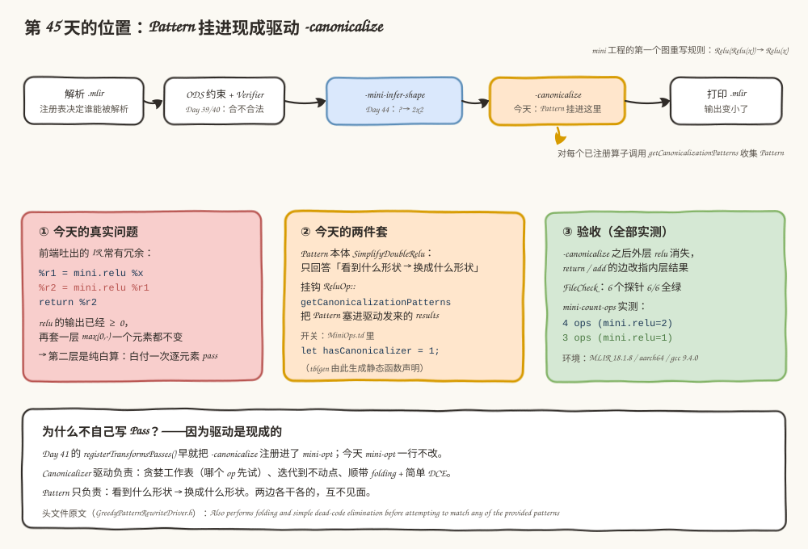
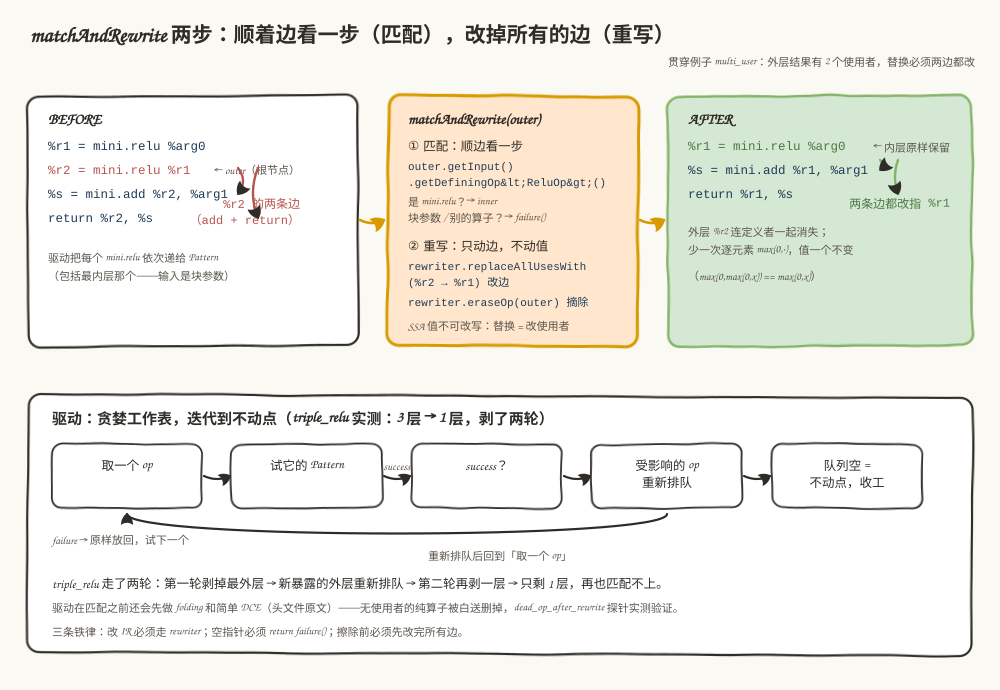
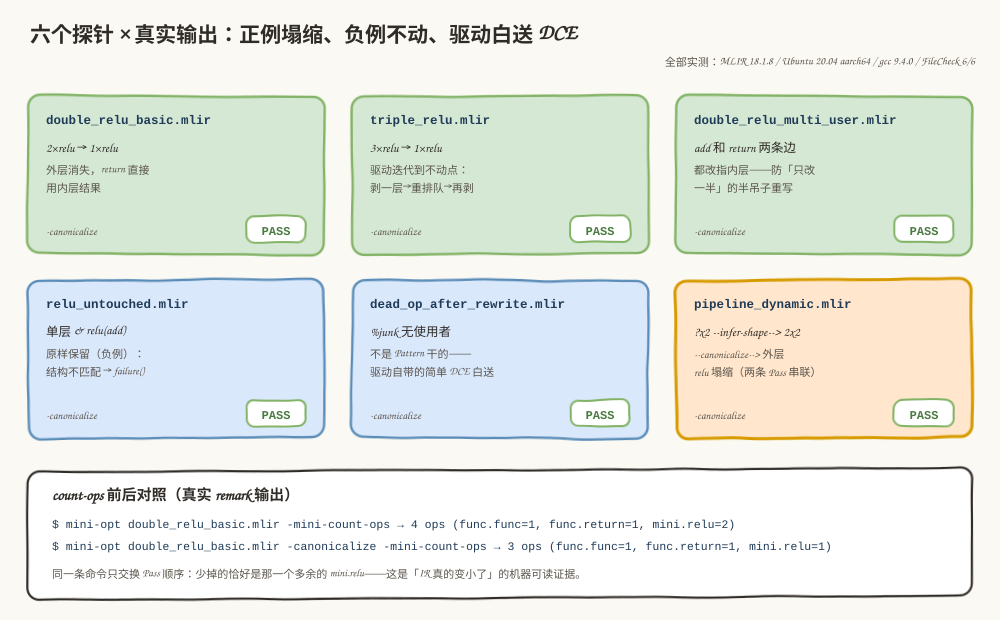

# 第 45 天：第一个 RewritePattern——让 mini-opt 自动消掉 Relu(Relu(x))

> **今日目标**：完成本教程后，你能把 `relu(relu(x)) == relu(x)` 这条数学恒等式写成 mini 方言的第一个 RewritePattern（`lib/ReluCanonicalization.cpp`），挂进 `-canonicalize` 现成驱动；能用 6 个 FileCheck 探针区分"塌缩"、"原样保留"和"驱动白送 DCE"；能解释 Pattern 与驱动的分工，并修复三类亲手复现过的真实错误（段错误、静默 UB、编译期挂钩缺失）。
> **预计时间**：学习 40 分钟＋实践 40 分钟
> **前置准备**：Day 41～44 的 mini 方言工程（`tutorials/day-044/code/mini` 基础上新增今天两处改动）、LLVM/MLIR 18.1.8（含 `MLIRConfig.cmake`）、CMake 3.20+ 与 Ninja、FileCheck（`/usr/lib/llvm-18/bin/FileCheck`）。实测环境：Ubuntu 20.04.5 LTS（aarch64）、gcc 9.4.0、cmake 3.20.5、ninja 1.10.0。
> **今日产出**：`lib/ReluCanonicalization.cpp`（Pattern 本体＋挂钩）、6 个带 FileCheck 的 `.mlir` 探针、3 组错误复现的真实终端记录。

## 1. 今天解决什么问题？

Day 44 结束时，mini-opt 已经能跑 Pass 流水线：解析、验证、`-mini-infer-shape` 补 shape、打印。但到目前为止，所有 Pass 都只在让 IR **信息更全**（把 `?` 变成数字），没有一个让 IR **变小**。今天补上第一块：图优化（graph optimization）。

真实问题从一个具体 IR 开始。前端生成的计算图经常套冗余的激活函数，比如：

```mlir
%r1 = mini.relu %x    : tensor<2x2xf32> -> tensor<2x2xf32>
%r2 = mini.relu %r1   : tensor<2x2xf32> -> tensor<2x2xf32>   // ← 这一层白算
```

`relu` 的语义是 `max(0, x)`：第一层的输出已经全部 ≥ 0，第二层再取一次 `max(0, ·)`，一个元素都不会变——`max(0, max(0, x)) == max(0, x)` 对一切实数成立。但在硬件上这层不是免费的：一次逐元素 pass 意味着把整个 tensor 读一遍再写一遍，白付一趟内存带宽和算力。在 AI 芯片编译器里，这类"数学上恒等于没做"的算子链正是图优化的第一批猎物——对应到技术上是 MLIR 的 **Pattern 重写**：一条"看到什么形状的 IR，就换成什么形状的 IR"的局部规则，由驱动在整张图上反复应用。

今天的目标用一句话说：**让 `mini-opt -canonicalize` 自动把 `Relu(Relu(x))` 塌缩成 `Relu(x)`，并且外层结果的所有使用者都被正确改指内层结果**。贯穿全文的例子就是上面这两层 relu；多使用者、三层链、负例、死代码这些变体都会在 §5 逐一实测。

验收标准从 Day 44 的"IR 信息变全"升级为"**IR 真的变小了，且有机器可读的证据**"：FileCheck 全绿，`-mini-count-ops` 数出 `mini.relu` 从 2 变 1。

## 2. 先看全貌：今天的内容位于哪里？



**图 1**：先看顶部流水线——`-canonicalize` 排在 `-mini-infer-shape` 之后（Day 41 就通过 `registerTransformsPasses()` 注册进了 mini-opt），今天我们**不写新 Pass**，只是往这个现成驱动里塞了一条规则。再看三张卡：左卡是白算问题；中卡是两件套——Pattern 本体只管"看到什么换什么"，挂钩负责把它交给驱动；右卡是验收，全部实测。

全流程五步：

1. **解析**：`.mlir` 变成内存里的 Operation 树（注册表决定谁能被解析，Day 35 的结论）。
2. **验证**：ODS 约束＋手写 Verifier 把关"合不合法"（Day 39/40）。
3. **`-mini-infer-shape`**：把结果类型里的 `?` 细化成数字（Day 44）。
4. **`-canonicalize`（今天）**：驱动对每个已注册算子调用 `getCanonicalizationPatterns` 收集 Pattern，用贪婪工作表迭代到不动点——今天的 `SimplifyDoubleRelu` 从这里进 IR。
5. **打印**：输出 `.mlir`，比输入少一个 relu。

为什么今天值得单独一天？因为 Pattern 重写是 MLIR 图优化的**基本工作单位**——上游的 `arith`、`linalg`、Tosa 等方言的几十条化简规则全是这个套路。今天用一条规则把"Pattern 本体 / 挂钩 / 驱动"三层关系走通，Day 46（`Add(x, 0) → x`）和 Day 47（常量折叠）只是往同一个入口里加新规则。

## 3. 核心概念：Pattern、Rewriter、驱动

### 3.1 RewritePattern：一条"看到什么 → 换成什么"的规则

**RewritePattern**（重写模式）是 MLIR 里一条局部重写规则：给定一个根算子，判断它周围的 IR 形状是否符合前提，符合就把这一小块换成等价但更优的形状。类比流水线上的一个改装工位——它不巡视整个车间，只等传送带把工件递到面前，看一眼形状：是自己认的就改装，不是就放行。对应到技术上是：Pattern 是**被驱动调用的回调**，它自己不遍历 IR、不知道什么时候被调用、也不知道还有谁在排队；这个"不知道"正是 Pattern 能被任意驱动复用的原因。

今天的 Pattern 叫 `SimplifyDoubleRelu`，继承 `OpRewritePattern<mini::ReluOp>`——模板参数告诉基类"我只匹配 `mini.relu` 这一种算子"：

```cpp
struct SimplifyDoubleRelu : OpRewritePattern<mini::ReluOp> {
  using OpRewritePattern<mini::ReluOp>::OpRewritePattern;  // 继承构造：算子名 + 收益权重(默认1)

  LogicalResult matchAndRewrite(mini::ReluOp outer,
                                PatternRewriter &rewriter) const override {
    mini::ReluOp inner = outer.getInput().getDefiningOp<mini::ReluOp>();
    if (!inner)
      return failure();                          // 形状不匹配：放行
    rewriter.replaceAllUsesWith(outer.getRes(), inner.getRes());
    rewriter.eraseOp(outer);
    return success();                             // 重写完成
  }
};
```

`matchAndRewrite` 就是 Pattern 的全部，两个参数一个返回值：`outer` 是驱动选中的根算子；`rewriter` 是驱动授权的改 IR 通道（§3.2）；返回 `failure()` 表示"这条规则对当前节点不适用"，返回 `success()` 表示"已重写完成"。最小例子就是上面这段——匹配一行、重写两行。

### 3.2 PatternRewriter：驱动授权的唯一改 IR 通道

**PatternRewriter** 是 `OpBuilder` 的子类，加了"通知驱动"的能力。为什么必须用它？因为贪婪驱动的工作表里排着一堆 `Operation*`，你删掉一个 op、改了一条边，驱动必须知道，否则它的计划就作废了。类比手术要走无菌通道——直接上手不是不能碰，而是会感染；对应到技术上是：绕过 rewriter 直接调 `replaceAllUsesWith`/`erase` 是**未定义行为**（§6 错误 1 有真实复现：本环境 Release 构建下它静默通过，比崩溃更危险）。

今天用到的两个原语：

- **替换 `replaceAllUsesWith(outer.getRes(), inner.getRes())`**：遍历外层结果的所有使用者，把它们的操作数边逐条改指内层结果。SSA 值本身不可改写——"替换"永远是"**改边的指向**"。外层结果有 2 个使用者（`func.return` 和 `mini.add`），这一步会把两条边都改掉，一条都不能漏。
- **擦除 `eraseOp(outer)`**：把外层 op 从父 Block 摘除并销毁。此时它已经没有任何使用者（上一步全改走了），擦除是安全的；内层 op 原样保留，因为替换值正是它的结果。

### 3.3 驱动与挂钩：`hasCanonicalizer = 1`

Pattern 写好后怎么让它跑起来？**不写 Pass**。`-canonicalize`（Canonicalizer）就是现成驱动，它做三件事：对上下文里每个已注册算子调用 `getCanonicalizationPatterns` 收集 Pattern；用贪婪工作表反复"取 op → 试 Pattern"直到不动点；并且在匹配之前**顺带做 folding 和简单 DCE**——这是 `GreedyPatternRewriteDriver.h` 的头文件原文（本环境 `/usr/lib/llvm-18/include/mlir/Transforms/GreedyPatternRewriteDriver.h` 第 96 行实测可见）：

> Also performs folding and simple dead-code elimination before attempting to match any of the provided patterns.

挂钩只有两件套：`MiniOps.td` 里 `mini.relu` 打开 `let hasCanonicalizer = 1;`，tblgen 会在生成的 `ReluOp` 类里声明静态函数；本体写在 `ReluCanonicalization.cpp` 里——把 Pattern 塞进驱动发来的 `results` 集合：

```cpp
void mini::ReluOp::getCanonicalizationPatterns(RewritePatternSet &results,
                                               MLIRContext *context) {
  results.add<SimplifyDoubleRelu>(context);
}
```

一个常见误解：以为 Pattern 每次只剥一层、所以三层链消不干净。边界在这里：单次 `matchAndRewrite` 确实只剥一层（外层被换掉），但**驱动会把新暴露出来的外层重新排进工作表再匹配一次**，迭代到不动点——§5.3 的 `triple_relu` 探针实测 3 层塌缩成 1 层。

## 4. 图解核心机制：一次匹配重写的全过程



**图 2**：上半部分用贯穿例子 `multi_user`（外层结果有 2 个使用者，最考验"替换"的完整性）走一遍单次重写：输入是左卡 IR＋两条红边，最关键的变化是右卡——两条边全部改指 `%r1`，外层 `%r2` 连定义者一起消失。下半部分是驱动的贪婪工作表循环，注意"受影响的 op 重新排队"那条回环边，它就是三层链能剥两轮的原因。

按图中编号逐步讲：

1. **驱动选中根节点**：`-canonicalize` 驱动把函数里的 op 依次递给 Pattern——注意是**每一个** `mini.relu` 都会被递到，包括最内层那个输入是块参数 `%arg0` 的。
2. **匹配：顺边看一步**：`outer.getInput().getDefiningOp<mini::ReluOp>()` 顺着操作数的 def-use 边往上看一步。定义者恰好是 `mini.relu` → 拿到 `inner`；是块参数或别的算子 → 返回空，`if (!inner) return failure()` 放行。这就是"Pattern 匹配"——只看局部形状，不做全局分析，所以它便宜，也所以它必须自己处理"看一步落空"的情况（§6 错误 2：漏掉这个检查就是段错误）。
3. **重写：改所有的边**：`rewriter.replaceAllUsesWith(%r2 → %r1)` 把 `mini.add` 的第一条操作数边和 `func.return` 的第一条返回边都改指 `%r1`。这一步防的是"只改了 return、漏了 add"的半吊子重写。
4. **擦除**：`rewriter.eraseOp(outer)` 摘除外层。先改边、后擦除，顺序不能反。
5. **驱动迭代**：重写成功后，受影响的 op 重新排队；队列空了就是不动点。`triple_relu` 探针实测走两轮：第一轮剥掉最外层，新外层重新排队，第二轮再剥一层，最后 1 层怎么也匹配不上，收工。

## 5. 动手实践：构建、运行、观察

### 5.1 准备文件

在 Day 44 的 mini 工程上，今天只有**三处接缝**（无一处碰 mini-opt）：

```text
tutorials/day-045/code/
├── mini/
│   ├── include/mini/MiniOps.td          # ① mini.relu 加 let hasCanonicalizer = 1（1 行）
│   └── lib/
│       ├── ReluCanonicalization.cpp     # ② 今天的主角：Pattern 本体＋挂钩（新文件）
│       └── CMakeLists.txt               # ③ 源文件列表登记 ReluCanonicalization.cpp（1 行）
├── double_relu_basic.mlir               # 主角用例：Relu(Relu(x))
├── triple_relu.mlir                     # 三层链：验证迭代到不动点
├── double_relu_multi_user.mlir          # 外层结果 2 个使用者：验证边的替换完整
├── relu_untouched.mlir                  # 负例：单层 & relu(add(...)) 必须原样
├── dead_op_after_rewrite.mlir           # 无使用者的 mini.add：驱动自带 DCE
└── pipeline_dynamic.mlir                # 组合：infer-shape + canonicalize 串联
```

从 `tutorials/day-045/code/` 目录构建（与 Day 44 同一套命令）：

```bash
cmake -G Ninja -B /tmp/day045/build -S mini -DCMAKE_BUILD_TYPE=Release \
      -DMLIR_DIR=/usr/lib/llvm-18/lib/cmake/mlir
cmake --build /tmp/day045/build
```

本环境实测：Configure/Generate 顺利完成，17 个构建目标全部成功，产物 `/tmp/day045/build/bin/mini-opt`（约 6.8 MB）。

### 5.2 代码讲解

完整代码在 `mini/lib/ReluCanonicalization.cpp`（99 行，含注释），核心就是 §3.1 贴过的 `matchAndRewrite`。三处值得停下来看一眼的地方：

**① 匹配为什么是"看一步"而不是"搜全图"**（`ReluCanonicalization.cpp` 第 61 行）：

```cpp
mini::ReluOp inner = outer.getInput().getDefiningOp<mini::ReluOp>();
```

`getDefiningOp<T>()` 是顺着操作数的 def-use 边往上看**一步**：定义者类型匹配就返回包装后的 op，不匹配（或值来自块参数）返回空。Pattern 的哲学是局部规则——只看眼前这一步的结构，全图的信息留给驱动去拼。

**② 替换为什么必须"整批"**（第 72 行）：

```cpp
rewriter.replaceAllUsesWith(outer.getRes(), inner.getRes());
```

`multi_user` 探针里 `%r2` 同时被 `mini.add` 和 `func.return` 使用。`replaceAllUsesWith` 遍历**所有**使用者改边；如果你手写循环只改了一部分，剩下的使用者就指着一个即将被擦除的值——错误立即暴露。

**③ 挂钩为什么一行就够**（第 96～99 行）：`results.add<SimplifyDoubleRelu>(context)` 把 Pattern 注册进驱动发来的集合。Day 46 的 `Add(x, 0) → x` 会给 `mini.add` 加同样的挂钩，Day 47 的常量折叠走 `mini.constant`——**每条规则挂在自己的算子上**，驱动收集时自然拼成完整规则库。

### 5.3 运行与观察：六个探针

全部真实运行（命令：`mini-opt <探针>.mlir -canonicalize`，FileCheck 检查注释里的 CHECK 行）：

**探针 1：`double_relu_basic.mlir`——主角用例**

```text
$ mini-opt double_relu_basic.mlir -canonicalize
module {
  func.func @double_relu(%arg0: tensor<2x2xf32>) -> tensor<2x2xf32> {
    %0 = mini.relu %arg0 : tensor<2x2xf32> -> tensor<2x2xf32>
    return %0 : tensor<2x2xf32>
  }
}
```

两层塌缩成一层：外层消失，`return` 直接用内层结果。这就是今天的交付物。

**探针 2：`triple_relu.mlir`——迭代到不动点**：输出与探针 1 逐字相同（`%0 = mini.relu %arg0` + `return %0`）。三层链剥了两轮——单次 Pattern 只剥一层，驱动负责把新暴露的外层重新排队。

**探针 3：`double_relu_multi_user.mlir`——两条边都改**

```text
$ mini-opt double_relu_multi_user.mlir -canonicalize
module {
  func.func @multi_user(%arg0: tensor<2x2xf32>, %arg1: tensor<2x2xf32>) -> (tensor<2x2xf32>, tensor<2x2xf32>) {
    %0 = mini.relu %arg0 : tensor<2x2xf32> -> tensor<2x2xf32>
    %1 = mini.add %0, %arg1 : tensor<2x2xf32>, tensor<2x2xf32> -> tensor<2x2xf32>
    return %0, %1 : tensor<2x2xf32>, tensor<2x2xf32>
  }
}
```

对照输入：`mini.add %r2, %arg1` 变成了 `mini.add %0, %arg1`（第一条操作数边改了），`return %r2, %s` 变成了 `return %0, %1`（返回边也改了）——两条边一条不漏。

**探针 4：`relu_untouched.mlir`——负例对照组**：`@single_relu`（只有一个 relu）和 `@relu_of_add`（relu 的输入是 `mini.add`）两个函数**原样 round-trip**，一个 relu 都不少。Pattern 只在"输入恰好由另一个 `mini.relu` 定义"时点火，其余一律 `failure()` 放行——消掉单层 relu 就改变语义了。

**探针 5：`dead_op_after_rewrite.mlir`——驱动白送的 DCE**：输入里有个结果无人使用的 `%junk = mini.add`。输出里它连同被替换的操作数一起消失了——但这**不是**我们 Pattern 干的（Pattern 只认 Relu(Relu(x))），是驱动在匹配前顺带做的简单 DCE（§3.3 引用的头文件原文），合法性靠 `mini.add` 带 `Pure` trait：删掉无使用者的纯算子不可能改变可观察行为。

**探针 6：`pipeline_dynamic.mlir`——两条 Pass 串联**：

```text
$ mini-opt pipeline_dynamic.mlir -mini-infer-shape -canonicalize
module {
  func.func @pipeline(%arg0: tensor<2x3xf32>, %arg1: tensor<3x2xf32>, %arg2: tensor<2x2xf32>) -> tensor<2x2xf32> {
    %0 = mini.matmul %arg0, %arg1 : tensor<2x3xf32>, tensor<3x2xf32> -> tensor<2x2xf32>   // ?x2 → 2x2
    %1 = mini.add %0, %arg2 : tensor<2x2xf32>, tensor<2x2xf32> -> tensor<2x2xf32>
    %2 = mini.relu %1 : tensor<2x2xf32> -> tensor<2x2xf32>                                 // 两层 → 一层
    return %2 : tensor<2x2xf32>
  }
}
```

Day 44 的 shape 细化和今天的 relu 塌缩接进了同一条流水线，各管各的。（只跑 `-canonicalize` 不跑 `-mini-infer-shape` 会怎样？§6 错误 4 有真实记录。）

FileCheck 汇总（`mini-opt <探针>.mlir -canonicalize | FileCheck <探针>.mlir`，探针 6 用 `-mini-infer-shape -canonicalize`）：**6/6 全部 PASS，rc=0**。



**图 3**：六张卡对应上面六个探针的实测结论；底部那条 count-ops 对照值得单独看——同一条命令只交换 Pass 顺序，`mini.relu` 计数从 2 变 1，这是"IR 真的变小了"的机器可读证据：

```text
$ mini-opt double_relu_basic.mlir -mini-count-ops
double_relu_basic.mlir:15:3: remark: 4 ops in @double_relu (func.func=1, func.return=1, mini.relu=2)
$ mini-opt double_relu_basic.mlir -canonicalize -mini-count-ops
double_relu_basic.mlir:15:3: remark: 3 ops in @double_relu (func.func=1, func.return=1, mini.relu=1)
```

### 5.4 对照实验：三行写法 vs 一行写法

`replaceAllUsesWith` + `eraseOp` 有一个等价的合体写法：

```cpp
rewriter.replaceOp(outer, inner.getRes());   // 替换所有使用者 + 擦除 outer，一步到位
```

这不是教科书传说，实测过：把 `ReluCanonicalization.cpp` 改成这一行（删掉原来两行），重新构建后**6 个探针 FileCheck 依然 6/6 全绿**，`multi_user` 的输出与 §5.3 探针 3 逐字一致。两种写法怎么选？`replaceOp` 少一行、更常用；拆开写的好处是教学上能把"替换"和"擦除"两个动作分开看清楚。本仓库保留拆开写法。

第二个对照：把 `if (!inner) return failure();` 这行删掉会发生什么？这是 §6 错误 2 的实验，先预测再往下看——提示：驱动会把**每一个** `mini.relu` 递给 Pattern，包括输入是块参数 `%arg0` 的最内层那个。

## 6. 常见错误与排查

四个错误全部在本环境亲手复现过（Ubuntu 20.04 aarch64 / MLIR 18.1.8 / Release 构建），终端记录如下。

### 错误 1：绕过 rewriter 直接改 IR——静默的未定义行为

- **现象**：把 `rewriter.replaceAllUsesWith(...)` 写成 `outer.getRes().replaceAllUsesWith(...)`、`rewriter.eraseOp(outer)` 写成 `outer.erase()`，构建通过，6 个探针 FileCheck **全部 PASS**，甚至 6 层 relu 链也正确塌缩、rc=0。看似没有任何问题。
- **原因**：这是**未定义行为**，而未定义行为不保证崩溃。贪婪驱动的工作表里持有被 `erase()` 删除的 op 的指针，同时它的 Listener 没有收到任何通知——IR 已经变了，驱动的计划还是旧的。今天没崩只说明这块内存在这次运行里恰好没被复用。
- **定位**：审自己的 `matchAndRewrite`：所有改 IR 的调用是不是都带 `rewriter.` 前缀？（`Value::replaceAllUsesWith` 和 `Operation::erase` 是 `PatternRewriter` 同名方法的"无通知版"，编译器不会替你区分。）
- **修复**：一律走 `rewriter.replaceAllUsesWith` / `rewriter.eraseOp` / `rewriter.replaceOp`。带断言或 `MLIR_ENABLE_EXPENSIVE_CHECKS` 的构建能拦住这类问题，Release 构建只能靠纪律。

### 错误 2：漏掉空检查——段错误

- **现象**：删掉 `if (!inner) return failure();` 后重新构建，运行探针 1：

  ```text
  $ mini-opt double_relu_basic.mlir -canonicalize
  PLEASE submit a bug report to https://github.com/llvm/llvm-project/issues/ and include the crash backtrace.
  Stack dump:
  0.  Program arguments: mini-opt double_relu_basic.mlir -canonicalize
  ...
  Segmentation fault (core dumped)          # rc=139，triple_relu 同样 rc=139
  ```

- **原因**：驱动会把**每一个** `mini.relu` 递给 Pattern，包括最内层那个输入是块参数 `%arg0` 的 relu。对它调 `getDefiningOp<mini::ReluOp>()` 返回空 op 包装，下一行 `inner.getRes()` 解引用空指针。
- **定位**：崩溃栈没有符号时，看崩溃**发生在哪个探针**：凡带"输入是块参数的 relu"的用例都崩，说明是 Pattern 对"看一步落空"没设防。
- **修复**：匹配结果先判空再使用——`if (!inner) return failure();`。Pattern 匹配失败是**正常路径**，不是异常。

### 错误 3：忘开 `hasCanonicalizer`——编译期挂钩缺失

- **现象**：写好了 `ReluCanonicalization.cpp`，但 `MiniOps.td` 里忘了 `let hasCanonicalizer = 1;`，构建直接失败：

  ```text
  ReluCanonicalization.cpp:96:6: error: no declaration matches
    'void mini::ReluOp::getCanonicalizationPatterns(mlir::RewritePatternSet&, mlir::MLIRContext*)'
  note: no functions named 'void mini::ReluOp::getCanonicalizationPatterns(...)'
  ```

- **原因**：`getCanonicalizationPatterns` 这个静态成员的**声明**是 tblgen 看到 `hasCanonicalizer = 1` 才生成的。开关没开，类里没有这个成员，你在 .cpp 里定义的函数就成了"无主函数"。
- **定位**：报错行号正好指向挂钩函数定义处；对照 `MiniOps.td` 里 `mini.relu` 的定义查开关。
- **修复**：`MiniOps.td` 的 `Mini_ReluOp` 里加 `let hasCanonicalizer = 1;`，重新构建（tblgen 重跑，声明生成，链接通过）。

### 错误 4：`pipeline_dynamic` 只跑 `-canonicalize`——FileCheck 失败

- **现象**：探针 6 少跑了 shape 推导：

  ```text
  $ mini-opt pipeline_dynamic.mlir -canonicalize | FileCheck pipeline_dynamic.mlir
  pipeline_dynamic.mlir:12:11: error: CHECK: expected string not found in input
  // CHECK: %[[M:.*]] = mini.matmul %arg0, %arg1 : ... -> tensor<2x2xf32>
            ^
  <stdin>:3:2: note: possible intended match here
   %0 = mini.matmul %arg0, %arg1 : ... -> tensor<?x2xf32>
  ```

- **原因**：CHECK 行期望 `tensor<2x2xf32>`，但 Pattern 只认 `Relu(Relu(x))`，它既不认识也不会补 shape——`?x2 → 2x2` 是 Day 44 的 `-mini-infer-shape` 的职责。FileCheck 的提示很贴心：它找到了"possible intended match"，只差 `?` 没变成 `2`。
- **定位**：对比"期望的行"和"possible intended match 的行"，差异维度就是缺的那条 Pass。
- **修复**：按职责排流水线：`mini-opt pipeline_dynamic.mlir -mini-infer-shape -canonicalize`，实测 PASS。

## 7. 今日练习

### 必做练习：四层链，先预测再验证

新建 `quad_relu.mlir`：在 `triple_relu.mlir` 基础上加一层，变成 `%r4 = mini.relu %r3`。**先**在注释里写出你的 CHECK 预测（几层留下？谁被剥掉？），**再**跑 `mini-opt quad_relu.mlir -canonicalize` 对答案。验收标准：①rc=0 且 FileCheck 通过；②你的预测与实际输出一致；③你能说出驱动迭代了几轮、每轮剥掉哪一层。提示：想想工作表在第一轮重写后会重新排进谁。

### 选做挑战：给死代码再挂一个

在 `dead_op_after_rewrite.mlir` 里再加一行结果无人使用的 `%junk2 = mini.mul %r2, %arg0`（同 shape 的 `mini.mul`，Day 42 已有）。预测：它会不会跟 `%junk` 一起消失？依据是什么（哪个 trait、驱动的哪条行为）？跑一下验证。再想一步：如果把 `%junk2` 的结果接进 `func.return`（多返回一个值），它还会消失吗？

## 8. 今日验收

- [ ] 我能用自己的话解释 Pattern 与驱动的分工：Pattern 只答"看到什么形状换成什么形状"，驱动负责工作表、迭代到不动点和顺带的 folding/DCE；
- [ ] 我能独立构建 mini-opt，并让 `double_relu_basic.mlir` 在 `-canonicalize` 后从 2 个 relu 变 1 个，`multi_user` 的两条使用边都正确改指；
- [ ] 我能修改 Pattern（换成 `replaceOp` 一行写法 / 删掉空检查）并**预测**结果，且已实际复现过段错误（错误 2）；
- [ ] 我能定位"忘开 hasCanonicalizer 的编译错"和"少跑 infer-shape 的 FileCheck 失败"这两类错误；
- [ ] 我保存了 `ReluCanonicalization.cpp`、6 个探针和 3 组错误复现的终端记录（`tutorials/day-045/code/`）。

## 9. 一句话总结与明天预告

今天给 mini 方言写下了第一个 RewritePattern：**问题**是 IR 里 `Relu(Relu(x))` 白付一次逐元素 pass 的算力；**机制**是两层结构——`SimplifyDoubleRelu` 本体（顺 def-use 边看一步匹配，`replaceAllUsesWith` 改掉所有使用者的边，`eraseOp` 摘除外层）加 `getCanonicalizationPatterns` 挂钩（`hasCanonicalizer = 1` 换来）；**实践**只动了三处接缝，mini-opt 一行不改；**验证**靠 6 个探针的 FileCheck 全绿和 count-ops 的 `mini.relu 2 → 1`，外加三组亲手复现的错误（静默 UB、段错误、编译期挂钩缺失）。

明天（Day 46）写第二条规则：`Add(x, 0) → x`。新东西只有两个——常量匹配（操作数是不是 `mini.constant` 的 `0`）和属性读取（从 `ElementsAttr` 里把数读出来）；挂钩、驱动、FileCheck 套路全部复用今天这一套。
