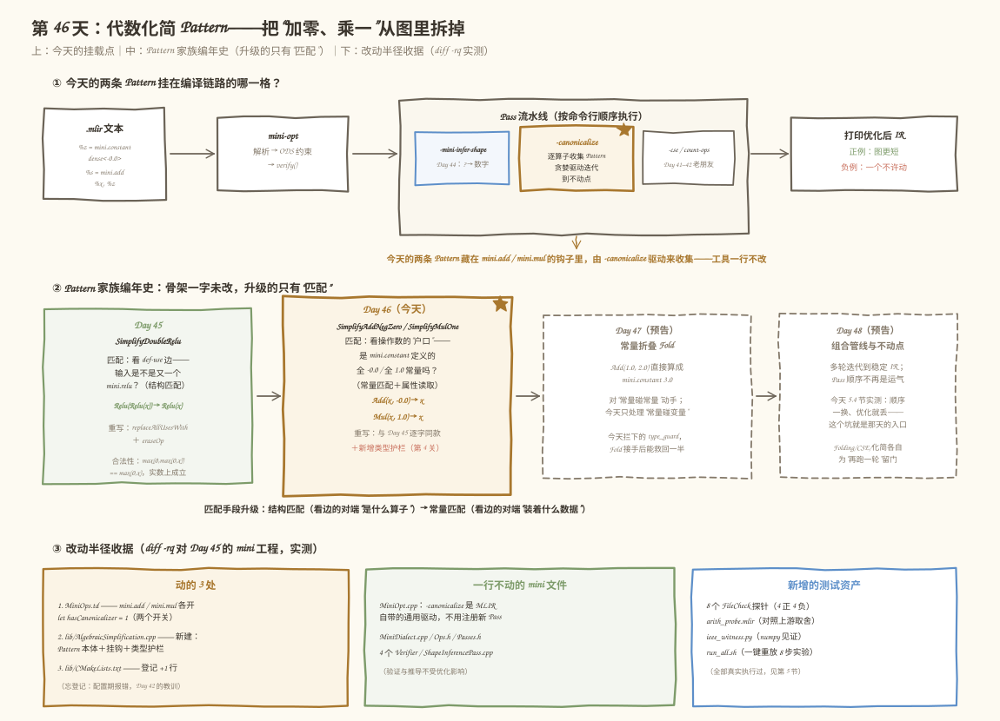
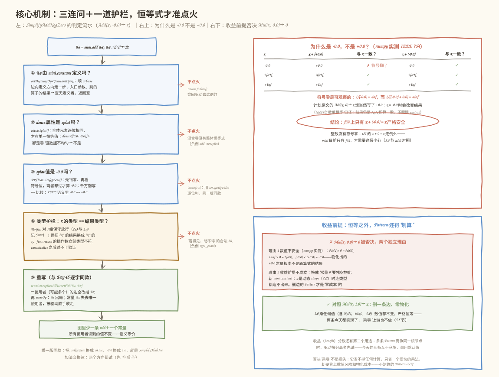
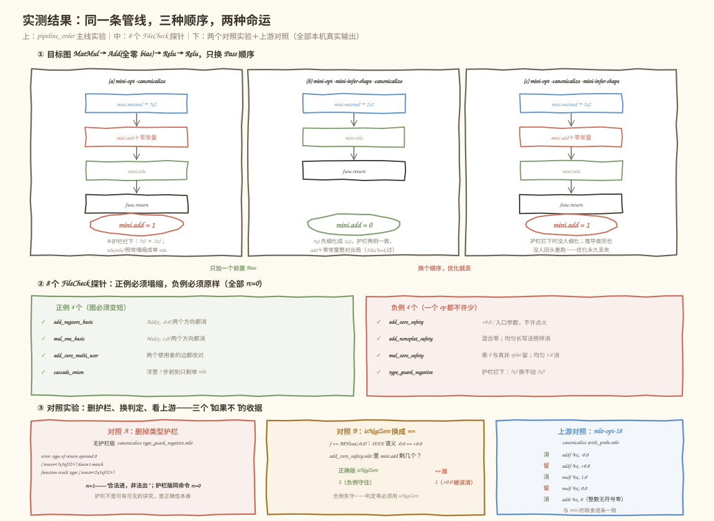

# 第 46 天：代数化简 Pattern——`Add(x, 0)` 这道小学数学题，为什么必须写成 `Add(x, -0.0)`

> **今日目标**：完成本教程后，你能把"加零、乘一"写成 mini 方言的代数化简 Pattern（`lib/AlgebraicSimplification.cpp`），挂进 `-canonicalize` 现成驱动；能说清常量匹配（`getDefiningOp`）、属性读取（`DenseElementsAttr` 的 splat 判定）和收益前提（不许凭空物化新常量）这三个新知识点；能用 8 个 FileCheck 探针＋两个对照实验证明"`+0.0` 不许消、护栏不能删"，并解释为什么上游 `arith` 也做同样的取舍。
> **预计时间**：学习 40 分钟＋实践 45 分钟
> **前置准备**：Day 41～45 的 mini 方言工程（`tutorials/day-045/code/mini` 基础上新增今天三处改动）、LLVM/MLIR 18.1.8（含 `MLIRConfig.cmake`）、CMake 3.20+ 与 Ninja、FileCheck（`FileCheck-18`）、Python3＋numpy（跑 IEEE 见证脚本）。实测环境：Ubuntu 20.04.5 LTS（aarch64）、gcc 9.4.0、cmake 3.20.5、ninja 1.10.0、numpy 1.26.4——与 Day 29/37～45 记录一致。
> **今日产出**：`lib/AlgebraicSimplification.cpp`（两条 Pattern＋共享的常量匹配工具）、10 个带 FileCheck 的 `.mlir` 用例（正负例 8＋主线 2，另有 1 个上游 `arith` 对照探针）、`run_all.sh` 一键重放脚本（含两个对照实验）、`ieee_witness.py` IEEE 754 数值见证，全部实测通过。

## 1. 今天解决什么问题？

Day 45 结束时，mini 方言有了第一条 Pattern：`relu(relu(x)) → relu(x)`。它的匹配只看**结构**——顺着 def-use 边看一步，输入是不是又一个 `mini.relu`。但真实计算图里更常见的冗余不是"同一个算子套两层"，而是**算子和常量做无意义的运算**：训练框架导出的图里，bias 初始化成全零、缩放系数是全一、learning rate 乘 1.0……这些算子在图里占着一个节点、一份内存带宽，数学上却恒等于没做：

```mlir
%z = mini.constant dense<0.0> : tensor<2x2xf32>   // 全零 bias
%s = mini.add %x, %z : ...                         // ← 这一层白算？
```

直觉说该删。但在 f32 上"白算"两个字要过 IEEE 754 这一关——这就是今天的真实问题：**计划原文写的 `Add(x, 0) → x`，在浮点数上根本不是恒等式**。§3.3 会用 numpy 真算给你看：`x = -0.0` 时 `(-0.0) + (+0.0) = +0.0`，符号位翻了，`1/x` 会从 `-inf` 变成 `+inf`——下游任何一个除法都能观察到这次"优化"改了答案。所以今天实现的安全版本是：

- **`Add(x, 全体元素为 -0.0 的常量) → x`**：IEEE 754 规定 `x + (-0.0) = x` 对一切 x 成立（含 ±0.0、NaN、±Inf），严格安全；
- **`Mul(x, 全体元素为 1.0 的常量) → x`**：1.0 乘任何值数值都不变，比加零还干净；
- 反方向的两个"看似更省"——`Add(x, +0.0) → x` 和 `Mul(x, 0.0) → 0`——今天都要**论证后否决**，前者数值不安全，后者既不安全又违反收益前提（§3.4）。

相比 Day 45，Pattern 的骨架（`OpRewritePattern` + `getCanonicalizationPatterns` 挂钩）一字不差，升级的只有**匹配**这一步：从"看边"（输入是不是另一个 relu）变成"看常量"（操作数是不是 `mini.constant` 定义的、dense 属性里装的是不是全体 `-0.0`/`1.0`）。这个升级正好覆盖计划里点名的三个学习点：常量匹配、属性读取、收益前提。

贯穿全文的例子就用上面那条 `%s = mini.add %x, %z`：它的两个方向（常量在左/在右）、多个使用者、嵌套洋葱、以及四组"不许动"的负例变体，都会在 §5 逐一实测。验收标准：8 个探针 FileCheck 全绿，主线图 `MatMul → Add(全零 bias) → Relu → Relu` 在 `-mini-infer-shape -canonicalize` 后只剩 `matmul + 单 relu`，且换一下 Pass 顺序优化就丢（这也是今天最有工程价值的观察之一）。

## 2. 先看全貌：今天的内容位于哪里？



**图 1**：三个看点。顶部流水线：今天**不写新 Pass**，两条 Pattern 藏在 `mini.add` / `mini.mul` 的 `getCanonicalizationPatterns` 钩子里，由 Day 41 就注册好的 `-canonicalize` 驱动来收集——`mini-opt` 一行不改。中部编年史：Day 45 的匹配看 def-use 边（结构），Day 46 的匹配看常量属性（数据），Day 47 的常量折叠连结果都算出来，骨架从未变过。底部收据：`diff -rq` 实测，相对 Day 45 的工程只动了 3 个文件、两行开关、一个新 `.cpp`。

全流程五步：

1. **解析**：`.mlir` 变成内存里的 Operation 树。
2. **验证**：ODS 约束＋手写 Verifier 把关"合不合法"。
3. **`-mini-infer-shape`（可选前置）**：把结果类型里的 `?` 细化成数字——今天 §5.3 会证明它是不是排在 `-canonicalize` 前面，直接决定代数化简能不能点火。
4. **`-canonicalize`（今天）**：驱动对每个已注册算子调用 `getCanonicalizationPatterns` 收集 Pattern（今天新收集到 `SimplifyAddNegZero` / `SimplifyMulOne` 两条），贪婪迭代到不动点，顺带做简单 DCE——被拆掉的 `-0.0` 常量失去唯一使用者后就是被它收走的。
5. **打印**：输出 `.mlir`，正例图更短，负例一个字节不许变。

为什么这值得单独一天？因为"算子 × 常量"的化简是图优化的主力矿脉：上游 `arith`、`linalg`、Tosa 里几十条规则大半是这个形态。今天把常量匹配、属性读取、收益前提走通，Day 47 的常量折叠（把整个运算在编译期算掉）只是在这套匹配基础上再加一步"算出来"。

## 3. 核心概念：常量匹配、属性读取、IEEE 安全性与收益前提

### 3.1 常量匹配：先回答"这个操作数是谁定义的"

**常量匹配**（constant matching）就是判断某个操作数在 IR 里是不是一个编译期已知的常量。类比核对进件——你想把"给包裹贴 `+0` 标签"的工序删掉，得先确认标签内容真的写死在单据上，而不是司机随口报的。对应到技术上是：在 SSA 的 def-use 图上，顺着操作数这条边向**定义方向**走一步（`getDefiningOp`），看定义者是不是 `mini.constant`。

Day 45 已经用过这个动作（`getDefiningOp<mini::ReluOp>()`），今天只是换了模板参数：

```cpp
mini::ConstantOp cst = v.getDefiningOp<mini::ConstantOp>();
if (!cst)
  return false;   // 函数入口参数、别的算子的结果：查无定义者
```

三连问的第一问就在这里。注意"数值上是全零"和"IR 里是常量"是两回事——负例 `add_zero_safety.mlir` 的 `@from_arg` 里，`%arg1` 运行时可能恰好传全 `-0.0` 张量，但它是函数入口参数，def-use 边上一步找不到定义者，编译器无法证明"它永远是 -0.0"，不许点火。这是**保守性**：宁可放过一百个运行时巧合，不可错杀一个会改语义的重写。

### 3.2 属性读取：从 `dense<>` 里把数拿出来

第二个新知识点：常量的数值不带在操作数上，而是带在**属性**（attribute）里。这是 Day 38 就埋下的结构——`mini.constant` 是 mini 方言第一个"数据在属性里"的算子：

```mlir
%z = mini.constant dense<-0.0> : tensor<2x2xf32>
//                        ^^^^^ 属性：DenseElementsAttr，不是操作数
```

**属性读取**就是把 `dense<>` 里的数值取出来判定。今天的读取走三步，其中有个新面孔 **splat**（喷涂式张量，指所有元素同一个值的张量）：

```cpp
DenseElementsAttr attr = cst.getValue();   // ODS 生成的取值器：属性存取不用 cast
if (!attr.isSplat())                        // ① 全体元素逐位相同？
  return false;
return pred(attr.getSplatValue<llvm::APFloat>());  // ② 取出那个值，交给判定器
```

`isSplat()` 判定的是**数据本身，不是写法**：`dense<-0.0>` 和 `dense<[[-0.0, -0.0]]>` 是同一个 splat（正例 `add_nonsplat_safety.mlir` 的 `@uniform_negzero` 实测照样塌缩）；而 `dense<[[0.0, -0.0]]>` 虽然每个元素"都是零"，但 `+0.0` 与 `-0.0` 位模式不同，`isSplat()` 为假——这不是性能优化，是**安全边界本身**：混合零对任何 x 都不存在整体恒等式（左半边会把 `x = -0.0` 翻成 `+0.0`）。`llvm::APFloat` 是 LLVM 的任意精度浮点实现，`mini.constant` 的 f32 数据在 C++ 里就以它为载体。

### 3.3 IEEE 754 的符号零：为什么计划里的 `Add(x, 0)` 必须改写成 `Add(x, -0.0)`

今天是全教程数学最较真的一节。**IEEE 754**（浮点算术标准）规定零有两个位模式：`+0.0` 和 `-0.0`。它们比较相等（`-0.0 == +0.0` 为真），但符号位可观察——最直接的观察口是除法：`1/(-0.0) = -inf`，`1/(+0.0) = +inf`。

加法规则说：**同号零相加得同号零，异号零相加得 `+0.0`**。于是：

| 恒等式 | `x = -0.0` | `x = NaN` | `x = +Inf` | 结论 |
|---|---|---|---|---|
| `x + (+0.0)` | `+0.0`，**符号翻了** ✗ | NaN ✓ | +Inf ✓ | 不是恒等式 |
| `x + (-0.0)` | `-0.0` ✓ | NaN ✓ | +Inf ✓ | **严格恒等** |
| `x * 1.0` | `-0.0` ✓ | NaN ✓ | +Inf ✓ | **严格恒等** |
| `x * (+0.0)`（想重写成常量 0） | `-0.0` ✗ | NaN ✗ | **NaN** ✗ | 不是"等于 +0.0" |

这张表不是抄书，是 `ieee_witness.py` 用 numpy 1.26.4 真算出来的（§5.5 有完整真实输出），其中两行值得盯住：

- 第一行：`(-0.0) + (+0.0) = +0.0`。如果 Pattern 天真地按计划原文匹配 `+0.0`，那么 x 恰好是 `-0.0` 时，重写后下游读到的值符号变了——`1/x` 从 `-inf` 变 `+inf`。§5.4 对照实验 B 会把判定器换成 `==` 比较，让这个错误真实发生给你看（负例失守，`mini.add` 计数从 2 变 1）。
- 第二行：`x + (-0.0) = x` 对一切 x 成立——包括 `-0.0 + (-0.0) = -0.0`、NaN 原样返回、`+Inf + (-0.0) = +Inf`。所以安全版本常量必须写 **`-0.0`**。

类比时间：`+0.0` 像一块"见零翻正"的磁铁，`-0.0` 才是惰性的透明玻璃——穿过去什么都没变。对应到技术上是：加法的单位元在 IEEE 754 里**不是 `+0.0` 而是 `-0.0`**；乘法的单位元才是 `1.0`（且它没有任何符号坑，连 NaN、±Inf、±0.0 都原样通过）。这个边界也解释了上游的取舍：§5.5 的探针实测 `mlir-opt-18 -canonicalize` 对 `arith.addf %x, %cst(0.0)` **不消**、对 `arith.mulf %x, 1.0` **消**——上游和 mini 做了同一个数学决定。

还有一个实现层的坑值得点名：判 `-0.0` 千万别写 `f == llvm::APFloat(-0.0)`。`APFloat` 的 `operator==` 走 IEEE 比较语义，`-0.0 == +0.0` 成立，`+0.0` 会被误放行。正确写法是自带的 `isNegZero()`（先判是零、再看符号位）；乘一版的 `isExactlyValue(1.0)` 则是逐位比较，没有这个歧义。判 NaN payload 的假设也声明在案：mini 不跟踪 NaN 的负载位，按"数值相等"判定恒等，与通用编译器通行做法一致。

### 3.4 收益前提：Pattern 不许让图"越化简越大"

第三个学习点最容易被忽略。**收益前提**（profitability）问的是：这条重写完成后，图真的更便宜吗？类比做减法——把"发票金额 × 1"这笔划掉是省钱；但"发票金额 × 0"想划掉，你得**另开一张零发票**存档，开票本身就有成本。对应到技术上是两类成本：

- **物化成本**：`Mul(x, 1.0) → x` 的右侧 x 已经在图里，重写零新增；而 `Mul(x, 0.0) → 0` 的右侧"常量 0"图里**没有**，得凭空造一个新 `mini.constant`——x 是动态 shape（`?x2`）时，连"造一个和 x 同 shape 的零张量"都无从下手（shape 要运行时才知道）。
- **数值成本**：就算 shape 已知，§3.3 表的最后一行已经否决了它——`NaN × 0 = NaN`、`±Inf × 0 = NaN`、`-0.0 × 0 = -0.0`，结果根本不是那个被物化的 `+0.0`。

所以 `Mul(x, 0.0) → 0` 被**双重否决**，负例 `mul_zero_safety.mlir` 的 `@mul_by_zero` 实测原样保留。今天实现的两条 Pattern 都是"右侧已在图里"的零成本重写：删一个算子、（通常连带）删一个常量、不加任何东西。这也是它们可以放心给默认收益分数 1 的原因——`OpRewritePattern` 的构造函数第二参数是收益权重，多条 Pattern 竞争同一根节点时高分先试；今天的两条规则分别挂在 `mini.add` / `mini.mul` 上互不竞争，都用默认值。

## 4. 图解核心机制：三连问＋一道护栏



**图 2**：左侧主干是 `SimplifyAddNegZero` 的完整判定流水，从上往下五个关卡，任何一关不过都走"不点火"出口（`return failure()` 把节点交回驱动去试别的 Pattern）；右上角的 IEEE 表就是 §3.3 那张（numpy 实测）；右下角是 `Mul(x, 0.0) → 0` 的两条否决理由。乘一版 `SimplifyMulOne` 的流水完全同构，只是把 `isNegZero` 换成 `isOne`、`-0.0` 换成 `1.0`。

按图中编号逐步讲：

1. **`%z` 由 `mini.constant` 定义吗？**——`getDefiningOp<mini::ConstantOp>()` 顺 def-use 边走一步；入口参数、别的算子的结果都查无定义者。不过 → 不点火。为什么需要：§3.1，编译器只能对"证明得了的常量"动手。
2. **dense 属性是 splat 吗？**——`attr.isSplat()` 判全体元素逐位相同；`dense<[[0.0, -0.0]]>`"都是零"但不均匀。不过 → 不点火。为什么需要：§3.2，混合值没有单一恒等元。
3. **splat 的值是 `-0.0` 吗？**——`APFloat::isNegZero()` 先判零再看符号位；写 `==` 比较会把 `+0.0` 误放行（§6 错误 2 有真实复现）。不过 → 不点火。
4. **类型护栏：x 的类型 == 结果类型？**——`x.getType() != add.getRes().getType()` 就撤退。为什么需要这一关：Day 40 的 Verifier 对动态维**保守放行**（`?x3` 与 `2x3` 记 Same），所以存在"验证过的 IR 里，lhs 是 `?x3`、结果是 `2x3`"这种合法组合；此时把 `2x3` 的结果换成 `?x3` 的 x，`func.return` 的操作数立刻类型不符——**canonicalize 之后过不了验证**（§5.4 对照实验 A 有真实复现，§6 错误 3）。这一关是"看得见、动不得"的合法 IR 的安全阀。
5. **重写**——与 Day 45 逐字同款：`rewriter.replaceAllUsesWith(%s, %x)` 把**所有**使用者的边改指 x（可能不止一个，负责任的重写一条都不能漏），`eraseOp` 送走 add；常量 `%z` 失去唯一使用者后被驱动顺带做的简单 DCE 收走（Day 45 看过的机制，今天again受益）。

语义等价的保证由三部分拼成：常量匹配保证"另一侧是编译期常量"，splat＋`isNegZero` 保证"这个常量对一切 x 都是加法单位元"，类型护栏保证"替换边之后类型依然对得上"。三者缺一，重写就从优化变成 bug。

## 5. 动手实践：构建、运行、观察

### 5.1 准备文件与改动半径

今天的代码在 `tutorials/day-046/code/`，相对 Day 45 的 mini 工程只动了三处——`diff -rq` 实测收据（`run_all.sh` 第 1b 步真实输出）：

```text
Files .../day-045/code/mini/include/mini/MiniOps.td and .../day-046/.../MiniOps.td differ
Only in .../day-046/code/mini/lib: AlgebraicSimplification.cpp
Files .../day-045/code/mini/lib/CMakeLists.txt and .../day-046/.../CMakeLists.txt differ
```

| 文件 | 改动 | 内容 |
|---|---|---|
| `include/mini/MiniOps.td` | 2 行开关 | `Mini_AddOp` / `Mini_MulOp` 各加 `let hasCanonicalizer = 1;` |
| `lib/AlgebraicSimplification.cpp` | 新文件 | 两条 Pattern＋`isSplatConstant` 工具＋两个挂钩 |
| `lib/CMakeLists.txt` | 1 行登记 | 源文件列表加 `AlgebraicSimplification.cpp` |

`mini-opt`、`MiniDialect.cpp`、`Ops.h`、`Passes.h` 一行不动——Day 45 的结论继续生效：Pattern 是数据，不是工具里的代码分支。探针文件（正例 4＋负例 4＋主线 2＋上游 1）、`run_all.sh`、`ieee_witness.py` 都在 `code/` 下。构建命令：

```bash
cd tutorials/day-046/code
cmake -G Ninja -B /tmp/day046/build -S mini \
      -DCMAKE_BUILD_TYPE=Release -DMLIR_DIR=/usr/lib/llvm-18/lib/cmake/mlir
cmake --build /tmp/day046/build     # 首次约 1~3 分钟，17 个构建步
```

### 5.2 编写代码：Pattern 本体＋挂钩

`MiniOps.td` 的开关（Day 45 的 relu 同款）：

```tablegen
// Mini_AddOp 里：
let hasCanonicalizer = 1;   // tblgen 生成 static getCanonicalizationPatterns 声明
// Mini_MulOp 里：同款一行
```

`lib/AlgebraicSimplification.cpp` 的关键实现（完整 172 行见代码目录，注释即讲解）：

```cpp
// 三连问的前两问＋第三问的入口：v 是不是"装着 pred 所指值"的常量
static bool isSplatConstant(Value v, bool (*pred)(const llvm::APFloat &)) {
  mini::ConstantOp cst = v.getDefiningOp<mini::ConstantOp>();  // ① 常量匹配
  if (!cst)
    return false;
  DenseElementsAttr attr = cst.getValue();   // 属性读取：ODS 生成的取值器
  if (!attr.isSplat())                        // ② 全体元素逐位相同？
    return false;
  return pred(attr.getSplatValue<llvm::APFloat>());  // ③ 值判定
}

static bool isNegZero(const llvm::APFloat &f) { return f.isNegZero(); }
static bool isOne(const llvm::APFloat &f) { return f.isExactlyValue(1.0); }

struct SimplifyAddNegZero : OpRewritePattern<mini::AddOp> {
  using OpRewritePattern<mini::AddOp>::OpRewritePattern;

  LogicalResult matchAndRewrite(mini::AddOp add,
                                PatternRewriter &rewriter) const override {
    Value x;                                   // 加法交换律：两个方向都收
    if (isSplatConstant(add.getRhs(), isNegZero))
      x = add.getLhs();
    else if (isSplatConstant(add.getLhs(), isNegZero))
      x = add.getRhs();
    else
      return failure();                        // 没有任何一侧是全 -0.0：交回驱动

    if (x.getType() != add.getRes().getType()) // ④ 类型护栏，不能省（§6 错误 3）
      return failure();

    rewriter.replaceAllUsesWith(add.getRes(), x);  // ⑤ 改边：所有使用者
    rewriter.eraseOp(add);                         //     擦除：add 出局
    return success();
  }
};

// SimplifyMulOne 结构完全同构：isNegZero → isOne，Add → Mul（见源文件）

void mini::AddOp::getCanonicalizationPatterns(RewritePatternSet &results,
                                              MLIRContext *context) {
  results.add<SimplifyAddNegZero>(context);
}
void mini::MulOp::getCanonicalizationPatterns(RewritePatternSet &results,
                                              MLIRContext *context) {
  results.add<SimplifyMulOne>(context);
}
```

值得停在三个点上：其一，两条 Pattern 共用 `isSplatConstant`，判定器作为函数指针传入——常量匹配的骨架是公共资产，明天常量折叠还会再用它。其二，`getValue()` 的返回类型是 `DenseElementsAttr`，因为 `Mini_F32ElementsAttr`（`FloatElementsAttr<32>`）的 C++ 存储类型由 tblgen 翻译成它，不用再 cast。其三，`SimplifyMulOne` 与 `SimplifyAddNegZero` 的差异只有判定器和算子类型——这正是"Pattern 家族"的含义：学会一条，第二条的边际成本接近零。

### 5.3 运行与观察：正例、负例、主线

以下全部是本机真实执行结果（`bash run_all.sh` 一键重放，环境见文首）。先看正例`add_negzero_basic.mlir`：

```bash
/tmp/day046/build/bin/mini-opt -canonicalize add_negzero_basic.mlir
```

```mlir
module {
  func.func @rhs_zero(%arg0: tensor<2x2xf32>) -> tensor<2x2xf32> {
    return %arg0 : tensor<2x2xf32>          // add 没了，常量也没了
  }
  func.func @lhs_zero(%arg0: tensor<2x2xf32>) -> tensor<2x2xf32> {
    return %arg0 : tensor<2x2xf32>          // 常量在左边，同样消
  }
}
```

输入里每个函数各有一个 `mini.add` 和一个 `mini.constant`，输出里两者全部消失——常量失去唯一使用者后被驱动顺带收走。`FileCheck` 校验 8 个探针全绿：

```text
[add_negzero_basic.mlir]   FileCheck 通过 (rc=0)   正例：-0.0 两个方向都消
[mul_one_basic.mlir]       FileCheck 通过 (rc=0)   正例：×1.0 两个方向都消
[add_zero_multi_user.mlir] FileCheck 通过 (rc=0)   两个使用者的边都改对
[cascade_onion.mlir]       FileCheck 通过 (rc=0)   洋葱 3 步剥到只剩单 relu
[add_zero_safety.mlir]     FileCheck 通过 (rc=0)   负例：+0.0 / 入口参数不许动
[add_nonsplat_safety.mlir] FileCheck 通过 (rc=0)   负例：混合零留、均匀长写法消
[mul_zero_safety.mlir]     FileCheck 通过 (rc=0)   负例：×0 与真非 splat 留
[type_guard_negative.mlir] FileCheck 通过 (rc=0)   负例：?x3 换不动 2x3
```

`cascade_onion.mlir` 值得单独看一眼——两条分属两天的 Pattern 在同一次 `-canonicalize` 里协同剥壳，输入 `relu(add(relu(add(x, -0.0)), -0.0))`，真实输出：

```mlir
module {
  func.func @onion(%arg0: tensor<2x2xf32>) -> tensor<2x2xf32> {
    %0 = mini.relu %arg0 : tensor<2x2xf32> -> tensor<2x2xf32>
    return %0 : tensor<2x2xf32>
  }
}
```

然后是今天最有工程价值的主线实验：`pipeline_order.mlir`（目标图 `MatMul → Add(全零 bias) → Relu → Relu`），同一个文件跑三种 Pass 顺序：

```bash
# (a) 只跑 canonicalize：数输出里 mini.add 的行数
/tmp/day046/build/bin/mini-opt -canonicalize pipeline_order.mlir | grep -c mini.add
1
# (b) 先推导 shape 再 canonicalize
/tmp/day046/build/bin/mini-opt -mini-infer-shape -canonicalize pipeline_order.mlir | grep -c mini.add
0
# (c) 顺序对调
/tmp/day046/build/bin/mini-opt -canonicalize -mini-infer-shape pipeline_order.mlir | grep -c mini.add
1
```

(b) 的完整真实输出——整张图只剩 `matmul + 单 relu`，全零 bias 的 add 整对出局：

```mlir
module {
  func.func @target(%arg0: tensor<2x3xf32>, %arg1: tensor<3x2xf32>) -> tensor<2x2xf32> {
    %0 = mini.matmul %arg0, %arg1 : tensor<2x3xf32>, tensor<3x2xf32> -> tensor<2x2xf32>
    %1 = mini.relu %0 : tensor<2x2xf32> -> tensor<2x2xf32>
    return %1 : tensor<2x2xf32>
  }
}
```



**图 3**：三种顺序、两种命运。为什么 (a) 和 (c) 里 add 消不掉？matmul 的结果类型是 `?x2`，`-canonicalize` 跑到 add 时，类型护栏发现 lhs 是 `?x2`、结果是 `2x2`——两个不同的类型，撤退。(b) 里 `-mini-infer-shape` 先把 `?x2` 细化成 `2x2`，护栏两侧一致，add 消失。(c) 的教训最值钱：先跑的 canonicalize 被护栏拦下后，后面单独一个 Pass 做完 shape 推导**不会回头再跑一遍 canonicalize**——每条 Pass 独立地跑一遍，优化机会就永久错过了。这正是 Day 48（组合运行优化 Pass / 迭代到不动点）要解决的问题。回归用例 `pipeline_bias_nonzero.mlir` 同时确认：bias 是 `[[-1,-2],[-3,-4]]` 时，同样的命令下 add 原样保留——代数化简只对恒等运算动手（FileCheck 通过，rc=0）。

### 5.4 对照实验：亲手弄坏两处，看负例怎么守住

**实验 A：删掉类型护栏。** 把 `x.getType() != add.getRes().getType()` 两处检查删掉重新构建，跑同一个 `type_guard_negative.mlir`（`run_all.sh` 第 6 步真实输出）：

```text
type_guard_negative.mlir:24:5: error: type of return operand 0 ('tensor<?x3xf32>')
  doesn't match function result type ('tensor<2x3xf32>') in function @guard
    func.return %s : tensor<2x3xf32>
    ^
note: see current operation: "func.return"(%arg0) : (tensor<?x3xf32>) -> ()
rc=1
```

护栏一删，Pattern 就把 `2x3` 的结果换成了 `?x3` 的 x，`func.return` 立刻类型不符——**优化后的 IR 过不了验证**，工具以 rc=1 拒绝交付。注意 Verifier 全程放行过这份输入（Day 40 对 `?` 维保守），是重写自己造出的非法。

**实验 B：`isNegZero` 换成 `==` 比较。** 把判定器改成 `f == llvm::APFloat(-0.0f)` 重新构建，跑 `add_zero_safety.mlir`，数 `mini.add` 行数（`run_all.sh` 第 7 步真实输出）：

```text
--- 正确版：add_zero_safety.mlir -canonicalize 后 mini.add 行数（应为 2）---
2
--- == 版：同文件同命令（若小于 2，说明 +0.0 被错误消掉了）---
1
```

正确版守住两个 add（`@pos_zero` 的 `+0.0` 和 `@from_arg` 的入口参数都不许动）；`==` 版只剩 1 个——`@pos_zero` 的 `+0.0` 被**错误地**消掉了，因为 IEEE 语义里 `-0.0 == +0.0` 成立。负例从"守住"变"失守"，这就是 §3.3 第一行表格的机器级复现：x 恰为 `-0.0` 时这个重写会翻符号。

### 5.5 上游对照与 IEEE 见证

同样的恒等式，上游 `mlir-opt-18 -canonicalize` 怎么处理？探针 `arith_probe.mlir`（标量版 f32/i32）的真实输出：

```mlir
module {
  func.func @addf_pos(%arg0: f32) -> f32 {
    %cst = arith.constant 0.000000e+00 : f32
    %0 = arith.addf %arg0, %cst : f32      // +0.0：上游也不消
    return %0 : f32
  }
  func.func @addf_neg(%arg0: f32) -> f32 {
    return %arg0 : f32                     // -0.0：消
  }
  func.func @mulf_one(%arg0: f32) -> f32 {
    return %arg0 : f32                     // ×1.0：消
  }
  func.func @mulf_zero(%arg0: f32) -> f32 {
    %cst = arith.constant 0.000000e+00 : f32
    %0 = arith.mulf %arg0, %cst : f32      // ×0.0：上游也不消
    return %0 : f32
  }
  func.func @addi_zero(%arg0: i32) -> i32 {
    return %arg0 : i32                     // 整数 +0：消——没有符号零
  }
}
```

上游与 mini 做了**同一个数学决定**：`addf +0.0` 留、`addf -0.0` 消、`mulf 1.0` 消、`mulf 0.0` 留；而整数版 `addi 0` 毫不犹豫地消——i32 没有符号零，`x + 0` 恒等于 x，不需要这份小心。我们的取舍不是怪癖，是浮点语义的通行做法。

最后是 `ieee_witness.py` 的 numpy 实测（§3.3 表格的数据来源，真实输出节选）：

```text
== 表 1：x + (+0.0) —— 计划原文 Add(x, 0) 想要的恒等式 ==
  x = -0.0    结果 = 0.0     signbit = 0   与 x 一致？否 <-- 反例
== 表 2：x + (-0.0) —— 今天实现的 SimplifyAddNegZero ==
  x = -0.0    结果 = -0.0    signbit = 1   与 x 一致？是
== 表 4：x * (+0.0) —— 被否决的 Mul(x, 0) -> 0 ==
  x = +Inf    结果 = nan     signbit = 0   等于 +0.0？否 <-- 反例
== 符号零为什么可观察：1/x 的两种无穷 ==
  1/(-0.0)         = -inf
  1/((-0.0) + 0.0) = inf   <-- Add(x, +0.0) 翻了符号
```

至此闭环完成：数学事实（numpy）→ 实现取舍（两条 Pattern）→ 机器证据（8 探针＋2 对照实验）→ 上游佐证（arith 同款取舍）。

## 6. 常见错误与排查

四个错误全部在本环境亲手复现过（Ubuntu 20.04 aarch64 / MLIR 18.1.8 / Release 构建）；错误 1 来自单独构建的"无开关"变体工程，错误 2、3、4 由 `run_all.sh` 第 7、6、4 步自动复现（对照变体的构建目录 `/tmp/day046-eqcmp`、`/tmp/day046-noguard`）。

### 错误 1：`MiniOps.td` 忘开 `hasCanonicalizer`——编译期挂钩缺失

- **现象**：写好了 `AlgebraicSimplification.cpp`，但 `Mini_AddOp` / `Mini_MulOp` 里忘了 `let hasCanonicalizer = 1;`，构建直接失败（真实终端记录）：

  ```text
  AlgebraicSimplification.cpp:164:6: error: no declaration matches
    'void mini::AddOp::getCanonicalizationPatterns(mlir::RewritePatternSet&, mlir::MLIRContext*)'
  AlgebraicSimplification.cpp:169:6: error: no declaration matches
    'void mini::MulOp::getCanonicalizationPatterns(mlir::RewritePatternSet&, mlir::MLIRContext*)'
  （构建以 rc=1 终止）
  ```

- **原因**：`getCanonicalizationPatterns` 这个静态成员的**声明**是 tblgen 看到 `hasCanonicalizer = 1` 才生成的。开关没开，`mini.add` / `mini.mul` 的 C++ 类里没有这两个成员，你在 .cpp 里定义的挂钩函数就成了"无主函数"——与 Day 45 错误 3 同一款机制，只是这次一次报两个（add 和 mul 各一条）。
- **定位**：报错行号正好指向两个挂钩函数的定义处；对照 `MiniOps.td` 里对应算子定义查开关。今天特别容易踩：文件里有**三个**开关（relu 是 Day 45 的），只加新 .cpp 不加新开关时，relu 那条还在工作，容易误以为"挂钩机制没问题"。
- **修复**：`Mini_AddOp` / `Mini_MulOp` 各加一行 `let hasCanonicalizer = 1;`，重新构建——tblgen 重跑、声明生成、编译通过。

### 错误 2：`isNegZero` 写成 `==` 比较——负例静默失守

- **现象**：把判定器从 `f.isNegZero()` 改成 `f == llvm::APFloat(-0.0f)`，构建通过、**正例全部照常通过**（图确实变短了），只有负例暴露问题（`run_all.sh` 第 7 步真实输出）：

  ```text
  --- 正确版：add_zero_safety.mlir -canonicalize 后 mini.add 行数（应为 2）---
  2
  --- == 版：同文件同命令（若小于 2，说明 +0.0 被错误消掉了）---
  1
  ```

- **原因**：`APFloat` 的 `operator==` 走 IEEE 比较语义，而 IEEE 754 规定 `-0.0 == +0.0` 成立。于是 `@pos_zero` 里那个**必须保留**的 `+0.0` 被误判成单位元——x 恰为 `-0.0` 时这次重写会翻符号（§3.3 表第一行的机器级复现）。最危险的地方在于它**不崩、不报错、正例全绿**：只跑正例的测试套件根本看不见它。
- **定位**：用"负例计数"当探雷器——对"一个都不许少"的文件数算子行数（`grep -c mini.add`），期望值写死在脚本里。数值 2 变 1 就是失守的实锤。
- **修复**：用自带语义的判定器——加零版 `isNegZero()`（先判是零、再看符号位），乘一版 `isExactlyValue(1.0)`（逐位比较）。凡是浮点判定，先问一句"IEEE 的 `==` 对这对值说什么"。

### 错误 3：删掉类型护栏——优化后的 IR 过不了验证

- **现象**：觉得 `x.getType() != add.getRes().getType()` 这道检查多余（Verifier 都放行过这份 IR），删掉重新构建，跑 `type_guard_negative.mlir`（`run_all.sh` 第 6 步真实输出）：

  ```text
  type_guard_negative.mlir:24:5: error: type of return operand 0 ('tensor<?x3xf32>')
    doesn't match function result type ('tensor<2x3xf32>') in function @guard
      func.return %s : tensor<2x3xf32>
      ^
  note: see current operation: "func.return"(%arg0) : (tensor<?x3xf32>) -> ()
  rc=1
  ```

- **原因**：Day 40 的 Verifier 对动态维**保守放行**（`?x3` 与 `2x3` 记 Same），所以"lhs 是 `?x3`、结果是 `2x3`"是合法 IR；但重写把 `2x3` 的结果换成了 `?x3` 的 x，`func.return` 的操作数立刻类型不符——**合法 IR 被重写成了非法 IR**。Verifier 放行的是"输入"，拦住的是"输出"，两道闸门管的是不同时刻。
- **定位**：报错指向 `func.return` 而不是 add——重写点和使用点分离是这类错误的典型指纹；看到"类型不匹配"先查替换值与被替换值的结果类型。
- **修复**：护栏留着，一行不许省。它挡的是"看得见、动不得"的合法 IR；想让这条 add 能被优化，正确做法是先跑 `-mini-infer-shape` 把 `?` 细化成数字（§5.3 主线实验 (b)），而不是拆安全带。

### 错误 4：Pass 顺序摆错——优化静默丢失，不报任何错

- **现象**：主线图 `MatMul → Add(全零 bias) → Relu → Relu`，三种命令对比（`run_all.sh` 第 4 步真实输出）：

  ```text
  (a) mini-opt -canonicalize pipeline_order.mlir                  | grep -c mini.add → 1
  (b) mini-opt -mini-infer-shape -canonicalize pipeline_order.mlir | grep -c mini.add → 0
  (c) mini-opt -canonicalize -mini-infer-shape pipeline_order.mlir | grep -c mini.add → 1
  ```

- **原因**：(a) 里 matmul 的结果类型是 `?x2`，类型护栏发现 lhs 与结果是两个不同类型，撤退——这是护栏的正确行为；(c) 里先跑的 canonicalize 被拦下后，后面单独一个 `-mini-infer-shape` 做完推导**不会回头再跑一遍 canonicalize**——每条 Pass 独立地各跑一次，机会就永久错过了。全程 rc=0、输出合法、FileCheck 若只查"输出合法"也发现不了——丢的只是优化本身。
- **定位**：用算子计数当差异指标（`grep -c mini.add`），三种顺序各跑一遍列成表；(a) 与 (c) 结果相同而 (b) 不同，说明缺的不是 Pattern 而是"类型信息就位"这个前提。
- **修复**：按依赖排顺序——先 `mini-infer-shape` 后 `canonicalize`。但"手工排对顺序"只是止血：真正的解法是让优化流水线**组合迭代到不动点**（推导→化简→可能又触发推导……），这正是 Day 48 的主题。

## 7. 今日练习

### 必做练习一：双层包装，先预测再验证

新建 `wrap_twice.mlir`：`%s = mini.add %arg0, %z(-0.0)` 之后接 `%p = mini.mul %s, %o(1.0)`，返回 `%p`。**先**在注释里写出你的 CHECK 预测：最后图里剩几个算子？`-0.0` 和 `1.0` 两个常量的命运分别是什么？**再**跑 `mini-opt wrap_twice.mlir -canonicalize` 对答案。验收标准：①你预测"只剩 `return %arg0`"且实测一致；②你能按驱动迭代讲出顺序——add 先塌缩（或 mul 先塌缩，两者都能到达不动点，想想为什么顺序不影响结果）；③两个常量都在失去唯一使用者后被驱动收走。本教程作者实测答案：输出只剩 `return %arg0 : tensor<2x2xf32>`，两个常量全部消失。

### 必做练习二：两个操作数都是常量时，塌缩成谁？

新建 `both_const.mlir`：lhs 是常量 NaN（`dense<0x7FC00000>`，f32 位模式写法），rhs 是常量 `-0.0`，返回 `add(NaN, -0.0)`。三个思考点：①rhs 是全 `-0.0` 的常量，Pattern 点火吗？②点火了的话，`x` 是谁——左边那个 NaN 常量有类型、有定义者，护栏过不过？③输出里 `add` 和哪个常量消失、哪个常量留下？先写预测再跑 `mini-opt both_const.mlir -canonicalize`。作者实测答案：Pattern 点火，`add` 塌缩成 lhs 的 NaN 常量，`-0.0` 常量被 DCE 收走，输出只剩一个 `mini.constant` 接 `return`。再想一步：今天只是"选中了 lhs"，如果要把 `NaN + (-0.0)` 的结果**真的算出来**（其实还是 NaN），需要什么新机制？——这就是明天常量折叠的入口。

### 选做挑战：构造你自己的"顺序敏感"用例

`pipeline_order.mlir` 里类型差异来自 matmul 的 `?x2`。自己再构造一个不同的"必须先推导才能化简"的用例（提示：让 add 的某个操作数类型带 `?`，且结果类型是确定的——matmul 不是唯一来源，Day 44 的 shape 推导规则回顾一下）。要求：①三种顺序的 `grep -c mini.add` 结果与你预测一致；②写出一个"无论推导与否都能化简"的对照函数，说明它对顺序不敏感的原因（类型两侧本来就是同一个）。做完这个，你就把 §5.3 的结论从"记住"变成"能造"。

## 8. 今日验收

- [ ] 我能用自己的话解释为什么计划原文的 `Add(x, 0) → x` 在 f32 上必须改写成 `Add(x, -0.0) → x`，并说出 x = -0.0 时的反例（`1/x` 从 `-inf` 变 `+inf`）；
- [ ] 我能说出三连问＋类型护栏各挡住哪类输入：入口参数（无常量定义者）、混合零（非 splat）、`+0.0`（不是加法单位元）、动态维 `?x3`（替换后类型不符）；
- [ ] 我能独立完成三处改动（两个开关＋一个新 .cpp＋CMake 登记）并构建成功，8 个正负例探针＋2 个主线用例 FileCheck 全部 rc=0；
- [ ] 我能解释主线实验 (a)(b)(c) 三种顺序的差异：谁负责细化类型、谁负责重写、为什么 (c) 的优化机会永久丢失；
- [ ] 我已亲手复现并理解至少两个对照实验：删护栏 → 验证失败 rc=1（错误 3）；`==` 比较 → 负例失守 2 变 1（错误 2）；
- [ ] 我保存了 `AlgebraicSimplification.cpp`、10 个 FileCheck 用例与上游 `arith` 探针、`run_all.sh` 和 `ieee_witness.py`（`tutorials/day-046/code/`），能一键重放今天的全部实验。

## 9. 一句话总结与明天预告

今天给 mini 方言写下了第二、三条 RewritePattern：**问题**是图里"加零、乘一"的算子白占节点和带宽，但计划原文的 `Add(x, 0) → x` 在 IEEE 754 上根本不是恒等式（`x = -0.0` 时符号会翻，`1/x` 从 `-inf` 变 `+inf`）；**机制**是三连问＋一道护栏——常量匹配（`getDefiningOp<ConstantOp>`）、属性读取（`isSplat()`＋`isNegZero()`/`isExactlyValue(1.0)`）、类型护栏（`?x3` 换不动 `2x3`），全过才 `replaceAllUsesWith`＋`eraseOp`，安全版本因此定为 `Add(x, -0.0)` 和 `Mul(x, 1.0)`，`Mul(x, 0) → 0` 被数值与收益前提双重否决；**实践**只动了三处接缝（两个开关＋一个新 .cpp），mini-opt 一行不改；**验证**是 8 个正负例探针＋2 个主线用例 FileCheck 全绿＋两个"弄坏它"的对照实验（删护栏 rc=1、`==` 比较负例失守）＋上游 `arith` 同款取舍的佐证，外加最有工程价值的观察：`-mini-infer-shape` 与 `-canonicalize` 的顺序直接决定优化成败。

明天（Day 47）做常量折叠：今天的 `both_const` 练习里两个操作数都是常量时，我们只是"选中 lhs"完事；明天把结果**真的算出来**——`Folder` 与 `Canonicalization` 的关系、常量物化（凭空造新常量的合法场景）的限制、以及"过大 Tensor 不许在编译期展开"的开销边界。挂钩、判定器骨架全部复用，新东西只有一个"算"字。
