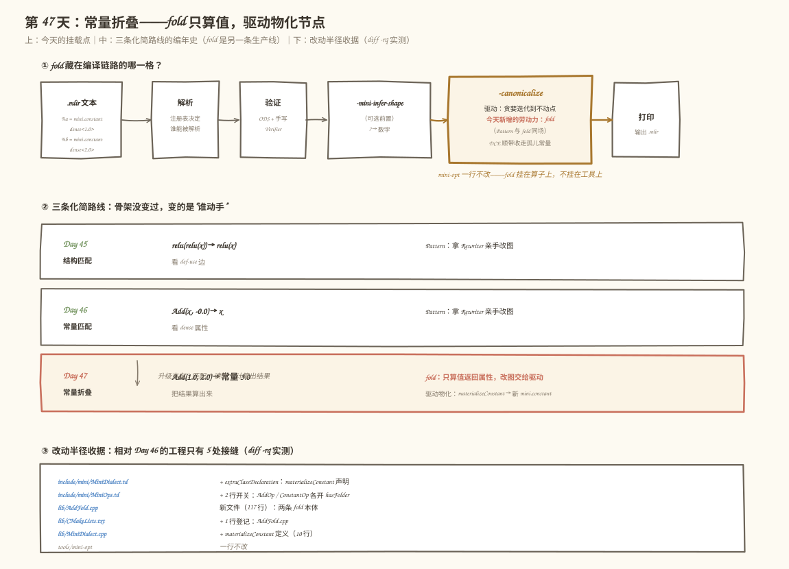
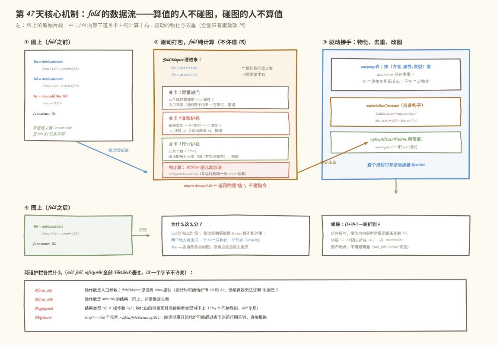
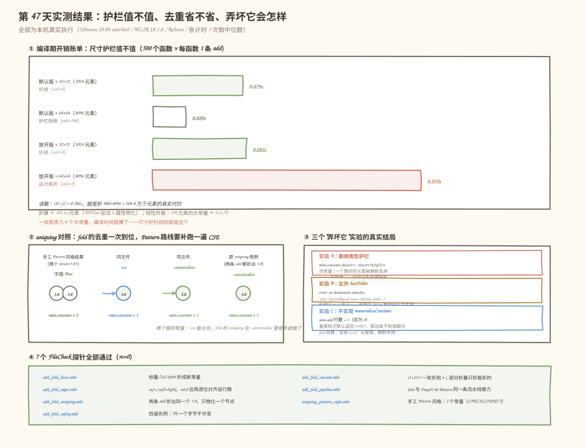

# 第 47 天：常量折叠——`Add(1.0, 2.0)` 的答案，编译期就该算出来

> **今日目标**：完成本教程后，你能把"常量碰常量"的 `mini.add` 写成 fold（`lib/AddFold.cpp`），挂进 `-canonicalize` 现成驱动；能说清 Folder、Canonicalization、常量物化（materialization）三者的分工——fold 只算值不碰 IR，驱动负责物化节点和全局去重；能用 7 个 FileCheck 探针＋三个"弄坏它"对照实验＋一组真实计时的压测，证明两道护栏（类型、尺寸）各自拦什么、uniquing 省了什么、"过大 Tensor 不许在编译期展开"的账单到底有多大。
> **预计时间**：学习 40 分钟＋实践 45 分钟
> **前置准备**：Day 41～46 的 mini 方言工程（今天在其上新增 5 处接缝）、LLVM/MLIR 18.1.8（含 `MLIRConfig.cmake`）、CMake 3.20+ 与 Ninja、FileCheck（`FileCheck-18`）、Python3（跑压测计时）。实测环境：Ubuntu 20.04.5 LTS（aarch64）、gcc 9.4.0、cmake 3.20.5、ninja 1.10.0、Python 3.11.4——与 Day 29/37～46 记录一致。
> **今日产出**：`lib/AddFold.cpp`（`mini.add` 与 `mini.constant` 两条 fold）＋`MiniDialect::materializeConstant`（常量物化钩子）、7 个带 FileCheck 的 `.mlir` 用例（正例 5＋负例 1＋对照 1）＋上游 `arith` 探针、`gen_stress.py` 压测生成器、`run_all.sh` 一键重放脚本（含三个"弄坏它"变体构建和真实计时压测），全部实测通过。

## 1. 今天解决什么问题？

Day 46 的必做练习二埋了一个悬念：`add(NaN, -0.0)` 里两个操作数都是常量时，代数化简 Pattern 只是"选中 lhs 完事"——`-0.0` 被消掉、`add` 出局，但 lhs 那个 NaN 常量只是**被选中**，没有被**算过**。可"常量碰常量"的场景远不止恒等式：训练框架导出的图里到处是 `add(1.0, 2.0)` 这种**两边都是编译期已知值**的运算——预计算好的缩放系数、融合前的 bias 调整、标定表里的常量……它们的共同点是：**答案在编译期就已经确定了，运行期再算一遍纯属浪费**。今天就把这个"算"字补上——贯穿全文的例子就是它：

```mlir
%a = mini.constant dense<1.0> : tensor<f32>
%b = mini.constant dense<2.0> : tensor<f32>
%s = mini.add %a, %b : tensor<f32>, tensor<f32> -> tensor<f32>

//  ==今天的 fold + materializeConstant==>

%s = mini.constant dense<3.0> : tensor<f32>   // 和已在编译期算出，
                                               // add 与两个旧常量一起消失
```

计划原文给今天点了三个学习点：**Folder、Canonicalization 和常量物化之间的关系**；对支持的标量或小型 Tensor 常量执行 Add 折叠；**限制过大 Tensor 的编译期展开**。对应到实现上就是三件事：

- `MiniOps.td` 给 `mini.add` / `mini.constant` 打开 `hasFolder`，本体写在 `lib/AddFold.cpp`：读进属性、算出属性、原路返回——全程不许碰 IR；
- `MiniDialect` 实现常量物化钩子 `materializeConstant`：fold 返回的只是"值"（Attribute），把它变回图上一个真实 `mini.constant` 节点是方言的活；
- 尺寸护栏 `kMaxFoldElements = 1024`：元素太多就不在编译期展开——§5.6 会用真实计时告诉你这条护栏值多少钱。

相比 Day 45/46，今天是**另一条生产线**：Pattern 拿 `PatternRewriter` 亲手改图；fold 连 Rewriter 的影子都见不到。这个看似别扭的分工换来一样 Pattern 做不到的能力——驱动拿到"值"之后可以做**全局去重**（uniquing）：两个地方折出同一个 `3.0`，图里只会出现一个常量节点（§5.4 实测）。验收标准：7 个探针 FileCheck 全绿；`add_fold_safety.mlir` 里四道负例的 IR 一个字节不许变；压测里 4096 元素的常量被护栏拒绝、1024 元素的照折；三个"弄坏它"实验各自复现出三种不同的失败形态。

## 2. 先看全貌：今天的内容位于哪里？



**图 1**：三个看点。顶部流水线：今天**不写新 Pass**——fold 和 Pattern 一样挂在算子上，由 Day 41 就注册好的 `-canonicalize` 驱动统一调度，`mini-opt` 一行不改。中部编年史：Day 45 看结构（边）、Day 46 看常量（属性）、Day 47 把结果**算出来**；前两天是 Pattern 拿 Rewriter 改图，今天 fold 只算值、改图交给驱动。底部收据：`diff -rq` 实测，相对 Day 46 的工程只动了 5 处接缝。

全流程五步：

1. **解析**：`.mlir` 变成内存里的 Operation 树（Day 35 的注册表决定谁能被解析）。
2. **验证**：ODS 约束＋手写 Verifier 把关"合不合法"，对动态维 `?` 保守放行（Day 40）。
3. **`-mini-infer-shape`（可选前置）**：把结果类型里的 `?` 细化成数字（Day 44）。
4. **`-canonicalize`（今天）**：驱动贪婪迭代到不动点，每个节点上**先试 fold、再试 Pattern**（两种劳动力同场）；fold 出的属性经 `materializeConstant` 物化成新常量，被拆掉的旧常量失去使用者后由驱动顺带做的简单 DCE 收走。
5. **打印**：输出 `.mlir`，正例图更短，负例一个字节不许变。

为什么这值得单独一天？因为"把运算在编译期算掉"是图优化的另一条主力矿脉：上游 `arith`、`linalg`、Tosa 的几十条化简规则里，fold 和 Pattern 各占半壁江山。今天走通"fold 返回值、驱动管节点"的分工，Day 48 把 Shape 推导、Relu 消除、代数化简、常量折叠四种能力接进同一条组合管道时，你会看到它们互相制造机会——折叠出的新常量，正好是代数化简的匹配对象。

## 3. 核心概念：fold、常量物化与 uniquing

### 3.1 fold：只交答案，不发号令

**常量折叠**（constant folding）指在编译期就把只依赖常量的运算算出结果。今天的机制载体是 **fold 钩子**：ODS 里 `let hasFolder = 1;` 会让 tblgen 在生成的算子类里声明一条实例方法：

```cpp
::mlir::OpFoldResult fold(FoldAdaptor adaptor);
```

它和 Day 45/46 的 `matchAndRewrite` 有一条本质分界线：**fold 全程拿不到 `PatternRewriter`**。类比考试里的阅卷分工——fold 是"只交答案"的考生：读题（操作数的常量值）、算题（纯计算）、交答案（返回一个 Attribute）；至于怎么把答案誊到卷面上（改 IR、物化节点、替换使用者），是发号令的驱动干的。对应到技术上是三条硬约束：输入是**打包好的属性**（`FoldAdaptor`），输出是**一个 Attribute**（通常是 `DenseElementsAttr`），过程**不许修改 IR**。这条分界不是形式主义——正因为它"只算值"，驱动才能把它的输出放进全局去重表（§3.4）。

`OpFoldResult` 是"属性或已有 Value"的二选一包装：返回 Attribute 表示"这个 op 的结果等于这个常量值"；返回 `Value` 表示"结果等于图里已有的某个值"（今天用不到，返回 `{}` 表示"无活可干"）。

### 3.2 递纸条：`FoldAdaptor` 从哪来

驱动折叠 `mini.add` 时，怎么知道 `%a`、`%b` 装着什么值？答案藏在 `mini.constant` 自己的 fold 里：

```cpp
OpFoldResult mini::ConstantOp::fold(mini::ConstantOp::FoldAdaptor adaptor) {
  return getValue();   // 把 value 属性原样奉还——这不是化简，是"递纸条"
}
```

驱动（MLIR 里叫 `OperationFolder`）对操作数的**定义者**问一句"你是常量吗？值是多少"：定义者带 `ConstantLike` trait 才会被问，`mini.constant` 的回答就是把 `value` 属性原样交出。驱动把两边收来的纸条打包成 `FoldAdaptor` 送进 `mini.add` 的 fold。所以函数入口参数、`mini.relu` 的结果这些**非常量定义者**，在 `FoldAdaptor` 里就是空 `Attribute`——`dyn_cast_or_null<DenseElementsAttr>` 返回空，fold 第一关就撤退（负例 `@from_arg` / `@from_relu` 实测，§5.3）。上游 `arith.constant` 的 fold 是同一句话；`mini.add` 的 fold 对应上游 `arith.addf`——§5.5 的探针会看到两者行为逐项对齐。

### 3.3 常量物化：把"值"变回图上的节点

fold 返回 `dense<3.0>` 之后，图上还没有这个节点——**常量物化**（constant materialization）是方言的活，通过 `Dialect` 基类的虚函数钩子接入：

```cpp
Operation *MiniDialect::materializeConstant(OpBuilder &builder,
                                             Attribute value, Type type,
                                             Location loc) {
  auto dense = dyn_cast<DenseElementsAttr>(value);
  auto tensorType = dyn_cast<ShapedType>(type);
  if (!dense || !tensorType || dense.getType() != tensorType)
    return nullptr;                       // 类型对不上：交还驱动（双保险）
  return builder.create<mini::ConstantOp>(loc, tensorType, dense);
}
```

声明放在 `MiniDialect.td` 的 `extraClassDeclaration` 里（签名照抄基类），定义放在 `MiniDialect.cpp`。基类头文件（`mlir/IR/Dialect.h`）对这个钩子的约定是：生成的 op 必须是"常量样"的——单结果、零操作数、无副作用；`mini.constant` 天生满足（`Pure` + `ConstantLike` + `AllTypesMatch` 保证属性类型与结果类型一致）。**不实现这个钩子会怎样？**基类默认实现返回 `nullptr`，驱动拿不到落脚点就放弃这次重写——fold 照样被调用、照样把和算出来，但图一个字节都不变。这是今天最隐蔽的失败形态（§6 错误 3 有真实复现：`mini.add` 行数纹丝不动，rc=0 无任何报错）。

### 3.4 uniquing：fold 独享的全局去重表

`OperationFolder` 里有一张按**（方言, 属性, 类型）三元组**索引的去重表（`FoldUtils.h` 里的 `ConstantMap`，按插入区域分桶；头文件注释原话："uniqued constants by dialect, attribute, and type"）。驱动每次拿到 fold 的属性结果，先查表：表里已有同款常量就**直接复用旧节点**，没有才调用 `materializeConstant` 物化新的。

这是"fold 返回值、驱动管节点"分工的直接红利：`add(1.0, 2.0)` 和 `add(0.5, 2.5)` 两条互不相干的运算都折出 `3.0`，图里只会出现**一个** `mini.constant dense<3.0>`。Pattern 拿不到这张表——每条 Pattern 各自 `rewriter.create` 各自的常量，想追平得额外跑一遍 `-cse`（§5.4 的对照实验实测了这个差距）。注意去重的键是"方言 + 值 + 类型"，与**哪条算子折出来的无关**——不同算子折出同一个值也共享节点。

### 3.5 与 Canonicalization 的关系：同一个驱动，两种劳动力

fold 和 Pattern 不是竞争关系，而是同一条 `-canonicalize` 流水线里的两种劳动力：驱动对工作表里的每个节点先试 fold（便宜、纯计算），再试算子注册的 Canonicalization Pattern（贵、能做结构重写），谁成功谁的效果落图，重写影响到的节点回工作表，直到不动点。两个直接后果：

- **级联一轮到底**：`(1.0+2.0)+3.0` 折外层时，驱动向内层新物化的常量递纸条拿到 `3.0`，外层随之折成 `6.0`——一次 `-canonicalize` 到不动点，不用跑两遍（`add_fold_cascade.mlir` 实测）；
- **两条生产线指向同一结果**：`add(3.0, -0.0)` 这种用例，Day 46 的 Pattern（消 `-0.0`）和今天的 fold（直接算出 `3.0 + (-0.0) = 3.0`）都能处理，谁先点火都安全（`add_fold_pipeline.mlir` 的 `@pattern_then_fold` 实测）。

还有一点值得单独强调：**fold 算出的就是运行期会算出的同一个位模式**。今天的纯计算用 `llvm::APFloat` 逐元素加法，舍入模式 `rmNearestTiesToEven` 与运行期默认一致——`(+Inf) + (-Inf) = NaN`、`(-0.0) + (-0.0) = -0.0`、`(+0.0) + (-0.0) = +0.0`，IEEE 754 的边角值全部按标准处理（`add_fold_edges.mlir` 实测，MLIR 打印器对 NaN 输出十六进制位模式 `0x7FC00000`）。fold 不是"近似计算"，它复刻的就是硬件会做的每一位。

## 4. 图解核心机制：fold 的数据流



**图 2**：一条从左到右的数据流。左：fold 之前的图，`%a`、`%b` 两个常量定义者是纸条来源；中：`FoldAdaptor` 打包进 fold，三道关卡全过才做纯计算，返回 `dense<3.0>` 这个"值"；右：驱动接手——查 uniquing 表、物化新常量、改边擦节点。**全图只有右侧的驱动握着改图的笔**，这是今天和 Day 45/46 最大的结构差异。

按图中编号逐步讲：

1. **驱动收纸条**：对 `%s = mini.add %a, %b` 的两个操作数，各向定义者要常量值。`%a`、`%b` 由 `mini.constant` 定义（`ConstantLike`），它们的 fold 把 `value` 属性原样交出。**为什么需要这一步**：常量的数值不带在操作数上而是带在属性里（Day 38 的结构），fold 必须通过驱动才能看到它。
2. **关卡 1——常量进门**：`FoldAdaptor` 里两个属性都得是 `DenseElementsAttr`。入口参数、别的算子的结果在这里就是空属性，撤退。**为什么**：编译器只能对"证明得了的常量"动手，运行时巧合不算数。
3. **关卡 2——类型护栏**：`getRes().getType() == getLhs().getType() == getRhs().getType()` 才动手。**为什么**：Verifier 对动态维保守放行（Day 40），"lhs 是 `2x3`、结果是 `?x3`"是合法 IR；但物化出的常量类型跟着属性走（静态 `2x3`），顶替 `?x3` 的结果会让使用者类型对不上——§6 错误 2 的复现比 Day 46 的更隐蔽：不是报错，是**静默产出空常量**。
4. **关卡 3——尺寸护栏**：结果元素个数 > `kMaxFoldElements`(1024) 就拒绝。**为什么**：每折叠一次是 O(N) 次 `APFloat` 加法＋物化一个 N 元素的新属性，大常量在编译期展开的开销可能超过它省下的运行期开销——§5.6 的压测给出真实账单。
5. **纯计算＋返回**：`llvm::zip` 把两个常量的元素逐对配对，`APFloat::add(rmNearestTiesToEven)` 逐元素求和，装进 `SmallVector` 后 `DenseElementsAttr::get(resType, sum)` 返回。注意 MLIR 18 的 `DenseElementsAttr` 没有 `begin<T>()/end<T>()` 迭代器对，标准入口是 `getValues<T>()` 返回可迭代的值区间。

右侧驱动侧三步（物化、去重、改图）在 §3.3/3.4 已讲透，这里补一个图上看不见的细节：`replaceAllUsesWith` 改的是**所有**使用者的边，`eraseOp` 送走 add 之后，两个旧常量失去使用者，被驱动顺带做的简单 DCE 收走——所以最终图里旧常量也消失了（Day 45 就见过的机制，今天再次受益）。

## 5. 动手实践：构建、运行、观察

### 5.1 准备文件与改动半径

今天的代码在 `tutorials/day-047/code/`，相对 Day 46 的 mini 工程只动了 5 处接缝——`diff -rq` 实测收据（`run_all.sh` 第 1b 步真实输出）：

```text
Files .../day-046/code/mini/include/mini/MiniDialect.td and .../day-047/.../MiniDialect.td differ
Files .../day-046/code/mini/include/mini/MiniOps.td and .../day-047/.../MiniOps.td differ
Only in .../day-047/code/mini/lib: AddFold.cpp
Files .../day-046/code/mini/lib/CMakeLists.txt and .../day-047/.../CMakeLists.txt differ
Files .../day-046/code/mini/lib/MiniDialect.cpp and .../day-047/.../MiniDialect.cpp differ
```

| 文件 | 改动 | 内容 |
|---|---|---|
| `include/mini/MiniDialect.td` | 1 段声明 | `extraClassDeclaration` 里加 `materializeConstant` override 声明 |
| `include/mini/MiniOps.td` | 2 行开关 | `Mini_AddOp` / `Mini_ConstantOp` 各加 `let hasFolder = 1;` |
| `lib/AddFold.cpp` | 新文件 | 两条 fold 本体＋`kMaxFoldElements` 常量（117 行） |
| `lib/CMakeLists.txt` | 1 行登记 | 源文件列表加 `AddFold.cpp` |
| `lib/MiniDialect.cpp` | 1 个新函数 | `materializeConstant` 定义（10 行） |

`mini-opt`、`Ops.h`、`Passes.h` 一行不动。构建命令（本机实测 19 个构建步）：

```bash
cd tutorials/day-047/code
cmake -G Ninja -B /tmp/day047/build -S mini \
      -DCMAKE_BUILD_TYPE=Release -DMLIR_DIR=/usr/lib/llvm-18/lib/cmake/mlir
cmake --build /tmp/day047/build
```

### 5.2 编写代码：开关、fold 本体与物化钩子

`MiniOps.td` 的开关（Day 45 的 `hasCanonicalizer` 同款机制，只是换了个名字）：

```tablegen
// Mini_AddOp 里：
let hasFolder = 1;      // tblgen 生成 ::mlir::OpFoldResult fold(FoldAdaptor);
// Mini_ConstantOp 里：同款一行（递纸条用）
```

`lib/AddFold.cpp` 的关键实现（完整 117 行见代码目录，注释即讲解）：

```cpp
OpFoldResult mini::AddOp::fold(mini::AddOp::FoldAdaptor adaptor) {
  // 关卡 1：两个操作数都带着常量属性进门
  DenseElementsAttr lhs =
      dyn_cast_or_null<DenseElementsAttr>(adaptor.getLhs());
  DenseElementsAttr rhs =
      dyn_cast_or_null<DenseElementsAttr>(adaptor.getRhs());
  if (!lhs || !rhs)
    return {};                    // 有一个不是常量：交回驱动

  // 关卡 2：类型护栏（?x3 换不动 2x3，§6 错误 2）
  if (getRes().getType() != getLhs().getType() ||
      getRes().getType() != getRhs().getType())
    return {};

  // 关卡 3：尺寸护栏（编译期展开的代价预算）
  ShapedType resType = cast<ShapedType>(getRes().getType());
  if (resType.getNumElements() > kMaxFoldElements)
    return {};

  // 纯计算：逐元素 APFloat 加法，舍入与运行期一致
  SmallVector<llvm::APFloat, 16> sum;
  sum.reserve(lhs.getNumElements());
  for (auto [l, r] : llvm::zip(lhs.getValues<llvm::APFloat>(),
                                rhs.getValues<llvm::APFloat>())) {
    llvm::APFloat v = l;
    v.add(r, llvm::APFloat::rmNearestTiesToEven);
    sum.push_back(v);
  }
  return DenseElementsAttr::get(resType, sum);  // 值交出去，节点交给驱动
}
```

值得停在三个点上。其一，`adaptor.getLhs()` 的类型是 `Attribute` 而不是 `Value`——`FoldAdaptor` 打包的是**操作数携带的常量值**，这正是"fold 只见值不见图"的类型化体现。其二，三个关卡全在纯计算之前：fold 里没有重试机会，任何一点拿不准就整体撤退，把节点交回驱动去试 Pattern。其三，`mini.constant` 的 fold（§3.2 的递纸条）与 `materializeConstant`（§3.3）合起来构成一条完整的"值 ⇄ 节点"双向通道——前者把节点变成值交给 fold 计算，后者把 fold 算出的值变回节点落回图上。

### 5.3 运行与观察：正例、级联与护栏

以下全部是本机真实执行结果（`bash run_all.sh` 一键重放，环境见文首）。先看主角用例 `add_fold_basic.mlir`：

```bash
/tmp/day047/build/bin/mini-opt -canonicalize add_fold_basic.mlir
```

```mlir
module {
  func.func @scalar() -> tensor<f32> {
    %0 = mini.constant dense<3.000000e+00> : tensor<f32>
    return %0 : tensor<f32>
  }
  func.func @tensor23() -> tensor<2x3xf32> {
    %0 = mini.constant dense<[[1.500000e+00, 2.500000e+00, 3.500000e+00], [4.500000e+00, 5.500000e+00, 6.500000e+00]]> : tensor<2x3xf32>
    return %0 : tensor<2x3xf32>
  }
  func.func @bias() -> tensor<2x2xf32> {
    %0 = mini.constant dense<[[1.500000e+00, 1.500000e+00], [2.500000e+00, 2.500000e+00]]> : tensor<2x2xf32>
    return %0 : tensor<2x2xf32>
  }
}
```

三个函数对应三种形态：`@scalar` 是标量（秩 0）折叠；`@tensor23` 是非 splat 的 2×3 常量逐元素相加；`@bias` 里 `dense<0.5>` 是 splat（全体元素同值的张量）——fold 对 splat 没有特殊通道，照样逐元素算，只是 MLIR 打印器会把结果里的均匀值再印成 splat 简写。每个函数里 `mini.add` 和**两个旧常量**都消失了，只剩折出来的新常量。

级联用例 `add_fold_cascade.mlir` 见证"一轮到不动点"：输入是 `(1.0+2.0)+3.0` 两层 add，真实输出只剩 `mini.constant dense<6.000000e+00>`；同文件 `@partial` 里 `add(%arg0, 1.0+2.0)` 只折能折的内层，外层 `add(%arg0, 常量 3.0)` 原样保留——fold 只在"证明得了"的地方动手：

```mlir
  func.func @partial(%arg0: tensor<f32>) -> tensor<f32> {
    %0 = mini.constant dense<3.000000e+00> : tensor<f32>
    %1 = mini.add %arg0, %0 : tensor<f32>, tensor<f32> -> tensor<f32>
    return %1 : tensor<f32>
  }
```

IEEE 边角用例 `add_fold_edges.mlir` 逐位对齐运行期：`(+Inf) + (-Inf)` 折成 `dense<0x7FC00000>`（NaN 的 f32 位模式，MLIR 打印器的十六进制写法）、`(-0.0) + (-0.0)` 折成 `dense<-0.000000e+00>`、`(+0.0) + (-0.0)` 折成 `dense<0.000000e+00>`。负例合集 `add_fold_safety.mlir` 的四道护栏（入口参数、relu 结果、`?x3` 类型、64×64 尺寸）实测全部拦下，IR 一个字节没变。`FileCheck` 校验 7 个探针全绿：

```text
[add_fold_basic.mlir]          FileCheck 通过 (rc=0)   标量/2x3/splat 折成新常量
[add_fold_cascade.mlir]        FileCheck 通过 (rc=0)   (1+2)+3 一轮折到 6
[add_fold_edges.mlir]          FileCheck 通过 (rc=0)   inf+(-inf)=NaN、±0.0 逐位对齐
[add_fold_pipeline.mlir]       FileCheck 通过 (rc=0)   fold 与 Pattern 同场接力
[add_fold_uniquing.mlir]       FileCheck 通过 (rc=0)   两条 add 只物化一个 3.0
[uniquing_pattern_style.mlir]  FileCheck 通过 (rc=0)   对照：Pattern 风格 2 个常量
[add_fold_safety.mlir]         FileCheck 通过 (rc=0)   四道负例 IR 一字未动
```

`add_fold_pipeline.mlir` 值得单独看：`relu(relu(add(1.0, 2.0)))` 里 fold 先把 add 折成常量 3.0，Day 45 的 Pattern 再把双层 relu 剥成单层，真实输出只剩 `relu(常量 3.0)`——relu 没实现 fold（教学上留给今天的练习），到它这里停住：

```mlir
  func.func @fold_then_pattern() -> tensor<f32> {
    %0 = mini.constant dense<3.000000e+00> : tensor<f32>
    %1 = mini.relu %0 : tensor<f32> -> tensor<f32>
    return %1 : tensor<f32>
  }
```

### 5.4 uniquing 对照：fold 的去重 vs 补跑一遍 CSE

`add_fold_uniquing.mlir` 里两条互不相干的 `add(1.0, 2.0)` 和 `add(0.5, 2.5)` 都折出 3.0，真实输出里**只有一个**常量节点，`return %0, %0` 两个返回值共用同一个 `%0`。如果 fold 是 Pattern（各自物化各自的常量），结果就是 `uniquing_pattern_style.mlir` 手工摆出的样子。数 `mini.constant` 节点（`run_all.sh` 第 4 步真实输出）：

```text
--- (1) 手工 Pattern 风格结果（两个 dense<3.0>），不跑 Pass ---
2
--- (2) 同文件 -cse：CSE 把两个相同常量合并 ---
1
--- (3) 同文件 -canonicalize：fold 的 uniquing 一次到位 ---
1
--- (4) 原 uniquing 用例（两条 add 都折出 3.0）-canonicalize ---
1
```

结论：fold 的 uniquing 在 `-canonicalize` 内部一次到位；Pattern 路线要**再跑一遍 `-cse`** 才能追平。这不是 mini 的私货——上游 `OperationFolder` 同一张表，§5.5 的 arith 探针同样只物化一个 `arith.constant 3.0`。

### 5.5 上游对照：`mlir-opt-18` 的同款行为

探针 `arith_probe.mlir`（标量版 f32）交给上游，真实输出：

```mlir
module {
  func.func @both_const() -> f32 {
    %cst = arith.constant 3.000000e+00 : f32
    return %cst : f32
  }
  func.func @uniquing() -> (f32, f32) {
    %cst = arith.constant 3.000000e+00 : f32
    return %cst, %cst : f32, f32
  }
  func.func @from_arg(%arg0: f32, %arg1: f32) -> f32 {
    %0 = arith.addf %arg0, %arg1 : f32
    return %0 : f32
  }
}
```

三项逐项对齐：`addf(常量, 常量)` 折成 `arith.constant 3.0`（同款折叠）；两条都折出 3.0 的 addf 只剩一个常量节点（同款 uniquing）；操作数来自入口参数的不折（同款保守性）。mini 复刻的正是上游的机制与取舍。

### 5.6 压测：尺寸护栏的真实账单

最后回答计划里"限制过大 Tensor 的编译期展开"这条要求值多少钱。`gen_stress.py` 生成 500 个函数、每个函数一条"常量＋常量"的 `mini.add`：`--dim 32` 是 `tensor<32x32xf32>`（1024 个元素 == `kMaxFoldElements`，允许折叠）；`--dim 64` 是 4096 个元素（> 1024，被尺寸护栏拒绝）。再构建一个把阈值放开到 1000000 的变体 `mini-opt` 做对照，四个组合各计时 3 次取中位数（`run_all.sh` 第 9 步真实输出）：

| # | mini-opt 版本 | 输入 | mini.add 剩余 | 耗时（中位数） |
|---|---|---|---|---|
| (1) | 默认（阈值 1024） | 500 × 32×32（1024 元素） | 0（全折） | 0.079s |
| (2) | 默认（阈值 1024） | 500 × 64×64（4096 元素） | 500（全拒） | 0.029s |
| (3) | 放开（阈值 1000000） | 500 × 32×32（1024 元素） | 0（全折） | 0.082s |
| (4) | 放开（阈值 1000000） | 500 × 64×64（4096 元素） | 0（全折） | 0.235s |

三个读数：

- **(4) − (2) = 0.206s**，就是折 500×4096 = 204.8 万个元素的真实编译期代价，折算 **≈ 101 ns/元素**（`APFloat` 加法＋新属性物化）。(3) − (2) = 0.053s 对应 51.2 万个元素，折算 ≈ 103 ns/元素——两组数字互相印证，代价随元素数**线性增长**。
- 换个视角：默认版遇到 4096 元素的常量，0.029s 就把整个文件处理完；放开版要花 0.235s——**约 8 倍**。线性外推：一个 1024×1024（100 万元素）的大常量就是约 0.1s，一张图里来几十个，编译时间就爆了。这就是 `kMaxFoldElements` 存在的理由：**编译时间预算**。真实编译器会按预算调这个数，而不是无脑放开。
- (1) 与 (3) 几乎相同（0.079s vs 0.082s）：阈值只影响"大常量折不折"，对本来就允许折叠的小常量没有额外开销——护栏本身近乎免费。



**图 3**：三块证据。上部压测账单回答"尺寸护栏值不值"——8 倍的编译时间差距就是答案；中部 uniquing 对照回答"fold 的分工换来什么"——一次到位的全局去重；下部三个"弄坏它"实验（§6 详述）展示三种不同的失败形态，其中最危险的是实验 A：**rc=0、无报错、静默丢数据**。

## 6. 常见错误与排查

四个错误全部在本环境亲手复现过（Ubuntu 20.04 aarch64 / MLIR 18.1.8 / Release 构建；`run_all.sh` 第 6～9 步自动重放，变体源码与构建日志在 `/tmp/day047/mini-*` 与 `/tmp/day047/build-*.log`）。

### 错误 1：忘开 `hasFolder`——fold 成了无主函数

- **现象**：写好了 `lib/AddFold.cpp` 并登记进 CMake，但 `Mini_AddOp` 里忘了 `let hasFolder = 1;`，构建直接失败（真实终端记录）：

  ```text
  lib/AddFold.cpp:71:14: error: no declaration matches
    'mlir::OpFoldResult mini::AddOp::fold(mini::AddOp::FoldAdaptor)'
  lib/AddFold.cpp:71:14: note: no functions named
    'mlir::OpFoldResult mini::AddOp::fold(mini::AddOp::FoldAdaptor)'
  （构建以 rc=1 终止）
  ```

- **原因**：fold 的**声明**是 tblgen 看到 `hasFolder = 1` 才生成的。开关没开，`mini.add` 的 C++ 类里没有这个成员，你在 .cpp 里定义的 fold 就成了"无主函数"——与 Day 45 错误 3（`hasCanonicalizer`）、Day 46 错误 1 同一款机制，第三次出现。今天特别容易踩的坑：文件里有**两个** fold（`ConstantOp::fold` 和 `AddOp::fold`），只开 constant 的开关时，递纸条那条能链上、`add` 那条报错——报错行号（71）正好指向 `AddOp::fold` 的定义处。
- **定位**：报错的函数签名直接点名哪个算子的开关没开；对照 `MiniOps.td` 里对应算子查 `hasFolder`。
- **修复**：`Mini_AddOp` 加一行 `let hasFolder = 1;`，重新构建——tblgen 重跑、声明生成、编译通过。

### 错误 2：删掉类型护栏——静默产出"空常量"

- **现象**：觉得 `getRes().getType() != getLhs().getType()` 这道检查多余（Verifier 都放行过这份 IR），删掉重新构建，跑 `add_fold_safety.mlir` 的 `@typeguard`（lhs/rhs 是 `2x3` 常量、结果类型 `?x3`），真实输出：

  ```mlir
  func.func @typeguard() -> tensor<?x3xf32> {
    %0 = mini.constant dense<> : tensor<?x3xf32>   // ← 空常量！
    return %0 : tensor<?x3xf32>
  }
  ```

  add 消失了，取而代之的是一个**空的** `dense<>` 常量——fold 算好的 6 个元素被静默丢弃。全程 **rc=0、无任何报错**，比 Day 46 同款实验（rc=1 验证失败）更危险。

- **原因**：拆开看是一串连锁。① 护栏删除后，`resType` 是动态形状 `?x3`，而 `ShapedType::getNumElements()` 的契约是"仅静态形状可调用，否则 abort"（头文件注释原话），靠 `assert(hasStaticShape())` 把守——**Release 构建里 assert 被编译掉**；② `?` 维在 MLIR 内部是哨兵值 `kDynamic = INT64_MIN`，"元素个数"算成 `INT64_MIN × 3`，回绕后仍是负数，于是尺寸护栏 `负数 > 1024` 判假放行；③ `DenseElementsAttr::get` 拿着这个垃圾尺寸建属性，得到 0 个元素的空属性；④ `materializeConstant` 里 `AllTypesMatch` 让新常量的结果类型跟属性走（也是 `?x3`），顶替 add 后 `func.return` 的 `?x3` 对 `?x3`，**验证通过**。Debug 构建里 ① 的 assert 会当场 abort（本机实测 Debug 构建被一个无关的 MLIR statistics 链接问题挡住，未跑到这一步，此为头文件注明的行为，未当作已执行结果）。
- **定位**：输出里出现 `dense<>` 就是这个错误的指纹；另一个探雷器是"负例计数"——`@typeguard` 的 add 本应保留，被无声换成了空常量。
- **修复**：护栏留着，一行不许省。想让这条 add 能被优化，正确做法是先跑 `-mini-infer-shape` 把 `?` 细化成数字（Day 46 的结论原样适用），而不是拆安全带。

### 错误 3：不实现 `materializeConstant`——fold 白算

- **现象**：以为写完 `AddFold.cpp` 就大功告成，忘了 `MiniDialect.td` 的声明和 `MiniDialect.cpp` 的定义。构建成功（基类有默认实现，虚函数不实现也能链上），跑 `add_fold_basic.mlir`，数 `mini.add` 行数（`run_all.sh` 第 8 步真实输出）：

  ```text
  --- 无物化钩子版 -canonicalize add_fold_basic.mlir：数 mini.add 行数 ---
  3
  （正确版同命令应为 0：全部折掉）
  ```

- **原因**：`Dialect::materializeConstant` 基类默认返回 `nullptr`。驱动拿到 fold 返回的属性，调钩子物化，拿到空指针就放弃这次重写——**fold 照样被调用、照样把和算出来，但图一个字节都不变**。fold 的输出是"值"，没有物化钩子它就没有落脚点，折叠等于白算。
- **定位**：症状是"fold 写了、构建过了、图却一点没变"。跟错误 2 一样是静默失败，区分办法：错误 2 会**改图**（换成空常量），错误 3 **根本不改图**。
- **修复**：补上声明＋定义（§3.3 的 10 行）。这也是读 `run_all.sh` 对照实验的价值：三个失败形态（构建失败／改错图／不改图）各对应一条缺失的接缝。

### 错误 4：把 `kMaxFoldElements` 当性能旋钮随手调大

- **现象**：觉得"1024 太保守，现代机器算 4096 个浮点数眨眼的事"，把阈值改成 1000000（甚至删掉尺寸护栏），构建通过、所有正例照常通过——FileCheck 全绿，看起来毫无问题。
- **原因**：正确性确实没问题，丢的是**编译时间**。§5.6 的压测给了真实账单：500 个 64×64 常量的文件，默认版 0.029s（护栏拒绝）、放开版 0.235s（真折）——8 倍差距，约 101 ns/元素，且随元素数线性增长。真实模型里常量大户（embedding 表、标定表、常量权重）动辄百万元素，几十个就把编译时间拖进秒级。最阴险的地方在于：这个退化**不触发任何测试**——所有功能测试照样通过，只有 CI 的编译时间曲线会悄悄抬头。
- **定位**：把"编译 wall time"当回归指标盯住（`run_all.sh` 第 9 步的计时就是模板：同一输入、不同阈值、各跑 3 次取中位数）。
- **修复**：阈值按编译时间预算定，改动它时必须带着计时数据来。教学版取 1024 覆盖 bias／标量／小张量等真实场景；上游各方言的 fold 同样有尺寸上的保守取舍，思路一致。

## 7. 今日练习

### 必做练习一：给 `mini.relu` 补上 fold

`add_fold_pipeline.mlir` 的 `@fold_then_pattern` 停在 `relu(常量 3.0)`，因为 relu 没实现 fold。现在补上它：`Mini_ReluOp` 打开 `hasFolder`，`fold` 里读进操作数的 `DenseElementsAttr`，逐元素算 `max(x, 0.0)`（提示：`APFloat` 比较 `f.isNegative()` 或与 `APFloat(0.0)` 比大小都行；类型护栏照抄 add 的写法；`max(0.0, -0.0)` 取哪个零值得想一句——建议保留 `+0.0`，并说出你的理由）。**先**在注释里预测 `@fold_then_pattern` 的最终形态，**再**跑 `mini-opt -canonicalize add_fold_pipeline.mlir` 对答案。验收标准：①输出只剩一个常量、没有 relu（作者预测：`mini.constant dense<3.000000e+00>`）；②你手写的 CHECK 断言全部命中；③能解释 fold 在 relu（单操作数）和 add（双操作数）上的差异只是"收几张纸条"。

### 必做练习二：跨算子的 uniquing

构造一个新文件：`add(1.0, 2.0)` 和 `mul(1.0, 3.0)` 各一条（`mini.mul` 需要先照 add 的模板实现 fold——骨架完全同构，`APFloat::add` 换成 `APFloat::multiply`）。**先**预测：两条不同算子折出的 `3.0` 会不会共享同一个常量节点？依据是什么（回看 §3.4 去重表的键）？**再**跑 `-canonicalize` 数 `mini.constant` 的行数验证。作者预测：共享——表键是（方言, 属性, 类型），与哪条算子折出来的无关；`return %0, %0` 两个返回值共用一个 `%0`。

### 选做挑战：画你自己的护栏账单

用 `gen_stress.py` 把 `--dim` 扫过 16、32、64、128（元素数 256～16384），对每个尺寸分别用默认版和放开版计时，画出"折叠代价 vs 元素数"的曲线。要求：①验证代价确实线性（相邻尺寸翻倍，时间差也近似翻倍）；②找出在你的机器上"编译时间翻倍"对应的元素数门槛，据此提出一个你自己的 `kMaxFoldElements` 取值并说明理由；③对照 §5.6 的 101 ns/元素，看你的机器是快是慢。做完这个，"限制过大 Tensor 的编译期展开"就从一句规定变成你亲手量过的工程决策。

## 8. 今日验收

- [ ] 我能用自己的话说清 fold 和 Pattern 的分工：fold 只做纯计算、返回属性、不许碰 IR；Pattern 拿 Rewriter 亲手改图；以及这个分工换来 uniquing 这张 Pattern 拿不到的全局去重表；
- [ ] 我能讲出常量物化的完整链路：`ConstantOp::fold` 递纸条 → `AddOp::fold` 算值 → 驱动查 (方言, 属性, 类型) 表 → `materializeConstant` 物化新 `mini.constant` → `replaceAllUsesWith`＋`eraseOp`，旧常量由 DCE 收走；
- [ ] 我能说出三道关卡各拦什么：入口参数/非常量定义者（空属性）、`?x3` 换 `2x3`（物化后类型不符）、4096 元素（编译期展开超预算），且四道负例的 IR 一个字节未变（FileCheck 全绿）；
- [ ] 我能解释 uniquing 对照实验的四组计数（2/1/1/1）：Pattern 路线要补跑 `-cse` 才追平 fold 的一次到位；
- [ ] 我能读懂压测账单并说出结论：折 204.8 万个元素 ≈ 0.206s（≈101 ns/元素）、线性增长、护栏本身近乎免费（0.079s vs 0.082s）；
- [ ] 我已亲手复现三个失败形态并知道怎么防：忘开 `hasFolder` → 构建失败（无主函数）；删类型护栏 → 静默空常量（rc=0）；不实现 `materializeConstant` → fold 白算（图不变）；
- [ ] 我保存了 `AddFold.cpp`、`materializeConstant` 两处接缝、7 个 FileCheck 用例、`gen_stress.py` 和 `run_all.sh`（`tutorials/day-047/code/`），能一键重放今天的全部实验（含三个变体构建与计时压测）。

## 9. 一句话总结与明天预告

今天给 mini 方言接上了第三条化简生产线：**问题**是"常量碰常量"的运算在运行期白算——`add(1.0, 2.0)` 的答案编译期就已确定；**机制**是"fold 返回值、驱动管节点"——`AddOp::fold` 读进两张纸条、过三道关卡（常量进门、类型、尺寸）、用 `APFloat` 逐元素算出和返回属性，`materializeConstant` 把值物化成新常量，`OperationFolder` 顺带用 (方言, 属性, 类型) 表全局去重，旧 add 与旧常量一起出局；**实践**只动了 5 处接缝，`mini-opt` 一行不改；**验证**是 7 个探针 FileCheck 全绿＋uniquing 对照（2/1/1/1）＋上游 arith 逐项对齐＋真实计时压测（护栏挡下 8 倍编译时间）＋三个"弄坏它"实验（构建失败、静默空常量、fold 白算）。最有工程价值的观察：fold 的安全性不靠自觉靠关卡——类型护栏挡住的不是报错，是**静默丢数据**。

明天（Day 48）把这些能力接进同一条管道：Shape 推导（Day 44）、Relu 消除（Day 45）、代数化简（Day 46）、常量折叠（Day 47）分散在四种不同的挂载点上，互相制造机会也互相错过窗口——组合管道与不动点（跑到没有变化为止）就来解决这个问题。
