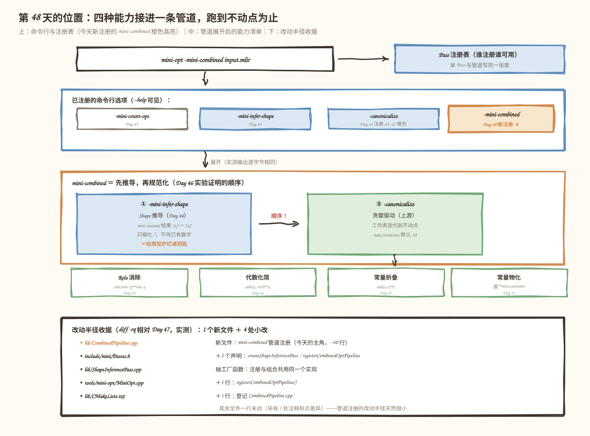
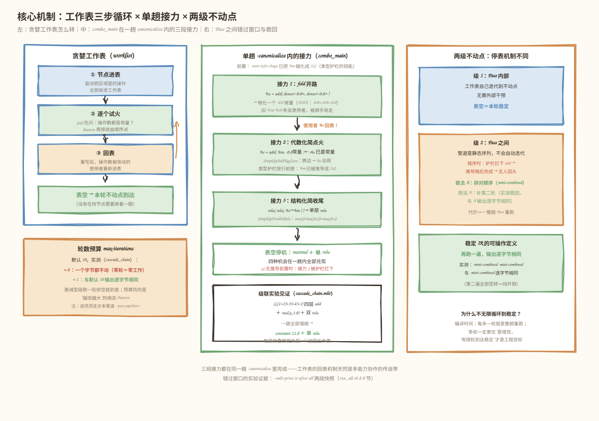
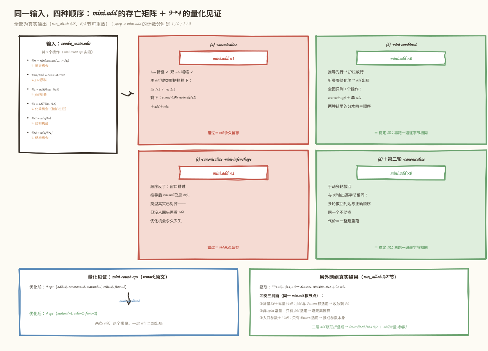

# 第 48 天：组合运行优化 Pass——四天攒下的能力接到一条管道上，跑到不动点为止

> **今日目标**：完成本教程后，你能把 Shape 推导（Day 44）、Relu 消除（Day 45）、代数化简（Day 46）、常量折叠（Day 47）四种能力组合进一条注册好的 Pass 管道 `mini-combined`（`lib/CombinedPipeline.cpp`）；能说清 Pass 管道（pipeline）、Canonicalizer 的迭代执行（贪婪工作表）、Pattern 冲突与不动点（fixpoint）这四个概念；能用"同一文件四种 Pass 顺序"的对照实验证明**顺序决定优化存亡**、用 `max-iterations` 参数证明**迭代预算怎么花**、用"跑两遍输出逐字节相同"定义**稳定 IR**。
> **预计时间**：学习 40 分钟＋实践 45 分钟
> **前置准备**：Day 41～47 的 mini 方言工程（今天的改动半径：新建 1 个文件＋4 处小改）、LLVM/MLIR 18.1.8（含 `MLIRConfig.cmake`）、CMake 3.20+ 与 Ninja、FileCheck（`FileCheck-18`）。实测环境：Ubuntu 20.04.5 LTS（aarch64）、gcc 9.4.0、cmake 3.20.5、ninja 1.10.0——与 Day 29/37～47 记录一致。
> **今日产出**：`lib/CombinedPipeline.cpp`（`mini-combined` 管道注册）、5 个带 FileCheck 的 `.mlir` 用例（正例 3＋负例 1＋上游探针 1）、`run_all.sh` 一键重放（含顺序对照、迭代预算、幂等性、量化计数四组实验），全部实测通过；优化前后操作数 9 → 4 的量化见证。

## 1. 今天解决什么问题？

Day 46 结尾留了一个悬念。当时为了证明"Pass 顺序重要"，我们把目标图 `MatMul → Add(全零 bias) → Relu → Relu` 用三种顺序跑了一遍：`-canonicalize` 在前时，`mini.add` 的类型护栏（`?x2 ≠ 2x2`）把重写拦下；`-mini-infer-shape` 在前时，护栏两侧类型对齐，add 消失。当时的原话是：

> （c）先 canonicalize 再推导：护栏拦下时没人细化类型，推导做完也不会回头再跑一遍 canonicalize——优化机会永久错过。（Day 48 的"组合运行优化 Pass / 不动点"就来解决这个问题。）

今天兑现这个承诺。但真实工程里的问题比"排对顺序"更普遍：**四种能力是四天里分开写的，各自藏在不同的挂载点上**——Shape 推导是独立 Pass（`-mini-infer-shape`），Relu 消除和代数化简是挂在算子上的 Canonicalization Pattern，常量折叠是挂在算子上的 fold。它们互相制造机会：折叠把 `add(-0.0, -0.0)` 变成一个常量，代数化简才有"右侧是 -0.0 常量"可匹配；推导把 `?x2` 细化成 `2x2`，类型护栏才放行。**谁先谁后、错过窗口怎么救、跑到什么时候停**——今天用一个贯穿全文的例子把这三个问题一次讲清：

```mlir
%m  = mini.matmul %a, %b : ... -> tensor<?x2xf32>      // ← 推导机会（? 等着变 2）
%za = mini.constant dense<-0.0> : tensor<2x2xf32>
%zb = mini.constant dense<-0.0> : tensor<2x2xf32>
%z  = mini.add %za, %zb : ...                          // ← Fold 机会（常量碰常量）
%s  = mini.add %m, %z : tensor<?x2xf32>, ... -> tensor<2x2xf32>  // ← 化简机会（但被护栏拦着）
%r1 = mini.relu %s : ...
%r2 = mini.relu %r1 : ...                              // ← 结构化简机会（双 relu）
```

四种机会叠在一张 9 个操作的图上。今天交付的组合管道 `-mini-combined` 一趟全收，输出只剩 `matmul + 单 relu` 共 4 个操作（§5.3 有 `mini-count-ops` 的真实计数：9 → 4）；而顺序不对时，add 永久留存——两种结局的 IR 都会贴出来对照。

## 2. 先看全貌：今天的内容位于哪里？



**图 1**：三个看点。顶部：今天**只写了一个新文件**——`lib/CombinedPipeline.cpp` 把"先推导、再规范化"这个 Day 46 用实验换来的顺序知识，固化成一个注册名 `-mini-combined`；命令行解析器不区分"一个 Pass"和"一条管道"，它们写同一张注册表。中部：`-canonicalize` 内部的贪婪工作表怎么转——节点进表、Pattern 试火、重写后受影响的节点回表，表空即停。底部：改动半径收据，相对 Day 47 只有 1 个新文件＋4 处小改（`Passes.h` 两个声明、`ShapeInferencePass.cpp` 抽工厂、`MiniOpt.cpp` 一行注册、`CMakeLists.txt` 一行登记）。

全流程五步：

1. **解析**：`.mlir` 变成内存里的 Operation 树（Day 35 的注册表决定谁能被解析）。
2. **验证**：ODS 约束＋手写 Verifier 把关"合不合法"，对动态维 `?` 保守放行（Day 40）。
3. **`-mini-infer-shape`**：把 matmul 结果类型里的 `?` 细化成数字——只做信息增量，绝不改写已有数字（Day 44）。
4. **`-canonicalize`**：贪婪驱动收集所有已注册算子的 Pattern 和 fold，在工作表上迭代到不动点；被拆掉的常量失去使用者后顺手收走（Day 45～47 的能力都在这里被驱动）。
5. **打印**：输出 `.mlir`；今天的关键动作是把 3＋4 两步**注册成一个名字**，并回答"如果 3 和 4 还有别的排法、别的轮数，会发生什么"。

为什么这值得单独一天？因为单打独斗的 Pass 和组合运行的管道是两个工程量级：前者只需证明"我这一步正确"，后者要回答"组合之后哪些机会兑现了、哪些错过了、错过的能不能救回来、什么时候算稳定"。Day 49 的周复盘（"为什么一次 Pattern 遍历不一定得到最简 IR"）正是站在今天的实验结果上说话。

## 3. 核心概念：管道、迭代执行、冲突与不动点

### 3.1 Pass 管道：把"正确顺序"从命令行搬进注册表

**Pass 管道**（pass pipeline）就是一组按固定顺序执行的 Pass，注册后拥有一个命令行名字。类比餐厅的"套餐"：你当然可以单点（`-mini-infer-shape -canonicalize`），但招牌组合（`-mini-combined`）把后厨验证过的上菜顺序写进了菜单——点套餐的人想排错都难。对应到技术上是：`PassPipelineRegistration<>` 向全局 PassRegistry 注册一个"管道构造器"函数，它拿到 `OpPassManager`（管理一段 IR 上要跑哪些 Pass 的容器）后按顺序 `addPass`；命令行解析器查表时**不区分**"单个 Pass 的构造函数"和"往管理器里装一串 Pass 的函数"——上游 `mlir-opt` 的 `-O2` 这类总开关也是同样的机制。

今天注册的管道本体只有四行（`lib/CombinedPipeline.cpp`）：

```cpp
PassPipelineRegistration<>(
    "mini-combined",
    "Run mini shape inference followed by canonicalization "
    "(the Day-46-verified order)",
    [](OpPassManager &pm) {
      pm.addPass(createShapeInferencePass());   // Day 44：先细化 ?
      pm.addPass(createCanonicalizerPass());   // 上游驱动：Pattern + fold
    });
```

两个配套小改动：`ShapeInferencePass.cpp` 把原来埋在注册函数里的 lambda 抽成正式工厂 `createShapeInferencePass()`（注册和组合共用一个实现，避免"注册的是一个东西、组合的是另一个东西"）；`MiniOpt.cpp` 加一行 `registerCombinedOptPipeline()`。§5.2 会贴出全部改动。

一个容易误解的点：**管道不是调度器**。它只是"展开后等价的命令行"——`-mini-combined` 与 `-mini-infer-shape -canonicalize` 的输出实测逐字节相同（§5.3 (e) 组）。它不监测"上一轮谁改了 IR"也不会自动补跑；错序问题的救法见 §3.4。

### 3.2 Canonicalizer 的迭代执行：贪婪工作表怎么转

**迭代执行**指 `-canonicalize` 不是扫一遍 IR 就走，而是把操作放进一张**工作表**（worklist）反复处理，直到没有 Pattern 能再点火。类比擦白板上的连环笔误：擦掉第一处后，第二处"原来写错的两行"才暴露出来，你得再看一眼新暴露的地方——擦到一块干净的板子为止。对应到技术上是三步循环：

1. **进表**：驱动把区域里的操作收进工作表；
2. **试火**：逐个取出，先试 fold（常量碰常量直接算）、再按收益顺序试 Pattern；任一重写成功，就把**操作数被改动的使用者**重新放回表里——因为它们面对的输入变了，可能又匹配上了；
3. **停表**：表空即"没有任何节点再需要看一眼"，这一轮不动点到达。

§5 的级联实验 `cascade_chain.mlir` 是这条循环的实测见证：`((((1+2)+3)+4)+1)` 四层 add，外层要等内层折叠成常量后才具备折叠条件；一趟 `-canonicalize` 全部塌缩成单个常量 `11.0`——每层 add 点火时把外层 add 送回工作表，链条靠回表接力到底。`max-iterations` 选项（默认 10）是这条循环的**轮数预算**：§5.4 实测 `max-iterations=0` 时一个字节都不动（零轮＝零工作），`=1` 时已与默认输出逐字节相同——因为"删节点、换边"这类不新增操作的重写，一轮工作表排空就能到底；预算真正防的是**越改越大**的病态 Pattern（每次重写都生成新的可匹配操作），今天的 Pattern 都不做这种事。

### 3.3 Pattern 冲突：两条生产线抢同一个节点

**Pattern 冲突**指同一个根操作同时被多条重写规则匹配。这不是灾难，是要有明确裁决顺序的正常竞争。类比两个编辑同时改一段稿子：只要两人改完的结果一致，谁先动手不重要；不一致才需要主编（收益排序）定规矩。对应到技术上是：mini.add 现在同时挂着 `SimplifyAddNegZero`（Pattern 生产线）和 `fold`（折叠生产线），对 `add(常量 5.0, 常量 -0.0)` 两者都想动手——

- Pattern 说：右侧是 -0.0，把 add 换成左侧那个现成的 `5.0` 常量；
- fold 说：两个操作数都是常量，我直接算 `5.0 + (-0.0) = 5.0`，物化一个新常量。

两条路算出的**最终值相同**（IEEE 754：`x + (-0.0) = x` 对一切 x 成立），加上驱动的常量去重（uniquing，物化重复常量时优先复用已有节点），所以无论谁先动手，输出都收敛到同一个 IR：一个值 5.0 的常量。§5 的 `conflict_regimes.mlir` 把三种局面排在一起实测：**两者都能动**（splat 常量对 splat 常量）、**只有 fold 能动**（非 splat 常量没有单一恒等值，`isSplat()` 不过，但逐元素照算不误）、**只有 Pattern 能动**（入口参数不是常量，fold 无从下手；代数化简只要求"被加的那一侧是常量"）。真正的工程红线是：竞争的 Pattern 必须都正确——收益排序（`OpRewritePattern` 构造的第二个参数，默认 1，高分先试）只决定谁先上，不豁免谁做数学题。

### 3.4 不动点：两个层面，两种机制

**不动点**（fixpoint）是数学名词，借到编译器里指"再跑一遍也不变了"的 IR 状态。今天的实验显示它有两个层面，停表机制完全不同：

- **Pass 内部**：`-canonicalize` 的工作表自己迭代到不动点（§3.2），不需要外部干预；
- **Pass 之间**：管道**不会**自动迭代。Day 46 的错序实验证明过：canonicalize 错过窗口后，后面的推导不会让它回头看。救法有两个——要么**排对顺序**（`-mini-combined` 的选择，一次到位），要么**再来一轮**（§5.3 (d) 组实测 `-canonicalize -mini-infer-shape -canonicalize` 救回了错序丢掉的优化，输出与正确顺序逐字节相同）。真编译器面对几十个 Pass 的组合，往往两条都做：顺序靠工程经验调，保险靠"跑到固定点"的循环。

那为什么不干脆无限循环到稳定？**编译时间**。每多一轮就是整趟 Pass 的重跑；我们的例子里第二轮的推导和规范化全部空转（§5.3 (iii) 幂等性实测：第二遍一个字节不改）。"多轮一定更优"是错觉，"有限轮到达稳定"才是工程目标——这也是为什么把"再跑一遍输出逐字节相同"当作**稳定 IR 的可操作定义**：它可测（diff 一下就行）、可验收（写进 run_all.sh 自动断言），比"我觉得已经最优了"诚实得多。

一个如实的注记：本环境（MLIR 18.1.8）的 `--mlir-pass-statistics` 打印空报告（Day 44 已记录过），所以今天所有"稳定"的断言都不依赖统计表，以 diff 输出和 grep 计数为准。

## 4. 图解核心机制：工作表三步循环与两级不动点



**图 2**：三个分区讲同一趟优化的三个时间尺度。左侧是**分钟级都不到**的单步循环：工作表取出一个节点，fold 先问"操作数都是常量吗"，Pattern 再问"结构/常量匹配吗"，任何一个点火就把受影响的使用者送回表里。中间是**单趟 `-canonicalize` 内**的接力：`%z = add(%za, %zb)` 折叠成 `-0.0` 常量后，主 `%s = add(%m, %z)` 的右侧才满足常量匹配——这就是"一个 Pass 的产出喂给另一个 Pattern 的输入"。右侧是**Pass 之间**的时间尺度：错序时类型护栏拦下 add、推导随后完成却无人回头，第二轮 canonicalize 才把它收走——错过窗口的成本是一整趟 Pass 重跑。

按图中编号逐步讲：

1. **折叠先开路**：`%z = add(dense<-0.0>, dense<-0.0>)` 两侧都是常量，fold 算出 `dense<-0.0>`（IEEE：`-0.0 + -0.0 = -0.0`），驱动经 `materializeConstant` 物化回图。`%za`、`%zb` 失去使用者被顺手收走。
2. **接力者回表**：`%z` 被替换成新常量的瞬间，它的使用者 `%s` 的操作数边变了——驱动把 `%s` 重新放回工作表。**没有这一步，接力就断了**：单趟扫描里 `%s` 可能已经查过一次（当时 rhs 还不是常量）。
3. **化简再点火**：`%s` 再次出表时，rhs 已是 `-0.0` splat 常量，`SimplifyAddNegZero` 的常量匹配通过；类型护栏要求 lhs 与结果同型——这正是推导必须排在前面（或第二轮补跑）的原因。
4. **结构化简收尾**：`relu(relu(%s))` 塌成单层。三段接力都在同一趟 `-canonicalize` 里完成——工作表的回表机制天然是多能力协作的传送带。
5. **表空停机**：没有任何节点再匹配任何规则，本轮不动点到达。输出的稳定性由 §5.3 的幂等性实验断言。

## 5. 动手实践：注册管道，四种顺序跑到底

### 5.1 准备文件

今天的文件布局（在 Day 47 工程之上）：

```text
tutorials/day-048/code/
├── mini/                          # 方言工程（Day 41~47 逐日长成）
│   ├── include/mini/Passes.h      # 改：+createShapeInferencePass、+registerCombinedOptPipeline
│   ├── lib/CombinedPipeline.cpp   # 新：mini-combined 管道注册（今天的主角）
│   ├── lib/ShapeInferencePass.cpp # 改：抽工厂函数
│   ├── lib/CMakeLists.txt         # 改：登记 CombinedPipeline.cpp
│   └── tools/mini-opt/MiniOpt.cpp # 改：+一行注册调用
├── combo_main.mlir                # 主线：一张图四种机会
├── cascade_chain.mlir             # 级联：工作表接力
├── conflict_regimes.mlir          # 冲突三局面
├── guard_survives.mlir            # 负例：+0.0 / 混合零不许消
├── arith_cascade_probe.mlir       # 上游 arith 探针
└── run_all.sh                     # 一键重放（本节所有实验）
```

构建与冒烟（约 1～3 分钟）：

```bash
cmake -G Ninja -B /tmp/day048/build -S tutorials/day-048/code/mini \
      -DCMAKE_BUILD_TYPE=Release -DMLIR_DIR=/usr/lib/llvm-18/lib/cmake/mlir
cmake --build /tmp/day048/build
/tmp/day048/build/bin/mini-opt --help | grep mini-combined   # 名字进了注册表
```

### 5.2 编写代码：四行构造器＋三处配套

`lib/CombinedPipeline.cpp` 的核心就是 §3.1 贴过的 `PassPipelineRegistration` 块。配套改动一：`ShapeInferencePass.cpp` 尾部把构造从注册 lambda 里抽出来——

```cpp
std::unique_ptr<Pass> mlir::mini::createShapeInferencePass() {
  return std::make_unique<ShapeInferencePass>();
}
void mlir::mini::registerShapeInferencePass() {
  registerPass([]() -> std::unique_ptr<Pass> { return createShapeInferencePass(); });
}
```

配套改动二：`MiniOpt.cpp` 在既有注册后面加一行 `mlir::mini::registerCombinedOptPipeline();`。配套改动三：`lib/CMakeLists.txt` 的源文件列表加一行 `CombinedPipeline.cpp`。头文件 `Passes.h` 里两个新声明需要 `#include <memory>` 和 `class Pass;` 前置声明——这不是小事，§6 错误 1 记录了今天真实踩到的编译错误。其余文件一行未动；`diff -rq` 实测相对 Day 47 只有上述 5 处功能改动＋两处注释标点差异。

### 5.3 运行与观察：同一文件，四种顺序

对 `combo_main.mlir`（§1 那张 9 操作的图）跑四种顺序，`mini.add` 的存亡一览（全部为真实输出，`run_all.sh` 4/8 节可重放）：

| 顺序 | mini.add 行数 | 结局 |
|---|---|---|
| (a) `-canonicalize` | **1** | bias 折叠了，主 add 被 `?x2 ≠ 2x2` 的类型护栏拦下 |
| (b) `-mini-combined` | **0** | 推导先行＋canonicalize 接力，全消 |
| (c) `-canonicalize -mini-infer-shape` | **1** | 顺序反了：窗口错过，优化永久丢失 |
| (d) `-canonicalize -mini-infer-shape -canonicalize` | **0** | 手动第二轮救回 |

(a) 的输出——注意 bias 已经折叠成单个 `-0.0` 常量、双 relu 已塌成单层，**唯独主 add 留着**：

```mlir
func.func @target(%arg0: tensor<2x3xf32>, %arg1: tensor<3x2xf32>) -> tensor<2x2xf32> {
  %0 = mini.constant dense<-0.000000e+00> : tensor<2x2xf32>
  %1 = mini.matmul %arg0, %arg1 : tensor<2x3xf32>, tensor<3x2xf32> -> tensor<?x2xf32>
  %2 = mini.add %1, %0 : tensor<?x2xf32>, tensor<2x2xf32> -> tensor<2x2xf32>
  %3 = mini.relu %2 : tensor<2x2xf32> -> tensor<2x2xf32>
  return %3 : tensor<2x2xf32>
}
```

(c) 的输出最值得盯着看——matmul 已经被推导细化为 `2x2`（护栏两侧类型其实已经对齐），**但 add 留着**：放行时机出现了，却再没有驱动回头看它。`--mlir-print-ir-after-all` 的两段快照把这个"错过窗口"拍了下来（`run_all.sh` 8/8 节；下面是节选，`←` 为本文标注，其余行已省略）：

```text
// -----// IR Dump After Canonicalizer (canonicalize) //----- //
    %2 = mini.add %1, %0 : tensor<?x2xf32>, tensor<2x2xf32> -> tensor<2x2xf32>   ← ?x2 拦下
// -----// IR Dump After {anonymous}::ShapeInferencePass (mini-infer-shape) //----- //
  %2 = mini.add %1, %0 : tensor<2x2xf32>, tensor<2x2xf32> -> tensor<2x2xf32>   ← 类型齐了，没人回头
```

(b) 的输出，也就是 (d) 救回后逐字节相同的结果——四种机会全部兑现：

```mlir
func.func @target(%arg0: tensor<2x3xf32>, %arg1: tensor<3x2xf32>) -> tensor<2x2xf32> {
  %0 = mini.matmul %arg0, %arg1 : tensor<2x3xf32>, tensor<3x2xf32> -> tensor<2x2xf32>
  %1 = mini.relu %0 : tensor<2x2xf32> -> tensor<2x2xf32>
  return %1 : tensor<2x2xf32>
}
```



**图 3**：读法从上往下：同一输入、四种顺序、两种结局。注意 (a) 和 (c) 的 add 留存原因**不同**——(a) 是护栏真的拦（类型不一致），(c) 是护栏早已放行却无人再试；(d) 证明第二轮不是白跑。下方的量化计数（`mini-count-ops` 真实输出）把"优化"翻译成数字：9 个操作 → 4 个操作，两条 add、两个常量、一层 relu 全部出局。

量化计数原文（`run_all.sh` 6/8 节）：

```text
remark: 9 ops in @target (func.func=1, func.return=1, mini.add=2, mini.constant=2, mini.matmul=1, mini.relu=2)
remark: 4 ops in @target (func.func=1, func.return=1, mini.matmul=1, mini.relu=1)
```

两组"逐字节相同"的 diff 断言把等价性和稳定性钉死：

```text
(e) -mini-combined ≡ -mini-infer-shape -canonicalize     → 逐字节相同
    （mini-combined 就是注册成名字的那串命令行）
(iii) -mini-combined -mini-combined ≡ -mini-combined      → 逐字节相同
    （第二遍空转——这就是「稳定 IR」的可操作定义）
```

### 5.4 修改一个参数再观察：max-iterations 的预算账

`canonicalize` 有个 `max-iterations` 选项（默认 10，意为"最多做几轮完整的图扫描"）。给它 0 和 1 两个值，跑 `cascade_chain.mlir`（四层 add 级联＋`mul(x, 1.0)`＋双 relu）：

```bash
B=/tmp/day048/build/bin/mini-opt
$B --pass-pipeline='builtin.module(canonicalize{max-iterations=0})' cascade_chain.mlir
$B --pass-pipeline='builtin.module(canonicalize{max-iterations=1})' cascade_chain.mlir
```

注意这里必须用**文本管道形式** `--pass-pipeline='...{...}'` 传选项——`-canonicalize{max-iterations=1}` 这种"短横线＋花括号"写法在本版 MLIR 会被当成未知命令行参数直接报错（§6 错误 3 有完整现场）。真实结果（`run_all.sh` 5/8 节）：

- `max-iterations=0`：**一个字节都不动**。四个 add、一个 mul、五层结构原样——零轮预算＝零工作，连第一层 `1+2` 都不折；
- `max-iterations=1`：与默认的 10 轮**逐字节相同**——四层 add 级联塌缩成单个常量 `1.100000e+01`（= 1+2+3+4+1），`mul(x, 1.0)` 消失，双 relu 塌成单层，最后只剩 `mini.constant dense<1.100000e+01> ＋ mini.relu`。

这张对照表说明"轮数预算"花在哪：删减型重写（只删节点、只换边）的级联靠工作表回表机制在一轮内到底，预算从 1 提到 10 没有额外收益；但预算砍到 0，连第一枪都不响。真正吃多轮预算的是"会生成新操作的 Pattern"——那类重写每轮都可能制造新的匹配机会，需要上限防住病态循环，这也是选项默认给 10 而不是无限的原因。

## 6. 常见错误与排查

### 错误 1：给 Passes.h 加声明后，全工程编译失败

- **现象**：`error: 'unique_ptr' in namespace 'std' does not name a template type`、`error: 'Pass' was not declared in this scope`，且 `CountOpsPass.cpp`、`ShapeInferencePass.cpp` 等所有 include 这个头的文件一起报错。
- **原因**：`Passes.h` 原本零 include——旧声明只是函数原型，靠各 `.cpp` 先 include MLIR 头才编得过。今天新加的 `std::unique_ptr<Pass> createShapeInferencePass();` 第一次让这个头**自己**需要 `std::unique_ptr` 和 `mlir::Pass` 的完整知识。
- **定位**：报错行号直接指向 `Passes.h:26`；"所有引用者一起红"是头文件问题的典型指纹。
- **修复**：头文件顶部加 `#include <memory>` 和 `namespace mlir { class Pass; }` 前置声明——声明用前置类型足够，不必拖入完整定义（那是 `.cpp` 的活）。

### 错误 2：管道文件里 OpPassManager "不完整"

- **现象**：`error: invalid use of incomplete type 'class mlir::OpPassManager'`。
- **原因**：`PassRegistry.h` 只对 `OpPassManager` 做了前置声明；管道构造器要调用 `pm.addPass(...)`，需要完整类定义。
- **定位**：报错行是 `[](OpPassManager &pm) {` 的第一处使用。
- **修复**：`#include "mlir/Pass/PassManager.h"`。判断口诀：用到**成员函数**就要完整类型，只用**名字或引用**前置声明即可——错误 1 和错误 2 正好是这条规则的两面。

### 错误 3：`-canonicalize{max-iterations=1}` 被当成未知参数

- **现象**：`mini-opt: Unknown command line argument '-canonicalize{max-iterations=1}'. Try: ... --help`（上游 `mlir-opt-18` 同样报错）。
- **原因**：本版 MLIR 的命令行解析器不认"短横线直连＋花括号选项"的写法；Pass 选项要经**文本管道**语法解析。
- **定位**：换 `mlir-opt-18` 复现即可确认不是 mini-opt 的注册问题。
- **修复**：`--pass-pipeline='builtin.module(canonicalize{max-iterations=1})'`。顺带的收获：文本管道还支持嵌套（`builtin.module(...)` 内再套 `func.func(...)`），这是命令行单 Pass 序列表达不了的形态。

### 错误 4：以为注册了管道就自动"跑到不动点"

- **现象**：`-canonicalize -mini-infer-shape` 之后 add 留存，与直觉"最后总能优化干净"相反。
- **原因**：管道是**静态的 Pass 序列**，不监测前序 Pass 是否改了 IR，更不会自动补跑；canonicalize 错过的窗口，后面的推导不会替它回头。
- **定位**：`--mlir-print-ir-after-all` 打出两段快照——第二段里类型已对齐而 add 仍在，即为铁证。
- **修复**：要么排对顺序（`-mini-combined`），要么显式补第二轮（§5.3 (d)）。两条路实测到达**逐字节相同**的输出——这正是"组合测试"要覆盖的局面。

## 7. 今日练习

### 必做练习

构造一个"**fold 创造 Pattern 机会**"的新用例：写一个函数，其中 `SimplifyAddNegZero` 的右侧 `-0.0` 常量**不是手写的**，而是由三个 `-0.0` 常量两两相加折叠出来（`add(add(-0.0, -0.0), -0.0)`）。先在纸上预测：`-canonicalize` 单独跑能消掉最外层的 `add(入口参数, 折叠结果)` 吗？`-mini-combined` 会输出几个操作？然后用 FileCheck 验证预测。提示：折叠出的 `-0.0` 经物化回图后，常量匹配看到的是一个货真价实的 `mini.constant`——这与它"生出来"的方式无关。

### 选做挑战

给 `mini-combined` 尾部再接一段 `mini-infer-shape`，构成"推导→规范化→再推导"三段管道。预测：第三段会细化几个结果？（提示：规范化只会**删**节点，不会把已细化的 `2x2` 变回 `?`，也不会造出新的 `?`。）用 `--mlir-print-ir-after-all` 验证第三段前后 IR 是否逐字节相同——如果是，这就解释了为什么真实编译器的管道宁可精心调顺序，也不无脑循环到固定点：稳定之后的每一轮都是纯开销。

## 8. 今日验收

- [ ] 我能用自己的话解释 Pass 管道与单个 Pass 的关系，并说出 `-mini-combined` 展开后等价于哪串命令行（用 diff 实验证明过）；
- [ ] 我能独立构建并运行 `run_all.sh`，看到 5 个 FileCheck 全绿＋四组顺序对照全部符合预期（1/0/1/0）；
- [ ] 我能修改 `max-iterations`（0 与 1）并预测级联实验的输出变化，解释"预算"与"工作表回表"的分工；
- [ ] 我能定位"错序后优化丢失"的问题（用 `--mlir-print-ir-after-all` 找到错过窗口），并给出两种修复（排对顺序／补第二轮）；
- [ ] 我保存了今天的代码（`CombinedPipeline.cpp`＋4 处配套改动）、5 个 `.mlir` 用例和 `run_all.sh`，能一键重放所有实验。

## 9. 一句话总结与明天预告

今天把四天攒下的四种能力——Shape 推导、Relu 消除、代数化简、常量折叠——接进一条注册好的管道 `mini-combined`，用一张 9 操作的图证明了：**顺序决定机会存亡**（1/0/1/0 的 add 存亡矩阵），**工作表回表让单趟 canonicalize 自带接力**（bias 折叠喂给代数化简），**稳定 IR 有可操作的定义**（再跑一遍逐字节相同，9 → 4 个操作不再变化）；`max-iterations` 的 0/1/10 对照划清了"迭代预算"与"工作表一轮到底"的边界。所有结论都以真实命令＋真实输出沉淀在 `run_all.sh` 里。

明天是第 7 周复盘（Day 49）：站在今天"错序窗口"的实验结果上，回答计划里的复盘问题——"Shape Inference、Fold 和 RewritePattern 的职责有什么不同""为什么一次 Pattern 遍历不一定得到最简 IR"，并构造一个必须连续执行两种 Pattern 才能完全优化的用例。今天的 §5.3 (c) 和 (d) 已经把答案预演了一半。
