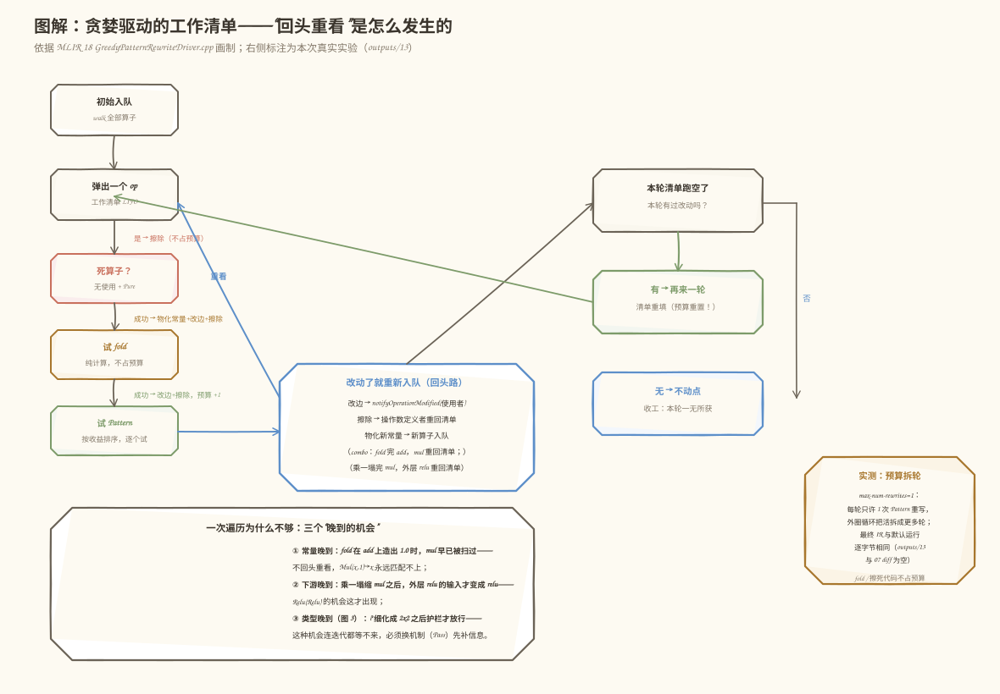

# 第 49 天：第 7 周复盘——三种机制各管什么？一场"缺一不可"的接力赛给出答案

> **今日目标**：完成本教程后，你能不查资料说清 Shape Inference（Shape 推导 Pass）、Fold（常量折叠钩子）、RewritePattern（规范化重写 Pattern）三者的职责边界——各自拿什么输入、产出什么、能不能改 IR、失败时怎么表示；能构造并实测一个**必须连续执行两种 Pattern 才能完全优化**的用例（`combo.mlir`：fold 造常量 → 乘一塌缩 → 双 Relu 消除，8 ops → 3 ops）；能分两层回答计划里的复盘问题"**为什么一次 Pattern 遍历不一定得到最简 IR**"——图会变（机会晚到，要回头重看）＋信息要齐（类型不齐，迭代再多也放不了行）；还能识别"跑到不动点 ≠ 得到最简"的信息关卡（`combo_shape.mlir`：9 → 6 卡住 vs 9 → 4 放行）。
> **预计时间**：学习 35 分钟＋实践 45 分钟
> **前置准备**：Day 41～48 的 mini 方言工程（今天的改动半径见 §2）、LLVM/MLIR 18.1.8（含 `MLIRConfig.cmake`）、CMake 3.20+ 与 Ninja。实测环境：Ubuntu 20.04.5 LTS（aarch64）、gcc 9.4.0、cmake 3.20.5、ninja 1.10.0——与 Day 29/37～48 记录一致，今天全部实验在此环境重放并逐字节核对。
> **今日产出**：`combo.mlir`（三步接力主用例）、`combo_shape.mlir`（信息关卡对照用例）、三条 Pattern 的稳定标签（`mini-double-relu` / `mini-add-neg-zero` / `mini-mul-one`，让 `--enable-patterns` / `--disable-patterns` 能单独开关每条规则）、`run_all.sh` 一键重放（17 个输出文件＋5 组断言全部实测通过）、`make_images.py` 与 4 张可复现插图。

## 1. 今天解决什么问题？

Day 48 结尾留了话：组合管道 `mini-combined` 把四种能力排好了队，但"为什么是这个顺序、错序为什么丢优化"的深层原因还没有正面回答。今天不写新 Pass，做第 7 周复盘——把一周攒下的能力放到放大镜下，回答计划里的两个问题：

- **复盘一问**：Shape Inference、Fold 和 RewritePattern 的**职责到底有什么不同**？它们看起来都在"优化"，但一个注册成独立 Pass、两个挂在算子身上当钩子——挂载位置不同不是巧合，是职责不同。
- **复盘二问**：**为什么一次 Pattern 遍历不一定得到最简 IR**？`-canonicalize` 明明会迭代到不动点，"迭代"和"最简"之间还差什么？

复盘最怕变成复述笔记，所以今天用一个**必须接力才能跑完**的用例把两个问题一次问穿。贯穿全文的主用例 `combo.mlir`（8 个操作，含函数壳）：

```mlir
%c0  = mini.constant dense<0.5> : tensor<2x2xf32>   // ┐
%c1  = mini.constant dense<0.5> : tensor<2x2xf32>   // ┘ 只有 fold 能把
%one = mini.add %c0, %c1 : ...                      //   它变成常量 1.0
%r   = mini.relu %x : ...                           // relu(入口参数)
%m   = mini.mul %r, %one : ...                      // 只有 %one 变成 1.0，Mul(x,1)→x 才能匹配
%rr  = mini.relu %m : ...                           // 只有 %m 塌缩成 %r，Relu(Relu)→Relu 才能匹配
return %rr : ...
```

三步依赖链环环相扣：**fold 创造常量 1.0 → 乘一 Pattern 拿到匹配前提 → 乘一塌缩后双 Relu 结构才出现**。§5.3 的隔离实验会证明：关掉链条中的任何一环，优化就停在半路（6 ops 或 4 ops），全开才塌到 3 ops。第二个用例 `combo_shape.mlir` 再加一道"信息关卡"：matmul 的结果类型故意写成 `?x2`，不给 `-mini-infer-shape` 补类型，代数化简的类型护栏连迭代到不动点也冲不过去——这正好是复盘二问的第二层答案。

为什么复盘值得花一天？因为这周攒下的能力分布在**三种不同的挂载点**上：Shape 推导是独立 Pass（`-mini-infer-shape`），Relu 消除和代数化简是挂在算子上的 Canonicalization Pattern，常量折叠是挂在算子上的 fold。它们互相制造机会也互相等待解锁，谁先谁后、谁等谁、缺了谁会怎样——不实测一遍，"我理解了"只是一句感觉。复盘的产出是**职责边界＋依赖关系的可运行证据**，不是又一份目录。

## 2. 先看全貌：今天的内容位于哪里？


**图 1**：读这张图先看一个结构性事实——**三种机制住在同一条流水线的不同格子里**。Shape 推导有自己独立的命令行入口（一格 Pass）；fold 和 RewritePattern 连 Pass 都不是，它们挂在算子上，由 `-canonicalize` 这个现成驱动统一收集和调度（图右上橙色框内画了两层）。这个挂载差异就是职责差异的入口。三张职责卡的"口诀"行先扫一眼，§3 逐格展开。底部的两个计数（combo：8 → 3；combo_shape：9 → 6 卡住 vs 9 → 4 放行）全部来自 §5 的真实运行。

今天一条命令的旅程五步：

1. **解析**：`.mlir` 文本按注册表变成内存 IR（Day 35 的结论：注册表决定谁能被解析）。
2. **验证**：ODS 约束＋手写 Verifier 把关，对动态维 `?` 保守放行（Day 39/40）。
3. **补信息（可选）**：`-mini-infer-shape` 走独立 Pass，把 matmul 结果类型里的 `?` 细化成数字（Day 44）。
4. **规范化**：`-canonicalize` 收集所有算子的 fold 钩子和 Canonicalization Pattern，用贪婪工作表迭代到不动点（Day 45～47 的能力都在这里被驱动）。
5. **打印**：输出优化后的 `.mlir`，用 `-mini-count-ops` 量化见证。

今天的改动半径（相对 Day 48 的工程，`diff -rq` 实测四类）：

| 改动 | 文件 | 目的 |
|---|---|---|
| **贴标签 ×3** | `ReluCanonicalization.cpp`、`AlgebraicSimplification.cpp` | Pattern 注册从 `add` 升级为 `addWithLabel`，贴上 `mini-double-relu` / `mini-add-neg-zero` / `mini-mul-one`——今天所有隔离实验的开关 |
| **删管道** | `CombinedPipeline.cpp` 及其注册（回到 Day 47 的能力集） | 复盘要单独拷问每个机制，昨天的 `mini-combined` 反而是干扰项；顺序知识已在 Day 48 证毕 |
| **开关规范化** | `MiniDialect.td`：`extraClassDeclaration` → `hasConstantMaterializer = 1` | TableGen 有官方开关，不必手抄虚函数声明 |
| **配对收紧** | `AddFold.cpp`：`zip` → `zip_equal` | 元素数不等时编译期报错，而不是静默越界 |

一句话：**今天只加了"标签"这一个新能力，其余都是把本周代码放回真实编译器里复盘时的规范化**。§6 的错误 4 会展示复盘时真实暴露的两个"从未真实编译过"的坑。

## 3. 核心概念：复盘一问——三种机制的职责边界

### 3.1 Shape Inference（Pass）：补信息，不动图

**Shape 推导**是一个独立注册的 Pass（`-mini-infer-shape`，Day 44）。类比体检报告里的"待复查"项：检查单上写着 `?x2`，医生（Pass）根据两侧 operand 的实测数据把 `?` 填成 `2`——**只填空，不改写任何已有结论**。对应到技术上是三步（`lib/ShapeInferencePass.cpp`）：

1. `inferMatmulShape(lhs, rhs)`：纯函数，按 Day 43 的规则 R1～R4 算出"输出 shape 应该是什么"（M 取 lhs 倒数第二维、N 取 rhs 最后一维、K 被消费不进输出）；
2. `refineShape(old, inferred)`：逐维合并——`old` 是数字就**原样保留**（写 IR 的人对 Verifier 的承诺，Pass 无权改写），`old` 是 `?` 才采纳推导值；
3. 合并结果有变化才 `op.getRes().setType(...)`——注意这是 `Value::setType`：SSA 值的类型改了，**所有使用者同时看到新类型**，不需要逐个改边。

职责的三个关键面：**它不删任何算子**（图的结构分毫不动）；**它只做信息增量**（细化 `?` 语义必然保持，改写已有数字才可能制造新错误）；**它的产物是"别的机制的前提"**——§5.4 会实测：类型护栏拦下的重写，等的就是它补的数字。类比边界：体检类比只覆盖"填空"这个动作，覆盖不了"为什么填的数字全图立刻可见"——后者是 SSA 单赋值＋类型挂在值上的机制带来的。

### 3.2 Fold（fold 钩子）：只算值，不碰图

**常量折叠**（constant folding，Day 47）挂在算子上：`mini.add` 和 `mini.constant` 的 ODS 里 `hasFolder = 1`，tblgen 生成 `OpFoldResult fold(FoldAdaptor)` 实例方法的声明。类比心算：收银台前你把"3 元＋2 元"直接算成"5 元"报出来——**你只报数，不负责把钱换成一张 5 元的钞票**。对应到技术上是严格的分工：

- **送进来**：驱动把"操作数若是常量则携带的 dense 属性"打包成 `FoldAdaptor`——`mini.constant` 自己的 fold 就是把 `value` 属性原样奉还，这是"递纸条"；
- **算出来**：`mini.add` 的 fold 检查两个操作数都带常量属性、类型护栏通过、尺寸不超 `kMaxFoldElements`（1024），然后逐元素 `APFloat` 加法，返回算好的 `DenseElementsAttr`；
- **绝不改 IR**：fold 函数签名里**连 PatternRewriter 的影子都见不到**。把属性变回图上一个真实 `mini.constant` 节点（常量物化）是**驱动**的活——它调用方言的 `materializeConstant` 钩子（`MiniDialect.cpp`），顺带还能做 uniquing：两个地方算出同一个常量时合并成一个节点。

为什么这样分？因为 fold 的输出是"值"而不是"指令"，驱动拿到值可以做 Pattern 做不到的跨节点优化（常量去重）。反过来，fold 也因此**只能处理"常量碰常量"**——操作数有一个不是常量，它返回空 `Attribute` 交回驱动。今天的 `combo.mlir` 里，`add(0.5, 0.5)` 只有它能变成 `1.0`：两条代数 Pattern 都只认特定恒等值（-0.0、1.0），**恒等式 Pattern 造不出新常量**。

### 3.3 RewritePattern（canonicalization 钩子）：认形状，改结构

**重写 Pattern**（Day 45 的 `SimplifyDoubleRelu`、Day 46 的 `SimplifyAddNegZero` / `SimplifyMulOne`）也挂在算子上：ODS 里 `hasCanonicalizer = 1`，tblgen 生成静态函数 `getCanonicalizationPatterns`，往驱动发来的集合里塞 Pattern。类比手术：Pattern 认出"这里多缝了一层"（`relu(relu(x))`），**亲手拆线**——但必须在无菌条件下做。对应到技术上是两条铁律：

- **只看局部形状**：`matchAndRewrite` 拿到根算子，顺着操作数的 def-use 边看一眼局部结构（外层 relu 的输入是不是另一个 relu？某个操作数是不是装着 1.0 的 splat 常量？）——不做全局分析，"什么时候被调用、被谁调用"一概不知道；
- **改图必须经 PatternRewriter**：`replaceAllUsesWith`（改所有使用者的边）＋`eraseOp`（擦除）。绕过 rewriter 直接改 IR，驱动的工作清单（worklist）不会收到通知，排着的计划全部失效——Day 45 的错误 1 有真实复现。

今天给三条 Pattern 贴的标签是它们的新装备（§5.2 贴代码）：

```cpp
results.addWithLabel<SimplifyDoubleRelu>({"mini-double-relu"}, context);
```

没有标签时，`--enable-patterns` / `--disable-patterns` 只能按 Pattern 的 debug name 过滤，而 g++ 生成的名字是 `{anonymous}::SimplifyDoubleRelu` 这种随编译器变化的字符串——难敲也不可移植。标签是 Pattern 的**外部身份**，让命令行可以单独开关每条规则，这正是今天隔离实验的前提。

### 3.4 职责对照表：复盘一问的答案

| 维度 | Shape Inference | Fold | RewritePattern |
|---|---|---|---|
| 身份 | 独立 Pass（`-mini-infer-shape`） | 算子上的 fold 钩子 | 算子上的 canonicalization 钩子 |
| 诞生 | Day 43（规则）／44（Pass） | Day 47 | Day 45／46 |
| 输入 | 两个操作数的类型 | FoldAdaptor 送来的常量属性 | 根算子＋局部 def-use 形状 |
| 输出 | 细化后的结果类型（`?`→数字） | 算好的属性（OpFoldResult） | 改写后的 IR（success/failure） |
| 改 IR 吗 | 只 `setType`，不删算子 | **绝不**（拿不到 Rewriter） | 亲手改，必须经 PatternRewriter |
| 善后谁做 | 无需（类型全图立即可见） | 驱动物化常量＋uniquing | 自己改边＋擦除，驱动回表 |
| 失败语义 | 推不出就保持 `?` | 返回空 Attribute | 返回 failure 交回驱动 |
| 口诀 | **补信息，不动图** | **只算值，不碰图** | **认形状，改结构** |

三个"失败语义"值得对照着看：Shape 推导推不出来就留着 `?`（图合法，只是信息不全）；fold 遇到非常量操作数就交回驱动（不适用≠错误）；Pattern 返回 failure 表示"这个节点我处理不了"（驱动接着试别的 Pattern）。**没有一种失败会中断编译**——这正是三种机制能被同一个驱动自由组合的前提。

## 4. 图解核心机制：combo.mlir 的三步接力


**图 2**：三列讲同一件事。左列是起点（8 ops，`mini-count-ops` 真实计数）；中列三张卡片是三次解锁，**每张卡片都注明它依赖谁**——这是"接力"的全部含义：第 N 步的匹配前提由第 N-1 步的重写结果创造；右列的隔离矩阵用"关掉谁、停在几"证明依赖不是错觉。按编号逐步看：

1. **fold 先开路**：`%one = add(0.5, 0.5)` 两个操作数都是常量，fold 算出 `dense<1.0>`，驱动经 `materializeConstant` 物化成新的 `mini.constant`。两个 0.5 常量失去使用者，被驱动顺手收走——8 ops 变 6 ops。**只有 fold 能做这件事**：两条代数 Pattern 分别只认 -0.0 和 1.0，对 0.5＋0.5 无能为力。
2. **乘一接力**：`%m = mul(%r, %one)` 的右侧操作数**现在是**一个装着 1.0 的 splat 常量了——`SimplifyMulOne` 的常量匹配通过，类型护栏（x 类型 == 结果类型，两侧都是 `2x2`）放行，mul 被改写消失——6 ops 变 4 ops。注意时间差：**第 1 步没发生时，mul 的右侧是那个 add，这条 Pattern 一次都匹配不上**。
3. **双 Relu 收尾**：mul 塌缩后，`%rr` 的输入才变成 `%r`——`relu(relu(x))` 的结构**此刻才存在**，`SimplifyDoubleRelu` 这才有的可配对——4 ops 变 3 ops，只剩 `mini.relu %x` 和函数壳。

复盘二问的第一层答案就藏在这条链里：**图会变**。每次重写都可能制造新的匹配机会（常量出现了、下游变短了），单趟扫描必然漏掉"晚到的机会"——第 2 步点火的前提在第 1 步完成前不存在。所以 `-canonicalize` 的驱动不靠"扫一遍"而靠**工作清单回头重看**（§5.5 配图 4 详解），迭代到不动点为止。但注意边界：迭代解决的是"图会变"，解决不了"信息不齐"——那要等 §5.4 的第二层答案。

## 5. 动手实践：隔离实验、信息关卡与预算

### 5.1 准备文件与构建

今天的文件布局（在 Day 48 工程基础上做了 §2 表格里的四类改动）：

```text
tutorials/day-049/code/
├── mini/                          # 方言工程（Day 41~48 逐日长成，今天贴了标签）
│   ├── include/mini/MiniDialect.td# 改：extraClassDeclaration → hasConstantMaterializer = 1
│   ├── lib/ReluCanonicalization.cpp   # 改：addWithLabel<...>({"mini-double-relu"})
│   ├── lib/AlgebraicSimplification.cpp# 改：mini-add-neg-zero / mini-mul-one 两个标签
│   ├── lib/AddFold.cpp            # 改：getValues<APFloat> + zip_equal
│   └── tools/mini-opt/MiniOpt.cpp # 改：删掉 mini-combined 注册（复盘不需要管道）
├── combo.mlir                     # 主用例：三步接力
├── combo_shape.mlir               # 对照用例：信息关卡
├── run_all.sh                     # 一键重放（17 个输出 + 4 组断言）
├── make_images.py                 # 本教程 4 张插图的生成器（确定性随机种子）
└── outputs/                       # 全部真实运行记录（下文引用）
```

构建与冒烟（约 1～3 分钟）：

```bash
cmake -G Ninja -B /tmp/day049/build -S tutorials/day-049/code/mini \
      -DCMAKE_BUILD_TYPE=Release -DMLIR_DIR=/usr/lib/llvm-18/lib/cmake/mlir
cmake --build /tmp/day049/build
bash tutorials/day-049/code/run_all.sh /tmp/day049/build/bin/mini-opt
```

`run_all.sh` 会把 §5.3～§5.5 的全部实验重放进 `outputs/`，并在末尾自动做五组 diff/计数断言（A：全链 == 默认；B：预算 == 默认；C：括号陷阱 enable 侧；D：计数 remark；E：括号陷阱 disable 侧）。本文引用的每个输出都是刚在这个环境重放过的（与此前记录逐字节相同）。

### 5.2 关键代码：addWithLabel——给 Pattern 贴开关

今天唯一的"新能力"是三行注册代码的变化。以 `SimplifyMulOne` 为例（`lib/AlgebraicSimplification.cpp`）：

```cpp
// 旧（Day 46）：results.add<SimplifyMulOne>(context);
void mini::MulOp::getCanonicalizationPatterns(RewritePatternSet &results,
                                              MLIRContext *context) {
  results.addWithLabel<SimplifyMulOne>({"mini-mul-one"}, context);
}
```

`addWithLabel` 的第一个参数是标签列表——它成为这条 Pattern 的**外部身份**，`--enable-patterns` / `--disable-patterns` 按它过滤。Pattern 本体一行没动：`SimplifyMulOne` 的匹配（rhs 是装着 1.0 的 splat 常量）、类型护栏（`x.getType() != mul.getRes().getType()` 就收手）、重写（`replaceAllUsesWith` + `eraseOp`）都和 Day 46 一样。**给能力贴标签不改变能力**——这个复盘心得值得记住：调试和实验需要的可开关性，应该由注册机制提供，而不是把 Pattern 改得七零八落。

顺带的复盘收获（改动半径表里的后两行）：把 Day 47 的代码放进真实编译器，`MiniDialect.cpp` 里手写的 `materializeConstant` 类外定义立刻报 `no declaration matches`——基类虚函数没在本类声明，而类由 `.inc` 生成，正确入口是 TableGen 开关 `hasConstantMaterializer = 1`；`AddFold.cpp` 的 `begin<APFloat>()` 在 MLIR 18 的 `DenseElementsAttr` 上不存在，标准入口是 `getValues<APFloat>()`，配对遍历用 `zip_equal`（元素数不等直接报错，不越界）。详见 §6 错误 4。

### 5.3 运行与观察：隔离矩阵——关掉谁，优化停在哪

对 `combo.mlir` 依次跑六种过滤配置，`mini-count-ops` 的真实计数排成矩阵（全部可由 `run_all.sh` 段 1 重放）：

| 配置（canonicalize 的过滤参数） | 剩余 ops | 谁没出手 |
|---|---|---|
| 只留 fold（disable 三条 Pattern） | **6** | 三条全关 |
| fold ＋ 双 relu（disable 乘一） | **6** | 双 relu **干等**！ |
| fold ＋ 加负零（enable add-neg-zero） | **6** | 负零救不了 0.5＋0.5 |
| fold ＋ 乘一（disable 其余两条） | **4** | 双 relu 缺席 |
| fold ＋ 乘一 ＋ 双 relu | **3** | 全链跑通 ✓ |
| 默认 `-canonicalize`（不过滤） | **3** | 同上——工作清单自动接力 ✓ |

三行 6 ops 的输出互为镜像，先看"只留 fold"（`outputs/02-fold-only.mlir`）：

```mlir
%0 = mini.constant dense<1.000000e+00> : tensor<2x2xf32>   // fold 的产物
%1 = mini.relu %arg0 : tensor<2x2xf32> -> tensor<2x2xf32>
%2 = mini.mul %1, %0 : tensor<2x2xf32>, tensor<2x2xf32> -> tensor<2x2xf32>
%3 = mini.relu %2 : tensor<2x2xf32> -> tensor<2x2xf32>
return %3 : tensor<2x2xf32>
```

再看最关键的一行——"fold ＋ 双 relu"（`outputs/03-fold-plus-double-relu.mlir`）：输出与上面**逐字节相同**。双 relu 开着，却一次都没出手：`%3` 的输入是 mul，不是 relu——**它在等乘一塌缩，而乘一被禁用了**。"开了 Pattern 却没动静"不是 Pattern 坏了，是它的机会还在上游排队。这就是计划要求的"必须连续执行两种 Pattern 才能完全优化"的直接证据：乘一和双 relu 都在图里、都合法、都正确，但**单独开双 relu 得 6 ops，单独开乘一得 4 ops，只有连着开才到 3 ops**。

"fold ＋ 乘一"（`outputs/04-fold-plus-mul-one.mlir`）停在 4 ops，双 relu 结构已经出现却没人收：

```mlir
%0 = mini.relu %arg0 : tensor<2x2xf32> -> tensor<2x2xf32>
%1 = mini.relu %0 : tensor<2x2xf32> -> tensor<2x2xf32>   // relu(relu(x)) 已就位
return %1 : tensor<2x2xf32>
```

全链与默认的终点相同（`outputs/06-fold-plus-mul-one-plus-double-relu.mlir` 与 `outputs/07-all-default.mlir`，diff 为空）：

```mlir
func.func @combo(%arg0: tensor<2x2xf32>) -> tensor<2x2xf32> {
  %0 = mini.relu %arg0 : tensor<2x2xf32> -> tensor<2x2xf32>
  return %0 : tensor<2x2xf32>
}
```

量化计数原文（`run_all.sh` 段 3，`-mini-count-ops` 的 remark）：

```text
remark: 8 ops in @combo (func.func=1, func.return=1, mini.add=1, mini.constant=2, mini.mul=1, mini.relu=2)
remark: 3 ops in @combo (func.func=1, func.return=1, mini.relu=1)
```

八条指令塌成一条，语义分毫未变——这就是"接力"的终点，也是本周四种能力协同工作的验收。

### 5.4 对照实验 A：combo_shape.mlir——信息关卡（复盘二问第二层）

`combo.mlir` 的三步接力在**同一个** `-canonicalize` 里就能跑完，因为工作清单会回头重看。`combo_shape.mlir` 把难度升一级：matmul 的结果类型故意写成 `?x2`，让代数化简的类型护栏变成一道**信息关卡**（`outputs/16-*.txt`：基线 9 ops）：

```mlir
%mm = mini.matmul %a, %b : tensor<2x3xf32>, tensor<3x2xf32> -> tensor<?x2xf32>
%m  = mini.mul %mm, %one : tensor<?x2xf32>, tensor<2x2xf32> -> tensor<2x2xf32>
```

对照两种命令（都可重放）：

```bash
B=/tmp/day049/build/bin/mini-opt
$B -canonicalize                    combo_shape.mlir   # 6 ops，卡住
$B -mini-infer-shape -canonicalize  combo_shape.mlir   # 4 ops，放行
```


**图 3**：上路（只跑 `-canonicalize`，`outputs/17-count-shape-canon-only.txt`：6 ops）值得逐行读：fold 照常出手（`add` 塌成常量 1.0）、双 relu 照常出手（`r2` 消失）——**唯独 mul 卡在类型护栏**：`x` 是 `?x2`、结果是 `2x2`，`x.getType() != mul.getRes().getType()` 成立，Pattern 收手。关键在于：这个判断**不是 Pattern 过于胆小**——把一个 `2x2` 的结果整体替换成 `?x2` 的值，使用者的类型就对不上，重写反而制造非法 IR（Day 46 实测过的坑）。护栏拦下的不是合法重写，是**信息不足的重写**。于是 mul 留在图里，迭代到不动点也推不走：

```text
remark: 6 ops in @combo_shape (func.func=1, func.return=1, mini.constant=1,
        mini.matmul=1, mini.mul=1, mini.relu=1)
```

下路（先 `-mini-infer-shape`，`outputs/18-count-shape-full.txt`：4 ops）：Shape 推导把 `?x2` 细化成 `2x2`——只 `setType`、不删算子，但所有使用者立刻看到新类型。护栏处 `2x2 == 2x2` 放行，乘一塌缩，双 relu 接力，只剩 `matmul + relu`：

```mlir
func.func @combo_shape(%arg0: tensor<2x3xf32>, %arg1: tensor<3x2xf32>) -> tensor<2x2xf32> {
  %0 = mini.matmul %arg0, %arg1 : tensor<2x3xf32>, tensor<3x2xf32> -> tensor<2x2xf32>
  %1 = mini.relu %0 : tensor<2x2xf32> -> tensor<2x2xf32>
  return %1 : tensor<2x2xf32>
}
```

复盘二问的第二层答案在这里落地：**信息要齐**。类型护栏拦下的重写，迭代一万次也放不了行——缺的不是遍数，是类型信息；而补信息是 Shape 推导（Pass）的职责，不是 Pattern 的职责。把两层答案合起来，就是"为什么一次 Pattern 遍历不一定得到最简 IR"的完整回答：**图会变的靠迭代，信息不齐的靠换机制**——这正是三种职责必须分工的原因。

### 5.5 对照实验 B：max-num-rewrites=1——预算拆轮，结果不变

`-canonicalize` 有两个容易混淆的旋钮（`mini-opt --help` 实测，MLIR 18.1.8）：`max-iterations`（外圈轮数上限，默认 10）和 `max-num-rewrites`（**单轮内 Pattern 重写次数上限**，默认无限制）。把后者压到 1：

```bash
$B --pass-pipeline='builtin.module(func.func(canonicalize{max-num-rewrites=1}))' \
  combo.mlir    # outputs/13-budget-one-rewrite.mlir
```

真实结果：与默认运行（`outputs/07`）**逐字节相同**（`run_all.sh` 断言 B，diff 为空）——每轮只许 1 次 Pattern 重写，外圈循环把三步接力拆成更多轮，最终 IR 一模一样。这说明"回头重看"的能力住在**两层循环**里：内层工作清单靠回表接力（图 4 中间），外层轮次把没干完的活重新排班。



**图 4**（依据 MLIR 18 `GreedyPatternRewriteDriver` 画制，右侧注解为本次实测）：主流程自上而下——弹出一个 op，先问"死算子吗"（无使用者＋Pure 直接擦除，**不占预算**），再试 fold（纯计算，**不占预算**），最后按收益顺序试 Pattern（成功一次**预算 +1**）。中间蓝框是回表的三种触发：改边 → 使用者回表；擦除 → 操作数定义者回表；物化新常量 → 新 op 入队。combo 的两次关键回表都标在图上：**fold 完 add，mul 回表**（操作数被改了，重新匹配上了 1.0）；**乘一塌完 mul，外层 relu 回表**（输入变成 relu，双 Relu 结构出现）。底部把三个"晚到的机会"排成一列——常量晚到、下游晚到、类型晚到——前两个靠回表解决，第三个（§5.4 的信息关卡）连迭代都等不来，必须换机制先补信息。

## 6. 常见错误与排查

### 错误 1：`enable-patterns=[...]` 带方括号——enable 侧全过滤，disable 侧全失效

- **现象**：想做隔离实验，写 `canonicalize{enable-patterns=[mini-mul-one]}`，输出却和"只留 fold"一模一样（6 ops）；换成 `disable-patterns=[mini-mul-one,mini-double-relu]`，输出又和默认运行一模一样（3 ops）——**过滤像完全没生效**。
- **原因**：文本管道语法里方括号把内容当成**一个受保护的整串条目**，它和任何真实标签都不相等。于是 enable 侧等于"白名单里一个都匹配不上 → 全部 Pattern 被过滤"；disable 侧等于"黑名单里一个都匹配不上 → 谁也禁不掉"。
- **定位**：拿已知结果做对照实验。今天实测三连（`run_all.sh` 段 1 生成 20 号、断言 C/E 可重放）：`disable-patterns=[mini-mul-one,mini-double-relu]` 输出 3 ops ＝ 默认；`disable-patterns=mini-mul-one,mini-double-relu`（去括号）输出 6 ops ＝ 预期；`enable-patterns=[mini-mul-one]` 输出与 `outputs/02-fold-only.mlir` 逐字节相同。**disable 侧带括号的危害最隐蔽**：你以为关掉了，实验结论从根上就是错的。
- **修复**：过滤列表用逗号直接分隔，不加方括号：`enable-patterns=mini-mul-one,mini-double-relu`。

### 错误 2：以为"跑到不动点"就是"最简 IR"

- **现象**：`combo_shape.mlir` 只跑 `-canonicalize`，得 6 ops；有人把它当最终结果汇报（"已优化到不动点"）。
- **原因**：不动点是"驱动不再有活可干"，不是"IR 已经最简"。mul 卡在类型护栏——`?x2` 的值不能替换 `2x2` 的结果，这个信息缺口**迭代多少次也长不出数字**。缺的不是遍数，是类型信息。
- **定位**：看输出里 matmul 的结果类型——还是 `?x2` 就说明没人补过信息；或者跑 `-mini-count-ops` 对照"已知的可达值"（本例 4 ops）。
- **修复**：在 canonicalize **前面**加 `-mini-infer-shape`（Day 48 的顺序结论），或事后补第二轮（见 §7 选做）。判断口诀：重写被护栏拦下时，先问"缺的是遍数还是信息"。

### 错误 3：开了 Pattern 却"一次没出手"，误以为 Pattern 写坏了

- **现象**：`enable-patterns=mini-double-relu`（只开双 relu）跑 `combo.mlir`，双 relu 一次都没匹配——8 ops 里只少了 fold 能减的部分，容易怀疑 `SimplifyDoubleRelu` 有 bug。
- **原因**：它的机会还在上游排队：`%rr` 的输入是 mul，`relu(relu(x))` 结构要等乘一塌缩后才存在。Pattern 只看局部形状，**不负责追上游制造前提**。
- **定位**：对照隔离矩阵（§5.3）找依赖：单独开它没效果、配合上游 Pattern 有效 → 是机会依赖，不是 Pattern 故障；两个都没效果才是 Pattern 本身的问题。
- **修复**：把上游 Pattern 一起开（或直接用默认全开）。复盘启示：汇报"某优化没生效"之前，先确认它的触发前提是否存在于当前 IR。

### 错误 4：复盘把本周代码放进真实编译器，Day 47 的折叠路径编不过

- **现象**：两连报错——`error: no declaration matches 'mlir::Operation* mini::MiniDialect::materializeConstant(...)'`；以及 `error: ... has no member named 'begin'`（`DenseElementsAttr` 上调 `lhs.begin<APFloat>()`）。
- **原因**：`materializeConstant` 是从 `Dialect` 基类继承的虚函数，C++ 规定类外定义必须对应**本类里声明的**成员——只继承没声明，定义无处安放；而 `begin<T>()/end<T>()` 根本不是 MLIR 18 `DenseElementsAttr` 的 API。两处都是"写的时候像能跑、编译时才现形"的问题。
- **定位**：报错行号直指 `MiniDialect.cpp` 的定义和 `AddFold.cpp` 的循环；关键是**这类错误只有真实编译才能暴露**——读代码十遍也读不出"API 不存在"。
- **修复**：声明交给 TableGen 官方开关 `hasConstantMaterializer = 1`（`MiniDialect.td`，比手抄 `extraClassDeclaration` 更正规）；迭代改用 `getValues<APFloat>()` 返回的 range，配对用 `zip_equal`。复盘方法论：**"看起来能跑"和"真的能跑"之间隔一次真实构建**——这正是复盘日把全部代码重新编译一遍的价值。

## 7. 今日练习

### 必做练习

给接力链再加一环，让今天"全程没出手"的 `mini-add-neg-zero` 也必须参与。在 `combo.mlir` 基础上：在 `%m = mul(%r, %one)` 之后插入 `%s = mini.add %m, %z`（`%z` 是全体元素 `-0.0` 的常量），把最外层改成 `%rr = mini.relu %s`。先在纸上预测：默认 `-canonicalize` 跑到几个 ops？只 `enable-patterns=mini-add-neg-zero` 时链条停在哪（注意：加负零这条 Pattern 对"输入是不是 mul"没有要求，它能不能独立出手）？只 `enable-patterns=mini-double-relu` 时它为什么干等（`%rr` 的输入现在是谁定义的）？然后用 `--pass-pipeline` 过滤参数逐一验证，最后用 `-mini-count-ops` 把"预测的 ops 数"对成"实测的 ops 数"。

### 选做挑战

用 Day 48 的"第二轮救回"检验信息关卡的可逆性：对 `combo_shape.mlir` 跑 `-canonicalize -mini-infer-shape -canonicalize`（错序在前、补推导、再补一轮规范化）。预测：第一轮 canonicalize 停在 6 ops（护栏拦下），中间的推导把 `?x2` 细化成 `2x2`，第二轮 canonicalize 能否把 mul 收走？最终 IR 与"正确顺序"的 `outputs/12-infer-then-canon.mlir`（4 ops）是否逐字节相同？用 diff 验证。如果相同，这说明**顺序错了可以救**；再想一步：为什么真实编译器宁可精心调顺序，也不无脑"跑到固定点"——提示：数一数第二轮里有多少 Pass 是空转的（Day 48 §3.4 有实测：第二遍一个字节都不改）。

## 8. 今日验收

- [ ] 我能不查资料说出三种机制的职责边界——Shape 推导"补信息不动图"（只 `setType`）、Fold"只算值不碰图"（拿不到 Rewriter，物化交给驱动）、RewritePattern"认形状改结构"（必须经 PatternRewriter），并说出三者失败语义的共同点（都不中断编译，交回驱动）；
- [ ] 我能独立构建 mini 工程并运行 `run_all.sh`，看到隔离矩阵 6/6/6/4/3/3 全部复现、五组断言（06==07、13==07、20==02、计数 remark、disable 括号失效）全部通过；
- [ ] 我能分两层回答"为什么一次 Pattern 遍历不一定得到最简 IR"——图会变（晚到的机会靠工作清单回表＋外圈轮次）＋信息要齐（类型护栏拦下的重写必须换机制补信息），并各举一个今天的实测例子（combo.mlir / combo_shape.mlir）；
- [ ] 我能修改 `--enable-patterns` / `--disable-patterns` 并**预测**结果（包括方括号陷阱两侧的不同失效方式），用 diff 对照验证；
- [ ] 我保存了今天的全部产出：`combo.mlir`、`combo_shape.mlir`、三条 Pattern 标签、`run_all.sh`、`outputs/` 17 个文件和 4 张插图（`make_images.py` 可确定性重生成）。

## 9. 一句话总结与明天预告

复盘周把三种机制放在同一张实验台上拷问：**职责上**，Shape 推导补信息不动图、Fold 只算值不碰图、RewritePattern 认形状改结构，三者失败语义一致（交回驱动、不中断编译），挂载位置的不同就是职责的不同；**协作上**，`combo.mlir` 用 8 → 6 → 4 → 3 的隔离矩阵证明优化机会互相创造——fold 造出 1.0 乘一才有得匹配，乘一塌缩后双 Relu 结构才出现，关掉任何一环就停在半路；**边界上**，`combo_shape.mlir` 用 9 → 6 卡住 vs 9 → 4 放行证明"迭代到不动点 ≠ 最简"——图会变的靠回表和轮次，信息不齐的只能换机制先补类型。全部结论都有真实命令和逐字节 diff 沉淀在 `run_all.sh` 里，复盘的产出是可重放的证据，不是记忆。

明天进入第 8 周（算子融合）：定义 `mini.fused_add_relu` 和 `mini.fused_matmul_bias_relu`。今天的接力链是"多个算子被逐个消去"，明天要问相反的问题——**能不能把多个算子合并成一个**，让 `Add + Relu` 压根不产生中间结果。今天的 Pattern 机制（认形状、改结构、经 Rewriter）就是融合 Pattern 的直接底座，区别只在重写的方向：消减靠"替换成已有值"，融合靠"生成新算子"。
