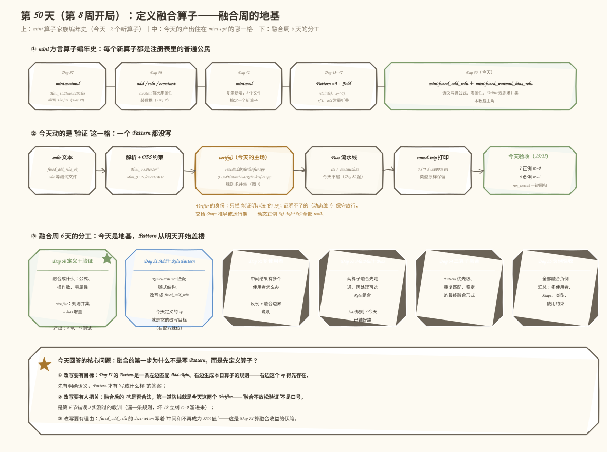
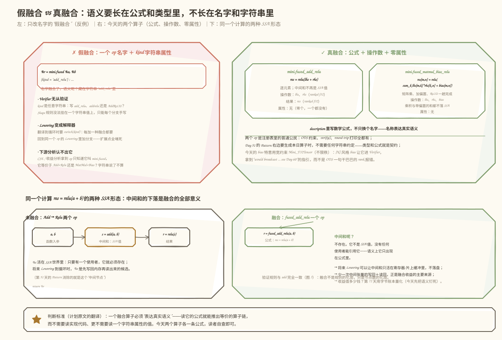
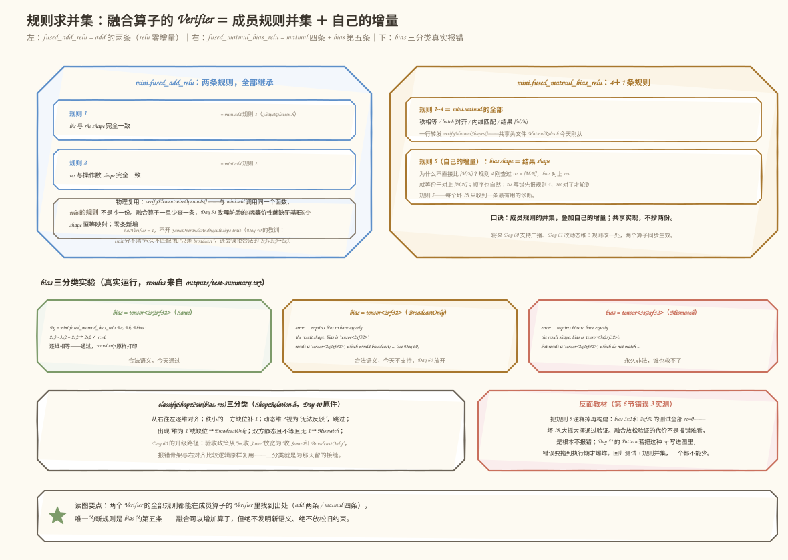
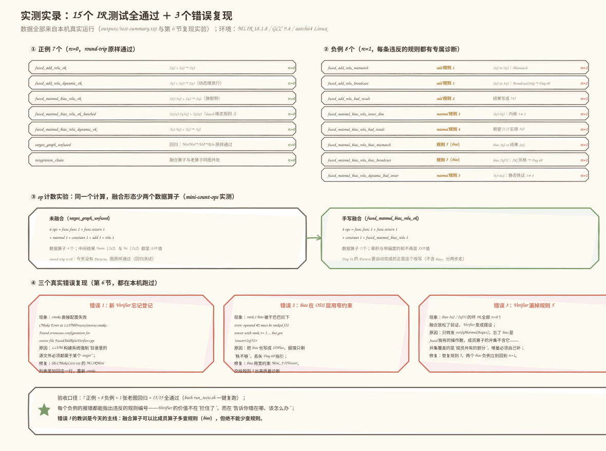

# 第 50 天：定义融合算子——先让"融合成什么"有公式、有验证，再谈改写

> **今日目标**：完成本教程后，你能为 `mini.fused_add_relu` 和 `mini.fused_matmul_bias_relu` 说出三件事——语义公式是什么、Verifier 的规则从哪里来、为什么今天一个 Pattern 都不写；并且能用 `run_tests.sh` 一键复跑 15 个 IR 测试。
> **预计时间**：学习 30 分钟＋实践 60 分钟
> **前置准备**：第 37～47 天的 mini 工程（`mini.matmul/add/mul/relu/constant` 五个算子、手写 Verifier、`-canonicalize`）；已安装 MLIR 18（本文环境：Ubuntu 的 `libmlir-18-dev` 18.1.8，GCC 9.4，aarch64 Linux）；不需要今天新学任何 Pass 机制。
> **今日产出**：两个融合 Operation 定义、两个 Verifier、一份共享规则头文件、15 个 IR 测试（7 正例＋8 负例）全部真实运行通过，外加 3 个"真实踩坑"复现记录。

## 1. 今天解决什么问题？

从第 13 天起，我们的目标图一直是这一张：

```text
%m = mini.matmul %a, %b        : 2x3 · 3x2 -> 2x2
%s = mini.add     %m, %bias    : 2x2 + 2x2 -> 2x2
%r = mini.relu    %s           : 2x2     -> 2x2
```

第 8 周开始要把这张图"融合"掉。但动手写第一行融合代码之前，有一个比"怎么改写"更靠前的问题：**融合成什么？**

一个直觉的偷懒方案是造一个万能算子：

```mlir
%r = mini.fused %a, %b {kind = "add_relu"} : tensor<2x2xf32>, tensor<2x2xf32> -> tensor<2x2xf32>
```

名字里带了个 `fused`，融合就算完成了吗？没有。这个方案把真正的语义藏进了一个字符串属性 `kind` 里：Verifier 无法验证"add_relu 该满足什么 shape 规则"（字符串不进类型系统，`"add_relu"`、`"AddRelu"`、`"addrelu"` 它都认不了）；将来 Lowering 到循环时必须 `switch(kind)`，每加一种融合都要回同一个 op 的实现里加分支——它不是编译器算子，是一个小型解释器的入口。这就是学习计划里警告的"只改变名称而不表达真实语义"。

今天的正确答案：**把每种融合定义成一个语义完整的独立算子**。贯穿全文的例子沿用第 37 天的 shape 家族：`2x3 · 3x2 + bias 2x2 → relu → 2x2`。学完你会发现，今天新增的 C++ 只有约 110 行（两个手写 Verifier）外加一次规则搬家（`MatmulRules.h`），却一个 Pattern 都没碰——这是刻意的（第 2 节解释为什么）。

## 2. 先看全貌：今天的内容位于哪里？



**图 1**：看三个位置——上排是 mini 算子编年史，今天一次性新增第 6、7 个算子（绿色框）；中间是 mini-opt 流水线，今天动的是"verify() 这一格"（橙色框），Pass 流水线一格都不碰；下排是融合周 6 天分工，今天是地基，Day 51 的 Pattern 才开始盖楼。

把全貌串成 5 步：

1. mini 方言注册表里新登记两个算子：`mini.fused_add_relu`（2 输入 1 输出）和 `mini.fused_matmul_bias_relu`（3 输入 1 输出），语义公式写进 description，**零属性**；
2. ODS 层用已有的类型约束词汇表把关（`Mini_F32Tensor`、`Mini_F32Tensor2DPlus`）；
3. C++ 层各写一个手写 Verifier——规则 = 成员算子规则的**并集**（add 两条 / matmul 四条），`fused_matmul_bias_relu` 再叠一条自己的 bias 规则；
4. 为了"物理共享而不是抄一份"，把 `MatmulVerifier.cpp` 里的四条 matmul 规则提取成 `MatmulRules.h`，两个算子调用同一个函数；
5. 写 15 个 IR 测试：7 个正例（含"老图原样通过"的回归测试）＋8 个负例（每条规则至少一个反例），全部真实运行。

为什么 Pattern 之前必须先定义算子？因为 Day 51 的 RewritePattern 是一条"左边匹配 `Add+Relu`、右边生成融合算子"的规则——**右边这个 op 得先存在、先有明确语义、先有 Verifier 把关**，Pattern 才有"改写成什么样"的答案，改写后的 IR 才有合法性防线。此外，`fused_add_relu` 的 description 写明"中间和不再成为 SSA 值"，这是第 72 天量化融合收益的伏笔——语义没钉死，收益无从算起。

## 3. 核心概念：先用直觉，再给准确定义

### 3.1 融合算子：一个 op 顶一串 op，中间结果从 SSA 世界消失

一句通俗解释：融合算子就是"把流水线上的几道工序合并成一道工序"——原来"先算和、再过 ReLU"两道工序，现在一道工序直接出结果。

类比：厨房里"焯水→过凉水"两道工序合并成"焯水后直接在同一锅里冲凉水"。对应到技术上是：**中间结果不再是 SSA 值**。未融合时 `add` 的结果 `%s` 是图里的一个节点，有名字、有使用者，将来 Lowering 到循环时它要先写回内存、再被 `relu` 读出来；融合后 `a+b` 这个中间和只存在于算子的数学公式里，没有任何 SSA 值能引用它，Lowering 可以让它只活在寄存器或片上缓冲中。类比的边界：合并工序省的是"中间搬运"，但**不减少任何数学计算**——`relu(a+b)` 一个乘加都不能少（第 72 天算的正是省掉的搬运字节，不是算力）。

准确定义（今天两个算子的语义公式）：

```text
fused_add_relu:          res = relu(lhs + rhs)                     // 逐元素
fused_matmul_bias_relu:  res[m,n] = relu( Σ_k lhs[m,k]·rhs[k,n] + bias[m,n] )
```

输入输出设计：`fused_add_relu` 的操作数是两个任意秩的 ranked f32 张量（`Mini_F32Tensor`，与 `mini.add` 相同）；`fused_matmul_bias_relu` 的 lhs/rhs/res 沿用 matmul 的"秩 ≥ 2"约束（`Mini_F32Tensor2DPlus`），bias 单独用宽约束（见 3.3）。**两个算子都是零属性**——没有 `kind`、没有任何开关。要不要 ReLU 是算子名的一部分（`..._relu`），不是运行时参数。

### 3.2 语义设计：公式进 description，语义不长在字符串里



**图 2**：左半边是"假融合"的三宗罪（Verifier 无从验证、Lowering 变解释器、下游分析认不出它）；右半边是今天两个真融合算子的解剖卡；下半边是 `res = relu(a+b)` 的两种 SSA 形态对照——注意左边橙色框里的 `%s`（中间和，SSA 值）在右边消失了。

首次出现的术语解释：**ODS**（Operation Definition Specification）是 MLIR 用 TableGen 描述算子的语言，`MiniOps.td` 里一个 `def` 生成一整个 C++ 算子类。**description** 是 ODS 里写给"读 IR 的人"的文档字段，公式写在这里，将来 `mini-opt` 的文档、报错上下文、代码评审都以它为准绳。

设计决定的检验标准只有一条：**读一个融合算子的公式，就能推出它与哪条算子链等价**，不需要读实现、更不需要读一个字符串属性的值。`fused_add_relu` 的公式 `relu(lhs+rhs)` 一秒钟推出等价链 `Add+Relu`；反过来，`mini.fused {kind="add_relu"}` 里的 `"add_relu"` 既进不了类型系统，也进不了公式。

一个常见误解："融合算子是个特殊的高级节点，编译器要特殊对待"。恰恰相反——看图 1 上排：它在注册表里和 `mini.matmul` 是完全平等的公民，有自己的 ODS 约束、自己的 `verify()`、自己的 round-trip 打印。第 5.3 节的 `integration_chain.mlir` 就让融合算子和老算子出现在同一张图里，毫无特殊待遇。

### 3.3 规则求并集：融合不放松验证

融合算子的 Verifier 怎么写？口诀只有一句：**成员算子的规则求并集，再叠上自己的增量。**

- `fused_add_relu` = `add` 的规则（操作数 shape 一致＋结果与操作数一致）∪ `relu` 的规则。而 `relu` 是 shape 恒等映射，**零条新增**——所以并集恰好还是 add 的两条；
- `fused_matmul_bias_relu` = `matmul` 的四条规则（秩相等 / batch 对齐 / 内维匹配 / 输出 [M,N]）∪ `relu` 的零条 ∪ **自己的增量第 5 条**：bias 的 shape 必须与结果完全一致。

为什么"物理共享"这么重要？如果复制粘贴一份 matmul 规则到融合算子里，将来 Day 60 支持广播、Day 61 改动态维推导时就要改两处，漏改一处，融合算子就成了"规则弱化版"——这正是第 6 节错误 3 实测出的漏洞形态。所以今天做的第一件事是把 `MatmulVerifier.cpp` 里的四条规则**提取**成共享头文件 `MatmulRules.h`：`mini.matmul` 的 verify() 和 `fused_matmul_bias_relu` 的 verify() 从此调用同一个函数。

还有一个 ODS 层的细节决定：`fused_matmul_bias_relu` 的 **bias 特意用宽约束** `Mini_F32Tensor`（不限秩），而不是沿用"秩 ≥ 2"。原因：PyTorch 风格的 rank-1 bias（`tensor<2xf32>`）是**合法语义、只是今天不支持**——让它通过 ODS、落到 Verifier 的第 5 条规则里，能拿到 `"would broadcast ... see Day 60 -- tile the bias for now"` 这样有下一步指引的诊断；若在 ODS 就被拦下，用户只会看到一句干巴巴的 `"operand #2 must be ranked f32 tensor with rank >= 2"`（第 6 节错误 2 里有两条真实报错的对照）。

动态维（`?`）的处理沿用第 39/40 天的保守策略：任一方动态 → 编译期无法证明非法 → 放行。负例 `?x3 · 4x2` 仍会被拦，因为内维 3 对 4 是**静态铁证**（见 5.3 节最后一个负例）。

## 4. 图解核心机制：五条规则的来历与去向



**图 3**：左卡是 `fused_add_relu` 的两条规则（全部继承自 add）；右卡是 `fused_matmul_bias_relu` 的 4+1 条（前四条一行转发给共享的 `verifyMatmulShapes()`，第五条是 bias 增量）；下排是 bias 的三分类真实实验，报错文案都来自本机运行记录。

按图中标注逐步讲：

1. **规则 1～4 的转发**：`FusedMatmulBiasReluVerifier.cpp` 里只有一行 `verifyMatmulShapes(getOperation(), lhs, rhs, res)`。注意报错会自动带 `'mini.fused_matmul_bias_relu' op` 前缀——错误消息的"姓氏"跟着调用者走，规则本体不分家。这就是"物理共享"的具体形态。
2. **规则 5 为什么对 res 比、不直接对 [M,N] 比**：因为规则 4 刚刚查过 `res = [M,N]`（静态维铁证），bias 与 res 一致就等价于与 [M,N] 一致。少抄一遍 M、N 取数逻辑，报错顺序也自然成立——res 写错先报规则 4，res 对了才轮到规则 5，每个坏 IR 只收到一条最有用的诊断。
3. **bias 三分类**：`classifyShapePair(bias, res)`（第 40 天的 `ShapeRelation.h` 原件）把结果分成 Same / BroadcastOnly / Mismatch 三类。`tensor<2x2>` 放行；`tensor<2xf32>` 是 [N] 风格 bias，报"would broadcast, see Day 60"；`tensor<3x2>` 谁也救不了，直接拦。三分类就是 Day 60 广播支持的接缝：到那天只需把验收政策从"只收 Same"放宽为"收 Same 和 BroadcastOnly"。
4. **为什么不开 `SameOperandsAndResultType` trait**：第 40 天的结论原样适用——trait 只认字面类型相等，分不清"shape 永久不匹配"和"只差 broadcast"，还会误拒合法的动态细化 IR（`?x3 + 2x3 → 2x3`）。手写 Verifier 才能给三类情况各配一句"说人话"的报错。

## 5. 动手实践：完成一个最小可运行例子

### 5.1 准备文件

```text
tutorials/day-050/code/
├── mini/                          # 第 37 天起的 mini 工程（今天新增 3 个文件，改动 2 个）
│   ├── include/mini/MiniOps.td        # 改动：新增两个融合算子定义
│   ├── lib/FusedAddReluVerifier.cpp   # 新增
│   ├── lib/FusedMatmulBiasReluVerifier.cpp  # 新增
│   ├── lib/MatmulRules.h              # 新增：从 MatmulVerifier.cpp 提取的共享规则
│   └── lib/CMakeLists.txt             # 改动：登记两个新 .cpp
├── fused_add_relu_ok.mlir … fused_matmul_bias_relu_dynamic_bad_inner.mlir   # 15 个测试
├── run_tests.sh                   # 一键回归
├── make_images.py                 # 本教程插图生成器
└── outputs/                       # 真实运行记录（test-summary.txt、op 计数）
```

构建（本机实际使用的命令；`MLIR_DIR` 按你的安装路径调整）：

```bash
cd tutorials/day-050/code
cmake -G Ninja -S mini -B build -DCMAKE_BUILD_TYPE=Release \
  -DMLIR_DIR=/usr/lib/llvm-18/lib/cmake/mlir \
  -DLLVM_DIR=/usr/lib/llvm-18/lib/cmake/llvm
ninja -C build mini-opt
```

### 5.2 编写代码

**ODS 定义**（`MiniOps.td` 节选，完整文件见仓库；类型约束 `Mini_F32Tensor`/`Mini_F32Tensor2DPlus` 是第 38/37 天已定义的词汇表，今天零新增）：

````tablegen
def Mini_FusedAddReluOp : Mini_Op<"fused_add_relu", [Pure]> {
    let summary = "fused elementwise add + ReLU";

    let description = [{
        The `mini.fused_add_relu` operation computes

        ```mlir
        res = relu(lhs + rhs)    // elementwise
        ```

        in a single operation. It is semantically equivalent to
        `mini.relu(mini.add(lhs, rhs))`, but the intermediate sum never
        exists as an SSA value -- that elision is the whole point: a later
        Lowering can keep the sum in a register instead of materializing
        it to memory (quantified on Day 72).
    }];

    let hasVerifier = 1;
    let arguments = (ins Mini_F32Tensor:$lhs, Mini_F32Tensor:$rhs);
    let results = (outs Mini_F32Tensor:$res);
    let assemblyFormat = [{
      $lhs `,` $rhs attr-dict `:` type($lhs) `,` type($rhs) `->` type($res)
    }];
}
````

（节选自仓库 `MiniOps.td`：省略了中文注释和 shape 规则的后半段描述；description 逐字保留——公式写在这里，`mini-opt` 的文档和代码评审都以它为准绳。）

注意三处细节：`[Pure]` 声明无副作用（与全部成员算子一致）；`hasVerifier = 1` 打开手写验证开关；**没有** `hasCanonicalizer` / `hasFolder`——改写 Pattern 是 Day 51 的事，今天不碰任何 Pattern 开关。`Mini_FusedMatmulBiasReluOp`（同文件后半段）唯一的结构性差异是三个操作数：lhs/rhs 用 `Mini_F32Tensor2DPlus`，bias 用宽约束 `Mini_F32Tensor`（原因见 3.3 节）。

**融合算子的 Verifier**（`FusedAddReluVerifier.cpp` 全文——短到可以整体贴出）：

```cpp
LogicalResult mini::FusedAddReluOp::verify() {
  auto lhs = llvm::cast<RankedTensorType>(getLhs().getType());
  auto rhs = llvm::cast<RankedTensorType>(getRhs().getType());
  auto res = llvm::cast<RankedTensorType>(getRes().getType());

  // 规则 1（= mini.add 规则 1）：两个操作数 shape 一致。
  if (failed(verifyElementwiseOperands(getOperation(), lhs, rhs)))
    return failure();

  // 规则 2（= mini.add 规则 2 ⊇ mini.relu 的规则）：
  // 结果 shape 与操作数一致。relu 的 shape 规则是恒等映射，被完全覆盖。
  if (classifyShapePair(lhs, res) != ShapeRelation::Same)
    return emitOpError("result shape must equal the operand shape")
           << ": operands are " << lhs << " and " << rhs
           << ", but result is " << res;
  return success();
}
```

关键一行是 `verifyElementwiseOperands(...)`：**与 `mini.add` 调用同一个函数**（`ShapeRelation.h`），不是抄一份。`FusedMatmulBiasReluVerifier.cpp` 的结构相同，前四条规则是一行转发：

```cpp
// 规则 1～4（= mini.matmul 全部规则）：转发给共享实现。
if (failed(mini::verifyMatmulShapes(getOperation(), lhs, rhs, res)))
  return failure();

// 规则 5（自己的增量）：bias 与结果 shape 完全一致。
switch (classifyShapePair(bias, res)) {
case ShapeRelation::Same:      return success();
case ShapeRelation::BroadcastOnly:
  return emitOpError("requires bias to have exactly the result shape")
         << ": bias is " << bias << ", result is " << res
         << ", which would broadcast; broadcasting is not supported yet"
            " (see Day 60) -- tile the bias to the full result shape for now";
case ShapeRelation::Mismatch:  /* 同样报错，完整文案见 5.3 节倒数第三条 */
}
```

`MatmulRules.h` 的提取是纯搬家：四条规则和两个维度工具函数（`staticallyCompatible`、`dimToString`）从 `MatmulVerifier.cpp` 的匿名命名空间平移到 `namespace mini` 的 inline 函数，`MatmulVerifier.cpp` 从此只是它的调用者。规则本体一行未改。

### 5.3 运行与观察

一键回归（`run_tests.sh` 会跑全部 15 个测试并把退出码、关键诊断写进 `outputs/test-summary.txt`）：

```bash
bash run_tests.sh build/bin/mini-opt
```

以下输出是**本机真实运行结果**（MLIR 18.1.8 / GCC 9.4 / aarch64 Linux；完整记录在 `code/outputs/test-summary.txt`）。正例以旗舰例子 `fused_matmul_bias_relu_ok.mlir` 为代表，round-trip 原样通过（注意浮点打印被规范化成科学计数法，类型原样保留）：

```text
PASS  rc=0  fused_add_relu_ok
PASS  rc=0  fused_add_relu_dynamic_ok
PASS  rc=0  fused_matmul_bias_relu_ok
PASS  rc=0  fused_matmul_bias_relu_ok_batched
PASS  rc=0  fused_matmul_bias_relu_dynamic_ok
PASS  rc=0  target_graph_unfused        # 回归：老图 MatMul→Add→Relu 原样通过
PASS  rc=0  integration_chain           # 融合算子与老算子同图共处
```

```bash
build/bin/mini-opt fused_matmul_bias_relu_ok.mlir
```

```mlir
module {
  func.func @fused_matmul_bias_relu_ok(%arg0: tensor<2x3xf32>, %arg1: tensor<3x2xf32>) -> tensor<2x2xf32> {
    %0 = mini.constant dense<[[5.000000e-01, -1.000000e+00], [-2.000000e+00, 3.500000e+00]]> : tensor<2x2xf32>
    %1 = mini.fused_matmul_bias_relu %arg0, %arg1, %0 : tensor<2x3xf32>, tensor<3x2xf32>, tensor<2x2xf32> -> tensor<2x2xf32>
    return %1 : tensor<2x2xf32>
  }
}
```

8 个负例各违反一条规则，每条旁的注释标出它触发的规则编号（真实诊断节选，报错文案逐字来自本机运行）：

```text
PASS  rc=1  fused_add_relu_mismatch        # add 规则 1
  error: 'mini.fused_add_relu' op requires identical operand shapes, but got
  'tensor<2x2xf32>' and 'tensor<2x3xf32>', which do not match dimension by
  dimension and are not broadcast-compatible either
PASS  rc=1  fused_add_relu_broadcast       # add 规则 1（BroadcastOnly 分支）
  error: ... 'tensor<2x2xf32>' and 'tensor<1x2xf32>', which would broadcast;
  broadcasting is not supported yet (see Day 60) -- expand the smaller operand
  to the exact shape for now
PASS  rc=1  fused_add_relu_bad_result      # add 规则 2
  error: ... result shape must equal the operand shape: operands are
  'tensor<2x2xf32>' and 'tensor<2x2xf32>', but result is 'tensor<3x3xf32>'
PASS  rc=1  fused_matmul_bias_relu_inner_dim        # matmul 规则 3
  error: ... requires matching inner dimensions: lhs 'tensor<2x3xf32>' ends in
  3, but rhs 'tensor<2x2xf32>' has second-to-last dim 2
PASS  rc=1  fused_matmul_bias_relu_bad_result       # matmul 规则 4
  error: ... result shape must be [M, N] derived from the operands: expected
  [..., 2, 2] from lhs 'tensor<2x3xf32>' and rhs 'tensor<3x2xf32>', but got
  'tensor<3x3xf32>'
PASS  rc=1  fused_matmul_bias_relu_bias_mismatch   # 规则 5（Mismatch）
  error: ... requires bias to have exactly the result shape: bias is
  'tensor<3x2xf32>', but result is 'tensor<2x2xf32>', which do not match
  dimension by dimension
PASS  rc=1  fused_matmul_bias_relu_bias_broadcast  # 规则 5（BroadcastOnly）
  error: ... bias is 'tensor<2xf32>', result is 'tensor<2x2xf32>', which would
  broadcast; broadcasting is not supported yet (see Day 60) -- tile the bias
  to the full result shape for now
PASS  rc=1  fused_matmul_bias_relu_dynamic_bad_inner  # matmul 规则 3，动态维不拦铁证
  error: ... lhs 'tensor<?x3xf32>' ends in 3, but rhs 'tensor<4x2xf32>' has
  second-to-last dim 4
```



**图 4**：上排左是 7 个正例（含动态维两例和两张回归图），右是 8 个负例按被违反规则分组；中部是 op 计数实验；下排是第 6 节三个错误复现的实况。

再用 `mini-count-ops`（第 41 天的 Pass）看同一个计算的两种形态——未融合的 `target_graph_unfused.mlir` 与手写融合的 `fused_matmul_bias_relu_ok.mlir`（两者用同一个 bias 常量）：

```text
remark: 6 ops in @target_graph (func.func=1, func.return=1, mini.add=1,
       mini.constant=1, mini.matmul=1, mini.relu=1)
remark: 4 ops in @fused_matmul_bias_relu_ok (func.func=1, func.return=1,
       mini.constant=1, mini.fused_matmul_bias_relu=1)
```

数据算子从 4 个（matmul/add/relu/constant）变成 2 个（fused/constant）。注意：这是**手写**的融合版，今天没有任何工具自动做这个改写——`target_graph_unfused` 原样通过（rc=0）本身就是回归测试：定义了融合算子的世界，必须先证明"没写 Pattern 时一切照旧"。

### 5.4 修改一个参数再观察：bias 三分类

把 `fused_matmul_bias_relu_ok.mlir` 里的 bias 常量依次换成三种 shape（其余不动；注意 bias 常量上的类型标注和算子操作数列表里 bias 的类型要一起改，否则解析阶段先报类型不一致），观察规则 5 的三档反应：

| bias 常量改写成 | classifyShapePair 判定 | 真实结果 |
|---|---|---|
| `dense<[[0.5,-1.0],[-2.0,3.5]]>`（2x2，不改） | Same | rc=0，round-trip 通过 |
| `dense<[0.5,-1.0]>`（`tensor<2xf32>`） | BroadcastOnly | rc=1，"would broadcast … see Day 60 -- tile the bias" |
| `dense<[[0.5,-1.0],[-2.0,3.5],[0.0,1.0]]>`（3x2） | Mismatch | rc=1，"do not match dimension by dimension" |

读法：第二行不是 bug 而是边界——[N] 风格 bias 在 NumPy/PyTorch 语义下合法，只是今天不支持；报错里带着明确的升级路标（Day 60）和当下 workaround（把 bias 铺成完整 shape）。这正是 3.3 节"宽约束＋Verifier"设计想要的质量。第三行才是永久非法：bias 3 行对结果 2 行，广播也救不了。

## 6. 常见错误与排查

以下三个错误都在本机**真实复现**过（在 mini 工程的副本上修改→构建→运行→还原）。

**错误 1：新 Verifier 忘记登记进 `lib/CMakeLists.txt`**
- 现象：`cmake` 在配置阶段直接失败：

  ```text
  CMake Error at /usr/lib/llvm-18/lib/cmake/llvm/LLVMProcessSources.cmake:116 (message):
    Found erroneous configuration for source file FusedAddReluVerifier.cpp

  LLVM's build system enforces that all source files are added to a build
  target, that exactly one build target exists in each directory, and that
  this target lists all files in that directory.
  ```

- 原因：LLVM/MLIR 的构建系统强制"目录里每个源文件都必须属于某个 target"——防止你写了文件却没编进库（那会变成更难查的链接错误或"改了没生效"）。
- 定位：报错直接点名文件和 `lib/CMakeLists.txt`。
- 修复：把 `FusedAddReluVerifier.cpp` 加回 `add_mlir_dialect_library(MLIRMini ...)` 的源文件列表，重新配置构建。这是新增算子的固定三步之一（.td 定义、Verifier 本体、CMake 登记）。

**错误 2：bias 在 ODS 层用了窄约束，报错质量崩塌**
- 现象：把 `MiniOps.td` 里 bias 的约束从 `Mini_F32Tensor` 改成 `Mini_F32Tensor2DPlus` 重新构建后，rank-1 bias 的测试报：

  ```text
  error: 'mini.fused_matmul_bias_relu' op operand #2 must be ranked f32 tensor
  with rank >= 2 of 32-bit float values, but got 'tensor<2xf32>'
  ```

- 原因：ODS 约束在 `verifyInvariantsImpl` 里先于手写 `verify()` 执行——约束一窄，第 5 条规则的高质量诊断永远轮不到出场（和第 40 天"trait 屏蔽手写报错"是同一机理）。
- 定位：对比两种约束下同一测试的报错——窄约束只说"秩不够"，宽约束能说"会广播、哪天支持、现在怎么办"。
- 修复：bias 用宽约束 `Mini_F32Tensor`，把判断留给 Verifier 的规则 5。原则：**能在 Verifier 里给出带下一步指引的诊断，就不要在 ODS 提前拦死**。

**错误 3：Verifier 漏掉规则 5——融合放松了验证**
- 现象：把 `FusedMatmulBiasReluVerifier.cpp` 里规则 5 的 switch 段注释掉（只剩 matmul 四条规则的转发）重新构建后：

  ```text
  fused_matmul_bias_relu_bias_mismatch  →  rc=0   # 本应 rc=1！
  fused_matmul_bias_relu_bias_broadcast →  rc=0   # 本应 rc=1！
  ```

- 原因：`verifyMatmulShapes()` 只查 lhs/rhs/res 三方，它根本不知道 bias 存在——**成员规则的并集覆盖的是"成员共有的部分"，融合算子自己的增量（bias）必须自己补**。漏掉后坏 IR 大摇大摆通过验证。
- 定位：负例测试是唯一的哨兵。没有那 8 个负例，这个漏洞会安静地活到 Day 51——Pattern 把不合法的融合 op 写进图里，错误拖到执行期才爆炸。
- 修复：恢复规则 5，两个 bias 负例立刻回到 rc=1。教训即今天的底线：**融合算子可以比成员算子多查规则，绝不能少查**。

## 7. 今日练习

### 必做练习：预测一条新负例的报错

在 `fused_matmul_bias_relu_ok.mlir` 的副本上，把**结果类型**从 `tensor<2x2xf32>` 改成 `tensor<?x4xf32>`（函数签名、算子结果类型、`return` 三处都要一致，否则解析阶段先报类型错误）。动笔预测：违反的是哪条规则？报错消息里 `expected [..., m, n]` 会打印什么——m、n 从哪两个操作数取，结果的 `?` 会传染给它们吗？写完预测再运行 `build/bin/mini-opt` 对照。判分点：能不能说清"保守放行只发生在'无法证明非法'时，而这里有一维是静态铁证"。

### 选做挑战：给融合算子链数 op

用 `build/bin/mini-opt -mini-count-ops integration_chain.mlir` 数出这张"融合算子与老算子混居"图的 op 总数与分布（答案不直接给出，跑一下就有）。然后回答：这张图里哪个 SSA 值是融合消不掉的"真边界"？提示：看看每个融合算子的输入分别来自谁。

## 8. 今日验收

- [ ] 我能用自己的话说清"假融合"（`mini.fused {kind}`）错在哪三处，以及"真融合"的语义长在哪里；
- [ ] 我能写出两个融合算子的语义公式，并指出 `fused_add_relu` 的 Verifier 规则为什么恰好等于 `mini.add` 的两条（relu 贡献了什么）；
- [ ] 我能独立构建 mini-opt 并运行 `bash run_tests.sh`，复现 15/15 通过（7 个 rc=0＋8 个 rc=1）；
- [ ] 我能修改 bias 的 shape 预测三分类结果（Same / BroadcastOnly / Mismatch）和对应报错文案；
- [ ] 我保存了两个融合 Operation、两个 Verifier、`MatmulRules.h`、15 个 IR 测试和 `outputs/test-summary.txt`（含 op 计数记录）。

## 9. 一句话总结与明天预告

今天回答的问题是"融合成什么"：不做换名字的假融合，而是定义语义完整、零属性的独立算子——公式进 description，中间结果退出 SSA 世界。机制上只做了一件事：**Verifier 规则求并集**（add 两条、matmul 四条，全部物理共享），`fused_matmul_bias_relu` 只新增一条 bias 规则。实践上 15 个测试全过、老图回归无损，还实测了"漏一条规则，坏 IR 立刻 rc=0 溜进来"的反面教材。明天（第 51 天）开始写第一个 RewritePattern：`Add + Relu → FusedAddRelu`——今天定义的算子从"被验证的公民"变成"被生成的目标"，Pattern 的右半边已经就位。
