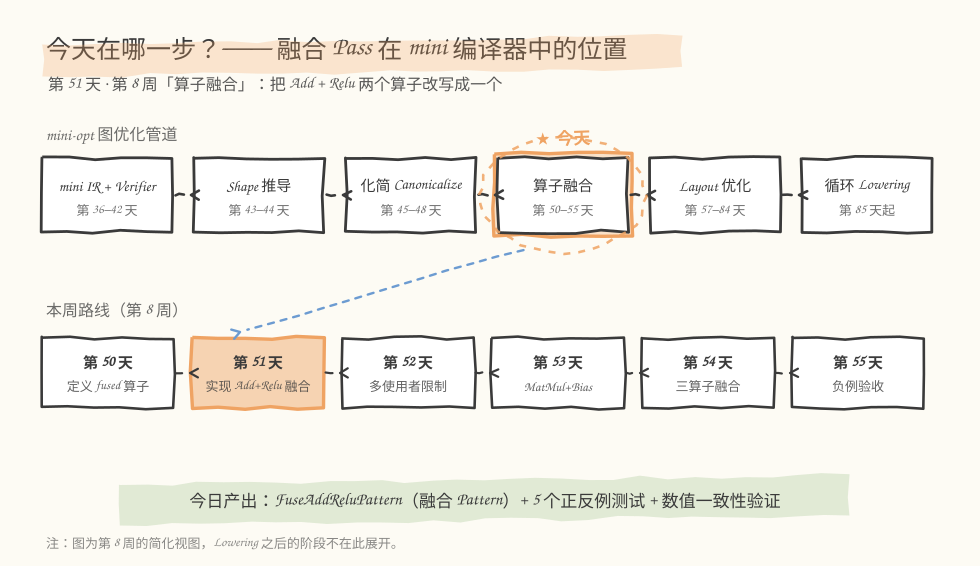
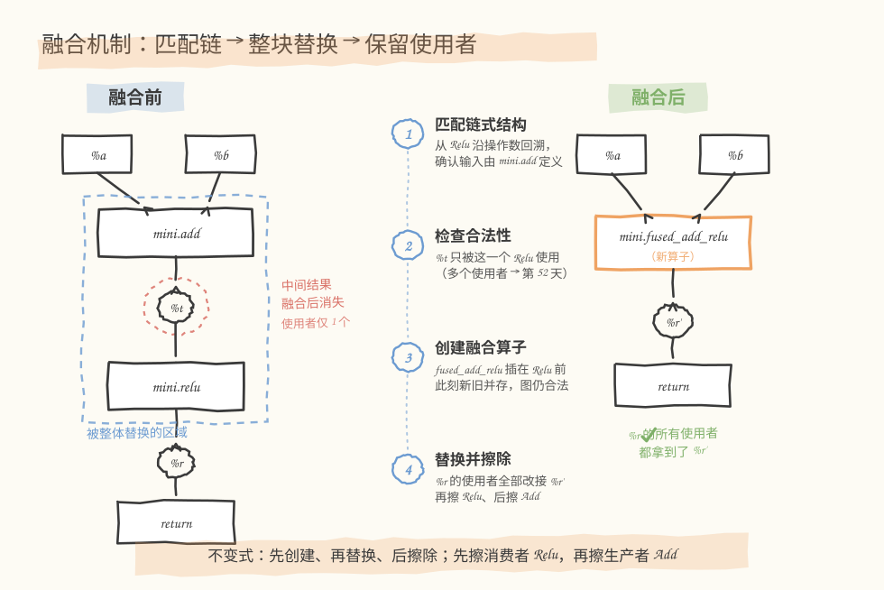
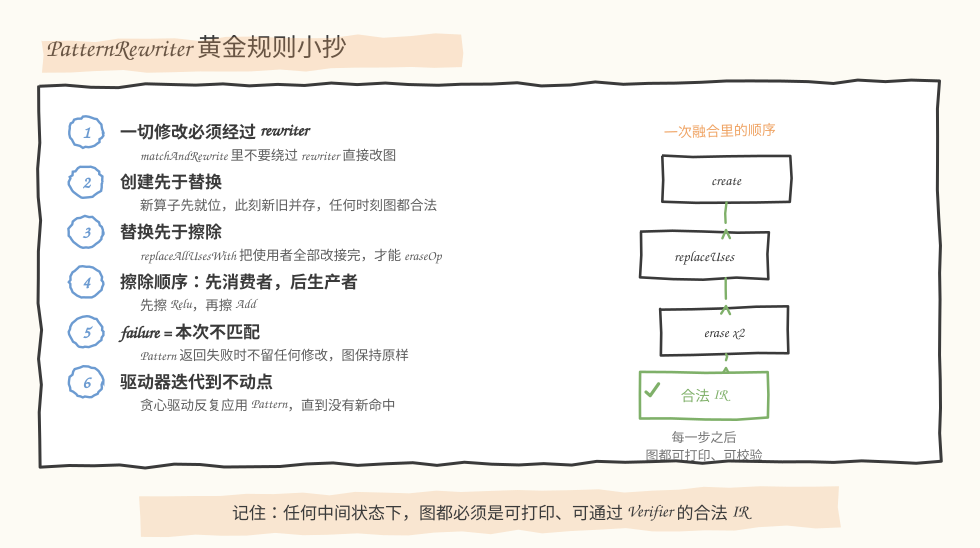
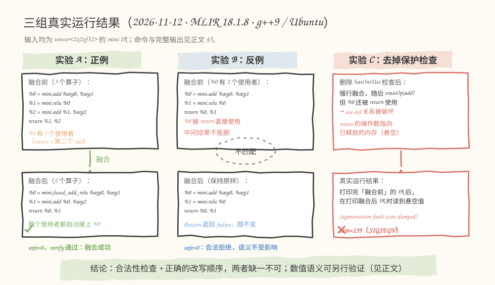

# 第 051 天：实现 Add＋Relu 融合——把一条链安全地替换成一个算子

> **今日目标**：能解释并写出「匹配链式结构 → 整块替换 → 保留原始结果使用者」的融合 Pattern；亲手跑通正例与反例，并亲眼看到擦除顺序写错会发生什么。
> **预计时间**：学习 40 分钟＋实践 60 分钟（选做另加 30 分钟）
> **前置准备**：
> - 第 50 天定义好的 `mini.fused_add_relu`（若你自己的工程不在手边，本文 §5.2 提供等价的最小 ODS 子集，可独立构建运行）
> - 回顾第 45 天：`matchAndRewrite` 中「返回 `failure` 表示本次不匹配，图保持原样」
> - 热身实验需要 Python 3 + numpy；正餐需要 C++17 编译器与 MLIR 18
> **今日产出**：`FuseAddReluPattern`（真实 MLIR C++ 版 + Python 教学版）、5 个基础测试、3 组真实运行记录

## 1. 今天解决什么问题？

先看一个具体的图。输入是两个 `2×2` 的 f32 张量：

```mlir
%t = mini.add %a, %b : tensor<2x2xf32>
%r = mini.relu %t : tensor<2x2xf32>
```

不融合时，`mini.add` 要把中间结果 `%t` 完整写回内存，`mini.relu` 再把它完整读出来一遍。融合成一个算子后：

```mlir
%f = mini.fused_add_relu %a, %b : tensor<2x2xf32>
```

`%t` 不再落盘，加法和激活在一次遍历里完成。省了多少字节的读写、什么时候真的更快，是第 71～72 天要定量计算的问题；今天要解决的是**改写机制本身的正确性**：

> 图不是一串代码，而是一张 use-def 网络（第 10 天引入的「谁定义这个值、谁在使用这个值」的两张关系表）。把两个算子换成一个新的，意味着要删两个节点、造一个新节点，还要保证**每一条引用都不断线**——`%r` 的所有下游必须都拿到新结果；`%t` 若还有别人在用，绝不能一删了之。

「把两个框变成一个框」画在纸上只需要 5 秒；难的是让改写过程中的**每一个中间状态**都是一张合法的、可打印、可校验的图。今天全程用上面这个 `2×2` 小例子贯穿：融合前后 `%r` 都应等于 `[[1.5, 0.0], [2.0, 0.0]]`（`a=[[1,-2],[3,-4]]`，`b=[[0.5,0.5],[-1,2]]`）。

## 2. 先看全貌：今天的内容位于哪里？



**图 1**：看两个位置——上排是 `mini-opt` 的图优化管道，融合 Pass 站在「化简」之后、Layout 优化之前；下排是第 8 周的路线，昨天（第 50 天）我们定义了融合算子本身，今天为它写**改写规则**，明天处理多使用者的边界。

整条链路可以概括成 5 步：

1. 前几天已经在 `mini` Dialect 上完成了算子定义与 Verifier（第 36～42 天）；
2. Shape 推导（第 43～44 天）保证每个结果的类型已知；
3. 化简（第 45～48 天）把 `Relu(Relu(x))` 这类冗余先清掉；
4. **今天：融合 Pattern 把 `Add + Relu` 链替换成 `fused_add_relu`**；
5. 之后的 Layout 优化与 Lowering（第 57 天起）面对的是融合后的、更精简的图。

也就是说，融合的输入是「一张化简过的合法 IR」，输出也必须是。

## 3. 核心概念：链、整块替换、保留使用者

### 3.1 链式结构：生产者与消费者

一句通俗的解释：融合找的是**首尾相接的一串算子**——上游（生产者，producer）的结果恰好是下游（消费者，consumer）的唯一输入。类比流水线：先把「称重」和「贴标签」两道工序合并成一个岗位，货不用在两个岗位之间来回放架子。对应到技术上是：**Relu 的操作数 `%t` 的定义算子（defining op）恰好是 `mini.add`，两者由一条 SSA 数据边相连**（SSA：每个值只被定义一次、随后只读，第 17 天的主题）。

这个类比覆盖不到的边界：它说的是「串行工序」，但技术上匹配的是**SSA 数据依赖**，而且我们还需要一个类比里没有的条件——这条边要「独占」：`%t` 只能被这个 Relu 使用。生产者一被删除，`%t` 就随之消失；若还有别的算子握着 `%t`，它们立刻全部悬空。这正是第 52 天的主题，今天先用一个**单使用者检查**保守地挡住这种情况。

**从哪一端开始匹配？** 第 45 天的 Pattern 以单个算子为根（`OpRewritePattern<ReluOp>`）。从消费者 Relu 出发，沿 `getX().getDefiningOp<AddOp>()` 回溯一步就能验证整条链；反过来以 Add 为根，则要遍历它的全部使用者、找出哪一个才是「紧跟其后的 Relu」，检查更多还容易漏。所以今天的匹配根是 `mini.relu`。

### 3.2 整块替换：不只是「删一个、加一个」

第 45 天的 `Relu(Relu(x)) → Relu(x)` 只动一个算子：新建（或不建）、改接、擦除，规模是 1。今天的替换对象是**一块区域**：`mini.add`、中间值 `%t`、`mini.relu` 三个成员一起消失，换成一个 `mini.fused_add_relu`。要点有两个：

- **操作数取自链条源头**：融合算子的输入是 `%a、%b`（即 Add 的操作数），而不是 `%t`——`%t` 是要被删除的东西，绝不能出现在新算子的输入里；
- **先创建、后替换、再擦除**：新算子插进图里的那一刻，新旧并存，图仍然合法；等 `%r` 的使用者全部改接之后，旧算子才变成「无人使用」，才能安全擦除。

### 3.3 保留原始结果使用者

`%r`（Relu 的结果）可能有不止一个下游：它可能同时被第二个算子引用、又作为函数返回值。替换时不许挑挑拣拣，必须 `replaceAllUsesWith(%r, %f)`——把 use 表里的每一项都改接到 `%f`。MLIR 里 `func.return` 本身就是一个普通算子，它对 `%r` 的使用同样登记在 use-def 表里，所以「图输出也是一种使用者」自动成立；第 45 天你还见过「反向遍历删除无使用者算子」，两张表就是同一套 use-def。

> **前置补给**：`PatternRewriter` 是 MLIR 规定的改写 API——在 `matchAndRewrite` 里你不能直接修改 IR，创建、替换、擦除都必须通过 `rewriter` 参数完成。驱动器（`applyPatternsAndFoldGreedily`，贪心 Greedy 驱动）会把图里的算子放进工作队列反复匹配，直到不再有新改动（不动点，fixpoint）为止。今天的 Pattern 幂等且方向单一，一轮内就能收敛。

## 4. 图解机制：四步走



**图 2**：左边是融合前的链（虚线框内是「被整体替换的区域」），右边是融合后的图，中间是 Pattern 的四个动作。注意红圈标注的 `%t`：它只在链内存在，融合后不复存在；而 `%r` 的所有使用者都改接到了 `%r'`。

按图中的编号逐步走查（对应 `code/mlir-mini/mini-fuse.cpp` 里的 Pattern）：

1. **匹配链**：`relu.getX().getDefiningOp<AddOp>()` 沿操作数回溯。拿不到 Add 就返回 `failure`，图保持原样——失败必须是无副作用的；
2. **检查合法性**：`t.hasOneUse()` 确认中间结果只被这个 Relu 用。不满足就返回 `failure`，这不是错误，而是「这块图不归我管」；
3. **创建融合算子**：`rewriter.setInsertionPoint(relu)` 后 `create<FusedAddReluOp>`。此刻新旧算子并存，use-def 完整，图仍然合法——这一步是「任何时刻图都可打印、可校验」的关键；
4. **替换并按序擦除**：`replaceAllUsesWith(relu.getResult(), fused.getResult())` 把 `%r` 的使用者全部改接；然后**先擦消费者 Relu，再擦生产者 Add**。顺序反过来，擦 Add 时 `%t` 还有使用者，等于把别人正握着的东西销毁了。



**图 4**：把顺序约束整理成一张小抄。右下角的涂鸦是检验标准：走完每一步后停下来打印、校验，图都必须是合法 IR。§6 的两个真实崩溃，全都来自违反这张小抄。

## 5. 动手实践：从 180 行 Python 到真实 MLIR

本日代码结构如下（均为可直接运行的完整文件）：

```text
tutorials/day-051/
├── README.md                    ← 本教程
├── images/                      ← 4 张手绘信息图（SVG）
└── code/
    ├── mini_fuse.py             ← 热身：迷你图 IR + Rewriter + 融合 Pattern（180 行）
    ├── test_fusion.py           ← 5 个基础测试
    └── mlir-mini/               ← 正餐：真实 MLIR 里的同款 Pattern
        ├── MiniOps.td           ← ODS：三个算子的定义（第 50 天成果的最小子集）
        ├── MiniDialect.h/.cpp   ← Dialect 壳（手工 + TableGen 生成代码）
        ├── mini-fuse.cpp        ← 融合 Pattern + 命令行驱动
        ├── CMakeLists.txt
        └── inputs/              ← add_relu / shared_result / multi_user_add / add_relu_linalg
```

以下所有命令与输出均为 **2026-11-12 在本环境真实执行**的结果。环境：Linux aarch64，g++ 9.4.0，Ubuntu LLVM 18.1.8（含 `mlir-opt`、`mlir-tblgen`），Python 3.11.4，numpy 1.26.4。

### 5.1 热身（15 分钟）：用 Python 复刻机制并做数值验证

先不碰 MLIR，把机制本身写清楚。`code/mini_fuse.py` 的核心是三件事：带 use-def 的迷你 IR、把一切修改收口的 `Rewriter`（含完整性检查，违反顺序会当场报错）、以及和 C++ 版步骤一一对应的 Pattern：

```python
class Rewriter:
    """对图的一切修改都必须通过 Rewriter，修改前后维护 use-def 完整性。"""

    def create(self, name, inputs, insert_before=None, result_name=None):
        result_name = result_name or f"%f{len(self.graph.ops)}"
        op = self.graph.create_op(name, inputs, result_name)
        if insert_before is not None:               # 对应 setInsertionPoint
            self.graph.ops.remove(op)
            self.graph.ops.insert(self.graph.ops.index(insert_before), op)
        return op

    def replace_all_uses_with(self, old, new):
        for user, idx in old.uses:                  # return 算子也是普通使用者
            user.inputs[idx] = new
            new.uses.append((user, idx))
        old.uses = []

    def erase(self, op):
        # 擦除前必须保证结果已无任何使用者，否则使用者会得到悬空引用
        if op.result is not None and op.result.uses:
            raise RuntimeError(
                f"不能擦除 {op.name}：结果 {op.result.name} "
                f"仍有 {len(op.result.uses)} 处使用者")
        for i, v in enumerate(op.inputs):
            v.uses = [u for u in v.uses if u[0] is not op]
        self.graph.ops.remove(op)


def fuse_add_relu_pattern(relu, rw):
    """匹配 mini.relu，若其输入由 mini.add 定义且中间结果单使用者，则融合。"""
    t = relu.inputs[0]
    add = t.def_op
    if add is None or add.name != "mini.add":   # 不是 Add -> Relu 链
        return False
    if not t.has_one_use():                     # 多使用者：第 52 天再处理
        return False

    fused = rw.create("mini.fused_add_relu", add.inputs,
                      insert_before=relu, result_name=relu.result.name + "'")
    rw.replace_all_uses_with(relu.result, fused.result)
    rw.erase(relu)      # 先擦消费者
    rw.erase(add)       # 再擦生产者
    return True
```

注意 `fuse_add_relu_pattern` 与图 2 的四步严格对应：回溯匹配 → 单使用者检查 → 创建 → 替换后按序擦除。文件完整版还带 numpy 数值语义（`mini.fused_add_relu` 即 `maximum(a+b, 0)`），用来验证融合不改语义。运行：

```bash
cd tutorials/day-051/code
python3 mini_fuse.py
```

真实输出：

```text
===== 融合前 IR =====
func @demo(%a: tensor<2x2xf32>, %b: tensor<2x2xf32>) -> (tensor<2x2xf32>) {
  %t = mini.add %a, %b : tensor<2x2xf32>
  %r = mini.relu %t : tensor<2x2xf32>
  return %r
}
融合前 %r = [[1.5, 0.0], [2.0, 0.0]]

===== 融合后 IR =====
func @demo(%a: tensor<2x2xf32>, %b: tensor<2x2xf32>) -> (tensor<2x2xf32>) {
  %r' = mini.fused_add_relu %a, %b : tensor<2x2xf32>
  return %r'
}
融合后 %r' = [[1.5, 0.0], [2.0, 0.0]]

数值验证通过：融合前后结果完全一致。
```

再跑基础测试（覆盖正例、双使用者改接、反例拒绝、错误顺序、非法链不匹配）：

```bash
python3 test_fusion.py
```

真实输出：

```text
test_basic_fusion        通过：2 个算子融合成 1 个，数值一致
test_shared_relu_result  通过：%r 的两个使用者都被正确改接
test_multi_user_add      通过：中间结果多使用者，Pattern 拒绝融合
test_wrong_erase_order   通过：错误擦除顺序被 Rewriter 拒绝，异常信息 = 不能擦除 mini.add：结果 %t 仍有 1 处使用者
test_illegal_chain       通过：Relu(Relu(x)) 不匹配，图保持原样

全部 5 个测试通过。
```

### 5.2 正餐（40 分钟）：真实 MLIR 里的 FuseAddReluPattern

现在把同样的 Pattern 写进真实 MLIR。第一步用 ODS（Operation Definition Specification，第 37 天开始用的算子定义语言）声明三个算子——这就是第 50 天成果的最小复刻，`MiniOps.td`：

```tablegen
include "mlir/IR/OpBase.td"
include "mlir/Interfaces/InferTypeOpInterface.td"

def Mini_Dialect : Dialect {
  let name = "mini";
  let cppNamespace = "::mini";
}

class MiniOp<string mnemonic, list<Trait> traits = []> :
    Op<Mini_Dialect, mnemonic, traits>;

def Mini_AddOp : MiniOp<"add", [SameOperandsAndResultType]> {
  let arguments = (ins AnyType:$lhs, AnyType:$rhs);
  let results = (outs AnyType:$result);
  let assemblyFormat = "$lhs `,` $rhs attr-dict `:` type($lhs)";
}

def Mini_ReluOp : MiniOp<"relu", [SameOperandsAndResultType]> {
  let arguments = (ins AnyType:$x);
  let results = (outs AnyType:$result);
  let assemblyFormat = "$x attr-dict `:` type($x)";
}

def Mini_FusedAddReluOp : MiniOp<"fused_add_relu", [SameOperandsAndResultType]> {
  let arguments = (ins AnyType:$lhs, AnyType:$rhs);
  let results = (outs AnyType:$result);
  let assemblyFormat = "$lhs `,` $rhs attr-dict `:` type($lhs)";
}
```

解析/打印格式由 `assemblyFormat` 全自动生成，Verifier 由 `SameOperandsAndResultType` trait（操作数与结果类型必须一致）承担——真实工程里你会加更多约束，见第 39 天。Dialect 壳很短，完整内容在 `code/mlir-mini/MiniDialect.h` 与 `MiniDialect.cpp`，关键点是要先打开 `GET_OP_CLASSES` 开关再 include 生成的声明文件（原因见 §6 错误 3）。

真正的主角是 `mini-fuse.cpp` 里的 Pattern，与图 2 四步逐行对应：

```cpp
struct FuseAddReluPattern : OpRewritePattern<mini::ReluOp> {
  using OpRewritePattern<mini::ReluOp>::OpRewritePattern;

  LogicalResult matchAndRewrite(mini::ReluOp relu,
                                PatternRewriter &rewriter) const override {
    // (1) 沿操作数回溯：Relu 的输入必须由 mini.add 定义，才是 Add -> Relu 链
    Value t = relu.getX();
    auto add = t.getDefiningOp<mini::AddOp>();
    if (!add)
      return failure();

    // (2) 合法性前提：中间结果 %t 只被这一个 Relu 使用。
    //     有多个使用者时直接删除 Add 会破坏别人的输入，处理策略留到第 52 天。
    if (!t.hasOneUse())
      return failure();

    // (3) 在被匹配的 Relu 之前创建融合算子；此刻新旧算子并存，图仍然合法
    rewriter.setInsertionPoint(relu);
    auto fused = rewriter.create<mini::FusedAddReluOp>(
        relu.getLoc(), t.getType(), add.getLhs(), add.getRhs());

    // (4) %r 的全部使用者改接 %f，然后先擦消费者 Relu、再擦生产者 Add
    rewriter.replaceAllUsesWith(relu.getResult(), fused.getResult());
    rewriter.eraseOp(relu);
    rewriter.eraseOp(add);
    return success();
  }
};
```

`main()` 的流程是：注册 `mini` 和 `func` 两个 Dialect → 解析输入文件 → 打印融合前 IR → `applyPatternsAndFoldGreedily(fn, frozen)`（贪心驱动，对每个函数迭代应用到不动点）→ 校验 → 打印融合后 IR。完整源码见 `code/mlir-mini/mini-fuse.cpp`（其中还包含一个 `--broken` 开关，用来故意复现 §5.4 的两种错误写法）。

构建并运行（路径按你的 MLIR 安装调整 `MLIR_DIR`）：

```bash
cd tutorials/day-051/code/mlir-mini
cmake -G Ninja -B build -DCMAKE_CXX_COMPILER=g++ \
      -DMLIR_DIR=/usr/lib/llvm-18/lib/cmake/mlir -DCMAKE_BUILD_TYPE=Release
ninja -C build
./build/mini-fuse inputs/add_relu.mlir
```

真实输出（构建约 1～2 分钟，产物 `build/mini-fuse` 约 6.8 MB）：

```text
===== 融合前 =====
module {
  func.func @graph(%arg0: tensor<2x2xf32>, %arg1: tensor<2x2xf32>) -> tensor<2x2xf32> {
    %0 = mini.add %arg0, %arg1 : tensor<2x2xf32>
    %1 = mini.relu %0 : tensor<2x2xf32>
    return %1 : tensor<2x2xf32>
  }
}

===== 融合后 =====
module {
  func.func @graph(%arg0: tensor<2x2xf32>, %arg1: tensor<2x2xf32>) -> tensor<2x2xf32> {
    %0 = mini.fused_add_relu %arg0, %arg1 : tensor<2x2xf32>
    return %0 : tensor<2x2xf32>
  }
}
```

### 5.3 正例与反例：使用者数量的两种情形



**图 3**：三组结果全部来自真实运行。左列回答「`%r` 被多处使用还能融合吗」，中列回答「`%t` 被多处使用还能融合吗」，右列是本日最重要的对照组。逐一看真实输出。

**实验 A——`%r` 有两个使用者**（`inputs/shared_result.mlir`：`%r` 同时被第二个 `mini.add` 使用并作为返回值之一）：

```text
===== 融合后 =====
module {
  func.func @graph_shared(%arg0: tensor<2x2xf32>, %arg1: tensor<2x2xf32>, %arg2: tensor<2x2xf32>) -> (tensor<2x2xf32>, tensor<2x2xf32>) {
    %0 = mini.fused_add_relu %arg0, %arg1 : tensor<2x2xf32>
    %1 = mini.add %0, %arg2 : tensor<2x2xf32>
    return %0, %1 : tensor<2x2xf32>, tensor<2x2xf32>
  }
}
```

`%r` 原来的两个使用者——`return` 和第二个 `mini.add`——都被自动改接到 `%0`。这正是「保留原始结果使用者」的含义：`replaceAllUsesWith` 不挑使用者，全部改接，`exit=0` 且校验通过。

**实验 B——`%t` 有两个使用者**（`inputs/multi_user_add.mlir`：`%t` 同时被 `return` 使用）。真实输出是**融合前后 IR 完全相同**（原样打印 `%0 = mini.add`、`%1 = mini.relu` 两行，不再重复），`exit=0`。`hasOneUse()` 检查拒绝了匹配：删掉 Add 会破坏 `return` 对 `%t` 的使用。拒绝不是失败——图语义分毫未动。完整策略（保留中间节点还是复制计算）明天展开。

### 5.4 修改一个参数再观察：把保护拿掉会发生什么

对照实验：同一个工具、同一个反例输入，只是把 Pattern 写错。**实验 C**——去掉单使用者检查（`--broken=no-guard`）后作用于 `multi_user_add.mlir`：

```text
$ stdbuf -o0 ./build/mini-fuse inputs/multi_user_add.mlir --broken=no-guard
===== 融合前 =====
module {
  func.func @graph_multi(%arg0: tensor<2x2xf32>, %arg1: tensor<2x2xf32>) -> (tensor<2x2xf32>, tensor<2x2xf32>) {
    %0 = mini.add %arg0, %arg1 : tensor<2x2xf32>
    %1 = mini.relu %0 : tensor<2x2xf32>
    return %0, %1 : tensor<2x2xf32>, tensor<2x2xf32>
  }
}
Segmentation fault (core dumped)
$ echo $?
139
```

崩溃机制值得逐句读：Pattern 在 `%0` 仍被 `return` 使用时执行了 `eraseOp(add)`，Add 被销毁，`return` 的操作数变成悬空指针；IR 本身看起来还是那几个节点，但一条边指向了已释放的内存。等到最后打印模块时，读取 `return` 的操作数触发 `SIGSEGV`（信号 11，退出码 139）。**真正的错误在 Pattern 里，崩溃却在打印处**——这是图形改写类 bug 最典型的迷惑性，第 136 天的 Pass 二分定位会成为系统性的排查手段。

**实验 D——擦除顺序颠倒**（`--broken=erase-order`，作用于 `add_relu.mlir`）更阴险：先 `eraseOp(add)` 再 `replaceAllUsesWith(...)`。真实运行结果：**输出看起来正确、`exit=0`**。但这只是侥幸——Add 被销毁时 Relu 的操作数已经悬空，后续擦除 Relu 时对 use 计数的修改写进了已释放的内存，是未定义行为（UB）。同一份代码换个输入、换个构建（比如打开断言的调试构建）就可能当场崩溃。所以不能拿「跑通了」当正确性证据；Python 版的 `Rewriter.erase` 把这个检查做成显式异常（见 §5.1 的测试输出），就是为了把 UB 变成确定性报错。

**生产级对照**：上游 MLIR 自带同思想的元素级融合。用 `arith.addf`（加）和 `arith.maximumf`（即 max(x,0)，relu 的等价写法）搭一条链，先转成 `linalg.generic`，再融合：

```bash
/usr/lib/llvm-18/bin/mlir-opt inputs/add_relu_linalg.mlir \
    --convert-elementwise-to-linalg --linalg-fuse-elementwise-ops
```

真实输出（已保留原样）：

```text
%1 = linalg.generic {indexing_maps = [#map, #map, #map], iterator_types = ["parallel", "parallel"]} ins(%arg0, %arg1 : tensor<2x2xf32>, tensor<2x2xf32>) outs(%0 : tensor<2x2xf32>) {
^bb0(%in: f32, %in_0: f32, %out: f32):
  %2 = arith.addf %in, %in_0 : f32
  %3 = arith.maximumf %2, %cst : f32
  linalg.yield %3 : f32
} -> tensor<2x2xf32>
```

两个独立的 `linalg.generic`（各自一次遍历）被合并成了一个，循环体里先 `addf` 再 `maximumf`——和我们手写的 `mini.fused_add_relu` 是同一个思想：生产者-消费者链合并成一次遍历，中间张量不再物化。输入文件 `inputs/add_relu_linalg.mlir` 的内容就是 `%t = arith.addf %a, %b` 与 `%r = arith.maximumf %t, %zero` 两行加上返回。

## 6. 常见错误与排查

**错误 1：擦除顺序颠倒（消费者还没擦就擦生产者）**
- **现象**：Python 版当场抛 `RuntimeError: 不能擦除 mini.add：结果 %t 仍有 1 处使用者`（§5.1 测试）；C++ 版（`--broken=erase-order`）表面正常但已构成 use-after-free。
- **原因**：`erase` 销毁的是 `%t` 的存储；Relu 的操作数仍指向它。
- **定位**：Python 版靠 Rewriter 的完整性检查直接点名坏算子；C++ 版打印崩溃栈通常出现在无关代码处，要回头审查 Pattern 里所有 `eraseOp` 的前置条件。
- **修复**：顺序固定为 `replaceAllUsesWith → eraseOp(消费者) → eraseOp(生产者)`，即图 4 小抄的第 3、4 条。

**错误 2：忘记单使用者检查**
- **现象**：`Segmentation fault (core dumped)`，退出码 139，崩溃点在打印/校验阶段（§5.4 实验 C）。
- **原因**：`%t` 的其他使用者（如 `return`）在 Add 被擦除后持悬空指针。
- **定位**：凡是 `eraseOp` 的对象都可能出事；先怀疑一切「删除生产者」的 Pattern。
- **修复**：匹配阶段加 `if (!t.hasOneUse()) return failure();`。多使用者时怎么办是第 52 天的正题。

**错误 3：TableGen 生成代码「找不到算子类」（本日真实踩坑）**
- **现象**：编译报 `'ReluOp' is not a member of 'mini'`，错误却指向自己的代码而不是生成文件。
- **原因**：`mlir-tblgen -gen-op-decls` 生成的头文件把类定义包在 `#ifdef GET_OP_CLASSES` 里，直接 include 得到的几乎只有空壳。
- **定位**：打开 `build/gen/MiniOps.h.inc` 一眼可见 `#ifdef GET_OP_CLASSES`。
- **修复**：在 include 之前 `#define GET_OP_CLASSES`（见 `MiniDialect.h` / `MiniDialect.cpp`），`.h.inc` 与 `.cpp.inc` 都要。

**错误 4：绕过 rewriter 直接修改 IR**
- **现象**：在 `matchAndRewrite` 里直接 `op->erase()` 或直接改操作数，驱动器的工作队列与实际 IR 脱节，出现重复访问已删算子、改动「看不见」等诡异现象。
- **原因**：贪心驱动靠 `PatternRewriter` 的回调（listener）维护工作队列；绕过它等于改图不报备。
- **定位**：审 Pattern 时只问一句「有没有不经过 `rewriter.` 前缀的修改」。
- **修复**：创建、替换、擦除、插入点全部改走 `rewriter` API。

## 7. 今日练习

### 必做练习：嵌套链的两轮融合

自己构造一个新输入 `chain.mlir`（参考 `inputs/add_relu.mlir` 的写法）：

```mlir
%t  = mini.add %a, %b  : tensor<2x2xf32>
%r1 = mini.relu %t     : tensor<2x2xf32>
%s  = mini.add %r1, %c : tensor<2x2xf32>
%r2 = mini.relu %s     : tensor<2x2xf32>
func.return %r2
```

先**在纸上写出你预测的融合后 IR**（提示：`%r1` 有几个使用者？`%s` 呢？两处 `Add+Relu` 都该融合，想想贪心驱动几轮能收敛），再运行 `./build/mini-fuse chain.mlir` 或用 Python 版 `run_fusion` 验证。若预测与输出不一致，回到图 2 逐边核对 use-def。

### 选做挑战：给 Python 版增加 Mul＋Relu 融合

在 `mini_fuse.py` 中新增 `mini.mul` 与 `mini.fused_mul_relu` 的数值语义（`maximum(a*b, 0)`），再仿照 `fuse_add_relu_pattern` 写一个 `fuse_mul_relu_pattern`，并补一个正例测试。不许改动 `Rewriter`——机制应当对新算子零改动，这也是对第 14 天「新增算子的成本由哪些设计决定」的回应。

## 8. 今日验收

- [ ] 我能不看资料说出四步顺序：创建 → `replaceAllUsesWith` → 擦 Relu → 擦 Add，并解释为什么消费者先于生产者；
- [ ] 我能独立运行 `python3 mini_fuse.py`、`python3 test_fusion.py`，并说出 5 个测试分别守护哪条性质；
- [ ] 我能构建并运行 `mini-fuse`，让 `add_relu.mlir` 融合、`multi_user_add.mlir` 保持原样，两者 `verify` 都通过；
- [ ] 我能亲手复现 `--broken=no-guard` 的 `exit=139`，并讲清「错误发生在 Pattern、崩溃发生在打印」的原因；
- [ ] 我保存了今日的代码、测试和运行记录，能回答「为什么说 Pattern 失败必须无副作用」。

## 9. 一句话总结与明天预告

今天我们把「把两个算子合成一个」从一个纸面想法落成了可运行的机制：从消费者 Relu 出发回溯匹配 `Add → Relu` 链，用单使用者检查守住中间结果的独占性，再按「创建、替换、擦除」的固定顺序完成整块替换；两个故意写错的版本分别给出了「侥幸通过但已 UB」与「打印时段错误」的真实对照，Python 版的数值验证则确认了语义不变。至此融合的**机制**已经清楚，但它还只覆盖了最干净的情形：当中间结果被多个下游使用时，「删除生产者」就不再合法——是拒绝融合、保留中间节点，还是复制计算？这正是第 52 天「融合的多使用者限制」要解决的问题。
